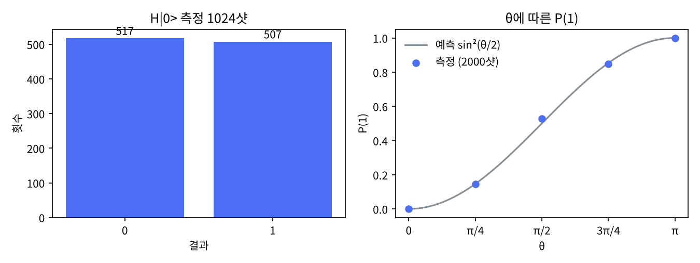

# 1장 큐비트와 상태벡터

2026-10-26 · Gosh

양자컴퓨팅 입문·심화서 · 1부 게이트와 회로 · 이 장을 마치면 중첩·측정·Bloch 구를 numpy로 재현할 수 있다.

## 1. 요약

큐비트 하나는 복소수 두 개(α, β)로 완전히 기술되고, 우리가 볼 수 있는 것은 그 제곱 크기 |α|²·|β|²뿐이다. 이 장은 그 두 숫자를 numpy 배열로 직접 만들고, 측정을 난수 추출로 흉내 내고, 결과가 수식의 예측과 맞는지 확인한다. 끝에서는 H 게이트를 두 번 걸면 확률 비트와 달리 원래 상태로 정확히 되돌아오는 것을 보고, "큐비트 = 확률이 붙은 비트"라는 직관이 왜 틀리는지 짚는다.

이 장에서 쓰는 도구는 numpy와 Quirk뿐이다. Qiskit·QuTiP 코드는 같은 결과를 SDK로 재현하는 대조용으로만 나온다.

## 2. 직관 먼저 — Quirk에서 손으로 돌려 보기

아래 링크를 열면 큐비트 한 줄에 H 게이트와 Bloch 구 표시가 놓여 있다. H를 드래그해 빼고 넣으면서 구 위의 화살표가 북극(|0⟩)과 적도 사이를 오가는 것을 본다. 오른쪽 끝의 확률 막대가 0 %/100 %에서 50 %/50 %로 바뀐다.

- [Quirk: H 게이트 하나와 Bloch 구](https://algassert.com/quirk#circuit={"cols":[["H"],["Bloch"]]})
- 같은 회로에 측정을 붙인 것: [Quirk: H → 측정](https://algassert.com/quirk#circuit={"cols":[["H"],["Measure"]]})

해 볼 것 세 가지. (1) H를 두 개 연달아 놓으면 화살표가 북극으로 돌아온다. (2) 툴박스의 `Y^¼`·`Z^½` 같은 회전 게이트를 넣어 화살표를 적도 위에서 돌려 본다. (3) 어떤 회전을 해도 확률 막대가 바뀌지 않는 경우가 있다는 것을 찾는다 — Z축 회전이다. 이 셋이 이 장의 수식 세 개(Born 규칙·Bloch 각·전역/상대 위상)에 각각 대응한다.

Quirk는 설치가 없고 상태를 항상 보여 주므로 1·2부에서는 모든 회로를 먼저 여기서 돌린다.

## 3. 정의와 수식

**상태벡터.** 큐비트의 상태는 2차원 복소 벡터이고, 길이가 1이다. 계산 기저 |0⟩ = (1, 0)ᵀ, |1⟩ = (0, 1)ᵀ로 쓰면 임의의 상태는 다음과 같다.

```latex
|\psi\rangle = \alpha|0\rangle + \beta|1\rangle = \begin{pmatrix}\alpha\\ \beta\end{pmatrix},\qquad |\alpha|^2 + |\beta|^2 = 1
```

비유: 2차원 평면의 단위 화살표. 다만 성분이 실수가 아니라 복소수이므로 "방향"이 실제로는 4개의 실수 자유도에서 정규화와 전역 위상을 뺀 2개로 줄어든다. 비유가 깨지는 곳: 평면 화살표는 두 개를 더하면 더 긴 화살표가 되지만, 상태벡터의 덧셈(중첩)은 다시 정규화해야 하고, 위상 때문에 서로 상쇄될 수 있다.

**Born 규칙.** 계산 기저로 측정하면 결과 0이 나올 확률은 |α|², 1이 나올 확률은 |β|²이다. 측정 뒤 상태는 결과에 해당하는 기저로 바뀐다.

```latex
P(0) = |\alpha|^2,\quad P(1) = |\beta|^2,\quad |\psi\rangle \xrightarrow{\text{결과 } k} |k\rangle
```

**Bloch 구.** 전역 위상을 무시하면 모든 큐비트 상태는 두 각 θ∈\[0, π\], φ∈\[0, 2π)로 쓸 수 있고, 단위 구 위의 점 (sin θ cos φ, sin θ sin φ, cos θ)에 대응한다.

```latex
|\psi\rangle = \cos\tfrac{\theta}{2}|0\rangle + e^{i\varphi}\sin\tfrac{\theta}{2}|1\rangle,\qquad \vec r = (\langle X\rangle, \langle Y\rangle, \langle Z\rangle)
```

북극이 |0⟩, 남극이 |1⟩, 적도의 x축 방향이 |+⟩, y축 방향이 |+i⟩이다. θ/2가 붙는 이유는 |0⟩과 |1⟩이 벡터로는 직교(90°)인데 구 위에서는 정반대(180°)에 놓이기 때문이다.

**전역 위상과 상대 위상.** e^{iγ}|ψ⟩는 |ψ⟩와 물리적으로 같은 상태다. 어떤 측정으로도 구별되지 않는다. 반면 α와 β 사이의 상대 위상 φ는 Bloch 구의 경도이고, 기저를 바꿔 측정하면(2장의 H 게이트) 확률로 드러난다.

**교과서 비교.** N&C는 1.2절에서 큐비트를 추상적 2차원 상태로 바로 도입하고 Bloch 구를 그림으로 붙인 뒤, 2.1\~2.2절에서 선형대수와 양자역학 공준을 정리한다. KLM은 2장 전체를 선형대수와 Dirac 표기에 쓰고 3장에서 큐비트와 상태 공간·시간 진화·측정 공준을 순서대로 세운다. 이 책의 1장은 KLM의 순서(선형대수 → 공준)를 따르되 분량은 N&C 1.2절 수준으로 줄였고, 표기는 N&C를 따른다.

## 4. 회로 구성 — numpy로 직접, 그다음 Qiskit으로

"회로"라고 해도 이 장에서는 큐비트 하나를 준비하고 측정하는 것이 전부다. 중첩을 만들려면 게이트가 하나 필요하므로 2장의 H 게이트를 "50:50 중첩을 만드는 버튼"으로만 빌려 쓴다. H의 행렬은 아래와 같고, 왜 이 모양인지는 2장에서 다룬다.

```latex
H = \frac{1}{\sqrt 2}\begin{pmatrix}1 & 1\\ 1 & -1\end{pmatrix},\qquad H|0\rangle = \frac{|0\rangle + |1\rangle}{\sqrt 2} = |+\rangle
```

**numpy 구현(실행 완료).** 전체 스크립트는 `ch01_qubit_statevector.py`이고, 핵심은 세 함수다. 상태는 배열, 게이트는 행렬 곱, 측정은 Born 확률로 난수를 뽑는 것이다.

```python
import numpy as np
rng = np.random.default_rng(seed=7)

ket0 = np.array([1, 0], dtype=complex)
H = np.array([[1, 1], [1, -1]], dtype=complex) / np.sqrt(2)
X = np.array([[0, 1], [1, 0]], dtype=complex)
Y = np.array([[0, -1j], [1j, 0]], dtype=complex)
Z = np.array([[1, 0], [0, -1]], dtype=complex)

def probs(psi):                      # Born 규칙
    return np.abs(psi) ** 2

def sample(psi, shots):              # 측정을 난수 추출로 흉내
    out = rng.choice([0, 1], size=shots, p=probs(psi))
    return {"0": int((out == 0).sum()), "1": int((out == 1).sum())}

def bloch(psi):                      # (<X>, <Y>, <Z>)
    return np.array([np.vdot(psi, P @ psi).real for P in (X, Y, Z)])

plus = H @ ket0
print(probs(plus), sample(plus, 1024), bloch(plus))
```

**Qiskit 구현(작성됨, 미실행).** 같은 일을 SDK로 하면 상태는 `Statevector`, 측정은 `StatevectorSampler`가 맡는다. 이 세션의 실행 환경에서는 패키지 설치가 막혀 출력을 붙이지 못했다. 다음 세션에서 실행해 출력과 히스토그램을 이 자리에 넣는다(작업계획서 §7 메모 참조).

```python
# qiskit==2.5.x — 작성됨, 미실행
from qiskit import QuantumCircuit
from qiskit.quantum_info import Statevector
from qiskit.primitives import StatevectorSampler

qc = QuantumCircuit(1)
qc.h(0)
print(Statevector(qc))                 # [0.7071, 0.7071]

qc_meas = qc.copy()
qc_meas.measure_all()                  # 고전 레지스터 "meas" 생성
sampler = StatevectorSampler(seed=7)
job = sampler.run([qc_meas], shots=1024)
counts = job.result()[0].data.meas.get_counts()
print(counts)                          # 예: {'0': 5xx, '1': 5xx}
```

두 구현의 대응: `H @ ket0` ↔ `qc.h(0)` + `Statevector(qc)`, `sample(...)` ↔ `StatevectorSampler.run(...)`, `bloch(...)` ↔ `Statevector.expectation_value(Pauli)`. 1장에서 numpy 쪽을 먼저 보이는 이유는, 이후 모든 SDK가 결국 이 세 줄(배열·행렬 곱·난수 추출)을 포장한 것임을 몸으로 알기 위해서다.

## 5. 시뮬레이션 결과

모든 수치는 `ch01_qubit_statevector.py`를 `seed=7`로 실행한 출력이다. 측정값은 샷 수의 통계 오차(1024샷에서 약 ±1.6 %p) 안에서 예측과 일치한다.

**중첩 상태의 측정.** |+⟩ = H|0⟩를 1024샷 측정한 결과는 0이 517회, 1이 507회였다. 예측은 각각 512회다. 상태벡터 자체는 (0.7071, 0.7071)로 출력됐고 정규화 검사는 True였다.

**Bloch 좌표.** `bloch()`가 돌려준 (⟨X⟩, ⟨Y⟩, ⟨Z⟩)는 수식의 예측과 정확히 같다.

| 상태 | ⟨X⟩ | ⟨Y⟩ | ⟨Z⟩ | 구 위의 위치 |
| --- | --- | --- | --- | --- |
| \|0⟩ | 0 | 0 | 1 | 북극 |
| \|1⟩ | 0 | 0 | −1 | 남극 |
| \|+⟩ | 1 | 0 | 0 | 적도, x축 |
| \|+i⟩ | 0 | 1 | 0 | 적도, y축 |

**각도 θ에 따른 P(1).** 상태 cos(θ/2)|0⟩ + sin(θ/2)|1⟩을 θ = 0, π/4, π/2, 3π/4, π에서 2000샷씩 측정했다. 예측은 sin²(θ/2)이다.

| θ | 예측 P(1) | 측정 P(1) (2000샷) | 차이 |
| --- | --- | --- | --- |
| 0 | 0.0000 | 0.0000 | 0.0000 |
| π/4 | 0.1464 | 0.1450 | −0.0014 |
| π/2 | 0.5000 | 0.5270 | +0.0270 |
| 3π/4 | 0.8536 | 0.8465 | −0.0071 |
| π | 1.0000 | 1.0000 | 0.0000 |

π/2에서의 +0.027은 2000샷의 표준오차 √(0.25/2000) ≈ 0.011의 약 2.4배로, 우연히 큰 편이지만 이상치는 아니다. 샷을 늘리면 줄어든다(연습문제 2). 히스토그램과 θ-곡선 그림은 `ch01_results.png`(내보낸 html에도 포함)에 있다.



## 6. 다른 SDK 대응 — QuTiP으로 같은 상태 보기

이 장에서 QuTiP을 고른 이유는 하나다. Qiskit이 상태를 "회로의 출력"으로 보는 반면 QuTiP은 상태를 "물리계의 벡터"로 보므로, 기대값·밀도행렬·Bloch 구가 1급 객체로 바로 나온다. 7장(물리층)과 25장(노이즈)에서 이 관점이 필요하다.

```python
# qutip==5.2.x — 작성됨, 미실행
import numpy as np
from qutip import basis, sigmax, sigmay, sigmaz, expect, ket2dm, Bloch

ket0 = basis(2, 0)
plus = (basis(2, 0) + basis(2, 1)).unit()        # .unit()이 정규화
print(plus)                                         # Qobj 벡터 출력
print([expect(P, plus) for P in (sigmax(), sigmay(), sigmaz())])  # [1, 0, 0]

rho = ket2dm(plus)                                  # 밀도행렬 |+><+|
print(rho)

b = Bloch()
b.add_states([ket0, plus])
b.save("ch01_bloch.png")
```

numpy 구현과 비교하면 `bloch()` 함수가 `expect()` 한 줄로, Bloch 구 그림이 `Bloch()` 객체로 대체된다. 대신 QuTiP에는 "샷 측정" 개념이 없다. 측정 통계가 필요하면 확률을 직접 뽑아야 하고, 그 일은 Qiskit의 Sampler가 더 자연스럽다. 이것이 두 도구의 역할 분담이다.

## 7. 한계와 반례 — 큐비트는 확률 비트가 아니다

가장 흔한 오해는 "큐비트는 0일 확률 p, 1일 확률 1−p를 가진 비트"라는 것이다. 이 모델로는 H|0⟩의 50:50을 설명할 수 있지만, H를 한 번 더 걸었을 때를 설명하지 못한다.

**실험.** `H @ (H @ ket0)`를 계산하면 상태벡터는 정확히 (1, 0)이고, 1024샷 측정 결과는 0이 1024회, 1이 0회였다. 고전 동전이라면 "50:50 동전을 한 번 더 섞은 것"이므로 여전히 50:50이어야 한다.

```latex
HH|0\rangle = H\,\frac{|0\rangle+|1\rangle}{\sqrt2} = \frac{1}{2}\big[(|0\rangle+|1\rangle) + (|0\rangle-|1\rangle)\big] = |0\rangle
```

|1⟩ 성분이 +와 −로 상쇄된다. 확률은 음수가 될 수 없으므로 상쇄할 수 없지만 진폭은 할 수 있다. 이 "간섭"이 3부에서 분류할 양자 가속의 첫 번째 원천이다.

**전역 위상 실험.** e^{0.9i}|+⟩의 확률과 Bloch 좌표는 |+⟩와 완전히 같았다(출력 6번). 따라서 전역 위상은 물리가 아니라 표기의 잉여다.

**이 장의 한계.** 큐비트 하나는 복소수 두 개이므로 어떤 고전 컴퓨터로도 즉시 시뮬레이션된다. 양자 가속은 큐비트 n개의 상태가 2ⁿ개의 진폭을 가질 때(3장) 비로소 문제가 된다. 또한 여기서의 "측정"은 완벽한 사영 측정이다. 실제 QPU의 측정은 오류율이 있고(25장), 1부에서는 하드웨어 실행을 하지 않는다.

## 8. 연습문제와 해답

**문제 1 (자작).** |−⟩ = (|0⟩ − |1⟩)/√2라 하자. ⟨+|−⟩를 계산해 두 상태가 직교함을 보이고, |+⟩를 {|+⟩, |−⟩} 기저로 측정하면 어떤 결과가 나오는지 말하라.

*해답.* ⟨+|−⟩ = (1·1 + 1·(−1))/2 = 0이므로 직교한다. 따라서 {|+⟩, |−⟩}는 정규직교 기저이고, Born 규칙을 이 기저에 적용하면 P(+) = |⟨+|+⟩|² = 1, P(−) = 0이다. 계산 기저에서 50:50이던 상태가 기저를 바꾸면 확정적이 된다. 이것이 H 게이트가 하는 일(계산 기저 ↔ {+, −} 기저 변환)이고 2장의 출발점이다.

**문제 2 (자작).** θ = π/2에서 측정한 P(1)을 95 % 신뢰 수준으로 ±0.005 안에 넣으려면 샷이 몇 개 필요한가? `sample()`로 확인하라.

*해답.* 이항분포의 표준오차는 √(p(1−p)/N)이고 p = 0.5에서 최대다. 1.96·√(0.25/N) ≤ 0.005 → N ≥ (1.96·0.5/0.005)² = 38 416. 약 4만 샷이 필요하다. 같은 식으로 2000샷의 95 % 폭은 ±0.022이므로, 5절의 +0.027은 그 바깥에 놓인 2.4σ짜리 드문 요동이다. 확인: N = 38 416으로 `sample()`을 여러 번 돌리면 약 95 %가 0.5 ± 0.005 안에 든다(2000샷에서는 약 3분의 1). 실제 QPU에서는 샷마다 비용이 들므로, 2부부터는 "필요한 정밀도 → 샷 수"를 먼저 계산하고 제출한다.

**문제 3 (KLM 3장 연습 변형).** 상태 |ψ⟩ = ((1+i)/2)|0⟩ + ((1−i)/2)|1⟩의 Bloch 각 (θ, φ)와 좌표 (⟨X⟩, ⟨Y⟩, ⟨Z⟩)를 구하고 `bloch()`로 검산하라.

*해답.* |α| = |1+i|/2 = √2/2이므로 cos(θ/2) = √2/2, θ = π/2. 위상을 떼면 α = (√2/2)e^{iπ/4}, β = (√2/2)e^{−iπ/4}이고, 전역 위상 e^{iπ/4}를 빼면 상대 위상은 φ = −π/2 (= 3π/2)이다. 좌표는 (sin θ cos φ, sin θ sin φ, cos θ) = (0, −1, 0)로 적도의 −y축, 즉 |−i⟩ 상태다. 직접 계산해도 conj(α)·β = −i/2이므로 ⟨X⟩ = 2 Re(conj(α)·β) = 0, ⟨Y⟩ = 2 Im(conj(α)·β) = −1, ⟨Z⟩ = |α|² − |β|² = 0이다. `bloch(np.array([(1+1j)/2, (1-1j)/2]))`는 `[0, -1, 0]`을 돌려준다.

## 9. 학습 노트

- **Born 규칙** — 진폭의 제곱 크기가 확률. 이 장에서 `probs()` 한 줄이 그것이다 → 비유: 파동의 높이(진폭)는 음수일 수 있지만 에너지(제곱)는 음수일 수 없다. 깨지는 곳: 고전 파동의 에너지는 연속량이지만 측정 결과는 0/1로 떨어진다.
- **전역 위상 vs 상대 위상** — e^{iγ}를 전체에 곱하면 아무 측정으로도 못 보고, α·β 사이의 위상차는 기저를 바꾸면 보인다 → Bloch 구가 2차원 구면(각 2개)인 이유. 깨지는 곳: 그 위상이 제어 게이트로 조건부로 걸리면(제어 큐비트가 |1⟩일 때만) 제어 큐비트와의 상대 위상이 되어 물리가 된다 — 곱 상태에 그냥 곱한 e^{iγ}는 여전히 전역이다(2장 7절·3장).
- **θ/2 규칙** — 벡터 공간의 90°(직교)가 Bloch 구의 180°(대척점)로 간다. 2장의 회전 게이트 Rx·Ry·Rz가 왜 θ/2를 들고 다니는지의 뿌리.
- **간섭(H·H = I)** — 확률은 더하기만 하지만 진폭은 빼기도 한다. 이 장의 유일한 "양자적" 현상이며, 3부 15장에서 가속 원천 1번으로 다시 등장한다.
- **샷 수와 표준오차** — √(p(1−p)/N). 엔지니어링 관점에서 양자 알고리즘의 비용은 "회로 깊이 × 샷 수"이고 샷 수는 이 공식이 정한다.
- 더 깊이 볼 것: N&C 2.2절 "Postulates of quantum mechanics" (측정 공준의 일반형, POVM), KLM 3.4절 "The measurement postulate", Qiskit 문서 `qiskit.quantum_info.Statevector`.

## 10. 출처와 환경

**실행 환경.** Python 3.13.17, numpy 2.5.3, matplotlib 3.11.2, `seed=7`. 스크립트 `ch01_qubit_statevector.py`, 그림 `ch01_results.png`. Qiskit(2.5.x)·QuTiP(5.2.x) 코드는 "작성됨, 미실행" 상태다 — 작업계획서 §7 메모 참조.

**출처.**

- Nielsen, M. A. & Chuang, I. L., *Quantum Computation and Quantum Information*, 10th anniversary ed., Cambridge, 2010 — 1.2절(큐비트·Bloch 구), 2.1\~2.2절(선형대수·공준). 등급 A.
- Kaye, P., Laflamme, R. & Mosca, M., *An Introduction to Quantum Computing*, Oxford, 2007 — 2장(Dirac 표기), 3장(큐비트와 공준). 등급 A.
- [Qiskit `quantum_info.Statevector` API](https://quantum.cloud.ibm.com/docs/en/api/qiskit/qiskit.quantum_info.Statevector) — 다음 세션에서 실행 시 확인. 등급 A.
- [Quirk](https://algassert.com/quirk) — 2절의 회로 링크. 등급 B.
- [QuTiP 문서](https://qutip.readthedocs.io/) — `basis`, `expect`, `Bloch`. 등급 A.
