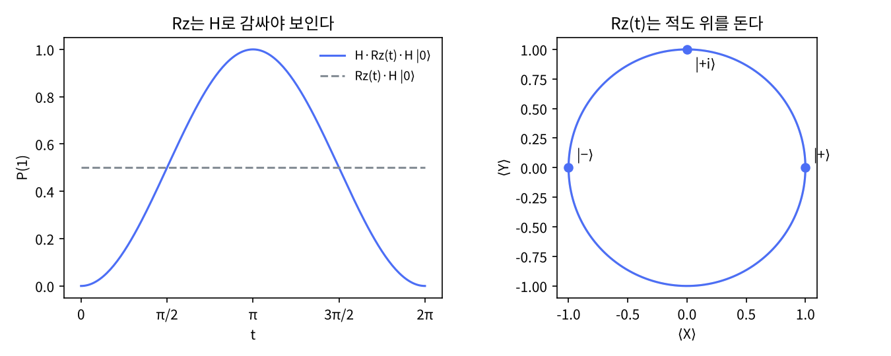

# 2장 단일 큐비트 게이트

2026-10-27 · Gosh

양자컴퓨팅 입문·심화서 · 1부 게이트와 회로 · 이 장을 마치면 X·Y·Z·H·S·T·Rx·Ry·Rz·U를 행렬과 회전으로 설명하고 합성할 수 있다.

## 1. 요약

단일 큐비트 게이트는 2×2 유니터리 행렬이고, 전역 위상을 빼면 전부 Bloch 구의 회전이다. 이 한 문장이 장 전체다. X·Y·Z·H·S·T 같은 "이름 붙은" 게이트는 특정 축·특정 각의 회전이고, Rx·Ry·Rz는 축을 고정한 임의 각 회전이며, U(θ, φ, λ)는 셋을 한 번에 쓰는 일반형이다. 어떤 단일 큐비트 유니터리도 Rz·Ry·Rz 세 번의 회전으로 분해된다(ZYZ 분해).

이 장의 모든 항등식(HZH = X, T² = S, Rz(π) ≅ Z, H = U(π/2, 0, π) 등)은 numpy로 검증했고 그 출력이 5절에 있다. 끝에서는 Rz 회전이 계산 기저 측정에서는 전혀 보이지 않다가 H로 감싸면 확률로 드러나는 것을 보고, "측정이 안 보는 것 = 물리가 아닌 것"이 아님을 짚는다. 이것이 2부 8장(위상 되돌림)의 씨앗이다.

## 2. 직관 먼저 — Quirk에서 화살표 돌리기

아래 링크에는 큐비트 한 줄에 Bloch 구 표시만 놓여 있다. 왼쪽 툴박스에서 게이트를 하나씩 끌어다 놓고 화살표가 어디로 가는지 본다.

- [Quirk: 빈 회로 + Bloch 구](https://algassert.com/quirk#circuit={"cols":[["Bloch"]]})
- [Quirk: H → T → H 순서](https://algassert.com/quirk#circuit={"cols":[["H"],["Z^¼"],["H"],["Bloch"]]}) — 5절 Bloch 궤적과 같은 회로

해 볼 것 네 가지. (1) X는 화살표를 북극에서 남극으로 뒤집는다 — x축 주위 180° 회전. (2) H는 북극을 적도의 x축 방향으로 보낸다 — x+z 대각축 주위 180° 회전. (3) 적도에 올려놓은 뒤 Z·S·T(Quirk에서는 `Z`, `Z^½`, `Z^¼`)를 걸면 화살표가 적도 위를 180°·90°·45°씩 돈다 — z축 회전. 확률 막대는 꿈쩍도 하지 않는다. (4) `X^½`을 두 번 걸면 X 한 번과 같다 — 회전은 각이 더해진다.

Quirk의 `Z^¼` 표기는 Cirq와 같은 "거듭제곱" 표기(6절)다. Qiskit의 T 게이트와 같은 것이지만 이름이 다르다는 점을 미리 알아 둔다.

## 3. 정의와 수식

**게이트 = 유니터리.** 게이트 G는 상태벡터에 곱하는 2×2 행렬이고 G†G = I를 만족한다. 유니터리이므로 길이(확률 합 1)를 보존하고 역행렬 G† = G⁻¹가 항상 있어 모든 게이트는 되돌릴 수 있다. 비유: 구를 돌리는 손. 구의 크기는 안 바뀌고, 반대로 돌리면 원위치다. 깨지는 곳: 측정은 유니터리가 아니라 되돌릴 수 없다(5장).

**고정 게이트.** 가장 많이 쓰는 여섯 개와 Bloch 구에서의 뜻.

```latex
X=\begin{pmatrix}0&1\\1&0\end{pmatrix},\;
Y=\begin{pmatrix}0&-i\\i&0\end{pmatrix},\;
Z=\begin{pmatrix}1&0\\0&-1\end{pmatrix},\;
H=\tfrac{1}{\sqrt2}\begin{pmatrix}1&1\\1&-1\end{pmatrix},\;
S=\begin{pmatrix}1&0\\0&i\end{pmatrix},\;
T=\begin{pmatrix}1&0\\0&e^{i\pi/4}\end{pmatrix}
```

| 게이트 | 회전축 | 각 | 한 줄 뜻 |
| --- | --- | --- | --- |
| X | x | 180° | 비트 뒤집기(NOT). \|0⟩↔\|1⟩ |
| Y | y | 180° | 비트 뒤집기 + 위상 i |
| Z | z | 180° | 위상 뒤집기. \|1⟩에만 −1 |
| H | (x+z)/√2 | 180° | 계산 기저 ↔ {+, −} 기저 |
| S = √Z | z | 90° | 위상 i |
| T = √S | z | 45° | 위상 e^{iπ/4}. 범용성의 열쇠(4장) |

**회전 게이트.** 축을 고정하고 각 θ를 자유롭게 준다. 지수 형태가 정의이고, θ/2가 붙는 이유는 1장(θ/2 규칙)과 같다.

```latex
R_x(\theta)=e^{-i\theta X/2}=\begin{pmatrix}\cos\frac\theta2&-i\sin\frac\theta2\\-i\sin\frac\theta2&\cos\frac\theta2\end{pmatrix},\quad
R_y(\theta)=e^{-i\theta Y/2}=\begin{pmatrix}\cos\frac\theta2&-\sin\frac\theta2\\\sin\frac\theta2&\cos\frac\theta2\end{pmatrix},\quad
R_z(\theta)=e^{-i\theta Z/2}=\begin{pmatrix}e^{-i\theta/2}&0\\0&e^{i\theta/2}\end{pmatrix}
```

같은 축의 회전은 각이 더해진다: Rx(a)Rx(b) = Rx(a+b). 축이 다르면 순서를 바꿀 수 없다: RxRy ≠ RyRx. 이것이 3D 회전의 비가환성이고, 양자 회로에서 게이트 순서가 중요한 이유다.

**위상 게이트와 전역 위상.** P(λ) = diag(1, e^{iλ})는 Rz(λ)와 전역 위상 e^{iλ/2}만 다르다. Z = P(π), S = P(π/2), T = P(π/4)이고, Rz(π) = −iZ다. 단일 큐비트에서는 둘을 구별할 수 없지만, 제어 게이트의 목표로 쓰이면(3장) 그 "전역" 위상이 제어 큐비트와의 상대 위상이 되어 물리가 된다. Qiskit이 `rz`와 `p`를 따로 두는 이유가 이것이다.

**일반 게이트 U(θ, φ, λ).** 임의의 단일 큐비트 게이트는 전역 위상을 빼면 세 각으로 쓸 수 있다. Qiskit의 `UGate` 정의를 따른다.

```latex
U(\theta,\varphi,\lambda)=\begin{pmatrix}\cos\frac\theta2&-e^{i\lambda}\sin\frac\theta2\\ e^{i\varphi}\sin\frac\theta2&e^{i(\varphi+\lambda)}\cos\frac\theta2\end{pmatrix},\qquad H=U(\tfrac\pi2,0,\pi),\; X=U(\pi,0,\pi),\; R_z(\lambda)\simeq U(0,0,\lambda)
```

**ZYZ 분해(Euler 분해).** 모든 2×2 유니터리는 U = e^{iα} Rz(β) Ry(γ) Rz(δ)로 쓸 수 있다. 비유: 지구본을 아무 방향으로나 돌린 결과는 "자전축 회전 → 기울이기 → 자전축 회전" 세 번으로 재현된다. 트랜스파일러가 임의 게이트를 하드웨어 기저 게이트로 바꿀 때 이 분해를 쓴다(4장).

**교과서 비교.** N&C 4.2절은 Pauli 행렬의 지수로 회전 연산자를 정의하고 정리 4.1(ZYZ 분해)을 증명한 뒤, 따름정리 4.2로 "U = e^{iα} AXBXC (ABC = I)" 형태까지 밀어붙여 제어 게이트 구성(4.3절)에 바로 쓴다. KLM 4.2절(4.2.1 1-큐비트 게이트)은 Bloch 구 회전의 기하를 먼저 그림으로 보이고 나서 행렬을 붙이며, 분해 정리는 짧게 언급만 한다. 이 책은 KLM처럼 기하(2절·5절 궤적)를 먼저 두고 N&C의 ZYZ를 코드로 검증한다. U(θ, φ, λ) 표기는 두 책 모두에 없고 Qiskit 고유다.

## 4. 회로 구성 — numpy 행렬과 Qiskit 표준 게이트

**numpy 구현(실행 완료).** 전체 스크립트는 `ch02_single_qubit_gates.py`다. 게이트는 행렬, 적용은 `@`, 합성은 오른쪽에서 왼쪽으로 곱한다(회로도에서 먼저 나오는 게이트가 행렬식에서는 오른쪽).

```python
import numpy as np
I = np.eye(2, dtype=complex)
X = np.array([[0, 1], [1, 0]], dtype=complex)
Z = np.array([[1, 0], [0, -1]], dtype=complex)
H = np.array([[1, 1], [1, -1]], dtype=complex) / np.sqrt(2)
S = np.array([[1, 0], [0, 1j]], dtype=complex)
T = np.array([[1, 0], [0, np.exp(1j*np.pi/4)]], dtype=complex)

def Rz(t): return np.array([[np.exp(-1j*t/2), 0], [0, np.exp(1j*t/2)]])
def Ry(t): return np.array([[np.cos(t/2), -np.sin(t/2)], [np.sin(t/2), np.cos(t/2)]], dtype=complex)
def U(theta, phi, lam):
    return np.array([[np.cos(theta/2), -np.exp(1j*lam)*np.sin(theta/2)],
                     [np.exp(1j*phi)*np.sin(theta/2), np.exp(1j*(phi+lam))*np.cos(theta/2)]])

def eq_up_to_phase(A, B):          # 전역 위상만 다른 두 게이트는 같다
    idx = np.unravel_index(np.argmax(np.abs(B)), B.shape)
    g = A[idx] / B[idx]
    return np.allclose(A, g * B), np.angle(g)

print(np.allclose(H @ Z @ H, X), np.allclose(T @ T, S))      # True True
print(eq_up_to_phase(Rz(np.pi), Z))                           # (True, -pi/2)
print(np.allclose(H, U(np.pi/2, 0, np.pi)))                   # True
```

**Qiskit 대응표.** Qiskit의 표준 게이트는 `QuantumCircuit`의 메서드와 `qiskit.circuit.library`의 클래스 두 얼굴을 가진다. 같은 게이트다.

| 수식 | `QuantumCircuit` 메서드 | 클래스 | 비고 |
| --- | --- | --- | --- |
| X, Y, Z | `qc.x(0)`, `qc.y(0)`, `qc.z(0)` | `XGate`, `YGate`, `ZGate` |  |
| H | `qc.h(0)` | `HGate` |  |
| S, S† | `qc.s(0)`, `qc.sdg(0)` | `SGate`, `SdgGate` | dg = dagger |
| T, T† | `qc.t(0)`, `qc.tdg(0)` | `TGate`, `TdgGate` |  |
| Rx(θ), Ry(θ), Rz(θ) | `qc.rx(t, 0)` 등 | `RXGate(t)` 등 | 각이 먼저, 큐비트가 나중 |
| P(λ) | `qc.p(lam, 0)` | `PhaseGate(lam)` | Rz와 전역 위상만 다름 |
| U(θ, φ, λ) | `qc.u(t, p, l, 0)` | `UGate(t, p, l)` | 일반형 |
| √X | `qc.sx(0)` | `SXGate` | IBM 하드웨어 기저 게이트 |

**Qiskit 구현(작성됨, 미실행).** `Operator`로 회로 전체의 행렬을 꺼내 numpy 결과와 비교한다. 주의: Qiskit은 큐비트 순서를 리틀 엔디안(큐비트 0이 최하위 비트)으로 두지만, 단일 큐비트에서는 차이가 없다. 3장에서 문제가 된다.

```python
# qiskit==2.5.x — 작성됨, 미실행
import numpy as np
from qiskit import QuantumCircuit
from qiskit.quantum_info import Operator
from qiskit.circuit.library import HGate, TGate, ZGate, UGate

qc = QuantumCircuit(1)
qc.h(0); qc.t(0); qc.h(0)
M = Operator(qc).data                 # 2x2 numpy 배열
print(np.round(M, 4))

H_np = HGate().to_matrix(); T_np = TGate().to_matrix()
print(np.allclose(M, H_np @ T_np @ H_np))                                   # True
print(np.allclose(HGate().to_matrix(), UGate(np.pi/2, 0, np.pi).to_matrix()))  # True

qc_rz = QuantumCircuit(1); qc_rz.rz(np.pi, 0)
print(Operator(qc_rz).equiv(Operator(ZGate())))   # True: 전역 위상 무시
```

`Operator.equiv()`는 전역 위상을 무시하고 비교한다. 마지막 줄이 위 numpy의 `eq_up_to_phase(Rz(pi), Z)`와 같은 검사다. 다음 세션에서 실행해 출력을 붙인다.

## 5. 시뮬레이션 결과

모든 수치는 `ch02_single_qubit_gates.py`를 `seed=7`로 실행한 출력이다. 이 장은 샷 측정이 아니라 행렬 항등식을 검증하므로 통계 오차가 없고, `np.allclose`의 허용 오차(rtol 1e-5, atol 1e-8)만 있다.

**유니터리 검사.** X, H, S, T, Rx(1.1), U(1, 2, 3) 모두 G†G = I를 통과했다.

**항등식.** 아래 표의 모든 항이 True였다. "위상 제외" 항은 전역 위상 γ까지 함께 출력했다.

| 항등식 | 결과 | 비고 |
| --- | --- | --- |
| HZH = X, HXH = Z | True | H는 x축과 z축을 맞바꾼다 |
| T² = S, S² = Z | True | z축 45° → 90° → 180° |
| X² = Y² = Z² = H² = I | True | 180° 회전 두 번 = 원위치 |
| XYZ = iI | True | Pauli 대수 |
| Rz(π) = e^{iγ} Z | True, γ = −π/2 | 즉 Rz(π) = −iZ |
| P(0.7) = e^{iγ} Rz(0.7) | True, γ = 0.35 | γ = λ/2 |
| H = U(π/2, 0, π), X = U(π, 0, π) | True | Qiskit UGate 정의 확인 |
| Rz(0.9) = e^{iγ} U(0, 0, 0.9) | True, γ = −0.45 |  |
| Rx(0.4)Rx(1.3) = Rx(1.7) | True | 같은 축은 각이 더해진다 |
| Rx(0.4)Ry(1.3) = Ry(1.3)Rx(0.4) | **False** | 다른 축은 교환하지 않는다 |

**ZYZ 분해.** 난수 유니터리(QR 분해로 생성)를 분해한 결과 β = 4.4937, γ = 1.1060, δ = −1.1744이고, Rz(β)Ry(γ)Rz(δ)로 재구성한 행렬은 원래 행렬과 전역 위상 α = 0.0916만 다르고 일치했다.

**Bloch 궤적 |0⟩ → H → T → H.** 2절 Quirk 링크와 같은 회로다.

| 단계 | (⟨X⟩, ⟨Y⟩, ⟨Z⟩) | P(1) | 해석 |
| --- | --- | --- | --- |
| 시작 | (0, 0, 1) | 0.0000 | 북극 |
| H | (1, 0, 0) | 0.5000 | 적도 x축 |
| T | (0.7071, 0.7071, 0) | 0.5000 | 적도 위 45° 회전. P(1) 불변 |
| H | (0, −0.7071, 0.7071) | 0.1464 | 위상이 확률로 바뀜. sin²(π/8) = 0.1464 |

세 번째 행에서 T는 Bloch 좌표를 바꿨지만 P(1)은 그대로다. 네 번째 행에서 H가 그 위상을 확률 0.1464로 바꾼다. 그림(`ch02_results.png`, 내보낸 html에 포함)의 왼쪽은 H·Rz(t)·H에서 t에 따른 P(1) = sin²(t/2) 곡선과, Rz(t)만 걸었을 때의 평평한 0.5 선을 겹쳤다. 오른쪽은 Rz(t)가 |+⟩를 적도 위에서 돌리는 궤적이다.



## 6. 다른 SDK 대응 — Cirq의 거듭제곱 표기

이 장에서 Cirq를 고른 이유는 게이트를 "회전의 거듭제곱"으로 쓰는 표기가 이 장의 핵심 메시지(게이트 = 회전, 같은 축은 각이 더해진다)를 문법으로 보여 주기 때문이다. Quirk의 `Z^¼`도 같은 관습이다.

```python
# cirq==1.7.x — 작성됨, 미실행
import numpy as np
import cirq

q = cirq.LineQubit(0)
print(cirq.unitary(cirq.Z**0.25))                 # T 게이트 (전역 위상까지 같음)
print(cirq.unitary(cirq.X**0.5))                  # sqrt(X): Qiskit SXGate와 정확히 같음
print(np.allclose(cirq.unitary(cirq.T), cirq.unitary(cirq.Z**0.25)))   # True

circuit = cirq.Circuit(cirq.H(q), cirq.T(q), cirq.H(q))
print(circuit)                                    # 0: ───H───T───H───
print(np.round(cirq.unitary(circuit), 4))

# Rz(t)와 Z**(t/pi)는 전역 위상만 다르다
t = 0.9
print(cirq.equal_up_to_global_phase(cirq.unitary(cirq.rz(t)), cirq.unitary(cirq.Z**(t/np.pi))))  # True
```

대응 규칙: Cirq의 `G**e`는 `exp(iπe(I−G)/2)` (= e^{iπe/2}·exp(−iπeG/2))로 정의되어 e = 1에서 정확히 G가 되고, Qiskit의 `Rz(θ)`는 `exp(−iθZ/2)`다. 둘은 전역 위상만 다르므로 단일 큐비트에서는 구별되지 않지만, 제어 게이트로 올리면(3장) `cirq.CZ**0.5`와 `qc.crz(pi/2)`는 다른 게이트가 된다. SDK 간 코드를 옮길 때 가장 자주 틀리는 지점이다.

## 7. 한계와 반례

**Rz는 계산 기저 측정에 보이지 않는다.** Rz(0.3), Rz(1.0), Rz(2.5)를 |+⟩에 걸어도 P(1)은 정확히 0.5000이었다. Bloch 좌표는 (0.9553, 0.2955, 0) → (0.5403, 0.8415, 0) → (−0.8011, 0.5985, 0)으로 적도 위를 돌지만 z 성분이 0이므로 계산 기저 확률은 안 바뀐다. 그러나 양쪽을 H로 감싸면 H·Rz(t)·H|0⟩의 P(1)은 t = 0, π/2, π에서 0.0000, 0.5000, 1.0000으로 바뀐다. 틀린 결론: "측정에 안 보이니 Rz는 아무 것도 안 한다." 맞는 결론: "위상은 기저를 바꿔야 보인다." 8장의 위상 되돌림(phase kickback)이 정확히 이 구조다.

**전역 위상은 언제 물리가 되는가.** Rz(π) = −iZ이고 P(λ) = e^{iλ/2}Rz(λ)다. 단일 큐비트 회로에서는 둘을 바꿔 써도 아무 측정도 달라지지 않는다. 하지만 제어 게이트의 목표로 쓰이면 제어 큐비트가 |1⟩일 때만 그 위상이 붙으므로 제어 큐비트의 상대 위상이 된다. 같은 이유로 Cirq의 `Z**0.5`와 Qiskit의 `rz(π/2)`는 제어 버전에서 서로 다른 게이트다.

**하드웨어는 이 게이트들을 직접 실행하지 않는다.** IBM Heron 계열의 기저 게이트는 단일 큐비트에서 `rz`, `sx`, `x`다. H는 Rz(π/2)·√X·Rz(π/2)로, 임의 U는 Rz·√X·Rz·√X·Rz로 바뀐다. `rz`는 하드웨어에서 "가상" 게이트로, 실제 펄스 없이 이후 펄스의 위상 기준만 바꿔 구현되므로 오류가 거의 0이다. 따라서 게이트 수를 셀 때 "Rz 개수"는 거의 공짜고 "√X 개수"가 비용이다. 4장에서 트랜스파일 결과를 읽을 때 이 관점이 필요하다.

**이 장의 한계.** 단일 큐비트 게이트만으로는 얽힘이 생기지 않고, 얽힘 없는 n큐비트 회로는 2×2 행렬 n개로 고전 시뮬레이션된다(비용 O(n)). 양자 가속의 가능성은 3장의 2큐비트 게이트에서 비로소 열린다.

## 8. 연습문제와 해답

**문제 1 (N&C 연습 4.13·4.14 변형).** HTH는 어떤 회전인가? 축과 각을 말하고 numpy로 검산하라.

*해답.* T = e^{iπ/8} Rz(π/4)이고 H는 x축과 z축을 맞바꾸므로 H Rz(θ) H = Rx(θ)다. 따라서 HTH = e^{iπ/8} Rx(π/4): x축 주위 45° 회전이다. 검산: `eq_up_to_phase(H @ T @ H, Rx(np.pi/4))`는 `(True, 0.3927)`을 돌려주고 0.3927 = π/8이다. 일반화하면 "기저를 바꾸는 게이트로 감싸면 회전축이 그 기저를 따라 옮겨간다"이고, 5절의 H·Rz(t)·H 곡선이 정확히 Rx(t)의 P(1) = sin²(t/2)인 이유다.

**문제 2 (자작).** IBM 기저 게이트 {rz, sx, x}만으로 H를 만들어라. √X = ½\[\[1+i, 1−i\], \[1−i, 1+i\]\]이다. 전역 위상은 무시해도 된다.

*해답.* H = e^{iπ/4} Rz(π/2) √X Rz(π/2). 회로 순서로는 `rz(π/2) → sx → rz(π/2)`다. 검산: `eq_up_to_phase(Rz(np.pi/2) @ SX @ Rz(np.pi/2), H)` = `(True, −0.7854)`. 기하적 의미: √X는 x축 90°, 양쪽의 Rz(π/2)는 z축 90°씩이고, 세 회전의 합성이 (x+z)/√2 축 180°가 된다. 트랜스파일러가 `qc.h(0)`을 만날 때 내놓는 결과가 이것이고, 실제 비용은 √X 한 번이다.

**문제 3 (KLM 4장 연습 변형).** S H S†는 어떤 행렬인가? 이 게이트가 |0⟩을 어디로 보내는지 Bloch 좌표로 말하라.

*해답.* S는 z축 90° 회전이므로 x축을 y축으로 보낸다. H의 회전축 (x+z)/√2를 S로 돌리면 (y+z)/√2가 된다. 따라서 S H S† = (Y+Z)/√2 = ½√2 \[\[1, −i\], \[i, −1\]\]이다. 검산: `np.allclose(S @ H @ S.conj().T, (Y+Z)/np.sqrt(2))`는 True. |0⟩에 걸면 (1, i)/√2 = |+i⟩, Bloch 좌표 (0, 1, 0)이다. H가 북극을 x축으로 보내듯 이 게이트는 북극을 y축으로 보낸다. 일반 원리: G A G†는 A의 회전축을 G로 돌린 게이트다(켤레 변환).

## 9. 학습 노트

- **게이트 = Bloch 구 회전** — 2×2 유니터리는 전역 위상을 빼면 SU(2)이고 SU(2)는 3D 회전군 SO(3)을 두 번 덮는다 → 게이트 이름을 외우지 않고 "어느 축, 몇 도"로 기억하면 항등식이 기하로 보인다. 비유가 깨지는 곳: "두 번 덮는다"가 바로 θ/2 규칙과 Rz(2π) = −I다. 360° 돌리면 구는 원위치지만 상태벡터는 부호가 바뀐다.
- **켤레 변환 G A G†** — "A의 회전축을 G로 돌린 게이트" → HZH = X, HTH = Rx(π/4), SHS† = (Y+Z)/√2가 전부 같은 한 원리. 4장 게이트 분해와 12장 Trotter 회로에서 반복 등장.
- **Rz는 가상 게이트** — IBM 하드웨어에서 Rz는 펄스 없이 이후 펄스의 위상 기준만 바꾸므로 시간·오류가 거의 0 → 회로 비용을 셀 때는 √X와 2큐비트 게이트만 센다. 비유: 오디오 파이프라인에서 샘플을 옮기지 않고 읽기 오프셋만 바꾸는 것. 더 깊이: McKay et al., "Efficient Z-gates for quantum computing" (PRA 2017).
- **전역 위상은 제어되면 물리** — Rz(λ) vs P(λ), Cirq `Z**e` vs Qiskit `rz`가 단일 큐비트에서는 같고 제어 버전에서는 다르다 → SDK 간 코드 이식 시 1순위 확인 항목.
- 더 깊이 볼 것: N&C 4.2절 정리 4.1·따름정리 4.2, Qiskit 문서 `UGate`·`Operator.equiv`, Cirq 문서 "Gates and operations"(게이트 거듭제곱).

## 10. 출처와 환경

**실행 환경.** Python 3.13.17, numpy 2.5.3, matplotlib 3.11.2, `seed=7`. 스크립트 `ch02_single_qubit_gates.py`, 그림 `ch02_results.png`. Qiskit(2.5.x)·Cirq(1.7.x) 코드는 작성만 되었고 미실행 — 작업계획서 §7 메모 참조.

**출처.**

- Nielsen & Chuang, 4.2절 "Single qubit operations" — 회전 연산자, 정리 4.1(ZYZ), 따름정리 4.2. 등급 A.
- Kaye–Laflamme–Mosca, 4.2절(4.2.1) — Bloch 구 회전의 기하. 등급 A.
- [Qiskit `UGate`](https://quantum.cloud.ibm.com/docs/en/api/qiskit/qiskit.circuit.library.UGate) — U(θ, φ, λ) 행렬 정의. 등급 A.
- [Qiskit standard gates](https://quantum.cloud.ibm.com/docs/en/api/qiskit/circuit_library#standard-gates) — 4절 대응표. 등급 A.
- [Cirq Gates and operations](https://quantumai.google/cirq/build/gates) — 게이트 거듭제곱(`cirq.X**t` = `XPowGate(exponent=t)`); `EigenGate` 자체의 정의는 API 레퍼런스 `cirq.EigenGate`. 등급 A.
- McKay, Wood, Sheldon, Chow, Gambetta, "Efficient Z-gates for quantum computing", Phys. Rev. A 96, 022330 (2017) — 가상 Rz. 등급 A.
- [Quirk](https://algassert.com/quirk) — 2절 링크. 등급 B.
