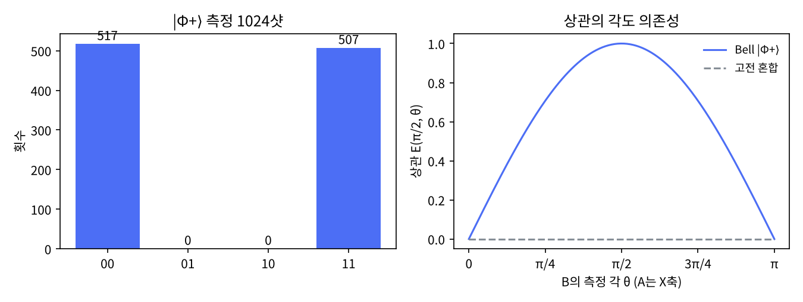

# 3장 다중 큐비트 게이트와 얽힘

2026-10-27 · Gosh

양자컴퓨팅 입문·심화서 · 1부 게이트와 회로 · 이 장을 마치면 CNOT·CZ·SWAP·Toffoli로 Bell·GHZ 상태를 만들고 텐서곱을 계산할 수 있다.

## 1. 요약

큐비트 n개의 상태는 길이 2ⁿ의 복소 벡터이고, 그 중 텐서곱으로 쓸 수 없는 상태가 얽힘 상태다. 얽힘을 만드는 최소 도구는 2큐비트 게이트 하나(CNOT)와 단일 큐비트 게이트들이며, H 뒤에 CNOT을 붙이면 Bell 상태 (|00⟩+|11⟩)/√2가 나온다. 이 장은 그 상태를 numpy로 만들고, "얽힘"이 단순한 상관과 어디서 다른지를 세 가지 수치로 보인다: 부분 추적한 한 쪽은 최대 혼합(순수도 0.5), XX 상관이 고전 혼합에서는 0인데 Bell에서는 1, CHSH 값이 고전 한계 2를 넘어 2√2.

이 장에서 가장 실용적인 함정은 큐비트 순서다. 교과서(N&C)는 왼쪽 큐비트를 상위 비트로 쓰고 Qiskit은 큐비트 0을 최하위 비트(오른쪽 끝)로 쓴다. 같은 상태의 진폭 배열이 두 규약에서 다르게 나열되므로, 4절에 변환 함수를 두고 이후 모든 장에서 쓴다.

## 2. 직관 먼저 — Quirk에서 Bell 상태 만들기

아래 링크는 큐비트 두 줄에 H와 CNOT을 놓고 두 줄 모두에 Bloch 구 표시를 붙인 것이다.

- [Quirk: H → CNOT → Bloch×2](https://algassert.com/quirk#circuit={"cols":[["H"],["•","X"],["Bloch","Bloch"]]})
- [Quirk: 같은 회로에 측정 추가](https://algassert.com/quirk#circuit={"cols":[["H"],["•","X"],["Measure","Measure"]]})

해 볼 것 세 가지. (1) CNOT을 넣기 전에는 위쪽 큐비트의 Bloch 화살표가 적도에 있다(|+⟩). CNOT을 넣는 순간 두 화살표가 모두 구의 중심으로 지워진다. 각 큐비트만 보면 아무 정보가 없다는 뜻이고, 5절의 "순수도 0.5"가 그림으로 나타난 것이다. (2) 오른쪽 끝 확률 표시를 보면 00과 11만 50 %씩이고 01·10은 0이다. (3) 측정 대신 Quirk의 사후선택(postselect) 게이트 |0⟩⟨0| 또는 |1⟩⟨1|을 위쪽 줄에 놓으면 아래 큐비트의 Bloch 화살표가 북극 또는 남극으로 나타난다 — 한 쪽을 재면 다른 쪽이 정해진다. (Quirk의 Measure 게이트는 붕괴가 아니라 결어긋남으로 모델링되므로 측정만 넣으면 아래 화살표는 중심에 남는다.)

Quirk에서 위쪽 줄이 큐비트 0이고, 확률 표시의 비트열은 위쪽 줄이 오른쪽 끝에 온다. 이것은 Qiskit과 같은 리틀 엔디안이고, 교과서와는 반대다. 3절에서 정리한다.

## 3. 정의와 수식

**텐서곱.** 큐비트 A가 |ψ⟩, B가 |φ⟩일 때 전체는 |ψ⟩⊗|φ⟩이고, 성분은 모든 곱의 조합이다. n큐비트의 상태 공간은 차원 2ⁿ이고, 게이트도 텐서곱으로 커진다: A에만 H를 걸면 H⊗I다.

```latex
\begin{pmatrix}a\\b\end{pmatrix}\otimes\begin{pmatrix}c\\d\end{pmatrix}=\begin{pmatrix}ac\\ad\\bc\\bd\end{pmatrix},\qquad
|\psi\rangle=\sum_{x\in\{0,1\}^n}\alpha_x|x\rangle,\quad \sum|\alpha_x|^2=1
```

비유: 두 주사위의 결과는 36가지이고, 각각 독립이면 확률이 곱으로 쓰인다(곱상태). 깨지는 곳: 양자에서는 확률이 아니라 진폭이 곱해지고, 곱으로 쓸 수 없는 진폭 배열이 얽힘이다. 주사위에서는 "상관된 분포"가 그 역할을 하지만, 7절에서 보듯 얽힘은 상관된 분포보다 강하다.

**큐비트 순서.** 이 책의 수식과 numpy 코드는 N&C 규약(빅 엔디안)을 따른다: |q₀q₁⟩에서 q₀가 왼쪽·상위 비트이고 텐서곱 순서도 q₀⊗q₁이다. Qiskit은 리틀 엔디안이다: 비트열 오른쪽 끝이 q₀이고 `Statevector`의 진폭 인덱스는 qₙ₋₁…q₁q₀를 이진수로 읽은 값이다. 같은 상태가 두 규약에서 다른 배열로 나온다.

|  | N&C·이 책 numpy (빅 엔디안) | Qiskit·Quirk (리틀 엔디안) |
| --- | --- | --- |
| 비트열 '01'의 뜻 | q₀=0, q₁=1 | q₁=0, q₀=1 |
| \|+⟩⊗\|0⟩ (q₀=\|+⟩)의 진폭 | (0.707, 0, 0.707, 0) | (0.707, 0.707, 0, 0) |
| CNOT(q₀→q₁) 행렬 | \[\[1,0,0,0\],\[0,1,0,0\],\[0,0,0,1\],\[0,0,1,0\]\] | \[\[1,0,0,0\],\[0,0,0,1\],\[0,0,1,0\],\[0,1,0,0\]\] |
| 장점 | 교과서와 일치 | 정수 x의 이진 표현과 큐비트 번호가 일치 |

**2큐비트 게이트.** 빅 엔디안으로, 제어 q₀·표적 q₁.

```latex
\mathrm{CNOT}=|0\rangle\langle0|\otimes I+|1\rangle\langle1|\otimes X=\begin{pmatrix}1&0&0&0\\0&1&0&0\\0&0&0&1\\0&0&1&0\end{pmatrix},\quad
\mathrm{CZ}=\mathrm{diag}(1,1,1,-1),\quad
\mathrm{SWAP}=\begin{pmatrix}1&0&0&0\\0&0&1&0\\0&1&0&0\\0&0&0&1\end{pmatrix}
```

| 게이트 | 하는 일 | 성질 |
| --- | --- | --- |
| CNOT | 제어가 1이면 표적을 뒤집는다. 계산 기저에서는 XOR | 비대칭. (H⊗H)로 감싸면 제어·표적이 바뀐다 |
| CZ | 둘 다 1일 때만 위상 −1 | 대칭. CZ = (I⊗H) CNOT (I⊗H) |
| SWAP | 두 큐비트 교환 | CNOT 세 번으로 만든다 |
| Toffoli (CCX) | 제어 둘 다 1일 때 표적 반전 | 고전 가역 논리의 범용 게이트. 4장에서 분해 |

**얽힘의 정의.** 순수 상태 |ψ⟩\_AB가 어떤 |α⟩\_A⊗|β⟩\_B로도 쓸 수 없으면 얽힘 상태다. 2큐비트에서는 진폭을 2×2 행렬 M = \[\[α₀₀, α₀₁\], \[α₁₀, α₁₁\]\]로 놓았을 때 랭크 1이면 곱상태, 2이면 얽힘이다. 정량화는 부분 추적으로 한다: ρ\_A = Tr\_B|ψ⟩⟨ψ|의 순수도 Tr(ρ\_A²)가 1이면 곱상태, 1/2이면 최대 얽힘. 얽힘 엔트로피 S(ρ\_A) = −Tr ρ\_A log₂ ρ\_A는 최대 얽힘에서 1 bit다.

**Bell·GHZ 상태.**

```latex
|\Phi^+\rangle=\tfrac{1}{\sqrt2}(|00\rangle+|11\rangle)=\mathrm{CNOT}(H\otimes I)|00\rangle,\qquad
|\mathrm{GHZ}\rangle=\tfrac{1}{\sqrt2}(|000\rangle+|111\rangle)=\mathrm{CNOT}_{12}\mathrm{CNOT}_{01}(H\otimes I\otimes I)|000\rangle
```

나머지 Bell 상태 세 개(Φ⁻, Ψ⁺, Ψ⁻)는 |Φ⁺⟩의 한 쪽에 Z, X, ZX를 걸어 얻는다. 넷은 2큐비트 공간의 정규직교 기저이고, 5장 텔레포테이션의 측정 기저다.

**교과서 비교.** N&C는 1.2.1절에서 Bell 상태를 예로 바로 들고, 2.1.7절에서 텐서곱을, 2.4.3절에서 부분 추적을 밀도행렬의 일부로 다룬다. 얽힘 엔트로피는 11장까지 미룬다. KLM은 3.3절에서 다중 큐비트 계와 텐서곱을, 3.5절에서 부분 추적과 밀도행렬을 도입하고, 텐서곱의 성분 순서를 명시적으로 쓴다. 이 책은 KLM처럼 순서를 명시하되, 코드에서 Qiskit 순서로의 변환 함수를 항상 두는 점이 두 책과 다르다. N&C는 2.6절 본문에서 CHSH를 유도하고 KLM은 본문에서 다루지 않는데, 이 책은 "얽힘이 고전 상관과 다르다"는 수치 증거로 5절에 넣는다.

## 4. 회로 구성 — numpy 텐서곱과 Qiskit 표기

**numpy 구현(실행 완료).** 전체 스크립트는 `ch03_multi_qubit.py`다. `np.kron`이 텐서곱이고, 부분 추적은 밀도행렬을 4차원 배열로 바꾼 뒤 B 축을 `einsum`으로 축약한다.

```python
import numpy as np
I = np.eye(2, dtype=complex); X = np.array([[0,1],[1,0]], dtype=complex)
H = np.array([[1,1],[1,-1]], dtype=complex)/np.sqrt(2)
ket0 = np.array([1,0], dtype=complex); ket1 = np.array([0,1], dtype=complex)

def kron(*ops):
    out = np.array([[1]], dtype=complex)
    for o in ops: out = np.kron(out, o)
    return out

P0, P1 = np.outer(ket0, ket0), np.outer(ket1, ket1)
CNOT = kron(P0, I) + kron(P1, X)                 # control q0, target q1 (빅 엔디안)

phi_plus = CNOT @ kron(H, I) @ kron(ket0, ket0)  # (|00>+|11>)/sqrt2

def partial_trace_B(rho):                        # 2큐비트 → A만 남김
    return np.einsum('ijkj->ik', rho.reshape(2,2,2,2))

rhoA = partial_trace_B(np.outer(phi_plus, phi_plus.conj()))
print(rhoA, np.trace(rhoA @ rhoA).real)          # [[.5,0],[0,.5]]  0.5

def to_qiskit_order(psi):                        # 빅 → 리틀 엔디안
    n = int(np.log2(len(psi)))
    return psi.reshape([2]*n).transpose(range(n)[::-1]).reshape(-1)
```

**Qiskit 구현(작성됨, 미실행).** `qc.cx(control, target)`이 CNOT이고, `Statevector`는 리틀 엔디안 진폭을 돌려준다. 부분 추적은 `partial_trace`, 얽힘 엔트로피는 `entropy`로 바로 구한다.

```python
# qiskit==2.5.x — 작성됨, 미실행
import numpy as np
from qiskit import QuantumCircuit
from qiskit.quantum_info import Statevector, partial_trace, entropy, Operator
from qiskit.primitives import StatevectorSampler

qc = QuantumCircuit(2)
qc.h(0); qc.cx(0, 1)
sv = Statevector(qc)
print(sv.data)                          # [0.707, 0, 0, 0.707] — Φ+는 대칭이라 순서에 무관
rhoA = partial_trace(sv, [1])           # 큐비트 1을 추적
print(rhoA.purity().real, entropy(rhoA, base=2))   # 0.5, 1.0

# 순서 함정: q0에만 H
qc2 = QuantumCircuit(2); qc2.h(0)
print(Statevector(qc2).data)            # [0.707, 0.707, 0, 0] — numpy 빅 엔디안의 [0.707, 0, 0.707, 0]과 다름

# CNOT 행렬도 순서가 다르다
qc3 = QuantumCircuit(2); qc3.cx(0, 1)
print(Operator(qc3).data.real)          # [[1,0,0,0],[0,0,0,1],[0,0,1,0],[0,1,0,0]]

qc.measure_all()
counts = StatevectorSampler(seed=7).run([qc], shots=1024).result()[0].data.meas.get_counts()
print(counts)                           # {'00': 5xx, '11': 5xx}
```

표의 두 번째 행(|+⟩⊗|0⟩)이 함정의 전부다. 대칭적인 Bell·GHZ 상태는 순서와 무관하게 같은 배열이 나오므로 처음에는 문제가 안 보이다가, 비대칭 상태나 CNOT 행렬을 비교하는 순간 어긋난다. 규칙: numpy 결과를 Qiskit과 비교할 때는 반드시 `to_qiskit_order()`를 거친다.

## 5. 시뮬레이션 결과

모든 수치는 `ch03_multi_qubit.py`를 `seed=7`로 실행한 출력이다. 행렬 항등식은 `np.allclose`, 샷 측정은 1024샷이다.

**게이트 항등식.** CNOT = |0⟩⟨0|⊗I + |1⟩⟨1|⊗X, CZ = (I⊗H)CNOT(I⊗H), SWAP = CNOT₀₁·CNOT₁₀·CNOT₀₁, (H⊗H)CNOT(H⊗H) = 제어·표적이 바뀐 CNOT — 모두 True. CZ는 SWAP·CZ·SWAP = CZ로 대칭이고, CNOT은 같은 검사에서 False로 비대칭이다.

**Bell 상태.** CNOT(H⊗I)|00⟩의 진폭은 (0.7071, 0, 0, 0.7071), 확률은 (0.5, 0, 0, 0.5). 1024샷 측정에서 00이 517회, 11이 507회, 01·10은 0회였다. 진폭 행렬의 랭크는 2(얽힘), 비교용 |+⟩⊗|0⟩는 랭크 1(곱상태)이었다.

**부분 추적과 얽힘 엔트로피.**

| 상태 | ρ\_A | 순수도 Tr(ρ\_A²) | S(ρ\_A) | 해석 |
| --- | --- | --- | --- | --- |
| \|Φ⁺⟩ | diag(0.5, 0.5) | 0.5000 | 1.000 bit | A만 보면 공정한 동전. 최대 얽힘 |
| \|+⟩⊗\|0⟩ | \|+⟩⟨+\| | 1.0000 | 0 bit | A는 순수 상태. 얽힘 없음 |

**GHZ.** CNOT₁₂CNOT₀₁(H⊗I⊗I)|000⟩의 진폭은 |000⟩과 |111⟩에만 0.7071이고, 1024샷에서 000이 520회, 111이 504회였다.

**CHSH.** A는 각 a = 0, a' = π/2, B는 b = π/4, b' = −π/4의 xz평면 축으로 측정한다. 각 상관 E(θ₁, θ₂) = ⟨Φ⁺|σ(θ₁)⊗σ(θ₂)|Φ⁺⟩ = cos(θ₁ − θ₂)다.

| 항 | Bell \|Φ⁺⟩ | 고전 혼합 ½(\|00⟩⟨00\| + \|11⟩⟨11\|) |
| --- | --- | --- |
| E(a, b) | 0.7071 | 0.7071 |
| E(a, b') | 0.7071 | 0.7071 |
| E(a', b) | 0.7071 | 0 |
| E(a', b') | −0.7071 | 0 |
| S = E(a,b) + E(a,b') + E(a',b) − E(a',b') | **2.8284** | 1.4142 |

Bell 상태는 양자 최대값 2√2에 도달하고, 어떤 고전(국소 숨은 변수) 모델도 2를 넘지 못한다. 같은 Z상관(00과 11만 나옴)을 가진 고전 혼합 상태는 1.41에 그친다. 차이는 표의 세·네 번째 행, 즉 A를 X축으로 재었을 때의 상관에서 나온다. 고전 혼합은 ZZ 상관 1.0, XX 상관 0이고, Bell은 둘 다 1.0이다. 그림(`ch03_results.png`)의 오른쪽은 A를 X축으로 고정하고 B의 측정 각 θ를 바꾼 상관 E(π/2, θ)다: Bell은 sin θ 곡선이고, 고전 혼합은 모든 θ에서 0이다.

**큐비트 순서 확인.** |+⟩⊗|0⟩(q₀ = |+⟩)의 빅 엔디안 진폭 (0.707, 0, 0.707, 0)을 `to_qiskit_order()`로 바꾸면 (0.707, 0.707, 0, 0)이고, 이것이 `Statevector(qc2).data`가 돌려줄 배열이다.



## 6. 다른 SDK 대응 — Cirq의 Moment 모델

이 장에서 Cirq를 고른 이유는 두 가지다. 첫째, Cirq는 회로를 "동시에 실행되는 게이트 묶음(Moment)의 열"로 보므로, 2큐비트 게이트가 어느 시간 슬롯에 들어가는지가 구조에 드러난다. 하드웨어 스케줄링(5부)을 생각하면 이 관점이 유용하다. 둘째, Cirq는 큐비트를 정수 인덱스가 아니라 객체(`LineQubit`, `GridQubit`)로 다루고, 상태벡터의 순서는 큐비트 객체의 정렬 순서(빅 엔디안)를 따른다. 즉 Cirq의 `final_state_vector`는 이 책의 numpy 배열과 같고, Qiskit과는 다르다.

```python
# cirq==1.7.x — 작성됨, 미실행
import numpy as np
import cirq

q0, q1 = cirq.LineQubit.range(2)
circuit = cirq.Circuit(cirq.H(q0), cirq.CNOT(q0, q1))
print(circuit)
# 0: ───H───@───
#           │
# 1: ───────X───
print(list(circuit.moments))        # [Moment(H(q0)), Moment(CNOT(q0, q1))]  — 두 시간 슬롯

psi = cirq.final_state_vector(circuit)
print(np.round(psi, 4))             # [0.7071 0 0 0.7071]

# 순서 확인: q0에만 H
print(np.round(cirq.final_state_vector(cirq.Circuit(cirq.H(q0), cirq.I(q1))), 4))
# [0.7071 0 0.7071 0]  — 빅 엔디안, 이 책의 numpy와 같고 Qiskit과 다르다

# 동시에 실행 가능한 게이트는 한 Moment에 모인다
c2 = cirq.Circuit(cirq.H(q0), cirq.H(q1), cirq.CNOT(q0, q1))
print(len(c2.moments))              # 2: [H(q0), H(q1)] 가 한 Moment

sim = cirq.Simulator(seed=7)
res = sim.run(circuit + cirq.measure(q0, q1, key='m'), repetitions=1024)
print(res.histogram(key='m'))       # Counter({0: 5xx, 3: 5xx})  — 0 = '00', 3 = '11'
```

세 SDK의 순서 규약을 한 줄로 정리하면: numpy(이 책)·Cirq·N&C = 빅 엔디안, Qiskit·Quirk = 리틀 엔디안. 한 알고리즘을 두 SDK로 병기할 때는 상태벡터가 아니라 측정 비트열을 큐비트 번호로 풀어 비교하는 것이 안전하다.

## 7. 한계와 반례

**얽힘은 통신이 아니다(no-signaling).** Bell 상태에서 A를 재면 B가 정해지지만, B 혼자서 보는 통계는 A가 무엇을 했든 ρ\_B = I/2로 변하지 않는다. 5절의 부분 추적이 그 증거다: A가 어떤 기저로 재든, 재지 않든 ρ\_B는 같다. 따라서 B는 A의 측정 결과를 고전 채널로 전달받기 전에는 상관을 알 수 없다. "얽힘으로 빛보다 빠른 통신"은 이 한 줄로 끝난다.

**고전 상관과의 차이는 기저를 바꿔야 보인다.** 계산 기저에서만 재면 Bell 상태와 "동전을 던져 00 또는 11을 나눠 가진 혼합 상태"는 구별되지 않는다(ZZ 상관 둘 다 1.0). XX 상관(1.0 vs 0)과 CHSH(2.83 vs 1.41)가 차이를 드러낸다. 2장의 교훈(위상은 기저를 바꿔야 보인다)이 2큐비트에서 다시 나타난 것이다.

**얽힘만으로는 가속이 없다.** 이 장에서 Bell·GHZ를 만드는 데 쓴 게이트(H, X, Z, CNOT, CZ, SWAP)는 전부 Clifford 게이트이고(표의 Toffoli만 예외다), Clifford 회로는 큐비트가 몇 천 개여도 고전 컴퓨터가 다항 시간에 시뮬레이션한다(Gottesman–Knill 정리). Bell·GHZ 같은 최대 얽힘 상태를 만들어도 그 자체로는 양자 가속이 없다. 가속에는 Clifford 밖의 게이트(T, Toffoli, 임의 회전)가 필요하며, 이것이 4장 범용성과 15장 가속 원천 분류의 출발점이다.

**시뮬레이션 비용.** 이 장의 numpy 코드는 2ⁿ 진폭을 전부 들고 있다. 3큐비트는 8개, 30큐비트는 10억 개(복소수 16바이트 기준 약 17 GB)다. 상태벡터 시뮬레이션의 한계가 여기서 나오고, 26장의 GPU·텐서망 시뮬레이션이 그 다음 단계다.

## 8. 연습문제와 해답

**문제 1 (N&C 1.3.6절 Bell 상태 회로 변형).** 나머지 Bell 상태 세 개를 만드는 회로를 쓰고, 네 상태가 정규직교임을 numpy로 확인하라.

*해답.* |Φ⁻⟩ = (Z⊗I)|Φ⁺⟩ = (|00⟩−|11⟩)/√2, |Ψ⁺⟩ = (X⊗I)|Φ⁺⟩ = (|01⟩+|10⟩)/√2, |Ψ⁻⟩ = (ZX⊗I)|Φ⁺⟩ = (|01⟩−|10⟩)/√2. 일반형은 CNOT(H⊗I)|ab⟩ — 입력 비트 a, b가 네 상태를 고른다. 검산: 네 벡터를 열로 쌓은 행렬 B에 대해 `np.allclose(B.conj().T @ B, np.eye(4))`가 True다. 이 기저로 측정하는 것(Bell 측정)이 5장 텔레포테이션의 핵심이고, 회로로는 위 생성 회로를 거꾸로(CNOT 후 H⊗I) 돌린 뒤 계산 기저 측정이다.

**문제 2 (자작).** |ψ⟩ = cosθ|00⟩ + sinθ|11⟩의 얽힘 엔트로피를 θ의 함수로 구하고, 어느 θ에서 최대인지 말하라.

*해답.* ρ\_A = diag(cos²θ, sin²θ)이므로 S = −cos²θ log₂ cos²θ − sin²θ log₂ sin²θ, 즉 확률 p = cos²θ인 이진 엔트로피 H₂(p)다. θ = π/4(p = 1/2)에서 최대 1 bit이고, 이것이 |Φ⁺⟩다. θ = 0, π/2에서 0으로 곱상태다. 검산: 스크립트의 `partial_trace_B`와 고유값 엔트로피를 θ = π/8에 넣으면 H₂(cos²(π/8)) = H₂(0.8536) ≈ 0.601 bit가 나온다. 교훈: 얽힘은 있다/없다가 아니라 양이고, Ry(2θ) 뒤 CNOT으로 임의의 양을 만들 수 있다.

**문제 3 (N&C 연습 4.20·KLM 6장 변형).** CNOT의 제어 큐비트가 |+⟩, 표적이 |−⟩일 때 출력을 구하라. 어느 큐비트가 바뀌었는가?

*해답.* CNOT|+⟩|−⟩ = |−⟩|−⟩. 표적은 그대로고 제어 큐비트가 |+⟩에서 |−⟩로 바뀌었다. 계산: X|−⟩ = −|−⟩이므로 CNOT(|0⟩+|1⟩)|−⟩/√2 = (|0⟩|−⟩ + |1⟩X|−⟩)/√2 = (|0⟩ − |1⟩)|−⟩/√2. 표적의 고유값 −1이 제어 쪽 위상으로 "되돌려진" 것이고, 이것이 위상 되돌림(phase kickback)이다. 검산: `CNOT @ np.kron(plus, minus)`가 `np.kron(minus, minus)`와 같다(스크립트 끝의 연습문제 검산 블록). 5절의 "(H⊗H)CNOT(H⊗H) = 뒤집힌 CNOT" 항등식이 같은 사실의 행렬 버전이며, 8장 Deutsch–Jozsa의 오라클이 정확히 이 트릭으로 동작한다.

## 9. 학습 노트

- **큐비트 순서(엔디안)** — N&C·Cirq·이 책의 numpy는 왼쪽 큐비트가 상위 비트, Qiskit·Quirk는 큐비트 0이 오른쪽 끝 → 대칭 상태(Bell·GHZ)에서는 차이가 안 보여서 더 위험하다. 비유: 네트워크 바이트 순서(빅 엔디안) vs x86 메모리(리틀 엔디안). JNI에서 네이티브 버퍼를 읽을 때와 같은 종류의 함정이고, 해법도 같다: 경계에서 단 한 번 변환하고 그 함수를 쓴다.
- **부분 추적(partial trace)** — 전체 계의 밀도행렬에서 한 부분계만 보는 연산. 얽힘을 "한 쪽만 보면 정보가 없다"로 정량화한다 → 순수도 0.5·엔트로피 1 bit. 비유: 결합 확률분포에서 주변 분포를 구하는 것. 깨지는 곳: 고전에서는 주변분포가 균일이어도 결합분포가 "순수"일 수 없지만, 양자에서는 전체는 순수이면서 부분은 최대 혼합일 수 있다 — 그게 얽힘이다.
- **CHSH 부등식** — 국소 숨은 변수 모델은 |S| ≤ 2, 양자는 2√2까지 → "얽힘은 고전 상관이 아니다"의 수치 증거. 핵심은 상관 함수 E = cos(θ₁−θ₂)의 모양이고, 고전 혼합은 cosθ₁cosθ₂만 가진다. 더 깊이: Clauser–Horne–Shimony–Holt (PRL 1969), N&C 2.6절.
- **Gottesman–Knill** — H·S·CNOT(Clifford)만으로 된 회로는 고전 다항 시간 시뮬레이션 가능 → 얽힘 ≠ 가속. T 게이트가 비용의 단위가 되는 이유(4장·15장). 더 깊이: Aaronson & Gottesman, "Improved simulation of stabilizer circuits" (2004).
- **위상 되돌림(phase kickback)** — 표적이 X의 고유상태 |−⟩이면 CNOT의 효과가 제어 쪽 위상으로 옮겨간다 → 2부 오라클 알고리즘 전부의 엔진. 이 장 연습문제 3이 그 최소 예다.

## 10. 출처와 환경

**실행 환경.** Python 3.13.17, numpy 2.5.3, matplotlib 3.11.2, `seed=7`. 스크립트 `ch03_multi_qubit.py`, 그림 `ch03_results.png`. Qiskit(2.5.x)·Cirq(1.7.x) 코드는 작성만 되었고 미실행 — 작업계획서 §7 메모 참조.

**출처.**

- Nielsen & Chuang, 1.2.1절(Bell 상태), 1.3.2절(다중 큐비트 게이트), 2.1.7절(텐서곱), 2.4.3절(부분 추적), 2.6절(EPR과 Bell 부등식), 10.5.4절(Gottesman–Knill). 등급 A.
- Kaye–Laflamme–Mosca, 3.3절(합성계), 3.5절(밀도행렬과 부분 추적), 4.2절(다중 큐비트 게이트). 등급 A.
- Clauser, Horne, Shimony, Holt, "Proposed Experiment to Test Local Hidden-Variable Theories", Phys. Rev. Lett. 23, 880 (1969). 등급 A.
- Aaronson & Gottesman, "Improved simulation of stabilizer circuits", Phys. Rev. A 70, 052328 (2004). 등급 A.
- [Qiskit 큐비트 순서 문서](https://quantum.cloud.ibm.com/docs/en/guides/bit-ordering) — 리틀 엔디안 규약. 등급 A.
- [Qiskit `partial_trace`](https://quantum.cloud.ibm.com/docs/en/api/qiskit/quantum_info#partial_trace), [`entropy`](https://quantum.cloud.ibm.com/docs/en/api/qiskit/quantum_info#entropy). 등급 A.
- [Cirq Circuits — Moments](https://quantumai.google/cirq/build/circuits). 등급 A.
- [Quirk](https://algassert.com/quirk) — 2절 링크. 등급 B.
