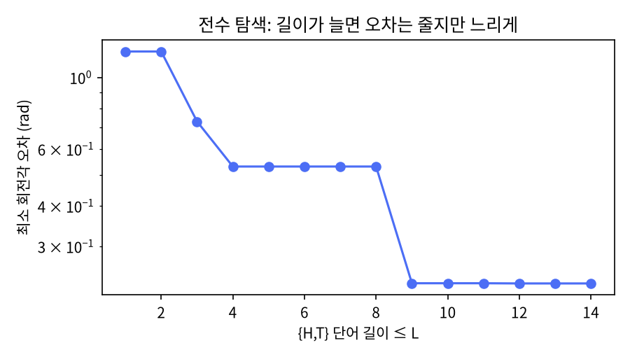

# 4장 범용성과 게이트 분해

2026-10-27 · Gosh

양자컴퓨팅 입문·심화서 · 1부 게이트와 회로 · 이 장을 마치면 범용 게이트 집합을 설명하고, 기저 게이트(ISA)로의 트랜스파일 결과를 읽을 수 있다.

## 1. 요약

어떤 n큐비트 유니터리도 CNOT과 단일 큐비트 게이트만으로 정확히 만들 수 있고, 단일 큐비트 게이트는 {H, T} 두 개만으로 임의 정밀도까지 근사할 수 있다. 그래서 {H, T, CNOT}이 범용 게이트 집합이다. 하지만 "만들 수 있다"와 "싸게 만든다"는 다르다. 이 장은 그 간격을 세 가지 실험으로 잰다: {H, T} 단어를 전수 탐색해도 길이 14에서 오차가 0.23 rad에 멈춘다(Solovay–Kitaev가 필요한 이유), Toffoli 하나가 CNOT 6개와 T 7개로 풀린다(T-count가 비용인 이유), 연결되지 않은 큐비트 사이의 CNOT 하나가 7개로 불어난다(라우팅이 비용인 이유).

실무적 결론은 하나다. 사용자가 쓴 회로와 하드웨어가 실행하는 회로는 다르고, 그 사이를 트랜스파일러가 메운다. 이 장 끝에서는 Qiskit의 `transpile` 출력에서 무엇을 읽어야 하는지(2큐비트 게이트 수, 깊이, SWAP 삽입)를 정리한다. 14장에서 노이즈 모델로 결과를 예측할 때(그리고 나중에 실제 QPU 결과를 해석할 때) 이 숫자들이 입력이 된다.

## 2. 직관 먼저 — Quirk에서 손으로 해 보기

**H와 T만으로 화살표 옮기기.** 아래 링크는 큐비트 한 줄에 H, T(`Z^¼`), H, T를 놓고 Bloch 구를 붙인 것이다. 이 네 개가 만드는 회전은 약 0.349π rad이고, 이 값이 π의 무리수 배라는 사실이 범용성의 핵심이다. 같은 네 게이트를 반복해 붙여 보면 화살표가 절대 같은 자리로 돌아오지 않고 구 위의 한 원을 점점 빽빽하게 채운다.

- [Quirk: HTHT + Bloch](https://algassert.com/quirk#circuit={"cols":[["H"],["Z^¼"],["H"],["Z^¼"],["Bloch"]]})
- [Quirk: (HTHT)×3](https://algassert.com/quirk#circuit={"cols":[["H"],["Z^¼"],["H"],["Z^¼"],["H"],["Z^¼"],["H"],["Z^¼"],["H"],["Z^¼"],["H"],["Z^¼"],["Bloch"]]})

**Toffoli를 풀어 보기.** Quirk에서 `••X`(Toffoli)를 놓은 회로와, 아래 3절의 6-CNOT 분해를 손으로 쌓은 회로를 나란히 두고 입력 |110⟩, |111⟩에 대해 출력이 같은지 본다. 회로도가 길어지는 것을 눈으로 보는 것이 목적이다: 게이트 하나가 15개가 된다.

- [Quirk: Toffoli 한 개](https://algassert.com/quirk#circuit={"cols":[["X","X",1],["•","•","X"],["Measure","Measure","Measure"]]})

## 3. 정의와 수식

**범용 게이트 집합.** 게이트 집합 G가 범용이란, 임의의 n큐비트 유니터리 U와 정밀도 ε에 대해 G의 원소들만으로 된 회로 V가 있어 ‖U − V‖ < ε를 만족한다는 뜻이다. 두 단계로 나뉜다.

1. **정확한 분해(연속 집합).** 임의의 n큐비트 유니터리는 CNOT과 임의 단일 큐비트 게이트만으로 정확히 만들어진다(N&C 4.5절). 증명 경로는 유니터리 → 2준위 행렬들의 곱 → 각각을 제어 게이트로 → 제어 게이트를 CNOT과 단일 큐비트 게이트로. 일반적으로는 O(n²4ⁿ) 개의 게이트가 필요하므로(N&C 4.5.2절) "만들 수 있다"일 뿐 효율을 보장하지 않는다.
2. **이산 근사(유한 집합).** 단일 큐비트 게이트는 연속체이므로 유한 집합으로는 근사만 가능하다. {H, T}가 그 표준 집합이다.

**{H, T}가 단일 큐비트에 범용인 이유.** HTHT는 어떤 축 n̂ 주위의 회전이고, 그 회전각 θ는 cos(θ/2) = cos²(π/8)을 만족한다.

```latex
\cos\frac{\theta}{2}=\cos^2\frac{\pi}{8}=\frac{2+\sqrt2}{4}\approx0.8536,\qquad \theta\approx0.3489\pi
```

θ가 π의 무리수 배이므로 (HTHT)ᵏ는 어떤 k에서도 제자리로 돌아오지 않고, n̂ 축 회전을 임의 각도로 근사할 수 있다. H로 켤레 변환(2장)하면 다른 축 m̂의 회전도 얻고, 두 축이 평행하지 않으므로 임의 회전을 합성할 수 있다(N&C 4.5.3절). 비유: 시계바늘을 매번 무리수 바퀴씩 돌리면 언젠가 원하는 시각 바로 옆을 지나간다. 깨지는 곳: "언젠가"가 문제다 — 5절의 전수 탐색이 보여 주듯 매우 느리다.

**Solovay–Kitaev 정리.** 유한 범용 집합(역원 포함)이 주어지면, 임의의 단일 큐비트 게이트를 정밀도 ε로 근사하는 데 O(logᶜ(1/ε)) 개의 게이트면 충분하다(c ≈ 3.97, 개선하면 c→1 근처). 전수 탐색이 ε를 반으로 줄이려면 단어 수를 기하급수적으로 늘려야 하는 데 비해, 게이트 수가 다항로그만 늘어난다는 뜻이다. 알고리즘은 재귀적이다: 거친 근사 U₀를 찾고, 나머지 오차 U U₀⁻¹을 군 교환자 VWV⁻¹W⁻¹로 쓴 뒤 V, W를 각각 더 거친 정밀도로 재귀 근사한다. V, W의 근사 오차 ε이 교환자에서는 O(ε^{3/2})로 줄어드는 성질이 핵심이다(한 단계마다 길이 5배, 오차 지수 3/2배 → c = ln 5/ln(3/2) ≈ 3.97). 이 책은 구현하지 않고 Qiskit의 `SolovayKitaev` 패스를 쓴다(4절).

**Toffoli 분해.** 3큐비트 게이트 Toffoli(CCX)는 CNOT 6개, T·T† 7개, H 2개로 정확히 분해된다(N&C 그림 4.9와 동치인 판. N&C 그림은 제어 쪽에 S 하나를 더 쓴 16게이트이고, 여기서는 그 S를 T 배치로 흡수한 15게이트 판 — Qiskit `ccx`의 정의 — 을 쓴다). 이 분해가 중요한 이유는 두 가지다. Toffoli는 고전 가역 논리의 범용 게이트이므로 모든 고전 계산(산술, 오라클)을 양자 회로로 옮기는 통로이고, T 게이트 7개가 필요하다는 사실이 오류 정정 환경에서의 비용(T-count)을 정한다. 알려진 하한은 T 7개이고, 보조 큐비트를 쓰면 4개로 줄인다.

**기저 게이트(ISA)와 트랜스파일.** 실제 하드웨어는 범용 집합 중 하나를 네이티브로 실행한다. IBM Heron: {rz, sx, x, cz} (이전 세대 Eagle은 cz 대신 ecr). 임의 단일 큐비트 게이트는 ZYZ 분해(2장)를 거쳐 다음 형태로 바뀐다.

```latex
U \simeq R_z(\beta+\pi)\,\sqrt X\,R_z(\gamma+\pi)\,\sqrt X\,R_z(\delta)
```

Rz는 가상 게이트(2장)이므로 실제 비용은 √X 두 개다. 트랜스파일러는 여기에 더해 (1) 큐비트 연결성에 맞춰 SWAP을 삽입하고(라우팅), (2) 인접한 단일 큐비트 게이트를 하나로 합치고, (3) 서로 상쇄되는 게이트를 지운다. 연결되지 않은 큐비트 사이의 CNOT 하나는 SWAP 두 개(CNOT 6개)를 더해 CNOT 7개가 된다.

**교과서 비교.** N&C 4.5절은 범용성을 세 단계(2준위 행렬 → CNOT+단일 큐비트 → 이산 집합)로 증명하고, 부록 3에서 Solovay–Kitaev를 증명한다. 4.5.4절의 "근사하는 데 필요한 게이트 수의 하한" 논의가 "대부분의 유니터리는 효율적으로 만들 수 없다"는 이 장 7절의 근거다. KLM 4.3\~4.4절은 같은 내용을 더 짧게 다루되, 제어 게이트 구성(4.2.2절)을 그림으로 자세히 보인다. 기저 게이트·트랜스파일·T-count는 두 책 모두에 없고 SDK 문서와 최근 논문의 영역이다.

## 4. 회로 구성 — numpy 검증과 Qiskit 트랜스파일러

**numpy 구현(실행 완료).** 전체 스크립트는 `ch04_universality.py`다. 세 가지를 검증한다: {H, T} 단어의 전수 탐색, Toffoli 6-CNOT 분해, ZSXZSXZ 분해. 게이트 거리는 전역 위상을 무시한 1 − |Tr(A†B)|/d를 쓴다.

```python
import numpy as np
from itertools import product
I = np.eye(2, dtype=complex)
H = np.array([[1,1],[1,-1]], dtype=complex)/np.sqrt(2)
T = np.array([[1,0],[0,np.exp(1j*np.pi/4)]], dtype=complex)
SX = np.array([[1+1j,1-1j],[1-1j,1+1j]], dtype=complex)/2
def Rz(t): return np.array([[np.exp(-1j*t/2),0],[0,np.exp(1j*t/2)]])

def dist(A, B):                       # 전역 위상 무시 거리
    return 1 - abs(np.trace(A.conj().T @ B)) / A.shape[0]

# (1) {H,T} 전수 탐색: 길이 L 이하 단어 중 목표에 가장 가까운 것
target = ...                          # 임의 2x2 유니터리
best = (np.inf, None)
for L in range(1, 15):
    for word in product('HT', repeat=L):
        if any(word[i] == word[i+1] == 'H' for i in range(L-1)): continue   # HH = I 생략
        M = I.copy()
        for g in word: M = M @ {'H': H, 'T': T}[g]
        d = dist(M, target)
        if d < best[0]: best = (d, ''.join(word))

# (2) Toffoli = 6 CNOT + 7 T/T† + 2 H  (시간 순서로 왼쪽에 곱한다)
seq = [single(H,2), cnot(1,2), single(Tdg,2), cnot(0,2), single(T,2), cnot(1,2), single(Tdg,2),
       cnot(0,2), single(T,1), single(T,2), single(H,2), cnot(0,1), single(T,0), single(Tdg,1), cnot(0,1)]
M = np.eye(8, dtype=complex)
for g in seq: M = g @ M
assert np.allclose(M, CCX)

# (3) ZSXZSXZ: U ≅ Rz(β+π) SX Rz(γ+π) SX Rz(δ)
b, g, d = zyz(U)
assert dist(Rz(b+np.pi) @ SX @ Rz(g+np.pi) @ SX @ Rz(d), U) < 1e-10
```

**Qiskit 구현(작성됨, 미실행).** 세 일을 트랜스파일러가 대신 한다. `transpile(qc, basis_gates=...)`가 기저 게이트 변환, `coupling_map`이 라우팅, `SolovayKitaev` 패스가 이산 근사다. 읽어야 할 수치는 `count_ops()`의 2큐비트 게이트 수와 `depth()`다.

```python
# qiskit==2.5.x — 작성됨, 미실행
import numpy as np
from qiskit import QuantumCircuit, transpile
from qiskit.transpiler import CouplingMap
from qiskit.transpiler.passes import SolovayKitaev
from qiskit.quantum_info import Operator

# (a) 임의 단일 큐비트 게이트 → IBM 기저 {rz, sx, x}
qc = QuantumCircuit(1); qc.u(1.0, 0.7, 0.3, 0)
t = transpile(qc, basis_gates=['rz', 'sx', 'x'], optimization_level=1)
print(t.count_ops())                  # {'rz': 3, 'sx': 2}  — ZSXZSXZ
print(Operator(t).equiv(Operator(qc)))   # True

# (b) Toffoli → CNOT + 단일 큐비트
qc = QuantumCircuit(3); qc.ccx(0, 1, 2)
t = transpile(qc, basis_gates=['cx', 'rz', 'sx', 'x'], optimization_level=1)
print(t.count_ops()['cx'], t.depth())    # 6, ~11

# (c) 연결성 제약: 선형 사슬 0-1-2 에서 CX(0,2)
qc = QuantumCircuit(3); qc.cx(0, 2)
t = transpile(qc, basis_gates=['cx','rz','sx','x'], coupling_map=CouplingMap([[0,1],[1,2]]), optimization_level=1, seed_transpiler=7)
print(t.count_ops()['cx'])               # 7 또는 라우팅 방식에 따라 4 (브리지 CNOT 기법)

# (d) Solovay–Kitaev: 연속 회전 → {H, T, T†} 이산 근사
qc = QuantumCircuit(1); qc.rx(1.0, 0); qc.ry(0.7, 0)
sk = SolovayKitaev(recursion_degree=2)
from qiskit.transpiler import PassManager
d = PassManager([sk]).run(qc)
print(d.count_ops(), d.depth())
print(np.linalg.norm(Operator(d).data - Operator(qc).data))   # ε 수준 — 재귀 차수를 올리면 줄고 길이는 늘어난다
```

(c)의 미실행 예측값 "7 또는 4"는 확정이 아니다. 트랜스파일러는 SWAP 삽입 대신 더 짧은 라우팅을 고를 수 있고, `optimization_level`과 시드에 따라 다르다. 다음 세션에서 실행해 실제 값으로 바꾼다. (d)의 SK 패스는 `to_matrix`가 있는 단일 큐비트 게이트(`rx`, `ry` 포함)를 바로 근사하고 전역 위상도 기록한다 — 실행 시 `recursion_degree`에 따른 길이만 확인한다.

## 5. 시뮬레이션 결과

모든 수치는 `ch04_universality.py`를 `seed=7`로 실행한 출력이다(실행 시간 1.2초).

**HTHT의 회전각.** 계산값 θ = 1.096057 rad = 0.348886π, cos(θ/2) = 0.853553 = cos²(π/8). 수식과 일치한다.

**{H, T} 전수 탐색.** 목표 U = Rx(1.0)Ry(0.7)을 길이 L 이하의 모든 단어로 근사했다. 오차는 두 SU(2) 원소 사이의 회전각이다.

| 길이 ≤ L | 길이 L 단어 수 | 최소 회전각 오차 (rad) |
| --- | --- | --- |
| 1 | 2 | 1.2028 |
| 3 | 8 | 0.7309 |
| 4 | 16 | 0.5302 |
| 8 | 256 | 0.5302 |
| 9 | 512 | 0.2309 |
| 12 | 4 096 | 0.2306 |
| 14 | 16 384 | 0.2306 |

최선의 단어는 HTTHTHTTHTHT(길이 12)였다. 같은 거리를 내는 길이 12의 단어가 2개 있어 사전순 첫째를 적었다 — 둘의 거리 차는 반올림 수준이라, 규칙 없이 고르면 계산하는 컴퓨터에 따라 다른 단어가 뽑힌다. 길이 4에서 8까지, 그리고 9에서 14까지 오차가 거의 줄지 않는다. 단어 수를 32배 늘려도 오차가 그대로다. 범용성 정리는 "언젠가 가까워진다"만 보장하고, 단순 열거는 그 "언젠가"를 기다리기에 너무 느리다. 그림(`ch04_results.png`)이 이 계단 모양의 곡선이다. Solovay–Kitaev는 이 곡선을 길이 ≈ logᶜ(1/ε)의 매끄러운 감소로 바꾼다.

**Toffoli 분해.** N&C 그림 4.9와 동치인 15개 게이트 순서(S 없는 판, Qiskit `ccx` 정의)를 행렬로 곱한 결과가 CCX와 `allclose`로 일치했다. CNOT 6, T·T† 7, H 2.

**ZSXZSXZ 분해.** 난수 유니터리 U를 ZYZ 분해한 뒤 Rz(β+π)·SX·Rz(γ+π)·SX·Rz(δ)로 재구성한 거리는 0.00 (1e-16 수준)이었다. 즉 임의 단일 큐비트 게이트 = √X 2개 + 가상 Rz 3개.

**연결성 라우팅.** 선형 사슬 0–1–2에서 CX(0,2) = SWAP(1,2)·CX(0,1)·SWAP(1,2)가 행렬로 일치했다. SWAP 하나가 CNOT 3개이므로 CNOT 1개가 7개가 된다.

| 작업 | 사용자 회로 | 하드웨어 회로 | 비용 배수 |
| --- | --- | --- | --- |
| 임의 단일 큐비트 게이트 | U 1개 | √X 2 + Rz 3 | √X 2개 (Rz는 공짜) |
| Toffoli | CCX 1개 | CNOT 6 + T 7 + H 2 | 2큐비트 게이트 6배 |
| 먼 큐비트 CNOT (거리 2) | CX 1개 | CX 7개 (SWAP 라우팅) | 7배 |
| 연속 회전 → 이산 {H,T} | Rx 1개 | 허용 오차에 따라 수십\~수백 개 | 오류 정정 환경에서만 필요 |



## 6. 다른 SDK 대응 — Cirq transformers

이 장에서 Cirq를 고른 이유는, Cirq가 트랜스파일을 하나의 `transpile()` 호출이 아니라 합성 가능한 변환기(transformer) 함수들로 노출하므로, "기저 게이트 변환 → 라우팅 → 최적화"의 각 단계가 무엇을 하는지 따로 볼 수 있기 때문이다.

```python
# cirq==1.7.x — 작성됨, 미실행
import cirq

q = cirq.LineQubit.range(3)

# (a) Toffoli → 2큐비트 게이트: 분해는 게이트 객체의 메서드
ops = cirq.decompose(cirq.TOFFOLI(*q), keep=lambda op: len(op.qubits) <= 2)
print(len(ops), sum(1 for op in ops if len(op.qubits) == 2))   # 17, 8 — Cirq 는 선형 연결용 8-CNOT 판(CCZ 를 H 로 감쌈); N&C 6-CNOT 판과 다르다

# (b) 기저 게이트 변환: Google 하드웨어 기저는 CZ (또는 √iSWAP) + PhasedXZ
c = cirq.Circuit(cirq.H(q[0]), cirq.CNOT(q[0], q[1]))
c_cz = cirq.optimize_for_target_gateset(c, gateset=cirq.CZTargetGateset())
print(c_cz)
# 0: ───PhXZ(...)───@───PhXZ(...)───
#                   │
# 1: ───PhXZ(...)───@───PhXZ(...)───

# (c) 라우팅: 선형 사슬 0-1-2 에서 CNOT(0,2)
import networkx as nx
c_far = cirq.Circuit(cirq.CNOT(q[0], q[2]))
router = cirq.RouteCQC(nx.path_graph(q))          # 0-1-2 선형 연결 그래프
routed, initial_map, swap_map = router.route_circuit(c_far)
print(sum(1 for op in routed.all_operations() if len(op.qubits) == 2))   # SWAP 포함 2큐비트 게이트 수

# (d) 게이트 수와 깊이 읽기
print(len(list(c_cz.all_operations())), len(c_cz))   # 게이트 수, Moment 수(= 깊이)
```

대응 관계: Qiskit `transpile(basis_gates=...)` ↔ Cirq `optimize_for_target_gateset(gateset=...)`, Qiskit `coupling_map` 라우팅 ↔ Cirq `RouteCQC`, Qiskit `count_ops()`/`depth()` ↔ Cirq `all_operations()`/`len(circuit)`. Google 하드웨어의 단일 큐비트 기저는 `PhasedXZGate` 하나로 임의 회전을 표현하고(IBM의 Rz·√X 조합에 해당), 2큐비트 기저는 CZ 또는 √iSWAP이다. (c)의 라우팅 API는 미확인 상태로 적었으므로 실행 시 고친다.

## 7. 한계와 반례

**범용 ≠ 효율.** 범용성 정리는 "모든 유니터리를 만들 수 있다"만 말하고 "짧게 만들 수 있다"는 말하지 않는다. 세는 논법(N&C 4.5.4절)으로, n큐비트 유니터리 대부분은 정밀도 ε로 근사하는 데 Ω(2ⁿ log(1/ε)/log n) 개의 게이트가 필요하다. 즉 "임의의 양자 연산"은 거의 다 지수적으로 비싸고, 양자 알고리즘은 그 중 구조가 있어 짧게 쓰이는 극소수 유니터리를 찾는 일이다. 3부의 발견 방법론이 "문제의 구조(주기성·대칭·선형성)"에서 출발하는 이유가 이것이다.

**T-count가 비용인 환경, √X가 비용인 환경.** 오류 정정 환경에서는 Clifford 게이트는 싸고 T는 비싸다(T는 마법 상태 증류가 필요). 따라서 회로 비용 = T-count이고, 연속 회전 하나마다 Solovay–Kitaev나 더 좋은 합성(Ross–Selinger)으로 수십 개의 T가 들어간다. 반면 현재의 노이즈 하드웨어(14장)에서는 연속 회전 Rz가 가상 게이트라 공짜이고, 2큐비트 게이트 수와 회로 깊이가 비용이다. 같은 회로도 두 환경에서 비용 함수가 다르므로, "이 알고리즘은 게이트 몇 개"라는 말은 어느 비용 함수인지 밝혀야 의미가 있다. 이 책에서는 2부와 4부의 모든 회로에 "2큐비트 게이트 수 / 깊이 / T-count" 세 개를 함께 적는다.

**연결성은 숫자에 안 보이는 비용이다.** 사용자 회로의 CNOT 수와 하드웨어 회로의 CNOT 수는 다르다. IBM Heron은 heavy-hex 격자로 큐비트당 이웃이 2\~3개뿐이므로, 전체 연결을 가정한 회로(예: QFT의 모든 큐비트 쌍 제어 회전)는 라우팅 후 CNOT이 수 배로 늘어난다. 6장 QFT와 14장 하드웨어 실행에서 이 차이를 직접 재본다.

**이 장의 한계.** 전수 탐색은 길이 14까지만 했고 Solovay–Kitaev는 구현하지 않았다. 라우팅(SABRE)과 레이아웃 비용은 14장에서 재고, 백엔드별 트랜스파일 설정은 24장에서 다룬다.

## 8. 연습문제와 해답

**문제 1 (자작; N&C 10.5.2절 Clifford 군 참고).** {H, S}만으로는 단일 큐비트에 범용이 아님을 보여라. H와 S로 만들 수 있는 서로 다른 게이트(전역 위상 무시)는 몇 개인가?

*해답.* H와 S로 생성되는 군은 단일 큐비트 Clifford 군이고, 전역 위상을 무시하면 원소가 24개뿐인 유한군이다. 유한 집합으로는 연속체인 SU(2)를 조밀하게 덮을 수 없으므로 범용이 아니다. 검산: 너비 우선 탐색으로 I에서 출발해 H, S를 계속 곱하며 새 원소가 나오지 않을 때까지 세면 정확히 24개에서 멈춘다(위상 정규화는 첫 번째 0이 아닌 성분을 양의 실수로 맞춘다). 비교하면 {H, T}는 같은 탐색이 끝나지 않는다 — 그것이 범용성이다. 이 24개가 Bloch 구의 정팔면체 대칭군(정육면체의 회전 대칭)과 같은 크기인 것은 우연이 아니다.

**문제 2 (자작).** IBM Heron의 2큐비트 기저 게이트는 CNOT이 아니라 CZ다. CNOT을 CZ와 단일 큐비트 게이트로 쓰고, Toffoli 분해의 2큐비트 게이트 수가 바뀌는지 말하라.

*해답.* CNOT = (I⊗H)·CZ·(I⊗H) — 표적 큐비트를 H로 감싼다(3장 항등식 CZ = (I⊗H)CNOT(I⊗H)의 양변에 H를 곱한 것). 검산은 `np.allclose(kron(I,H) @ CZ @ kron(I,H), CNOT)` = True. CNOT 하나가 CZ 하나로 바뀌므로 Toffoli의 2큐비트 게이트 수는 6으로 같고, 양쪽 H는 인접한 단일 큐비트 게이트와 합쳐져 √X·Rz로 녹아 들어간다. 트랜스파일러가 `basis_gates=['cz','rz','sx','x']`로 내놓는 결과가 이것이고, 연속된 CNOT 쌍에서는 중간 H·H = I가 상쇄되어 CZ가 더 유리할 때도 있다.

**문제 3 (N&C 4.2절 따름정리 4.2 응용).** 제어-Rz(t)를 CNOT 2개와 단일 큐비트 게이트만으로 만들고 검산하라.

*해답.* 따름정리 4.2: U = e^{iα} A X B X C, ABC = I이면 제어-U = (제어 위상 α) · A · CNOT · B · CNOT · C. U = Rz(t)에는 A = Rz(t/2), B = Rz(−t/2), C = I가 맞는다: ABC = I이고 X Rz(−t/2) X = Rz(t/2)이므로 A X B X = Rz(t/2)Rz(t/2) = Rz(t). 회로는 "CNOT → 표적에 Rz(−t/2) → CNOT → 표적에 Rz(t/2)"이고, 검산 `np.allclose(kron(I,A) @ CNOT @ kron(I,B) @ CNOT, diag(1, 1, e^{−it/2}, e^{it/2}))` = True (t = 0.9). 제어 큐비트가 0이면 두 CNOT이 아무것도 안 해서 Rz(−t/2)Rz(t/2) = I, 1이면 중간의 X 켤레가 부호를 뒤집어 Rz(t)가 된다. 이 패턴의 가운데 토막 CNOT·Rz·CNOT이 12장 Trotter 회로의 exp(−iθ ZZ) 게이트이고(CNOT·(I⊗Rz(2θ))·CNOT = exp(−iθ Z⊗Z)), 6장 QFT의 제어 위상 게이트도 같은 꼴(제어 큐비트에 P(λ/2) 하나를 더하면 CP = CRz·(P(λ/2)⊗I))이다.

## 9. 학습 노트

- **범용성의 두 단계** — (1) CNOT + 연속 단일 큐비트 게이트로 정확히, (2) {H, T}로 단일 큐비트를 근사. 핵심은 HTHT의 회전각이 π의 무리수 배라는 것 → 거듭제곱이 제자리로 안 돌아온다. 비유: 무리수 회전의 구에서의 조밀성은 원 위의 무리수 회전(Kronecker의 정리)과 같은 원리. 깨지는 곳: 조밀하다 ≠ 빠르다 — 5절의 계단 곡선.
- **Solovay–Kitaev** — 유한 범용 집합으로 정밀도 ε 근사에 O(logᶜ(1/ε)) 게이트. 군 교환자 VWV⁻¹W⁻¹가 오차를 ε → O(ε^{3/2})로 줄이는 성질이 재귀의 엔진. 비유: Newton 법처럼 단계마다 오차의 지수가 곱으로 커지는 초선형 수렴(다만 차수는 2가 아니라 3/2). 더 깊이: Dawson & Nielsen, "The Solovay–Kitaev algorithm" (2006) — 구현 가능한 수준의 설명. Ross & Selinger (2016)의 최적 T-count 합성.
- **비용 함수는 하나가 아니다** — 오류 정정 환경: T-count. 노이즈 하드웨어: 2큐비트 게이트 수와 깊이(Rz는 공짜). 같은 회로의 "비용"이 환경에 따라 다르므로 이 책은 세 숫자를 항상 함께 적는다. 엔지니어링 비유: 같은 코드도 CPU 바운드·메모리 바운드·I/O 바운드 환경에서 병목이 다르다.
- **라우팅 비용** — 연결되지 않은 큐비트 사이 CNOT 1개 → SWAP 2개 포함 CNOT 7개. 사용자 회로의 게이트 수는 하드웨어 비용의 하한일 뿐이다. `transpile` 후 `count_ops()`를 읽는 습관이 14장부터 필수.
- **Clifford 군은 24개** — {H, S}로 만드는 단일 큐비트 게이트는 전역 위상 무시 시 24개뿐(정팔면체 대칭군과 같은 크기). 3장 Gottesman–Knill과 묶어 "T가 양자성의 가격"이라는 그림을 완성한다.

## 10. 출처와 환경

**실행 환경.** Python 3.13.17, numpy 2.5.3, matplotlib 3.11.2, `seed=7`. 스크립트 `ch04_universality.py`, 그림 `ch04_results.png`. Qiskit(2.5.x)·Cirq(1.7.x) 코드는 작성만 되었고 미실행 — 작업계획서 §7 메모 참조. 4절 (c)의 라우팅 결과와 (d)의 SK 결과는 실행 후 수치로 바꾼다.

**출처.**

- Nielsen & Chuang, 4.2절(따름정리 4.2), 4.3절(제어 게이트, 그림 4.9 Toffoli), 4.5절(범용 게이트 집합, 4.5.3 {H,T}, 4.5.4 근사 하한), 부록 3(Solovay–Kitaev). 등급 A.
- Kaye–Laflamme–Mosca, 4.3\~4.4절(범용 게이트 집합과 근사). 등급 A.
- Dawson, C. M. & Nielsen, M. A., "The Solovay–Kitaev algorithm", Quantum Inf. Comput. 6, 81 (2006), arXiv:quant-ph/0505030. 등급 A.
- Ross, N. J. & Selinger, P., "Optimal ancilla-free Clifford+T approximation of z-rotations", Quantum Inf. Comput. 16, 901 (2016), arXiv:1403.2975. 등급 A.
- [Qiskit `transpile`](https://quantum.cloud.ibm.com/docs/en/api/qiskit/compiler#transpile), [`SolovayKitaev`](https://quantum.cloud.ibm.com/docs/en/api/qiskit/qiskit.transpiler.passes.SolovayKitaev), [Transpiler 개요](https://quantum.cloud.ibm.com/docs/en/guides/transpile). 등급 A.
- [IBM Quantum 프로세서 유형](https://quantum.cloud.ibm.com/docs/en/guides/processor-types) — Heron 계열 개요. 기저 게이트 {rz, sx, x, cz}는 이 페이지가 아니라 백엔드의 `backend.operation_names`(또는 문서의 지원 명령 표)에서 확인한다. 등급 A.
- [Cirq Transformers](https://quantumai.google/cirq/transform/transformers), [Routing](https://quantumai.google/cirq/transform/routing_transformer). 등급 A.
- [Quirk](https://algassert.com/quirk) — 2절 링크. 등급 B.
