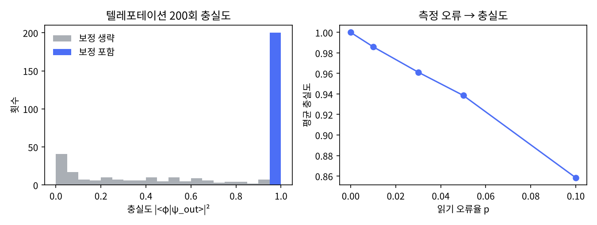

# 5장 측정·고전 제어·동적 회로

2026-10-27 · Gosh

양자컴퓨팅 입문·심화서 · 1부 게이트와 회로 · 이 장을 마치면 중간 측정과 조건부 게이트로 텔레포테이션을 구현할 수 있다.

## 1. 요약

측정은 지금까지 다룬 게이트와 다른 유일한 연산이다. 유니터리가 아니고, 확률적이며, 되돌릴 수 없다. 그러나 회로 중간에 측정을 넣고 그 결과로 다음 게이트를 고르면(고전 제어, feed-forward) 유니터리만으로는 불편한 일들이 가능해진다. 표준 예가 텔레포테이션이다: Bell 쌍 하나와 고전 비트 2개로 미지의 큐비트 상태를 옮긴다. 이 장은 그 프로토콜을 numpy로 끝까지 돌려 충실도 1.0을 확인하고, 보정 비트를 빼면 0.44로 떨어지는 것을 보인다.

두 번째 핵심은 지연 측정 원리다. "측정하고 결과에 따라 게이트"는 항상 "제어 게이트를 걸고 마지막에 측정"으로 바꿀 수 있다. 이론적으로는 동등하지만 하드웨어에서는 다르다: 중간 측정은 큐비트를 재사용하게 해 주고(reset), 오류 정정(25장)의 전제 조건이며, IBM 하드웨어에서는 "동적 회로"라는 이름으로 지원된다. 끝에서는 판독 오류율 p가 텔레포테이션 충실도를 어떻게 깎는지(p = 0.05에서 0.94) 재본다.

## 2. 직관 먼저 — Quirk에서 텔레포테이션 돌려 보기

아래 링크는 큐비트 3줄짜리 텔레포테이션이다. 위쪽 큐비트에 보낼 상태를 만들고(Y^¼로 적당히 기울인다), 가운데·아래로 Bell 쌍을 만든 뒤, 위 두 줄을 측정하고 그 결과로 아래 줄에 X·Z를 건다. Quirk는 측정 뒤의 제어를 고전 제어로 해석한다.

- [Quirk: 텔레포테이션](https://algassert.com/quirk#circuit={"cols":[["Y^¼"],[1,"H"],[1,"•","X"],["•","X"],["H"],["Measure","Measure"],[1,"•","X"],["•",1,"Z"],[1,1,"Bloch"]]})

해 볼 것 세 가지. (1) 맨 아래 줄 끝의 Bloch 구가 맨 위 줄 처음의 상태(Y^¼|0⟩)와 같은 위치를 가리킨다. 위쪽 게이트를 바꿔 보낼 상태를 바꿔도 따라온다. (2) 조건부 X·Z 두 열을 지우면 아래 줄의 Bloch 구가 구 중심(최대 혼합)으로 간다 — 측정 결과를 모르면 받는 쪽은 아무 것도 없다. (3) 측정 기호를 마지막 열로 옮기고 조건부 X·Z를 그대로 두면(이제는 양자 제어 게이트가 된다) 결과가 같다 — 지연 측정 원리다.

Quirk는 측정 뒤의 선을 이중선(고전 비트)으로 그리고 그 선은 제어로만 쓰게 하므로, 그림만으로도 "측정 전 제어 = 양자, 측정 후 제어 = 고전"이 구분된다. Qiskit은 이 둘을 `cx`와 `if_test`로 코드에서 나눈다(4절).

## 3. 정의와 수식

**사영 측정.** 계산 기저의 측정은 사영 연산자 P₀ = |0⟩⟨0|, P₁ = |1⟩⟨1|로 기술된다. 결과 m이 나올 확률과 측정 후 상태는 다음과 같다.

```latex
p(m)=\langle\psi|P_m|\psi\rangle,\qquad |\psi\rangle\;\xrightarrow{m}\;\frac{P_m|\psi\rangle}{\sqrt{p(m)}},\qquad P_0+P_1=I
```

n큐비트 계에서 큐비트 q만 재는 부분 측정은 P_m을 q 자리에 놓고 나머지는 I로 채운 연산자다. 비유: 사진을 찍는 일. 찍기 전에는 피사체가 여러 자세의 중첩이지만 찍고 나면 한 자세로 고정되고, 다시 찍어도 같은 자세가 나온다. 깨지는 곳: 사진은 피사체를 바꾸지 않지만 측정은 상태를 바꾼다(붕괴).

**다른 기저의 측정.** X 기저 {|+⟩, |−⟩}로 재는 것은 H를 걸고 계산 기저로 재는 것과 같다. 일반적으로 기저 {U|0⟩, U|1⟩}의 측정 = U† 후 계산 기저 측정. 하드웨어는 계산 기저만 재므로 모든 측정은 "기저 변환 게이트 + Z 측정"으로 컴파일된다. 3장의 Bell 상태 측정이 그 예다: CNOT 후 H⊗I 뒤에 계산 기저 측정.

**고전 제어(feed-forward).** 측정 결과 m에 따라 게이트 G를 걸거나 말거나. 결과가 고전 비트이므로 이 제어는 보통의 if문이고, 양자 제어 게이트와 달리 얽힘을 만들지 않는다.

**지연 측정 원리.** 측정은 항상 회로 끝으로 미룰 수 있다. 중간 측정 결과로 제어하던 고전 제어 게이트를 같은 큐비트를 제어 큐비트로 하는 양자 제어 게이트로 바꾸면 최종 통계가 같다(N&C 4.4절). 증명의 핵심: 측정은 제어 큐비트의 Z 기저와 교환하므로 언제 재든 같다. 이것이 "동적 회로는 정적 회로보다 강력하지 않다"는 뜻이며, 동시에 "강력하지 않지만 싸다"는 뜻이다: 텔레포테이션을 유니터리로 하려면 2큐비트 게이트가 두 개 더 필요하고, 제어 큐비트를 살려 둘 수 없다.

**텔레포테이션.** Alice가 |φ⟩ = α|0⟩ + β|1⟩를 가지고, Alice와 Bob이 Bell 쌍 |Φ⁺⟩를 나눠 가진다. 전체 상태를 Alice의 두 큐비트의 Bell 기저로 다시 쓰면 다음과 같다.

```latex
|\varphi\rangle|\Phi^+\rangle=\tfrac12\Big[|\Phi^+\rangle|\varphi\rangle+|\Phi^-\rangle Z|\varphi\rangle+|\Psi^+\rangle X|\varphi\rangle+|\Psi^-\rangle XZ|\varphi\rangle\Big]
```

Alice가 Bell 측정(CNOT, H, 계산 기저 측정)으로 네 경우 중 하나를 얻으면 Bob의 큐비트는 |φ⟩, Z|φ⟩, X|φ⟩, XZ|φ⟩ 중 하나다. Alice가 결과 2비트(m₀, m₁)를 고전 채널로 보내면 Bob은 X^{m₁} Z^{m₀}를 걸어 |φ⟩를 복원한다. 각 결과의 확률은 φ와 무관하게 1/4이므로 고전 비트는 φ에 대한 정보를 담지 않는다. Alice 쪽의 |φ⟩는 측정으로 파괴되므로 복제가 아니다.

**교과서 비교.** N&C는 1.3.7절에서 텔레포테이션을 도입부의 마지막 예로 보이고, 2.2.3\~2.2.6절에서 측정 공준을 일반 측정 → 사영 측정 → POVM 순으로 세우며, 4.4절에서 지연 측정과 암시적 측정 원리를 두 줄로 말한다. KLM은 3.4절에서 측정 공준을, 5.1절(초밀 부호화)과 5.2절(텔레포테이션)을 나란히 다룬다. 이 책은 N&C의 사영 측정만 쓰고 POVM은 25장으로 미룬다. "동적 회로"라는 용어와 하드웨어 비용은 두 책 모두에 없고 SDK 문서 영역이다.

## 4. 회로 구성 — numpy 측정과 Qiskit 동적 회로

**numpy 구현(실행 완료).** 전체 스크립트는 `ch05_measurement.py`다. 측정은 함수 하나로 충분하다: 확률을 계산하고, 난수로 결과를 뽑고, 사영한 뒤 정규화한다. 고전 제어는 Python의 `if`다.

```python
import numpy as np
rng = np.random.default_rng(seed=7)
P0, P1 = np.diag([1, 0]).astype(complex), np.diag([0, 1]).astype(complex)

def proj(q, bit, n):                      # 큐비트 q 에 P_bit, 나머지는 I
    ops = [I]*n; ops[q] = P1 if bit else P0; return kron(*ops)

def measure(psi, q, n):                   # 사영 측정: (결과, 붕괴된 상태)
    p1 = np.vdot(psi, proj(q, 1, n) @ psi).real
    bit = int(rng.random() < p1)
    post = proj(q, bit, n) @ psi
    return bit, post / np.linalg.norm(post)

def teleport(phi):
    n = 3; psi = kron(phi, ket0, ket0)
    psi = single(H, 1, n) @ psi; psi = cnot(1, 2, n) @ psi     # Bell 쌍 (q1, q2)
    psi = cnot(0, 1, n) @ psi; psi = single(H, 0, n) @ psi     # Alice의 Bell 측정 준비
    m0, psi = measure(psi, 0, n)
    m1, psi = measure(psi, 1, n)
    if m1: psi = single(X, 2, n) @ psi                         # 고전 제어
    if m0: psi = single(Z, 2, n) @ psi
    idx = (m0 << 2) | (m1 << 1)                                # q0,q1 이 확정된 블록에서 q2 를 꺼낸다
    out = psi[idx:idx+2]; return out / np.linalg.norm(out), (m0, m1)

phi = rng.normal(size=2) + 1j*rng.normal(size=2); phi /= np.linalg.norm(phi)
out, bits = teleport(phi)
print(abs(np.vdot(phi, out))**2)          # 1.0
```

**Qiskit 구현(작성됨, 미실행).** 중간 측정은 `measure`, 고전 제어는 `with qc.if_test((clbit, 1)):` 블록, 큐비트 재사용은 `reset`이다. 이 세 가지가 Qiskit에서 말하는 동적 회로의 재료다. 검증은 Bob의 큐비트에 준비 게이트의 역을 걸고 재서 항상 0이 나오는지 본다(상태벡터를 직접 볼 수 없는 하드웨어에서도 통하는 방법).

```python
# qiskit==2.5.x, qiskit-aer==0.17.x — 작성됨, 미실행
import numpy as np
from qiskit import QuantumCircuit, QuantumRegister, ClassicalRegister
from qiskit.primitives import StatevectorSampler

q = QuantumRegister(3, 'q'); a = ClassicalRegister(2, 'alice'); b = ClassicalRegister(1, 'bob')
qc = QuantumCircuit(q, a, b)

theta, phi_ = 1.1, 0.4
qc.ry(theta, 0); qc.rz(phi_, 0)                 # 보낼 상태 |φ> 준비
qc.h(1); qc.cx(1, 2)                            # Bell 쌍
qc.cx(0, 1); qc.h(0)                            # Alice의 Bell 측정 준비
qc.measure(0, a[0]); qc.measure(1, a[1])        # 중간 측정
with qc.if_test((a[1], 1)):                     # 고전 제어: m1 → X
    qc.x(2)
with qc.if_test((a[0], 1)):                     # m0 → Z
    qc.z(2)
qc.rz(-phi_, 2); qc.ry(-theta, 2)               # 검증: 준비의 역을 걸면 |0> 이어야 한다
qc.measure(2, b[0])

# 참조 구현 StatevectorSampler 는 중간 측정·if_test 를 지원하지 않으므로 동적 회로는 Aer 로 돌린다
from qiskit_aer.primitives import SamplerV2            # Aer 의 SamplerV2 는 AerSimulator 위에서 돌아 if_test 를 지원
res = SamplerV2(seed=7).run([qc], shots=2048).result()[0]
print(res.data.bob.get_counts())                 # {'0': 2048}  — Bob 은 항상 0
print(res.data.alice.get_counts())               # 4가지가 각 약 512

# reset: 측정 후 조건부 X 와 같다
qc2 = QuantumCircuit(1, 1); qc2.h(0); qc2.reset(0); qc2.measure(0, 0)
print(StatevectorSampler(seed=7).run([qc2], shots=1024).result()[0].data.c.get_counts())   # {'0': 1024}
```

실제 QPU에 보낼 때는 `if_test`가 하드웨어 제어기에서 실행되므로 트랜스파일러가 이를 지원하는 백엔드인지 확인한다(IBM Heron은 지원). 동적 회로의 실기 제출은 14장 회로 목록에 아직 없다(후속 하드웨어 장에서 다룬다).

## 5. 시뮬레이션 결과

모든 수치는 `ch05_measurement.py`를 `seed=7`로 실행한 출력이다.

**붕괴와 반복 측정.** |+⟩|0⟩의 q₀를 재서 0이 나왔고, 붕괴 후 상태는 (1, 0, 0, 0) = |00⟩, 다시 재면 같은 0이 나왔다. Bell 상태를 q₀, q₁ 순서로 1000회 재면 (0,0) 489회, (1,1) 511회, 다른 조합 0회로 두 비트가 항상 같았다.

**텔레포테이션.** Bloch 구 위 난수 상태 200개에 대해 충실도 |⟨φ|ψ_out⟩|²의 최소값과 평균이 모두 1.000000이었다. Alice의 측정 비트 분포는 (0,0) 67, (0,1) 46, (1,0) 40, (1,1) 47로, (0,0)이 다소 많지만 200회 표본의 요동 범위이고 φ와 무관하다. 보정 X·Z를 생략한 버전은 평균 충실도 0.4431로, 난수 상태 두 개의 평균 중첩도 0.5 근처다. 즉 고전 비트 2개를 받지 못한 Bob은 아무것도 받지 못한 것과 같다. 그림(`ch05_results.png`) 왼쪽이 두 분포다: 보정 포함은 1.0에 한 막대, 보정 생략은 0\~1에 퍼져 있다.

**지연 측정.** 측정과 고전 제어를 CNOT(q₁→q₂), CZ(q₀, q₂)로 바꾸고 재지 않은 유니터리 버전에서, q₀·q₁을 부분 추적한 q₂의 밀도행렬은 |φ⟩⟨φ|와 `allclose`로 일치했다. 중간 측정 버전과 통계적으로 구별되지 않는다.

**기저 변경과 reset.** |+⟩에 H를 걸고 계산 기저로 1000회 재면 1이 0회 — X 기저에서 |+⟩는 확정적이다. 난수 2큐비트 상태에 "측정 후 결과가 1이면 X"를 건 뒤 q₀가 |0⟩일 확률은 1.0이었다. 이것이 `reset`의 구현이고, 큐비트를 회로 중간에 재사용하는 유일한 방법이다.

**판독 오류의 영향.** Alice의 측정 비트가 확률 p로 뒤집혀 보고된다고 하고 난수 상태 300개의 평균 충실도를 재었다.

| 판독 오류율 p | 평균 충실도 | 해석 |
| --- | --- | --- |
| 0.00 | 1.0000 | 이상적 |
| 0.01 | 0.9860 | IBM Heron r2 판독 오류의 하한 수준(14장: 1.0\~1.6×10⁻²) |
| 0.03 | 0.9612 | |
| 0.05 | 0.9386 | |
| 0.10 | 0.8583 | |

대략 F ≈ 1 − (4/3)p — 비트 하나가 틀리면 잘못된 Pauli가 걸려 난수 상태에 대해 평균 충실도 1/3이 되고, 비트 두 개 중 하나라도 틀릴 확률이 ≈ 2p이므로 F ≈ 1 − 2p·(2/3). 그림 오른쪽이 이 선형 감소다. 실제 QPU 결과를 해석할 때 이 표를 기준선으로 쓴다 — 단, 14장은 이 텔레포테이션 회로를 돌리지 않으므로 14장의 노이즈 모델로 이 표의 값을 예측해 보는 것은 과제로 남기고, 실기 비교는 후속 하드웨어 장에서 한다.



## 6. 다른 SDK 대응 — QuTiP의 양자 궤적

이 장에서 QuTiP을 고른 이유는, QuTiP이 측정을 "회로 속 게이트"가 아니라 "연속적으로 관측되는 열린 계의 물리"로 보기 때문이다. 양자 궤적 방법(Monte Carlo 파동함수, `mcsolve`)은 이 장의 `measure()` 함수를 시간 연속으로 확장한 것과 같다: 매 시간 단계마다 "점프가 일어났는가"를 난수로 결정하고 상태를 사영한다. 7장(물리층)과 25장(노이즈)에서 이 관점이 본격적으로 쓰인다.

```python
# qutip==5.2.x — 작성됨, 미실행
import numpy as np
from qutip import basis, sigmax, sigmaz, ket2dm, Qobj
from qutip.measurement import measure, measurement_statistics

plus = (basis(2, 0) + basis(2, 1)).unit()

# (a) 사영 측정: 관측량을 주면 (고유값, 붕괴 후 상태) 를 난수로 돌려준다
value, state = measure(plus, sigmaz())
print(value, state)                      # +1 또는 -1, 그리고 |0> 또는 |1>

# (b) 통계: 고유값별 확률과 사후 상태를 한 번에
vals, states, probs = measurement_statistics(plus, sigmaz())
print(vals, probs)                       # [-1, 1], [0.5, 0.5]

# (c) X 기저 측정은 관측량을 바꾸기만 하면 된다 (H 를 걸 필요가 없다)
vals, states, probs = measurement_statistics(plus, sigmax())
print(vals, probs)                       # [-1, 1], [0.0, 1.0]  — 확정적
```

Qiskit과의 차이: Qiskit은 계산 기저 측정만 있고 다른 기저는 게이트로 돌려서 재지만(하드웨어가 그렇기 때문), QuTiP은 임의 관측량을 직접 재고 고유값을 돌려준다(물리학자의 관점). 같은 일을 두 도구가 다른 추상화 수준에서 하는 것이고, 이 책에서는 회로를 쓸 때 Qiskit, 물리를 확인할 때 QuTiP을 쓴다.

## 7. 한계와 반례

**텔레포테이션은 복제가 아니다.** Alice의 큐비트는 Bell 측정으로 파괴된다. 전송 후에도 |φ⟩는 우주에 한 벌뿐이다. 이것은 우연이 아니라 복제 불가 정리의 결과다: 임의의 |φ⟩에 대해 U|φ⟩|0⟩ = |φ⟩|φ⟩인 유니터리 U는 없다. 연습문제 2에서 직접 보인다. 또한 빛보다 빠르지도 않다: Bob은 고전 비트 2개를 받기 전에는 최대 혼합 상태를 가지고 있다(5절의 충실도 0.44 실험, 3장 no-signaling).

**중간 측정의 하드웨어 비용.** 초전도 큐비트의 측정은 게이트보다 수십 배 느리다(수십\~수백 ns 게이트 vs \~1\~1.5 μs 측정). 그 시간 동안 다른 큐비트에서는 결어긋남이 진행된다(T₁, T₂). 따라서 "중간 측정 + 고전 제어"는 이론적으로는 지연 측정 버전과 동등하지만, 노이즈 하드웨어에서는 어느 쪽이 나은지가 회로마다 다르다. 게이트 수를 줄이는 대신 대기 시간을 사는 거래다. 14장은 두 버전 모두 실행하지 않으므로, 14장의 노이즈 모델로 어느 쪽이 나은지 예측해 보는 것은 과제로 남기고 실기 비교는 후속 하드웨어 장에서 한다.

**측정 오류는 게이트 오류와 다르다.** 5절의 표가 보여 주듯, 판독 오류 p는 충실도를 약 (4/3)p만큼 깎는다. 중간 측정을 쓰는 회로는 게이트 오류에 더해 이 오류를 따로 지불한다. 판독 오류는 비교적 쉬운 보정 대상이기도 하다(25장의 측정 오류 완화): 각 큐비트의 혼동 행렬을 미리 재어 두고 결과 분포를 되돌린다. 단, 중간 측정의 결과로 이미 게이트를 걸어 버린 뒤에는 사후 보정이 불가능하다 — 동적 회로가 정적 회로보다 오류 완화에 불리한 이유다.

**이 장의 한계.** 측정을 이상적 사영 측정으로만 다뤘다. 일반 측정(POVM)과 약한 측정은 25장에서, 측정을 연산의 주인공으로 쓰는 측정 기반 양자 계산은 이 책의 범위 밖이다.

## 8. 연습문제와 해답

**문제 1 (자작, N&C 1.3.7절 변형).** Bell 쌍이 |Φ⁺⟩가 아니라 |Ψ⁻⟩ = (|01⟩ − |10⟩)/√2일 때, Alice의 측정 결과 (m₀, m₁)에 따라 Bob이 걸어야 할 보정을 구하라.

*해답.* |Ψ⁻⟩ = (I ⊗ XZ)|Φ⁺⟩(전역 위상 제외) — Bell 쌍에서는 (A⊗I)|Φ⁺⟩ = (I⊗Aᵀ)|Φ⁺⟩이고 (XZ)ᵀ = −XZ이므로 Alice 쪽 q₁에 걸든 Bob 쪽 q₂에 걸든 같은 상태다. 따라서 Bob의 큐비트에는 모든 경우에 XZ가 추가로 붙는다. 즉 원래의 보정 X^{m₁}Z^{m₀}에 XZ를 합성한 것이고, Pauli 군의 곱을 정리하면 (0,0) → XZ, (0,1) → Z, (1,0) → X, (1,1) → I다. 즉 보정이 정확히 뒤집힌다. 검산: 스크립트의 Bell 쌍 생성 뒤에 q₁에 Z, X를 차례로 걸고 네 경우 각각 어느 Pauli로 충실도가 1이 되는지 찾으면 위 표와 같다. 교훈: 텔레포테이션은 "어떤 얽힘 쌍을 썼는가"와 "측정 결과가 무엇인가"를 합쳤을 때 보정이 정해진다. 두 정보 중 하나만 없어도 Bob은 아무것도 모른다.

**문제 2 (N&C 연습 1.2·Box 12.1 변형).** 복제 불가 정리: 임의의 |φ⟩에 대해 U|φ⟩|0⟩ = |φ⟩|φ⟩를 만족하는 유니터리 U가 없음을 |0⟩과 |+⟩ 두 상태만으로 보여라.

*해답.* 유니터리는 내적을 보존한다. 입력 쪽 내적은 ⟨0|⟨0| · |+⟩|0⟩ = ⟨0|+⟩ = 1/√2 ≈ 0.7071. 복제가 된다면 출력 쪽 내적은 ⟨0|⟨0| · |+⟩|+⟩ = ⟨0|+⟩² = 1/2. 0.7071 ≠ 0.5이므로 그런 U는 없다. 일반화: ⟨φ|ψ⟩ = ⟨φ|ψ⟩²는 내적이 0 또는 1일 때만 성립하므로, 직교하는 상태들(고전 비트)은 복제할 수 있고 그 사이의 중첩은 복제할 수 없다. 이것이 CNOT이 "복사"처럼 보이지만 복사가 아닌 이유다: CNOT|+⟩|0⟩ = |Φ⁺⟩ ≠ |+⟩|+⟩. 복제 불가는 텔레포테이션이 원본을 파괴해야 하는 이유이고, 25장 오류 정정이 "상태를 복사해 두는" 고전적 방법을 쓸 수 없는 이유다.

**문제 3 (자작).** `reset`을 게이트가 아니라 밀도행렬에 작용하는 연산(채널)으로 쓰고, 그것이 유니터리가 아님을 보여라. 여기서 채널이란 Kraus 연산자 Kₖ들로 ρ → Σₖ KₖρKₖ†라고 쓰는 사상이고, Σₖ Kₖ†Kₖ = I(추적 보존)를 만족한다.

*해답.* reset = "측정 후 결과가 1이면 X"이므로 두 가지 일이 일어난다: 결과 0이면 |0⟩⟨0|를 적용, 결과 1이면 |1⟩⟨1| 후 X, 즉 |0⟩⟨1|을 적용. 이 두 연산자 K₀ = |0⟩⟨0|, K₁ = |0⟩⟨1|이 Kraus 연산자이고 채널은 ρ → K₀ρK₀† + K₁ρK₁† = (ρ₀₀ + ρ₁₁)|0⟩⟨0| = |0⟩⟨0|다. 검산: K₀†K₀ + K₁†K₁ = I(추적 보존)는 True이고, 난수 상태를 넣으면 출력이 항상 diag(1, 0)이다. 유니터리가 아닌 이유: 유니터리는 서로 다른 입력을 서로 다른 출력으로 보내지만(내적 보존), reset은 모든 입력을 한 점으로 보낸다. 정보를 버리는 연산이고, 버린 정보는 측정 결과라는 고전 비트로 나간다. Kraus 표현은 25장 노이즈 채널의 언어이고, reset은 그 가장 간단한 예다.

## 9. 학습 노트

- **측정 = 사영 + 정규화 + 난수** — 유니터리가 아닌 유일한 연산. 코드로는 함수 하나(`measure()`)이고, 고전 제어는 그냥 `if`다. 비유: 사진 찍기 — 찍으면 한 자세로 고정. 깨지는 곳: 사진과 달리 측정은 피사체를 바꾼다(붕괴).
- **지연 측정 원리** — "측정 후 고전 제어" ≡ "양자 제어 후 마지막 측정". 동적 회로는 이론적으로 더 강하지 않지만 2큐비트 게이트를 고전 비트로 바꾸고 큐비트를 재사용하게 한다. 비유: 분기 예측 없이 모든 분기를 다 계산해 두는 것(유니터리) vs 조건을 보고 한 분기만 실행(동적). 깨지는 곳: 양자에서는 "모든 분기를 다 계산"해도 비용이 게이트 몇 개뿐이다.
- **텔레포테이션의 세 재료** — 얽힘 쌍 1개 + Bell 측정 + 고전 비트 2개. 어느 하나라도 빠지면 충실도가 난수 수준(0.44\~0.5)으로 떨어진다. 연습문제 1의 "다른 Bell 쌍이면 보정이 달라진다"는 점이 25장 오류 정정의 신드롬 복호와 같은 구조.
- **복제 불가 = 내적 보존** — ⟨φ|ψ⟩ = ⟨φ|ψ⟩²는 0 또는 1에서만. 증명이 한 줄이라는 것이 포인트. CNOT이 복사가 아닌 이유, 오류 정정이 고전 방식(백업)을 못 쓰는 이유. 더 깊이: N&C 12.1절 Box 12.1, Wootters & Zurek (1982).
- **Kraus 연산자** — 유니터리가 아닌 연산(측정, reset, 노이즈)을 밀도행렬에 쓰는 표준 언어: ρ → Σ Kₖ ρ Kₖ†, Σ Kₖ†Kₖ = I. reset은 K₀ = |0⟩⟨0|, K₁ = |0⟩⟨1|. 25장의 노이즈 채널이 전부 이 형태다.
- **판독 오류와 충실도** — F ≈ 1 − (4/3)p. 하드웨어 결과를 볼 때 "게이트 오류인가 판독 오류인가"를 갈라내는 첫 기준선. 판독 오류는 혼동 행렬로 사후 보정이 되지만, 동적 회로에서는 이미 게이트를 걸어 버려서 안 된다.

## 10. 출처와 환경

**실행 환경.** Python 3.13.17, numpy 2.5.3, matplotlib 3.11.2, `seed=7`. 스크립트 `ch05_measurement.py`, 그림 `ch05_results.png`. Qiskit(2.5.x)·QuTiP(5.2.x) 코드는 작성만 되었고 미실행 — 작업계획서 §7 메모 참조.

**출처.**

- Nielsen & Chuang, 1.3.7절(텔레포테이션), 2.2.3\~2.2.5절(측정 공준·사영 측정), 4.4절(지연 측정·암시적 측정 원리), 8.2절(Kraus 표현), Box 12.1(복제 불가). 등급 A.
- Kaye–Laflamme–Mosca, 3.4절(측정 공준), 5.1절(초밀 부호화), 5.2절(텔레포테이션). 등급 A.
- Bennett, Brassard, Crépeau, Jozsa, Peres, Wootters, "Teleporting an unknown quantum state via dual classical and Einstein–Podolsky–Rosen channels", Phys. Rev. Lett. 70, 1895 (1993). 등급 A.
- Wootters, W. K. & Zurek, W. H., "A single quantum cannot be cloned", Nature 299, 802 (1982). 등급 A.
- [Qiskit 동적 회로 가이드](https://quantum.cloud.ibm.com/docs/en/guides/classical-feedforward-and-control-flow) — `if_test`, `measure`, `reset`. 등급 A.
- [QuTiP measurement 모듈](https://qutip.readthedocs.io/en/stable/apidoc/functions.html#module-qutip.measurement) — `measure`, `measurement_statistics`. 등급 A.
- [Quirk](https://algassert.com/quirk) — 2절 링크. 등급 B.
