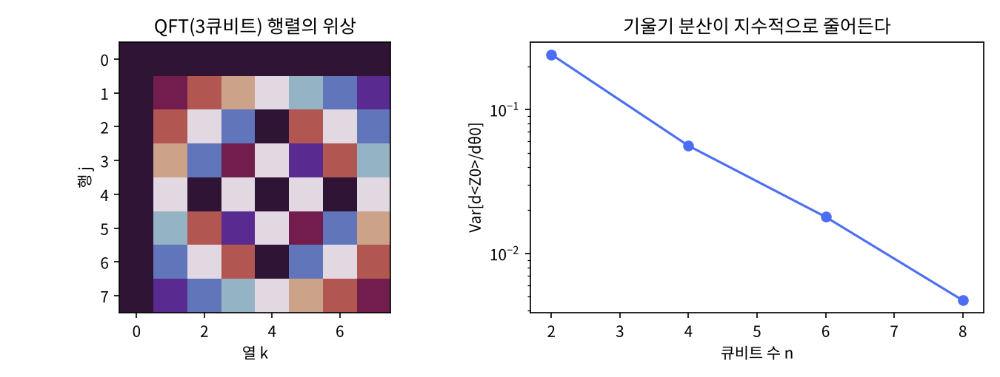

# 6장 회로 라이브러리 해부

2026-10-27 · Gosh

양자컴퓨팅 입문·심화서 · 1부 게이트와 회로 · 이 장을 마치면 `n_local`·feature map·QFT·산술 회로의 내부를 읽고 재구성할 수 있다.

## 1. 요약

Qiskit의 회로 라이브러리는 "자주 쓰는 회로를 한 줄로 만드는 함수 모음"이다. 이 장은 그 중 네 가족을 골라 함수를 부르지 않고 1\~5장의 게이트만으로 직접 조립한 뒤, 같은 것이 나오는지 검증한다. 네 가족은 이후 모든 장의 부품이다: QFT(10·11장의 위상 추정·Shor), 산술 회로(11장의 모듈러 지수), 데이터 인코딩 feature map(22장 양자 커널), 변분 ansatz `n_local`(13·21·23장 VQE·QAOA).

검증 결과: 2\~4큐비트 QFT를 H와 제어 위상으로 조립한 행렬이 DFT 행렬과 정확히 같고, QFT로 만든 Draper 덧셈기는 3비트 입력 64가지 전부에서 a+b mod 8을 내며 보조 큐비트가 필요 없다. ZZ feature map은 가까운 데이터에 큰 커널값을 주고 커널 행렬은 양의 준정부호다. `real_amplitudes`는 이름대로 실수 진폭만 만든다. 그리고 이 장의 반례: 변분 회로의 그래디언트 분산이 큐비트 수에 따라 지수적으로 줄어든다(n = 2 → 8에서 0.24 → 0.005). 불모 고원(barren plateau)이다.

이 장은 "라이브러리 함수를 쓰라"가 아니라 "함수가 무엇을 만드는지 알고 쓰라"를 말한다. 3부에서 새 알고리즘을 찾을 때 이 부품들을 다시 조립한다.

## 2. 직관 먼저 — Quirk에서 3큐비트 QFT 쪼개 보기

Quirk에는 QFT 게이트가 통째로 있다(`QFT3`). 아래 링크는 입력 |101⟩ = 5에 QFT를 걸고 각 큐비트의 Bloch 구를 붙인 것이다. 세 화살표가 모두 적도에 놓이고 경도만 다르다: QFT는 계산 기저 상태를 "곱상태인데 각 큐비트가 x에 비례해 돌아간" 상태로 보낸다.

- [Quirk: QFT3 + Bloch×3](https://algassert.com/quirk#circuit={"cols":[["X",1,"X"],["QFT3"],["Bloch","Bloch","Bloch"]]})
- [Quirk: 같은 QFT를 H·제어위상·SWAP으로 풀어 쓴 것](https://algassert.com/quirk#circuit={"cols":[["X",1,"X"],[1,1,"H"],[1,"•","Z^½"],["•",1,"Z^¼"],[1,"H"],["•","Z^½"],["H"],["Swap",1,"Swap"],["Bloch","Bloch","Bloch"]]})

해 볼 것 세 가지. (1) 두 회로의 Bloch 구가 같다 — 통째 게이트와 조립 회로가 같은 것이다. (2) 입력 X를 바꿔 x = 1, 2, 4를 넣으면 화살표가 적도 위에서 45°, 90°, 180°씩 도는 것이 보인다. Quirk는 위 와이어가 최하위 비트(리틀 엔디안)라 가장 위 큐비트가 가장 천천히 돈다(x 전체 비트의 정보, 2πx/8), 가장 아래 큐비트가 가장 빨리 돈다(x의 최하위 비트만 반영, πx). (3) 조립 회로에서 SWAP 열을 지우면 큐비트 순서만 뒤집힐 뿐 같은 상태다 — Draper 덧셈기가 SWAP을 생략하는 이유.

Quirk의 `Z^½`, `Z^¼`은 각각 제어 위상 π/2, π/4이고(2장의 거듭제곱 표기), 제어 기호(•)가 붙은 큐비트가 제어다.

## 3. 정의와 수식

**QFT.** N = 2ⁿ 차원의 이산 푸리에 변환을 상태벡터에 가하는 유니터리다.

```latex
\mathrm{QFT}|x\rangle=\frac{1}{\sqrt N}\sum_{k=0}^{N-1}e^{2\pi i\,xk/N}|k\rangle
=\bigotimes_{j=1}^{n}\frac{|0\rangle+e^{2\pi i\,0.x_{n-j+1}\cdots x_n}|1\rangle}{\sqrt2}
```

오른쪽 곱상태 형태가 회로를 정한다: 큐비트 j에 H를 걸고, 그 아래 큐비트 k들이 제어하는 위상 2π/2^{k−j+1}을 차례로 건다. 게이트 수는 H n개 + 제어 위상 n(n−1)/2개 + SWAP ⌊n/2⌋개 = O(n²). 고전 FFT가 O(N log N) = O(n 2ⁿ)인 것과 비교하면 지수적으로 짧다. 비유: FFT가 "신호의 주파수 성분을 전부 계산해 배열에 담는 것"이라면 QFT는 "주파수 성분을 진폭에 담은 상태를 만드는 것". 깨지는 곳: 그 진폭을 읽어 낼 수 없다. 측정하면 k 하나만 나온다(7절).

**Draper QFT 덧셈기.** |a⟩|b⟩ → |a⟩|a+b mod 2ⁿ⟩를 보조 큐비트 없이 한다. 원리: QFT|b⟩는 각 큐비트에 b에 비례하는 위상을 가진 곱상태이므로, a의 비트들이 제어하는 위상을 더 걸면 QFT|a+b⟩가 된다. 그 다음 QFT⁻¹. 푸리에 공간에서는 덧셈이 위상 회전이라는 고전 신호처리의 사실(시간 이동 = 주파수 영역 위상 곱)이 그대로 쓰인다. 게이트 수 O(n²), 보조 큐비트 0. 11장 Shor의 모듈러 지수가 이 덧셈기를 쌓아 만든다.

**ZZ feature map.** 고전 데이터 x ∈ ℝⁿ을 n큐비트 상태로 바꾼다. Qiskit 정의:

```latex
U_\Phi(x)=\exp\Big(i\sum_i x_i Z_i + i\sum_{i<j}(\pi-x_i)(\pi-x_j)Z_iZ_j\Big)H^{\otimes n},\qquad |\Phi(x)\rangle=U_\Phi(x)^{\,\mathrm{reps}}|0\rangle^{\otimes n}
```

ZᵢZⱼ 항은 CNOT·P(λ)·CNOT 세 게이트로 구현된다(4장 연습문제 3의 패턴). 양자 커널 K(x, y) = |⟨Φ(x)|Φ(y)⟩|²은 항상 대칭·양의 준정부호이므로 고전 커널 방법(SVM)에 그대로 넣을 수 있다. 이 특정 형태가 선택된 이유는 ZZ 항 때문에 고전 시뮬레이션이 어렵다고 추정되기 때문이다(Havlíček et al. 2019). 22장에서 이 추정을 검증한다.

**n_local 변분 ansatz.** 회전 층과 얽힘 층을 번갈아 쌓은 파라미터 회로. `real_amplitudes` = Ry 층 + CX 사다리, reps번 반복 후 Ry 층 하나 더. 파라미터 n(reps+1)개, CX reps·(n−1)개. Ry와 CX가 모두 실수 행렬이므로 출력 진폭은 실수다 — 이름의 유래. `efficient_su2`는 Ry·Rz 두 층으로 복소 진폭까지 덮는다. 이 회로는 "문제와 무관한 범용 ansatz"이고, 그래서 훈련이 어렵다(7절 불모 고원). 문제 구조를 반영한 ansatz는 13장(HVA·QAOA)과 23장(UCCSD)에서.

**교과서 비교.** N&C 5.1절은 QFT를 곱상태 형태로 유도하고 그림 5.1의 회로를 준다. 이 장의 `qft_gates()`가 그 그림 그대로다. KLM 7.1절도 같은 유도이나 비트 순서 표기가 더 명시적이다. 산술 회로는 N&C 본문에 없다(본문은 고전 가역 회로 중심). 다만 5장 장말 문제 5.6 "Addition by Fourier transforms"가 상수를 QFT로 더하는 같은 아이디어를 묻는다 — 연습 5.6(근사 QFT)과는 다른 항목이다. 두 레지스터 덧셈기의 1차 출처는 Draper 2000 원논문이다. feature map과 n_local은 두 책 모두에 없다 — 2010년대 후반 NISQ 시대의 산물이고, 1차 출처는 Qiskit 문서와 논문(Havlíček 2019, Kandala 2017)이다.

## 4. 회로 구성 — numpy 조립과 Qiskit 라이브러리 함수

**numpy 구현(실행 완료).** 전체 스크립트는 `ch06_circuit_library.py`다. 네 회로 모두 "게이트 행렬의 시간 순서 리스트"로 만들고 `seq()`로 곱한다. QFT와 덧셈기의 핵심만 적는다. 아래는 `ch06_circuit_library.py`에서 핵심만 간추린 발췌다(그대로 실행되지 않는다). 실행 가능한 전체 코드는 스크립트 파일에 있다.

```python
def cphase(c, t, lam, n):                 # 제어 위상: |1><1|_c ⊗ P(λ)_t
    a = [I]*n; a[c] = P0; b = [I]*n; b[c] = P1; b[t] = Pgate(lam)
    return kron(*a) + kron(*b)

def qft_gates(n):                         # N&C 그림 5.1
    g = []
    for j in range(n):
        g.append(single(H, j, n))
        for k in range(j+1, n):
            g.append(cphase(k, j, 2*np.pi / 2**(k-j+1), n))
    for j in range(n//2):
        g.append(swap(j, n-1-j, n))
    return g

def dft_matrix(N):
    w = np.exp(2j*np.pi/N)
    return np.array([[w**(j*k) for k in range(N)] for j in range(N)]) / np.sqrt(N)

assert np.allclose(seq(qft_gates(3)), dft_matrix(8))

def draper_adder_gates(n):                # |a>|b> → |a>|a+b mod 2^n>,  a = q[0:n], b = q[n:2n]
    N = 2*n; g = []
    for j in range(n):                    # QFT(b), SWAP 생략
        g.append(single(H, n+j, N))
        for k in range(j+1, n): g.append(cphase(n+k, n+j, 2*np.pi/2**(k-j+1), N))
    for j in range(n):                    # a 가 제어하는 위상 = 푸리에 공간에서의 덧셈
        for k in range(j, n): g.append(cphase(k, n+j, 2*np.pi/2**(k-j+1), N))
    inv = [ ...QFT(b) 와 같은 리스트... ]
    for gate in reversed(inv): g.append(gate.conj().T)   # QFT⁻¹(b)
    return g
```

**Qiskit 대응표(작성됨, 미실행).** Qiskit 2.x는 클래스(`QFT`, `ZZFeatureMap`, `RealAmplitudes`)와 함수(`qft`는 `QFTGate`, `zz_feature_map`, `real_amplitudes`) 두 얼굴이 있고, 함수형이 권장이다. 표의 "확인" 열이 각 함수가 이 장의 numpy 조립과 같은지 확인하는 방법이다.

| 회로 | Qiskit 2.x | numpy 조립 | 확인 |
| --- | --- | --- | --- |
| QFT | `QFTGate(n)` / `qiskit.circuit.library.QFT(n)` | `qft_gates(n)` | `Operator(QFTGate(3)).data` vs `dft_matrix(8)` — 정수 라벨 행렬이라 순서 변환 불필요; 뒤집히는 것은 회로 그림뿐 |
| 덧셈기 | `DraperQFTAdder(n, kind='fixed')` | `draper_adder_gates(n)` | 64가지 입력 전수 검사 |
| feature map | `zz_feature_map(n, reps=2)` + `assign_parameters(x)` | `zz_feature_map_gates(x, reps)` | `Statevector` 내적으로 커널 비교 |
| ansatz | `real_amplitudes(n, reps=2, entanglement='reverse_linear')` | `real_amplitudes_gates(n, reps, θ)` | `num_parameters`, `count_ops()['cx']` |

```python
# qiskit==2.5.x — 작성됨, 미실행
import numpy as np
from qiskit.circuit.library import QFTGate, DraperQFTAdder, zz_feature_map, real_amplitudes
from qiskit.quantum_info import Operator, Statevector
from qiskit import QuantumCircuit

# QFT: DFT 행렬은 정수 라벨로 정의되므로 엔디안과 무관 — reverse_bits() 를 걸면 오히려 틀린다 (Π·DFT·Π)
qc = QuantumCircuit(3); qc.append(QFTGate(3), [0, 1, 2])
M = Operator(qc).data
print(np.allclose(M, dft_matrix(8)))                 # True (예상)
print(qc.decompose().count_ops())                    # {'h': 3, 'cp': 3, 'swap': 1}

# 덧셈기
add = DraperQFTAdder(3, kind='fixed')
print(add.num_qubits, add.decompose().count_ops())   # 6, cp 위주

# feature map 과 커널
fm = zz_feature_map(2, reps=2)
print(fm.num_parameters)                             # 2
sx = Statevector(fm.assign_parameters([0.3, 1.2])); sy = Statevector(fm.assign_parameters([0.35, 1.1]))
print(abs(sx.inner(sy))**2)                          # ≈ 0.962 (5절 numpy 값)

# ansatz
ans = real_amplitudes(4, reps=2, entanglement='reverse_linear')
print(ans.num_parameters, ans.count_ops()['cx'])   # 12, 6  (real_amplitudes 는 이미 ry/cx 평면 회로)
```

## 5. 시뮬레이션 결과

모든 수치는 `ch06_circuit_library.py`를 `seed=7`로 실행한 출력이다(실행 시간 1분 50초, 대부분 5번 항목).

**QFT = DFT.** n = 2, 3, 4에서 게이트 조립 행렬이 DFT 행렬과 `allclose`로 일치했다. 게이트 수는 H n, 제어 위상 n(n−1)/2, SWAP ⌊n/2⌋ — n = 4에서 4 + 6 + 2 = 12개. QFT|x⟩의 진폭은 크기가 모두 1/√8 = 0.3536이고 위상만 다르다.

| x | 진폭 위상 / 2π (k = 0…7) | 해석 |
| --- | --- | --- |
| 0 | 0, 0, 0, 0, 0, 0, 0, 0 | 균등 중첩 |
| 1 | 0, .125, .25, .375, .5, .625, .75, .875 | k/8씩 돈다 |
| 5 | 0, .625, .25, .875, .5, .125, .75, .375 | 5k/8의 소수부 |

**Draper 덧셈기.** n = 3, (a, b) 64가지 전부에서 출력이 |a⟩|a+b mod 8⟩와 일치했다. 게이트 18개(QFT 6 + 위상 덧셈 6 + QFT⁻¹ 6), 보조 큐비트 0. 예: |101⟩|110⟩ → b 레지스터 011 (5 + 6 = 11 ≡ 3 mod 8). 전부 제어 위상 게이트이므로 서로 교환하고, 하드웨어에서는 작은 각도의 제어 위상(2π/2ⁿ)을 생략해 근사할 수 있다(Qiskit의 `approximation_degree`).

**ZZ feature map 커널.** 2큐비트, reps = 2.

| 쌍 | K(·,·) | 거리 |
| --- | --- | --- |
| x = (0.3, 1.2), x | 1.0000 | 0 |
| x, y = (0.35, 1.1) | 0.9620 | 0.11 |
| x, z = (2.5, −0.8) | 0.7247 | 2.97 |

네 점의 커널 행렬은 대칭이고 고유값이 모두 ≥ 0이다(양의 준정부호). 단, K(x, z)가 0.72로 "먼 점치고는 크다" — 2큐비트의 힐버트 공간이 4차원뿐이라 표현력이 작다. 큐비트를 늘리면 먼 점의 커널이 0에 가까워지지만, 너무 빠르게 0이 되면 모든 점이 서로 직교해 학습이 안 된다(커널 집중 현상, 22장).

**real_amplitudes.** n = 4, reps = 2: 파라미터 12개, CX 6개, 난수 파라미터에서 출력 진폭 16개가 전부 실수(허수부 0)였다.

**불모 고원.** 앞서 말한 반례. 깊이를 reps = n으로 큐비트 수에 비례시키고, 난수 파라미터 80개 표본에서 ∂⟨Z₀⟩/∂θ₀를 파라미터 이동 규칙(parameter-shift rule)으로 구해 분산을 재었다.

| 큐비트 n | Var[∂⟨Z₀⟩/∂θ₀] |
| --- | --- |
| 2 | 0.2414 |
| 4 | 0.0560 |
| 6 | 0.0179 |
| 8 | 0.0047 |

2큐비트 늘어날 때마다 약 1/3\~1/4씩, 지수적(≈ c^{−n})으로 줄어든다. 그래디언트 분산이 지수적으로 작으면 샷 측정으로 그래디언트를 읽는 데 지수적으로 많은 샷이 필요하므로(1장 표준오차 공식) 훈련이 멈춘다. 그림(`ch06_results.png`) 오른쪽이 이 감소다. 처음에 깊이를 reps = 3으로 고정했을 때는 n = 6과 8에서 차이가 없었다 — 불모 고원은 회로가 충분히 깊어 "난수 유니터리처럼" 될 때 나타나고, 얕은 회로는 피한다(McClean et al. 2018).



## 6. 다른 SDK 대응 — PennyLane templates

이 장에서 PennyLane을 고른 이유는 같은 네 가족을 PennyLane이 `templates`로 제공하면서 변분 회로를 "미분 가능한 함수"로 다루기 때문이다. 5절의 불모 고원 실험을 PennyLane으로 하면 `qp.grad` 한 줄이다.

```python
# pennylane==0.45.x — 작성됨, 미실행
import pennylane as qp
import numpy as np

n = 4
dev = qp.device("default.qubit", wires=n)

# QFT
@qp.qnode(dev)
def qft_state(x):
    qp.BasisState(np.array([int(b) for b in format(x, f'0{n}b')]), wires=range(n))
    qp.QFT(wires=range(n))
    return qp.state()
print(np.round(np.angle(qft_state(1)) / (2*np.pi) % 1, 3))   # k/16 씩 도는 위상

# 데이터 인코딩: AngleEmbedding (단순 Ry) — ZZ feature map 은 직접 조립
@qp.qnode(dev)
def zz_feature(x):
    for i in range(n): qp.Hadamard(i); qp.PhaseShift(2*x[i], wires=i)
    for i in range(n):
        for j in range(i+1, n):
            qp.CNOT([i, j]); qp.PhaseShift(2*(np.pi-x[i])*(np.pi-x[j]), wires=j); qp.CNOT([i, j])
    return qp.state()

# 변분 ansatz + 그래디언트
shape = qp.StronglyEntanglingLayers.shape(n_layers=3, n_wires=n)
@qp.qnode(dev)
def cost(theta):
    qp.StronglyEntanglingLayers(theta, wires=range(n))
    return qp.expval(qp.PauliZ(0))
from pennylane import numpy as pnp
theta = pnp.array(np.random.default_rng(7).uniform(0, 2*np.pi, shape), requires_grad=True)
g = qp.grad(cost)(theta)                 # 파라미터 이동 규칙을 자동으로 (requires_grad 없으면 () 반환)
print(g.shape, float(np.var(g)))
```

대응: Qiskit `QFTGate` ↔ `qp.QFT`, `zz_feature_map` ↔ 직접 조립(PennyLane에는 `AngleEmbedding`, `IQPEmbedding`이 있고 `IQPEmbedding`이 ZZ feature map과 가장 가깝다), `real_amplitudes` ↔ `BasicEntanglerLayers`(Rx + CNOT 고리) 또는 `StronglyEntanglingLayers`(Rot + CNOT). 차이의 핵심: Qiskit은 회로를 객체로 만들고 나중에 파라미터를 바인딩하고, PennyLane은 회로를 Python 함수로 쓰고 그 함수를 미분한다. 13장 VQE부터 두 스타일을 나란히 쓴다.

## 7. 한계와 반례

**QFT는 FFT의 대체품이 아니다.** QFT는 게이트 O(n²)으로 2ⁿ점 푸리에 변환을 "계산"하지만, 결과는 진폭에 담겨 있고 측정하면 k 하나만 나온다. 스펙트럼 전체를 읽으려면 2ⁿ번 재야 하고, 입력 신호를 진폭에 싣는 것도 일반적으로 O(2ⁿ)이다(데이터 로딩 문제). 음성 스펙트로그램을 QFT로 구하는 것이 유망하지 않은 이유가 이것이고, 작업계획서의 4부 후보 1번을 탈락시킨 근거다. QFT가 쓸모 있는 경우는 입력이 이미 양자 상태로 주어지고(주기 찾기의 모듈러 지수 출력), 출력에서 필요한 것이 "가장 큰 피크 하나"일 때다 — 10·11장. 연습문제 2가 그 피크 구조를 보인다.

**불모 고원.** 5절에서 그래디언트 분산이 지수적(≈ c^{−n})으로 줄어드는 것을 봤다. 문제와 무관한 범용 ansatz(`real_amplitudes`, `StronglyEntanglingLayers`)를 난수 초기화하면 큐비트 수십 개부터 사실상 훈련이 불가능하다. 피하는 길은 세 가지다: 얕은 회로(깊이가 log n 이하), 문제 구조를 반영한 ansatz(13장의 HVA·QAOA, 23장의 UCCSD; 국소성 보존), 영리한 초기화(항등 근처에서 시작). 3부의 발견 절차에서 "변분 회로를 쓰려면 불모 고원을 먼저 검사한다"가 체크리스트 항목이 된다.

**feature map의 reps는 공짜 하이퍼파라미터가 아니다.** 연습문제 3에서 보듯 reps를 바꾸면 커널의 모양이 비단조적으로 바뀐다(먼 점의 커널이 reps = 1에서 0.07, reps = 2에서 0.72). 양자 커널이 고전 커널보다 낫다는 보장은 없고, Havlíček 2019의 "고전 시뮬레이션이 어렵다"는 주장은 "유용하다"와 다르다. 22장에서 같은 데이터에 RBF 커널 베이스라인을 두고 비교한다.

**이 장의 한계.** 라이브러리의 나머지(Grover 연산자, 진폭 추정 회로, `PauliEvolutionGate`, 상태 준비 `StatePreparation`)는 해당 알고리즘 장(9·12·16장)에서 다룬다. Qiskit 실행이 막혀 대응표의 "확인" 열은 다음 세션 과제다.

## 8. 연습문제와 해답

**문제 1 (자작).** Draper 덧셈기 회로를 거꾸로(모든 게이트의 역을 역순으로) 돌리면 무엇이 되는가? |2⟩|5⟩와 |5⟩|2⟩를 넣어 확인하라.

*해답.* 뺄셈기 |a⟩|b⟩ → |a⟩|b − a mod 2ⁿ⟩이 된다. 덧셈기 U의 역 U†는 시간 순서로 "QFT → 위상 빼기 → QFT⁻¹"(연산자 곱으로는 QFT⁻¹·Φ(−a)·QFT)이고, 위상의 부호가 바뀌므로 푸리에 공간에서 −a를 더하는 것이다. 검산: U†|010⟩|101⟩ → b = 011 (5 − 2 = 3), U†|101⟩|010⟩ → b = 101 (2 − 5 = −3 ≡ 5 mod 8). 교훈: 양자 산술은 전부 유니터리이므로 "역연산 = 켤레 전치"가 공짜이고, 같은 회로가 덧셈기이자 뺄셈기다. 고전 가산기에는 없는 성질이며, 11장이 비용만 인용하는 Beauregard 회로가 모듈러 덧셈의 비교·보정 단계에서 보조 큐비트를 되돌릴 때(uncompute) 이 성질을 쓴다.

**문제 2 (N&C 5.4.1절 주기 찾기 준비).** 상태 (|0⟩ + |4⟩)/√2 (주기 4, N = 8)와 (|1⟩ + |3⟩ + |5⟩ + |7⟩)/2 (주기 2, 오프셋 1)에 QFT를 걸고 측정 확률을 구하라. 피크가 어디에 나타나는가?

*해답.* 주기 r인 빗 상태의 QFT는 N/r의 배수에서만 피크를 가진다. 첫 번째: r = 4, N/r = 2 → k = 0, 2, 4, 6에서 각 0.25. 두 번째: r = 2, N/r = 4 → k = 0, 4에서 각 0.5. 오프셋 1은 위상에만 영향을 주고 확률 분포는 바꾸지 않는다 — 측정 결과는 오프셋과 무관하다. 검산은 스크립트의 `seq(qft_gates(3)) @ psi`로 바로 나온다. 이것이 10·11장의 전부다: 주기 찾기는 "주기 r인 상태를 만들고 QFT로 N/r의 배수를 읽어 r을 역산"이고, 오프셋(모듈러 지수에서는 어느 잉여류인지)을 몰라도 된다는 점이 핵심이다. 비유: 미지의 간격으로 찍힌 점들의 사진을 푸리에 변환하면 간격의 역수에서 피크가 선다 — 점들이 어디서 시작했는지는 상관없다.

**문제 3 (자작).** ZZ feature map의 reps를 1, 2, 3으로 바꾸며 가까운 쌍 (x, y)와 먼 쌍 (x, z)의 커널을 구하라. reps가 늘면 "먼 점은 더 멀어진다"가 성립하는가?

*해답.* 성립하지 않는다. 수치: K(x, y)는 0.955 → 0.962 → 0.981로 거의 그대로이고, K(x, z)는 0.071 → 0.725 → 0.804로 reps = 1에서 가장 작다. ZZ feature map의 커널은 reps에 대해 단조가 아니고, 2큐비트에서는 힐버트 공간이 4차원이라 상태가 몇 번만 돌아도 서로 겹친다. 교훈: reps·큐비트 수·입력 스케일링(x를 어느 범위로 정규화하는가)이 모두 커널 모양을 바꾸는 하이퍼파라미터이고, 고전 RBF 커널의 γ처럼 교차검증으로 골라야 한다. 양자 커널에 "자연스러운" 설정은 없다. 22장에서 이 세 하이퍼파라미터를 실제 임베딩 데이터로 탐색한다.

## 9. 학습 노트

- **QFT의 곱상태 형태** — QFT|x⟩는 각 큐비트가 x에 비례해 돌아간 곱상태. 이 형태가 회로(H + 제어 위상)를 정하고, O(n²) 게이트의 원천이며, Draper 덧셈기가 "위상을 더하면 덧셈"인 이유. 비유: 고전 신호처리의 시간 이동 = 주파수 영역 위상 곱. 깨지는 곳: 진폭을 읽을 수 없다 — QFT는 FFT가 아니다.
- **양자 산술은 유니터리** — 덧셈기의 켤레 전치가 뺄셈기. 중간 결과를 "되돌리는(uncompute)" 것이 공짜라는 성질이 Beauregard 회로(11장은 비용만 인용한다)의 모듈러 덧셈에서 보조 큐비트 정리에 쓰인다. 비유: 트랜잭션 롤백 — 모든 연산이 가역이라 롤백 로그가 필요 없다.
- **양자 커널 = 상태 중첩의 제곱** — K(x, y) = |⟨Φ(x)|Φ(y)⟩|²는 항상 유효한 커널(대칭·양의 준정부호)이므로 고전 SVM에 그대로 넣는다. reps·큐비트 수·입력 스케일이 모두 커널 모양을 바꾸는 하이퍼파라미터이고 비단조적이다(연습문제 3). 더 깊이: Havlíček et al., Nature 567, 209 (2019); Schuld, "Supervised quantum machine learning models are kernel methods" (2021).
- **불모 고원** — 문제와 무관한 깊은 범용 ansatz의 그래디언트 분산은 지수적(≈ c^{−n}, 수치 실험에서 2큐비트당 1/3\~1/4)으로 줄어든다(n = 2 → 8에서 0.24 → 0.005). 샷 측정으로 그래디언트를 읽으려면 지수적 샷이 필요 → 훈련 불가. 얕은 회로는 피한다(reps 고정 실험에서 확인). 비유: 고차원에서 난수 방향은 거의 모두 직교한다(차원의 저주). 더 깊이: McClean et al., Nat. Commun. 9, 4812 (2018); 파라미터 이동 규칙.
- **파라미터 이동 규칙** — Pauli 회전 게이트의 파라미터에 대한 기대값의 미분은 ∂f/∂θ = [f(θ+π/2) − f(θ−π/2)]/2로 정확하다(유한차분 근사가 아님). 양자 회로를 "미분 가능한 함수"로 다루는 근거이고 PennyLane `qp.grad`의 내부. 하드웨어에서도 쓸 수 있다(역전파가 아니라 회로를 두 번 돌린다).

## 10. 출처와 환경

**실행 환경.** Python 3.13.17, numpy 2.5.3, matplotlib 3.11.2, `seed=7`. 스크립트 `ch06_circuit_library.py`(실행 1분 50초), 그림 `ch06_results.png`. Qiskit(2.5.x)·PennyLane(0.45.x) 코드는 작성만 되었고 미실행 — 작업계획서 §7 메모 참조. 4절 대응표의 "확인" 열은 실행 후 결과로 채운다.

**출처.**

- Nielsen & Chuang, 5.1절(QFT와 그림 5.1), 5.2절(위상 추정), 5.4.1절(주기 찾기 — 연습문제 2), 연습 5.6(근사 QFT). 등급 A.
- Kaye–Laflamme–Mosca, 7.1절(QFT). 등급 A.
- Draper, T. G., "Addition on a Quantum Computer", arXiv:quant-ph/0008033 (2000). 등급 A.
- Havlíček et al., "Supervised learning with quantum-enhanced feature spaces", Nature 567, 209 (2019) — ZZ feature map의 원논문. 등급 A.
- Kandala et al., "Hardware-efficient variational quantum eigensolver for small molecules and quantum magnets", Nature 549, 242 (2017) — hardware-efficient ansatz. 등급 A.
- McClean et al., "Barren plateaus in quantum neural network training landscapes", Nat. Commun. 9, 4812 (2018). 등급 A.
- Schuld, M., Bergholm, V., Gogolin, C., Izaac, J., Killoran, N., "Evaluating analytic gradients on quantum hardware", Phys. Rev. A 99, 032331 (2019) — 파라미터 이동 규칙. 등급 A.
- [Qiskit Circuit Library](https://quantum.cloud.ibm.com/docs/en/api/qiskit/circuit_library) — `QFTGate`, `DraperQFTAdder`, `zz_feature_map`, `real_amplitudes`. 등급 A.
- [PennyLane templates](https://docs.pennylane.ai/en/stable/introduction/templates.html). 등급 A.
- [Quirk](https://algassert.com/quirk) — 2절 링크. 등급 B.
