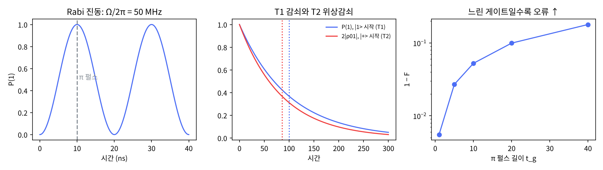

# 7장 물리층 한눈에

2026-10-27 · Gosh

양자컴퓨팅 입문·심화서 · 1부 게이트와 회로(마지막 장) · 이 장을 마치면 "게이트 = 해밀토니안의 시간 진화"와 T1·T2가 회로 설계에 어떻게 들어오는지 설명할 수 있다.

## 1. 요약

1~6장의 게이트는 행렬이었다. 이 장은 그 행렬이 어디서 오는지 한 번만 내려가 본다: 게이트는 큐비트에 해밀토니안 H를 시간 t 동안 걸었을 때의 진화 U = exp(−iHt)이고, 하드웨어에서 '게이트를 건다'는 것은 '펄스를 쏜다'는 뜻이다. 그리고 펄스가 지나가는 동안에도, 펄스가 없는 동안에도 큐비트는 환경과 상호작용해 정보를 잃는다 — 그 속도가 T1(에너지 이완)과 T2(위상 결맞음 손실 = 결어긋남)다.

numpy로 확인한 것: 공진 구동 H = (Ω/2)X를 Ω/2π = 50 MHz로 10 ns 걸면 정확히 X 게이트(전역 위상 −i)가 나오고, 20 ns 걸면 −I가 된다(스핀의 2π 회전은 −1). 펄스의 위상 φ를 바꾸면 회전축이 X에서 Y로 돈다 — 2장의 '가상 Rz'가 공짜인 이유다. 이조(detuning) Δ가 있으면 P(1)의 최대가 Ω²/(Ω²+Δ²)로 떨어진다. Lindblad 방정식을 4차 Runge–Kutta로 적분하면 |1⟩의 점유 확률은 e^{−t/T1}, |+⟩의 결맞음은 e^{−t/T2}로 줄고, 1/T2 = 1/(2T1) + 1/Tφ가 수치로 맞는다. 이 해가 5장의 Kraus 표현(reset)과 같은 언어로 쓴 진폭 감쇠·위상 감쇠 채널과 같다는 것도 확인했다. 마지막으로 π 펄스를 1에서 40 시간 단위로 늘리며 X 게이트의 평균 충실도를 재면 1−F ≈ (t_g/3)(1/T1 + 1/Tφ)로 선형 증가한다 — 느린 게이트는 결맞음에 먹힌다.

이 장의 메시지는 세 줄이다. 게이트 = 펄스 = 해밀토니안 진화. 오류의 1차 원천은 T1·T2이고 회로 깊이 × 게이트 시간이 T2에 비해 작아야 한다. 노이즈는 Lindblad(연속)로도 Kraus(이산)로도 쓸 수 있고 둘은 같은 것이다. 14장 하드웨어 실행과 25장 오류 완화가 이 세 줄 위에 선다.

## 2. 직관 먼저 — Quirk에 없는 것

Quirk의 회로는 게이트 사이에 아무 일도 일어나지 않는다. 게이트는 순간적이고 완벽하며, 전선은 상태를 그대로 전달한다. 실제 큐비트는 둘 다 아니다. 아래 링크로 그 차이를 본다.

- [Quirk: X^t(시간에 따라 도는 X 거듭제곱) + Bloch 구](https://algassert.com/quirk#circuit={"cols":[["X^t"],["Bloch"]]}) — `X^t`는 시간 t에 따라 계속 도는 X 거듭제곱이다. Bloch 구의 화살표가 x축을 둘러싸고 도는 것이 Rabi 진동이고, 화살표가 반 바퀴 돌았을 때(t = 1)가 X 게이트다. 하드웨어의 X 게이트는 이 애니메이션을 30~60 ns(Heron r2 중앙값 32 ns, 14장)에 걸쳐 실제로 한다.

Quirk이 못 보여 주는 두 가지를 상상으로 보충한다. (1) 화살표가 도는 동안 길이가 줄어든다 — 구 표면에서 안으로 파고든다(T2, 결어긋남). 순수 상태는 구 표면, 혼합 상태는 구 내부다(3장 부분 추적). (2) 화살표가 천천히 북극(|0⟩)으로 끌려 올라간다 — 에너지를 잃고 바닥상태로 떨어진다(T1). 이 두 운동은 펄스가 있든 없든 항상 진행된다. 5절 그림 가운데가 이 두 곡선이다.

비유: 그네를 생각하자. 손으로 밀어 주는 것이 펄스(구동 해밀토니안), 미는 박자가 그네의 고유 진동수와 맞아야 크게 흔들린다(공진 — 이조가 있으면 진폭이 작다). 밀기를 멈추면 마찰로 점점 멈춘다(T1). 바람이 불규칙하게 불면 진폭은 그대로인데 박자가 흐트러진다(Tφ, 순수 위상 감쇠). 비유가 깨지는 곳: 그네의 위상은 한 번에 읽을 수 있지만 큐비트의 위상은 여러 번 재서 통계로만 알 수 있다(1·5장).

## 3. 정의와 수식

**닫힌 계: Schrödinger 방정식.** 환경과 상호작용이 없는 큐비트는 해밀토니안 H(에너지 연산자, 에르미트 행렬)가 정하는 대로 진화한다(ħ = 1).

```latex
i\frac{d}{dt}|\psi\rangle = H|\psi\rangle \quad\Rightarrow\quad |\psi(t)\rangle = U(t)|\psi(0)\rangle,\quad U(t)=e^{-iHt}\ (H\text{ 시간 불변)}
```

H가 에르미트이면 U는 유니터리다 — 1~2장에서 "게이트는 유니터리"라고 한 것의 물리적 이유다. 2장의 Rx(θ) = exp(−iθX/2)는 H = (Ω/2)X를 시간 t = θ/Ω 동안 건 것이다. 트랜스몬 큐비트의 실제 해밀토니안은 H = −(ω₀/2)Z + Ω cos(ωt + φ) X 꼴이고(ω₀/2π ≈ 4~6 GHz, 큐비트 주파수로 마이크로파를 쏜다), ω₀로 도는 회전 틀(rotating frame)으로 옮기고 빠르게 진동하는 항을 버리면(RWA) 위의 간단한 꼴이 된다:

```latex
H_{\text{rot}} = \frac{\Delta}{2}Z + \frac{\Omega}{2}\left(\cos\phi\,X + \sin\phi\,Y\right),\qquad \Delta = \omega_0-\omega
```

여기서 세 가지가 나온다. 펄스 진폭 Ω와 길이 t가 회전각 θ = Ωt를 정한다(π 펄스 = X). 펄스의 위상 φ가 회전축을 정한다 — φ = 0이 Rx, φ = π/2가 Ry. 이조 Δ ≠ 0이면 축이 기울어 완전한 반전이 안 된다(P(1)최대 = Ω²/(Ω²+Δ²)). **가상 Rz**(2장)는 여기서 나온다: 뒤따르는 모든 펄스의 φ를 λ만큼 바꾸면 Rz(λ)를 건 것과 같다. 펄스를 안 쏘니 시간 0, 오류 0이다.

**열린 계: Lindblad 방정식.** 큐비트가 환경과 약하게, 기억 없이(마르코프) 상호작용하면 상태벡터 대신 밀도행렬 ρ(3장)가 필요하고, 그 진화는

```latex
\dot\rho = -i[H,\rho] + \sum_k \left( L_k\rho L_k^\dagger - \tfrac12\{L_k^\dagger L_k,\rho\}\right)
```

붕괴 연산자(collapse operator) L_k가 노이즈 종류를 정한다. 큐비트 하나에 중요한 두 개:

| 노이즈 | L | 효과 | 시간 상수 |
| --- | --- | --- | --- |
| 에너지 이완 | √(1/T1)·σ₋ = √(1/T1)·\|0⟩⟨1\| | \|1⟩ → \|0⟩, P(1) ∝ e^{−t/T1}; 비대각도 e^{−t/2T1} | T1 |
| 순수 위상 감쇠 | √(1/2Tφ)·Z | 대각 보존, 비대각 ρ₀₁ ∝ e^{−t/Tφ} | Tφ |

둘을 합치면 비대각 원소(결맞음)는 e^{−t/T2}로 줄고

```latex
\frac{1}{T_2} = \frac{1}{2T_1} + \frac{1}{T_\varphi}\qquad\Rightarrow\qquad T_2 \le 2T_1
```

이것이 하드웨어 사양서의 T1·T2다. IBM Heron의 중앙값이 T1 ≈ 100~200 μs, T2 ≈ 100 μs 규모이고 단일 큐비트 게이트가 ≈ 30~60 ns, CZ가 ≈ 70 ns(Heron r2 68 ns)이므로 게이트 하나당 t_g/T2 ≈ 10⁻⁴~10⁻³ — 이것이 게이트 오류율의 바닥이다(14장에서 공개 사양서의 값을 읽는다).

**Kraus와의 관계.** Lindblad 방정식을 시간 t만큼 풀면 하나의 CPTP 사상 ρ → Σ K_i ρ K_i†가 된다. 에너지 이완 → 진폭 감쇠 채널(γ = 1 − e^{−t/T1}), 순수 위상 감쇠 → 위상 감쇠 채널(λ = 1 − e^{−2t/Tφ}). 5장의 reset이 두 Kraus 연산자였던 것과 같은 언어다. Lindblad는 "연속 시간의 미분방정식", Kraus는 "게이트 한 개 단위의 이산 맵" — 펄스 시뮬레이터(QuTiP)는 앞의 것을, 회로 시뮬레이터(Qiskit Aer)는 뒤의 것을 쓴다. 4절에서 둘이 같은 것임을 수치로 확인한다.

**교과서 비교.** N&C 7장은 물리 구현(광학·이온 트랩·NMR)을 다루지만 2000년 기준이라 초전도 큐비트가 없다; 그 대신 7.7.2절 NMR의 펄스→회전 대응이 이 장의 Rabi 유도와 같다. N&C 8장(양자 노이즈, 연산자-합 표현, 8.3절 진폭·위상 감쇠, 8.4.1 마스터 방정식)이 이 장의 Kraus 쪽 기준이다. KLM은 물리층을 거의 다루지 않고(10장 오류 정정에서 노이즈 모델만) Lindblad도 없다. 초전도 큐비트의 1차 출처는 Krantz et al. 2019 리뷰이고, 이 장의 해밀토니안·T1·T2 정의는 그 리뷰와 QuTiP 문서를 따른다.

## 4. 회로 구성 — numpy 적분과 QuTiP

**numpy 구현(실행 완료).** 전체 스크립트는 `ch07_physical_layer.py`다. 이 장은 게이트를 행렬로 주지 않고 해밀토니안에서 만든다. 핵심 세 조각:

```python
from scipy.linalg import expm
Omega = 2*np.pi * 0.05                       # Rabi 주파수 50 MHz (rad/ns)
U = lambda t: expm(-1j * (Omega/2) * X * t)  # 공진 구동의 시간 진화 = Rx(Ωt)
t_pi = np.pi / Omega                         # π 펄스 = 10 ns
assert np.allclose(U(t_pi), -1j*X)           # 전역 위상 빼고 X

def lindblad_rhs(rho, Hs, cops):             # dρ/dt
    d = -1j * (Hs @ rho - rho @ Hs)
    for L in cops:
        LdL = L.conj().T @ L
        d += L @ rho @ L.conj().T - 0.5 * (LdL @ rho + rho @ LdL)
    return d
def mesolve(rho0, Hs, cops, ts):             # 4차 Runge–Kutta: QuTiP mesolve 의 최소 대체
    ...

sm = np.array([[0, 1], [0, 0]])               # σ- = |0><1|
cops = [np.sqrt(1/T1)*sm, np.sqrt(1/(2*Tphi))*Z]
rho_t = mesolve(rho_plus, 0*Z, cops, tt)     # |+> 의 결어긋남
```

연산자 σ₋ = |0⟩⟨1|가 에너지 이완이다(|1⟩을 |0⟩으로 내린다). Z의 계수가 √(1/2Tφ)인 것은 D[Z]ρ의 비대각 원소가 −2ρ₀₁이기 때문이다 — 계수를 잘못 잡으면 T2가 2배 틀린다(이 장을 쓰며 같은 종류의 실수를 Kraus λ에서 한 번 했다; §10 참고). 평균 게이트 충실도는 Bloch 구 여섯 축 상태(±x, ±y, ±z)에 대한 상태 충실도의 평균으로 구했다 — 단일 큐비트에서 이 여섯 상태는 2-design이라 정확한 평균이다.

**QuTiP 5 스니펫(작성됨, 미실행).** 같은 계산을 QuTiP은 세 줄로 한다. `mesolve`가 Lindblad 적분기이고 `e_ops`가 기대값 기록이다.

```python
# qutip==5.2.x — 작성됨, 미실행
import numpy as np
from qutip import sigmax, sigmay, sigmaz, destroy, basis, mesolve, expect, Bloch
# 주의: QuTiP 의 sigmam() 은 |1><0| (스핀 규약: basis(2,0) 이 spin-up) — 큐비트 감쇠 |1>→|0> 에는 destroy(2) = |0><1| 을 쓴다

# 1) Rabi 진동: H = (Ω/2) σx, |0> 에서 시작
Omega = 2*np.pi*0.05
H = 0.5*Omega*sigmax()
ts = np.linspace(0, 40, 401)
res = mesolve(H, basis(2, 0), ts, c_ops=[], e_ops=[(1 - sigmaz())/2])   # P(1)
print(res.expect[0][100])        # t=10 ns → 1.0

# 2) T1·T2: 붕괴 연산자를 넣으면 Lindblad 가 된다
T1, Tphi = 100.0, 150.0
c_ops = [np.sqrt(1/T1)*destroy(2), np.sqrt(1/(2*Tphi))*sigmaz()]
plus = (basis(2, 0) + basis(2, 1)).unit()
tt = np.linspace(0, 300, 601)
res = mesolve(0*sigmaz(), plus, tt, c_ops=c_ops, e_ops=[sigmax(), sigmaz()])
print(res.expect[0][::100])       # <X> = 2|ρ01| 가 e^{-t/T2} 로

# 3) Bloch 구 애니메이션 재료
res = mesolve(H, plus, ts, c_ops=c_ops, e_ops=[sigmax(), sigmay(), sigmaz()])
b = Bloch(); b.add_points(res.expect); b.save("ch07_bloch.png")
```

**qutip-qip: 회로를 펄스로 내려 보내기(작성됨, 미실행).** qutip-qip의 `Processor`는 회로를 받아 게이트를 구동 해밀토니안의 펄스 시퀀스로 컴파일하고 Lindblad로 시뮬레이션한다. 이 책에서 게이트 모델과 물리 모델을 잇는 유일한 도구다.

```python
# qutip-qip==0.4.x — 작성됨, 미실행
from qutip import basis, fidelity
from qutip_qip.circuit import QubitCircuit
from qutip_qip.device import LinearSpinChain

qc = QubitCircuit(1); qc.add_gate("X", targets=0)
proc = LinearSpinChain(num_qubits=1, sx=0.25, t1=100.0, t2=85.7)   # sx: 구동 세기 → 펄스 길이
proc.load_circuit(qc)                 # 게이트 → 펄스 컴파일
fig, ax = proc.plot_pulses()          # 어떤 해밀토니안 항이 언제 켜지는지
res = proc.run_state(init_state=basis(2, 0))
print(fidelity(res.states[-1], basis(2, 1))**2)   # qutip.fidelity 는 √F 를 주므로 제곱해야 5절의 F = <1|ρ|1> 와 비교된다; T1/T2 때문에 1 보다 살짝 작다
```

`sx`를 줄이면 펄스가 길어지고 충실도가 떨어진다 — 5절 마지막 실험을 qutip-qip으로 다시 하는 것이 연습이다. 참고로 Qiskit은 펄스 모듈(`qiskit.pulse`)을 2.0에서 제거했고, 펄스 수준 시뮬레이션은 별도 패키지 Qiskit Dynamics로 간다. 이 책은 펄스 수준을 QuTiP으로 통일한다.

## 5. 시뮬레이션 결과

모든 수치는 `ch07_physical_layer.py`의 출력이다(실행 5초). 시간 단위는 1번이 ns, 2~4번은 "T1 = 100인 임의 단위" — 비율만 중요하다.

**Rabi 진동과 펄스 → 게이트.** Ω/2π = 50 MHz에서 π 펄스 = 10.0 ns, P(1)이 정확히 1에 닿는다.

| 펄스 | U(t) | 등가 게이트 |
| --- | --- | --- |
| t_π/2 = 5 ns | Rx(π/2) | √X |
| t_π = 10 ns | −i·X | X |
| 2t_π = 20 ns | −I | I (전역 위상 −1, 연습문제 1) |
| t_π, 위상 φ = π/2 | −i·Y | Y |

이조 Δ가 있으면 진폭이 줄어든다: Δ/2π = 0, 25, 50 MHz에서 P(1) 최대 = 1.000, 0.800, 0.500. 이론값 Ω²/(Ω²+Δ²)과 네 자리 일치. 큐비트 주파수를 정확히 모르면 X 게이트가 안 된다 — 14장에서 보게 될 보정(calibration)이 필요한 이유.

**T1·T2 감쇠.** T1 = 100, Tφ = 150 → T2 = 85.7(≤ 2T1 = 200).

| 시작 상태 | 관측량 | t = T1 또는 T2 에서 | 이론 |
| --- | --- | --- | --- |
| \|1⟩ | P(1) | 0.3679 (t = T1) | e⁻¹ = 0.3679 |
| \|+⟩ | \|ρ₀₁\| | 0.1833 (격자점 t = 86 ≈ T2) | 0.5e⁻¹ = 0.1839 |
| \|+⟩ | Bloch 벡터, t = 300 | (0.030, 0, 0.950) | x → 0, z → +1 |

마지막 행이 중요하다: 위상 감쇠는 Bloch 벡터를 z축으로 누이고(구 표면 → 내부), 에너지 이완은 북극으로 끌어 올린다(내부 → 다시 표면의 |0⟩). 해가 정확한지는 Kraus로 검산했다: t = 70에서 진폭 감쇠(γ = 0.5034)와 위상 감쇠(λ = 1 − e^{−2t/Tφ})을 합성한 밀도행렬이 Lindblad 적분 결과와 10⁻⁶ 안에서 같고, |ρ₀₁| = 0.2210 = 0.5e^{−t/T2}.

**게이트 충실도 vs 펄스 길이.** π 펄스를 길이 t_g로 늘리면서(Ω = π/t_g) T1·Tφ 아래 Lindblad로 적분한 X 게이트의 평균 충실도:

| t_g | F | 1 − F | (t_g/3)(1/T1 + 1/Tφ) |
| --- | --- | --- | --- |
| 1 | 0.9945 | 0.0055 | 0.0056 |
| 5 | 0.9730 | 0.0270 | 0.0278 |
| 10 | 0.9474 | 0.0526 | 0.0556 |
| 20 | 0.9004 | 0.0996 | 0.1111 |
| 40 | 0.8206 | 0.1794 | 0.2222 |

오류는 펄스 길이에 선형이고, 1차 공식 1 − F ≈ (t_g/3)(1/T1 + 1/Tφ)가 짧은 펄스에서 정확하다(긴 펄스에서는 지수 포화로 공식보다 작다). 실제 하드웨어로 환산하면 t_g = 40 ns, T1 = Tφ = 100 μs에서 1 − F ≈ 2.7×10⁻⁴ — IBM이 보고하는 단일 큐비트 오류율 규모다. 그러나 더 빠른 펄스가 항상 나은 것은 아니다: Ω가 커지면 트랜스몬의 세 번째 준위로 새는 누설(leakage)이 커진다(7절). 실제 게이트 길이는 이 둘의 타협이다.



그림: 왼쪽 Rabi 진동과 π 펄스 위치, 가운데 T1 감쇠와 T2 결어긋남(점선이 각 시간 상수), 오른쪽 펄스 길이에 따른 1 − F.

## 6. 다른 SDK 대응 — Qiskit Aer

이 장에서 Qiskit Aer를 고른 이유는, 이 책의 회로 대부분이 Qiskit으로 쓰이고 14장이 실제 장비의 T1·T2를 Aer의 `NoiseModel`로 가져오므로, 이 장의 T1·T2가 회로 시뮬레이터에 어떤 모양으로 들어가는지를 같은 도구로 미리 봐 두어야 하기 때문이다. 펄스 수준(QuTiP)을 벗어나면 회로 시뮬레이터는 노이즈를 "게이트 뒤에 붙는 Kraus 채널"로 넣는다. 같은 T1·T2·t_g를 넣으면 같은 채널이 나와야 하고, 5절의 1 − F 표가 그 검산 기준이다.

| SDK | 노이즈 넣는 방법 | T1·T2 → 채널 | 시뮬레이터 |
| --- | --- | --- | --- |
| QuTiP / qutip-qip | `c_ops`(Lindblad), `Processor(t1=, t2=)` | 자동(연속 시간) | `mesolve`, 펄스 수준 |
| Qiskit Aer | `NoiseModel` + `thermal_relaxation_error(t1, t2, time)` | 게이트별 시간으로 Kraus 생성 | `AerSimulator(noise_model=)` |

```python
# qiskit-aer==0.17.x — 작성됨, 미실행.  T1=100us, T2=85.7us, X 게이트 40ns
from qiskit import QuantumCircuit
from qiskit_aer import AerSimulator
from qiskit_aer.noise import NoiseModel, thermal_relaxation_error
err = thermal_relaxation_error(t1=100e3, t2=85.7e3, time=40)         # ns 단위
nm = NoiseModel(); nm.add_all_qubit_quantum_error(err, ['x', 'sx'])
qc = QuantumCircuit(1, 1); qc.x(0); qc.measure(0, 0)
res = AerSimulator(noise_model=nm).run(qc, shots=100_000, seed_simulator=7).result()
print(res.get_counts())            # '0' 이 ≈ 4×10⁻⁴ (= t/T1) 비율로 섞인다 — 5절의 평균 게이트 오류 2.7×10⁻⁴와는 다른 양(population 손실 vs 평균 충실도)
```

차이의 핵심: QuTiP은 붕괴 연산자를 받아 연속 시간으로 적분하고, Qiskit Aer는 T1·T2·게이트 시간을 받아 게이트 뒤에 붙일 Kraus 채널을 만들어 준다(3절의 γ, λ 환산을 대신 해 준다). Aer 쪽은 "게이트가 끝난 뒤 노이즈가 한 번에 온다"는 근사를 쓰지만, 단일 큐비트 평균 충실도에서는 이 근사가 Lindblad 적분과 소수점 3자리까지 같다(검산: t_g = 40에서 1−F가 0.17925 vs 0.17937, 차이 1.2×10⁻⁴). 5절 표에서 공식과 실측이 벌어지는 것은 그 근사 때문이 아니라 1차 공식이 지수의 포화를 무시하기 때문이다. 14장의 리허설은 공개 중앙값으로 만든 numpy 노이즈 모델로 하고, 계정이 열리면 `NoiseModel.from_backend(backend)`(제출 스크립트의 fake 모드)로 한 번 더 한다 — 실제 장비의 T1·T2·게이트 오류·판독 오류를 그대로 가져온다.

## 7. 한계와 반례

**이 장은 큐비트 하나의 2준위 토이 모델이다.** 트랜스몬은 2준위계가 아니라 비조화 진동자다 — |2⟩, |3⟩…가 있고 위로 갈수록 준위 간격이 조금씩 줄어든다(비조화성 α/2π ≈ −200~−300 MHz). π 펄스를 빠르게(Ω 크게) 쏘면 펄스의 주파수 폭이 넓어져 |1⟩→|2⟩ 전이도 건드린다. 이것이 누설(leakage)이고, 계산 공간 밖으로 나간 정보는 어떤 큐비트 노이즈 채널로도 표현되지 않는다. 5절의 "짧을수록 좋다"는 결론이 깨지는 지점이며, 실제 펄스는 DRAG(Derivative Removal by Adiabatic Gate) 같은 모양 보정으로 누설을 억제한다. 이 책은 여기까지 내려가지 않는다 — "게이트 시간은 하드웨어가 정한 상수"로 받아들이고 14장에서 그 상수를 읽는다.

**2큐비트 게이트의 물리는 다루지 않았다.** CZ나 CNOT은 두 큐비트를 결합시키는 상호작용 해밀토니안(정적 결합 J·ZZ, 또는 조율 가능한 커플러)을 짧은 시간 켜는 것이고, 켜지 않았을 때도 남는 잔류 결합(ZZ 크로스토크)이 이웃 큐비트의 위상을 어긋나게 한다. 14장에서 사양서로 확인할 "2큐비트 게이트 오류율이 단일의 ≈10배"라는 사실의 원인이 여기 있지만, 이 책은 그 오류율을 사양서 숫자로 받는다.

**마르코프 가정의 반례.** Lindblad 방정식은 환경이 기억이 없다고 가정한다. 초전도 큐비트의 위상 잡음은 1/f 스펙트럼(느린 요동)이 크고, 느린 잡음은 기억이 있다(비마르코프). 그 결과가 Ramsey 실험의 T2\*(자유 유도 감쇠)와 에코 실험의 T2(echo)가 다르다는 것이다 — 느린 잡음은 중간에 π 펄스를 넣어 되돌릴 수 있기 때문에 T2(echo) > T2\*다. 이 장의 Lindblad 모델은 이 차이를 낼 수 없다(지수 감쇠는 되돌릴 수 없다). 사양서의 T2가 어느 쪽인지 확인해야 하고, 동적 디커플링(25장)이 효과가 있는 이유가 바로 비마르코프 잡음이다. 반대로 디커플링이 효과가 없다면 잡음이 마르코프에 가깝다는 힌트다.

**Kraus가 모든 오류를 표현하지는 않는다.** 회로 시뮬레이터의 "게이트 뒤 채널" 모델은 오류가 게이트마다 독립이라고 가정한다. 보정이 틀린 펄스(이조 Δ, 진폭 오차)는 매번 같은 방향으로 틀리는 결맞은(coherent) 오류이고, 이것은 n번 반복하면 오류 진폭이 n배(확률은 n²배)로 착실히 쌓인다 — 독립적인 채널 노이즈가 진폭으로는 √n배(확률로는 n배)로 쌓이는 것과 다르다. 무작위 컴파일링(25장)이 결맞은 오류를 확률적 오류로 바꾸는 기법이다. 이 장의 1번 실험(이조 Δ에서 P(1) 최대 < 1)이 결맞은 오류의 가장 단순한 예다.

**미실행 항목.** QuTiP·qutip-qip·Aer 스니펫은 작성만 됐다. 특히 qutip-qip의 `LinearSpinChain(t1=, t2=)`이 5절의 1 − F 표를 재현하는지가 다음 세션의 검산 항목이다.

## 8. 연습문제와 해답

**문제 1 (자작).** 2π 펄스(π 펄스를 두 번)를 걸면 왼쪽 그림에서 P(1)이 0으로 돌아온다. 그런데 유니터리는 I가 아니라 −I다. 이 −1은 관측될 수 있는가?

*해답.* 큐비트 하나만 보면 관측되지 않는다 — −I는 전역 위상이고(1장), 모든 측정 확률이 같다. 그러나 **제어 게이트로 바꾸면 관측된다**: 제어 큐비트가 |+⟩일 때 표적에 "2π 펄스"를 걸면 제어가 |1⟩인 가지만 −1을 얻어 제어 큐비트가 |−⟩가 된다(위상 되돌림, 8장). 수학적으로 Rx(2π) = exp(−iπX) = −I인 이유는 Rx(θ)가 스핀 1/2의 회전 표현(SU(2))이고 SU(2)는 회전군 SO(3)을 두 번 덮기 때문이다 — Bloch 구에서 2π 돌아 제자리인 회전이 상태벡터에서는 −1이다. 2장에서 Rz(2π) = −I를 본 것과 같은 사실이고, 스크립트 1번이 U(2t_π) = −I를 확인한다. 중성자 간섭계로 1975년에 실제 관측된 현상이다(Rauch et al.; Werner et al.).

**문제 2 (N&C 8.3.5–8.3.6 연장).** 1/T2 = 1/(2T1) + 1/Tφ를 Lindblad 방정식에서 유도하고 T2 ≤ 2T1을 보여라.

*해답.* ρ₀₁(비대각 원소)의 시간 미분을 각 붕괴 연산자에 대해 계산한다. L = √γ₁·σ₋에 대해 L†L = γ₁|1⟩⟨1|이고 LρL†는 |0⟩⟨0| 성분만 있으므로 비대각에는 −½{L†L, ρ}만 기여: dρ₀₁/dt = −(γ₁/2)ρ₀₁. L = √(γφ/2)·Z에 대해 ZρZ의 비대각은 −ρ₀₁, L†L = (γφ/2)I이므로 dρ₀₁/dt = (γφ/2)(−ρ₀₁ − ρ₀₁) = −γφρ₀₁. 합치면 ρ₀₁(t) = ρ₀₁(0)·e^{−(γ₁/2 + γφ)t}, 즉 1/T2 = 1/(2T1) + 1/Tφ. γφ ≥ 0이므로 1/T2 ≥ 1/(2T1), 즉 T2 ≤ 2T1. 등호는 순수 위상 감쇠가 없을 때다 — 에너지 이완만으로도 결맞음은 깨진다(|1⟩ 성분이 사라지면 중첩도 사라진다). 직관: T1 과정은 진폭 √(1−γ)를 줄이고 확률은 진폭의 제곱이므로 결맞음의 감쇠율이 확률 감쇠율의 절반 — 그래서 2T1이다. 스크립트 2번이 T2 = 85.7(T1 = 100, Tφ = 150)을 수치로 확인한다. 사양서에서 T2 > 2T1을 보면 측정 오류다.

**문제 3 (자작).** |+⟩에 위상 감쇠 채널(λ = 1/2)을 걸었다. 밀도행렬, 순도 Tr ρ², Bloch 벡터 길이를 구하고, 같은 채널을 한 번 더 걸면 어떻게 되는지 말하라.

*해답.* 위상 감쇠는 대각을 보존하고 비대각에 √(1−λ)를 곱한다. ρ = [[0.5, 0.5√0.5], [0.5√0.5, 0.5]] = [[0.5, 0.3536], [0.3536, 0.5]]. 순도 Tr ρ² = 2(0.25 + 0.125) = 0.75, Bloch 벡터 = (2ρ₀₁, 0, 0) = (0.707, 0, 0), 길이 0.707 = √(1−λ). 순도와 Bloch 길이 r의 관계 Tr ρ² = (1 + r²)/2가 맞는다(ρ = (I + r·σ)/2를 제곱해 대각합을 취하면 나온다). 같은 채널을 한 번 더 걸면 비대각이 다시 √0.5배: ρ₀₁ = 0.25, Bloch 길이 0.5, 순도 0.625. 지수 감쇠의 이산 버전이다 — 채널을 n번 합성하면 √(1−λ)ⁿ, 즉 시간 nt의 Lindblad 해와 같다. 이것이 "게이트마다 채널 한 번" 모델(6절)이 정당한 이유이고, 동시에 한계다: 채널이 매번 독립이어야 합성이 지수가 된다(7절 비마르코프 반례). 마지막으로, λ = 1이면 ρ = I/2 — 완전 혼합, 고전 동전 던지기. 1장에서 "큐비트가 확률적 비트와 다른 이유는 위상"이라고 한 것의 반대 방향: 위상을 잃으면 확률적 비트가 된다.

## 9. 학습 노트

- **게이트 = exp(−iHt)** — 유니터리는 에르미트 해밀토니안의 시간 진화다. 펄스 진폭×길이 = 회전각, 펄스 위상 = 회전축. 2장의 Rx·Ry와 가상 Rz가 여기서 나온다. 비유: 그네 밀기 — 박자(공진)와 미는 방향(위상)이 결과를 정한다. 깨지는 곳: 양자 위상은 한 번에 읽을 수 없다. 더 깊이: Krantz et al. 2019 §IV(단일 큐비트 게이트), rotating wave approximation.
- **Lindblad 방정식과 붕괴 연산자** — 열린 계의 밀도행렬 진화. σ₋가 T1(에너지 이완), Z가 Tφ(위상 감쇠). 1/T2 = 1/(2T1) + 1/Tφ → T2 ≤ 2T1(연습문제 2). QuTiP `mesolve`가 이것을 푸는 도구이고, 이 장은 RK4 십여 줄로 대신했다. 더 깊이: N&C 8.4.1, QuTiP Users Guide "Lindblad Master Equation Solver".
- **Lindblad ↔ Kraus** — 같은 노이즈의 연속형과 이산형. γ = 1 − e^{−t/T1}, λ = 1 − e^{−2t/Tφ}로 환산하면 10⁻⁶ 안에서 일치. 펄스 시뮬레이터는 앞을, 회로 시뮬레이터(Qiskit Aer)는 뒤를 쓴다. 계수 하나 틀리면 T2가 2배 틀린다 — 이 장에서 Kraus λ에서 실제로 한 번 틀렸다.
- **1 − F ≈ (t_g/3)(1/T1 + 1/Tφ)** — 게이트 오류의 결맞음 바닥. 회로의 총 시간 × (1/T1 + 1/Tφ)/3이 회로 전체의 결어긋남 몫의 1차 추정이다. 14장의 회로들은 짧아서 이 항보다 게이트 오류와 판독 오류가 지배한다(14장 5절). 비유: 얼음 위에서 그림 그리기 — 느릴수록 녹는다. 깨지는 곳: 너무 빠르면 누설(7절).
- **결맞은 오류 vs 확률적 오류** — 보정 오차는 n번에 n²배, 채널 노이즈는 n배로 쌓인다. 회로 시뮬레이터의 노이즈 모델은 뒤의 것만 표현한다. 더 깊이: randomized compiling (Wallman & Emerson 2016), 25장.

## 10. 출처와 환경

**실행 환경.** Python 3.13.17, numpy 2.5.3, scipy 1.18.1(`expm`), matplotlib 3.11.2, `seed=7`. 스크립트 `ch07_physical_layer.py`(실행 5초), 그림 `ch07_results.png`. QuTiP 5.2.x·qutip-qip 0.4.x·qiskit-aer 0.17.x 코드는 작성만 되고 미실행 — 작업계획서 §7 메모 참조.

**작성 중 발견한 오류(기록).** 위상 감쇠 Kraus의 λ를 처음에 1 − e^{−t/Tφ}로 뒀더니 Lindblad 해와 비대각이 어긋났다(0.279 vs 0.221). 비대각에 곱해지는 것이 √(1−λ)이므로 λ = 1 − e^{−2t/Tφ}이 맞다. "채널 확률"과 "결맞음 감쇠 인자"는 다른 것이다 — 채널 확률을 직접 계산해 넣는 SDK에서 틀리기 쉬운 지점.

**출처.**

- Nielsen & Chuang, 7.7절(NMR 펄스→회전), 8.2–8.4절(연산자-합 표현, 진폭·위상 감쇠, 마스터 방정식). 등급 A.
- Krantz, P. et al., "A quantum engineer's guide to superconducting qubits", Appl. Phys. Rev. 6, 021318 (2019) — 트랜스몬 해밀토니안, 단일·2큐비트 게이트, T1·T2·T2\*, DRAG. 등급 A.
- Lindblad, G., Commun. Math. Phys. 48, 119 (1976); Gorini–Kossakowski–Sudarshan, J. Math. Phys. 17, 821 (1976). 등급 A.
- [QuTiP Users Guide — Lindblad Master Equation Solver](https://qutip.readthedocs.io/en/stable/guide/dynamics/dynamics-master.html). 등급 A.
- [qutip-qip — Pulse-level circuit simulation (Processor)](https://qutip-qip.readthedocs.io/en/stable/qip-processor.html); Li, B. et al., "Pulse-level noisy quantum circuits with QuTiP", Quantum 6, 630 (2022), arXiv:2105.09902. 등급 A.
- [Qiskit Aer — thermal_relaxation_error](https://qiskit.github.io/qiskit-aer/stubs/qiskit_aer.noise.thermal_relaxation_error.html). 등급 A.
- Rauch, H. et al., Phys. Lett. A 54, 425 (1975); Werner, S. A. et al., Phys. Rev. Lett. 35, 1053 (1975) — 스핀의 2π 회전 = −1 관측(연습문제 1). 등급 A.
- Wallman & Emerson, "Noise tailoring for scalable quantum computation via randomized compiling", Phys. Rev. A 94, 052325 (2016). 등급 A.
- [Quirk](https://algassert.com/quirk) — 2절 링크. 등급 B.
