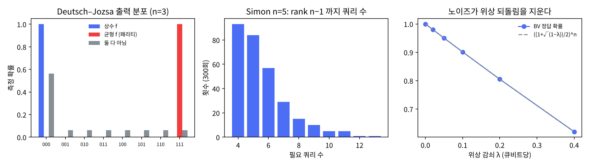

# 8장 오라클과 위상 되돌림

2026-10-27 · Gosh

양자컴퓨팅 입문·심화서 · 2부 대표 알고리즘(첫 장) · 이 장을 마치면 임의의 불 함수를 오라클 회로로 만들고, 위상 되돌림으로 Deutsch–Jozsa·Bernstein–Vazirani·Simon을 직접 조립할 수 있다.

## 1. 요약

2부는 "게이트로 알고리즘을 짠다"의 연습이다. 첫 장은 가장 오래된 세 알고리즘 — Deutsch–Jozsa(1992), Bernstein–Vazirani(1993), Simon(1994) — 을 하나의 틀로 조립한다. 세 개 모두 "블랙박스 함수 f에 질문할 수 있다"는 오라클 설정이고, 회로는 정확히 같다: H^{⊗n} → 오라클 → H^{⊗n} → 측정. 다른 것은 f에 걸린 약속(상수/균형, 선형, 주기적)과 측정 결과를 읽는 고전 후처리뿐이다.

공통 엔진은 **위상 되돌림(phase kickback)**: 비트 뒤집기 오라클 |x⟩|y⟩ → |x⟩|y⊕f(x)⟩의 보조 큐비트에 |−⟩를 넣으면 보조는 그대로고 입력 쪽에 (−1)^{f(x)}가 붙는다. 이렇게 얻은 위상 패턴을 H^{⊗n}이 한 번에 간섭시켜 측정 가능한 비트로 바꾼다. 1장의 H·H = I 간섭과 전역 위상 vs 상대 위상, 7장 연습문제 1의 "−1은 제어하면 보인다"가 여기서 합쳐진다.

numpy로 확인한 것: (1) 진리표에서 오라클 치환 행렬을 만들고 U_f(I⊗|−⟩) = U_phase⊗|−⟩를 행렬로 확인. (2) Deutsch–Jozsa 3비트: 상수 함수 2개와 균형 함수 70개 전부를 1쿼리로 판별(P(00…0) = 1 또는 0). (3) Bernstein–Vazirani 6비트: 비밀 문자열 64가지 전부 1쿼리에 확률 1로 복원(고전은 6쿼리). (4) Simon 5비트: 샘플 y가 항상 y·s = 0을 만족하고, GF(2) 가우스 소거로 영공간을 풀면 300회 전부 성공, 평균 5.6쿼리(하한 n−1 = 4, 단번에 끝날 확률 표본값 0.310 vs 이론 0.308). (5) 7장의 위상 감쇠를 오라클 뒤에 넣으면 BV 성공률이 ((1+√(1−λ))/2)^n으로 떨어진다 — 노이즈는 정확히 위상을 지우므로 위상 되돌림을 지운다.

이 장의 반례는 정직해야 한다: DJ와 BV는 고전 확률 알고리즘도 쉽게 푸는 문제고(가속이 '결정론적 쿼리 수'에서만 있다), Simon은 진짜 지수 분리이지만 응용이 없다. 그러나 Simon의 구조 — 숨은 부분군 찾기 — 가 Shor(11장)로 직행한다. 15장에서 "어디서 가속이 왔는가"를 따질 때 이 세 알고리즘이 최소 예제다.

## 2. 직관 먼저 — Quirk에서 위상 되돌림 보기

위상 되돌림은 CNOT 하나로 보인다. 표적을 |−⟩로 두고 제어를 |+⟩로 두면, CNOT 후 표적은 그대로 |−⟩인데 제어가 |−⟩로 바뀐다. "제어가 표적을 바꾼다"가 아니라 "표적이 제어를 바꾼다" — 어느 쪽이 제어인지는 기저의 문제다(3장에서 CNOT이 X 기저에서는 방향이 반대라는 것을 봤다).

- [Quirk: 위상 되돌림 — 제어 |+⟩, 표적 |−⟩](https://algassert.com/quirk#circuit={"cols":[["H","X"],[1,"H"],["•","X"],["Bloch","Bloch"]]}) — 위 큐비트(제어)의 Bloch 화살표가 +x에서 −x로 돌아가 있고, 아래(표적)는 −x 그대로다. CNOT 열을 지우면 제어가 +x로 돌아온다.
- [Quirk: Deutsch 1비트 알고리즘, f(x) = x (균형)](https://algassert.com/quirk#circuit={"cols":[[1,"X"],["H","H"],["•","X"],["H"],["Chance"]]}) — 오라클이 CNOT 하나(f(x) = x). 위 큐비트의 측정이 확정적으로 1 = "균형". CNOT을 지우면(f = 0, 상수) 0이 나온다. 한 번 물어서 f(0)과 f(1)이 같은지 다른지를 알았다 — 고전은 두 번 물어야 한다.
- [Quirk: Bernstein–Vazirani 3비트, s = 101](https://algassert.com/quirk#circuit={"cols":[[1,1,1,"X"],["H","H","H","H"],["•",1,1,"X"],[1,1,"•","X"],["H","H","H"],["Chance","Chance","Chance"]]}) — 오라클 f(x) = s·x는 s의 1인 자리마다 CNOT 하나. 측정이 정확히 101. CNOT을 더하거나 빼면 측정값이 그대로 따라온다 — 회로가 비밀 s를 "읽는다".

세 번째 링크에서 할 것: 마지막 H 열을 지워 보라. Chance가 전부 50%가 된다. 오라클이 넣은 정보는 위상에만 있고 위상은 직접 측정되지 않는다. H^{⊗n}이 위상 패턴을 진폭으로 바꿔야 비로소 읽힌다 — "어떤 상태인가"가 아니라 "어느 기저로 재는가"가 양자 알고리즘의 절반이다.

비유: 위상 되돌림은 "질문지를 거울에 반사시켜 돌려받는" 것이다. 입력 x를 보내면 답 f(x)가 보조 큐비트에 적혀 돌아와야 하는데, 보조를 |−⟩로 두면 답이 보조에 적히지 않고 질문지 자체의 부호로 되돌아온다. 중첩된 모든 x에 대해 동시에 일어나므로 한 번에 2^n개의 부호를 얻는다. 깨지는 곳: 2^n개 부호를 다 읽을 수는 없다 — 읽을 수 있는 것은 부호 패턴의 "전역적 성질"(모두 같은가, 선형인가, 주기가 있는가)뿐이고, 어떤 성질을 읽을 수 있는지가 양자 가속의 경계선이다(15장).

## 3. 정의와 수식

**오라클.** 불 함수 f: {0,1}ⁿ → {0,1}ᵐ을 양자 회로로 쓰려면 가역이어야 한다(4장). 표준 방법은 입력을 보존하고 출력을 보조 레지스터에 XOR하는 것:

```latex
U_f|x\rangle|y\rangle = |x\rangle|y\oplus f(x)\rangle
```

U_f는 계산 기저를 계산 기저로 보내는 치환 행렬이고 U_f² = I다. "오라클 알고리즘"은 U_f를 블랙박스로 받아 호출 횟수(쿼리 복잡도)를 센다 — 게이트 수가 아니다. 이 구분이 7절의 핵심이다.

**위상 되돌림.** m = 1일 때 보조를 |−⟩ = (|0⟩ − |1⟩)/√2로 두면

```latex
U_f|x\rangle|-\rangle = |x\rangle\frac{|f(x)\rangle-|1\oplus f(x)\rangle}{\sqrt2} = (-1)^{f(x)}|x\rangle|-\rangle
```

보조는 변하지 않고 입력에 부호가 붙는다. 따라서 보조를 아예 빼고 대각 행렬 U_φ = diag((−1)^{f(x)})를 "위상 오라클"로 쓸 수 있다(연습문제 1). 중첩 입력에 걸면 모든 x의 부호가 한 번에 붙는다 — 이것이 "양자 병렬성"의 실체이고, 동시에 그 자체로는 아무 쓸모가 없다(읽을 수 없다).

**H^{⊗n}의 일반식.** 읽어 내는 도구는 항상 같다:

```latex
H^{\otimes n}|x\rangle = \frac{1}{\sqrt{2^n}}\sum_{y\in\{0,1\}^n}(-1)^{x\cdot y}|y\rangle,\qquad x\cdot y = \textstyle\sum_i x_i y_i \bmod 2
```

이것은 GF(2)ⁿ 위의 푸리에 변환(Walsh–Hadamard)이다. 6장의 QFT가 Z_{2^n} 위의 푸리에 변환인 것과 대응한다 — 군이 다를 뿐 같은 일(위상 패턴 → 주파수)을 한다. 세 알고리즘의 회로 H^{⊗n} U_φ H^{⊗n}|0⟩의 출력 진폭은

```latex
\langle y|H^{\otimes n}U_\varphi H^{\otimes n}|0\rangle = \frac{1}{2^n}\sum_x (-1)^{f(x)+x\cdot y}
```

즉 "f의 Walsh 스펙트럼"을 진폭으로 가진다. 세 알고리즘은 이 식에 약속을 넣은 것이다.

| 알고리즘 | f에 대한 약속 | 출력 | 고전 쿼리(결정론) | 고전 쿼리(확률, 오류 ε) | 양자 쿼리 |
| --- | --- | --- | --- | --- | --- |
| Deutsch–Jozsa | 상수 또는 균형 | y = 0ⁿ ↔ 상수 | 2^{n−1}+1 | O(log 1/ε) | 1 |
| Bernstein–Vazirani | f(x) = s·x | y = s 확정 | n | n | 1 |
| Simon | f(x) = f(x⊕s), 2대1 | y·s = 0인 난수 y | Ω(2^{n/2}) | Ω(2^{n/2}) | O(n) |

**Deutsch–Jozsa.** y = 0ⁿ의 진폭은 (1/2ⁿ)Σ(−1)^{f(x)}. 상수면 ±1(확률 1), 균형이면 +1과 −1이 정확히 상쇄해 0. 약속이 없으면 중간값(연습문제 2). 가속은 결정론적 쿼리에서만 지수적이고, 난수 샘플링 몇 번이면 고전도 실용적으로 풀 수 있다.

**Bernstein–Vazirani.** f(x) = s·x를 넣으면 진폭이 (1/2ⁿ)Σ(−1)^{x·(s⊕y)} = δ_{y,s}. 측정이 s를 그대로 준다. 고전은 x = e_i를 n번 물어야 하므로 n 대 1 — 다항식 분리다. 오라클은 s의 1인 자리마다 CNOT 하나, 즉 "오라클을 보면 답이 보인다" — 7절.

**Simon.** f(x) = f(x⊕s)인 2대1 함수(s ≠ 0). 보조를 n비트로 두고 위상 되돌림 없이 쓴다: H^{⊗n}|0⟩|0⟩ → Σ|x⟩|f(x)⟩. 보조를 재면(안 재도 같다, 5장 지연 측정) 입력은 (|x₀⟩ + |x₀⊕s⟩)/√2로 무너지고, H^{⊗n}을 걸면 진폭이 (−1)^{x₀·y}[1 + (−1)^{s·y}]/2^{(n+1)/2} — s·y = 1인 y는 상쇄한다. 따라서 측정 y는 s에 직교하는 부분공간의 균등 난수다. n−1개의 선형독립 y를 모으면 GF(2) 선형방정식 y_i·s = 0의 해가 s 하나로 정해진다. 필요 쿼리 수의 기대값은 n + O(1)(연습문제 3). 고전은 충돌(f(x) = f(x'))을 찾아야 하므로 생일 역설로 Ω(2^{n/2}) — 확률 알고리즘으로도 지수적이다. 이것이 양자가 고전을 지수적으로 이긴 최초의 온전한(오라클) 분리이고, Shor의 주기 찾기는 "Z₂ⁿ의 숨은 부분군 {0, s}"를 "Z의 숨은 부분군 rZ"로 바꾼 것이다(11장).

**교과서 비교.** N&C는 1.4.3–1.4.4에서 Deutsch와 Deutsch–Jozsa를 다루고 BV·Simon은 본문에 없다(Simon은 5장 말미 역사 노트에서 언급). KLM 6장은 Deutsch·Deutsch–Jozsa·Simon을 상세히 다루고(6.2 위상 되돌림, 6.3 Deutsch, 6.4 DJ; BV는 연습문제 수준) 특히 6.5절 Simon의 후처리(선형독립 벡터를 모을 확률)와 "온전한 분리"의 의미를 설명한다 — 이 장의 구성은 KLM을 따른다. 작업계획서의 표기 규약대로 오라클은 N&C의 U_f를 기본으로 하고 KLM의 "위상 오라클 U_f^{±}" 표기를 병기한다. 상세 쿼리 복잡도 표는 KLM 9장과 Beals et al. 1998을 따른다.

## 4. 회로 구성 — numpy 조립과 Qiskit

**numpy 구현(실행 완료).** 전체 스크립트는 `ch08_oracles.py`다. 오라클은 진리표에서 치환 행렬로 바로 만든다 — 이 장에서는 오라클의 내부 게이트 구조를 묻지 않으므로(쿼리 복잡도) 행렬이면 충분하다.

```python
def oracle_bitflip(f, n, m=1):             # U_f |x>|y> = |x>|y ⊕ f(x)>
    N = 2**(n+m); U = np.zeros((N, N), dtype=complex)
    for x in range(2**n):
        for y in range(2**m):
            U[(x << m) | (y ^ f(x)), (x << m) | y] = 1
    return U
def oracle_phase(f, n):                    # U_φ |x> = (-1)^{f(x)} |x>
    return np.diag([(-1)**f(x) for x in range(2**n)]).astype(complex)

def deutsch_jozsa(f, n):                   # H^{n+1} → U_f → H^n → 입력 레지스터 측정
    psi = Hn(n+1) @ ket('0'*n + '1')       # 보조 |1> → H → |->
    psi = oracle_bitflip(f, n) @ psi
    psi = kron(Hn(n), I) @ psi
    p_in = probs(psi).reshape(2**n, 2).sum(axis=1)   # 보조 추적
    return p_in[0], p_in                   # P(0...0): 1 상수, 0 균형

def bernstein_vazirani(s, n):              # 같은 회로, f(x) = s·x mod 2
    f = lambda x: bin(x & s).count('1') % 2
    ...; return int(np.argmax(p_in))

def simon_sample(f, n):                    # 보조 n비트, 위상 되돌림 없음
    psi = kron(Hn(n), np.eye(2**n)) @ ket('0'*(2*n))
    psi = oracle_bitflip(f, n, m=n) @ psi
    psi = kron(Hn(n), np.eye(2**n)) @ psi
    p = probs(psi); idx = rng.choice(len(p), p=p/p.sum())
    return idx >> n                        # 입력 레지스터 y (보조는 안 재도 된다)

def gf2_rank(rows, n):                     # GF(2) 가우스 소거: 정수의 XOR 로
    basis = []
    for r in rows:
        for b in basis: r = min(r, r ^ b)  # 최상위 비트 소거
        if r: basis.append(r); basis.sort(reverse=True)
    return len(basis), basis
```

세 가지 바로 보여야 할 것. (1) DJ와 BV는 함수 f만 다르고 회로는 완전히 같다. (2) Simon은 보조를 재지 않는다 — 재든 안 재든 입력 레지스터의 확률 분포는 같다(5장 지연 측정 원리). 교과서는 "보조를 재서 무너뜨린다"고 설명하지만 설명 장치일 뿐이다. (3) GF(2) 가우스 소거는 정수 XOR로 네 줄이다 — `min(r, r ^ b)`가 "최상위 비트를 지울 수 있으면 지운다"이고, basis를 내림차순으로 유지하면 서로 다른 최상위 비트를 가진 행사다리꼴 기저가 된다(기약은 아니지만 rank·영공간 계산에는 충분).

**Qiskit 스니펫(작성됨, 미실행).** Qiskit에서는 오라클을 게이트로 짠다. BV 오라클은 CNOT 몇 개, DJ 균형 오라클도 CNOT으로, 임의의 진리표는 `PhaseOracle`(불 식 → 회로) 또는 단순히 `UnitaryGate(행렬)`.

```python
# qiskit==2.5.x — 작성됨, 미실행
from qiskit import QuantumCircuit, transpile
from qiskit.primitives import StatevectorSampler
from qiskit.circuit.library import PhaseOracle, UnitaryGate   # PhaseOracle 클래스는 2.2에서 폐기 예정 → PhaseOracleGate(expression) 을 QuantumCircuit 에 append

def bv_circuit(s: str):                     # s 는 비밀 문자열, 예 '101101' (빅 엔디안 표기)
    n = len(s); qc = QuantumCircuit(n + 1, n)
    qc.x(n); qc.h(range(n + 1))             # 보조 |->
    for i, bit in enumerate(s):
        if bit == '1': qc.cx(i, n)          # 오라클 f(x) = s·x
    qc.h(range(n)); qc.measure(range(n), range(n))
    return qc
qc = bv_circuit('110100')
counts = StatevectorSampler(seed=7).run([qc], shots=1000).result()[0].data.c.get_counts()
print(counts)                               # {'001011': 1000}  — 리틀 엔디안이라 문자열이 뒤집혀 나온다 (3장 to_qiskit_order)

# 위상 오라클: 불 식에서 바로 (보조 큐비트 없음, 연습문제 1)
oracle = PhaseOracle('(a & b) ^ c')         # f(a,b,c) = ab ⊕ c
qc = QuantumCircuit(3); qc.h(range(3)); qc.compose(oracle, inplace=True); qc.h(range(3))

# Simon: 임의의 2대1 함수는 UnitaryGate 로 (실제 하드웨어에서는 합성해야 하고 그 비용이 7절)
U = oracle_bitflip(f, n, m=n)               # numpy 행렬 (빅 엔디안 → 큐비트 순서 변환 필요)
qc = QuantumCircuit(2*n, n); qc.h(range(n))
qc.append(UnitaryGate(to_qiskit_order(U)), range(2*n)); qc.h(range(n)); qc.measure(range(n), range(n))
print(transpile(qc, basis_gates=['rz','sx','x','cz']).count_ops())   # 오라클 행렬이 게이트로 폭발한다
```

마지막 줄이 이 장의 반례를 미리 보여 준다: 10큐비트 임의 유니터리를 `transpile`하면 2큐비트 게이트가 수십만 개 나온다(QSD ≈ (23/48)·4¹⁰ ≈ 5×10⁵)(4장 일반 유니터리의 지수 비용). "오라클 1회"는 실제로는 그 게이트 전부다.

**게이트 비용 기록(이 책의 규칙).** BV(n = 6, s = 101101): 2큐비트 게이트 4(s의 1의 개수), 깊이 ≈ 7(보조 준비 2 + 보조를 공유하는 CNOT 4 + 마지막 H 1), T-count 0(Clifford 회로). DJ의 균형 오라클도 선형(패리티) 함수이면 CNOT 사슬이라 같은 꼴이다(비선형 균형 함수는 Toffoli류 게이트가 들어가 T-count가 생길 수 있다). Simon은 이 장에서 오라클을 치환 행렬로 두었으므로 세 숫자가 없다 — 선형 오라클로 짜면 CNOT O(n²), T-count 0이다.

## 5. 시뮬레이션 결과

모든 수치는 `ch08_oracles.py`를 `seed=7`로 실행한 출력이다(실행 약 20\~40초, 대부분 Simon 300회 반복).

**위상 되돌림(행렬 검산).** 난수 진리표 f = [1,1,1,1,1,1,1,0](3비트)에 대해 U_f·(I⊗|−⟩) = U_φ⊗|−⟩가 행렬로 일치. 위상 오라클의 대각은 [−1,−1,−1,−1,−1,−1,−1,+1] — 진리표가 부호로 바뀐 것.

**Deutsch–Jozsa, n = 3.** 상수 함수 2개 모두 P(000) = 1, 균형 함수 C(8,4) = 70개 모두 P(000) = 0. 약속을 어긴 함수(f(x) = 1이 x = 0에서만)는 P(000) = 0.5625 = (6/8)², 나머지 7개 y에 0.0625씩 — "상수"도 "균형"도 아닌 답이 나온다(연습문제 2). 그림 왼쪽.

**Bernstein–Vazirani, n = 6.** 비밀 s 64가지 전부 1쿼리, 확률 1로 복원. 예: s = 101101 → 측정 101101. 고전 결정론은 6쿼리.

**Simon, n = 5, s = 10110.** 샘플 y 8개: 01111, 11100, 10100, 10010, 01111, 00111, 00000, 00111 — 모두 y·s = 0 (mod 2). 00000이 나오기도 하고(정보 없음) 같은 y가 반복되기도 한다 — 그래서 n−1번보다 더 필요하다.

| 항목 | 값 |
| --- | --- |
| 반복 | 300회 (매번 새 난수 2대1 함수) |
| s 복원 성공 | 300/300 |
| 필요 쿼리 수: 평균 / 중앙값 / 최대 | 5.59 / 5 / 13 |
| 하한 n−1 = 4번에 끝난 비율 | 0.310 (이론 ∏(1−2^{−k}) = 0.308) |
| n+10 = 15번 안에 끝난 비율 | 1.000 |

쿼리 수 분포(그림 가운데): 4번 93, 5번 84, 6번 57, 7번 29, 8번 15, … 13번 1. 기하급수적으로 꼬리가 줄어든다 — 새 y가 기존 span에 들어갈 확률이 매번 ≤ 1/2이기 때문(연습문제 3).

**노이즈: 위상 되돌림은 위상 감쇠에 죽는다.** 7장의 위상 감쇠 채널(λ)을 오라클 직후 모든 큐비트에 넣고 BV(n = 4, s = 1011)의 정답 확률을 재면:

| λ | P(s) | ((1+√(1−λ))/2)ⁿ |
| --- | --- | --- |
| 0 | 1.0000 | 1.0000 |
| 0.05 | 0.9503 | 0.9503 |
| 0.1 | 0.9012 | 0.9012 |
| 0.2 | 0.8050 | 0.8050 |
| 0.4 | 0.6198 | 0.6198 |

공식이 정확히 맞는 이유: 오라클 뒤 각 입력 큐비트는 |+⟩ 또는 |−⟩(s의 비트에 따라)이고, 위상 감쇠는 그 비대각을 √(1−λ)배로 줄인다. H 후 정답 비트의 확률이 (1+√(1−λ))/2, n비트가 독립이므로 n제곱. 큐비트 수가 늘어날수록 성공률이 지수적으로 떨어진다 — "1쿼리"의 이점은 위상이 살아 있을 때만 유효하다. 진폭 감쇠(T1)는 더 나쁘다: 대각도 바꾼다. 14장에서 BV를 Heron r2 노이즈 모델로 예측할 때 이 표가 비교 기준이다(실기 제출은 아직 못 했다).



그림: 왼쪽 DJ 출력 분포(상수·균형·둘 다 아님), 가운데 Simon 필요 쿼리 수 히스토그램, 오른쪽 위상 감쇠에 따른 BV 성공률과 공식.

## 6. 다른 SDK 대응 — Cirq

이 장에서 Cirq를 고른 이유는, Cirq가 오라클을 `_decompose_`를 가진 게이트 클래스로 묶게 하므로 "블랙박스 호출 한 번"(쿼리 복잡도)과 "풀어 쓴 게이트 수"(게이트 복잡도)를 같은 코드에서 둘 다 볼 수 있기 때문이다. 오라클 알고리즘은 SDK 간 차이가 거의 없다 — H 층, CNOT 몇 개, H 층. 차이는 "오라클을 어떻게 묶는가"에 있다.

| | Qiskit 2.x | Cirq 1.7 |
| --- | --- | --- |
| 불 식 → 위상 오라클 | `PhaseOracle('(a & b) ^ c')` | 없음(직접 조립) |
| 행렬 → 게이트 | `UnitaryGate(U)` | `cirq.MatrixGate(U)` |
| 오라클을 재사용 단위로 | `qc.to_gate(label='U_f')` | `cirq.Gate` 서브클래스 `_decompose_` |
| 리틀/빅 엔디안 | 리틀 | 빅 |

```python
# cirq==1.7.x — 작성됨, 미실행.  BV 오라클을 게이트 클래스로
import cirq
class BVOracle(cirq.Gate):
    def __init__(self, s): self.s = s
    def _num_qubits_(self): return len(self.s) + 1
    def _decompose_(self, qs):
        *xs, anc = qs
        for x, bit in zip(xs, self.s):
            if bit == '1': yield cirq.CNOT(x, anc)
    def _circuit_diagram_info_(self, _): return ['U_f'] * self._num_qubits_()
qs = cirq.LineQubit.range(7)
c = cirq.Circuit(cirq.X(qs[6]), cirq.H.on_each(qs), BVOracle('101101').on(*qs), cirq.H.on_each(qs[:6]), cirq.measure(qs[:6], key='y'))
print(cirq.Simulator(seed=7).run(c, repetitions=100).histogram(key='y'))   # {45: 100}  (101101 = 45, 빅 엔디안)
```

Cirq의 `_decompose_` 패턴은 오라클의 비용을 셀 때 유용하다: 오라클을 "이름 있는 블랙박스"로 회로도에 보이게 하면서 `cirq.decompose`로 게이트 비용을 셀 수 있다.

## 7. 한계와 반례

**오라클은 공짜가 아니다.** 쿼리 복잡도는 U_f 호출을 1로 센다. 실제로는 U_f를 게이트로 짜야 하고, 임의의 n비트 함수의 가역 회로는 일반적으로 게이트 O(2ⁿ)이다(4장). BV 오라클은 CNOT n개로 싸지만 그건 f가 선형이라서고, 오라클 회로를 보면 s가 그대로 보인다 — "안을 볼 수 없는 블랙박스"라는 설정 자체가 인위적이다. 양자 가속 주장을 읽을 때 물어야 할 첫 질문: "오라클 모델인가, 실제 회로 비용을 센 것인가." Grover(9장)에서 이 질문이 결정적이 된다.

**DJ는 실용적으로 고전이 풀 수 있다.** 균형 함수에서 난수 x를 k개 뽑아 전부 같은 값일 확률은 2^{−(k−1)} 이하. k = 20이면 10⁻⁶의 오류로 구분한다 — n과 무관하게. 지수 분리는 "오류 0을 요구하는 결정론적 쿼리"에서만 있다. 강의에서 "양자는 1번, 고전은 2^{n−1}+1번"이라고 할 때 빠지는 단서다. BV도 마찬가지로 n 대 1로 다항식 차이뿐이다.

**Simon은 진짜 분리이지만 문제가 인위적이다.** 확률 고전 알고리즘도 Ω(2^{n/2}) 쿼리가 필요하다는 것이 증명되어 있다 — 오라클 모델에서는 진짜 지수 분리. 그러나 "f(x) = f(x⊕s)인 2대1 함수"를 쿼리할 일은 자연계에 없다. Simon의 가치는 구조에 있다: "함수가 숨긴 부분군 위에서 일정하다 → 푸리에 변환이 부분군의 쌍대를 샘플링한다"는 숨은 부분군 문제(HSP)의 원형이고, 주기 찾기(Shor) = Z 위의 HSP, 이산 로그 = Z_{r}×Z_{r}(r = 생성원의 위수, 보통 p−1) 위의 HSP다. 가환군에서는 다 풀리고 비가환군(그래프 동형, 격자 문제의 이면군)에서는 30년째 안 풀린다 — 15장의 "가속의 원천" 표에 그대로 들어간다.

**위상 되돌림은 위상 노이즈에 가장 약하다.** 5절 표: 큐비트당 위상 감쇠 λ에서 성공률 ((1+√(1−λ))/2)ⁿ. 오라클이 넣은 정보가 전부 위상에 있으므로, 위상을 지우는 노이즈가 정확히 알고리즘을 지운다. 깊은 위상 되돌림 회로에서 7장의 T2를 가장 먼저 봐야 하는 이유(14장의 얕은 회로에서는 게이트·판독 오류가 더 크다).

**이 장의 정직한 요약.** 세 알고리즘은 "양자 가속이 가능하다"의 존재 증명이지 응용이 아니다. 그러나 위상 되돌림 + H^{⊗n} 읽기 + 고전 후처리라는 세 부품은 이후 모든 장에 나온다: Grover의 위상 오라클(9장), 위상 추정의 제어 유니터리 되돌림(10장), Shor의 연분수 후처리(11장). 16장 원시 요소 사전의 부품들(블록 인코딩, 큐비트화, QSVT, 진폭 추정)이 모두 이 위상 되돌림 위에 선다.

**미실행 항목.** Qiskit `PhaseOracle`·`transpile` 게이트 수, Cirq 게이트 클래스 — 작성만 됨.

## 8. 연습문제와 해답

**문제 1 (자작).** BV를 보조 큐비트 없이 위상 오라클 U_φ = diag((−1)^{s·x})로 다시 써라. U_φ는 게이트로 무엇인가?

*해답.* (−1)^{s·x} = ∏_i (−1)^{s_i x_i}이므로 U_φ = ⊗_i Z^{s_i} — s가 1인 큐비트에 Z 하나씩, 얽힘도 없다. 회로는 H^{⊗n} (⊗ Z^{s_i}) H^{⊗n}|0⟩ = ⊗ (HZ^{s_i}H)|0⟩ = ⊗ X^{s_i}|0⟩ = |s⟩. 즉 BV는 "HZH = X"의 n번 병렬이고 양자적인 것이 아무것도 없다 — 얽힘이 전혀 없다. 가속이 '있는' 이유는 오로지 고전 쿼리가 비트 하나씩만 묻지만 양자 쿼리는 중첩으로 묻기 때문이고, 이것이 양자 쿼리와 고전 쿼리가 같은 단위가 아니라는 말이다. 비트 뒤집기 오라클(CNOT n개 + 보조)과 위상 오라클(Z n개)의 동치는 스크립트 1번이 행렬로 확인한다. 교훈: 알고리즘을 보면 얽힘이 어디서 생기는지 찾아라. BV에는 없고, DJ도 f가 선형(패리티)이면 없지만 일반 균형 f의 위상 오라클은 얽힘 게이트이며(예: 3비트 균형 함수 f = x₁x₂ ⊕ x₃ → CZ₁₂·Z₃), Simon에는 반드시 있다(입력–보조 간 얽힘이 본질).

**문제 2 (자작).** DJ에 약속을 어긴 f(f(x) = 1이 정확히 k개의 x에서)를 넣으면 P(0ⁿ)은 얼마인가? 5절의 0.5625를 설명하라.

*해답.* y = 0ⁿ의 진폭은 (1/2ⁿ)Σ_x(−1)^{f(x)} = (1/2ⁿ)[(2ⁿ − k) − k] = 1 − k/2^{n−1}. 확률은 (1 − k/2^{n−1})². n = 3, k = 1: (1 − 1/4)² = 9/16 = 0.5625. k = 0 또는 8이면 1, k = 4면 0 — DJ의 두 극단. 나머지 확률 7/16은 y ≠ 0ⁿ 7개에 균등히 1/16씩 분배된다(f가 단일 점 함수라 Walsh 스펙트럼이 평평). 교훈 두 가지. 첫째, 약속문제(promise problem)는 약속이 깨지면 답도 깨진다 — 알고리즘은 "상수인가 균형인가"를 재는 게 아니라 "편향 Σ(−1)^f의 제곱"을 재는 것이고, 약속이 그 값을 0 또는 1로 고정해 주는 것이다. 둘째, 이 "편향의 제곱"을 한 번의 측정 확률로 얻는 것 자체는 유용할 수 있다 — 진폭 추정(12장)이 이 확률을 정밀하게 재는 방법이다.

**문제 3 (KLM 6.5 연장).** Simon 후처리에서 (a) 정확히 n−1번 만에 끝날 확률, (b) 필요 쿼리 수의 기대값, (c) n+10번 안에 끝나지 못할 확률의 상한을 구하고 5절의 표본값과 비교하라.

*해답.* y는 s⊥(차원 n−1인 GF(2) 부분공간)의 균등 난수다. (a) 이미 독립 벡터 k개가 있을 때 새 y가 그 span(크기 2^k) 밖에 있을 확률은 1 − 2^{k−(n−1)}. 따라서 n−1번 연속 성공 확률은 ∏(1 − 2^{k−(n−1)}) (k = 0…n−2) = ∏(1 − 2^{−j}) (j = 1…n−1). n = 5: (1/2)(3/4)(7/8)(15/16) = 0.308; 표본값 0.310. n → ∞에서 0.2888로 수렴 — 절대 0으로 가지 않는다. (b) 단계 k에서 성공까지의 기하 분포 기대값은 1/(1 − 2^{k−(n−1)})이므로 E[쿼리] = Σ 1/(1 − 2^{−j}) (j = 1…n−1) = (n−1) + Σ 2^{−j}/(1−2^{−j}) ≈ (n−1) + 1.606. n = 5: 2 + 1.333 + 1.143 + 1.067 = 5.54; 표본 평균 5.59. 즉 "n + O(1)" 쿼리. (c) m번 후 rank < n−1일 확률은 (a)의 곱을 m번으로 늘린 1 − ∏_{k=0}^{n−2}(1 − 2^{k−m}) ≤ Σ_{k=0}^{n−2} 2^{k−m} < 2^{n−1−m}. m = n+10이면 < 2^{−11} ≈ 5×10⁻⁴; 표본 300회 중 0회(최대 13 < 15). 교훈: "O(n) 쿼리"는 정확히 n이 아니라 n + 상수이고, 실패 확률은 추가 쿼리마다 반감한다. Shor(11장)의 연분수 후처리도 같은 꼴 — "한 번에 되지 않지만 기대 상수 번에 된다"가 양자 알고리즘의 표준 성공 조건이다(BQP의 정의).

## 9. 학습 노트

- **위상 되돌림(phase kickback)** — 표적이 제어 유니터리의 고유상태이면 고유값(위상)이 제어 쪽에 붙는다. |−⟩는 X의 고유값 −1 고유상태이므로 CNOT = 제어에 (−1)^{f(x)}. 이 장의 세 알고리즘, 9장 Grover 오라클, 10장 위상 추정이 전부 이것. 비유: 질문지를 거울에 반사시켜 답을 질문지의 부호로 돌려받는다. 깨지는 곳: 2ⁿ개 부호를 다 읽을 수는 없다. 더 깊이: N&C 1.4.3, KLM 6.2.
- **H^{⊗n} = Walsh–Hadamard 변환** — H^{⊗n}|x⟩ = 2^{−n/2}Σ(−1)^{x·y}|y⟩. 위상 패턴(−1)^{f(x)}를 진폭으로 바꾸는 "읽기 장치". 6장 QFT가 Z_{2ⁿ} 위의 같은 일. 이 장의 출력 진폭 = f의 Walsh 스펙트럼. 더 깊이: 불 함수 해석학(O'Donnell, *Analysis of Boolean Functions*).
- **쿼리 복잡도 vs 게이트 복잡도** — 오라클 호출 1회 ≠ 게이트 1개. 임의 함수의 가역 회로는 O(2ⁿ) 게이트. "양자 가속" 주장을 읽을 때 첫 질문: 오라클 모델인가? 비유: 전화 한 통(쿼리)과 그 통화를 위해 상대가 한 일(게이트). 더 깊이: Beals et al. 1998 (다항식 방법), 15장.
- **약속문제(promise problem)와 결정론적 분리의 함정** — DJ의 지수 분리는 "오류 0 고전 쿼리"에서만; 난수 20개면 고전도 10⁻⁶ 오류로 풀 수 있다. Simon만 확률 고전에 대해서도 지수 분리. 연습문제 2: 약속이 깨지면 답은 (1 − k/2^{n−1})²의 연속값. 더 깊이: KLM 6.4–6.5, 9장.
- **GF(2) 가우스 소거를 정수 XOR로** — `r = min(r, r ^ b)`를 내림차순 basis에 대해 돌리면 최상위 비트 소거. Simon 후처리와 안정자 표현(Gottesman–Knill, 3장)에 같은 코드가 쓰인다(Shor의 후처리는 GF(2) 소거가 아니라 연분수다 — 11장). 더 깊이: "xor basis" / "linear basis over GF(2)" (경진 프로그래밍 정석 기법).

## 10. 출처와 환경

**실행 환경.** Python 3.13.17, numpy 2.5.3, matplotlib 3.11.2, `seed=7`. 스크립트 `ch08_oracles.py`(실행 약 20\~40초), 그림 `ch08_results.png`. Qiskit 2.5.x·Cirq 1.7.x 코드는 작성만 되고 미실행 — 작업계획서 §7 메모 참조.

**출처.**

- Nielsen & Chuang, 1.4.3–1.4.4(Deutsch, Deutsch–Jozsa), 5장 말미 역사 노트(Simon). 등급 A.
- Kaye–Laflamme–Mosca, 6장(6.2 위상 되돌림, 6.3–6.4 Deutsch·DJ(BV는 연습), 6.5 Simon); 쿼리 복잡도 하한은 9장. 등급 A.
- Deutsch, D. & Jozsa, R., "Rapid solution of problems by quantum computation", Proc. R. Soc. A 439, 553 (1992). 등급 A.
- Bernstein, E. & Vazirani, U., "Quantum complexity theory", SIAM J. Comput. 26, 1411 (1997; STOC 1993). 등급 A.
- Simon, D. R., "On the power of quantum computation", SIAM J. Comput. 26, 1474 (1997; FOCS 1994). 등급 A.
- Beals, R. et al., "Quantum lower bounds by polynomials", J. ACM 48, 778 (2001; FOCS 1998) — 쿼리 복잡도 하한. 등급 A.
- [Qiskit — PhaseOracle, UnitaryGate](https://quantum.cloud.ibm.com/docs/en/api/qiskit/circuit_library). 등급 A.
- [Cirq — Custom gates](https://quantumai.google/cirq/build/custom_gates). 등급 A.
- [Quirk](https://algassert.com/quirk) — 2절 링크. 등급 B.
