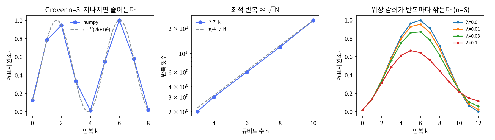

# 9장 Grover 탐색과 진폭 증폭

2026-10-28 · Gosh

양자컴퓨팅 입문·심화서 · 2부 대표 알고리즘 · 이 장을 마치면 오라클·확산 연산자를 게이트로 짜고 최적 반복 횟수를 유도하며, 진폭 증폭을 임의의 상태 준비 회로에 적용할 수 있다.

## 1. 요약

Grover 탐색은 "N개 중 표시된 것을 찾는데 오라클 O(√N)번"이다. 고전은 평균 N/2번. 회로는 8장과 같은 부품으로 된다 — 위상 오라클과 H^{⊗n} — 하나만 다르다: 한 번이 아니라 **반복**한다. 오라클 O(표시 원소에 −1)와 확산 연산자 D = 2|s⟩⟨s| − I(균등 중첩 |s⟩에 대한 반사)를 번갈아 걸면, 상태는 |s⟩와 |w⟩(표시 원소)가 펼치는 2차원 평면 안에서 매번 각 2θ(sin θ = 1/√N)씩 |w⟩ 쪽으로 회전한다. 두 반사의 합성은 회전이라는 중학교 기하가 알고리즘의 전부다.

numpy로 확인한 것: (1) 확산 연산자의 게이트 분해 H^{⊗n}X^{⊗n}(다중제어 Z)X^{⊗n}H^{⊗n}가 2|s⟩⟨s| − I와 전역 위상까지 일치. (2) n = 3\~10에서 성공 확률이 정확히 sin²((2k+1)θ)를 따르고, 최적 반복 k = ⌊π/4·√N⌋에서 0.945(N = 8) \~ 0.9999(N = 256). 한 번 더 돌리면 떨어진다 — N = 8에서 0.945 → 0.330. (3) 해가 M개면 √(N/M)번; M = N/4이면 한 번에 확률 1. (4) 초기 상태를 H^{⊗n}|0⟩가 아닌 임의의 회로 A|0⟩로 바꿔도 같은 공식이 성립한다(진폭 증폭): 초기 성공 확률 a = 0.016인 난수 A에서 6번 반복으로 0.990. (5) 해 수를 모를 때는 반복 횟수를 무작위로 고르며 범위를 키우면 평균 ≈ 1.4\~1.6×√(N/M) 호출로 끝난다. (6) 반복마다 위상 감쇠 λ를 넣으면 최대 성공률이 λ = 0.01에서 0.95, 0.1에서 0.67로 떨어지고 최적 k도 앞당겨진다.

이 장의 메시지: Grover는 "데이터베이스 검색"이 아니라 **성공 확률 a를 1/√a번의 반복으로 1 근처로 올리는 범용 증폭기**다. 그래서 12장 진폭 추정, 20장 선형계, 23장 바닥상태 준비에 부품으로 다시 나온다. 그리고 √N은 증명된 하한(이보다 적은 쿼리는 불가능, BBBV)이며, 오류 정정 오버헤드를 셀 때 2차 가속으로는 실용 이득을 보기 어렵다는 것이 현재의 정직한 평가다(7절).

## 2. 직관 먼저 — Quirk에서 반복하며 진폭 보기

3큐비트(N = 8), 표시 원소 |101⟩. 오라클은 "101에만 −1" — 가운데 큐비트가 0이므로 X로 감쌌다가 푸는 CCZ. 확산은 H·X·CCZ·X·H. Quirk의 Amplitude 표시기를 각 반복 뒤에 두어 8개 진폭이 어떻게 움직이는지 본다.

- [Quirk: Grover n=3, 반복 1회](https://algassert.com/quirk#circuit={"cols":[["H","H","H"],["Amps3"],[],[1,"X"],["•","•","Z"],[1,"X"],["H","H","H"],["X","X","X"],["•","•","Z"],["X","X","X"],["H","H","H"],["Amps3"],[],["Chance3"]]}) — 처음 Amps는 8개 모두 0.354(= 1/√8). 오라클 후 101만 부호가 바뀐다(크기 동일 — 측정해도 구분 안 됨). 확산 후 101이 0.884, 나머지가 0.177 — 확률 0.781.
- [Quirk: 반복 2회](https://algassert.com/quirk#circuit={"cols":[["H","H","H"],[1,"X"],["•","•","Z"],[1,"X"],["H","H","H"],["X","X","X"],["•","•","Z"],["X","X","X"],["H","H","H"],[1,"X"],["•","•","Z"],[1,"X"],["H","H","H"],["X","X","X"],["•","•","Z"],["X","X","X"],["H","H","H"],["Chance3"]]}) — 확률 0.945. 여기가 최적(k = ⌊π/4·√8⌋ = 2).

해 볼 것: 두 번째 링크의 마지막 열들을 복사해 세 번째 반복을 붙이면 확률이 0.330으로 **떨어진다**. 네 번째면 0.012. 더 돌린다고 좋아지지 않는다 — 회전이니까 목표를 지나치면 멀어진다. 5절 그림 왼쪽이 이 사인 곡선이다.

진폭의 막대 그래프로 보면 확산 연산자가 하는 일이 한눈에 보인다: **평균에 대한 반전(inversion about the mean)**. 8개 진폭의 평균을 구하고, 각 진폭을 평균 기준으로 뒤집는다. 오라클이 표시 원소를 음수로 만들어 평균을 조금 내리면, 반전 후 그 음수 진폭은 평균 위로 크게 튀어 오르고 나머지는 조금씩 내려간다.

비유: 시소 위에 사람 8명이 같은 높이로 서 있다. 오라클은 한 명을 바닥 아래로 밀어 넣는다(부호 반전). 확산은 모두를 평균 높이 기준으로 뒤집는다 — 바닥 아래 있던 사람이 가장 높이 튀어오른다. 깨지는 곳: 진폭의 합이 아니라 제곱의 합이 보존되므로 "높이"는 확률의 제곱근이고, 그래서 한 번에 √N분의 1이 아니라 2/√N뿐 올라간다 — √N번 필요한 이유.

## 3. 정의와 수식

**문제.** f: {0,1}ⁿ → {0,1}, 해 집합 W = {w : f(w) = 1}, |W| = M. 위상 오라클(8장) O|x⟩ = (−1)^{f(x)}|x⟩를 마음껏 부를 수 있다. 목표: W의 원소 하나를 출력.

**두 반사.** 균등 중첩 |s⟩ = H^{⊗n}|0⟩ = (1/√N)Σ|x⟩. 해들의 균등 중첩 |β⟩ = (1/√M)Σ_{w∈W}|w⟩, 비해의 균등 중첩 |α⟩. 그러면 |s⟩ = cosθ|α⟩ + sinθ|β⟩, sinθ = √(M/N).

```latex
O = I - 2\sum_{w\in W}|w\rangle\langle w|\ (|\beta\rangle\text{에 대한 반사}),\qquad D = 2|s\rangle\langle s| - I\ (|s\rangle\text{에 대한 반사}),\qquad G = DO
```

두 반사 모두 span{|α⟩, |β⟩} 평면을 보존하고, 평면 위의 두 반사의 합성은 두 반사축 사이각의 2배만큼의 회전이다. |β⟩에 대한 반사(정확히는 |α⟩축 반사)와 |s⟩에 대한 반사의 축 사이각이 θ이므로 G는 평면에서 각 2θ 회전:

```latex
G^k|s\rangle = \cos\big((2k+1)\theta\big)|\alpha\rangle + \sin\big((2k+1)\theta\big)|\beta\rangle,\qquad P_k = \sin^2\big((2k+1)\theta\big)
```

**최적 반복 횟수.** (2k+1)θ ≈ π/2가 되는 k = ⌊π/(4θ)⌋. M ≪ N이면 θ ≈ √(M/N)이므로 k ≈ (π/4)√(N/M). 실패 확률은 ≤ sin²θ = M/N. k를 넘기면 회전이 |β⟩를 지나쳐 확률이 다시 줄고, 주기 π/(2θ)로 진동한다. 최적 지점에서 정확히 1이 되는 것은 π/(4θ) − 1/2가 정수일 때뿐 — N = 4(M = 1)와 M = N/4가 그 경우다(θ = π/6, 연습문제 1·2).

**확산 연산자의 게이트 분해.** D = H^{⊗n}(2|0⟩⟨0| − I)H^{⊗n}이고 2|0⟩⟨0| − I는 "|0⋯0⟩ 빼고 전부 −1" = −X^{⊗n}(다중제어 Z)X^{⊗n}. 전역 위상을 버리면 D = H^{⊗n}X^{⊗n}Cⁿ⁻¹Z X^{⊗n}H^{⊗n}. 비용의 전부는 다중제어 Z: n = 3에서 CCZ = H·Toffoli·H(4장: 6 CNOT, 7 T), 일반 n에서 Cⁿ⁻¹Z는 보조 큐비트 n−3개로 Toffoli 2n−5개(제어 k개 일반식: 보조 k−2, Toffoli 2k−3), 보조 없이는 O(n²) 단일·2큐비트 게이트(Barenco 1995).

**진폭 증폭(일반화).** |s⟩ = H^{⊗n}|0⟩일 필요가 없다. 임의의 상태 준비 회로 A에 대해 A|0⟩의 '좋은' 부분 확률이 a = sin²θ이면

```latex
Q = -A\,S_0\,A^\dagger\,S_f,\qquad S_0 = I-2|0\rangle\langle 0|,\quad S_f = I - 2\Pi_{\text{good}}
```

가 같은 2θ 회전을 하고, ≈ (π/4)/√a 번에 성공 확률 ≈ 1. Grover는 A = H^{⊗n}인 특수 경우. 고전으로는 성공 확률 a인 시행을 1/a번 반복해야 하므로 2차 가속이 "어떤 확률적 알고리즘의 성공 확률을 올리는 것"에 범용으로 적용된다 — 이것이 12·20·23장에서 쓰는 형태다. 단, A†가 필요하므로 A는 유니터리(중간 측정 없음)여야 한다.

**하한.** 오라클 모델에서 Ω(√N) 쿼리가 필요하다(BBBV 1997; 정확한 상수까지 최적임은 Zalka 1999). 증명의 아이디어: 오라클 한 번이 상태를 바꿀 수 있는 양은 표시 원소의 진폭에 비례하고, k번 후 "어느 원소가 표시됐는가"를 구분할 만큼 상태가 갈리려면 Σ(진폭 변화)² ≥ 상수, 로그 없는 Cauchy–Schwarz로 k ≥ c√N. 즉 비구조화 탐색에서 지수 가속은 불가능 — NP 문제를 양자컴퓨터가 "그냥 다 해 봐서" 풀 수는 없다. 15장의 중심 명제.

**교과서 비교.** N&C 6장은 기하적 유도(6.1.3), 해 수를 모를 때(6.3, 양자 계수 세기(quantum counting)로 해결), 최적성 증명(6.6)을 다 다룬다 — 이 장의 참고 기준. KLM 8장은 Grover(8.1)를 먼저 다루고 8.2에서 진폭 증폭 Q = −AS_0A†S_f로 일반화한다 — 이 책도 같은 순서이고 4절 코드는 KLM의 일반형으로 짠다. KLM 8.4의 "성공 확률을 모를 때 탐색"(BBHT)이 연습문제 3이고 N&C는 이것 대신 양자 계수 세기(KLM 8.3)를 쓴다 — 양자 계수 세기는 12장 진폭 추정(QPE(Q))과 같은 회로이고, BBHT와의 비용 비교는 연습문제 3에서 한다.

## 4. 회로 구성 — numpy 조립과 Qiskit

**numpy 구현(실행 완료).** 전체 스크립트는 `ch09_grover.py`다. 오라클은 8장처럼 대각 행렬, 확산은 게이트 분해와 공식 둘 다 만들어 비교한다.

```python
def oracle(marked, n):                  # O = I - 2 Σ|w><w|
    d = np.ones(2**n, dtype=complex); d[list(marked)] = -1; return np.diag(d)
def mcz(n):                             # 다중 제어 Z: |1...1> 에만 -1
    d = np.ones(2**n, dtype=complex); d[-1] = -1; return np.diag(d)
def diffusion_gates(n):                 # H^n X^n MCZ X^n H^n
    return Hn(n) @ Xn(n) @ mcz(n) @ Xn(n) @ Hn(n)
def diffusion_formula(n):               # 2|s><s| - I
    s = Hn(n) @ ket0n(n); return 2*np.outer(s, s.conj()) - np.eye(2**n)
assert np.allclose(diffusion_gates(n), -diffusion_formula(n))   # 전역 위상 -1 차이

def grover_probs(n, marked, kmax):      # k = 0..kmax 의 성공 확률
    G = diffusion_formula(n) @ oracle(marked, n)
    psi = Hn(n) @ ket0n(n); out = []
    for k in range(kmax + 1):
        out.append(probs(psi)[list(marked)].sum()); psi = G @ psi
    return np.array(out)

def amp_amp(A, good, kmax):             # Q = -A S_0 A† S_f  (일반 진폭 증폭)
    N = A.shape[0]; S_f = oracle(good, int(np.log2(N))); S_0 = np.eye(N); S_0[0, 0] = -1
    Q = -A @ S_0 @ A.conj().T @ S_f
    ...
```

`diffusion_gates`와 `diffusion_formula`가 부호만 다르다는 것이 첫 번째 확인이다 — 게이트 분해 H^{⊗n}X^{⊗n}(MCZ)X^{⊗n}H^{⊗n}는 I − 2|s⟩⟨s| = −D이고, KLM의 Q = −AS₀A†S_f 앞의 −가 바로 이 부호를 흡수한 것이다 — 결과는 N&C의 G = DO와 같다. 전역 위상이므로 반복 결과도 같다. 단, 제어형으로 쓸 때(12장 진폭 추정에서 G를 제어한다)는 전역 위상이 상대 위상이 되므로 부호를 정확히 추적해야 한다(7장 연습문제 1과 같은 함정).

**게이트 비용 기록(이 책의 규칙).** n = 3 Grover 반복 1회 = 오라클(CCZ, X 2개) + 확산(H 6, X 6, CCZ) → CCZ 2개 = Toffoli 2개 = 2큐비트 게이트 12, T 14, 깊이 26. 전체(처음의 H 층 + k = 2): 2큐비트 24, T 28, 깊이 53. 깊이는 CX와 1큐비트 게이트로 푼 회로를 가능한 한 앞당겨 놓은 층 수이고, 스크립트 8번이 게이트 목록을 짜서 위의 G = DO와 같은지 확인한 뒤 센 값이다(규약은 책 앞의 「기호와 비용 단위」). 선형·heavy-hex 연결에서는 Toffoli를 8-CX 선형 판으로 바꾸므로 k = 2에서 2큐비트 게이트가 24 → 32가 된다(14장). 14장에서 노이즈 모델로 예측하고 제출 스크립트에 넣어 둔 회로는 n = 3, k = 2 버전이다.

**Qiskit 스니펫(작성됨, 미실행).** Qiskit 2.x는 `grover_operator(oracle, state_preparation=None)` 함수(클래스 `GroverOperator`는 2.1에서 폐기 예정)로 Q = −A S_0 A† S_f를 한 번에 만든다. 예전 `qiskit.algorithms.Grover`는 별도 패키지(qiskit-algorithms)로 나갔고 이 장에서는 쓰지 않는다(16장의 MLAE에서만 qiskit-algorithms 0.4.x를 쓴다) — 반복 횟수를 직접 정하는 것이 요점이므로.

```python
# qiskit==2.5.x — 작성됨, 미실행
import numpy as np
from qiskit import QuantumCircuit, transpile
from qiskit.circuit.library import grover_operator, PhaseOracle   # PhaseOracle 은 2.2에서 폐기 예정 → PhaseOracleGate
from qiskit.primitives import StatevectorSampler
from qiskit.quantum_info import Statevector

n = 3
oracle = QuantumCircuit(n)                       # |101> 에 -1 (Qiskit 리틀 엔디안: q0 가 최하위 비트)
oracle.x(1); oracle.ccz(0, 1, 2); oracle.x(1)
G = grover_operator(oracle)                      # 확산 포함: -H^n S_0 H^n · oracle
k = int(np.floor(np.pi/4 * np.sqrt(2**n)))       # 2
qc = QuantumCircuit(n, n); qc.h(range(n))
for _ in range(k): qc.compose(G, inplace=True)
qc.measure(range(n), range(n))
counts = StatevectorSampler(seed=7).run([qc], shots=2000).result()[0].data.c.get_counts()
print(counts)                                     # '101' 이 ≈ 94.5%

# 게이트 비용: 기본 게이트로 풀어 세기
tq = transpile(qc, basis_gates=['rz', 'sx', 'x', 'cz'], optimization_level=3)
print(tq.count_ops(), tq.depth())                # 미실행이라 출력은 아직 없다. 기대값(스크립트 출력이 아님): 연결 제약 없이 풀므로 cz 는
                                                 # 위 게이트 비용 기록(스크립트 8번, 전결합)의 2큐비트 24 와 같아야 한다(CCZ 4개 × CX 6).
                                                 # 깊이는 기저가 rz·sx·x·cz 라 기록의 53(CX + 1큐비트 기준)과 바로 비교되지 않는다.
                                                 # heavy-hex 로 라우팅한 회로는 CZ 32 다(14장 5절 표).

# 불 식 오라클 + 다중 해: SAT 답 찾기 (M 개 해)
oracle = PhaseOracle('(a | b) & (~a | c) & (~b | ~c)')   # 3변수 2-SAT, 해 여러 개
G = grover_operator(oracle)
M = sum(1 for x in range(8) if Statevector.from_int(x, 8).evolve(oracle).data[x].real < 0)
print('M =', M, ' k_opt =', int(np.floor(np.pi/(4*np.arcsin(np.sqrt(M/8))))))
```

`PhaseOracle`이 불 식을 회로로 컴파일한다 — 이것이 7절의 "오라클 비용"이 실제로 얼마인지 재는 도구다. 절 수가 늘어날수록 보조 큐비트와 Toffoli가 늘고, 그 비용은 √N 반복 전부에 곱해진다.

## 5. 시뮬레이션 결과

모든 수치는 `ch09_grover.py`를 `seed=7`로 실행한 출력이다(실행 30초).

**단일 해, 성공 확률 vs 반복.** 모든 n에서 numpy 곡선이 sin²((2k+1)θ)와 `allclose`로 일치.

| n | N | 최적 k = ⌊π/4·√N⌋ | P(k_opt) | P(k_opt+1) | P(0) = 1/N |
| --- | --- | --- | --- | --- | --- |
| 3 | 8 | 2 | 0.9453 | 0.3301 | 0.125 |
| 4 | 16 | 3 | 0.9613 | 0.5817 | 0.0625 |
| 6 | 64 | 6 | 0.9966 | 0.9074 | 0.0156 |
| 8 | 256 | 12 | 0.9999 | 0.9862 | 0.0039 |
| 10 | 1024 | 25 | 0.9995 | 0.9927 | 0.0010 |

n = 3 전체 곡선(k = 0…8): 0.125, 0.781, 0.945, 0.330, 0.012, 0.548, 1.000, 0.577, 0.019 — k = 4에서 거의 0(|s⟩를 지나 |α⟩ 쪽으로 돌아감), k = 6에서 1.000(13θ ≈ 3π/2). 주기 π/(2θ) ≈ 4.3번의 사인 제곱. 그림 왼쪽.

**다중 해 M개 (n = 8, N = 256).**

| M | 최적 k | P(k_opt) | √(N/M) |
| --- | --- | --- | --- |
| 1 | 12 | 0.9999 | 16.0 |
| 2 | 8 | 0.9956 | 11.3 |
| 4 | 6 | 0.9966 | 8.0 |
| 16 | 3 | 0.9613 | 4.0 |
| 64 | 1 | 1.0000 | 2.0 |

M = 64 = N/4에서 한 번에 정확히 1(θ = π/6, 3θ = π/2). 마찬가지로 N = 4, M = 1도 한 번에 1 — 연습문제 1·2. M이 N/2를 넘으면 θ > π/4라 ⌊π/(4θ)⌋ = 0이고 반복 한 번은 확률을 오히려 낮춘다 — 그냥 재는 게 낫다(기대 2회 미만).

**진폭 증폭(일반 A).** 5큐비트 Haar 난수 유니터리 A, '좋은' 상태 |7⟩. 초기 성공 확률 a = 0.0164 → θ = 0.128, k_opt = 6, P(6) = 0.9903 = sin²(13θ). H^{⊗n}과 아무 관계 없는 A에서도 공식이 그대로 — Grover의 본질이 "검색"이 아니라 "증폭"임을 수치로 보인다. 고전은 1/a = 61번 시도해야 할 것을 6번(+반사에 A†·A 하나씩)으로.

**해 수를 모를 때(BBHT 무작위 반복, n = 8, 200회 평균).**

| M | 평균 총 오라클 호출 | M을 알 때(k_opt + 검증 1) | √(N/M) |
| --- | --- | --- | --- |
| 1 | 25.6 | 13 | 16.0 |
| 4 | 12.7 | 7 | 8.0 |
| 16 | 5.7 | 4 | 4.0 |

모를 때는 알 때의 약 2배, 그래도 O(√(N/M))이다(연습문제 3). "반복 횟수를 틀리면 확률이 떨어진다"는 약점이 무작위화로 상수 배 비용에 해결된다.

**노이즈: 반복마다 위상 감쇠(n = 6, k_opt = 6).**

| λ (큐비트당, 반복당) | max P | 최적 k | P(k = 6) |
| --- | --- | --- | --- |
| 0 | 0.9966 | 6 | 0.9966 |
| 0.01 | 0.9521 | 6 | 0.9521 |
| 0.03 | 0.8700 | 6 | 0.8700 |
| 0.1 | 0.6656 | 5 | 0.6427 |

8장 BV는 노이즈가 한 번이었지만 Grover는 반복마다 쌓인다 — λ = 0.01이 6번 쌓여 5% 손실. 큰 N에서는 √N번 반복 동안 결맞음을 유지해야 하므로, 회로 깊이 × 게이트 시간 ≪ T2(7장)가 직접 반복 횟수의 상한을 정한다. 노이즈가 크면 최적 k가 앞당겨진다(λ = 0.1에서 5) — "더 일찍 재는 것이 낫다"는 것이 NISQ Grover의 실제 전략이다.



그림: 왼쪽 n = 3 사인 곡선, 가운데 최적 k vs n(로그 축, π/4·√N과 비교), 오른쪽 위상 감쇠별 성공률 곡선.

## 6. 다른 SDK 대응 — PennyLane

이 장에서 PennyLane을 고른 이유는, PennyLane이 오라클(`FlipSign`)과 확산(`GroverOperator`)을 별개의 연산으로 제공하므로 3절의 G = DO가 코드 두 줄로 그대로 보이고, 오라클까지 한 연산자로 묶어 주는 Qiskit의 `grover_operator`와 대조가 되기 때문이다.

| | Qiskit 2.x | PennyLane 0.45 |
| --- | --- | --- |
| 확산 연산자 | `grover_operator(oracle)`(오라클 포함) | `qp.GroverOperator(wires)`(확산만) |
| 위상 오라클 | `PhaseOracle(불식)` | `qp.FlipSign(비트열, wires)` |
| 다중제어 Z | `qc.mcp(π, ctrls, tgt)` / `ccz` | `qp.MultiControlledX` + H |
| 진폭 증폭(일반 A) | `grover_operator(oracle, state_preparation=A)` | 직접 A†·S_0·A |

```python
# pennylane==0.45.x — 작성됨, 미실행.  n=3, 표시 |101>
import pennylane as qp, numpy as np
n = 3; dev = qp.device('default.qubit', wires=n)
@qp.qnode(dev)
def grover(k):
    for w in range(n): qp.Hadamard(w)
    for _ in range(k):
        qp.FlipSign([1, 0, 1], wires=range(n))     # 오라클: 101 에 -1 (빅 엔디안)
        qp.GroverOperator(wires=range(n))            # 확산 2|s><s|-I
    return qp.probs(wires=range(n))
print(grover(2)[5])        # 0.9453
print(qp.specs(grover)(2)['resources'])   # 게이트 수 — 이 책의 비용 기록용
```

PennyLane의 `GroverOperator`는 확산만, Qiskit의 `grover_operator`는 오라클까지 포함 — 이름이 같아도 리턴이 다르다.

## 7. 한계와 반례

**√N은 최적이다 — 위로도 아래로도.** BBBV 하한: 오라클 모델에서 Ω(√N). 따라서 "비구조화 탐색을 지수적으로 빠르게"는 불가능하고, NP-완전 문제를 양자컴퓨터가 다항 시간에 푸는 일반 방법은 없다(BQP ⊉ NP가 정설이다). Grover는 2차 가속의 상한이자 하한이다.

**"데이터베이스 검색" 비유는 틀렸다.** N개 레코드를 오라클로 만들려면 데이터를 회로에 실어야 하고 그 비용이 O(N)(QRAM이 없는 한)이므로 √N 검색의 이득이 사라진다 — 6장의 데이터 로딩 문제와 같다. Grover가 의미 있는 경우는 f가 **계산 가능한 함수**일 때다: SAT의 절 평가, 해시 역산, 충돌 찾기. "전화번호부에서 이름 찾기"는 잘못된 예제고, "이 해시값을 내는 입력 찾기"가 올바른 예제다(AES-128 → 2⁶⁴ 효과, 그래서 키 길이를 2배로).

**오라클 비용이 지배한다.** 4절의 `PhaseOracle`이 보여 주듯, 오라클 한 번 = 함수 f의 가역 회로 한 번 = 보조 큐비트와 Toffoli 수백에서 수만. √N번 반복 동안 결맞음을 유지해야 하므로 오류 정정이 필수이고, 오류 정정은 게이트당 시간을 고전 연산보다 수십만 배(Babbush et al.: 논리 Toffoli ≈ 170 μs 대 CPU 클럭 ≈ 0.33 ns) 느리게 만든다. Babbush et al. 2021(PRX Quantum 2, 010103)의 결론: 오류 정정 오버헤드를 넣으면 2차 가속으로 고전 병렬 컴퓨터를 이기려면 고전 병렬도 10³에서 100일(하한 모델)\~880년(SA 모델), 10⁶에서 280년\~88만 년의 실행이 필요하다(Table I); 실용 이득은 3·4차 이상 또는 지수 가속에서만. Campbell–Khurana–Montanaro 2019는 k-SAT·그래프 채색에 Grover와 양자 백트래킹을 적용하는 비용을 표면 부호까지 넣어 추산했다: 물리 큐비트가 10¹²개 이상 필요하고, 표면 부호 복호에 드는 고전 계산 비용까지 넣으면 양자 이득이 사라진다. 이 책의 4부 후보 선정에서 "Grover로 √N 가속"을 주된 이유로 내세운 후보는 모두 탈락시킨 근거가 이것이다.

**반복 횟수를 정확히 알아야 한다.** 5절 표: 한 번 더 돌리면 N = 8에서 0.945 → 0.330. 해 수 M을 모르면 θ를 모르고, 그러면 k도 모른다. 해결책은 두 가지 — 무작위 반복(연습문제 3, 비용 ≈2배) 또는 M을 먼저 재는 양자 계수 세기(12장). 고전 탐색에는 없는 약점이다: 고전은 찾으면 멈추면 되지만 Grover는 "찾았는지" 중간에 볼 수 없다(보면 무너진다).

**노이즈에 누적적으로 취약.** 5절 마지막 표: 반복마다 결맞음이 깎이고 최대 성공률이 떨어진다. 노이즈가 있으면 최적 k가 줄고, 어느 수준 이상이면 Grover가 고전 난수 추출보다 나을 게 없다. Regev–Schiff 2008: 오라클이 확률 ε로 고장 나면(아무 일도 안 함) 양자 가속이 사라진다 — 노이즈 있는 Grover는 √N이 아니라 N. n = 3을 실제 장비에 올리면 k = 1이 k = 2보다 나을 가능성이 있다. 14장은 k = 2만 예측한다 — k = 1(CZ 16)과의 비교는 14장 방법으로 예측해 볼 과제다.

**그래도 남는 것.** 진폭 증폭은 범용 부품이다. 성공 확률 a인 어떤 양자 서브루틴도 1/√a번으로 올릴 수 있고, 이것이 12장 진폭 추정(몬테카를로 적분의 2차 가속), 20장 선형계(후선택 성공률 올리기), 16장 사전의 진폭 추정 항목의 바탕이다. Grover를 "검색 알고리즘"으로 기억하면 버리게 되고, "증폭기"로 기억하면 계속 쓴다.

**미실행 항목.** Qiskit `grover_operator`·`PhaseOracle` SAT 예제·`transpile` 게이트 수, PennyLane `specs` — 작성만 됨.

## 8. 연습문제와 해답

**문제 1 (자작, N&C 6.1절 응용).** N = 4(2큐비트), 해 1개. Grover 반복 한 번에 확률 1임을 보이고, 회로를 기본 게이트로 써라.

*해답.* sinθ = 1/√4 = 1/2 → θ = π/6. 한 번 후 확률 sin²(3θ) = sin²(π/2) = 1. 정확히 1이 되는 것은 π/(4θ) − 1/2 = 1이 정수이기 때문이고, 다른 N에서는 일반적으로 안 된다(N = 8: 0.945). 회로: H⊗H → 오라클(해 |11⟩이면 CZ, 다른 해면 X로 감싼 CZ) → 확산 H⊗H·X⊗X·CZ·X⊗X·H⊗H. 전부 해서 CZ 2개, 단일 큐비트 ≤ 14개, 깊이 ≈ 9 — 현재 하드웨어에서 거의 완벽하게 도는 유일한 Grover다. 교훈: 해 1개를 4개 중에서 단 1쿼리로 확정적으로 찾는다 — 고전은 최악 3쿼리, 평균 2.25. 이것이 "양자 쿼리가 고전 쿼리보다 많은 정보를 얻는다"의 가장 작은 예이고, 스크립트 3번 끝에서 P = 1.0000을 확인한다.

**문제 2 (자작).** 해가 M = N/4개면 한 번에 확률 1임을 보여라. M = N/2이면? M > N/2이면?

*해답.* sin²θ = M/N = 1/4 → θ = π/6, 문제 1과 같은 각. 한 번에 sin²(π/2) = 1. 스크립트가 N = 16, M = 4에서 1.0000을 확인한다. M = N/2: θ = π/4, 한 번 후 sin²(3π/4) = 1/2 — 초기와 같다, 증폭이 전혀 없다(회전 2θ = π/2가 |s⟩를 |α⟩와 |β⟩ 사이 대칭 위치로 보냄). M > N/2: θ > π/4이면 sin²3θ − sin²θ = sin4θ·sin2θ < 0이라 반복 한 번은 확률을 오히려 낮춘다. k ≥ 2에서 다시 높아질 수는 있지만(N = 8, M = 5: 0.625 → 0.156 → 0.977) 그냥 재고 검증하면 기대 2회 미만에 끝나므로 증폭할 이유가 없다 — 그냥 재라. 교훈: Grover의 이득은 "드문 해"에 있고 해가 흔하면 고전 난수 추출이 더 낫다. 실용 문제에서 M을 모를 때 안전한 트릭: 보조 큐비트 하나를 더해 N → 2N, M은 그대로 → M/N이 반으로 줄어 항상 θ < π/4 영역에 들어간다(N&C 6.1.4).

**문제 3 (KLM 8.4, BBHT).** 해 수 M을 모른다. 반복 횟수를 무작위로 고르는 전략이 왜 O(√(N/M))로 끝나는지 설명하고 5절의 표본값(M = 1: 25.6회)을 해석하라.

*해답.* k를 {0, …, m−1}에서 균등히 고르면 평균 성공 확률은 (1/m)Σ sin²((2k+1)θ) = 1/2 − sin(4mθ)/(4m sin 2θ). m ≥ 1/sin(2θ) ≈ √(N/M)/2이면 두 번째 항이 ≤ 1/4이므로 성공 확률 ≥ 1/4 — θ를 모르는데도 상수 확률로 성공한다. 전략: m = 1에서 시작해 실패할 때마다 m을 λ = 6/5배(√N 상한)로 키운다. 한 라운드의 기대 호출 수는 약 m/2다. m이 임계값 m₀ = 1/sin 2θ ≈ √(N/M)/2에 닿기 전의 비용은 등비급수 합으로 (1/2)·λ/(λ−1)·m₀ = 3m₀보다 작다. 닿은 뒤 u번째 라운드는 비용이 λ^{u+1}·m₀/2로 커지지만 거기까지 실패가 이어질 확률이 (3/4)^u 이하이므로, 기대 비용은 (λm₀/2)·Σ(3λ/4)^u = 6m₀로 수렴한다(3λ/4 = 0.9 < 1 — λ < 4/3이어야 하는 이유). 합쳐 9m₀ ≈ (9/2)√(N/M), 즉 O(√(N/M)) — BBHT 논문의 상한 (9/2)√(N/M)과 같은 상수다. 표본값: M = 1, N = 256에서 25.6회 = 1.6×√N; M을 알 때 13회의 약 2배. 상한 72보다 훨씬 작다(상한은 최악 경우). 교훈: "최적 반복 횟수를 알아야 한다"는 약점은 무작위화로 상수 배 비용에 없어지고, 더 정밀하게 하려면 M을 먼저 재는 양자 계수 세기(12장)를 쓴다 — 이것도 진폭 증폭 + 위상 추정의 조합이다.

## 9. 학습 노트

- **두 반사 = 한 회전** — 오라클(해에 대한 반사)과 확산(균등 중첩에 대한 반사)의 합성은 2차원 평면에서 각 2θ 회전, sinθ = √(M/N). 성공 확률 sin²((2k+1)θ), 최적 k ≈ (π/4)√(N/M), 지나치면 줄어든다. 비유: 두 거울에 비춘 반사를 두 번 하면 거울 사이각의 2배만큼 돈다(만화경 원리). 깨지는 곳: 거울은 보이지만 양자 상태는 보면 무너진다 — "찾았나?"를 중간에 확인할 수 없다. 더 깊이: N&C 6.1.3.
- **평균에 대한 반전** — 확산 2|s⟩⟨s| − I는 각 진폭을 평균 기준으로 뒤집는다. 게이트로는 H^{⊗n}X^{⊗n}(다중제어 Z)X^{⊗n}H^{⊗n} — 비용은 전부 다중제어 Z(Toffoli O(n)). 비유: 시소 위 사람들, 한 명을 바닥 아래로 밀어 넣고 평균 높이로 뒤집으면 그 사람이 가장 높이 튀어오른다. 깨지는 곳: 진폭 제곱의 합이 보존되므로 한 번에 2/√N뿐 — 그래서 √N번.
- **진폭 증폭 Q = −AS₀A†S_f** — Grover는 A = H^{⊗n}인 특수 경우. 성공 확률 a인 임의의 유니터리 서브루틴을 1/√a번으로 올린다(고전 1/a). 난수 A에서 수치로 확인(0.016 → 0.990, 6번). 12·20·23장의 부품; "검색"이 아니라 "증폭기"로 기억할 것. 조건: A†가 필요하므로 A는 중간 측정 없는 유니터리. 더 깊이: Brassard–Høyer–Mosca–Tapp 2002, KLM 8.2.
- **BBBV 하한 Ω(√N)** — 비구조화 탐색에 지수 가속은 없다. 증명 아이디어: 오라클 한 번이 상태를 바꾸는 양은 표시 원소 진폭에 비례, Cauchy–Schwarz로 k ≥ c√N. "NP를 양자컴퓨터가 푸나?"에 대한 표준 답의 근거. 더 깊이: BBBV 1997, N&C 6.6, Aaronson의 "BQP vs NP" 글들.
- **2차 가속의 실용성 회의론** — 오류 정정 오버헤드(게이트당 시간 수십만 배)를 넣으면 √N으로는 고전 병렬을 이기기 어렵다(Babbush et al. 2021). 4부 후보 선정의 탈락 기준. 비유: 2배 빠른 차가 시동에 한 시간 걸리면 짧은 거리에서 진다. 더 깊이: PRX Quantum 2, 010103 (2021); Campbell–Khurana–Montanaro, Quantum 3, 167 (2019).

## 10. 출처와 환경

**실행 환경.** Python 3.13.17, numpy 2.5.3, matplotlib 3.11.2, `seed=7`. 스크립트 `ch09_grover.py`(실행 30초), 그림 `ch09_results.png`. Qiskit 2.5.x·PennyLane 0.45.x 코드는 작성만 되고 미실행 — 작업계획서 §7 메모 참조.

**출처.**

- Nielsen & Chuang, 6.1절(절차·기하적 유도 6.1.3·성능 6.1.4), 6.3(양자 계수 세기 — 해 수 모를 때), 6.6(최적성), 연습 6.2. 등급 A.
- Kaye–Laflamme–Mosca, 8장(8.1 Grover, 8.2 진폭 증폭, 8.3 진폭 추정·계수 세기, 8.4 해 수 모를 때). 등급 A.
- Grover, L. K., "A fast quantum mechanical algorithm for database search", STOC 1996. 등급 A.
- Bennett, Bernstein, Brassard, Vazirani, "Strengths and weaknesses of quantum computing", SIAM J. Comput. 26, 1510 (1997) — Ω(√N) 하한. 등급 A.
- Zalka, C., "Grover's quantum searching algorithm is optimal", Phys. Rev. A 60, 2746 (1999). 등급 A.
- Boyer, Brassard, Høyer, Tapp, "Tight bounds on quantum searching", Fortschr. Phys. 46, 493 (1998) — 해 수 모를 때(BBHT). 등급 A.
- Brassard, Høyer, Mosca, Tapp, "Quantum amplitude amplification and estimation", Contemp. Math. 305, 53 (2002). 등급 A.
- Barenco, A. et al., "Elementary gates for quantum computation", Phys. Rev. A 52, 3457 (1995) — 다중제어 게이트 분해. 등급 A.
- Babbush et al., "Focus beyond quadratic speedups for error-corrected quantum advantage", PRX Quantum 2, 010103 (2021). 등급 A.
- Campbell, Khurana, Montanaro, "Applying quantum algorithms to constraint satisfaction problems", Quantum 3, 167 (2019). 등급 A.
- Regev, O. & Schiff, L., "Impossibility of a quantum speed-up with a faulty oracle", ICALP 2008. 등급 A.
- [Qiskit — grover_operator, PhaseOracle](https://quantum.cloud.ibm.com/docs/en/api/qiskit/circuit_library); [PennyLane — GroverOperator](https://docs.pennylane.ai/en/stable/code/api/pennylane.GroverOperator.html). 등급 A.
- [Quirk](https://algassert.com/quirk) — 2절 링크. 등급 B.
