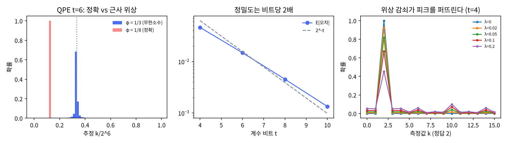

# 10장 QFT와 위상 추정

2026-10-28 · Gosh

양자컴퓨팅 입문·심화서 · 2부 대표 알고리즘 · 이 장을 마치면 제어 유니터리와 역 QFT로 고유값 위상을 t비트 정밀도로 읽고, 정밀도·성공 확률·회로 깊이의 교환 관계를 계산할 수 있다.

## 1. 요약

위상 추정(QPE)은 양자 알고리즘의 "자"다. 유니터리 U와 그 고유상태 |u⟩가 주어지면 U|u⟩ = e^{2πiφ}|u⟩의 위상 φ ∈ [0,1)를 t비트의 2진 소수로 읽는다. 부품은 두 개뿐이다 — 8장의 위상 되돌림과 6장의 QFT. 계수 큐비트 t개를 |+⟩로 두고 2^j 자리를 맡은 계수 큐비트가 U^{2^j}를 제어하면(이 책의 빅 엔디안에서는 q[0]이 최상위라 U^{2^{t−1}}), 고유상태는 그대로고 계수 큐비트에 e^{2πi·2^jφ}가 되돌아온다 — 계수 레지스터가 정확히 QFT|2^tφ⟩의 꼴(6장 곱상태 형태)이 된다. 역 QFT를 걸면 |2^tφ⟩가 나온다.

numpy로 확인한 것: (1) φ = 1/8 = 0.001₂처럼 t비트 안에 떨어지면 확률 1로 정확히 읽는다. (2) φ = 1/3 = 0.0101…₂처럼 무한소수면 가장 가까운 t비트 값이 확률 0.68, ±1 이내가 0.90으로 나오고, 이 확률은 t에 무관하며 하한 4/π² = 0.405 위에 있다. (3) 정밀도는 비트당 약 2배(계산값 1.8배, 꼬리가 1/k²라 ≈ t·2^{−t}): E|오차|가 t = 4 → 10에서 0.046 → 0.0013. n비트 정확도를 확률 0.96\~0.97로 얻는 데 t = n + 2이면 충분(N&C 하한 0.75). (4) 고유상태가 아닌 중첩을 넣으면 각 고유값이 |계수|² 확률로 샘플링되고 측정 후 레지스터는 해당 고유상태로 무너진다(충실도 1.0). (5) 계수 큐비트 하나만 쓰는 반복 위상 추정(IPE)이 비트를 최하위부터 하나씩 읽어 같은 답을 내고, 비트당 5샷 다수결이면 6비트 정확도 99.5%. (6) 제어 단계마다 위상 감쇠 λ를 넣으면 정답 확률이 λ = 0.05에서 0.82, 0.2에서 0.45로 떨어진다 — 피크는 남지만 바닥이 올라온다.

이 장의 메시지: QPE는 Shor(11장, U = 모듈러 곱셈), 해밀토니안 에너지(12장, U = e^{−iHt}), 진폭 추정(12장, U = Grover 반복), HHL(20장)의 공통 엔진이다. 대가는 제어 U^{2^j}의 깊이 — 정밀도 한 비트마다 회로가 2배 길어진다. NISQ에서 QPE가 돌지 않는 이유이고, 반복 QPE와 VQE(13장)가 그 빈자리를 메운다.

## 2. 직관 먼저 — Quirk에서 위상 0.125 읽기

U = T 게이트(= Z^{1/4}, 고유상태 |1⟩에 위상 e^{2πi/8}, φ = 1/8 = 0.001₂). 계수 큐비트 3개를 |+⟩로 두고 T¹, T², T⁴(= Z^{1/4}, Z^{1/2}, Z)를 제어한 뒤 역 QFT. Quirk는 리틀 엔디안이라 위 와이어가 최하위 비트 → 위 와이어가 T(= U¹), 아래가 Z(= U⁴)를 제어한다(이 책의 numpy 코드와 반대 순서).

- [Quirk: QPE, U = T, 계수 3비트](https://algassert.com/quirk#circuit={"cols":[[1,1,1,"X"],["H","H","H"],["•",1,1,"Z^¼"],[1,"•",1,"Z^½"],[1,1,"•","Z"],["QFT†3"],["Chance3"]]}) — 출력이 확정적으로 001 = 1/8. 제어 게이트를 보면 위 큐비트가 T(φ = 1/8), 가운데가 T² = S(φ×2 = 1/4), 아래가 T⁴ = Z(φ×4 = 1/2). 각 큐비트가 φ의 "서로 다른 자릿수"를 맡는다.
- [Quirk: 같은 회로, QFT† 직전의 Bloch 구](https://algassert.com/quirk#circuit={"cols":[[1,1,1,"X"],["H","H","H"],["•",1,1,"Z^¼"],[1,"•",1,"Z^½"],[1,1,"•","Z"],["Bloch","Bloch","Bloch"]]}) — 세 화살표가 적도 위에서 경도 45°, 90°, 180°(위에서부터). 6장 2절의 QFT|x⟩ 그림과 똑같다 — 계수 레지스터가 QFT|001⟩이다. 역 QFT가 이것을 |001⟩로 되돌린다.
- [Quirk: φ가 3비트에 안 떨어질 때 — U = Z^{1/8}, φ = 1/16](https://algassert.com/quirk#circuit={"cols":[[1,1,1,"X"],["H","H","H"],["•",1,1,"Z^⅛"],[1,"•",1,"Z^¼"],[1,1,"•","Z^½"],["QFT†3"],["Chance3"]]}) — φ = 1/16 = 0.0001₂는 3비트로 표현 불가. 출력이 000(0)과 001(1/8) 사이에 반반으로 갈리고 나머지에도 조금씩 퍼진다. 이 퍼짐이 5절의 주제다.

해 볼 것: 첫 링크에서 고유상태 레지스터의 X를 지워 |0⟩으로 바꾸면 출력이 000이 된다 — |0⟩은 T의 위상 0 고유상태. X 대신 H를 두면(두 고유상태의 중첩) 000과 001이 반반 — 고유값 샘플링이고 연습문제 2다.

비유: 시계 바늘 세 개를 두고 각각 1배·2배·4배 속도로 돌린다. 한 바퀴의 각도를 정밀히 재는 대신, 빠른 바늘이 한 바퀴를 돌았는지 두 바퀴 돌았는지만 보면(역 QFT가 하는 일) 각도의 상위 비트부터 읽힌다. 시계 하나로는 "대략 어디" 밖에 모르지만 2배씩 빠른 바늘 t개면 2^t 분해능. 깨지는 곳: 시계는 바늘을 보면 되지만 양자 위상은 보이지 않으므로 역 QFT라는 간섭으로 바늘을 한 번에 "맞춰 읽어야" 한다.

## 3. 정의와 수식

**문제.** 유니터리 U와 고유상태 |u⟩, U|u⟩ = e^{2πiφ}|u⟩, φ ∈ [0, 1). 제어 U^{2^j}를 부를 수 있다고 가정하고 φ를 t비트로 추정한다.

**1단계: 제어 유니터리의 위상 되돌림.** 계수 큐비트 하나를 |+⟩로 두고 U^{2^j}를 제어하면

```latex
\frac{|0\rangle+|1\rangle}{\sqrt2}|u\rangle \xrightarrow{\ c\text{-}U^{2^j}\ } \frac{|0\rangle+e^{2\pi i\,2^j\varphi}|1\rangle}{\sqrt2}|u\rangle
```

고유상태는 그대로고(8장: 표적이 고유상태이면 고유값이 제어로 되돌아온다) 계수 큐비트가 φ의 2^j배 위상을 갖는다. t개를 j = t−1, …, 0으로 두면 계수 레지스터는

```latex
\bigotimes_{j=t-1}^{0}\frac{|0\rangle+e^{2\pi i\,2^j\varphi}|1\rangle}{\sqrt2} = \frac{1}{\sqrt{2^t}}\sum_{k=0}^{2^t-1}e^{2\pi i\,\varphi k}|k\rangle
```

6장 QFT의 곱상태 형태와 정확히 같다 — φ = x/2^t이면 이것이 QFT|x⟩다. 비용: 제어 U를 총 1 + 2 + … + 2^{t−1} = 2^t − 1번, 즉 정밀도 비트당 깊이 2배(U^{2^j}를 반복 제곱으로 만들 때; 7절).

**2단계: 역 QFT.** QFT†를 걸면 |x⟩ = |2^tφ⟩. φ = 0.φ₁φ₂…φ_t의 2진 전개가 t비트 안에 떨어지면 확률 1로 정확히 읽는다.

**φ가 t비트에 안 떨어질 때.** 출력 k의 확률은 δ = φ − k/2^t에 대해

```latex
P(k) = \frac{1}{2^{2t}}\left|\frac{\sin(\pi 2^t\delta)}{\sin(\pi\delta)}\right|^2
```

— 고전 DFT의 Dirichlet 핵(스펙트럼 누설)과 같다. 가장 가까운 k(|δ| ≤ 2^{−t−1})의 확률은 ≥ 4/π² ≈ 0.405(연습문제 1), 양쪽 ±1 이내는 ≥ 8/π² ≈ 0.81. 오차 2^{−n} 이내를 확률 1 − ε로 얻으려면

```latex
t = n + \left\lceil \log_2\!\left(2 + \frac{1}{2\varepsilon}\right)\right\rceil
```

(N&C 5.2.1). 여분의 비트 몇 개가 꼬리 확률을 줄인다 — 반복 측정으로 중앙값을 취하는 것도 같은 효과.

**고유상태가 아닌 입력.** |ψ⟩ = Σ c_i|u_i⟩를 넣으면 선형성으로 출력은 Σ c_i|φ̃_i⟩|u_i⟩. 계수 레지스터를 재면 확률 |c_i|²로 φ_i가 나오고 레지스터는 |u_i⟩로 무너진다 — QPE는 "고유값 샘플러 + 고유상태 필터"다. 12장 해밀토니안의 바닥상태 에너지에서 이 성질을 쓴다: 바닥상태와의 겹침 |c_0|²이 충분하면 반복 측정으로 가장 낮은 에너지를 찾는다. 단 고유값이 여러 개면 각각의 피크가 서로 꼬리를 덮어 구분이 나빠진다.

**반복 위상 추정(IPE, Kitaev 1995).** 계수 큐비트 1개로 비트를 최하위부터 하나씩 읽는다. k번째 단계: |+⟩에 U^{2^{t−1−k}}를 제어하고, 이미 알아낸 하위 비트들의 위상을 Rz로 빼고, H 후 측정하면 다음 비트가 나온다. 역 QFT의 제어 위상들을 "고전 피드백"으로 바꾼 것 — 5장 지연 측정 원리의 역방향 적용이다. 큐비트는 줄지만 단계마다 측정·리셋·고전 제어가 필요하고(동적 회로), φ가 무한소수면 비트당 반복 측정으로 다수결이 필요하다(5절).

**교과서 비교.** N&C 5.2는 회로(그림 5.2–5.3), 성공 확률 증명(5.2.1), t 공식을 주고 흐름을 "위상 추정 → 위수 찾기 → 인수분해"로 잡는다 — 이 책도 같은 순서(10 → 11장). KLM 7장은 "고유값 추정"이라 부르고 7.1–7.2에서 고유값이 정확히 표현되지 않는 경우의 분석을 N&C보다 상세히 다룬다(특히 "연속 위상의 2진 근사" 도표). Kitaev의 반복 버전은 두 책 모두 간략히만 언급 — 1차 출처는 Kitaev 1995와 Dobšíček et al. 2007.

## 4. 회로 구성 — numpy 조립과 Qiskit

**numpy 구현(실행 완료).** 전체 스크립트는 `ch10_qpe.py`다. 6장의 `qft_gates`를 그대로 가져와 역을 취하고, 제어 U^{2^j}는 블록 행렬로 만든다. 아래는 `ch10_qpe.py`에서 핵심만 간추린 발췌다(그대로 실행되지 않는다). 실행 가능한 전체 코드는 스크립트 파일에 있다.

```python
def controlled_U_pow(U, c, t, m, power):      # 계수 큐비트 c 가 제어, 레지스터(m 큐비트)에 U^power
    Up = np.linalg.matrix_power(U, power)
    a = [I]*t; a[c] = P0; A = kron(*a, np.eye(2**m))
    b = [I]*t; b[c] = P1; B = kron(*b, Up)
    return A + B

def qpe_state(U, u, t):                       # |0..0>|u> → H^t → 제어 U^{2^j} → QFT†
    m = int(np.log2(len(u)))
    psi = np.kron(np.eye(2**t)[0], u)
    psi = kron(Hn(t), np.eye(2**m)) @ psi
    for j in range(t):                        # q[0] 가 최상위 비트 → U^{2^{t-1}}
        psi = controlled_U_pow(U, j, t, m, 2**(t-1-j)) @ psi
    return kron(iqft(t), np.eye(2**m)) @ psi

def ipe(U, u, n_bits, shots=1):               # 반복 위상 추정: 계수 큐비트 1개
    est_bits = []
    for k in range(n_bits):
        power = 2**(n_bits - 1 - k)
        corr = -2*np.pi*sum(b / 2**(j+2) for j, b in enumerate(est_bits))   # 이미 아는 하위 비트 보정
        psi = kron(H, I_m) @ np.kron([1, 0], u)
        psi = controlled_U_pow(U, 0, 1, m, power) @ psi
        psi = kron(Pgate(corr), I_m) @ psi; psi = kron(H, I_m) @ psi
        b = 측정(다수결 shots회); est_bits.insert(0, b)
    return est_bits
```

큐비트 순서 주의: 이 책은 빅 엔디안이므로 계수 큐비트 q[0]이 φ의 최상위 비트이고 U^{2^{t−1}}을 제어한다. 6장 `qft_gates`가 끝에 SWAP으로 순서를 맞추므로 역 QFT 후 그대로 읽으면 된다. Qiskit은 리틀 엔디안이라 q[0]이 최하위 → U^{2^0} — 교과서 그림과 비교할 때 가장 흔한 혼란.

**게이트 비용 기록(이 책의 규칙).** 세는 법: 기저는 CX + 임의의 1큐비트 게이트(전결합)이고, SWAP = 3 CX, 제어 위상 CP(θ) = 2 CX + 위상 회전 3개로 풀어(CP(π) = CZ는 2큐비트 게이트 1개) CX·CZ의 수를 센다. 깊이는 그렇게 푼 게이트를 가능한 한 앞에 놓았을 때(ASAP)의 층 수다(측정 제외, 회전은 합치지 않는다). T-count는 모든 게이트가 Clifford이거나 π/4의 배수 회전일 때만 정확하고, 그 밖의 회전은 합성 정밀도 ε을 정해야 T 수가 생기므로 회전 수 R을 적고 T ≈ 3·log₂(1/ε)·R로 어림한다(Ross & Selinger 2016; ε = 10⁻⁶이면 회전당 약 60). 아래는 스크립트 6번이 게이트 리스트를 짜서 위의 행렬(`qpe_state`가 쓰는 행렬들과 `qft`)과 전역 위상을 빼고 같은지 확인한 뒤 센 값이다.

| 회로 | 2큐비트 게이트 | 깊이 | T-count |
| --- | --- | --- | --- |
| QPE t = 4, U = T (φ = 1/8, 이 장의 주 예제) | 23 | 35 | T 12 + 회전 R 12 (T ≈ 12 + 718) |
| QPE t = 3, U = T | 14 | 27 | T 9 + R 6 (T ≈ 9 + 359) |
| QPE t = 6, φ = 1/3 | 51 | 66 | T 15 + R 48 (T ≈ 15 + 2870) |
| QPE t = 8, φ = 1/3 | 84 | 90 | T 21 + R 87 (T ≈ 21 + 5202) |
| QFT n = 4 (SWAP 포함 / 없이) | 18 / 12 | 25 / 22 | T 9 + R 9 (T ≈ 9 + 538) |
| QFT n = 8 (SWAP 포함 / 없이) | 68 / 56 | 57 / 54 | T 21 + R 63 (T ≈ 21 + 3767) |
| 반복 위상 추정 한 라운드, φ = 1/3 (큐비트 2개) | 2 | 7 | R 4 (T ≈ 239) |

읽는 법. QPE의 비용은 세 부분이다: (a) H t개, (b) 제어 U^{2^j} — U를 반복 제곱하면 제어 U 총 2^t − 1번, (c) 역 QFT — 제어 위상 t(t−1)/2개(6장). 이 장의 예처럼 U가 위상 게이트이면 제어 U^{2^j}가 CP 하나씩이라 2큐비트 게이트는 2t + t(t−1) + 3⌊t/2⌋개다(t = 6: 12 + 30 + 9 = 51). t = 4, U = T에서는 T⁸ = I가 빠지고 T⁴ = Z가 CZ 하나여서 26이 아니라 23이다: 제어 Z 1 + 제어 S 2 + 제어 T 2 + 역 QFT의 CP 6개(CX 12) + SWAP 2개(CX 6). 정확한 T는 제어 S 꼴(CP(±π/2))에서만 나온다 — 하나에 T 3개. QFT n큐비트에는 그런 CP가 n − 1개 있어 T 3(n − 1)개가 정확하고, 나머지 CP (n−1)(n−2)/2개는 회전 3개씩이다; 2큐비트 게이트는 CP n(n−1)/2개 → CX n(n−1), 끝의 SWAP ⌊n/2⌋개를 넣으면 3⌊n/2⌋가 더해진다. 반복 위상 추정은 라운드마다 CP 하나(2 CX)와 보정 위상 하나뿐이고, U = T 4비트의 네 라운드는 2큐비트 0, 1, 2, 2(합 5)다 — T⁸ = I, T⁴ = Z 라운드는 Clifford다. 14장은 이 회로를 t = 3으로 줄이고 계수 배정을 리틀 엔디안(q[j] → U^{2^j})으로 바꿔 SWAP을 없앤 판(6장 Draper 덧셈기의 SWAP 생략 요령)을 노이즈 모델로 예측한다(실기 제출은 미실행). 14장 표의 CZ 수는 모든 CP를(제어 Z까지) CX 2개로 풀고 heavy-hex 라우팅의 SWAP을 더해 센 값이라 이 표와 같지 않다. 반면 U가 "제어 거듭제곱을 한 번에 만들 수 없는" 일반 유니터리면 (b)가 2^t배로 폭발한다 — 7절. (규약은 책 앞의 「기호와 비용 단위」에도 적어 둔다.)

**Qiskit 스니펫(작성됨, 미실행).** Qiskit 2.x에는 `phase_estimation(num_evaluation_qubits, unitary)` 함수가 있고(클래스 `PhaseEstimation`은 2.1에서 폐기 예정), 직접 짜려면 `QFTGate(t).inverse()`와 `UnitaryGate(U).power(2**j).control()`을 쓴다. 반복 QPE는 5장의 동적 회로(`if_test`, `reset`)가 필요하다.

```python
# qiskit==2.5.x — 작성됨, 미실행
import numpy as np
from qiskit import QuantumCircuit, ClassicalRegister, transpile
from qiskit.circuit.library import phase_estimation, QFTGate, TGate, UnitaryGate
from qiskit.primitives import StatevectorSampler

# (1) 라이브러리 회로: U = T, 고유상태 |1>, 계수 3비트
t = 3
u = QuantumCircuit(1); u.t(0)
qpe = phase_estimation(t, u)                  # 내부: H^t, 제어 U^{2^j}, QFT†
qc = QuantumCircuit(t + 1, t); qc.x(t)        # 레지스터 = 마지막 큐비트
qc.compose(qpe, inplace=True); qc.measure(range(t), range(t))
counts = StatevectorSampler(seed=7).run([qc], shots=1000).result()[0].data.c.get_counts()
print(counts)                                  # {'001': 1000} — Qiskit 은 c2c1c0 순으로 인쇄하므로 그대로 001 = 1/8 (14장 4절 참고)

# (2) 직접 조립: 임의 U 와 φ = 1/3
U = UnitaryGate(np.diag([1, np.exp(2j*np.pi/3)]), label='U')
t = 6; qc = QuantumCircuit(t + 1, t); qc.x(t); qc.h(range(t))
for j in range(t):
    qc.append(U.power(2**j).control(1), [j, t])   # 리틀 엔디안: q[j] 가 U^{2^j}
qc.append(QFTGate(t).inverse(), range(t)); qc.measure(range(t), range(t))
counts = StatevectorSampler(seed=7).run([qc], shots=4000).result()[0].data.c.get_counts()
best = max(counts, key=counts.get); print(best, int(best, 2)/2**t)   # '010101' → 21/64 = 0.328

# (3) 반복 위상 추정: 큐비트 2개, 동적 회로
n_bits = 4; qc = QuantumCircuit(2, n_bits); qc.x(1)
for k in range(n_bits):
    qc.reset(0); qc.h(0)
    qc.append(TGate().power(2**(n_bits-1-k)).control(1), [0, 1])
    for j in range(k):                             # 이미 재인 하위 비트로 보정
        with qc.if_test((qc.clbits[n_bits-1-j], 1)): qc.p(-np.pi / 2**(k-j), 0)
    qc.h(0); qc.measure(0, n_bits-1-k)
print(transpile(qc, basis_gates=['rz','sx','x','cz','reset','measure']).depth())
```

(3)의 보정 각 `-π/2**(k-j)`가 numpy `ipe`의 `corr`과 같은 값인지가 실행 후 첫 검사 항목이다 — 비트 순서와 부호가 가장 틀리기 쉬운 곳.

## 5. 시뮬레이션 결과

모든 수치는 `ch10_qpe.py`를 `seed=7`로 실행한 출력이다(실행 38초).

**정확한 경우: φ = 1/8, U = T.** t = 3: 측정 001 = 1/8, 확률 1.0000. t = 4: 0010 = 2/16, 확률 1.0000. 2진 유한소수는 여분 비트가 있어도 정확히 읽힌다.

**근사 경우: φ = 1/3 = 0.010101…₂.**

| t | 최빈 출력 | 추정값 | 오차 | P(최빈) | 이론 (Dirichlet) | P(±1 이내) |
| --- | --- | --- | --- | --- | --- | --- |
| 3 | 011 | 0.3750 | 0.0417 | 0.6878 | 0.6878 | 0.9097 |
| 4 | 0101 | 0.3125 | 0.0208 | 0.6849 | 0.6849 | 0.9006 |
| 6 | 010101 | 0.3281 | 0.0052 | 0.6840 | 0.6840 | 0.8978 |
| 8 | 01010101 | 0.3320 | 0.0013 | 0.6839 | 0.6839 | 0.8977 |

최빈 확률이 t에 무관하게 ≈ 0.684로 수렴한다 — φ = 1/3의 최적 근사 오차 δ·2^t가 항상 ≈ 1/3이므로 (sin(π/3)/(π/3))² = 0.684. 하한 4/π² = 0.405는 δ·2^t = 1/2의 최악에서(연습문제 1). t = 3 전체 분포: [0.016, 0.032, 0.175, 0.688, 0.047, 0.019, 0.013, 0.012] — 피크 양쪽으로 꼬리가 1/k²로 줄어든다(스펙트럼 누설). 그림 왼쪽.

**정밀도 vs t.** E|오차|: t = 4 → 0.046, 6 → 0.015, 8 → 0.0045, 10 → 0.0013 — 비트당 약 1.8배씩 줄어든다 — 꼬리가 1/k²라 2^{−t}보다 약간 완만(≈ t·2^{−t}; 그림 가운데). n = t − 2비트 정확도를 얻을 확률은 네 경우 모두 0.96\~0.97 — N&C 공식(p = 2 여분 비트)의 하한 1 − 1/(2(2²−2)) = 0.75보다 넓다. 여분 비트 2개가 "일반 φ에서 96%"를 사 준다.

**고유상태 중첩 입력.** 2큐비트 U에 난수 고유벡터, 고유값 위상 1/8, 3/8, 5/8, 3/4(전부 3비트 정확). 입력 계수 (0.6, 0.5, 0.4, 0.48). t = 3 출력 분포: k = 1, 3, 5, 6에서 0.36, 0.25, 0.16, 0.23 = |계수|² 정확히, 나머지는 0. k = 3을 측정한 후 레지스터 상태와 고유벡터 v₁의 충실도 1.0 — QPE가 고유상태 필터로 작동한다(연습문제 2).

**반복 위상 추정.** φ = 1/8, 4비트: 0.0010₂ = 0.125 — 큐비트 2개로 QPE와 같은 답. φ = 1/3, 6비트, 200회 반복:

| 비트당 샷 | 중앙 오차 | P(오차 ≤ 1/64) |
| --- | --- | --- |
| 1 | 0.0052 | 0.845 |
| 5 | 0.0052 | 0.995 |
| 21 | 0.0052 | 1.000 |

중앙 오차 0.0052 = |1/3 − 21/64|, 6비트 최적 근사. φ가 무한소수면 각 단계의 측정이 확률적이라(마지막 비트에서 P(1) ≈ 0.75 같은 값) 단일 샷은 15% 실패, 5샷 다수결이면 0.5%. 비트당 샷 5 × 6비트 = 30회 회로 실행 — QPE t = 6의 1회보다 많지만 큐비트는 7 → 2.

**노이즈(φ = 1/8, t = 4).** 제어 단계마다 계수 큐비트 전부에 위상 감쇠 λ:

| λ | P(정답 0010) | 최빈 |
| --- | --- | --- |
| 0 | 1.0000 | 0010 |
| 0.02 | 0.9231 | 0010 |
| 0.05 | 0.8188 | 0010 |
| 0.1 | 0.6708 | 0010 |
| 0.2 | 0.4521 | 0010 |

피크는 끝까지 남고 바닥이 올라오되 k ≡ 2 (mod 4)인 자리에 작은 부 피크가 선다(그림 오른쪽; 역 QFT는 하위 비트부터 확정하고 상위 비트는 하위 비트 보정을 전부 거치므로 오류가 상위 비트에 누적되기 때문) — 위상 감쇠가 계수 레지스터를 부분적으로 균등 혼합으로 바꾸기 때문. 다수결로 맞추는 것은 λ = 0.2까지 가능하지만 샷 수가 급증한다.



그림: 왼쪽 t = 6 분포(정확한 1/8 vs 퍼진 1/3), 가운데 E|오차| vs t, 오른쪽 위상 감쇠별 분포.

## 6. 다른 SDK 대응 — PennyLane

이 장에서 PennyLane을 고른 이유는 QPE 회로를 `qp.QuantumPhaseEstimation` 한 줄로 주면서 계수 와이어의 순서가 이 책의 numpy 코드와 같은 빅 엔디안(`estimation_wires[0]`이 최상위 비트)이어서, 리틀 엔디안인 Qiskit과 비트 순서를 나란히 대조하기에 맞기 때문이다.

| | Qiskit 2.x | PennyLane 0.45 |
| --- | --- | --- |
| QPE 회로 | `phase_estimation(t, U)` | `qp.QuantumPhaseEstimation(U, target_wires, estimation_wires)` |
| 제어 U^{2^j} | `UnitaryGate(U).power(2**j).control()` | `qp.ControlledQubitUnitary(matrix_power(U, 2**j), ...)` |
| 역 QFT | `QFTGate(t).inverse()` | `qp.adjoint(qp.QFT)(wires)` |
| 계수 비트 순서 | 리틀(q[0] = 최하위) | 빅(estimation_wires[0] = 최상위) |
| 반복 QPE | `if_test` + `reset` | mid-circuit `qp.measure` + `qp.cond` |

```python
# pennylane==0.45.x — 작성됨, 미실행.  φ = 1/3, t = 6
import pennylane as qp, numpy as np
U = np.diag([1, np.exp(2j*np.pi/3)]); t = 6
dev = qp.device('default.qubit', wires=t + 1)
@qp.qnode(dev)
def qpe():
    qp.PauliX(wires=t)                                             # 고유상태 |1>
    qp.QuantumPhaseEstimation(U, target_wires=[t], estimation_wires=range(t))
    return qp.probs(wires=range(t))
p = qpe(); k = int(np.argmax(p)); print(k / 2**t, p[k])            # 0.328, 0.684 (빅 엔디안)

# 반복 QPE: PennyLane 의 중간 측정
dev_s = qp.device('default.qubit', wires=2)
@qp.set_shots(1)
@qp.qnode(dev_s)
def ipe_bit(k, prev_bits):
    qp.PauliX(wires=1); qp.Hadamard(0)
    qp.ControlledQubitUnitary(np.linalg.matrix_power(U, 2**(5-k)), wires=[0, 1])
    qp.PhaseShift(-2*np.pi*sum(b/2**(j+2) for j, b in enumerate(prev_bits)), wires=0)
    qp.Hadamard(0)
    return qp.sample(wires=0)
```

위 스니펫의 `qp.ControlledQubitUnitary(np.linalg.matrix_power(U, …))`와 Qiskit의 `UnitaryGate.power(2**j)`는 둘 다 행렬 거듭제곱을 먼저 계산해 새 유니터리 하나를 만들므로 분해 후 게이트 수가 j에 무관 — 시뮬레이션에서는 편하지만 "제어 U를 2^j번"이라는 실제 비용을 숨긴다(7절). 단 `PauliEvolutionGate.power`는 다르다: `time`만 2^j배로 늘리고 Trotter `reps`는 그대로라 dt가 커져 근사가 깨진다 — 12장에서는 `.repeat(2**j)`를 쓴다.

## 7. 한계와 반례

**제어 U^{2^j}의 지수 깊이.** QPE의 실제 비용은 역 QFT(O(t²))가 아니라 제어 U^{2^j}다. U^{2^j}를 "U를 2^j번"으로 만들면 총 2^t − 1번 — 정밀도 비트당 회로가 2배. 10비트면 U 천 번, 20비트면 백만 번. 이것을 피하는 것은 U의 구조에 달려 있다: 모듈러 곱셈(11장)은 반복 제곱을 고전으로 먼저 계산해 a^{2^j} mod N을 한 번의 곱셈으로 줄일 수 있고(그래서 Shor가 다항식), e^{−iHt}는 t를 2^j배로 늘리면 되지만 그만큼 긴 시간의 Trotter 오차가 커진다(12장). 일반 유니터리는 지름길이 없다.

**고유상태 준비 문제.** QPE는 고유상태 |u⟩를 입력으로 요구하지만, 고유상태를 알면 고유값도 보통 안다. 실제로는 "고유상태와 겹침이 큰 상태"를 넣고 샘플링한다(5절). 화학에서는 Hartree–Fock 상태와 바닥상태의 겹침이 분자 크기에 따라 지수적으로 줄어든다는 주장(orthogonality catastrophe)이 있고 이것이 "양자 화학의 지수 가속"에 대한 주요 반론이다(Lee et al. 2023, Nat. Commun.). 23장에서 분자 하나로 직접 재 본다.

**연속 위상의 누설.** 5절 표: φ가 2진 유한소수가 아니면 최빈값 확률이 0.405\~1 사이에서 φ에 따라 들쑥날쑥하고 꼬리가 1/k²로 느리게 줄어든다 — 고전 DFT의 스펙트럼 누설과 같은 현상이고 같은 처방이 있다: 계수 레지스터를 균등 중첩 대신 "창 함수"로 초기화하면 꼬리가 훨씬 빨리 줄어든다. 코사인 창은 칸별 확률을 1/k²에서 1/k⁴로(누적 꼬리는 1/k에서 1/k³으로) 줄여 오류율에 대한 비용을 세제곱으로 개선하고(Rendon et al. 2022), Kaiser 창은 그보다 더 강하게 누설을 억제해 현재 가장 실용적인 선택으로 평가된다(Greenaway, Pol, Sim 2024, arXiv:2404.01396). 음성 신호처리의 윈도우 설계가 양자 회로에 그대로 전이되는 드문 예다.

**NISQ에서 QPE는 돌지 않는다.** 5절 노이즈 표: 단계당 λ = 0.05에서 정답 확률 0.82(t = 4). t = 10이면 제어 U가 천 번이고 각 단계의 노이즈가 곱해진다. 현재 하드웨어에서 의미 있는 QPE는 t ≤ 3\~4, U = 단일 게이트 수준(14장에서 노이즈 모델로 예측, 실기 미실행). 그래서 두 갈래가 생겼다: (a) 반복 QPE/베이즈 위상 추정 — 큐비트 1개, 짧은 회로 여러 번, 고전 후처리로 정밀도 회복; (b) VQE(13장) — 위상 추정 없이 기대값만 재서 에너지를 추정. (a)는 Heisenberg 한계(오차 ∝ 1/회로 길이)를 유지하고 (b)는 샷 노이즈 한계(오차 ∝ 1/√샷)로 후퇴한다 — 이 차이가 12장(진폭 추정의 1/M 대 1/√M)과 16장에서 다시 나온다.

**정밀도와 성공률의 교환.** t = n + p에서 여분 비트 p는 정밀도가 아니라 성공률을 산다. 내가 원하는 것이 "n비트 정확도"인지 "n비트를 읽을 확률"인지를 구분해야 하고, 두 가지를 혼동하면 필요 큐비트 수를 잘못 세게 된다. 여분 비트 대신 반복 측정 후 중앙값을 취해도 같은 효과 — 큐비트와 샷의 교환.

**미실행 항목.** Qiskit `PhaseEstimation`·동적 회로 IPE(보정 각 부호 검사 필요), PennyLane `QuantumPhaseEstimation` — 작성만 됨.

## 8. 연습문제와 해답

**문제 1 (N&C 5.2.1).** φ가 t비트에 안 떨어질 때 가장 가까운 k를 얻을 확률이 ≥ 4/π²임을 보여라.

*해답.* 역 QFT 후 k의 진폭은 (1/2^t)Σ_{x=0}^{2^t−1} e^{2πi x(φ − k/2^t)} — 기하급수. δ = φ − k/2^t로 두면 합은 (1 − e^{2πi 2^tδ})/(1 − e^{2πiδ}), 확률은 |sin(π 2^tδ)/(2^t sin(πδ))|². 가장 가까운 k는 |δ| ≤ 2^{−t−1}. 분모에 |sin x| ≤ |x|, 분자에 |sin x| ≥ 2|x|/π (|x| ≤ π/2)를 쓰면 P ≥ (2·2^t|δ| ÷ (2^t·π|δ|))² = 4/π² ≈ 0.405. 등호는 δ = ±2^{−t−1}, 즉 φ가 두 격자점 정가운데에 있을 때 — 그때는 양쪽 k가 각 0.405를 나눠 갖는다. 5절의 φ = 1/3은 δ·2^t ≈ ±1/3이라 0.684. 스크립트 1b가 네 개의 t에서 이 공식과 numpy를 네 자리까지 맞춘다. 교훈: 이 함수는 고전 DFT의 Dirichlet 핵 — 양자 회로는 새로운 수학을 쓰지 않고 푸리에 분석을 진폭에 실을 뿐이다. 음성에서 FFT 빈 사이의 주파수가 이웃 빈으로 새는 것과 같은 식.

**문제 2 (자작).** 고유상태를 모를 때 임의의 상태 |ψ⟩를 넣으면 무엇이 나오는가? 5절의 결과를 설명하고, 이것이 왜 "가장 낮은 고유값 찾기"에 쓰이는지 말하라.

*해답.* |ψ⟩ = Σ c_i|u_i⟩에 대해 QPE는 선형이므로 출력은 Σ c_i|φ̃_i⟩|u_i⟩ — 계수 레지스터와 고유상태가 얽힌다. 계수를 재면 확률 |c_i|²로 φ_i가 나오고(5절: 0.36, 0.25, 0.16, 0.23 = |계수|² 정확히) 레지스터는 |u_i⟩로 무너진다(충실도 1.0). 고유값이 정확히 표현되지 않으면 각 피크가 꼬리를 가지고 서로 겹치므로 무너진 상태도 정확한 고유상태가 아니다 — "필터"의 선명도가 t에 달린다. 응용: 해밀토니안 H의 바닥상태 에너지를 찾을 때 U = e^{−iHτ}로 두고 바닥상태와 겹침이 γ = |c_0|²인 시험 상태를 넣으면, 한 번 실행당 확률 γ로 E_0가 나온다. 1/γ번 반복해 최소값을 취하거나, 9장 진폭 증폭으로 1/√γ번으로 줄인다. γ가 분자 크기에 따라 지수적으로 작아지면(7절) 이 방법이 무너진다 — 23장의 검증 항목. 교훈: QPE는 샘플러다. "고유값을 계산한다"가 아니라 "고유값 분포에서 입력의 겹침만큼의 확률로 하나를 뽑는다."

**문제 3 (자작, Kitaev).** 반복 위상 추정으로 T 게이트의 위상을 4비트로 추정하는 회로를 단계별로 써라. φ = 1/3일 때(5절처럼 6비트) 비트당 샷 수에 따라 성공 확률이 어떻게 달라지는가?

*해답.* φ = 0.φ₁φ₂φ₃φ₄. 최하위 비트부터: (1) |+⟩에 제어 U⁸: 위상 2π·8φ = 2π·0.φ₄ (상위 비트는 2π의 정수배로 사라짐) → H 후 측정이 φ₄ 확정. U = T이면 T⁸ = I이므로 φ₄ = 0. (2) 제어 U⁴: 위상 2π·0.φ₃φ₄, 알고 있는 φ₄를 Rz(−2πφ₄/4)로 빼면 2π·0.φ₃ → 측정이 φ₃. (3) U²에 φ₃φ₄ 보정 → φ₂. (4) U에 φ₂φ₃φ₄ 보정 → φ₁. T는 φ = 1/8 = 0.0010이므로 네 단계 모두 확정적 — 스크립트 3번이 0.0010₂를 얻는다. φ = 1/3이면 각 단계가 확률적이다: 남은 위상 0.φ_kφ_{k+1}…이 정확히 0이나 1/2가 아니면 P(1) = sin²(π·나머지). 1/3의 전개에서 첫 단계(최하위 비트)만 P(1) = 0.75의 동전이고, 보정 후 나머지 단계의 잔여 위상은 1/12, 1/24, 1/48, …로 매 단계 반감해 오류 sin²(π·잔여)가 0.067, 0.017, 0.0043, 0.0011, …로 떨어진다. 그래서 6비트 전부 맞을 확률은 0.75 × 0.933 × 0.983 × … = 0.684다 — 5절 표의 t = 6 최빈 확률과 같은 값이다(단일 샷 IPE는 QPE와 같은 분포에서 뽑는다). 최하위 비트를 틀려도 상위 보정이 흡수해 최종 오차 ≤ 1/64가 되는 경우(k = 22, 확률 0.171)를 더하면 0.855이고, 200회 표본의 값은 0.845다. 샷 s번 다수결의 첫 단계 오류는 Hoeffding으로 ≤ e^{−2s(0.25)²} — s = 5에서 상한 ≈ 0.5(정확한 이항 계산: 5샷 중 3 이상 틀릴 확률 0.10), s = 21에서 상한 0.07(이항 0.006). 표본값: 5샷 99.5%, 21샷 100%. 교훈: IPE는 "큐비트 t개"를 "회로 실행 t×s번"과 바꾼다. NISQ에서는 거의 항상 후자가 싸다.

## 9. 학습 노트

- **QPE = 위상 되돌림 × t + 역 QFT** — 계수 레지스터에서 2^j 자리의 큐비트가 U^{2^j}를 제어하면 위상 2^jφ가 되돌아와 계수 레지스터가 QFT|2^tφ⟩ 형태가 된다; 역 QFT가 |2^tφ⟩를 낸다. 8장과 6장이 합쳐진 것이고, Shor·해밀토니안 에너지·진폭 추정·HHL의 공통 엔진. 비유: 1·2·4배 속도의 시계 바늘 t개로 각도를 이진법 자릿수별로 읽는다. 깨지는 곳: 바늘은 보이지만 위상은 안 보여서 역 QFT라는 간섭으로 읽어야 한다. 더 깊이: N&C 5.2, KLM 7.1.
- **Dirichlet 핵과 4/π²** — φ가 t비트 격자에 없으면 P(k) = |sin(π 2^tδ)/(2^t sin πδ)|², 최빈값 확률 ≥ 0.405, 꼬리 ∝ 1/k². 고전 DFT의 스펙트럼 누설과 동일 — 창 함수로 줄인다(코사인 창: Rendon 2022, 누적 꼬리 1/k → 1/k³). 음성 신호처리 지식이 그대로 통하는 지점. 여분 비트 p개는 정밀도가 아니라 성공률을 산다(t = n + p).
- **QPE는 고유값 샘플러 + 고유상태 필터** — 중첩 입력 Σc_i|u_i⟩에서 φ_i가 |c_i|² 확률로 나오고 레지스터는 |u_i⟩로 무너진다(충실도 1.0 확인). 바닥상태 에너지는 "겹침 γ가 충분한 시험 상태"가 있어야 찾을 수 있고, γ가 지수적으로 작다는 반론(orthogonality catastrophe)이 양자 화학 가속 논쟁의 핵심. 더 깊이: Lee et al., Nat. Commun. 14, 1952 (2023).
- **제어 U^{2^j}의 지수 깊이** — 정밀도 비트당 회로 2배. U에 "지름길"(모듈러 곱셈의 사전 제곱, e^{−iHt}의 t 스케일링)이 있어야 QPE가 다항식. 일반 유니터리는 불가. "QPE로 풀 수 있다"는 주장을 읽을 때 첫 질문: U^{2^j}를 어떻게 만드나?
- **반복 위상 추정(Kitaev)** — 계수 큐비트 1개, 비트를 최하위부터 읽고 이미 아는 비트를 Rz로 보정. 역 QFT의 제어 위상 = 고전 피드백(5장 지연 측정의 역). 큐비트 t개 ↔ 회로 실행 t×s번의 교환; NISQ에서는 거의 항상 후자. 최하위 비트의 25% 오류를 상위 보정이 흡수해 단일 샷도 84%. 더 깊이: Dobšíček et al., PRA 76, 030306 (2007); 베이즈 위상 추정(Wiebe & Granade 2016).

## 10. 출처와 환경

**실행 환경.** Python 3.13.17, numpy 2.5.3, matplotlib 3.11.2, `seed=7`. 스크립트 `ch10_qpe.py`(실행 38초; 끝의 게이트 비용 블록 6번은 `tools/gate_cost.py`를 불러 쓴다), 그림 `ch10_results.png`. Qiskit 2.5.x·PennyLane 0.45.x 코드는 작성만 되고 미실행 — 작업계획서 §7 메모 참조.

**출처.**

- Nielsen & Chuang, 5.2절(위상 추정, 5.2.1 성능과 요구사항), 그림 5.2–5.3, 연습 5.8–5.9. 등급 A.
- Kaye–Laflamme–Mosca, 7.1–7.2(고유값 추정, 연속 위상의 근사 분석). 등급 A.
- Kitaev, A. Yu., "Quantum measurements and the Abelian stabilizer problem", arXiv:quant-ph/9511026 (1995) — 위상 추정의 원논문, 반복 버전. 등급 A.
- Cleve, Ekert, Macchiavello, Mosca, "Quantum algorithms revisited", Proc. R. Soc. A 454, 339 (1998) — 위상 되돌림 + QFT로의 통일된 서술. 등급 A.
- Dobšíček, Johansson, Shumeiko, Wendin, "Arbitrary accuracy iterative quantum phase estimation algorithm using a single ancillary qubit", Phys. Rev. A 76, 030306 (2007). 등급 A.
- Wiebe, N. & Granade, C., "Efficient Bayesian phase estimation", Phys. Rev. Lett. 117, 010503 (2016). 등급 A.
- Rendon, Izubuchi, Kikuchi, "Effects of cosine tapering window on quantum phase estimation", Phys. Rev. D 106, 034503 (2022) — 창 함수로 누설 억제. 등급 A.
- Greenaway, S., Pol, W., Sim, S., "A case study against QSVT: assessment of quantum phase estimation improved by signal processing techniques", arXiv:2404.01396 (2024) — Kaiser 창. 등급 A.
- Lee, S. et al., "Evaluating the evidence for exponential quantum advantage in ground-state quantum chemistry", Nat. Commun. 14, 1952 (2023). 등급 A.
- Ross, N. J. & Selinger, P., "Optimal ancilla-free Clifford+T approximation of z-rotations", Quantum Inf. Comput. 16, 901 (2016), arXiv:1403.2975 — 임의 각도 회전 하나의 T 수 ≈ 3·log₂(1/ε)(4절 게이트 비용 기록의 회전 규칙). 등급 A.
- [Qiskit — PhaseEstimation, QFTGate](https://quantum.cloud.ibm.com/docs/en/api/qiskit/circuit_library); [PennyLane — QuantumPhaseEstimation](https://docs.pennylane.ai/en/stable/code/api/pennylane.QuantumPhaseEstimation.html). 등급 A.
- [Quirk](https://algassert.com/quirk) — 2절 링크. 등급 B.
