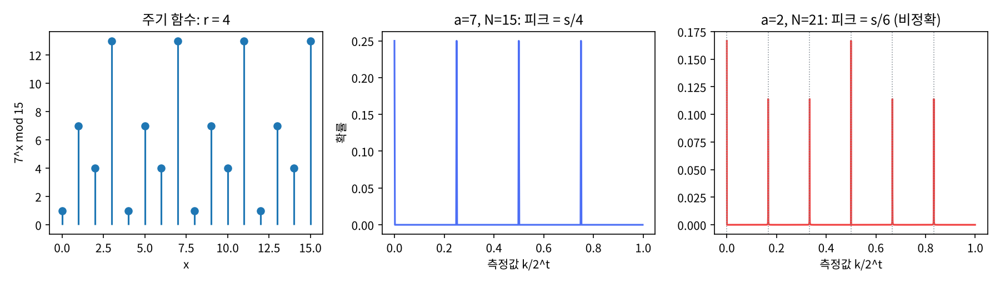

# 11장 Shor 알고리즘

2026-10-29 · Gosh

양자컴퓨팅 입문·심화서 · 2부 대표 알고리즘 · 이 장을 마치면 인수분해를 위수 찾기로 환원하고, 모듈러 곱셈 유니터리에 QPE를 걸어 위수를 읽으며, 연분수로 후처리해 N = 15·21을 인수분해할 수 있다 — 그리고 그것이 RSA-2048과 얼마나 먼지 숫자로 말할 수 있다.

## 1. 요약

Shor의 알고리즘은 "양자컴퓨터가 RSA를 깬다"로 알려져 있지만, 양자 부분은 단 하나 — **위수 찾기(order finding)** — 이고 그것은 10장 QPE를 U_a|y⟩ = |ay mod N⟩에 건 것이다. 나머지는 전부 고전: (1) N과 서로소인 a를 고른다. (2) a^r ≡ 1 (mod N)인 최소 r(위수)을 찾는다 ← 양자. (3) r이 짝수이고 a^{r/2} ≢ −1이면 gcd(a^{r/2} ± 1, N)이 인수다. 실패하면 a를 바꾼다(성공 확률 ≥ 1/2).

위수 찾기가 QPE인 이유: U_a의 고유상태 |u_s⟩는 고유값 e^{2πi s/r}를 가지고, 그 합이 정확히 |1⟩이다 — 고유상태를 모르고도 |1⟩을 넣으면 된다(10장 "고유값 샘플러"). QPE가 s/r을 난수 s로 주고, 연분수 전개가 k/2^t에서 r을 복원한다. 제어 U_a^{2^j}는 a^{2^j} mod N을 고전으로 먼저 계산해 곱셈 한 번으로 만든다 — 10장에서 말한 "지름길"이 있어서 Shor가 다항식 O(n³)이다.

numpy로 확인한 것: (1) N = 15의 서로소 a 7개 중 6개가 위수로 인수분해 성공(a = 14만 a^{r/2} ≡ −1로 실패; 일반 하한은 1/2). (2) U_7의 고유상태 |u_s⟩ 4개가 고유값 e^{2πi s/4}를 가지고 합이 |1⟩. (3) t = 9 QPE 분포가 k/512 = 0, 1/4, 1/2, 3/4에 각 0.25로 정확한 피크(r | 2^t). 연분수 후처리로 500회 중 49.6% 인수분해(k = 0과 s = 2가 실패 → 이론 1/2). (4) N = 21, a = 2, r = 6: 6은 2^t를 나누지 않으므로 피크가 s/6 근처에 퍼지고(상위 6개 합 0.79) 16큐비트 상태벡터를 전체 행렬 없이 돌려야 했다. 성공 33%; 연분수가 준 r̂의 작은 배수도 시도하면 99.8%. (5) 계수 비트 t가 2^t < N²이면 연분수가 r을 복원하지 못한다(t = 5: 0%, t = 7: 23%, t ≥ 9: 33%).

이 장의 메시지: N = 21을 인수분해하는 데 16큐비트 상태벡터가 필요했고, RSA-2048은 현재 최선의 추산으로 물리 큐비트 100만 개 미만·1주일 미만(Gidney 2025; 게이트 오류 0.1%)이다. 이 간격이 7절의 주제이고, 양자내성 암호로의 전환이 이미 표준화된 이유다. 알고리즘적으로 중요한 것은 구조: 8장 Simon의 "숨은 부분군"이 Z₂ⁿ에서 Z로 옮겨진 것이고, 같은 틀이 이산로그(타원곡선 암호)를 깨고 비가환군에서는 막힌다(15장).

## 2. 직관 먼저 — 주기 함수와 그 푸리에 피크

f(x) = 7^x mod 15를 x = 0, 1, 2, …로 써 보면 1, 7, 4, 13, 1, 7, 4, 13, … — 주기 4. 인수분해는 이 주기를 찾는 문제로 바뀐다. 6장 연습문제 2에서 "주기 r인 빗 상태의 QFT는 N/r의 배수에서 피크"를 봤다 — 그것이 이 장의 전부다. 5절 그림 왼쪽이 이 표, 가운데가 그 푸리에 피크(k/2^t = 0, 1/4, 1/2, 3/4)다.

Quirk에는 모듈러 곱셈 게이트가 통째로 있다("×A mod R" 게이트, 입력 A·R을 다른 레지스터에서 읽음). 최소 구성: 작업 레지스터 4비트를 |0001⟩로, 계수 레지스터 4비트를 H로, 계수 비트별로 ×7, ×7² = ×4, ×7⁴ = ×1… 를 제어하고 QFT†. Quirk의 URL 인코딩이 입력 레지스터 게이트를 포함해 길어지므로 여기서는 설명으로 대신한다 — Quirk 툴박스의 "Modular" 탭에서 `×A mod R`를, "Inputs" 탭에서 `input A`·`input R`를 끌어 직접 조립해 보는 것이 이 장의 Quirk 연습이다.

해 볼 것: 계수 레지스터를 4비트로 하면 r = 4가 16을 나누므로 피크가 정확히 0, 4, 8, 12에 선다. a를 2로 바꿔도 r = 4. a = 11이면 r = 2라 피크가 0과 8 두 개뿐. 피크 개수가 위수다.

비유: 어두운 방에서 불빛이 일정한 간격으로 깜박인다고 하자(주기 함수). 깜박임을 하나씩 세지 않고 그 빛을 프리즘(QFT)에 통과시키면 깜박임 주파수에서 밝은 줄이 선다 — 주기의 역수. 깨지는 곳: 프리즘은 스펙트럼 전체를 보여 주지만 양자 측정은 밝은 줄 중 하나(s/r)만 준다. 하나로도 충분한 이유가 연분수다 — "분모 ≤ N인 분수 중 k/2^t에 가장 가까운 것은 유일하다"(연습문제 3).

## 3. 정의와 수식

**고전 환원: 인수분해 → 위수 찾기.** N = pq(홀수 합성수), a ∈ [2, N−1], gcd(a, N) = 1. a의 위수 r = min{r ≥ 1 : a^r ≡ 1 (mod N)}. r이 짝수이고 y = a^{r/2} ≢ −1 (mod N)이면 y² ≡ 1이므로 (y−1)(y+1) ≡ 0 (mod N)이고 두 인자 모두 N의 배수가 아니므로 gcd(y ± 1, N)이 비자명한 인수다. 난수 a에 대해 이 조건이 성립할 확률은 ≥ 1 − 1/2^{m−1} (m = N의 서로 다른 소인수 개수; Shor 1997. N&C 정리 5.3 = A4.13에는 1 − 1/2^m로 인쇄되어 있으나 공식 정오표가 1 − 1/2^{m−1}로 고쳤다), N = pq면 ≥ 1/2. 이 하한은 N = 21에서 실제로 닿는다(a = 1을 포함한 서로소 a 12개 중 6개만 성공). 연습문제 2가 실패 예를 다룬다.

**모듈러 곱셈 유니터리.** n = ⌈log₂ N⌉ 큐비트에

```latex
U_a|y\rangle = |ay \bmod N\rangle\quad(0\le y<N),\qquad U_a|y\rangle=|y\rangle\quad(y\ge N)
```

gcd(a, N) = 1이므로 y ↦ ay mod N은 Z_N의 치환 — U_a는 치환 행렬, 유니터리, U_a^r = I. 고유상태와 고유값:

```latex
|u_s\rangle = \frac{1}{\sqrt r}\sum_{k=0}^{r-1} e^{-2\pi i\,sk/r}\,|a^k \bmod N\rangle,\qquad U_a|u_s\rangle = e^{2\pi i\,s/r}|u_s\rangle,\qquad \frac{1}{\sqrt r}\sum_{s=0}^{r-1}|u_s\rangle = |1\rangle
```

마지막 등식(연습문제 1)이 핵심: 고유상태는 r을 알아야 만들 수 있지만, 그 균등 중첩은 |1⟩이라 준비가 공짜다. 10장 3절의 "고유상태 중첩 입력"이므로 QPE는 s ∈ {0, …, r−1}를 균등 확률 1/r로 뽑아 φ = s/r의 추정값을 준다.

**제어 U_a^{2^j}의 지름길.** U_a^{2^j} = U_{a^{2^j} mod N}. a^{2^j} mod N은 고전 반복 제곱으로 O(j)번 곱셈에 계산되므로, 제어 U^{2^j}는 "새로운 상수 a_j로의 모듈러 곱셈 한 번"이다 — U를 2^j번 반복하지 않는다. 모듈러 곱셈 한 번은 모듈러 덧셈 O(n)번(6장 Draper 덧셈기의 모듈러 버전), 덧셈 한 번은 게이트 O(n) \~ O(n²). 전체: t = 2n+1개의 제어 곱셈 × O(n²) = O(n³) 게이트(리플캐리 덧셈기 기준; Draper QFT 덧셈기를 쓰는 Beauregard는 O(n³ log n), 4절) — n = 2048에서 ≈ 10¹⁰ 규모. 이것이 고전 최선(GNFS, exp(O(n^{1/3}(log n)^{2/3})))과의 지수 분리다.

**후처리: 연분수.** QPE가 k/2^t ≈ s/r을 주면 r을 모르므로 분수를 복원해야 한다. |k/2^t − s/r| ≤ 1/2^{t+1}이고 2^t ≥ N² > r²이면 — 즉 t = 2n + 1이면 — s/r은 k/2^t의 연분수 수렴분수 중 하나로 유일하게 나온다(N&C 정리 5.1, 연습문제 3). Python은 `Fraction(k, 2**t).limit_denominator(N)` 한 줄. 단 gcd(s, r) > 1이면 기약분수의 분모가 r의 약수 r/gcd(s, r)이라 틀린다 — 여러 번 뽑아 최소공배수를 취하거나(N&C 5.3.1) 작은 배수를 시도한다(5절). 유효한 s(gcd = 1)의 비율은 φ(r)/r ≥ c/log log r.

**전체 성공 확률과 복잡도.** (a 선택 ≥ 1/2) × (QPE가 정확한 값 ≥ 4/π² 근처, t 여분 비트로 올림) × (gcd(s, r) = 1 ≥ c/log log r) = Ω(1/log log N) → 기대 O(log log N)번 반복(두 번 뽑아 lcm을 취하면 상수 확률, N&C 5.3.1). 각 반복 O(n³). 이것이 Shor 1994의 결론.

**교과서 비교.** N&C 5.3은 위수 찾기(5.3.1, 고유상태·연분수·성공 확률 분석), 인수분해로의 환원(5.3.2, 부록 4의 정수론), 그리고 5.4에서 일반화(주기 찾기·이산로그·숨은 부분군)를 다룬다 — 이 장의 기준. KLM 7.3은 위수 찾기를 "고유값 추정의 응용"으로 더 짧게 다루고 7.4에서 이산로그, 7.5에서 숨은 부분군을 다룬다. 모듈러 곱셈 회로의 실제 구성(큐비트 2n+3)은 두 책 모두 없고 Beauregard 2003이 1차 출처다.

## 4. 회로 구성 — numpy 조립과 Qiskit

**numpy 구현(실행 완료).** 전체 스크립트는 `ch11_shor.py`다. 이 장에서 처음으로 전체 유니터리 행렬을 만들지 않는다 — N = 21은 계수 11 + 작업 5 = 16큐비트이고 65536² 행렬은 약 69 GB(64 GiB)다. 대신 상태를 (2^t, 2^n) 배열로 두고 게이트를 축별로 적용한다. 26장 GPU 시뮬레이션의 기본 기법이고 numpy로 5초.

```python
def U_mod(a, N, n):                            # U_a|y> = |a·y mod N>, y ≥ N 은 항등 (유니터리 유지)
    U = np.zeros((2**n, 2**n), dtype=complex)
    for y in range(2**n): U[(a*y) % N if y < N else y, y] = 1
    return U

def order_finding_probs(a, N, n, t):
    T, M = 2**t, 2**n
    psi = np.zeros((T, M), dtype=complex); psi[:, 1] = 1/np.sqrt(T)   # H^t|0..0> ⊗ |1>
    idx = np.arange(T)
    for j in range(t):                          # 계수 큐비트 j (q[0] 최상위) 가 U^{2^{t-1-j}} 제어
        ap = pow(a, 2**(t-1-j), N)              # '사전 제곱': a^{2^{t-1-j}} mod N 을 고전으로 — 지름길
        perm = np.array([(ap*y) % N if y < N else y for y in range(M)])
        inv = np.empty(M, dtype=int); inv[perm] = np.arange(M)
        mask = ((idx >> (t-1-j)) & 1) == 1      # 제어 비트가 1 인 행에만
        psi[mask] = psi[mask][:, inv]           # 작업 레지스터 치환
    psi = dft_matrix(T).conj().T @ psi          # 역 QFT = DFT† (6장에서 게이트 조립 = DFT 검증)
    return (abs(psi)**2).sum(axis=1)            # 계수 레지스터 분포

def continued_fraction_r(k, t, N):
    return Fraction(k, 2**t).limit_denominator(N).denominator   # 연분수 수렴분수, 분모 ≤ N

def shor_trial(a, N, n, t, p, multiples=1):
    k = rng.choice(len(p), p=p)                 # 측정
    r_hat = continued_fraction_r(k, t, N)
    for m in range(1, multiples + 1):           # r̂ 의 작은 배수도 시도 (gcd(s,r) > 1 구제)
        if pow(a, m*r_hat, N) == 1: return factor_from_order(a, m*r_hat, N)
    return None
```

세 줄이 이 장의 알고리즘 전부다: `pow(a, 2**(t-1-j), N)`(지름길), `psi[mask][:, inv]`(제어 치환), `limit_denominator(N)`(연분수). 역 QFT를 DFT 행렬로 바로 쓴 것은 6장에서 게이트 조립과 DFT가 같음을 이미 검증했기 때문 — 큰 t에서 71개의 2048×2048 행렬을 곱하는 것보다 빠르다.

**게이트 비용 기록(이 책의 규칙).** 세는 법은 10장과 같다: 기저는 CX + 임의의 1큐비트 게이트(전결합), SWAP = 3 CX, Toffoli = 6 CX + T 7개, Fredkin = Toffoli + 2 CX, CP(θ) = 2 CX + 위상 회전 3개; 깊이는 그렇게 푼 게이트를 가능한 한 앞에 놓은(ASAP) 층 수; π/4의 배수가 아닌 회전은 개수 R로 적고 T ≈ 3·log₂(1/ε)·R로 어림한다(Ross & Selinger 2016; ε = 10⁻⁶이면 회전당 약 60). 이 장의 numpy 구현은 쿼리 복잡도만 재고 U_a의 내부는 치환 행렬로 "공짜"로 썼다 — 8장의 오라클 비용 경고가 여기 그대로 들어맞는다. 그래서 세 숫자는 N = 15, a = 7에 한해, 답을 알고 줄인 "컴파일된" 게이트 회로를 스크립트 7번이 따로 짜서 센 것이다: ×7 mod 15 = 오른쪽 한 자리 순환(SWAP 3) 뒤 전체 반전(X 4), ×4 mod 15 = 두 자리 순환(SWAP 2), 그리고 7⁴ ≡ 1이라 제어 ×7^{2^j}(j ≥ 2)에는 게이트가 없다.

| 회로 (N = 15, a = 7 전용) | 2큐비트 게이트 | 깊이 | T-count |
| --- | --- | --- | --- |
| ×7 mod 15 (SWAP 3 + X 4) | 9 | 10 | 0 |
| 제어 ×7 (Fredkin 3 + CX 4) | 28 | 43 | 21 |
| 제어 ×4 (Fredkin 2) | 16 | 21 | 14 |
| 위수 찾기 전체, t = 9 (13큐비트, 5절의 회로) | 128 | 129 | T 59 + 회전 R 84 (T ≈ 59 + 5023) |
| 위수 찾기 전체, t = 8 (12큐비트, 아래 Qiskit 스니펫의 t) | 112 | 121 | T 56 + R 63 (T ≈ 56 + 3767) |

읽는 법. 전체 = 제어 ×7 (28) + 제어 ×4 (16) + 역 QFT(CP t(t−1)/2개 = CX t(t−1), SWAP ⌊t/2⌋개 = 3⌊t/2⌋ CX). t = 9에서 2큐비트 게이트 128개 중 84개가 역 QFT이고, 정확한 T 59개 중 35개가 Fredkin 5개에서, 24개가 역 QFT의 제어 S 꼴 8개에서 나온다. 검증: SWAP·X 회로는 y = 1…14에서 치환 행렬 U_7과 같고 y = 0과 15만 서로 맞바꾼다(U_7은 둘 다 고정하지만 |1⟩의 궤도 {1, 7, 4, 13} 밖이라 결과에 영향이 없다); ×4 회로는 U_4와 16개 전부에서 같다; 13큐비트 게이트 리스트의 계수 분포는 `order_finding_probs`와 일치한다. 이 숫자는 a와 N을 알고 줄인 이 구성에만 맞는다(7절 "N = 15 데모는 커닝이다"). N = 21(a = 2)과 일반 N은 이 장이 게이트 회로를 만들지 않았으므로 세 숫자를 정의하지 않고 문헌의 값만 옮긴다. 실제 회로(Beauregard 2003): 제어 모듈러 곱셈 = 제어 모듈러 덧셈 n개, 모듈러 덧셈 = Draper QFT 덧셈기(6장) + 비교·보정 — 큐비트 2n + 3, 게이트 O(n³ log n), 깊이 O(n³). N = 15(n = 4)에서 11큐비트, N = 21에서 13큐비트다. 게이트 수는 논문이 차수만 주므로, 스크립트 8번이 N = 15 회로를 논문 그림대로 짜서 세었다(추가 규약: 이중 제어 위상은 CP 3개 + CX 2개로 풀고 QFT의 SWAP은 뺀다. b 레지스터와 보조 큐비트가 0인 입력 2×15개 전부에서 제어 치환과 같고 상대 위상이 없음을 확인했다). 제어 ×7 한 번이 2큐비트 1,752·깊이 2,148·T 708 + R 1,546이고, 제어 곱셈 2n = 8번을 모두 넣으면 2큐비트 12,336·깊이 14,589다. 컴파일된 회로에서는 같은 부분이 44개였으니 280배다. 7⁴ ≡ 1을 미리 알고 ×1 여섯 번을 빼도 3,264개가 남는다. 최신 추산(Gidney 2025): RSA-2048에 논리 큐비트 ≈ 1,400, Toffoli ≈ 6.5×10⁹, 오류 정정 포함 물리 큐비트 < 10⁶, 실행 < 1주일(게이트 오류 0.1%, 표면 부호, 사이클 1 μs). 2019년 추산(Gidney–Ekerå)의 2천만 큐비트·8시간에서 20배 줄었다 — 하드웨어가 아니라 알고리즘·부호 수준의 개선(근사 잉여 산술 approximate residue arithmetic, 요크 표면 부호 yoked surface codes, 마법 상태 배양 magic state cultivation)으로. (규약은 책 앞의 「기호와 비용 단위」에도 적어 둔다.)

**Qiskit 스니펫(작성됨, 미실행).** N = 15, a = 7의 제어 모듈러 곱셈은 손으로 짤 수 있다 — ×7 mod 15는 4비트 치환이고 SWAP과 X로 분해된다(Vandersypen 2001의 "컴파일된" 회로). 일반 N은 `qiskit.circuit.library`에 모듈러 곱셈이 없고 직접 짜거나(Beauregard) `UnitaryGate(치환 행렬)`로 코딩한다.

```python
# qiskit==2.5.x — 작성됨, 미실행.  N=15, a=7: 제어 ×7^{2^j} mod 15 를 치환으로
import numpy as np
from fractions import Fraction
from math import gcd
from qiskit import QuantumCircuit, transpile
from qiskit.circuit.library import QFTGate, UnitaryGate
from qiskit.primitives import StatevectorSampler

N, a, n, t = 15, 7, 4, 8                               # t = 8 은 일부러 고른 값이다(본문 5절은 t = 2n + 1 = 9): 2^8 = 256 ≥ N² = 225 이고 r = 4 가 2^t 를 나누어 피크가 정확하다. 두 t 의 비용은 위 게이트 비용 표에 따로 있다
def c_amod15(power):                                   # 제어 U_a^{2^j} 를 하나의 게이트로
    ap = pow(a, power, N)
    U = np.zeros((16, 16)); 
    for y in range(16): U[(ap*y) % N if y < N else y, y] = 1
    return UnitaryGate(U, label=f'×{ap} mod 15').control(1)   # 변환 불필요: 작업 레지스터 값을 Qiskit 순서(q[t] = 최하위)로 읽고 |1> 도 x(t) 로 준비하므로 행렬 인덱스 = 레지스터 값

qc = QuantumCircuit(t + n, t)
qc.x(t)                                                # 작업 레지스터 |1>  (리틀 엔디안: 최하위 큐비트)
qc.h(range(t))
for j in range(t):
    qc.append(c_amod15(2**j), [j] + list(range(t, t + n)))
qc.append(QFTGate(t).inverse(), range(t))
qc.measure(range(t), range(t))
counts = StatevectorSampler(seed=7).run([qc], shots=1000).result()[0].data.c.get_counts()
for k_str, c in sorted(counts.items(), key=lambda kv: -kv[1])[:4]:
    k = int(k_str, 2); frac = Fraction(k, 2**t).limit_denominator(N)
    print(k_str, k/2**t, 'r̂ =', frac.denominator)      # 0, 64, 128, 192 → r̂ = 1, 4, 2, 4

# 게이트 비용 — UnitaryGate 는 transpile 시 일반 분해로 폭발한다 (실제 Beauregard 회로와 비교용)
print(transpile(qc, basis_gates=['rz', 'sx', 'x', 'cz'], optimization_level=1).count_ops())
```

마지막 줄이 중요하다: `UnitaryGate(16×16 치환)`을 트랜스파일하면 수백 CZ가 나온다 — 4장의 일반 유니터리 분해. 손으로 짠 ×7 mod 15(SWAP 3 + X 4)는 제어 버전(Fredkin 3 + CNOT 4)으로도 CX 28(위 게이트 비용 기록; CZ 기저로 옮겨도 28) — UnitaryGate 분해의 수백 개와 10배 차이. 이 차이가 7절 "컴파일된 데모"의 핵심이다.

## 5. 시뮬레이션 결과

모든 수치는 `ch11_shor.py`를 `seed=7`로 실행한 출력이다(실행 약 4\~6초).

**고전 환원 전수(N = 15).** a = 2…14 중 gcd(a, 15) > 1인 6개는 운으로 바로 인수. 서로소 7개:

| a | r | a^{r/2} mod 15 | 결과 |
| --- | --- | --- | --- |
| 2, 7, 8, 13 | 4 | 4 | gcd(3, 15), gcd(5, 15) → 3, 5 |
| 4, 11 | 2 | 4, 11 | 3, 5 |
| 14 | 2 | 14 ≡ −1 | 실패 |

성공 6/7 — 일반 하한 1/2(Shor 1997; N&C 정리 5.3의 정오표)보다 높다(연습문제 2). 스크립트 1b의 전수 계산: a = 1을 포함한 서로소 a 전체에서 "r이 짝수이고 a^{r/2} ≢ −1"인 비율은 N = 15에서 6/8 = 0.75, N = 21, 33, 57, 77에서 6/12, 10/20, 18/36, 30/60으로 정확히 1/2이다.

**U_7의 고유구조.** 4큐비트 치환 행렬, 유니터리, U⁴ = I. |u_s⟩(s = 0…3)가 고유값 e^{2πi s/4} = 1, i, −1, −i의 고유상태이고 (1/2)Σ|u_s⟩ = |0001⟩ — 연습문제 1을 수치로.

**위수 찾기 a = 7, N = 15, t = 9.** 계수 레지스터 분포가 k = 0, 128, 256, 384(k/512 = 0, 1/4, 1/2, 3/4)에 각 0.25, 합 1.0000 — r = 4가 2^t를 나누므로 꼬리 없이 정확. 샘플 10회:

| k | k/2^t | 연분수 r̂ | 결과 |
| --- | --- | --- | --- |
| 128, 384 | 1/4, 3/4 | 4 | 7² = 49 ≡ 4 → gcd(3, 15) = 3 ✓ |
| 256 | 1/2 | 2 | 7² ≢ 1 → 재시도 (s = 2, gcd(s, r) = 2) |
| 0 | 0 | 1 | 재시도 (s = 0, 정보 없음) |

500회 중 성공 49.6% — 유효한 s = 1, 3의 비율 φ(4)/4 = 1/2 그대로. 그림 가운데.

**N = 21, a = 2, r = 6, t = 11.** 6은 2048을 나누지 않으므로 피크가 s/6 근처에 선다: 상위 6개 k/2^t = 0, 0.1665, 0.3335, 0.5, 0.6665, 0.8335 vs s/6 = 0, 0.1667, 0.3333, 0.5, 0.6667, 0.8333. 상위 6개 확률 합 0.789 — 나머지 21%는 10장 Dirichlet 꼬리. 그림 오른쪽.

| 후처리 | 500회 성공률 | 설명 |
| --- | --- | --- |
| 연분수 r̂ 그대로 | 0.330 | 유효 s = 1, 5 (gcd(s, 6) = 1) → φ(6)/6 = 1/3 |
| r̂의 배수 ≤ 6배도 시도 | 0.998 | s = 2, 3, 4의 r̂ = 3, 2, 3을 배수로 구제; k = 0의 r̂ = 1도 6배로 |

두 번째 행은 r이 작을 때만 통하는 트릭이다 — 일반 N에서 r ≈ N이므로 배수를 다 시도할 수 없고, N&C의 처방(두 번 뽑아 lcm)이나 여러 번 반복이 정답이다.

**계수 비트 t와 연분수 복원률(N = 21).** 2^t ≥ N² = 441이 연분수 유일성의 조건:

| t | 2^t | r̂ = 6 복원률 |
| --- | --- | --- |
| 5 | 32 | 0.000 |
| 7 | 128 | 0.230 |
| 9 | 512 | 0.322 |
| 11 | 2048 | 0.340 |

t = 5(2^t < r² = 36조차 안 됨)에서는 전혀 복원하지 못하고, 2^t ≥ N²인 t ≥ 9에서 이론값 1/3에 닿는다. t = 2n + 1 = 11은 안전 마진 — 연습문제 3.



그림: 왼쪽 7^x mod 15의 주기 4, 가운데 N = 15 QPE 분포(정확한 s/4 피크), 오른쪽 N = 21 분포(s/6 근처의 피크와 꼬리).

## 6. 다른 SDK 대응 — Cirq

이 장에서 Cirq를 고른 이유는 `cirq.ArithmeticGate`가 정수 함수 하나로 모듈러 곱셈 게이트를 정의하게 해 주어, 이 장의 numpy가 한 일(치환을 상태벡터에 직접 적용)이 SDK의 문법으로 그대로 보이기 때문이다.

| | Qiskit 2.x | Cirq 1.7 |
| --- | --- | --- |
| 모듈러 곱셈 게이트 | 없음(직접 또는 `UnitaryGate`) | `examples/shor.py`의 `ModularExp` (`cirq.ArithmeticGate` 서브클래스) |
| 산술 게이트 틀 | `HalfAdderGate`, `ModularAdderGate`, `MultiplierGate`(1.3+; HLS 기반, `DraperQFTAdder`·`CDKMRippleCarryAdder` 클래스를 대체 권장) | `cirq.ArithmeticGate`(정수 함수 → 치환) |
| 연분수 후처리 | Python `fractions` | `fractions` |
| 큰 레지스터 시뮬레이션 | `AerSimulator`(상태벡터, 30큐비트까지 CPU) | `cirq.Simulator` |

```python
# cirq==1.7.x — 작성됨, 미실행.  cirq.ArithmeticGate 로 모듈러 지수 게이트 (Cirq 공식 예제의 축약)
import cirq
class ModularExp(cirq.ArithmeticGate):
    """|e>|y> → |e>|y·a^e mod N>  — 계수 레지스터 e 전체를 한 번에 제어로 쓴다"""
    def __init__(self, t, n, a, N): self.t, self.n, self.a, self.N = t, n, a, N
    def registers(self): return [2]*self.t, [2]*self.n
    def with_registers(self, *r): return self
    def apply(self, e, y): return e, (y * pow(self.a, e, self.N)) % self.N if y < self.N else y
t, n, a, N = 8, 4, 7, 15                                # t = 8: 4절 Qiskit 스니펫과 같은 값(본문 5절은 t = 9)
cnt = cirq.LineQubit.range(t); work = cirq.LineQubit.range(t, t + n)
c = cirq.Circuit(cirq.X(work[-1]), cirq.H.on_each(cnt),
                 ModularExp(t, n, a, N).on(*cnt, *work),
                 cirq.inverse(cirq.qft(*cnt)), cirq.measure(cnt, key='k'))
res = cirq.Simulator(seed=7).run(c, repetitions=200).histogram(key='k')
print(sorted(res.items(), key=lambda kv: -kv[1])[:4])     # {0, 64, 128, 192} 등장 — 치환은 Cirq 가 상태벡터에 직접 적용
```

스니펫의 `ModularExp`에서 정수 함수 `apply`만 주면 시뮬레이터가 치환을 상태벡터에 직접 적용한다 — 이 장 numpy의 `psi[mask][:, inv]`와 같은 일. 즉 시뮬레이션에서는 모듈러 곱셈이 공짜고, 실제 하드웨어에 올리려면 `cirq.decompose`가 없으므로(ArithmeticGate는 분해를 제공하지 않는다) Beauregard 회로를 직접 짜야 한다. "시뮬레이션이 된다"와 "회로가 있다"의 간격이 7절이다.

## 7. 한계와 반례

**N = 15 데모는 커닝이다.** 2001년 IBM의 NMR 실험(Vandersypen et al.) 이래 모든 "Shor로 15를 인수분해" 데모는 a와 N을 알고 손으로 최적화한 회로를 쓴다 — ×7 mod 15가 SWAP 세 개와 X 네 개로 줄어드는 것은 답을 알기 때문이다. Smolin–Smith–Vargo 2013은 이 논리를 끝까지 밀어 "큐비트 두 개로 어떤 N = pq도 인수분해"하는 풍자 논문을 썼다(답을 알고 위수 2인 밑을 고르면 모듈러 지수 회로가 CNOT 하나로 줄고, 출력은 동전 던지기와 같아진다 — RSA-768도 이렇게 "인수분해"된다). 정직한 Shor 실행은 "a를 모르는 채로 컴파일된 모듈러 지수 회로"를 써야 하고, 그런 회로는 N = 15에서도 2큐비트 게이트가 1만 개를 넘어(4절: Beauregard 회로 12,336개) 현재 하드웨어에서 노이즈에 묻힌다. 14장은 Shor 회로를 실행하지 않는다 — 컴파일된 N = 15 회로를 14장의 노이즈 모델로 예측해 보는 것은 과제로 남기고, 후속 하드웨어 장에서 실기에 올릴 때도 "컴파일된" 버전이라고 밝혀 부른다.

**규모의 간격.** 이 장의 N = 21은 16큐비트 상태벡터. RSA-2048은 Gidney 2025 추산으로 논리 큐비트 ≈ 1,400, Toffoli ≈ 6.5×10⁹, 물리 큐비트 < 100만, 1주일 미만(게이트 오류 0.1%). 2026년 Iceberg Quantum은 QLDPC 부호로 < 10만 물리 큐비트를 제시했고(시뮬레이션 기반), Google은 256비트 타원곡선 키를 물리 큐비트 < 50만·수 분에 깨는 추산을 냈다(회로는 비공개, 영지식 증명으로 검증). 현재 하드웨어는 물리 큐비트 수백\~수천, 게이트 오류 0.1\~1% — 큐비트 수에서 100배, 오류율에서 경계선. 정직하게 인수분해된 가장 큰 수는 여전히 두 자릿수다.

**그래도 암호는 이미 바뀌고 있다.** "지금 수집해 나중에 해독(harvest now, decrypt later)"이 위협 모델이므로 답은 양자컴퓨터가 오기 전에 전환하는 것이다. NIST는 2024년 8월 FIPS 203(ML-KEM, 격자 기반 키 교환), 204(ML-DSA, 서명), 205(SLH-DSA, 해시 서명)를 표준으로 확정했고, 주요 브라우저·TLS·Signal이 하이브리드 키 교환으로 전환 중이다. 격자 문제가 양자내성인 이유는 그 이면군(dihedral) 숨은 부분군 문제가 30년째 안 풀리기 때문 — 가환군(Shor)과 비가환군의 경계가 암호학의 경계가 됐다(15장).

**Regev 2023.** Shor 이후 30년 만에 나온 알고리즘적 개선: 차원을 하나가 아니라 √n개로 늘려 게이트를 O(n^{1.5})로 줄였다(단 큐비트는 더 필요, 이후 Ragavan–Vaikuntanathan이 큐비트 O(n log n)으로). 실용 이득은 아직 불확실하지만 "Shor가 최적이 아니다"는 것을 보였다 — 3부의 "알려진 알고리즘도 다시 볼 수 있다"의 예.

**위수 찾기가 일반화되는 곳과 안 되는 곳.** 가환군 G의 숨은 부분군 H(f가 H의 잉여류에서 일정): Z₂ⁿ에서 Simon(8장), Z에서 주기 찾기(이 장), Z_{r}×Z_{r}(r = 위수)에서 이산로그(ECDSA·DH) — 전부 다항식. Pell 방정식(Hallgren 2002), 단위군 계산도 가환군 HSP. 비가환군: 대칭군 S_n(그래프 동형)과 이면군 D_n(격자 최단 벡터)은 쿼리 복잡도는 다항식이지만 후처리가 지수 — "양자 샘플은 충분한데 읽을 수 없다"는 상황. 15장 "가속의 원천" 표의 첫 행이 이 경계선이다.

**이 장의 시뮬레이션이 숨긴 것.** 제어 치환을 상태벡터에 직접 적용했으므로 게이트 수·깊이·노이즈가 없다(N = 15에 한해 컴파일된 회로와 Beauregard 회로를 4절에서 따로 짜서 세었다). 모듈러 곱셈의 실제 회로를 짜고 7장 노이즈를 넣으면 N = 15에서도 성공률이 난수 수준으로 떨어진다 — 그 실험은 25장(오류 완화)에서. 미실행 항목: Qiskit·Cirq 스니펫, Beauregard 회로의 게이트 수 계수.

## 8. 연습문제와 해답

**문제 1 (N&C 연습 5.13).** |u_s⟩ = (1/√r)Σ_k e^{−2πi sk/r}|a^k mod N⟩가 U_a의 고유상태임을 보이고, (1/√r)Σ_s|u_s⟩ = |1⟩임을 보여라.

*해답.* U_a|a^k⟩ = |a^{k+1}⟩이므로 U_a|u_s⟩ = (1/√r)Σ_k e^{−2πi sk/r}|a^{k+1}⟩. k' = k+1로 바꾸면 지수가 −2πi s(k'−1)/r = −2πi sk'/r + 2πi s/r, 그리고 a^r ≡ 1이므로 k' = r인 항은 k' = 0과 같은 기저상태 — 합이 순환한다. 따라서 U_a|u_s⟩ = e^{2πi s/r}|u_s⟩. 두 번째: (1/√r)Σ_s|u_s⟩ = (1/r)Σ_k[Σ_s e^{−2πi sk/r}]|a^k⟩이고 안의 합은 k = 0에서 r, 그 외에서 0(단위근의 합) → |a⁰⟩ = |1⟩. 스크립트 2번이 a = 7, N = 15에서 둘 다 수치로 확인. 교훈: |u_s⟩는 정확히 "주기 r인 빗 상태의 QFT"다 — 6장 연습문제 2와 같은 구조. 주기 함수의 고유상태는 푸리에 모드이고, 그 모드들의 균등 중첩이 "시간 0의 델타" |1⟩이다 — 신호처리의 "임펄스는 모든 주파수의 합"과 같은 말.

**문제 2 (자작).** N = 15에서 a = 14는 왜 실패하는가? a = 4는 r = 2인데 왜 성공하는가? 일반적으로 실패하는 a의 비율은?

*해답.* 14 ≡ −1 (mod 15)이므로 14² ≡ 1, r = 2, a^{r/2} = 14 ≡ −1 — 정확히 제외 조건. y ≡ −1이면 y + 1 ≡ 0이라 gcd(y+1, N) = N, gcd(y−1, N) = gcd(13, 15) = 1 — 자명한 인수뿐. a = 4: r = 2, a^{r/2} = 4 ≢ ±1, 4² = 16 ≡ 1 → gcd(3, 15) = 3, gcd(5, 15) = 5 — 4는 15의 "비자명한 제곱근"이다. 일반적으로 N = pq에서 1의 제곱근은 CRT로 (±1 mod p, ±1 mod q)의 4개: ±1이 자명, 나머지 2개가 인수를 준다. r이 짝수일 때 a^{r/2}는 이 4개 중 1이 아닌 하나(1이면 r이 최소가 아님)다. 정확히 세면, a mod p와 a mod q의 위수에 들어 있는 2의 지수가 같을 때만 실패한다(둘 다 0이면 r이 홀수, 같은 양수이면 a^{r/2} ≡ −1). 그 확률은 ≤ 1/2이므로 "r이 짝수이고 a^{r/2} ≢ −1"의 확률은 ≥ 1 − 1/2^{m−1}(N = pq에서 1/2)이다 — Shor 원논문의 하한이다. N&C 정리 5.3의 1 − 1/2^m은 인쇄 오류이고 공식 정오표가 1 − 1/2^{m−1}로 고쳤다. 이 하한은 실제로 닿는다: N = 21, 33, 57, 77에서는 서로소 a의 정확히 절반이 실패한다(N = 21: 12개 중 a = 1, 4, 5, 16, 17, 20). N = 15는 p − 1 = 2와 q − 1 = 4의 2의 지수가 달라 8개 중 2개(a = 1, 14)만 실패한다 — a = 1을 빼면 7개 중 1개. 교훈: Shor의 "양자" 부분은 r을 주는 것까지이고, r에서 인수로 가는 것은 1970년대 Miller의 고전 정수론이다. "양자컴퓨터가 인수분해를 한다"는 말은 정확히는 "양자컴퓨터가 위수를 찾고 고전이 나머지를 한다"다.

**문제 3 (N&C 정리 5.1).** 왜 t = 2n + 1이면 연분수가 k/2^t에서 s/r을 유일하게 복원하는가? 5절의 t = 5, 7, 9 결과를 설명하라.

*해답.* 정리: |x − s/r| ≤ 1/(2r²)이면 s/r은 x의 연분수 수렴분수다(그리고 두 기약분수 s/r, s'/r' (r, r' ≤ N)은 차이가 ≥ 1/(rr') > 1/N²이므로 이 정밀도에서 최대 하나만 있다). QPE의 최빈 k는 |k/2^t − s/r| ≤ 1/2^{t+1}을 만족하므로, 1/2^{t+1} ≤ 1/(2N²) ← 2^t ≥ N² ← t ≥ 2n이면 충분. +1은 10장의 "여분 비트" — 최빈이 아닌 이웃 k가 나와도 여전히 안에 들게. 5절 표본값(N = 21, N² = 441): t = 5(2^t = 32 < r² = 36)는 연분수가 r̂ = 6을 한 번도 못 줌 — 봉우리 k = 5의 5/32는 1/6(차이 0.0104)보다 3/19(차이 0.0016)에 가까워 연분수가 r̂ = 19를 낸다. 격자 간격 1/32이 분모 ≤ 21인 분수들의 간격보다 넓기 때문이다. t = 7(128 < 441)은 23% — 피크가 맞을 때만. t = 9(512 ≥ 441)부터 이론값 φ(6)/6 = 1/3에 닿고 t = 11은 그 위에서 평평. 즉 계수 레지스터가 2n 비트인 이유는 정밀도가 아니라 "분모 ≤ N인 분수들의 간격 1/N²을 분해할 만큼"이다. 교훈: 연분수는 "실수를 가장 잘 근사하는 작은 분모의 분수"를 주는 유일한 도구(Diophantine 근사)이고, Python `Fraction.limit_denominator`가 그것이다. 음성에서 샘플링 주파수 비율을 정수비로 근사할 때(리샘플링 필터 설계) 쓰는 바로 그 함수다.

## 9. 학습 노트

- **인수분해 → 위수 찾기 → QPE** — 양자 부분은 U_a|y⟩ = |ay mod N⟩에 10장 QPE를 걸어 s/r을 읽는 것뿐. 앞(a 선택, gcd)과 뒤(연분수, a^{r/2} ± 1)는 고전 정수론. 비유: 깜박이는 불빛을 프리즘에 통과시켜 주기를 읽는다. 깨지는 곳: 프리즘은 스펙트럼 전체를, 측정은 선 하나만 준다 — 연분수가 하나로도 충분하게 한다. 더 깊이: N&C 5.3, Shor 1994/1997.
- **고유상태 준비가 공짜인 이유** — (1/√r)Σ|u_s⟩ = |1⟩. 고유상태는 r을 알아야 만들지만 그 균등 중첩은 계산 기저 상태. 10장 "고유값 샘플러"가 여기서 정확히 필요한 형태로 쓰인다. 화학(23장)에서는 이런 공짜 입력이 없다는 것이 차이.
- **사전 제곱 = QPE의 지름길** — 제어 U_a^{2^j} = U_{a^{2^j} mod N}, 고전으로 계산한 상수로의 곱셈 한 번. 10장에서 "U^{2^j}를 어떻게 만드나"가 첫 질문이었고 Shor의 답이 이것. 전체 O(n³) 게이트 vs 고전 GNFS의 지수 시간. 코드로는 `pow(a, 2**j, N)` 한 줄.
- **연분수와 2^t ≥ N²** — 분모 ≤ N인 분수들의 간격이 > 1/N²이므로 그보다 정밀하게 재면 유일하게 복원. t = 2n+1은 정밀도가 아니라 "분수 격자의 분해능". 표본값: t = 5에서 0%, t ≥ 9에서 1/3. `Fraction(k, 2**t).limit_denominator(N)` — 리샘플링 비율 근사에 쓰는 그 함수. 더 깊이: N&C 정리 5.1, Hardy & Wright 10장.
- **데모와 실제의 간격** — N = 15 데모는 답을 알고 컴파일한 회로(Smolin 2013의 풍자: 큐비트 2개로 무엇이든). RSA-2048은 물리 큐비트 < 100만·1주일(Gidney 2025, 오류 0.1%) — 현재 하드웨어와 100배 간격. 그래도 NIST PQC(FIPS 203/204/205, 2024)로 전환 중인 이유는 harvest-now-decrypt-later. 양자내성의 근거 = 비가환군 HSP가 안 풀림(15장).

## 10. 출처와 환경

**실행 환경.** Python 3.13.17, numpy 2.5.3, matplotlib 3.11.2, `seed=7`. 스크립트 `ch11_shor.py`(실행 약 6초; 전체 유니터리 행렬 대신 (2^t, 2^n) 상태 배열에 게이트를 직접 적용 — 처음 시도에서 약 69 GB(64 GiB) 할당 실패 후 재작성; 끝의 게이트 비용 블록 7·8번은 `tools/gate_cost.py`를 불러 쓰고, 8번은 11큐비트 Beauregard 회로를 짜서 검증한다), 그림 `ch11_results.png`. Qiskit·Cirq 코드는 작성만 되고 미실행 — 작업계획서 §7 메모 참조.

**출처.**

- Nielsen & Chuang, 5.3절(위수 찾기·인수분해), 5.4(일반화: 주기·이산로그·HSP), 부록 4(정수론, 정리 A4.13), 정리 5.1(연분수). 등급 A.
- Kaye–Laflamme–Mosca, 7.3(위수 찾기), 7.4(이산로그), 7.5(숨은 부분군). 등급 A.
- Hardy, G. H. & Wright, E. M., *An Introduction to the Theory of Numbers*, 10장(연분수). 등급 A.
- Shor, P. W., "Polynomial-time algorithms for prime factorization and discrete logarithms on a quantum computer", SIAM J. Comput. 26, 1484 (1997; FOCS 1994). 등급 A.
- Beauregard, S., "Circuit for Shor's algorithm using 2n+3 qubits", Quantum Inf. Comput. 3, 175 (2003). 등급 A.
- Vandersypen et al., "Experimental realization of Shor's quantum factoring algorithm using nuclear magnetic resonance", Nature 414, 883 (2001). 등급 A.
- Smolin, Smith, Vargo, "Oversimplifying quantum factoring", Nature 499, 163 (2013) — 컴파일된 데모 비판. 등급 A.
- Gidney, C., "How to factor 2048 bit RSA integers with less than a million noisy qubits", [arXiv:2505.15917](https://arxiv.org/abs/2505.15917) (2025); Gidney & Ekerå, Quantum 5, 433 (2021). 등급 A.
- [The Quantum Insider, 2026-03-31 — 최근 자원 추산 3편 정리](https://thequantuminsider.com/2026/03/31/q-day-just-got-closer-three-papers-in-three-months-are-rewriting-the-quantum-threat-timeline/). 등급 B(2차 정리; 원논문 확인 필요).
- Regev, O., "An efficient quantum factoring algorithm", J. ACM 72 (2025; arXiv:2308.06572). 등급 A.
- Ragavan, S. & Vaikuntanathan, V., "Space-efficient and noise-robust quantum factoring", CRYPTO 2024. 등급 A.
- Hallgren, S., "Polynomial-time quantum algorithms for Pell's equation and the principal ideal problem", STOC 2002. 등급 A.
- NIST FIPS 203/204/205 (2024-08) — ML-KEM, ML-DSA, SLH-DSA. 등급 A.
- Ross, N. J. & Selinger, P., "Optimal ancilla-free Clifford+T approximation of z-rotations", Quantum Inf. Comput. 16, 901 (2016), arXiv:1403.2975 — 임의 각도 회전 하나의 T 수 ≈ 3·log₂(1/ε)(4절 게이트 비용 기록의 회전 규칙). 등급 A.
- [Cirq examples/shor.py](https://github.com/quantumlib/Cirq/blob/main/examples/shor.py) — `ArithmeticGate` 기반 구현. 등급 A.
- [Quirk](https://algassert.com/quirk) — Modular 탭의 `×A mod R`, Inputs 탭의 `input A`·`input R`. 등급 B.
