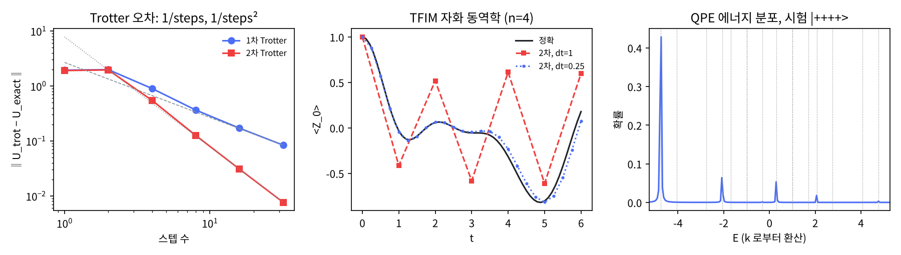

# 12장 해밀토니안 시뮬레이션

2026-10-29 · Gosh

양자컴퓨팅 입문·심화서 · 2부 대표 알고리즘 · 이 장을 마치면 파울리 분해된 해밀토니안의 시간 진화 e^{-iHt}를 Trotter 회로로 짜고 오차를 정량하며, 그 진화를 QPE에 넣어 에너지를, Grover 연산자를 QPE에 넣어 확률을 Heisenberg 정밀도로 읽을 수 있다.

## 1. 요약

Feynman이 1982년에 양자컴퓨터를 제안한 이유가 이 장이다: 양자계의 시간 진화 e^{−iHt}를 고전 컴퓨터는 지수 비용으로, 양자컴퓨터는 다항 비용으로 한다. 7장에서 게이트 하나가 해밀토니안 하나의 진화였다 — 이 장은 그 반대 방향이다. 주어진 H = Σ c\_k P\_k(파울리 문자열의 합)에 대해 e^{−iHt}를 게이트로 짠다. 항들이 서로 교환하지 않으므로 한 번에는 안 되고, 짧은 시간 dt만큼 항별로 번갈아 걸고 반복한다(Trotter 분해). 각 항 e^{−ic P dt}는 CNOT 사다리와 Rz 하나로 정확히 짜진다(연습문제 1).

numpy로 확인한 것(4스핀 횡자기장 이징 사슬, J = h = 1): (1) 1차 Trotter 오차가 스텝 수 r에 반비례(스텝 2배 → 오차 1/2.04), 2차(Suzuki)는 1/r²(1/4.02). t = 2에서 32스텝이면 2차 충실도 0.99998. (2) dt = 1은 자화 동역학을 완전히 틀리고(진동 주기 자체가 다름) dt = 0.25는 t = 6까지 따라간다 — Trotter는 dt·‖H‖ ≪ 1에서만 유효. (3) e^{−iHτ}를 10장 QPE에 넣으면 에너지 스펙트럼이 읽힌다: 시험 상태 |++++⟩(바닥상태 겹침 γ = 0.81)에서 E₀ = −4.759가 확률 0.43 + 0.24의 이웃 빈으로, |0000⟩(γ = 0.23)에서는 E₁이 더 크게 — "고유값 샘플러"가 에너지에서 그대로. (4) 9장 Grover 연산자 Q를 QPE에 넣으면 성공 확률 a = sin²θ가 읽힌다(진폭 추정): Q 호출 127회로 오차 상한 0.0145 vs 같은 횟수의 고전 샘플링 표준오차 0.0251 — 오차가 호출 수 M에 대해 1/M(Heisenberg)으로 줄고 고전은 1/√M이다. (이 비교는 확률 0.81의 상한과 표준오차를 견준 것이다. 한 번 실행의 RMSE가 다르게 움직이는 것은 16장 5절.) 교차점은 ≈ 50회(주항만 보면 4π² ≈ 40)다.

이 장의 메시지: 해밀토니안 시뮬레이션은 "양자컴퓨터의 지수 가속"이 가장 논란 없이 성립하는 영역이고(15장), 4부의 화학(23장)·스핀 동역학(23a장)이 이 부품 위에 선다. 진폭 추정은 몬테카를로 적분의 2차 가속으로 금융·물리에서 자주 인용되지만 9장의 2차 가속 회의론이 그대로 적용된다(7절).

## 2. 직관 먼저 — 비교환 항을 번갈아 조금씩

e^{−i(A+B)t}를 A와 B가 교환하지 않을 때 어떻게 만드나. 큐비트 하나에서 보면 답이 보인다: H = X + Z(비교환)의 진화는 Bloch 구에서 축 (1, 0, 1)/√2 — x와 z의 대각선 — 주위의 회전이다. Rx와 Rz를 큰 각으로 한 번씩 걸면 전혀 다른 곳에 도착하지만, 작은 각으로 번갈아 여러 번 걸면 대각선 회전에 수렴한다.

- [Quirk: Rx(π/2)·Rz(π/2) 한 번씩 (스텝 1)](https://algassert.com/quirk#circuit={"cols":[["H"],["X^½"],["Z^½"],["Bloch"]]}) — |+⟩에서 시작. 화살표가 어디에 도착하는지 기억.
- [Quirk: Rx(π/8)·Rz(π/8)를 4번 (스텝 4)](https://algassert.com/quirk#circuit={"cols":[["H"],["X^⅛"],["Z^⅛"],["X^⅛"],["Z^⅛"],["X^⅛"],["Z^⅛"],["X^⅛"],["Z^⅛"],["Bloch"]]}) — 같은 총 회전량, 다른 도착점. 스텝을 더 잘게 할수록 "(1,0,1) 축 회전"의 정답에 가까워진다. Quirk의 X^t, Z^t에 시간 슬라이더를 쓰면 연속으로 볼 수 있다.

비유: 바다에서 북동으로 가려는데 배가 북과 동으로만 갈 수 있다. 북으로 100 km, 동으로 100 km 가면 평면에서는 북동 대각선과 같은 곳이지만 구면(지구)에서는 다르다 — 이동이 교환하지 않는다. 북 1 km, 동 1 km를 100번 번갈아 가면 대각선에 훨씬 가깝다. 오차는 한 번 지그재그의 크기(dt)에 비례하고 횟수(r)를 곱하면 총 오차 ∝ t·dt = t²/r — 1차 Trotter. 북→동→동→북처럼 대칭으로 가면 1차 오차가 상쇄해 ∝ dt² — 2차(Suzuki). 깨지는 곳: 구면은 곡률이 일정하지만 해밀토니안 항의 비교환성 ‖\[A, B\]‖은 모델마다 다르고, 이것이 Trotter 오차 상수를 정한다(3절).

## 3. 정의와 수식

**파울리 분해.** n큐비트의 모든 에르미트 행렬은 파울리 문자열 P\_k ∈ {I, X, Y, Z}^{⊗n}의 실계수 일차결합 H = Σ\_k c\_k P\_k로 유일하게 쓰인다(4ⁿ개의 기저). 물리 해밀토니안은 항이 다항식 개수뿐 — 이것이 시뮬레이션이 효율적인 전제다. 이 장의 모델은 횡자기장 이징(TFIM) 사슬:

```latex
H = -J\sum_{i=0}^{n-2} Z_iZ_{i+1} - h\sum_{i=0}^{n-1} X_i
```

n = 4에서 항 7개. ZZ끼리는 교환, X끼리도 교환, ZZ와 X는 비교환 — 그래서 양자 상전이가 있다. 단 1차원 TFIM은 Jordan–Wigner 변환으로 자유 페르미온이 되어 고전으로도 다항 시간에 정확히 풀린다(Pfeuty 1970; 15장 3절의 "자유 페르미온" 경계). 이 책이 이 모형을 쓰는 이유는 어려워서가 아니라 정답을 알아 검산할 수 있어서다. 고전으로 어려워지는 것은 세로 자기장 −g Σ Zᵢ를 더하거나 2차원으로 갈 때의 실시간 동역학이다(17장 5절; 2차원 TFIM의 바닥상태는 양자 몬테카를로로 풀린다).

**한 항의 진화는 정확한 게이트.** P² = I이므로 e^{−icPt} = cos(ct)I − i sin(ct)P. 파울리 문자열 P = Z⊗Z⊗⋯의 경우 CNOT 사다리로 패리티를 한 큐비트에 모으고 Rz(2ct)를 건 뒤 사다리를 되돌린다; X·Y가 섞여 있으면 양쪽에 H(X의 경우) 또는 S† 다음 H(Y의 경우; 행렬로는 HS†)로 기저를 바꾼다(연습문제 1). 가중치(비항등 문자 수) k인 항의 비용: CNOT 2(k−1), 단일 큐비트 O(k). Qiskit의 `PauliEvolutionGate`가 이것을 한다.

**Lie–Trotter (1차).** A, B가 비교환이면 e^{−i(A+B)t} ≠ e^{−iAt}e^{−iBt}이지만

```latex
e^{-i(A+B)t} = \left(e^{-iA\,t/r}\,e^{-iB\,t/r}\right)^r + O\!\left(\frac{t^2}{r}\|[A,B]\|\right)
```

오차는 한 스텝당 O(dt²‖\[A,B\]‖)이고 r번 쌓여 총 O(t²‖\[A,B\]‖/r). 정밀도 ε를 원하면 r = O(t²/ε) — 시간의 제곱.

**Suzuki 2차.** 대칭 배치 S₂(dt) = e^{−iA dt/2}e^{−iB dt}e^{−iA dt/2}는 1차 오차가 상쇄해 스텝당 O(dt³), 총 O(t³/r²), r = O(t^{1.5}/√ε). 항이 여러 개면 순방향으로 반, 역방향으로 반 — 게이트는 2배이지만 양 끝 항이 합쳐지므로 실제로는 2배보다 적다. Suzuki 2k차는 재귀적으로 만들지만 게이트가 5^{k−1}배로 늘어 4차까지만 실용적.

**오차 상수의 실제 크기.** 위 공식의 ‖\[A,B\]‖는 상한이고 실제 오차는 훨씬 작다 — 교환자가 국소적으로만 0이 아니기 때문(이웃하지 않는 항은 교환). Childs et al. 2021의 "교환자 스케일링" 정리가 이것을 정확히 세워, 격자 모델에서 게이트 수가 시스템 크기에 거의 선형((nt)^{1+1/p}/ε^{1/p}, p = 차수)임을 보였다. 5절에서 계산한 오차가 ‖\[A,B\]‖ 상한보다 작은 이유.

**에너지 추정 = QPE(e^{±iHτ}).** U = e^{−iHτ}의 고유값은 e^{−iEτ}, 10장 QPE는 위상 φ ∈ \[0,1)을 읽으므로 E를 φ에 매핑해야 한다: H' = H + wI(w ≥ ‖H‖, 예를 들어 Σ|c\_k|)로 스펙트럼을 양수로 옮기고 τ < 2π/(2w)로 잡는다. 이 장은 U = e^{+iH'τ}를 써서 φ = (E+w)τ/2π ∈ (0,1)을 바로 읽는다(e^{−iH'τ}를 쓰면 1 − φ가 읽힌다, 4절). 해상도는 ΔE = 2π/(τ·2^{t\_b}) — t\_b는 계수 큐비트 수다(이 장에서 t는 시간이라 글자를 나눈다). 화학 정밀도 1.6 mHa에 ‖H‖ ≈ 10³ Ha면 t\_b ≈ 20비트, 제어 U ≈ 10⁶번. 각 제어 U는 Trotter 회로이므로 전체 깊이가 "분해능 × Trotter 스텝 × 항 수"로 곱해진다. 바닥상태를 찾으려면 겹침 γ가 큰 시험 상태가 필요(10장 연습문제 2).

**진폭 추정 = QPE(Q).** 9장의 Q = −AS₀A†S\_f는 span{|α⟩,|β⟩}에서 2θ 회전, 고유값 e^{±2iθ}. A|0⟩를 넣고 QPE를 걸면 φ = ±θ/π가 나오고 a = sin²θ. 오차 상한(BHMT 2002 정리 12): M = 2^{t\_b}(실제 Q 호출은 2^{t\_b} − 1회)로

```latex
|\hat a - a| \le \frac{2\pi\sqrt{a(1-a)}}{M} + \frac{\pi^2}{M^2}\quad(\text{확률} \ge 8/\pi^2)
```

고전 샘플링은 M번에 표준오차 √(a(1−a)/M) — 1/M vs 1/√M, 2차 가속. 이것이 "양자 몬테카를로"의 전부다: 기대값 Σ p(x)f(x)를 진폭 a로 인코딩하는 회로 A만 있으면 된다(연습문제 3).

**교과서 비교.** N&C 4.7절이 해밀토니안 시뮬레이션의 기준: Trotter 공식(정리 4.3), 국소 해밀토니안의 효율성, e^{−iZZZt} 회로(그림 4.19)를 준다 — 연습문제 1이 그 그림이다. KLM은 해밀토니안 시뮬레이션 장이 없고 진폭 추정은 8.3에서 양자 계수 세기(quantum counting)와 함께만. 2000년 이후의 발전(교환자 스케일링, LCU, 큐비트화(qubitization))은 두 책 모두 없고 Childs 2021·Low–Chuang 2019가 1차 출처다 — 7절.

## 4. 회로 구성 — numpy 조립과 Qiskit

**numpy 구현(실행 완료).** 전체 스크립트는 `ch12_hamiltonian.py`다. 해밀토니안은 (계수, 파울리 문자열) 리스트 — Qiskit `SparsePauliOp`와 같은 표현 — 로 두고, 한 항의 진화는 P² = I를 써서 행렬 지수 없이 만든다. 아래는 `ch12_hamiltonian.py`에서 핵심만 간추린 발췌다(그대로 실행되지 않는다). 실행 가능한 전체 코드는 스크립트 파일에 있다.

```python
def tfim_terms(n, J, h):                       # [(-J, 'ZZII'), ..., (-h, 'XIII'), ...]
def exp_term(c, s, dt):                        # e^{-i c P dt} = cos(c dt) I - i sin(c dt) P
    P = pauli_matrix(s); return np.cos(c*dt)*np.eye(len(P)) - 1j*np.sin(c*dt)*P
def trotter1(terms, t, steps):                 # (∏_k e^{-i c_k P_k dt})^steps
def trotter2(terms, t, steps):                 # (∏_k e^{-i c_k P_k dt/2} · ∏_{k 역순} e^{-i c_k P_k dt/2})^steps

# 에너지 QPE: U = e^{+i(H + wI)τ}, φ = (E + w)τ/2π ∈ (0, 1).  상태를 (2^t, 2^n) 배열로 (11장 기법)
w = sum(abs(c) for c, _ in terms); tau = 2*np.pi/(2*w) * 0.99
U = expm(1j * (Hm + w*np.eye(2**n)) * tau)
def qpe_energy_probs(U, trial, tb):
    psi = np.zeros((2**tb, 2**n), dtype=complex); psi[:] = trial/np.sqrt(2**tb)
    Upows = {}; cur = U.copy()
    for j in reversed(range(tb)): Upows[j] = cur; cur = cur @ cur      # Upows[j] = U^{2^{t_b-1-j}} (q[j] 용) 를 반복 제곱으로
    for j in range(tb):
        mask = ((np.arange(2**tb) >> (tb-1-j)) & 1) == 1; psi[mask] = psi[mask] @ Upows[j].T
    psi = dft_matrix(2**tb).conj().T @ psi
    return (abs(psi)**2).sum(axis=1)

# 진폭 추정: Q = -A S_0 A† S_f 를 같은 QPE 에 — 위 함수에 U 대신 Q, trial 대신 A|0>
```

세 가지 주의. (1) `exp_term`은 행렬로 계산하지만 게이트로는 CNOT 사다리 + Rz(2c·dt) + 사다리† — 연습문제 1이 둘이 같음을 보인다. (2) 에너지 QPE에서 U를 e^{+iH'τ}로 둔 것은 위상을 양수로 읽기 위한 편의다(e^{−iH'τ}를 쓰면 k ↔ 2^{t\_b} − k). 이 부호를 처음에 틀려 피크가 k = 256 − 41에 찍히고 에너지가 +4.88로 나왔다. (3) U^{2^j}를 반복 제곱 `cur @ cur`로 만들었다 — 시뮬레이션에서는 공짜지만 실제 회로는 e^{−iH·2^jτ}를 Trotter로 짜야 하고 그 깊이가 2^j배다(10장 7절).

**게이트 비용 기록(이 책의 규칙).** 세는 법은 10장과 같다: 기저는 CX + 임의의 1큐비트 게이트(전결합), e^{−iθZZ} = 2 CX + Rz 1개, 제어 회전 = 2 CX + 회전 2개, CP(θ) = 2 CX + 위상 회전 3개, CCZ = 6 CX + T 7개; 깊이는 그렇게 푼 게이트를 가능한 한 앞에 놓은(ASAP) 층 수다. Trotter 회로의 회전각은 π/4의 배수가 아니어서 T-count 대신 회전 수 R을 적고 T ≈ 3·log₂(1/ε)·R로 어림한다(Ross & Selinger 2016; ε = 10⁻⁶이면 회전당 약 60). 아래는 스크립트 7번이 게이트 리스트를 짜서 `trotter1`·`trotter2` 행렬(5절 표의 스텝 수 전부), 제어 Q 행렬, QPE·진폭 추정 분포와 같은지 확인한 뒤 센 값이다.

| 회로 (TFIM n = 4) | 2큐비트 게이트 | 깊이 | T-count: 회전 R (T ≈) |
| --- | --- | --- | --- |
| 1차 Trotter 1스텝, 본문 항 순서(ZZ 01·12·23 → X) | 6 | 10 | R 7 (T ≈ 419) |
| 1차 1스텝, ZZ를 01·23·12 순으로 | 6 | 7 | R 7 (T ≈ 419) |
| 2차 1스텝, 본문 순서 그대로 | 12 | 20 | R 14 (T ≈ 837) |
| 2차 32스텝(t = 2), 본문 순서 그대로 | 384 | 640 | R 448 (T ≈ 26788) |
| 2차 32스텝, 이어 붙은 회전 병합 | 322 | 515 | R 289 (T ≈ 17281) |
| 2차 32스텝, ZZ를 01·23·12 순으로(병합 없음) | 384 | 448 | R 448 (T ≈ 26788) |
| 2차 32스텝, ZZ 묶음 전체를 스텝 경계에서 병합 | 198 | 230 | R 227 (T ≈ 13573) |
| 에너지 QPE t\_b = 8 (12큐비트), U를 2차 Trotter 1스텝으로 | 5264 | 6296 | T 21 + R 3689 (T ≈ 21 + 220583) |
| 에너지 QPE t\_b = 8, U를 2차 Trotter 8스텝으로 | 40964 | 49136 | T 21 + R 28679 (T ≈ 21 + 1714852) |
| 진폭 추정 t\_b = 7 (9큐비트) | 1448 | 2838 | T 907 + R 554 (T ≈ 907 + 33126) |

읽는 법. 1차 1스텝 = ZZ 항 3개 × (CNOT 2 + Rz 1) + X 항 4개 × Rx 1 = CNOT 6, 회전 7. 깊이는 ZZ 항을 거는 순서에 달렸다: 본문 순서(01, 12, 23)는 이웃 항이 큐비트를 공유해 계단으로 놓여 10이고, 서로 교환하는 ZZ 항을 01·23 다음 12 순으로 놓으면 7이다(같은 유니터리). 2차는 스텝당 CNOT 12; 가운데에서 만나는 X 반쪽들을 합치면 Rx 8 → 4, 이웃 스텝과 만나는 끝의 ZZ 반쪽(결합 01)을 합치면 스텝당 CNOT 12 → 10이어서 r스텝에 10r + 2(스크립트 출력). ZZ 항끼리 교환함을 써서 ZZ 묶음 전체를 스텝 경계에서 합치면 6r + 6. t = 2, 32스텝 2차는 그대로 두면 CNOT 384·깊이 640, 다 합치면 198·230 — 충실도 0.99998을 위한 대가. 에너지 QPE: 본문은 U를 `expm` 행렬로 두었으므로 그 회로 자체의 세 숫자는 정의되지 않는다. U를 2차 Trotter s스텝 U\_s로 바꾸고 회전만 제어하면(제어 ZZ = 4 CX, 제어 Rx = 2 CX) 제어 U가 255번 들어가 2큐비트 게이트가 5100s + 164개다. s = 1은 5264개로 싸지만 ‖U\_s − U‖ = 0.245여서 최빈 에너지가 −4.569로 밀리고, 5절과 같은 두 빈(−4.735, −4.79)이 상위에 오는 s = 8(확률 0.495·0.185, ‖U\_s − U‖ = 0.0034)에서는 40964개·깊이 49136 — "분해능 × Trotter 스텝 × 항 수"의 곱이 그대로 보인다. 표의 T 어림은 회전 하나의 오차를 ε = 10⁻⁶으로 둔 값이어서, 회전이 28679개인 이 행에서는 회로 전체로 Rε ≈ 0.03까지 쌓일 수 있다(책 앞 「기호와 비용 단위」). 진폭 추정 t\_b = 7: 제어 Q 127번 + 역 QFT, 제어 Q 한 번 = 제어 Z 1 + 제어 Ry 2개(CX 4) + CCZ(CX 6) = 2큐비트 11, T 7, 회전 4(제어 없는 Q는 2큐비트 1) — A가 싸면 싸다. (규약은 책 앞의 「기호와 비용 단위」에도 적어 둔다.)

**Qiskit 스니펫(작성됨, 미실행).** `SparsePauliOp`로 H를 만들고 `PauliEvolutionGate(H, time, synthesis=SuzukiTrotter(order, reps))`가 이 장의 `trotter2`를 그대로 만든다. `Operator`로 꺼내 numpy와 비교하는 것이 검산.

```python
# qiskit==2.5.x — 작성됨, 미실행
import numpy as np
from qiskit import QuantumCircuit, transpile
from qiskit.quantum_info import SparsePauliOp, Operator, Statevector
from qiskit.circuit.library import PauliEvolutionGate, QFTGate
from qiskit.synthesis import SuzukiTrotter, LieTrotter

n, J, h = 4, 1.0, 1.0
H = SparsePauliOp.from_sparse_list(
    [('ZZ', [i, i+1], -J) for i in range(n-1)] + [('X', [i], -h) for i in range(n)], num_qubits=n)
t = 2.0
for reps in (4, 8, 16):
    gate = PauliEvolutionGate(H, time=t, synthesis=SuzukiTrotter(order=2, reps=reps))
    qc = QuantumCircuit(n); qc.append(gate, range(n))
    U_trot = Operator(qc).data
    from scipy.linalg import expm
    U_exact = expm(-1j * H.to_matrix() * t)
    print(reps, np.linalg.norm(U_trot - U_exact, 2))            # 5절 표와 같은 값 (항 순서가 같으면)
    print(transpile(qc, basis_gates=['rz','sx','x','cz']).count_ops())   # cz ≈ 12·reps

# 에너지 QPE: 한 스텝의 Trotter 게이트를 U 로
U_gate = PauliEvolutionGate(H, time=0.4, synthesis=SuzukiTrotter(order=2, reps=2))
# 주의: 여기 U_gate = e^{-iHτ} (w 이동 없음) → E = -2π·k/(2^t_b·0.4), k > 2^{t_b-1}이면 k-2^t_b (τ·스펙트럼폭 < 2π 라 겹침 없음).
# PauliEvolutionGate.power(2**j) 는 time 만 2^j 배로 늘리고 reps 는 그대로 — dt 가 커져 Trotter 가 깨진다.
# phase_estimation(6, U_gate) 가 내부에서 .power 를 쓰므로 제어 U^{2^j} 는 .repeat(2**j) 로 직접 짠다.
t_b = 6
qpe = QuantumCircuit(t_b + n)
qpe.h(range(t_b))
for j in range(t_b):
    qpe.append(U_gate.repeat(2**j).control(1), [j] + list(range(t_b, t_b + n)))   # 리틀 엔디안: q[j] 가 U^{2^j}
qpe.append(QFTGate(t_b).inverse(), range(t_b))
```

## 5. 시뮬레이션 결과

모든 수치는 `ch12_hamiltonian.py`의 출력이다(실행 약 4초; 난수를 쓰지 않아 결정적). 모델: TFIM n = 4, J = h = 1(임계점), E₀ = −4.7588, E₁ = −4.0642, 스펙트럼 폭 9.52.

**Trotter 오차 vs 스텝 수(t = 2).** ‖ΔU‖는 연산자 노름 오차, 충실도는 초기 상태 |0000⟩에서의 상태 충실도 |⟨ψ\_정확|ψ\_Trotter⟩|²이다.

| 스텝 r | dt | 1차 ‖ΔU‖ | 2차 ‖ΔU‖ | 1차 충실도 | 2차 충실도 |
| --- | --- | --- | --- | --- | --- |
| 1 | 2.0 | 1.94 | 1.90 | 0.228 | 0.209 |
| 2 | 1.0 | 1.98 | 1.95 | 0.088 | 0.014 |
| 4 | 0.5 | 0.898 | 0.547 | 0.729 | 0.899 |
| 8 | 0.25 | 0.364 | 0.125 | 0.954 | 0.9946 |
| 16 | 0.125 | 0.170 | 0.0306 | 0.990 | 0.99968 |
| 32 | 0.0625 | 0.0836 | 0.00761 | 0.9977 | 0.99998 |

스텝 16 → 32에서 1차 오차 비 2.04(이론 2), 2차 4.02(이론 4) — 점근 스케일링이 정확히 맞는다. dt ≥ 1(Σ|c\_k|·dt ≥ 7)에서는 둘 다 포화(‖ΔU‖ ≤ 2)하고 충실도가 난수 수준 — "Trotter는 dt·‖H‖ ≪ 1에서만". 2차가 1차보다 같은 스텝에서 10배 정확하다. 게이트는 그대로 두면 2배지만 이웃한 반쪽을 합치면 1.7배(10r + 2), ZZ 묶음까지 합치면 1차와 거의 같다(6r + 6 대 6r, 4절 표) — 항상 2차를 쓴다. 그림 왼쪽(로그-로그, 점선은 r = 32 점에 맞춘 1/r과 1/r² 기울기).

**자화 동역학 ⟨Z₀⟩(t).** 초기 |0000⟩(전부 up)에서 X 장이 스핀을 뒤섞는다. t = 6에서 정확값 0.178; 2차 Trotter dt = 0.25는 0.074(곡선 전체를 따라가며 끝에서 조금 벗어남), dt = 1은 0.597(진동 주기 자체가 다른 엉뚱한 곡선). 그림 가운데. 교훈: Trotter 회로는 유니터리이므로 노름은 보존되고 "그럴듯한 진동"이 나온다 — 틀려도 티가 안 난다. 정확해를 모르는 문제에서는 dt를 반으로 줄여 수렴을 확인하는 것이 유일한 검사(23a장).

**에너지 QPE(t\_b = 8, 분해능 0.055).**

| 시험 상태 | 바닥상태 겹침 γ | 상위 피크 E (확률) | E₀ 빈 ±1 질량 |
| --- | --- | --- | --- |
| \|++++⟩ | 0.813 | −4.735 (0.43), −4.79 (0.24), −2.08 (0.06) | 0.705 |
| \|0000⟩ | 0.230 | −4.07 (0.36), −2.08 (0.15), −4.74 (0.12) | 0.200 |

E₀ = −4.759가 두 빈(−4.735, −4.790) 사이에 있어 피크가 갈리고(10장 Dirichlet), 빈 ±1 질량이 γ보다 조금 작은 것은 꼬리로 새어서. |++++⟩는 X 장만의 바닥상태(J → 0 극한)라 임계점에서도 겹침 0.81 — 좋은 시험 상태. |0000⟩은 Z 장 극한의 바닥상태라 겹침 0.23이고 E₁ 피크가 더 크다 — "가장 높은 피크 = 바닥상태"가 아니라 "가장 낮은 에너지의 피크 = 바닥상태"이고 그 피크를 보려면 1/γ ≈ 4번 반복. 그림 오른쪽(점선 = 정확한 고유값 16개, 겹침 제외 14개).

**진폭 추정(a = sin²0.3 = 0.0873).**

| t\_b | Q 호출 2^{t\_b}−1 (BHMT의 M = 2^{t\_b}) | â | 오차 | BHMT 상한 | 고전 (2^{t\_b}−1)샷 표준오차 |
| --- | --- | --- | --- | --- | --- |
| 3 | 7 | 0.1464 | 0.059 | 0.376 | 0.107 |
| 5 | 31 | 0.0843 | 0.0031 | 0.065 | 0.051 |
| 7 | 127 | 0.0843 | 0.0031 | 0.0145 | 0.025 |

Heisenberg 상한이 1/M, 고전이 1/√M이므로 교차점은 M ≈ 50 근처(주항만 보면 4π² ≈ 40; 표에서 M = 31은 아직 고전이 근소하게 앞선다) — 그 위에서만 양자가 이긴다. 실제 오차(0.0031)가 상한보다 훨씬 작은 것은 θ/π·2^{t\_b} = 12.2가 격자점 근처여서 — 운이다. t\_b = 7에서 최빈 k = 116 = 128 − 12: 고유값 e^{±2iθ} 두 개 중 −θ 쪽이 뽑혔고 sin²는 대칭이라 같은 â. 교훈: 진폭 추정의 "2차 가속"은 Q 호출 수 기준이고, Q 한 번이 A·A† + 반사 2번이므로 고전 샘플 한 번(A 한 번)보다 적어도 2배 비싸다. 실제 교차점은 더 오른쪽.

그림(`ch12_results.png`): 왼쪽 Trotter 오차 스케일링, 가운데 ⟨Z₀⟩ 동역학(정확 vs dt = 1 vs dt = 0.25), 오른쪽 에너지 QPE 분포.



## 6. 다른 SDK 대응 — QuTiP

이 장에서 QuTiP을 고른 이유는 QuTiP이 파울리 분해도 Trotter 분해도 없이 Schrödinger 방정식을 직접 적분하므로(7장 `mesolve`의 닫힌계 버전 `sesolve`), 이 장의 게이트 회로와 독립인 "정답"으로 결과를 대조할 수 있기 때문이다.

|  | Qiskit 2.x | QuTiP 5 |
| --- | --- | --- |
| 해밀토니안 표현 | `SparsePauliOp` | `Qobj` 행렬(파울리 분해 불필요) |
| 정확한 진화 | `expm(H.to_matrix())` — 행렬 | `sesolve`, `mesolve`(적분) |
| Trotter 회로 | `PauliEvolutionGate(H, t, synthesis=SuzukiTrotter(order, reps))` | qutip-qip `Processor`는 펄스 수준 |
| 위상 추정 | `phase_estimation(t, U)` (함수는 1.3+; `PhaseEstimation` 클래스는 2.1에서 폐기 예정) | 직접 |

```python
# qutip==5.2.x — 작성됨, 미실행
from qutip import sigmax, sigmaz, qeye, tensor, basis, sesolve
import numpy as np
n = 4
def op(g, i): return tensor([g if k == i else qeye(2) for k in range(n)])
H = -sum(op(sigmaz(), i) * op(sigmaz(), i+1) for i in range(n-1)) - sum(op(sigmax(), i) for i in range(n))
psi0 = tensor([basis(2, 0)]*n)
res = sesolve(H, psi0, np.linspace(0, 6, 61), e_ops=[op(sigmaz(), 0)])
print(res.expect[0][-1])                                          # 0.1781 — 5절 <Z_0>(6) 정확값
```

스니펫 마지막 줄의 0.1781이 5절 자화 동역학의 t = 6 정확값이다 — 같은 시각의 2차 Trotter(dt = 0.25) 값 0.074와 견주어 Trotter 오차를 읽는 것이 이 장에서 QuTiP이 맡는 일이다.

## 7. 한계와 반례

**Trotter는 짧은 시간·작은 계에서만 싸다.** 1차 오차 O(t²/r), 2차 O(t³/r²)는 모두 t에 다항으로 커진다. 정밀도 ε로 시간 t를 가려면 게이트 수가 2차에서 O(t^{1.5}/√ε)이고, 고차 Suzuki를 써도 상수가 5^{k−1}배로 폭발한다. 최적 알고리즘(큐비트화, Low–Chuang 2019)은 오라클 호출 수가 O(αt + log(1/ε)/log log(1/ε))(16장)로 시간에 선형·정밀도에 로그이지만, 해밀토니안을 블록 인코딩하는 보조 큐비트와 제어 구조가 필요해 오류 정정 없이는 못 돌린다. 즉 지금 실기에서 돌리는 것은 여전히 Trotter이고, 그 한계가 5절 그림 왼쪽이다.

**Trotter 오차 상수는 교환자로 정해진다.** ‖\[A,B\]‖가 작으면 이론 상한(‖H‖²t²/r)보다 훨씬 잘 맞는다 — 우리 실험에서도 r = 32에서 실제 오차 0.084는 ‖H‖₂²t²/r = 2.8의 1/34, 교환자 상한 t²‖\[H\_ZZ,H\_X\]‖/2r = 0.56의 1/7이었다. Childs et al. (PRX 2021)이 이를 교환자 스케일링으로 정리했다. 역으로 모든 항이 교환하면 Trotter 오차는 0이다 (연습문제 2).

**에너지 QPE는 "에너지를 줌"이 아니라 "샘플링"이다.** 시험 상태가 바닥상태와 겹침 γ = |⟨ψ₀|φ⟩|²를 가져야 확률 γ로 바닥 에너지가 나온다. 분자 크기가 커지면 Hartree–Fock 상태의 γ가 지수적으로 작아질 수 있다는 것이 알려져 있다(orthogonality catastrophe, Lee et al. 2023 "Evaluating the evidence for exponential quantum advantage in ground-state quantum chemistry"). 이 문제는 알고리즘이 아니라 상태 준비의 문제라 13장(VQE)과 23장(분자 바닥상태)에서 다시 다룬다.

**텐서망이 1차원에서 이긴다.** 얽힘이 적은 1차원 사슬(짧은 시간, 또는 갭이 있는(gapped) 바닥상태)은 MPS/TEBD로 n = 100도 고전 시뮬레이션된다. 양자 이득이 기대되는 곳은 2차원 이상의 게이지 이론·페르미온 계·긴 시간 동역학이고, 2023년 IBM의 127큐비트 Trotter 실험(Kim et al., Nature 618)도 결국 텐서망으로 재현됐다. "얼마나 큰 계를" 이 아니라 "얼마나 얽힌 계를"이 기준이다.

**진폭 추정의 1/M은 오류 정정 이후의 이야기다.** Q를 M번 연산하는 회로 깊이가 M에 비례하므로, NISQ 잡음에서는 교차점 M ≈ 50의 깊이조차 결맞음이 버티지 못해 이득이 없다. 몬테카를로 정밀도 ε를 얻는 데 N = 1/ε² 샘플, AE는 M = 1/ε 호출 — ε = 10⁻³일 때 10⁶ 대 10³이지만, 회로 하나가 10³ 배 길고 오류율이 10⁻⁶ 이하여야 한다. Montanaro(2015)의 QMC 가속도 같은 조건이다.

## 8. 연습문제와 해답

**문제 1 (자작).** e^{−iθ Z⊗Z} = CNOT·(I⊗Rz(2θ))·CNOT 임을 보여라. (Qiskit `PauliEvolutionGate`가 ZZ 항을 합성하는 방식이다.)

*해답.* CNOT은 |x,y⟩ → |x, y⊕x⟩. 중간의 Rz(2θ) = diag(e^{−iθ}, e^{iθ})는 두 번째 큐비트 값 y⊕x에 따라 위상 e^{−iθ(−1)^{y⊕x}}를 준다. 두 번째 CNOT이 y를 되돌리므로 전체는 대각 행렬 diag(e^{−iθ}, e^{iθ}, e^{iθ}, e^{−iθ}) = exp(−iθ Z⊗Z). Z⊗Z의 고유값이 (−1)^{x⊕y}이므로 일치. k개 큐비트 Z^{⊗k}는 CNOT 사다리 2(k−1)개로 확장된다. 파울리 X, Y 항은 앞뒤에 H(X) 또는 S† 다음 H(Y)를 붙여 Z로 바꾼다 — 이것이 우리 `exp_term`의 행렬이 실제 회로가 되는 경로다.

**문제 2 (N&C 4.7 변형).** 모든 항이 서로 교환하면 Trotter 오차가 0임을 증명하고, TFIM에서 ZZ 항끼리·X 항끼리는 교환함을 이용해 우리 회로의 한 스텝이 사실은 2항 분해 e^{−iH\_X dt}e^{−iH\_{ZZ}dt}(ZZ 항을 먼저 적용)임을 보여라.

*해답.* \[A,B\]=0이면 e^{A}e^{B} = e^{A+B}가 정확히 성립한다(BCH의 모든 고차항이 교환자이므로). 따라서 ∏ e^{−iH\_k dt} = e^{−iΣH\_k dt}. TFIM에서 Z₀Z₁과 Z₁Z₂는 같은 큐비트에서 둘 다 Z이므로 교환하고, X\_i끼리는 다른 큐비트라 교환한다. 그러나 Z₀Z₁과 X₀은 반교환한다. 그래서 우리 7항 순서의 오차는 사실상 H\_{ZZ}와 H\_X 두 덩어리 사이의 교환자 ‖\[H\_{ZZ},H\_X\]‖ dt²/2 · steps 로만 결정된다. 이 묶기(grouping)가 실전 Trotter 회로의 기본 최적화다 — Qiskit `SparsePauliOp.group_commuting()`.

**문제 3 (자작).** 2큐비트 A = Ry(2θ)⊗I 대신, "단위 정사각형의 균등 점이 사분원 안에 들 확률 a = π/4"를 AE로 추정하려면 A를 어떻게 만들어야 하는가? 몬테카를로와 비교해 정밀도 10⁻⁴에 필요한 호출 수를 추산하라.

*해답.* m비트씩 두 좌표 x, y를 H^{⊗2m}으로 균등 중첩시키고, 보조 큐비트에 "x²+y² < 2^{2m}"을 가역 산술(11장의 모듈러 회로처럼)으로 계산해 기록한 것이 A다. good = 보조 큐비트 1, a ≈ π/4 (격자 이산화 오차 O(2^{−m})). 몬테카를로: 표준오차 √(a(1−a)/N) = 10⁻⁴ → N ≈ 1.7×10⁷ 샘플. AE: BHMT 경계 2π√(a(1−a))/M ≈ 10⁻⁴ → M ≈ 2.6×10⁴ 번의 Q (즉 약 5×10⁴ 번의 A 또는 A†). 샘플 수는 650배 줄지만, 회로 하나에 산술 회로가 5×10⁴번 직렬로 들어간다. Q를 M번 돌리는 것이 얼마나 비싼지가 AE의 실용성을 결정한다 — §7의 마지막 단락의 구체적 수치다.

## 9. 학습 노트

- **Trotter–Suzuki 분해** — e^{−i(A+B)t} ≈ (e^{−iAt/r}e^{−iBt/r})^r. 해밀토니안을 한 항씩 쪼개 각각을 게이트로 바꾸는 유일한 "손으로 할 수 있는" 방법이라 이 장의 회로를 전부 이것으로 만들었다. 비유: 동시에 두 방향으로 가야 하는 걸음을 "동쪽 한 발, 북쪽 한 발"로 쪼개면 보폭이 작을수록 대각선에 가까워진다. 비유가 깨지는 곳: 평면에서는 어떤 순서로 걸어도 같은 점에 도착하지만(교환), 행렬은 순서가 다르면 도착점이 다르다 — 그 차이가 교환자이고 Trotter 오차다.
- **파울리 분해와 한 항 지수함수** — P² = I이므로 e^{−icPt} = cos(ct)I − i sin(ct)P. 연습문제 1에서 보듯 이것이 CNOT 사다리 + Rz 한 개로 합성되고, Qiskit `PauliEvolutionGate`의 정체다. 더 깊이 볼 것: Qiskit `SparsePauliOp.group_commuting`, Childs et al. 2021 "Theory of Trotter error with commutator scaling".
- **해밀토니안 시뮬레이션의 두 용도** — (a) 동역학 그 자체 ⟨ψ(t)|O|ψ(t)⟩, (b) QPE의 부품 U = e^{−iHτ}로서 에너지 스펙트럼. 10장의 QPE가 "어떤 U의 위상"이었다면 이 장에서 그 U가 어디서 오는지가 채워졌다. 부호와 이동(w)으로 위상을 \[0,1)에 넣는 것이 실무에서 항상 하는 일이다.
- **진폭 추정(BHMT)** — Grover 반복자 Q의 고유위상이 ±2θ이고 a = sin²θ이므로 QPE(Q)가 확률을 읽는다. 오차 O(1/M) — 몬테카를로 O(1/√M)의 제곱 가속. 비유: 동전 던지기로 편향을 재는 대신 "편향이 각도로 있는 추"를 한 번에 재는 것. 깨지는 곳: 추를 M번 돌려야 하고 한 번이라도 미끄러지면(잡음) 각도가 날아간다. 더 깊이 볼 것: BHMT 2002 "Quantum amplitude amplification and estimation" §4, 그리고 QPE 없는 변형 IQAE(Grinko et al. 2021).
- **교환자 스케일링** — Trotter 오차의 진짜 크기는 ‖H‖가 아니라 ‖\[H\_j,H\_k\]‖의 합으로 정해진다. 이 장 실험에서 이론 상한보다 실제 오차가 훨씬 작은 이유이고, 교환하는 항을 묶는 것이 실전 회로의 첫 번째 최적화다.

## 10. 출처와 환경

- Nielsen & Chuang, *Quantum Computation and Quantum Information*, §4.7 (Simulation of quantum systems; 정리 4.3, 그림 4.19), §5.2 (phase estimation), Exercise 4.49–4.51.
- Kaye–Laflamme–Mosca, *An Introduction to Quantum Computing*, §7.1–7.2 (phase/eigenvalue estimation — QPE 부품), §8.3 (amplitude estimation and quantum counting).
- Lloyd, "Universal quantum simulators", *Science* 273, 1073 (1996).
- Pfeuty, "The one-dimensional Ising model with a transverse field", *Annals of Physics* 57, 79 (1970).
- Suzuki, "General theory of fractal path integrals…", *J. Math. Phys.* 32, 400 (1991) — 고차 분해.
- Childs, Su, Tran, Wiebe, Zhu, "Theory of Trotter error with commutator scaling", *Phys. Rev. X* 11, 011020 (2021).
- Low & Chuang, "Hamiltonian simulation by qubitization", *Quantum* 3, 163 (2019).
- Brassard, Høyer, Mosca, Tapp, "Quantum amplitude amplification and estimation", *Contemp. Math.* 305 (2002), Theorem 12.
- Montanaro, "Quantum speedup of Monte Carlo methods", *Proc. R. Soc. A* 471, 20150301 (2015).
- Lee et al., "Evaluating the evidence for exponential quantum advantage in ground-state quantum chemistry", *Nat. Commun.* 14, 1952 (2023).
- Kim et al., "Evidence for the utility of quantum computing before fault tolerance", *Nature* 618, 500 (2023).
- Ross & Selinger, "Optimal ancilla-free Clifford+T approximation of z-rotations", *Quantum Inf. Comput.* 16, 901 (2016), arXiv:1403.2975 — 임의 각도 회전 하나의 T 수 ≈ 3·log₂(1/ε)(4절 게이트 비용 기록의 회전 규칙).
- Qiskit 문서: `qiskit.circuit.library.PauliEvolutionGate`, `qiskit.synthesis.SuzukiTrotter`, `SparsePauliOp.group_commuting`; QuTiP `sesolve`.
- 환경: Python 3.13.17, numpy 2.5.3, scipy 1.18.1 (`expm`), matplotlib 3.11.2; `ch12_hamiltonian.py` 실행 약 4초(난수 미사용; 끝의 게이트 비용 블록 7번이 `tools/gate_cost.py`를 불러 12큐비트 QPE 게이트 리스트까지 돌린다). SDK 코드는 PyPI 차단으로 작성만 되었고 미실행.
