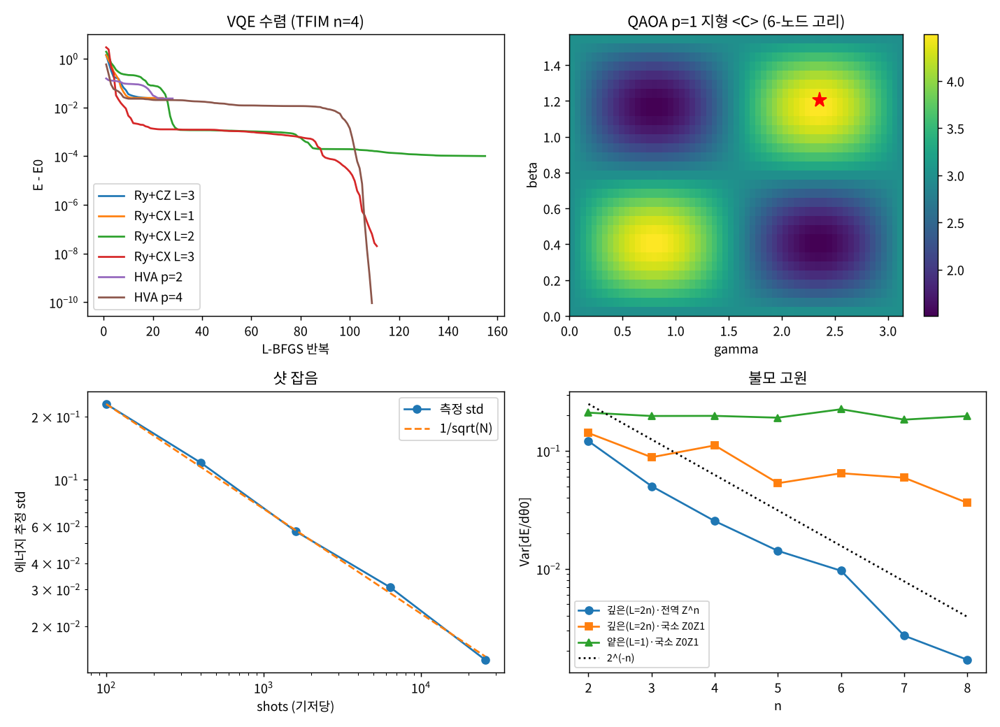

# 13장 변분 알고리즘

2026-10-29 · Gosh

양자컴퓨팅 입문·심화서 · 2부 대표 알고리즘 · 이 장을 마치면 하드웨어 효율 ansatz와 해밀토니안 ansatz로 VQE를 짜고, 파라미터 이동 규칙으로 정확한 그래디언트를 구하며, QAOA로 MaxCut을 풀고, "ansatz가 닿지 못하는 상태"와 "그래디언트가 사라지는 불모 고원(barren plateau)"을 숫자로 진단할 수 있다.

## 1. 요약

10–12장의 알고리즘은 "정확한 회로를 깊게 쌓고 끝에 한 번 읽는다"는 구조라 의미 있는 크기에서는 오류 정정 전에 돌릴 수 없다(14장의 3비트 QPE 같은 작은 예는 예외). 변분 알고리즘은 반대로 간다: 얕은 파라미터 회로 U(θ)를 수천 번 실행해 기대값 ⟨ψ(θ)|H|ψ(θ)⟩를 재고, 고전 최적화기가 θ를 갱신한다. 변분 원리(⟨H⟩ ≥ E₀)가 보증하는 것은 "내려갈수록 맞다"뿐이고, 어디까지 내려갈 수 있는지는 ansatz가 닿는 상태의 집합과 최적화기가 찾을 수 있는지가 정한다. 이 장은 그 두 질문을 숫자로 답한다.

numpy로 확인한 것(12장의 TFIM n = 4, E₀ = −4.7588): (1) **파라미터 이동 규칙**이 유한차분과 10⁻¹⁰까지 일치 — 그래디언트는 회로 평가 2번/파라미터로 정확히 나온다. (2) **ansatz가 전부다**: Ry + CZ 사슬은 층을 4까지 쌓아도 E − E₀ = 0.0245에서 멈추고(|0000⟩의 궤도가 바닥상태를 품지 못한다 — DLA 차원 20), 같은 파라미터 수의 Ry + CX(Qiskit `RealAmplitudes`)는 3층에서 2×10⁻⁸, 해밀토니안 ansatz(HVA)는 파라미터 8개로 10⁻¹⁰. (3) **샷 잡음**: 에너지 표준편차는 정확히 1/√shots(256배 → 16.6배 감소), 1000 shots/평가로 150스텝 그래디언트 하강은 E₀ 위 0.137에서 멈추고 회로 실행 7.2×10⁶ 샷을 썼다. (4) **QAOA** MaxCut 6-노드 고리: p = 1, 2에서 근사비 0.750, 0.833 — 고리 공식 (2p+1)/(2p+2)와 일치, p = 3에서는 고리가 작아 정확히 1.0. (5) **불모 고원**: 깊은 무작위 회로 + 전역 관측량에서 Var\[∂E/∂θ\]가 큐비트당 2^{−1.01}배로 지수 감소, 얕은 회로 + 국소 관측량은 n에 무관.

이 장의 메시지: VQE/QAOA는 "양자 가속 알고리즘"이 아니라 **양자 상태를 손실함수로 최적화하는 휴리스틱**이다. 동작하는 조건(문제 구조를 담은 ansatz, 국소 관측량, 얕은 깊이)과 실패하는 조건(무작위 하드웨어 효율 ansatz, 전역 관측량, 깊은 회로)이 정량적으로 갈리며, 4부의 VQE(23장)·QUBO(21장) 사례가 이 진단 도구 위에 선다.

## 2. 직관 먼저 — 비유와 Quirk

변분 알고리즘은 "양자 컴퓨터를 블랙박스 함수 f(θ) = ⟨ψ(θ)|H|ψ(θ)⟩로 두고 고전 컴퓨터가 θ를 돌리는" 루프다. 두 가지만 양자적이다: 닿을 수 있는 상태의 집합이 2ⁿ차원 안에 있다는 것, 그리고 f를 정확히 알 수 없고 샷으로 추정해야 한다는 것.

- [Quirk: 1큐비트 VQE — Ry(θ)로 H = −X의 바닥상태 찾기](https://algassert.com/quirk#circuit={"cols":[["Y^½"],["Bloch"],["H"],["Chance"]]}) — Ry(π/2) = Y^½ 가 |0⟩를 |+⟩로 보낸다(전역 위상 무시). 마지막 H 다음 "Chance"는 |1⟩(ON) 확률을 보인다: |+⟩ → H → |0⟩이라 0% → ⟨X⟩ = 1 − 2·P(ON) = 1, E = −1 = E₀. Y^½ 를 Y^¼으로 바꾸면 P(ON) = 0.146 → ⟨X⟩ = sin(π/4) = 0.707 — "θ를 돌리면 에너지가 변한다"를 눈으로 본다.
- [Quirk: 2큐비트 Ry+CX 한 층](https://algassert.com/quirk#circuit={"cols":[["Y^¼","Y^½"],["•","X"],["Y^¼","Y^¼"],["Amps2"]]}) — 진폭이 모두 실수(위상 0 또는 π)임을 표시기에서 확인. Y^t 는 Ry(πt), 실수 회전만 쓰니 상태도 실수 — 이것이 `RealAmplitudes`라는 이름의 유래이고 7절의 "복소 위상이 필요한 상태는 못 닿는다"의 이유다.

비유 하나: 안개 속 산에서 골짜기를 찾는 등산객. **ansatz**는 걸을 수 있는 길의 집합(등산로가 골짜기를 지나지 않으면 영원히 못 도착 — Ry+CZ가 그런 길), **파라미터 이동 규칙**은 양발을 정확히 한 걸음씩 벌려 경사를 재는 방법(유한차분은 발끝을 조금 움직여 재는 것 — 안개(샷 잡음)가 있으면 읽지 못한다), **샷 잡음**은 고도계가 ±몇 m 흔들리는 것, **불모 고원**은 산 전체가 평평한 고원이어서 어느 방향으로 발을 벌려도 고도계가 안 변하는 것이다. 비유가 깨지는 곳: 등산은 3차원이지만 여기 파라미터 공간은 수십차원이고, 고원은 "무작위 초기점에서 보면 확률적으로 평평"한 것이지 지형 자체가 평평한 것은 아니다 — 좋은 출발점(예: HVA의 작은 각도)에서는 경사가 있다.

## 3. 정의와 수식 — VQE, 파라미터 이동 규칙, QAOA, 불모 고원, 교과서 비교

**변분 원리와 VQE.** 임의의 정규화 상태에 대해 ⟨ψ|H|ψ⟩ = Σ pₖEₖ ≥ E₀(pₖ = |⟨Eₖ|ψ⟩|²). 따라서

```latex
E(\theta) = \langle 0|U(\theta)^\dagger H\, U(\theta)|0\rangle \ge E_0,\qquad \theta^* = \arg\min_\theta E(\theta)
```

이고 등호는 U(θ)|0⟩가 바닥상태일 때뿐이다(Peruzzo et al. 2014). H = Σ cₖPₖ로 분해하면 각 파울리 항의 기대값은 해당 기저로 재서 추정한다 — 교환하는 항은 한 기저에서 함께(TFIM은 ZZ 그룹과 X 그룹, 기저 2개). 샷 수 N으로 재면 표준오차 ∝ 1/√N(12장의 고전 몬테카를로와 같은 스케일링 — 여기엔 진폭 추정이 없다).

**Ansatz 세 가지.** (a) 하드웨어 효율(HEA): \[Ry 층 → 얽힘 사슬\] × L + Ry 층, 파라미터 n(L+1). 얽힘 게이트를 CZ로 두느냐 CX로 두느냐가 이 장의 반전이다. (b) 해밀토니안 변분 ansatz(HVA, Wecker et al. 2015): |+⟩^{⊗n}에서 e^{−iγₗH\_ZZ} e^{−iβₗH\_X}를 p층 — 12장의 Trotter 스텝을 각도만 풀어놓은 것, 파라미터 2p. (c) QAOA(Farhi et al. 2014): HVA의 최적화 버전 — 비용 C(대각)와 혼합기 B = ΣX를 번갈아 e^{−iγC} e^{−iβB}(연산자 순서: 오른쪽 B가 먼저 적용). 화학에서는 HVA 대신 분자 들뜸을 반영한 UCCSD ansatz를 쓴다(23장).

**파라미터 이동 규칙(Mitarai 2018, Schuld 2019).** 게이트 G(θ) = e^{−iθP/2}(P는 파울리, 고유값 ±1)에 대해 E(θ)는 θ의 사인 함수 a + b cosθ + c sinθ이므로

```latex
\frac{\partial E}{\partial\theta} = \frac{E(\theta+\pi/2) - E(\theta-\pi/2)}{2}
```

가 **정확히** 성립한다(근사가 아니다). 유한차분 \[E(θ+ε)−E(θ−ε)\]/2ε는 ε → 0에서 샷 잡음이 1/ε배로 증폭되지만, 이동 규칙은 π/2 떨어진 두 점의 차라 증폭이 없다. 비용은 파라미터당 회로 평가 2번 — 역전파처럼 "한 번에 전부"가 없다. 이것이 "미분 가능 회로"의 정확한 뜻이고 PennyLane이 실기에서 쓰는 미분 모드다(시뮬레이터의 기본은 역전파, 6절).

**동역학 리 대수(DLA)와 궤도(Larocca et al. 2022).** 회로가 닿을 수 있는 유니터리의 집합은 생성원들 {iPₖ}과 그 교환자들이 닫히는 리 대수 𝔤가 정한다. Ry+고정 얽힘층 회로의 생성원은 {Yₖ, W^{−k}YₖW^k}(W = 얽힘층, k = 0…ord(W)−1 — CZ 사슬은 W² = I라 한 겹, CX 사슬은 W⁴ = I라 네 겹까지 넣어야 한다). n = 4: Ry+CZ 사슬 20, Ry+CX 사슬 120 = so(16)(실수 상태 전체). **그러나 도달하는 상태의 집합은 대수가 아니라 궤도 G|0…0⟩이다** — 차원이 작은 부분군도 구 위를 추이적으로 움직일 수 있으니(Spin(9) ⊂ SO(16)) 대수 차원만으로는 판정하지 못한다. Ry+CZ: |0000⟩의 궤도 접공간은 10차원(실수 단위구는 15차원)이고 TFIM 바닥상태는 14차원 궤도 위에 있어 — 차원이 다르므로 같은 궤도일 수 없다. 구조적으로 못 닿는다(5절에서 수치로 확인). Ry+CX는 𝔤 = so(16) 전체라 모든 실수 상태를 닿는다. DLA 차원이 작으면 역설적으로 불모 고원은 없다 — 표현력과 훈련 가능성의 트레이드오프.

**불모 고원(barren plateau, McClean et al. 2018).** 회로가 충분히 깊고 무작위여서 2-설계(2-design)에 가까워지면 임의의 파라미터에 대해 E\[∂E/∂θ\] = 0, Var\[∂E/∂θ\] = O(2^{−n}). 샷 잡음 ∝ 1/√N 안에서 그래디언트를 읽으려면 N = O(2ⁿ) — 지수 비용. Cerezo et al. 2021a: 관측량이 국소(유한 개 큐비트에만 작용)이고 회로 깊이가 O(log n)이면 분산이 다항으로만 줄어든다. 전역 관측량(Z^{⊗n} 같은)은 얕은 회로에서도 지수로 죽는다. 5절에서 세 경우를 n = 2–8로 재었다.

**QAOA의 보증.** MaxCut 비용 C = Σ\_{(i,j)∈E} (1 − ZᵢZⱼ)/2. p → ∞에서 단열 에너지를 재현하므로 최적해에 수렴하지만, 유한 p에서는 "지름 2p+1 이내의 국소 구조만 본다". 3-정규 그래프에서 p = 1 근사비 ≥ 0.6924(Farhi 2014), 고리(2-정규)에서는 n ≥ 2p+2일 때 (2p+1)/(2p+2) — p = 1: 3/4, p = 2: 5/6. Farhi 2014가 p ≤ 6의 수치에서 읽어낸 이 값은 Mbeng 2019가 상한으로 증명했고(2p < n; Bravyi 2020은 Z₂ 대칭인 국소 회로 일반에 대해 비슷한 꼴의 상한을 따로 증명), QAOA가 실제로 그 값에 도달함은 Marwaha 2026이 증명했다. 고전 Goemans–Williamson은 0.878을 모든 그래프에서 보장하므로 작은 p의 QAOA는 고전에 진다(Bravyi et al. 2020은 일부 MaxCut 사례에서 어떤 상수 p의 QAOA도 Goemans–Williamson을 못 이김을 증명).

**교과서 비교.** N&C(2000)에는 변분 알고리즘이 없다 — VQE(2014)·QAOA(2014)는 책 이후의 물건이고, 가장 가까운 것은 4.7절의 시뮬레이션(HVA의 부품)과 7장의 물리 구현이다. KLM도 없다. 이 장의 1차 출처는 논문이다: Peruzzo 2014(VQE), Farhi 2014(QAOA), McClean 2018(불모 고원), Schuld 2019(이동 규칙), Cerezo 2021b 리뷰(전체 지도). 교과서 연습문제 대신 10절의 논문 번호를 따라가라.

## 4. 회로 구성 — numpy 조립과 Qiskit

**numpy 구현(실행 완료).** 전체 스크립트는 `ch13_variational.py`(실행 25초~1분). 12장과 같은 방식으로 상태벡터에 게이트를 직접 적용한다(행렬을 만들지 않으므로 n = 8도 쉬움). 아래는 `ch13_variational.py`에서 핵심만 간추린 발췌다(그대로 실행되지 않는다). 실행 가능한 전체 코드는 스크립트 파일에 있다.

```python
def ansatz_state_cx(theta, n, L):          # Qiskit RealAmplitudes(entanglement='linear') 와 같은 구조
    psi = |0...0>; k = 0
    for layer in range(L + 1):
        for q in range(n): psi = apply_1q(psi, ry(theta[k]), q, n); k += 1
        if layer < L:
            for q in range(n - 1): psi = apply_cx(psi, q, q + 1, n)     # CX = H·CZ·H (대상 큐비트)
    return psi

def hva_state(theta, n, p, zz_diag):      # |+>^n 에서 e^{-iγ H_ZZ} e^{-iβ H_X} 를 p 층
    psi = |+>^n
    for l in range(p):
        psi = np.exp(-1j * theta[2*l] * zz_diag) * psi          # H_ZZ 는 대각 → 위상 곱
        for q in range(n): psi = apply_1q(psi, rx(-2 * theta[2*l+1]), q, n)   # e^{-iβ(-X)} = Rx(-2β)
    return psi

def grad_param_shift(theta, ...):          # Ry(θ) = e^{-iθY/2} → shift π/2, 계수 1/2
    for k: g[k] = 0.5 * (E(θ + π/2 e_k) - E(θ - π/2 e_k))

def energy_shots(theta, n, L, shots, rng): # 기저 2개: Z 기저에서 ZZ 항, H^{⊗n} 후 Z 기저에서 X 항
    ...

def dla_dim(gens):                          # 생성원과 교환자로 닫힌 공간의 차원 (n=4, 16×16 행렬)
    ...
```

세 가지 주의. (1) HVA의 Rx 부호: H\_X = −ΣX이므로 e^{−iβH\_X} = ∏ e^{+iβX} = ∏ Rx(−2β) — 12장 3절의 e^{−icPt} ↔ Rz(2ct)와 같은 규약이다(Rx(θ) = e^{−iθX/2}). (2) 샷 추정에서 비트 추출은 빅 엔디안: 정수 샘플 s의 큐비트 q는 `(s >> (n-1-q)) & 1`. (3) `dla_dim`은 생성원 행렬을 벡터로 펴서 최소제곱으로 선형독립을 판정한다 — n = 4에서만 돌린다(256차원 벡터).

**게이트 비용 기록(이 책의 규칙).** 세는 법은 10장과 같다: 기저는 CX + 임의의 1큐비트 게이트(전결합), CZ는 2큐비트 게이트 1개, e^{−iθZZ} = 2 CX + Rz 1개; 깊이는 그렇게 푼 게이트를 가능한 한 앞에 놓은(ASAP) 층 수다. 변분 회로의 각도는 최적화가 정하는 일반값이라 T-count 대신 회전 수 R을 적고 T ≈ 3·log₂(1/ε)·R로 어림한다(Ross & Selinger 2016; ε = 10⁻⁶이면 회전당 약 60). 아래는 스크립트 8번이 게이트 리스트를 짜서 `ansatz_state`·`ansatz_state_cx`·`hva_state`·`qaoa_state`와 같은 상태를 내는지(전역 위상 제외) 확인한 뒤 센 값이다.

| 회로 | 2큐비트 게이트 | 깊이 | T-count: 회전 R (T ≈) |
| --- | --- | --- | --- |
| HEA(Ry+CX 또는 Ry+CZ, n = 4, 사슬 01·12·23), L = 1 | 3 | 5 | R 8 (T ≈ 478) |
| HEA L = 2 | 6 | 8 | R 12 (T ≈ 718) |
| HEA L = 3 | 9 | 11 | R 16 (T ≈ 957) |
| HEA L = 4 | 12 | 14 | R 20 (T ≈ 1196) |
| HVA(n = 4), p = 1 | 6 | 8 | R 7 (T ≈ 419) |
| HVA p = 2 | 12 | 15 | R 14 (T ≈ 837) |
| HVA p = 3 | 18 | 22 | R 21 (T ≈ 1256) |
| HVA p = 4 | 24 | 29 | R 28 (T ≈ 1674) |
| QAOA 6-노드 고리, p = 1 | 12 | 8 | R 12 (T ≈ 718) |
| QAOA p = 2 | 24 | 15 | R 24 (T ≈ 1435) |
| QAOA p = 3 | 36 | 22 | R 36 (T ≈ 2153) |

읽는 법. HEA(선형 사슬): 층당 2큐비트 n − 1 = 3, 회전 = 파라미터 n(L+1). 깊이는 사슬 01·12·23이 큐비트를 공유해 계단으로 놓이므로 3L + 2다(n ≥ 3인 일반 n은 n + 3L − 2, n = 2는 2L + 1) — 스크립트 3번 출력의 "깊이≈2L+1"은 얽힘 사슬 하나를 한 층으로 센 층 수여서 이 깊이와 다르다. Ry+CZ는 CZ끼리 교환하므로 01·23·12 순으로 놓으면 3L + 1이 된다. HVA p층: H 4개 뒤 층마다 e^{−iγZZ} 3개(CNOT 6, Rz 3)와 Rx 4 — ZZ를 01·23·12 순으로 놓아 깊이 7p + 1(01·12·23 순이면 7p + 4), 회전 7p(독립 파라미터는 2p). QAOA 6-노드 고리: H 6개 뒤 층마다 CNOT 12 + Rz 6 + Rx 6 — 변을 01·23·45 다음 12·34·50 순으로 놓아 깊이 7p + 1(01·12·…·50 순이면 p = 3에서 58). HVA·QAOA는 본문 구현이 대각 위상을 한 번에 곱하므로 ZZ를 거는 순서는 여기서 고른 것이다. 그래디언트 한 번 = 회로 평가 2×(파라미터 수), 평가당 기저 2개 × shots. (규약은 책 앞의 「기호와 비용 단위」에도 적어 둔다.)

**Qiskit 스니펫(작성됨, 미실행).** Qiskit 2.x의 함수형 라이브러리 `real_amplitudes`, `efficient_su2`, `qaoa_ansatz`와 `StatevectorEstimator`. 예전 `qiskit_algorithms.VQE`는 별도 패키지로 분리됐고 유지보수가 멈췄으니 루프를 직접 쓴다.

```python
# qiskit==2.5.x — 작성됨, 미실행
import numpy as np
from scipy.optimize import minimize
from qiskit.circuit.library import real_amplitudes, qaoa_ansatz
from qiskit.quantum_info import SparsePauliOp
from qiskit.primitives import StatevectorEstimator

n = 4
H = SparsePauliOp.from_sparse_list(
    [('ZZ', [i, i+1], -1.0) for i in range(n-1)] + [('X', [i], -1.0) for i in range(n)], num_qubits=n)
ansatz = real_amplitudes(n, reps=3, entanglement='linear')      # Ry 층 4 + CX 사슬 3 = 파라미터 16
est = StatevectorEstimator()

def energy(theta):
    return float(est.run([(ansatz, H, theta)]).result()[0].data.evs)

def grad(theta):                                                  # 파라미터 이동 규칙
    g = np.zeros_like(theta)
    for k in range(len(theta)):
        e = np.zeros_like(theta); e[k] = np.pi / 2
        g[k] = 0.5 * (energy(theta + e) - energy(theta - e))
    return g

rng = np.random.default_rng(7)
res = minimize(energy, rng.uniform(0, 2*np.pi, ansatz.num_parameters), jac=grad, method='L-BFGS-B')
print(res.fun)                                                    # 5절: -4.7588 (E-E0 ≈ 2e-8)

# QAOA: cost_operator 로 MaxCut 해밀토니안 (6-노드 고리), reps=p
edges = [(i, (i+1) % 6) for i in range(6)]
C = SparsePauliOp.from_sparse_list([('ZZ', [i, j], -0.5) for i, j in edges], num_qubits=6) + \
    SparsePauliOp('IIIIII', 0.5 * len(edges))                     # C = Σ (1 - Z_i Z_j)/2
qaoa = qaoa_ansatz(cost_operator=C, reps=2)                      # 파라미터 [β_1..β_p, γ_1..γ_p] 순서 주의
res = minimize(lambda x: -float(est.run([(qaoa, C, x)]).result()[0].data.evs),
               rng.uniform(0, np.pi, 4), method='COBYLA')
print(-res.fun / 6)                                               # 5절: 근사비 0.833
```

## 5. 시뮬레이션 결과

모든 수치는 `ch13_variational.py`를 `seed=7`로 실행한 출력이다(실행 25초~1분). 모델: 12장의 TFIM n = 4, J = h = 1, E₀ = −4.7588.

**파라미터 이동 규칙 검증.** Ry+CX L = 2(파라미터 12)의 무작위 점에서 이동 규칙 vs 중심차분(ε = 10⁻⁵): 최대 차이 1.3×10⁻¹⁰, |∇E| = 2.13. 회로 평가 24회/그래디언트.

**VQE: ansatz × 깊이 (L-BFGS-B, 무작위 초기값 5개 중 최선).**

| ansatz | 층 | 파라미터 | 2큐비트 | E − E₀ | 충실도 | 에너지 평가 |
| --- | --- | --- | --- | --- | --- | --- |
| Ry+CZ | 1 | 8 | 3 | 1.97×10⁻¹ | 0.8076 | 29 |
| Ry+CZ | 2 | 12 | 6 | 2.45×10⁻² | 0.9933 | 53 |
| Ry+CZ | 3 | 16 | 9 | 2.45×10⁻² | 0.9933 | 29 |
| Ry+CZ | 4 | 20 | 12 | 2.45×10⁻² | 0.9933 | 24 |
| Ry+CX | 1 | 8 | 3 | 2.45×10⁻² | 0.9933 | 28 |
| Ry+CX | 2 | 12 | 6 | 1.01×10⁻⁴ | 0.99999 | 190 |
| Ry+CX | 3 | 16 | 9 | 2.0×10⁻⁸ | 1.000000 | 128 |
| Ry+CX | 4 | 20 | 12 | 5.8×10⁻⁹ | 1.000000 | 67 |
| HVA | p=1 | 2 | 6 | 1.13×10⁻¹ | 0.9643 | 66 |
| HVA | p=2 | 4 | 12 | 2.35×10⁻² | 0.9932 | 185 |
| HVA | p=3 | 6 | 18 | 1.56×10⁻⁴ | 0.99997 | 686 |
| HVA | p=4 | 8 | 24 | 9×10⁻¹¹ | 1.000000 | 1188 |

세 가지가 보인다. (1) Ry+CZ는 L = 2에서 닿는 값 0.0245가 L = 4까지 소수점 15자리까지 같다 — 최적화 실패가 아니라 바닥상태가 도달 집합 밖에 있다. 무작위 실수 목표 상태로 충실도를 직접 최대화해도 L = 6에서 비충실도가 0.04~0.24(목표마다 다름) — 스크립트가 재는 궤도 접공간 차원이 |0000⟩에서 10, 바닥상태에서 14로 다르다. (2) 얽힘 게이트를 CX로 바꾸면(대상에 H를 양쪽에 붙인 것뿐) 얽힘층 차수가 2 → 4가 되어 DLA가 so(16) 전체(120), L = 3에서 10⁻⁸. 같은 파라미터 수·같은 2큐비트 수에서 10⁶배 차이 — "얽힘층의 종류"가 궤도를 정한다. (3) HVA는 파라미터 8개로 10⁻¹⁰ — 문제의 구조를 담은 ansatz가 가장 적은 파라미터로 가장 깊이 내려간다. 단 2큐비트 게이트는 24개로 HEA L = 3(9개)보다 많고, 에너지 평가도 1188회로 훨씬 많다(지형이 깊고 좁다). 그림 왼쪽 위: 수렴 곡선 — Ry+CZ는 10⁻²에서 평평, Ry+CX L = 3과 HVA p = 4는 수직 낙하.

**샷 잡음 (Ry+CX L = 3 최적점, 기저 2개 × shots, 200번 반복).**

| shots/기저 | 평균 | 표준편차 | std·√shots |
| --- | --- | --- | --- |
| 100 | −4.745 | 0.230 | 2.30 |
| 400 | −4.750 | 0.121 | 2.41 |
| 1,600 | −4.762 | 0.057 | 2.27 |
| 6,400 | −4.763 | 0.031 | 2.45 |
| 25,600 | −4.760 | 0.014 | 2.21 |

std·√shots ≈ 2.3으로 일정 — 정확한 1/√N. 화학 정밀도 1.6 mHa 급의 0.0016을 얻으려면 (2.3/0.0016)² ≈ 2×10⁶ 샷/기저 — 한 번의 에너지 평가에. 1000 shots/평가로 파라미터 이동 그래디언트 하강(Ry+CX L = 2, 학습률 0.1, 150스텝): 최종 정확 에너지 −4.622(E₀ + 0.137; 무잡음에서는 E₀ + 10⁻⁴) — 잡음 바닥에 걸려 더 못 내려간다. 총 샷 수 150 × 24 평가 × 2 기저 × 1000 = 7.2×10⁶. 그림 왼쪽 아래.

**QAOA MaxCut, 6-노드 고리 (최대 컷 6).** p = 1 지형(γ ∈ \[0,π\], β ∈ \[0,π/2\] 격자 61×31)의 최대 4.49, 연속 최적화(20 초기점 중 최선):

| p | 최적 ⟨C⟩ | 근사비 | 고리 공식 (2p+1)/(2p+2) | 최적해 측정 확률 | 2큐비트 게이트 |
| --- | --- | --- | --- | --- | --- |
| 1 | 4.500 | 0.750 | 0.750 | 0.285 | 12 |
| 2 | 5.000 | 0.833 | 0.833 | 0.536 | 24 |
| 3 | 6.000 | 1.000 | 0.875 | 1.000 | 36 |

p = 1, 2는 고리 공식과 정확히 일치. p = 3에서 1.0이 나온 것은 공식의 조건 n > 2p+1 = 7이 n = 6에서 깨져서 — "지름 2p+1의 국소 구조"가 고리 전체를 덮으면 QAOA는 그래프를 통째로 보고 정확해진다. 더 큰 고리(n = 12)에서는 7/8이 나온다(연습문제 3). 그림 오른쪽 위: p = 1 지형 — 최대점 두 개(γ, β)와 (π−γ, π/2−β)는 대칭으로 동치, 지형이 매끄러워 격자 탐색만으로도 최적 근처.

**불모 고원 (무작위 파라미터 100개, 첫 파라미터 θ₀에 대한 ∂⟨O⟩/∂θ₀의 분산).** 회로: 각 큐비트에 무작위 축(Rx/Ry/Rz)의 회전 + CZ 사슬, L층.

| n | 깊은(L = 2n)·전역 Z^{⊗n} | 깊은(L = 2n)·국소 Z₀Z₁ | 얕은(L = 1)·국소 Z₀Z₁ |
| --- | --- | --- | --- |
| 2 | 1.2×10⁻¹ | 1.4×10⁻¹ | 2.1×10⁻¹ |
| 4 | 2.5×10⁻² | 1.1×10⁻¹ | 2.0×10⁻¹ |
| 6 | 9.6×10⁻³ | 6.5×10⁻² | 2.3×10⁻¹ |
| 8 | 1.7×10⁻³ | 3.6×10⁻² | 2.0×10⁻¹ |

log₂ 분산의 기울기: 깊은·전역 −1.01/큐비트(2^{−n} 예측 = −1), 깊은·국소 −0.28, 얕은·국소 ≈ 0. n = 8에서 이미 100배 차이고 n = 50이면 전역은 10⁻¹⁵ — 어떤 샷 수로도 못 읽는다. 국소 관측량 + 얕은 회로는 n에 무관한 0.2 — Cerezo 2021a의 예측대로. 깊은·국소가 천천히 줄어드는 것은 L = 2n이 아직 2-설계에 닿지 않아서이고 더 깊어지면 전역과 같은 2^{−n}으로 간다(McClean 2018). 그림 오른쪽 아래.

그림(`ch13_results.png`): 왼쪽 위 VQE 수렴(x축은 L-BFGS 반복 수로, 표의 에너지 평가 nfev와 다르다 — HVA p=4는 반복 ≈110 vs 평가 1188), 오른쪽 위 QAOA p = 1 지형, 왼쪽 아래 샷 잡음 1/√N, 오른쪽 아래 불모 고원.



## 6. 다른 SDK 대응 — PennyLane

이 장에서 PennyLane을 고른 이유는 "미분 가능 회로"가 이 프레임워크의 설계 목표여서, 3절의 파라미터 이동 규칙을 `diff_method` 한 줄로 고르고 역전파·adjoint와 바꿔 볼 수 있기 때문이다.

|  | Qiskit 2.x | PennyLane 0.45 |
| --- | --- | --- |
| HEA 템플릿 | `real_amplitudes`, `efficient_su2`, `n_local` | `StronglyEntanglingLayers`, `BasicEntanglerLayers`(기본 Rx+CNOT 고리, rotation=qp.RY 로 변경) |
| QAOA 템플릿 | `qaoa_ansatz(cost_operator, reps)` | `qp.qaoa.maxcut`, `cost_layer`/`mixer_layer` |
| 기대값 | `StatevectorEstimator` / Runtime `Estimator` | `qp.expval(H)` |
| 그래디언트 | 직접(이동 규칙) 또는 `EstimatorGradient`(qiskit-algorithms, 유지보수 중단) | `qp.grad`, `diff_method='parameter-shift'/'adjoint'/'backprop'` |
| 최적화기 | scipy | `AdamOptimizer`, `QNGOptimizer`(양자 자연 그래디언트), `SPSAOptimizer` |

`qp.grad`는 시뮬레이터(default.qubit)에서는 역전파(backprop), 실기에서는 파라미터 이동을 자동 선택한다; `adjoint`는 명시해야 한다.

```python
# pennylane==0.45.x — 작성됨, 미실행
import pennylane as qp
import numpy as np
from pennylane import numpy as pnp
n = 4
H = qp.dot([-1.0]*(n-1) + [-1.0]*n,
           [qp.Z(i) @ qp.Z(i+1) for i in range(n-1)] + [qp.X(i) for i in range(n)])
dev = qp.device('default.qubit', wires=n)

@qp.qnode(dev, diff_method='parameter-shift')                      # 실기 호환 미분; 시뮬레이터면 'backprop' 가 빠르다 (adjoint 는 명시)
def E(theta):
    k = 0
    for layer in range(4):
        for q in range(n): qp.RY(theta[k], wires=q); k += 1
        if layer < 3:
            for q in range(n-1): qp.CNOT(wires=[q, q+1])
    return qp.expval(H)

theta = pnp.array(np.random.default_rng(7).uniform(0, 2*np.pi, 16), requires_grad=True)
opt = qp.AdamOptimizer(0.05)
for it in range(300):
    theta, e = opt.step_and_cost(E, theta)
print(e)                                                             # → -4.7588 근처

# 샷 잡음 포함: @qp.set_shots(1000) 을 qnode 위에 붙이면 5절의 1000-shot 실험
# QAOA 템플릿: qp.qaoa.maxcut(graph) 가 (cost_h, mixer_h) 를 주고 qp.qaoa.cost_layer / mixer_layer 로 층을 쌓는다
```

Qiskit은 2.x에서 `qiskit_algorithms`를 떼어내고 "회로 + 프리미티브만 제공, 루프는 네가 짜라"로 갔다 — 그래서 4절의 Qiskit 스니펫은 이동 규칙과 최적화 호출을 직접 쓰고, 위 PennyLane 스니펫에서는 `diff_method`와 `AdamOptimizer.step_and_cost`가 그 둘을 맡는다.

## 7. 한계와 반례

**"변분 = 가속"이 아니다.** VQE·QAOA에는 10–12장 같은 복잡도 보증이 없다. 증명된 것은 "변분 상한"과 "p → ∞ 수렴"뿐이고, 고전 최적화의 난점(국소 최소, 안장점)에 양자의 난점(샷 잡음, 불모 고원, 표현력)이 더해진다. Bittel & Kliesch 2021: VQE 파라미터 최적화는 일반적으로 NP-hard. 유리한 점은 하나, "회로가 얕아 지금 실기에서 돌아간다" — 그래서 14장의 예측·제출 목록에 들어간다(실기 실행은 아직 못 했다).

**표현력 함정: "층을 더 쌓으면 된다"가 거짓일 수 있다.** 5절의 Ry+CZ가 증거다 — DLA가 작으면 무한 깊이에서도 닿지 못한다. 실전 점검: (a) 작은 n에서 정확한 바닥상태와의 충실도를 직접 최대화해 본다(에너지가 아니라), (b) 얽힘 게이트·회전축을 바꿔 비교한다, (c) 대칭성을 본다 — 실수 회전만 쓰는 ansatz는 복소 위상이 필요한 바닥상태(자기장 안의 페르미온, 복소 호핑)를 원리적으로 못 닿는다.

**불모 고원은 진단할 수 있고, 피해가는 것은 일부만 증명됐다.** 5절의 분산 측정이 진단법이다(n을 키우며 Var\[∂E\]를 재고 기울기를 본다). 피해가는 방법: 국소 비용함수 + O(log n) 깊이(Cerezo 2021a), 문제 구조를 담은 ansatz(HVA·QAOA는 작은 각도 초기화로 단열 근처에서 시작), 층별 학습(layerwise), 리 대수가 작은 회로. 그러나 Cerezo et al. 2023 "Does provable absence of barren plateaus imply classical simulability?"가 지적하듯 불모 고원이 없다고 증명된 회로는 대개 DLA가 다항 크기라 고전으로도 시뮬레이션된다 — "훈련 가능하면 고전적으로 풀릴지 모른다"는 딜레마. 12장 7절의 텐서망 경고와 같은 구조다.

**샷 비용이 실제 병목이다.** 화학 정밀도 한 번에 \~10⁶ 샷(5절), 파라미터 m개 그래디언트에 2m배, 반복 수백 번 — 분자 하나에 10¹⁰ 샷 급이 나온다(Wecker 2015가 처음 지적; Gonthier et al. 2022 "Measurements as a roadblock"). QPE(12장)는 샷 수가 O(1)이지만 회로가 깊다 — 양쪽이 정확히 반대 트레이드오프다. 샷을 줄이는 기법(교환 그룹화, 고전 그림자 추정, 분산 가중 샷 배분)이 연구 분야 하나다.

**QAOA는 작은 p에서 고전에 진다.** 5절의 고리는 쉬운 문제라 p = 3에 풀렸지만, 3-정규 그래프 p = 1의 0.6924는 무작위 컷 0.5보다 나을 뿐 Goemans–Williamson 0.878에 못 미치고, Bravyi 2020은 대칭성 보호 때문에 상수 p 전체가 Goemans–Williamson에 지는 그래프족을 증명했다. 실기에서는 p를 키우면 잡음이 이득을 먹는다(14장은 HVA p = 1만 예측하므로, p에 따른 변화는 14장의 노이즈 모델로 예측해 볼 과제다). 21장의 QUBO 사례는 이 한계를 전제로 출발한다.

**파라미터 이동 규칙의 조건.** 생성원의 고유값이 두 개(±r)일 때만 이항 규칙이 정확하다. 고유값이 여럿인 게이트(예: e^{−iθ(ZZ+XX)}, 페르미온 시뮬레이션 게이트)는 4항 이상의 일반화 규칙(Wierichs et al. 2022)이거나 게이트를 분해해야 한다. 그리고 이동 규칙은 "잡음 없는 기대값"에 대해 정확한 것이지 샷 추정치의 잡음을 없애지는 않는다 — 5절의 1000-shot 실험이 그 증거다.

## 8. 연습문제와 해답

**문제 1 (Schuld 2019 변형).** G(θ) = e^{−iθP/2}(P² = I)를 포함한 회로의 기대값 E(θ)가 a + b cosθ + c sinθ 꼴임을 보이고, 그로부터 이동 규칙 ∂E/∂θ = \[E(θ+π/2) − E(θ−π/2)\]/2를 유도하라. 유한차분과 샷 잡음 증폭을 비교하라.

*해답.* G(θ) = cos(θ/2)I − i sin(θ/2)P. 회로를 G 앞의 V, 뒤의 W로 나누면 E(θ) = ⟨φ|G† Õ G|φ⟩(|φ⟩ = V|0⟩, Õ = W†HW). G†ÕG = cos²(θ/2)Õ + sin²(θ/2)PÕP + i sin(θ/2)cos(θ/2)(PÕ − ÕP) = ½(Õ + PÕP) + ½ cosθ(Õ − PÕP) + ½ sinθ·i\[P,Õ\]. 기대값을 취하면 a + b cosθ + c sinθ. 미분: −b sinθ + c cosθ. 한편 E(θ+π/2) − E(θ−π/2) = b\[cos(θ+π/2) − cos(θ−π/2)\] + c\[sin(θ+π/2) − sin(θ−π/2)\] = −2b sinθ + 2c cosθ — 정확히 2배. 유한차분은 \[E(θ+ε) − E(θ−ε)\]/2ε에서 각 E의 샷 표준편차 σ가 σ/(√2ε)로 증폭 — 이동 규칙의 σ/√2보다 1/ε배(ε = 10⁻²면 100배) 크다. 작은 ε의 유한차분은 샷 잡음에 묻힌다. ε를 키우면 분산은 줄지만 편향 O(ε²)이 생긴다 — 이동 규칙은 편향 없이 σ/√2를 준다. 이것이 양자 회로에 "미분 규칙"이 따로 필요한 이유다.

**문제 2 (자작).** TFIM n = 4의 7항을 같은 측정 기저로 재는 그룹으로 나누어 최소 기저 수를 구하라. Heisenberg XXX 사슬 H = Σ(XᵢXᵢ₊₁ + YᵢYᵢ₊₁ + ZᵢZᵢ₊₁)에서는 몇 개인가?

*해답.* 한 기저로 함께 재려면 항들이 큐비트별로 교환(qubit-wise commuting)해야 한다 — 같은 큐비트에 서로 다른 비항등 파울리가 없어야. ZZ 3항은 모두 Z만 쓰므로 한 그룹(Z 기저), X 4항은 한 그룹(H 후 Z 기저). Z₀Z₁과 X₀은 큐비트 0에서 충돌하므로 같은 그룹 불가 → 최소 2. Heisenberg: XX끼리, YY끼리, ZZ끼리는 각각 한 그룹, 서로는 충돌 → 3 기저(X: H, Y: S†다음 H, Z: 그대로). 일반 분자 해밀토니안은 항이 O(n⁴)이고 채색 문제로 풀면 그룹이 O(n³)∼O(n⁴) — 샷 비용의 실체다. 큐비트별이 아닌 일반 교환성을 쓰면(얽힘 측정 허용) 그룹 수가 O(n³)로 줄지만(Gokhale & Chong 2019) 기저 변환 회로가 깊어진다; 기저 회전 그룹화로는 O(n)까지(Huggins et al. 2021). Qiskit `SparsePauliOp.group_commuting(qubit_wise=True)`.

**문제 3 (자작).** 5절의 QAOA에서 p = 3이 1.0을 준 것은 n = 6이 작아서다. n = 12 고리로 바꾸면 p = 1, 2, 3의 근사비는 얼마가 되는가? 예측하고 스크립트로 확인하라.

*해답.* 고리 공식 (2p+1)/(2p+2)는 n > 2p+1에서 성립 — n = 12에서는 p = 3(2p+1 = 7)까지 모두 만족. 예측 0.750, 0.833, 0.875. 스크립트의 `nq = 12`로 바꿔 실행(4096차원, 15 초기점): ⟨C⟩ = 9.000, 10.000, 10.500 → 근사비 0.7500, 0.8333, 0.8750 — 소수점 네 자리까지 일치. QAOA p층은 각 변의 양 끝에서 거리 p 이내(고리에서는 정점 2p+2개·변 2p+1개의 사슬)만 "보고" 결정하므로(게이트 광원뿔(light cone)의 유한 전파), 고리가 그보다 크면 n에 무관한 값이 나온다. 거꾸로 말하면 지름이 큰 그래프의 전역 구조는 p가 지름에 비례해 커져야 보인다 — 이것이 Bravyi 2020 장애물의 직관이다.

## 9. 학습 노트

- **파라미터 이동 규칙** — ∂E/∂θ = \[E(θ+π/2) − E(θ−π/2)\]/2, 근사가 아니라 항등식. 이 장의 모든 그래디언트가 이것이고, 5절에서 유한차분과 10⁻¹⁰까지 일치. 비유: 시계추의 속도를 재려면 지금 위치를 살짝 밀어 보는 대신 4분의 1 주기(90°) 떨어진 두 위치를 보면 된다 — 사인함수는 그렇게 미분된다. 깨지는 곳: 생성원 고유값이 ±1/2 두 개일 때만; 고유값이 더 많은 게이트는 점이 더 필요(Wierichs 2022). 더 깊이: PennyLane 문서 "Gradients and training", `diff_method`.
- **동역학 리 대수(DLA)** — 회로 생성원과 그 교환자들로 닫힌 벡터공간; 차원이 "층을 무한히 쌓았을 때 닿는 방향의 수". Ry+CZ 20 vs Ry+CX 120이 이 장의 가장 놀라운 분기점이었다 — 같은 파라미터 수에서 도달 궤도가 완전히 다르다. 단 도달 여부는 대수 차원이 아니라 궤도 G|0⟩의 차원으로 판정한다(Ry+CZ는 |0000⟩ 궤도 10차원 < 바닥상태 14차원이라 불도달). 비유: 자동차가 앞·뒤·좌·우만 갈 수 있어도 조합하면 평행주차(옆으로 이동)가 되듯 교환자가 새 방향을 만든다; 그러나 어떤 조합으로도 위로는 못 뜨는 것처럼 닫힌 대수 밖은 영원히 못 간다. 더 깊이: Larocca et al., Quantum 6, 824 (2022); Ragone et al. 2023 "A Lie algebraic theory of barren plateaus".
- **불모 고원** — 무작위 파라미터에서 그래디언트 분산이 2^{−n}: n = 50이면 어떤 샷 수로도 경사를 못 읽는다. 진단법 = n을 키우며 Var\[∂E\] 기울기 재기(5절). 피하는 조건은 국소 비용 + 얕은 회로 + 구조화 ansatz인데, 그런 회로는 고전으로도 풀릴 가능성이 크다는 딜레마(Cerezo 2023). 더 깊이: McClean et al., Nat. Commun. 9, 4812 (2018); Cerezo et al., Nat. Commun. 12, 1791 (2021).
- **HVA/QAOA = Trotter 스텝의 각도를 풀어놓은 것** — 12장의 e^{−iH\_ZZ dt}e^{−iH\_X dt}에서 dt를 층마다 다른 (γ, β)로 두고 최적화. 파라미터 8개로 10⁻¹⁰ — "문제의 구조를 회로에 넣어라"가 이 장의 실천 규칙. 더 깊이: Wecker–Hastings–Troyer PRA 92, 042303 (2015); Wiersema et al. PRX Quantum 1, 020319 (2020) "Exploring entanglement and optimization within the Hamiltonian variational ansatz".
- **샷 예산** — 에너지 한 번에 σ ≈ 2.3/√shots(TFIM n = 4), 화학 정밀도면 10⁶ 샷; 그래디언트는 2×파라미터 배. QPE의 "깊은 회로, 적은 샷"과 정확히 반대 — 양자 알고리즘 설계는 이 두 축 사이의 선택이다. 더 깊이: Gonthier et al., PRR 4, 033154 (2022).

## 10. 출처와 환경

- Goemans & Williamson, "Improved approximation algorithms for maximum cut and satisfiability problems using semidefinite programming", *J. ACM* 42, 1115 (1995).
- Peruzzo et al., "A variational eigenvalue solver on a photonic quantum processor", *Nat. Commun.* 5, 4213 (2014).
- Farhi, Goldstone, Gutmann, "A quantum approximate optimization algorithm", arXiv:1411.4028 (2014) — §IV 고리(ring of disagrees), §V 3-정규 0.6924.
- Wecker, Hastings, Troyer, "Progress towards practical quantum variational algorithms", *Phys. Rev. A* 92, 042303 (2015) — HVA, 샷 비용.
- McClean et al., "Barren plateaus in quantum neural network training landscapes", *Nat. Commun.* 9, 4812 (2018).
- Mitarai et al., "Quantum circuit learning", *Phys. Rev. A* 98, 032309 (2018); Schuld et al., "Evaluating analytic gradients on quantum hardware", *Phys. Rev. A* 99, 032331 (2019).
- Mbeng, Fazio, Santoro, "Quantum annealing: a journey through digitalization, control, and hybrid quantum variational schemes", arXiv:1906.08948 (2019) — 고리 QAOA (2p+1)/(2p+2) 상한.
- Marwaha, "The QAOA on the ring of disagrees", arXiv:2606.29562 (2026) — 고리에서 QAOA가 (2p+1)/(2p+2)에 실제로 도달함을 증명.
- Gokhale & Chong, "O(N³) measurement cost for variational quantum eigensolver on molecular Hamiltonians", arXiv:1908.11857 (2019) — 일반 교환 그룹화로 O(n³) 측정 그룹. 선행 논문: Gokhale et al., "Minimizing state preparations in variational quantum eigensolver by partitioning into commuting families", arXiv:1907.13623 (2019).
- Bravyi, Kliesch, Koenig, Tang, "Obstacles to variational quantum optimization from symmetry protection", *Phys. Rev. Lett.* 125, 260505 (2020).
- Cerezo et al., "Cost function dependent barren plateaus in shallow parametrized quantum circuits", *Nat. Commun.* 12, 1791 (2021a); Cerezo et al., "Variational quantum algorithms", *Nat. Rev. Phys.* 3, 625 (2021b) — 리뷰.
- Bittel & Kliesch, "Training variational quantum algorithms is NP-hard", *Phys. Rev. Lett.* 127, 120502 (2021).
- Huggins et al., "Efficient and noise resilient measurements for quantum chemistry on near-term quantum computers", *npj Quantum Inf.* 7, 23 (2021).
- Larocca et al., "Diagnosing barren plateaus with tools from quantum optimal control", *Quantum* 6, 824 (2022).
- Wierichs et al., "General parameter-shift rules for quantum gradients", *Quantum* 6, 677 (2022).
- Gonthier et al., "Measurements as a roadblock to near-term practical quantum advantage in chemistry", *Phys. Rev. Research* 4, 033154 (2022).
- Cerezo et al., "Does provable absence of barren plateaus imply classical simulability?", arXiv:2312.09121 (2023).
- Ragone et al., "A Lie algebraic theory of barren plateaus for deep parameterized quantum circuits", *Nat. Commun.* 15, 7172 (2024) (arXiv 2023).
- Ross & Selinger, "Optimal ancilla-free Clifford+T approximation of z-rotations", *Quantum Inf. Comput.* 16, 901 (2016), arXiv:1403.2975 — 임의 각도 회전 하나의 T 수 ≈ 3·log₂(1/ε)(4절 게이트 비용 기록의 회전 규칙).
- SDK 문서: Qiskit `real_amplitudes`, `qaoa_ansatz`, `StatevectorEstimator`, `SparsePauliOp.group_commuting`; PennyLane "Gradients and training", `qp.qaoa`.
- 환경: Python 3.13.17, numpy 2.5.3, scipy 1.18.1, matplotlib 3.11.2; `ch13_variational.py` 실행 약 1분(빠른 환경에서는 25초 안팎), seed = 7(끝의 게이트 비용 블록 8번은 `tools/gate_cost.py`를 불러 쓰고 자체 난수 발생기를 써서 위 수치를 바꾸지 않는다). SDK 코드는 PyPI 차단으로 작성만 되었고 미실행.
