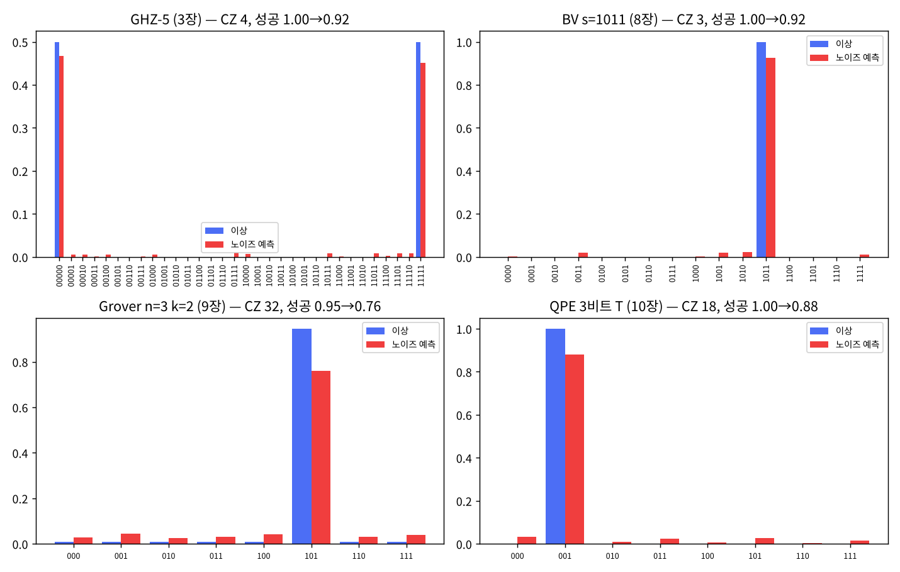

# 14장 하드웨어 실행 1

2026-10-30 · Gosh

양자컴퓨팅 입문·심화서 · 2부 대표 알고리즘 · 이 장을 마치면 공개 사양서의 오류율로 노이즈 모델을 만들어 8\~13장 회로가 실기에서 어떻게 나올지 예측하고, heavy-hex 연결에 라우팅한 비용을 세며, IBM Open Plan의 10분 안에 제출·기록할 수 있다 — 그리고 실측이 예측과 다를 때 어디를 보아야 하는지 안다.

## 1. 요약

지금까지의 장은 모두 시뮬레이터 위에서 정확했다. 이 장은 그 회로를 **실제 QPU에 내보내기 전에 해야 할 일**을 다룬다: 공개 사양서의 오류율로 노이즈 모델을 짜서 결과를 먼저 예측하고, 연결 그래프(heavy-hex)에 맞춰 라우팅 비용을 세고, 무료 한도(IBM Open Plan: 28일당 QPU 10분) 안에서 제출 계획을 세우고, 실측을 기록할 표를 준비한다. 처음 쓸 때는 네트워크·계정이 없어 예측만 실었고, **2026-11-11 `ibm_fez`에서 실측을 더했다** — 5절 표의 "QPU 실측" 열과 부록 A(`appA/appA_qpu_runs.md`).

numpy로 확인한 것(Heron r2 공개 중앙값: CZ 오류 3×10⁻³, 1큐비트 2.5×10⁻⁴, 판독 1.3×10⁻², T1 180 µs, T2 120 µs): (1) 회로 5개의 예측 성공 확률 — GHZ-5 1.000 → 0.918, BV 1.000 → 0.925, QPE 3비트 1.000 → 0.881, Grover n=3 0.945 → 0.759, HVA 에너지 −4.646 → −4.433(+0.21, 그중 0.12가 판독 오류). (2) **오류 예산** 1 − ∏(1 − rᵢ)는 얕은 회로(GHZ·BV·QPE)의 실패율을 0.5\~2%p 안에서 맞히지만 CZ 32개의 Grover는 9%p 낮게 잡는다 — "CZ 수 × 3×10⁻³ + 큐비트 수 × 1.3×10⁻²"는 낙관적인 하한에 가까운 암산 공식이다. (3) **라우팅**: heavy-hex는 삼각형이 없어 Toffoli는 8-CX 선형 판을 써야 하고(4장), QPE는 계수 큐비트끼리의 역 QFT 때문에 SWAP 2개(CZ 6개)가 들어간다. (4) CZ 오류율을 2배로 하면 Grover 성공이 0.76 → 0.69, 4배면 0.57 — 성공 − 1/8이 CZ 오류 3×10⁻³마다 0.89배씩 줄어드는 지수 감소다. (5) **시간 예산**: 샷당 ≈ 255 µs(반복 지연이 지배), 4000샷 × 6회로 ≈ 6.1초 — 10분의 약 1%.

실측(2026-11-11, `ibm_fez`, 4000샷): GHZ 0.920 · BV 0.889 · Grover 0.814 · QPE 0.922, HVA ⟨H⟩ −4.322 ± 0.039. 예측과의 차는 −3.6\~+5.5%p로 흩어졌다 — GHZ는 거의 그대로, QPE·Grover는 예측보다 좋고(실기 트랜스파일 CZ가 각각 15·39로 이 장의 18·32와 다르다), BV만 나쁘다(가장 큰 오답은 보조 큐비트 하나가 |1⟩에서 시작한 모양이다 — 부록 A 5절). 작업 id는 5절에 있다.

이 장의 메시지: 실기 결과는 "맞다/틀리다"가 아니라 **예측과의 차이**로 읽는다. 예측 안에 들어왔다고 노이즈 모델이 맞았다는 보장은 없고(실측의 GHZ가 그랬다 — 부록 A 4절), 벗어나면 사양서가 담지 않는 것(크로스토크, 특정 큐비트의 나쁜 보정, 라우팅으로 늘어난 깊이)이 있다는 신호다. 25장(오류 완화·정정)과 27장(재현 가능 워크플로)이 이 표 위에 선다.

## 2. 직관 먼저 — 비유와 하드웨어 사양서 읽기

시뮬레이터와 실기의 차이는 세 가지다. **게이트가 틀린다**(7장의 펄스 오류·T1·T2), **읽기가 틀린다**(판독 오류), **원하는 두 큐비트가 이웃이 아닐 수 있다**(연결 그래프). 세 가지가 각각 사양서의 숫자 하나로 요약된다: CZ 오류율, 판독 오류율, 연결 그래프.

사양서 읽는 법(IBM Quantum Platform의 백엔드 페이지, 또는 `backend.properties()`): 큐비트당 T1, T2, 판독 오류, 1큐비트 게이트 오류(SX), 연결당 CZ 오류와 게이트 시간. "중앙값"이 표제에 나오지만 분포가 넓다 — 최악 연결은 중앙값의 10배가 되기도 한다. (공개 보정 데이터에서 흔히 보이는 범위이며, 이 책이 직접 잰 값은 아니다.) 트랜스파일러(`optimization_level=3`)가 보정 데이터를 보고 좋은 큐비트를 고르므로, 실제 경험 오류는 중앙값보다 조금 낫다. 이 장의 노이즈 모델은 중앙값을 쓰지만 크로스토크·누설을 빼므로 "보수적"이라기보다 오히려 낙관적일 수 있다(7절).

비유: 시뮬레이터는 악보, 실기는 연주다. 악보가 맞아도 연주자가 음을 틀리고(게이트 오류), 녹음이 잡음을 타고(판독), 피아노에 없는 건반은 옥타브를 바꿔 친다(라우팅). 연주를 듣기 전에 "이 연주자가 음을 틀릴 확률 × 음표 수"를 계산해 두면 녹음을 듣고 놀라지 않는다 — 그것이 오류 예산이다. 깨지는 곳: 음표 하나의 실수는 그 음만 망치지만 양자 게이트의 오류는 얽힘을 타고 전체 상태로 퍼진다(GHZ에서 CX 하나의 오류가 모든 큐비트의 비트를 바꾼다). 그래서 "오류율 × 게이트 수"는 성공 확률의 예산이지 출력 분포의 모양을 말해 주지는 않는다.

- [Quirk에는 노이즈가 없다](https://algassert.com/quirk) — 이 장의 시각화는 Quirk 대신 5절의 "이상 vs 노이즈 예측" 히스토그램이다. Quirk로는 라우팅만 볼 수 있다: [SWAP 사슬로 멀리 있는 두 큐비트를 이웃으로](https://algassert.com/quirk#circuit={"cols":[["X"],["Swap","Swap"],[1,"Swap","Swap"],[1,1,"•","X"],["Chance4"]]}) — 큐비트 0의 |1⟩을 SWAP 두 번으로 큐비트 2까지 옮긴 뒤 큐비트 3에 CNOT. SWAP 하나 = CX 3개 = 실기에서 CZ 3개의 오류다.

## 3. 정의와 수식 — 노이즈 모델, 오류 예산, 라우팅, 교과서 비교

**게이트 노이즈 모델.** 게이트 하나 = 이상적 유니터리 → 탈분극 채널 → 게이트 시간만큼의 T1/T2 열완화(7장 Kraus). k큐비트 탈분극은

```latex
\mathcal{D}_p(\rho) = (1-p)\,\rho + \frac{p}{4^k-1}\sum_{P\ne I} P\rho P^\dagger
```

여기서 p는 비항등 파울리의 총확률이다. 사양서의 게이트 오류는 RB 오류율 r = 1 − F\_avg이고, 이 채널의 평균 게이트 충실도는 F\_avg = 1 − p·d/(d+1)이므로 p = r·(d+1)/d (d = 2^k) — 2큐비트 1.25배, 1큐비트 1.5배로 변환해 넣는다(스크립트 `p_dep`; 이전 판은 p = r로 두어 오류를 약 20% 덜 셌다). Qiskit `depolarizing_error`의 λ로 옮기면 λ = r·d/(d−1)(2큐비트 1.33배). 판독은 큐비트별 혼동 행렬 M = \[\[1−ε₀₁, ε₁₀\], \[ε₀₁, 1−ε₁₀\]\]을 확률 벡터에 곱한다. Heron에서 ε₁₀ > ε₀₁인 것은 판독 동안(≈ 1.5 µs) |1⟩이 T1으로 무너지기 때문이고, 사양서의 판독 오류(`prob_meas0_prep1`)는 그 붕괴를 이미 포함한 측정값이다 — 그래서 판독 전 열완화를 따로 넣지 않는다(넣으면 이중 계산; 이전 판의 실수로 실효 ε₁₀이 0.024가 되었다). 유휴 큐비트는 큐비트별 시계를 둔 ASAP 일정에서 기다린 시간만큼 T1/T2 열완화를 받고, 동시 판독을 위해 먼저 끝난 큐비트도 마지막 게이트까지 기다린다. ASAP는 보수적 선택이다 — ALAP로 일정을 짜면 데이터 큐비트가 |0⟩에서 기다려 유휴 오류가 줄어든다(5절의 기여 표의 유휴 몫 ≤ 1.3%p가 상한). 크로스토크·누설은 모델에 없다.

**오류 예산(error budget).** 모든 오류가 독립이고 한 번 일어나면 결과를 망친다고 보면

```latex
P_{\text{fail}} \approx 1-\prod_i (1-p_i) \approx N_{CZ}\,p_{CZ} + N_{1q}\,p_{1q} + n\,\epsilon_{\text{read}}
```

이 "합산 규칙"이 실기 실험의 철칙이다: 회로를 짜기 전에 N\_CZ·p\_CZ를 셈한다 — 0.3이면 성공 확률이 이상값의 약 3/4(e^{−0.3}), N\_CZ·p\_CZ ≳ 1이면 결과가 균등 분포에 묻힌다. 5절에서 예산(사양서 r 그대로)과 밀도행렬 결과를 비교했다 — 예산이 실패율보다 낮게 나오는 이유는 r가 탈분극 p보다 작고(위의 1.25배) 게이트·유휴 중 T1/T2 열완화가 예산에 없기 때문이다. 반대로 탈분극의 일부는 출력 비트를 안 바꾸고 일부 오류는 정답으로 되돌아가 예산을 깎는다 — 얕은 회로에서는 둘이 거의 상쇄되고, CZ가 수십 개면 앞의 효과가 이긴다.

**연결 그래프와 라우팅.** IBM Heron은 heavy-hex: 차수 2와 3의 큐비트만 있고 삼각형이 없다. 따라서 (a) 세 큐비트가 서로 이웃인 구조가 없어 Toffoli/CCZ는 N&C의 6-CX 판(삼각형 필요)이 아니라 8-CX 선형 판을 쓴다(4장 Cirq 분해와 같은 것), (b) 한 큐비트가 4개 이상과 상호작용하면 SWAP이 반드시 들어간다(3개까지는 레이아웃만 잘 고르면 피할 수 있다). SWAP = CX 3 = CZ 3 + H 6. 트랜스파일러의 라우팅(SABRE)은 SWAP 수를 휴리스틱으로 줄이지만 0으로는 못 만든다. 이 장은 heavy-hex의 "T" 조각(선 0-1-2-3-4에 가지 2-5)을 쓰고, 최단 경로를 따라 SWAP을 넣는 단순 라우터로 비용을 재었다 — 실제 트랜스파일러보다 비관적인 상한.

**시간 예산.** QPU 사용 시간은 벽시계가 아니라 "양자 시간"(`job.usage()`가 초 단위로 돌려준다)으로 재고, 샷당 ≈ 반복 지연(≈ 250 µs, 큐비트를 |0⟩으로 되돌리는 대기) + 회로(≈ 수 µs) + 판독(≈ 1.5 µs). 회로 길이는 거의 무관하고 샷 수가 정한다. Open Plan: 28일 롤링 윈도우에 10분, 작업당 최대 3시간, 세션 불가(작업·배치 모드는 가능), us-east 인스턴스만. 2026년 3월 16일부터 12개월 안에 20분 이상 사용한 Open Plan 사용자는 옵트인하면 이후 12개월 동안 180분을 받을 수 있다(IBM 공지 2026-03-16).

**교과서 비교.** N&C 8장이 양자 채널(탈분극 8.3.4, 진폭·위상 감쇠 8.3.5–8.3.6)과 Kraus 표현을 주고, 오류 예산 같은 "공학" 어법은 없다. KLM은 10장(오류 정정)의 서론으로 오류 모델을 짧게 다룬다. 연결 그래프·라우팅·클라우드 한도는 두 책 모두 없고 IBM 문서(아래 10절)가 1차 출처다. 노이즈 모델의 표준 재료는 Qiskit Aer의 `NoiseModel.from_backend` 문서, RB의 표준 논문 Magesan–Gambetta–Emerson(2011), 평균 게이트 충실도 공식 Nielsen(2002)이다.

## 4. 회로 구성 — numpy 에뮬레이션과 Qiskit Runtime 제출

**numpy 구현(실행 완료).** `ch14_hardware.py`(실행 5초). 밀도행렬 시뮬레이터 `DM`은 게이트마다 (유니터리 → 탈분극 → 열완화) Kraus를 적용하고 큐비트별 시계로 유휴 시간의 열완화도 넣으며, `Routed`는 논리→물리 사상을 유지하며 인접하지 않은 2큐비트 게이트 앞에 SWAP 사슬을 넣는다. 네이티브 게이트는 Heron과 같은 {Rz(가상, 무오류), SX/X, CZ}이고, H는 Rz·SX·Rz라 펄스 하나로 센다(임의 각도 Rx는 실제로 SX 2개지만 이 모델은 1개로 센다 — HVA에서 4펄스 과소, 영향은 무시할 만하다). 아래는 `ch14_hardware.py`에서 핵심만 간추린 발췌다(그대로 실행되지 않는다). 실행 가능한 전체 코드는 스크립트 파일에 있다.

```python
class DM:                                  # n 큐비트 밀도행렬, 빅 엔디안
    def g1(self, U, q, virtual=False):     # 1큐비트: 유니터리 → 탈분극(p = 1.5 r_1q) → 열완화(t_1q)
    def cz(self, a, b):                    # 두 큐비트 시계 맞춤(유휴 열완화) → CZ → 탈분극(p = 1.25 r_cz) → 열완화(t_cz)
    def cx(self, c, t): self.h(t); self.cz(c, t); self.h(t)
    def swap(self, a, b): self.cx(a, b); self.cx(b, a); self.cx(a, b)
    def probs(self):                       # 모두 같은 시각까지 유휴 열완화 → 대각 → 혼동 행렬 M ⊗n (ε 가 판독 중 T1 포함)

EDGES = [(0, 1), (1, 2), (2, 3), (3, 4), (2, 5)]   # heavy-hex 'T' 조각, 물리 2 가 차수 3 (허브)

class Routed:
    def cz(self, a, b): self._bring_adjacent(a, b); ...   # 최단 경로를 따라 SWAP, 사상 갱신
    def cp(self, a, b, t):                 # 제어 위상 = Rz · CX · Rz(-t/2) · CX · Rz  (CX 2)
    def ccz_linear(self, a, b, c):         # Cirq CCZ 분해: [CX(a,b), CX(b,c)] 스위프 4번 + T/T† 7 → CX 8

# 회로 5개: GHZ-5, BV(s=1011, 보조를 허브에, s의 1인 q0·q2·q3을 허브 이웃에), Grover n=3 k=2 (CCZ 가운데 큐비트가 허브), QPE 3비트 (표적이 허브), HVA p=1
```

세 가지 주의. (1) QPE의 계수 레지스터는 q0이 U¹, q2가 U⁴인 "리틀 엔디안"으로 두었다 — 그러면 SWAP 없는 QFT†가 (SWAP 포함 QFT)†와 같아져 결과를 그대로 빅 엔디안으로 읽는다(6장 Draper 덧셈기의 SWAP 생략과 같은 요령 — 10장 본문은 SWAP 포함 판을 썼다; 처음엔 반대로 두고 출력을 뒤집어 읽으려 했는데 그건 틀린다 — 연습문제 2). (2) 탈분극 Kraus는 4^k개 파울리로 풀어 썼다 — n = 6까지는 64×64 밀도행렬이라 쉽고, 그 이상은 Aer. (3) HVA의 (γ, β) = (0.2064, 0.3927)은 13장 p = 1 최적값을 π로 줄인 값(ZZ의 고유값이 홀수라 γ → γ+π는 전역 위상).

**게이트 비용 기록(라우팅 후).** 5절 표의 CZ·SWAP 열. QPE는 계수 큐비트 3개가 표적과는 모두 인접하지만 서로는 인접하지 않아 역 QFT의 제어 위상 3개 중 2개에 SWAP이 들어간다(CZ 12 → 18). Grover는 가운데 큐비트를 허브에 두면 SWAP 0 — 단 CCZ가 8-CX 판이라 2회 반복 = CZ 32. BV는 s의 1인 큐비트 셋을 허브의 세 이웃에 두면 SWAP 0, CZ 3(이전 판은 q3을 허브에서 먼 물리 0에 두어 SWAP 1, CZ 6이 되었다 — 레이아웃 하나가 CZ 수를 두 배로 만든다).

**Qiskit Runtime 제출 스크립트(2026-11-11 실기 실행은 이전 판으로, 지금 판은 작성됨 — 실기·fake 모두 다시 돌려야 한다).** `ch14_submit.py`. 두 모드: `fake`는 Heron 가짜 백엔드(`FakeMarrakesh`)의 보정 데이터로 Aer 노이즈 모델을 만들어 로컬에서 돌리고(이 장의 numpy 모델과 비교할 두 번째 예측), `real`은 장치를 고르고 트랜스파일해 제출 계획만 찍는다 — 실제 제출은 `real --yes`일 때만 한다. 지금 판의 기록(`ch14_record_<모드>.json`)에는 두 작업 id, 회로별 2큐비트 수·깊이·물리 큐비트, HVA 표준오차, 쓴 프리미티브의 모듈 이름이 남는다. 실기 기록은 제출 직후부터 `runs/`의 고정 사본에 쓰고, `ch14/ch14_record_real.json`은 결과가 다 온 뒤에만 바꾼다. 2026-11-11 기록은 이전 판이 만든 것이라 이 항목들이 없고, 표준오차와 실기 CZ 수는 `runs/20261111-063819Z_ibm_fez_ch14_isa_calib.json`에서 읽는다.

```python
# qiskit==2.6.2, qiskit-ibm-runtime==0.52.0 — 작성됨, 미실행(2026-11-11 실기 실행은 같은 호출을 SamplerV2·EstimatorV2 이름으로 했다)
from qiskit_ibm_runtime import QiskitRuntimeService, Sampler, Estimator
from qiskit.transpiler import generate_preset_pass_manager

service = QiskitRuntimeService()                                   # save_account 로 저장한 Open Plan 계정
backend = service.least_busy(operational=True, simulator=False, min_num_qubits=20,
                             filters=lambda b: (getattr(b, "processor_type", None) or {}).get("family") == "Heron")
pm = generate_preset_pass_manager(optimization_level=3, backend=backend, seed_transpiler=7)
isa = {k: pm.run(qc) for k, qc in CIRCUITS.items()}               # ISA 회로: 백엔드 기저·연결에 맞춰 라우팅됨
for k, qc in isa.items():                                          # 2큐비트 수와 게이트만 센 깊이(barrier·측정 제외)
    print(k, qc.count_ops().get('cz', 0), qc.depth(lambda i: i.operation.name not in ('barrier', 'measure')))

sampler = Sampler(mode=backend)                                    # Open Plan: 세션 불가 → 작업(또는 배치) 모드
job = sampler.run(list(isa.values()), shots=4000)                  # PUB 4개를 한 작업으로 (오버헤드 1회)
hva_isa = pm.run(hva_tfim()); H_isa = H_TFIM.apply_layout(hva_isa.layout)   # 관측량도 레이아웃을 따라간다
estimator = Estimator(mode=backend)
estimator.options.resilience_level = 0                             # 기본 1 = TREX 판독 완화; 0 으로 두어야 '판독 오류 포함' 예측과 비교
ejob = estimator.run([(hva_isa, H_isa)], precision=0.02)          # 목표 표준오차 0.02 (샷 ≈ 2500)
print(job.job_id(), ejob.job_id())                                 # 결과를 기다리기 전에 두 id 를 남긴다 — 끊기면 service.job(id)

counts = {k: pub.data.c.get_counts() for k, pub in zip(isa, job.result())}
d = ejob.result()[0].data; print(d.evs, d.stds)                    # stds 는 실제 표준오차(2026-11-11: 0.039)
print(job.usage(), ejob.usage())    # 5절 '사용 시간' 열(초). metrics()['usage'] 의 키는 플랫폼 작업에서 qpu_charge_time_seconds 다
```

핵심 네 가지. `apply_layout` — 트랜스파일이 논리 큐비트 4개를 백엔드의 물리 큐비트(Heron 156개) 중 일부로 옮기므로 관측량도 같이 옮겨야 한다(빼먹으면 회로와 관측량의 큐비트 수가 달라 `ValueError`가 난다 — 조용히 틀리지는 않는다). `precision=0.02` — Estimator는 샷 대신 목표 표준오차를 받고, Runtime은 이것을 샷 ≈ 1/precision² = 2500으로 환산한다(기본값 0.015625 = 1/√4096). 샷 수를 정하는 값이라 표준오차는 결과의 `stds`로 읽는다 — 2026-11-11 실행은 0.039였다(H가 두 기저에서 잰 항 일곱 개의 합이라 한 샷의 분산이 1보다 크다). `resilience_level = 0` — Runtime Estimator의 기본값 1은 판독 오류 완화(TREX)를 켜므로, 그대로 두면 5절의 '판독 오류 포함' 예측(−4.433)이 아니라 '판독 오류 제외' 예측(−4.555)과 비교해야 한다. 고전 비트 매핑 — Qiskit 비트열은 리틀 엔디안(c\_{n−1}…c₀ 순서로 인쇄)이다. BV·Grover는 q0이 이 책 빅 엔디안 문자열의 첫 글자이므로 `measure(range(n), range(n)[::-1])`로 역순 매핑하고(3장 `to_qiskit_order`와 같은 이유), QPE는 `QFTGate(t).inverse()`가 리틀 엔디안 정수 x = Σ q\_j 2^j를 내놓으므로 `measure(range(t), range(t))`로 그대로 매핑해야 '001'이 나온다(역순으로 매핑하면 '100' — 이전 판 `ch14_submit.py`의 버그).

**버전 주의.** qiskit-ibm-runtime 0.50(2026-09-24) 릴리스 노트는 "EstimatorV2 and SamplerV2 are deprecated"라고 적는다. 폐기되는 것은 서버 쪽 구현이고, 대체는 클라이언트 쪽 구현 `qiskit_ibm_runtime.executor_sampler.Sampler`·`executor_estimator.Estimator`다. 노트는 폐기 기간이 끝나면 최상위 이름이 클라이언트 쪽 구현을 가리키게 된다고 적는다. 이 책이 설치한 0.52.0에서는 최상위 `Sampler`·`Estimator`(와 `SamplerV2`·`EstimatorV2`)가 이미 그 클래스였다(설치된 패키지의 `__init__.py`로 확인. IBM의 0.52 릴리스 노트로는 확인하지 못했다). 최상위 이름이 무엇을 가리키는지는 버전에 따라 다르므로 `ch14_submit.py`는 쓴 클래스의 모듈 이름을 기록에 남긴다. 사용 시간은 `job.usage()`로 읽는다. `job.metrics()['usage']`의 키는 플랫폼 작업에서 `qpu_charge_time_seconds`이고, 로컬 시험 모드는 0.51부터 같은 꼴을 낸다.

## 5. 시뮬레이션 결과(예측)와 QPU 기록 표

모든 수치는 `ch14_hardware.py`를 `seed=7`로 실행한 출력이다(실행 5초). 노이즈 모델: r\_CZ = 3×10⁻³(탈분극 p = 3.75×10⁻³), r\_1q = 2.5×10⁻⁴(p = 3.75×10⁻⁴), ε₀₁ = 1.0×10⁻², ε₁₀ = 1.6×10⁻², T1 = 180 µs, T2 = 120 µs, t\_CZ = 68 ns, t\_1q = 32 ns, 유휴 열완화 포함, 판독 전 별도 열완화 없음. CZ 한 번 동안 T1 손실 3.8×10⁻⁴이고 가장 긴 Grover도 3.6 µs라 T2보다 훨씬 짧다 — 게이트 오류와 판독 오류가 지배한다.

**회로별 예측과 QPU 기록.** "QPU 실측"과 "사용 시간" 열은 `runs/20261111-063819Z_ibm_fez_ch14_record.json`(고정 사본; 2026-11-11 `ibm_fez`, 4000샷, Sampler 작업 `dbq0qmoqtr0c738f53u0`, Estimator 작업 `dbq0qpk4148s739vbffg`)에서 `ch14_hardware.py`의 7)이 계산한 값이다. 실측 성공은 ± 이항 표준오차, HVA는 ± Estimator 표준오차(`runs/20261111-063819Z_ibm_fez_ch14_isa_calib.json`). 사용 시간은 작업 단위로만 나온다(회로 4개가 한 Sampler 작업).

| 회로 | 큐비트 | CZ (SWAP) | 1q | 성공 이상 | 성공 예측 | TVD | 오류 예산 | QPU 실측 | 백엔드 · 사용 시간 |
| --- | --- | --- | --- | --- | --- | --- | --- | --- | --- |
| GHZ-5 (3장) | 5 | 4 (0) | 9 | 1.000 | 0.918 | 0.082 | 0.077 | 0.920 ± 0.004 | ibm\_fez · 6초(회로 4개 합) |
| BV s=1011 (8장) | 5 | 3 (0) | 16 | 1.000 | 0.925 | 0.075 | 0.063 | 0.889 ± 0.005 | 〃 |
| Grover n=3 k=2 (9장) | 3 | 32 (0) | 95 | 0.945 | 0.759 | 0.186 | 0.147 | 0.814 ± 0.006 | 〃 |
| QPE 3비트 T (10장) | 4 | 18 (2) | 43 | 1.000 | 0.881 | 0.119 | 0.099 | 0.922 ± 0.004 | 〃 |
| HVA p=1 TFIM (13장) | 4 | 6 (0) | 20 | ⟨H⟩ = −4.646 | −4.433 (판독 오류 제외 −4.555) | — | — | −4.322 ± 0.039 | ibm\_fez · 3초 |

**실측 읽는 법(요약 — 자세한 분석은 부록 A).** 실측 TVD는 GHZ 0.0795 · BV 0.1112 · Grover 0.1316 · QPE 0.0777. (1) 예측과의 차는 GHZ +0.2, BV −3.6, Grover +5.5, QPE +4.1%p, HVA +0.110(2.8σ)이다. 예측은 "이 근처"였고 회로마다 ±5%p 안팎으로 흩어졌다(7절). (2) 실기 트랜스파일러는 이 장과 다른 회로를 만들었다: Grover CZ 39(이 장 32), QPE CZ 15(이 장 18). 그날 이 작업이 쓴 연결의 CZ 오류는 1.6\~2.5×10⁻³으로 중앙값(3×10⁻³)보다 작았다. 다만 그 값으로 다시 계산해도 Grover는 0.779이고, 실측과의 나머지 차는 이 장의 모형이 게이트 중 열완화를 두 번 세는 데서 온다(7절, 부록 A 3.4절). (3) BV 손실 11.1%p 가운데 가장 큰 몫은 오답 `0000`(5.15%p)이고, 이것은 측정하지 않는 보조 큐비트가 |1⟩에서 시작했을 때 나오는 지문이다(실제 ISA 회로에 단일 결함을 넣어 확인 — 부록 A 5절). 그 큐비트는 이 작업에 쓰인 13개 큐비트 중 판독 오류가 가장 컸고 HVA 사슬에도 들어갔다. 이 실행에서는 사양서 숫자 네 개가 보지 못하는 "특정 큐비트 하나"가 얕은 회로 둘(GHZ, BV)의 결과를 정했다.

**모델 구성 요소별 기여(성공 확률).** 한 요소씩 끄고 다시 돌린 값 — 무엇이 결과를 정하는지 보여 준다.

| 회로 | 전체 모델 | r → p 변환 끔 | 유휴 열완화 끔 | 판독 오류 끔 |
| --- | --- | --- | --- | --- |
| GHZ-5 | 0.918 | 0.921 | 0.922 | 0.980 |
| BV s=1011 | 0.925 | 0.927 | 0.929 | 0.980 |
| Grover n=3 k=2 | 0.759 | 0.781 | 0.772 | 0.791 |
| QPE 3비트 T | 0.881 | 0.893 | 0.895 | 0.913 |

읽는 법. (1) 오류 예산 1 − ∏(1−r)(사양서 숫자 그대로)는 실패율(1 − 예측 성공)보다 GHZ 0.5, BV 1.2, QPE 2.0%p 낮고, Grover는 9.4%p(이상 성공 0.945를 곱한 기준으로도 4.7%p) 낮다. 위 표가 이유를 보여 준다: 얕은 회로는 판독 오류가 손실의 대부분이라 예산이 잘 맞고, CZ 32개·3.6 µs의 Grover는 r → p 변환(2.2%p)과 유휴 열완화(1.3%p)처럼 예산에 없는 몫이 CZ 수·회로 길이에 비례해 커진다. 즉 **얕은 회로는 사양서 숫자 네 개로 ±2%p, CZ 수십 개부터 예산은 낙관적인 하한**이다. (2) Grover는 이상에서도 0.945이고 CZ 32로 가장 무거워 0.76 — "표적이 최빈값"은 확실히 보이지만(3027/4000 대 다음 189) 9장의 정량적 예측은 이미 흐릿하다. k = 3으로 한 번 더 돌리면 이상 0.33으로 떨어지고 노이즈가 더해져 신호가 사라진다 — 실기에서는 "k를 정확히"가 더 중요하다. (3) QPE는 SWAP 2개가 CZ 18 중 6을 차지 — CZ 오류의 1/3, 판독까지 넣은 전체 예산(0.099)의 약 1/5(0.018). (4) HVA 에너지는 노이즈로 +0.21 올라간다. 그중 0.12가 판독 오류 몫이다(판독 오류를 빼면 −4.555, +0.09) — 판독 오류는 ⟨Z⟩·⟨ZZ⟩를 0 쪽으로 줄이고, 탈분극은 상태를 최대 혼합 쪽(⟨H⟩ = 0)으로 끈다. 단 노이즈가 에너지를 "위로만" 민다는 일반 보장은 없다 — 변분 원리가 보장하는 것은 어떤 (혼합)상태의 ⟨H⟩도 E0 아래로는 못 내려간다는 것뿐이고(진폭 감쇠는 에너지를 낮출 수도 있다), 이 회로에서 올라간 것은 탈분극과 판독 오류가 지배하기 때문이다. 13장의 최적화를 실기에서 돌리면 최적점 근처의 지형이 0.1\~0.2만큼 들리고 평평해진다 — 25장의 영잡음 외삽(ZNE)이 이 편향을 되돌리는 도구다.

**4000샷 예상 히스토그램(상위 3).** GHZ-5: 00000 1867, 11111 1807, 01111 44. BV: 1011 3704, 1010 80, 0011 76 — 틀린 답은 정답에서 한 비트만 다르다(판독 오류의 지문). Grover: 101 3027, 100 189, 001 158. QPE: 001 3492, 000 151, 101 124. 그림(`ch14_results.png`): 네 회로의 이상 vs 노이즈 예측 분포.

**CZ 오류율 민감도(Grover).** r\_CZ = 0 → 0.838, ×0.5 → 0.798, ×1 → 0.759, ×2 → 0.688, ×4 → 0.569, ×16 → 0.227. 성공 − 1/8(균등 분포 몫)이 r\_CZ 3×10⁻³마다 0.89배씩 줄어드는 지수 감소다 — ×4에서 0.89⁴ = 0.62(계산 0.62), ×16에서 0.89¹⁶ = 0.15(계산 0.14). 포화가 아니라 지수 꼬리로 1/8에 다가가므로, 오류율이 몇 배 나쁜 연결 하나도 신호를 눈에 띄게 깎는다. 실기에서 특정 CZ 연결이 중앙값의 4배(1.2%)인 것은 흔하므로, 트랜스파일러가 그 연결을 피하는가가 결과를 가른다.

**시간 예산.** 샷당 ≈ 255 µs(반복 지연 250 + 판독 1.5 + 가장 긴 회로 3.6) → 4000샷 × 6회로(HVA는 기저 2) ≈ 6.1초(10분의 약 1%; 실제 제출은 Sampler 4 × 4000샷 + Estimator ≈ 2 × 2500샷이라 ≈ 5.4초). 실제 과금 시간은 작업당 고정 오버헤드가 더해져 수십 초가 될 수 있지만 10분의 몇 %. 실측: Sampler 6초 + Estimator 3초(5절 표). 즉 **Open Plan 한도는 이 책의 2부 실험에 전혀 문제가 안 된다** — 문제는 대기열이다(수 분\~수 시간, 벽시계).



## 6. 다른 SDK 대응 — Cirq

이 장에서 Cirq를 고른 이유는, 이 장의 numpy 노이즈 모델이 Cirq와 같은 탈분극 규약(비항등 파울리 각각 p/(4^k−1))을 쓰므로 Qiskit Aer와 나란히 놓으면 같은 p가 SDK에 따라 다른 강도가 되는 규약 차이가 바로 드러나기 때문이다.

|  | Qiskit + IBM Runtime | Cirq (Google) |
| --- | --- | --- |
| 보정 데이터 노이즈 모델 | `NoiseModel.from_backend(backend)` / `AerSimulator.from_backend` / `FakeMarrakesh` | `cirq_google.engine.load_median_device_calibration` → `cirq_google.noise_properties_from_calibration` → `cirq_google.NoiseModelFromGoogleNoiseProperties` |
| 실기 제출 | `QiskitRuntimeService`, `Sampler/Estimator(mode=backend)` | `cirq_google` (일반 공개 없음), IonQ/AQT 플러그인 |
| 라우팅 | `generate_preset_pass_manager(backend=)` (SABRE) | `cirq.RouteCQC`, `optimize_for_target_gateset` |

```python
# cirq==1.7.x — 작성됨, 미실행. 동일한 탈분극 + 판독 오류 모델을 직접 짜서 GHZ-5 를 밀도행렬로
import cirq
q = cirq.LineQubit.range(5)
ghz = cirq.Circuit(cirq.H(q[0]), [cirq.CNOT(q[i], q[i+1]) for i in range(4)])
noisy = ghz.with_noise(cirq.depolarize(3e-3))         # 모든 모멘트·모든 큐비트에 1큐비트 탈분극 — 거친 근사; 게이트별 채널은 cirq.NoiseModel 서브클래스
noisy.append(cirq.measure(*q, key='m'))
sim = cirq.DensityMatrixSimulator(seed=7)
res = sim.run(noisy, repetitions=4000)
print(res.histogram(key='m'))                           # 0 과 31 이 각 ≈ 48%
```

규약 주의 두 가지. Cirq의 `depolarize(p)`는 "각 파울리 X, Y, Z가 p/3"이고 Qiskit `depolarizing_error(p)`는 "p 확률로 완전 혼합(I 포함)" — 같은 p를 넣으면 Qiskit의 비항등 오류 총확률은 p·(4^k−1)/4^k — 1큐비트 3/4배, 2큐비트 15/16배로 약하다. 이 장의 numpy 모델은 Cirq 규약(비항등 파울리 각각 p/(4^k−1), p = r·(d+1)/d); Aer 노이즈 모델과 비교할 때는 p에 4^k/(4^k−1)을 곱한 λ(= r·d/(d−1))를 넣는다. SDK 사이 비교할 때 가장 흔한 불일치 원인이다.

## 7. 한계와 반례

**중앙값 모델은 "어느 큐비트에 올리느냐"를 모른다.** 실기의 오류율은 큐비트·연결마다 다르고 날마다 바뀐다(IBM은 이 값들을 하루 단위의 벤치마킹으로 다시 잰다). 같은 회로를 같은 백엔드에 일주일 간격으로 내면 성공 확률이 ±5%p 움직이는 것이 정상이다. 따라서 5절 표의 예측은 "이 근처"이지 "이 값"이 아니고, 실측은 반드시 백엔드 이름·날짜·사용 큐비트(`isa.layout.final_index_layout()`)와 함께 기록한다(27장).

**탈분극은 가장 다루기 쉬운(낙관적인) 가정이다.** 실제 CZ 오류는 일부가 결맞은(coherent) 오류 — 각도가 조금 틀린 회전 — 이고, 결맞은 오류는 N개가 더해질 때 확률이 아니라 진폭이 더해져 최악의 경우 N²으로 커진다. 예산 공식은 더해지는 것을 가정한다. 또 ZZ 크로스토크(이웃 큐비트가 유휴 중에도 위상을 받는 것)와 누설(|2⟩ 상태)은 사양서 숫자 네 개에 없다. 실측이 예측보다 나쁘면 보통 이 둘이고, 동적 디커플링(`PadDynamicalDecoupling`, 25장)이 첫 번째 대책이다.

**게이트 중 열완화는 이중 계산이다.** RB 오류율 r에는 게이트 동안의 T1·T2 손실이 이미 들어 있다. 이 장의 모형은 r로 만든 탈분극에 게이트 시간만큼의 열완화를 더 얹으므로 CZ가 많은 회로일수록 비관적이다. 실제 ISA 회로와 당일 보정값으로 한 재현에서 Grover는 이 몫을 빼면 0.7785가 0.8090이 되어 실측 0.8137과 맞는다(부록 A 3.4절). 5절 표의 예측은 이 이중 계산을 포함한 값 그대로 둔다 — 실측을 본 뒤에 예측을 고치면 예측이 아니게 된다.

**판독 오류는 고전적으로 되돌릴 수 있다.** 혼동 행렬 M을 알면 M⁻¹을 히스토그램에 곱해 되돌린다(`mthree`, Runtime의 `twirled readout error extinction`). 5절의 BV 예측 히스토그램에서 오답이 "한 비트만 다른 이웃"에 모여 있는 것이 그 지문이다(실측의 1위 오답 0000은 다른 원인이다 — 부록 A 5절). 게이트 오류는 그렇게 되돌릴 수 없다 — 오류 완화(25장)는 편향을 줄이지만 분산을 키운다.

**"실기에서 돌았다"는 증거가 아니다.** 이 장의 회로는 모두 노트북이 10⁻⁶초에 정확히 푸는 크기다. QPU 실험의 목적은 알고리즘을 증명하는 것이 아니라 노이즈 모델을 검증하고 "어디까지 믿을 수 있는가"(CZ 수의 한계 ≈ 100 → 0.3 오류 예산)를 재는 것이다. 15장이 이 한계를 "가속의 원천"과 나란히 놓고, 24장이 다른 클라우드(IonQ, Quantinuum, IQM)의 사양서를 같은 표로 비교한다.

**실측이 보여 준 것.** 순서는 계획대로였다: `ch14_submit.py fake`(가짜 장치) → `real`. 결과는 "실측이 두 예측보다 나쁘다"는 예상과 달랐다. fake(`fake_marrakesh`)는 성공 확률을 잰 네 회로 모두 이 장의 예측보다 좋았고(GHZ 0.969, BV 0.978, Grover 0.874, QPE 0.953), 실측은 GHZ·Grover·QPE에서 둘 사이에 있었다. BV(0.889)와 HVA(−4.322)의 실측은 두 예측보다 나빴다. fake의 HVA 값 −4.581은 판독 오류가 없는 값이라 "판독 오류 제외" 예측 −4.555와 견줘야 한다. 그날의 큐비트별 보정값으로 실제 ISA 회로를 다시 돌려도 GHZ는 3.5%p, BV는 7.2%p를 설명하지 못한다(부록 A 4절) — 보정값은 하루 단위의 벤치마킹에서 잰 값이고(이 실행에서는 항목별 측정 시각을 받아 두지 않았다), 한 큐비트의 순간 상태나 회로에 따라 달라지는 초기화 오류는 담지 못한다. 그래서 실측 기록에는 백엔드·날짜·작업 id와 함께 **물리 큐비트와 그 시각의 보정값**(`env/fetch_ibm_job.py`)을 남긴다.

## 8. 연습문제와 해답

**문제 1 (자작).** 9장의 Grover를 n = 4(표적 1개)로 늘리면 이상 성공 확률, CZ 수, 오류 예산, 예상 성공 확률은? C³Z는 9장의 보조 1개·Toffoli 3개 분해를 쓰고 Toffoli는 8-CX 판으로 가정하라.

*해답.* θ = asin(1/4) = 0.2527, k = ⌊π/4θ⌋ = 3, P = sin²(7θ) = 0.961. C³Z 하나 = Toffoli 3 = CX 24; 한 반복에 오라클 + 확산 = C³Z 2 = CX 48; k = 3이면 CZ 144(+라우팅). 오류 예산(CZ와 판독만) 1 − 0.997¹⁴⁴·0.987⁴ = 0.38(1큐비트 게이트 수백 개, 각 2.5×10⁻⁴까지 넣으면 0.45 안팎) → 예상 성공 ≈ 0.961 × 0.62 + (균등 분포 몫) ≈ 0.6, SWAP까지 넣으면 0.5 근처. n = 5는 CZ ≈ 320으로 예산 0.64 — 5절에서 보았듯 실제 손실은 예산보다 몇 %p 더 크므로 표적 확률이 0.3 안팎으로 떨어져, 32개 결과 중 최빈값으로는 남아도 정량적 예측은 무너진다. 교훈: 오류 정정 없는 실기에서 Grover는 n = 4\~5가 실용 한계다. 예산이 0.5가 되는 CZ 수는 ln 0.5 / ln(1 − 0.003) ≈ 231.

**문제 2 (자작 — 스크립트 개발 중 실제로 한 실수).** QPE에서 SWAP 없는 QFT†를 쓰면서, 계수 큐비트를 q0 → U⁴, q2 → U¹로 두고 "출력을 뒤집어 읽으면 되겠지"라고 했다. φ = 1/8에서 결과는 001: 0.427, 010: 0.213, 011: 0.213, 101: 0.125, 100: 0.021이었다(스크립트로 재현). 왜 틀렸는가?

*해답.* SWAP 포함 QFT = SWAP · QFT\_ns 이므로 QFT† = QFT\_ns† · SWAP — SWAP이 **입력 쪽**에 온다. 입력 상태 Σ\_k e^{2πikφ}|k⟩에 SWAP을 걸어야 하고, 그것은 "비트 반전된 k"에 위상을 붙이는 것 = 제어 거듭제곱을 반대로 배정하는 것과 같다. 출력을 뒤집는 것은 QFT\_ns†를 연산자로 보면 SWAP · QFT\_ns†이고, 이는 QFT\_ns† · SWAP과 다르다(QFT\_ns는 SWAP과 교환하지 않는다 — 제어 위상의 각도 배정이 비대칭). 올바른 규칙: 제어 거듭제곱을 리틀 엔디안(q\_j → U^{2^j})으로 배정하고 SWAP 없는 QFT† 뒤 그대로 빅 엔디안으로 읽는다. 10장의 Qiskit `phase_estimation`이 바로 이 규칙이다(`q[j]`가 U^{2^j}).

**문제 3 (Nation et al. 2021의 혼동 행렬 역산 변형).** 5절의 BV 예측 히스토그램에 판독 혼동 행렬의 역행렬 M⁻¹⊗⁴을 곱해 판독 오류를 되돌리면 성공 확률은 얼마로 회복되는가? 나머지 손실은 무엇인가?

*해답.* M = \[\[0.990, 0.016\], \[0.010, 0.984\]\]. 역행렬을 네 큐비트에 곱하면 0.925 → 0.980(스크립트로 계산). 남은 0.020 ≈ CZ 3 × 0.00375 + 1q 16 × 0.000375 + 게이트·유휴 중 열완화 — 게이트 오류는 고전 후처리로 되돌릴 수 없다. 주의: M⁻¹은 확률을 음수로 만들 수 있고(샷 잡음 증폭), 실제 M은 큐비트마다 따로 재야 한다(보정 회로 2ⁿ개 대신 큐비트별 2개 — `mthree`의 가정). 25장의 첫 번째 오류 완화가 이것이다.

## 9. 학습 노트

- **오류 예산(error budget)** — P\_fail ≈ N\_CZ·p\_CZ + N\_1q·p\_1q + n·ε\_read. 회로를 실기에 내기 전에 암산하는 한 줄; 5절에서 얕은 회로는 밀도행렬 결과와 2%p 안, CZ 32개 Grover는 9%p 낙관적. 비유: 연주자가 음을 틀릴 확률 × 음표 수 = 연주가 망가질 확률. 깨지는 곳: 결맞은 오류는 확률이 아니라 진폭이 더해져 N²로 커질 수 있다(7절). 더 깊이: IBM 문서 "Error mitigation and suppression techniques", Magesan–Gambetta–Emerson 2011(RB), Nielsen 2002 "A simple formula for the average gate fidelity".
- **heavy-hex와 라우팅 비용** — 차수 ≤ 3, 삼각형 없음 → Toffoli는 8-CX 선형 판, 한 큐비트가 네 개 이상과 상호작용하면 SWAP(CZ 3). QPE에서 SWAP이 CZ 오류의 1/3(전체 예산의 약 1/5)을 먹었고, BV는 레이아웃 하나로 CZ 6 → 3. 비유: 피아노에 없는 건반은 옥타브를 바꿔 치는데 그 전환도 음표다. 더 깊이: SABRE(Li, Ding, Xie 2019), Qiskit `generate_preset_pass_manager` 레이아웃/라우팅 단계.
- **탈분극 규약 세 가지** — Qiskit: p 확률로 완전 혼합(I 포함). Cirq/이 장: 비항등 파울리 각각 p/(4^k−1). RB 오류율 r에서 이 장의 p = r·(d+1)/d, Qiskit λ = r·d/(d−1). 같은 "3×10⁻³"이 여러 다른 강도가 될 수 있다 — SDK 간 비교에서 가장 흔한 함정. 더 깊이: Qiskit Aer `depolarizing_error` 문서, Cirq `depolarize` 문서.
- **양자 시간 vs 벽시계** — Open Plan의 10분은 QPU가 실제로 회로를 돌리는 시간만 센다. 샷당 ≈ 255 µs라 4000샷 회로가 ≈ 1초 — 한도는 넉넉하고 병목은 대기열. 실험 설계는 "어떤 회로를 한 작업에 묶어 대기열을 한 번만 타는가"가 핵심(PUB 여러 개). 더 깊이: IBM 문서 "Execution modes", "Max execution time".
- **예측 먼저, 실측 나중(이 세션의 분기점)** — QPU를 못 쓰는 환경에서도 사양서 숫자 네 개로 결과를 ±몇 %p로 예측할 수 있다는 것. 실측은 그 예측의 검증이고, 차이가 나면 그것이 정보다. 27장의 재현 가능 워크플로는 이 순서(예측 → 가짜 백엔드 → 실기)를 고정한다.

## 10. 출처와 환경

- IBM Quantum 문서: "Plans overview"(Open Plan: 28일 롤링 10분, us-east), "Max execution time"(작업 3시간), "Execution modes", "Get started with primitives", `qiskit_ibm_runtime.fake_provider`. https://quantum.cloud.ibm.com/docs/guides/plans-overview , https://quantum.cloud.ibm.com/docs/guides/max-execution-time , https://quantum.cloud.ibm.com/docs/en/api/qiskit-ibm-runtime/release-notes (0.50·0.51 릴리스 노트)
- Heron r2 사양 중앙값: IBM 백엔드 페이지(ibm\_fez, ibm\_marrakesh; CZ 오류 ≈ 3×10⁻³, 판독 1.0\~2.0×10⁻², T1 100\~300 µs, T2 80\~200 µs) — 2026년 논문들의 백엔드 표(예: arXiv:2607.11637 Table 4)와 일치. 실제 값은 날마다 바뀐다.
- Nielsen & Chuang §8.3.3–8.3.6 (비트 반전·탈분극·진폭 감쇠·위상 감쇠 채널), §8.2 (Kraus). Kaye–Laflamme–Mosca 10장 서론(오류 모델).
- Magesan, Gambetta, Emerson, "Scalable and robust randomized benchmarking of quantum processes", *PRL* 106, 180504 (2011).
- Nielsen, "A simple formula for the average gate fidelity of a quantum dynamical operation", *Phys. Lett. A* 303, 249 (2002).
- Li, Ding, Xie, "Tackling the qubit mapping problem for NISQ-era quantum devices" (SABRE), *ASPLOS* 2019.
- Nation et al., "Scalable mitigation of measurement errors on quantum computers" (mthree), *PRX Quantum* 2, 040326 (2021).
- Qiskit Aer: `NoiseModel.from_backend`, `depolarizing_error`, `thermal_relaxation_error`; Cirq `depolarize`, `DensityMatrixSimulator`.
- 환경: Python 3.13.17, numpy 2.5.3, scipy 1.18.1, matplotlib 3.11.2; `ch14_hardware.py` 실행 약 5초, seed = 7(2026-11-11 Python 3.12.3, numpy 2.5.4 에서 재실행 — 1\~6) 출력 동일, 7) 실측 대조 추가). `ch14_submit.py`: qiskit 2.6.2, qiskit-ibm-runtime 0.52.0, qiskit-aer 0.18.2 — 2026-11-11 `fake`(fake\_marrakesh)·`real`(ibm\_fez, Sampler `dbq0qmoqtr0c738f53u0` 6초, Estimator `dbq0qpk4148s739vbffg` 3초, 4000샷) 실행. 실행 회로와 보정값: `runs/20261111-063819Z_ibm_fez_ch14_isa_calib.json`.
