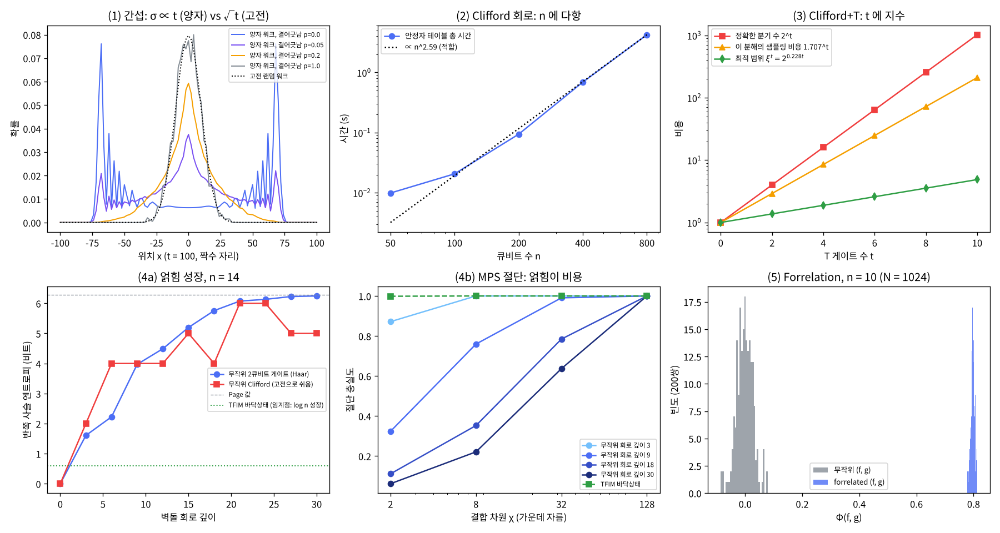

# 15장 양자 가속의 원천

2026-10-30 · Gosh

양자컴퓨팅 입문·심화서 · 3부 알고리즘 발견 방법론 · 이 장을 마치면 2부의 알고리즘을 간섭·위상 되돌림·진폭 증폭·푸리에 샘플링·해밀토니안 시뮬레이션으로 분류하고, 어떤 회로가 고전으로 쉽게 풀리는지(Clifford, 낮은 얽힘, 적은 T)를 숫자로 가려내며, BQP가 무엇을 할 수 없는지 말할 수 있다.

## 1. 요약

2부에서 본 알고리즘은 서로 달라 보이지만 가속의 원천은 몇 가지뿐이다. **간섭**(진폭이 더해지고 지워지는 것 — 모든 가속의 재료), **위상 되돌림**(함수 값을 위상으로 옮기는 연결부, 8장), **푸리에 샘플링**(군 구조가 있을 때의 지수 가속, 8·10·11장), **진폭 증폭**(구조가 없을 때의 2차 가속, 9장), **해밀토니안 시뮬레이션**(자연이 주는 지수 가속, 12장). 이 장은 그 분류를 세우고, 반대 방향에서 — 어떤 회로가 고전 컴퓨터로도 쉽게 풀리는가 — 숫자로 경계를 긋는다. 3부(발견 방법론)의 출발점: 새 알고리즘 후보가 있으면 "어느 원천을 쓰는가, 어느 고전 경계에 걸리는가"를 먼저 묻는다(17장 체크리스트).

numpy로 확인한 것: (1) **간섭**: Hadamard 양자 워크의 퍼짐 σ는 t에 비례(σ/t = 0.541 = √(1−1/√2)), 고전 랜덤 워크는 √t — t = 100에서 54 대 10. 동전을 매 스텝 확률 p로 측정하면(결어긋남) σ가 54 → 37(p = 0.05) → 21(0.2) → 10(1.0)로 무너져 고전이 된다. (2) **얽힘만으로는 부족하다**: 직접 짠 안정자 테이블(CHP) 시뮬레이터가 n = 800 큐비트, 게이트 16000개, 전 큐비트 측정을 4.5초에 끝낸다 — 상태벡터라면 2⁸⁰⁰ 진폭. n = 1000 GHZ도 즉시. 그리고 n = 14 무작위 Clifford 회로는 Haar 무작위 회로와 비슷한 속도로(10회 평균으로는 약간 낮지만 표준오차 안) 거의 최대 얽힘(5\~6비트)에 도달한다. (3) **마법(T 게이트)**: T 하나 = Clifford 두 개의 합 → T가 t개면 분기 2^t, 정확히 재현(t = 10, 분기 1024). 비용은 n이 아니라 t에 지수이고, 최적 분해는 2^{0.228t}. (4) **얽힘과 텐서망**: 무작위 회로 깊이 30에서 반쪽 사슬 엔트로피 6.25비트(Page 값 6.28), 가운데 자름 하나를 MPS 결합 차원 χ = 32로 자르면 충실도 0.64(모든 결합을 χ = 32로 자르면 ≈ 0.50); TFIM 바닥상태는 0.59비트(임계점이라 log n으로만 증가 — 사실상 면적 법칙)라 χ = 2로 0.9986. (5) **푸리에 샘플링의 최대 분리(Forrelation)**: N = 16384에서 양자 회로 두 쿼리의 출력 확률이 forrelated 쌍 0.636 대 무작위 쌍 7×10⁻⁵ — 몇 번 돌리면 구분; 고전은 Ω(√N / log N) 쿼리.

이 장의 메시지: 양자 가속은 "얽힘" 하나로 설명되지 않는다. **간섭 + 비Clifford 자원(마법) + 높은 얽힘 + 문제의 구조**가 동시에 있어야 하고, 하나라도 빠지면 고전 시뮬레이션이 따라온다. 그리고 BQP의 알려진 한계(구조 없는 탐색은 √N이 최선, NP-완전 문제를 푼다는 증거 없음)가 "어디서 찾지 말아야 하는가"를 알려준다.

## 2. 직관 먼저 — 비유와 Quirk

비유: 여러 갈래 길을 동시에 걸어가는 물결. 고전 확률은 "각 길의 확률을 더한다" — 모두 양수라 평균으로 퍼진다. 양자 진폭은 "각 길의 복소수를 더한다" — 위상이 맞는 길은 보강하고 엇갈리는 길은 상쇄한다. 알고리즘 설계는 "틀린 답으로 가는 길들을 서로 지우고, 맞는 답으로 가는 길들을 맞추는" 일이다. 비유가 깨지는 곳: 물결은 3차원 공간에 퍼지지만 양자 상태는 2ⁿ차원에 퍼지고, 그 공간의 크기 자체는 가속이 아니다 — 읽을 때 하나만 얻기 때문이다. "병렬로 모든 답을 계산한다"는 흔한 설명이 틀린 이유.

- [Quirk: 간섭의 최소 단위 — H·H = I](https://algassert.com/quirk#circuit={"cols":[["H"],["Chance"],["H"],["Chance"]]}) — 첫 H 뒤 50%, 두 번째 H 뒤 0%. 고전 동전 두 번 던지기는 50%를 두 번 거쳐도 50%인데, 양자는 |1⟩로 가는 두 경로(0→0→1, 0→1→1)가 부호 반대라 상쇄된다.
- [Quirk: 위상이 간섭을 바꾼다 — H·Z^t·H](https://algassert.com/quirk#circuit={"cols":[["H"],["Z^t"],["H"],["Chance"]]}) — 가운데 위상이 돌면 출력 확률이 sin²(πt/2)로 진동한다. 위상(보이지 않는 것)이 간섭을 통해 확률(보이는 것)이 되는 것 — 위상 되돌림(8장)과 QPE(10장)의 핵심 재료.
- [Quirk: Clifford만으로는 상태가 격자점에 갇힌다](https://algassert.com/quirk#circuit={"cols":[["H"],["Z^½"],["H"],["Bloch"],["Z^¼"],["Bloch"]]}) — H·S·H까지는 Bloch 벡터가 ±x, ±y, ±z 여섯 점 중 하나(안정자 상태). T(Z^¼)를 걸면 그 사이로 벗어난다 — 이것이 "마법"이고, 여섯 점 밖으로 나가야 고전 시뮬레이션이 어려워진다(3절).

## 3. 정의와 수식 — 가속의 원천, 복잡도 클래스, 고전 시뮬레이션 경계, 교과서 비교

**간섭.** 회로가 |0⟩에서 x로 가는 모든 경로(중간 기저 상태의 열)를 더하면

```latex
P_{\text{quantum}}(x) = \Big|\sum_{\text{paths}} a_{\text{path}}\Big|^2 \qquad\text{vs}\qquad P_{\text{classical}}(x) = \sum_{\text{paths}} p_{\text{path}}
```

(Feynman 경로 합). a가 복소수이므로 상쇄가 가능하다. 얽힘은 경로 수를 늘리고, 마법(비Clifford 게이트)은 위상을 π/2의 배수 밖으로 놓아 상쇄 패턴을 고전적으로 추적하기 어렵게 한다. 이 세 가지가 각각 5절 실험 (1), (4), (3)에 대응한다.

**가속의 분류.**

| 원천 | 메커니즘 | 이 책의 예 | 가속 | 알려진 한계·고전 대응 |
| --- | --- | --- | --- | --- |
| 푸리에 샘플링 (가환군 HSP) | 위상 되돌림 + 군 위의 QFT가 숨은 부분군을 드러냄 | 8장 Simon, 10장 QPE, 11장 Shor | 지수 | 군 구조 필수; 비가환 HSP(그래프 동형)는 일반적으로 미해결 |
| 진폭 증폭 | 두 반사의 곱 = 2θ 회전 | 9장 Grover·BBHT, 12장 진폭 추정 | 2차 | BBBV: 구조 없는 탐색은 Ω(√N)이 최선 |
| 해밀토니안 시뮬레이션 | 국소 항의 Trotter 곱 | 12장 TFIM | 지수 (BQP-완전) | 얽힘이 낮으면 텐서망이 따라옴 |
| 양자 워크 | 위치 공간의 간섭 | 이 장 5절 (1) | 퍼짐 2차; 접착 나무(glued trees)에서 지수 | 원소 유일성 N^{2/3}(다항) |
| 선형대수 (HHL·QSVT) | 블록 인코딩의 다항식 변환 | 16·20장 | 조건부 지수 | 저계수 입력은 dequantization(Tang 2019) |
| Forrelation | 두 함수의 푸리에 상관 | 이 장 5절 (5) | 쿼리 2(제어 큐비트를 쓰면 1) vs Ω̃(√N), 최대 분리 | 오라클 문제(실용 아님) |
| 변분·커널(휴리스틱) | 얕은 파라미터 회로를 고전 최적화기로 조정, 또는 특성 맵의 내적 | 6장 feature map, 13장 VQE·QAOA | 증명된 가속 없음 | 훈련 가능하다고 증명된 회로는 대개 고전 시뮬레이션 가능(Cerezo et al. 2023), 커널 집중 — 18장 휴리스틱 트랙 |

**복잡도 클래스.** BQP = 균일한 다항 크기 양자 회로 족이 오류 확률 ≤ 1/3로 푸는 결정 문제(Bernstein–Vazirani 1997). 알려진 포함 관계는

```latex
\mathsf{BPP} \subseteq \mathsf{BQP} \subseteq \mathsf{PP} \subseteq \mathsf{PSPACE}
```

(Adleman–DeMarrais–Huang 1997) 이고 어느 포함도 엄격하다고 증명되지 않았다 — BPP ≠ BQP를 증명하면 P ≠ PSPACE가 따라오므로. 그래서 "양자 가속"의 증거는 세 종류다: (a) 오라클(쿼리) 분리 — 증명됨(Simon, Forrelation, Raz–Tal 2019의 BQP ⊄ PH 오라클), (b) 고전 알고리즘이 알려지지 않은 문제의 다항 양자 알고리즘(인수분해 — 고전 하한은 없다), (c) 복잡도 가정 아래의 샘플링 어려움(IQP·무작위 회로 샘플링 — PH가 붕괴하지 않는다는 가정, 근사 샘플링은 평균 경우 난이도 추측까지 필요). NP-완전 문제를 BQP로 푼다는 증거는 없고, 오라클 상대로는 NP ⊄ BQP(BBBV 1997).

**고전 시뮬레이션 경계 — 가속의 "필요조건".**

- *Gottesman–Knill:* {H, S, CNOT} + 파울리 측정 회로는 안정자 테이블(2n×2n 비트 행렬)로 추적된다. 게이트당 O(n), 측정당 O(n²)(Aaronson–Gottesman 2004). GHZ처럼 최대 얽힘인 상태도 포함 — **얽힘은 필요조건이지 충분조건이 아니다.**
- *마법(magic):* Clifford에 T 하나만 더하면 범용이 된다(4장). T = e^{iπ/8}\[cos(π/8) I − i sin(π/8) Z\]는 Clifford 두 개의 합이므로 T가 t개인 회로는 안정자 상태 2^t개의 중첩 — 비용 poly(n)·2^{βt}. 더 좋은 분해로 지수 β가 줄어든다: 정확한 안정자 계수 χ(|T⟩^{⊗6}) = 7 → β ≈ 0.47(Bravyi–Smith–Smolin 2016), 근사는 안정자 범위 ξ(T) = 1/cos²(π/8) = 1.172 → β = 0.228(Bravyi–Gosset 2016이 처음 2^{0.23t}를 제시, Bravyi et al. 2019). 따라서 "T-count"가 고전 시뮬레이션 비용의 지수다 — 오류 정정에서 T가 비싼 것(25장)과 같은 동전의 양면.
- *얽힘(텐서망):* 1차원 MPS는 모든 자름에서 슈미트 수를 χ로 제한하고 비용은 O(nχ³). 자름의 엔트로피가 S비트면 χ ≳ 2^S. 바닥상태가 면적 법칙을 따르면(갭 있는 1D) S = O(1), 임계점이어도 S ∝ (c/6)log n(c = 1/2 for TFIM) → χ 다항. 무작위 회로는 S가 깊이에 선형으로 자라 χ 지수(Vidal 2003).
- *그 밖:* 자유 페르미온(matchgate, Valiant 2002·Terhal–DiVincenzo 2002), 충분히 잡음이 많고 깊은 회로(잡음이 상태를 최대 혼합으로 끌고 감 — 14장), 비대각 원소가 양수가 아닌(stoquastic) 해밀토니안(몬테카를로로 시뮬레이션 가능한 경우가 많다).

이 네 가지를 모두 피해야만 양자 회로가 고전으로 어렵다. 17장 체크리스트의 다섯 번째 단계(고전 베이스라인)가 묻는 "이 후보는 어느 고전 경계에 걸리는가"가 여기서 나오고, 18장이 경계마다 검사 도구를 붙인다.

**교과서 비교.** N&C는 복잡도를 3장(고전 계산)과 4.5.5절(양자 계산 복잡도, BQP ⊆ PSPACE), 블랙박스 하한을 6.6절(검색의 최적성), Gottesman–Knill을 10.5.4절에서 다룬다. KLM은 9장(양자 계산 복잡도와 하한 — 다항식 방법·적대자 방법)이 더 자세하다. 두 책 모두 마법·안정자 범위·텐서망·Forrelation은 없고(출판 이후), Aaronson의 *Quantum Computing Since Democritus*(2013)와 블로그 Shtetl-Optimized의 "BQP 한계" 글들이 이 장의 관점에 가장 가깝다.

## 4. 회로 구성 — numpy 구현과 SDK

**numpy 구현(실행 완료).** `ch15_sources.py`(실행 약 60초, 대부분 Forrelation n = 14와 양자 워크 궤적 평균). 핵심 두 가지 — 안정자 테이블과 T 분기 합. 아래는 `ch15_sources.py`에서 핵심만 간추린 발췌다(그대로 실행되지 않는다). 실행 가능한 전체 코드는 스크립트 파일에 있다.

```python
class Tableau:                                   # Aaronson–Gottesman CHP: 행 0..n-1 파괴자, n..2n-1 안정자
    def h(self, a):  r ^= x[:,a] & z[:,a];  x[:,a], z[:,a] = z[:,a].copy(), x[:,a].copy()   # numpy 열 교환은 .copy() 필수
    def s(self, a):  r ^= x[:,a] & z[:,a];  z[:,a] ^= x[:,a]
    def cnot(self, a, b):
        r ^= x[:,a] & z[:,b] & (x[:,b] ^ z[:,a] ^ 1);  x[:,b] ^= x[:,a];  z[:,a] ^= z[:,b]
    def rowsum(self, hs, i):               # 파울리 곱의 i 지수를 g 함수로 더해 부호 계산 (여러 행 벡터화)
    def measure(self, a, rng):             # x_{p,a}=1 인 안정자가 있으면 무작위, 없으면 작업 행에 누적해 결정적

# T = e^{iπ/8}[cos(π/8) I - i sin(π/8) Z]  →  T 가 t 개면 분기 b ∈ {0,1}^t 의 가중합
for b in range(2 ** t):
    w = prod(c1 if bit else c0 for bit in bits(b))           # c0 = e^{iπ/8}cos(π/8), c1 = -i e^{iπ/8}sin(π/8)
    psi += w * run_clifford(ops, branch=b)                   # k번째 T 를 I(0) 또는 Z(1) 로 바꾼 Clifford 회로
```

세 가지 주의. (1) 테이블의 Y는 (x, z) = (1, 1)이고 곱셈 위상 i는 g 함수가 챙긴다 — 부호 비트 r만 저장하므로 상태벡터의 전역 위상은 잃는다(확률에는 무관). 정확성은 n = 8 무작위 회로 20개에서 "상태벡터가 테이블 안정자 n개의 +1 고유상태인가"로 검산했다. (2) 측정 비용이 게이트보다 크다 — 무작위 결과는 rowsum을 최대 2n행에, 결정적 결과는 x\_{i,a} = 1인 파괴자 i의 짝 안정자(행 i+n)를 최대 n개 작업 행에 차례로 곱한다(측정당 O(n²), 전 큐비트 O(n³)). (3) T 분기 합은 각 분기를 상태벡터로 돌렸다 — 원리 설명용이고, 실제 시뮬레이터(Qiskit Aer `extended_stabilizer`)는 각 분기를 안정자 테이블로 다루어 n에 다항.

**게이트 비용 기록.** 이 장은 "회로 비용" 대신 "고전 시뮬레이션 비용"을 기록한다. Clifford: 큐비트 n, 게이트 g, 측정 m이면 O(gn + mn²). Clifford+T: T가 t개면 정확 2^t 분기(이 장), 근사 2^{0.228t}. MPS: 결합 차원 χ, 깊이 d면 O(ndχ³), 필요 χ ≳ 2^{S}(2^S는 하한이고 실제 값은 그 몇 배다 — 19장). 상태벡터: 2ⁿ·16바이트 — n = 50이면 18 PB.

**Qiskit 스니펫(작성됨, 미실행).** Aer의 시뮬레이션 방법이 곧 이 장의 분류표다.

```python
# qiskit==2.5.x, qiskit-aer==0.17.x — 작성됨, 미실행
from qiskit import QuantumCircuit
from qiskit.quantum_info import random_clifford
from qiskit_aer import AerSimulator

# (2) Clifford: 큐비트 1000개도 안정자 방법이면 다항 시간(합성 포함 수십 초 이내 예상)
qc = random_clifford(1000, seed=7).to_circuit(); qc.measure_all()
AerSimulator(method='stabilizer').run(qc, shots=100, seed_simulator=7).result().get_counts()

# (3) Clifford + T 몇 개: 확장 안정자 방법 (비용 ∝ ξ^t)
qc2 = random_clifford(40, seed=7).to_circuit()
for q in range(6): qc2.t(q)                                    # T 6개
qc2.compose(random_clifford(40, seed=8).to_circuit(), inplace=True)   # T 뒤에 Clifford를 더 둔다(측정 직전 T는 확률에 영향 없음)
qc2.measure_all()
sim = AerSimulator(method='extended_stabilizer', extended_stabilizer_approximation_error=0.05)
sim.run(qc2, shots=100, seed_simulator=7).result().get_counts()

# (4) 낮은 얽힘: MPS 방법. 결합 차원 상한을 두면 절단되고, mps_log_data=True로 결합 차원·버린 슈미트 값을 기록한다(충실도는 직접 계산)
sim_mps = AerSimulator(method='matrix_product_state', matrix_product_state_max_bond_dimension=32)
```

세 줄이 세 경계다: `stabilizer`는 Clifford가 아닌 게이트를 만나면 오류를 내고, `extended_stabilizer`는 T 수에 따라 느려지며, `matrix_product_state`는 얽힘에 따라 느려진다. 어느 하나로도 빨리 도는 회로는 "양자 이득의 후보가 아니다" — 17·18장의 고전 경계 검사(얽힘, 자유 페르미온, 입력 모형)는 같은 생각을 numpy로 옮긴 것이다.

## 5. 시뮬레이션 결과

모든 수치는 `ch15_sources.py`를 `seed=7`로 실행한 출력이다(실행 약 60초). 시간은 이 컨테이너 기준이라 기계마다 다르다.

**(1) 간섭: 양자 워크 vs 고전 랜덤 워크.** Hadamard 동전, 대칭 초기 동전 (|0⟩ + i|1⟩)/√2.

| 스텝 t | σ 양자 | σ/t | σ 고전 | σ/√t |
| --- | --- | --- | --- | --- |
| 25 | 13.55 | 0.542 | 5.00 | 1.000 |
| 50 | 27.07 | 0.541 | 7.07 | 1.000 |
| 100 | 54.12 | 0.541 | 10.00 | 1.000 |
| 200 | 108.24 | 0.541 | 14.14 | 1.000 |

σ/t의 극한은 √(1 − 1/√2) = 0.5412 — 알려진 값(Ambainis et al. 2001; Konno 2002)과 일치. 동전을 매 스텝 확률 p로 Z 기저에서 측정(궤적 2000개 평균)하면 t = 100에서 σ = 54.1(p = 0) → 36.7(0.05) → 20.6(0.2) → 10.2(1.0). p = 1이면 매 스텝 간섭이 지워져 정확히 고전 랜덤 워크가 된다. 그림 (1): 양자 분포는 양 끝(±t/√2 근처)에 봉우리, 고전은 가운데 종.

**(2) Gottesman–Knill: 안정자 테이블.** 정확성: n = 8, 무작위 Clifford 120게이트 × 20회로 모두 "상태벡터 = 테이블 안정자 8개의 +1 고유상태". n = 5 회로를 테이블로 4000번 측정한 분포 vs 상태벡터 |진폭|²: TVD = 0.027(지지 16개 균등 — 안정자 상태의 확률은 항상 2^k 개 균등). GHZ n = 1000: q0 측정은 무작위, 그 뒤 q1·q500·q999는 모두 같은 값으로 결정적.

| n | 게이트 수 | 게이트 시간 | 전 큐비트 측정 시간 |
| --- | --- | --- | --- |
| 50 | 1,000 | 0.00 s | 0.01 s |
| 100 | 2,000 | 0.01 s | 0.02 s |
| 200 | 4,000 | 0.02 s | 0.10 s |
| 400 | 8,000 | 0.06 s | 0.65 s |
| 800 | 16,000 | 0.24 s | 4.23 s |

총 시간의 log-log 기울기 ≈ 2.5(n = 100\~800, 실행마다 2.4\~2.5; 그림의 적합선) — 다항. 이론상 측정 총합은 O(n³)인데 numpy 벡터화 덕에 이 범위에서는 그보다 완만하다. 그림 (2).

**(3) 마법: T 분기 합.** n = 6, Clifford 60개에 T를 t개 끼워 넣은 무작위 회로.

| T 수 t | 분기 2^t | 분기 합 = 정확 상태 | 시간 | ‖c‖₁² = 1.707^t |
| --- | --- | --- | --- | --- |
| 0 | 1 | 예 | 0.001 s | 1.00 |
| 2 | 4 | 예 | 0.004 s | 2.91 |
| 4 | 16 | 예 | 0.016 s | 8.49 |
| 6 | 64 | 예 | 0.066 s | 24.75 |
| 8 | 256 | 예 | 0.29 s | 72.12 |
| 10 | 1024 | 예 | 1.16 s | 210.19 |

시간은 분기 수에 비례(T 2개당 ×4). ‖c‖₁²는 이 분해를 몬테카를로(준확률) 샘플링으로 쓸 때의 분산 비용 — 1.707^t = 2^{0.77t}. 최적 분해의 비용은 안정자 범위 ξ(T)^t = 1.172^t = 2^{0.228t} — 게이트 수준에서도 T ∝ (cos π/8 − sin π/8) I + √2 e^{−iπ/4} sin(π/8) S로 ‖c‖₁² = ξ를 달성한다. 그림 (3): 세 곡선 모두 t에 지수이고 기울기만 다르다 — **어떤 분해를 써도 n이 아니라 t가 지수**.

**(4) 얽힘: n = 14 벽돌 회로의 반쪽 사슬 엔트로피(비트).**

| 깊이 | 0 | 3 | 6 | 9 | 12 | 15 | 18 | 21 | 24 | 27 | 30 |
| --- | --- | --- | --- | --- | --- | --- | --- | --- | --- | --- | --- |
| Haar 무작위 | 0 | 1.61 | 2.22 | 3.97 | 4.49 | 5.20 | 5.76 | 6.07 | 6.13 | 6.23 | 6.25 |
| 무작위 Clifford | 0 | 2 | 4 | 4 | 4 | 5 | 4 | 6 | 6 | 5 | 5 |

Page 값(Haar 무작위 상태의 평균) ≈ n/2 − 1/(2 ln 2) = 6.28비트, 최대 7. 무작위 회로는 깊이 ≈ 20에서 포화. Clifford도 비슷한 속도로 5\~6비트에 이르고(이 표본에서는 초반이 앞서고, 10회 평균으로는 깊이 6·12에서 Clifford 1.80·4.00비트, Haar 2.01·4.15비트 — Clifford가 약간 낮지만 표준오차 0.25·0.37 안이다) 값이 정수다(안정자 상태의 슈미트 스펙트럼은 2^k개 균등) — **거의 최대 얽힘인데도 (2)의 테이블로 n = 800까지 쉽다**. TFIM 바닥상태(12·13장, 임계점)는 0.593비트.

MPS 절단 충실도(가운데 자름에서 슈미트 상위 χ개만 남기기):

| 상태 | χ = 2 | χ = 8 | χ = 32 | χ = 128 |
| --- | --- | --- | --- | --- |
| Haar 회로 깊이 3 | 0.872 | 1.000 | 1.000 | 1.000 |
| 깊이 9 | 0.323 | 0.760 | 0.991 | 1.000 |
| 깊이 18 | 0.111 | 0.352 | 0.785 | 1.000 |
| 깊이 30 | 0.062 | 0.221 | 0.637 | 1.000 |
| TFIM 바닥상태 | 0.9986 | 1.000000 | 1.00000000 | 1 |

χ = 128 = 2⁷은 반쪽 차원 전체라 항상 정확(점검용). 깊이 30 무작위 상태는 χ = 32에서 0.64(가운데 자름 하나의 값; 모든 결합을 χ = 32로 자르면 ≈ 0.50) — n을 두 배로 하면 필요한 χ는 제곱이 된다. TFIM은 χ = 2로 0.9986. 12장 7절 "텐서망이 1차원에서 이긴다"의 숫자. 그림 (4a)(4b).

**(5) Forrelation.** f는 무작위 ±1, forrelated g = sign(H^{⊗n} f), 무작위 g는 독립 ±1. 각 n마다 쌍 200개(양자 확률은 20개).

| n (N) | 무작위 쌍 평균 ｜Φ｜ | √(2/π)·N^{−1/2} | forrelated 평균 Φ | 양자 P(0ⁿ) 무작위 | 양자 P(0ⁿ) forrelated |
| --- | --- | --- | --- | --- | --- |
| 6 (64) | 0.0975 | 0.0997 | 0.797 | 1.7×10⁻² | 0.630 |
| 10 (1,024) | 0.0222 | 0.0249 | 0.798 | 5.9×10⁻⁴ | 0.635 |
| 14 (16,384) | 0.0062 | 0.0062 | 0.798 | 7.0×10⁻⁵ | 0.636 |

forrelated Φ → √(2/π) = 0.798(f의 푸리에 계수가 거의 가우스이므로 E|·| = √(2/π)), 양자 출력 확률 Φ² ≈ 0.636은 N에 무관. 무작위 쌍은 Φ² ≈ 1/N로 사라진다(쌍 200개의 표준오차는 n = 6에서 ≈ 0.005, n = 10에서 ≈ 0.0013 — 표의 차이는 2σ 이내의 표본 잡음). 두 쿼리 회로를 10번만 돌려도 두 경우가 갈리는데, 고전 무작위 알고리즘은 Ω(√N / log N) 쿼리가 필요(Aaronson–Ambainis 2015). 그림 (5).

그림(`ch15_results.png`): (1) 양자 워크와 결어긋남, (2) Clifford 테이블 시간 vs n, (3) Clifford+T 비용 vs t, (4a) 얽힘 성장, (4b) MPS 절단 충실도, (5) Forrelation 분포.



## 6. 다른 SDK 대응 — Cirq

이 장에서 Cirq를 고른 이유는, Cirq가 Clifford 경계를 `CliffordSimulator`라는 별도 시뮬레이터 클래스로 내놓으므로, `method=` 인자로 경계를 고르는 Qiskit Aer와 달리 "시뮬레이터를 고르는 것이 곧 경계를 고르는 것"임이 코드에 드러나기 때문이다. 이 장의 SDK 대응은 "어느 고전 시뮬레이터가 어느 경계를 쓰는가"다.

| 경계 | Qiskit Aer | Cirq |
| --- | --- | --- |
| Clifford (Gottesman–Knill) | `method='stabilizer'`, `quantum_info.StabilizerState`, `Clifford` | `cirq.CliffordSimulator`, `cirq.StabilizerChFormSimulationState` |
| Clifford + 적은 T | `method='extended_stabilizer'` | — |
| 낮은 얽힘 (MPS) | `method='matrix_product_state'` | `cirq.contrib.quimb` |
| 일반 텐서망 수축 | `method='tensor_network'`(GPU) | quimb |
| 상태벡터 (기준) | `method='statevector'` | `cirq.Simulator` |

```python
# cirq==1.7.x — 작성됨, 미실행. Clifford 회로는 CliffordSimulator 로, 큐비트 수와 무관하게 빠르다
import cirq
q = cirq.LineQubit.range(500)
ghz = cirq.Circuit(cirq.H(q[0]), [cirq.CNOT(q[i], q[i+1]) for i in range(499)], cirq.measure(*q, key='m'))
res = cirq.CliffordSimulator(seed=7).run(ghz, repetitions=10)
print(set(map(tuple, res.measurements['m'][:, [0, 250, 499]].tolist())))   # {(0,0,0), (1,1,1)}
```

Stim(Gidney 2021, *Quantum* 5, 497)은 이 장 테이블의 사촌이다 — 비트 패킹과 SIMD로, 거리 100 표면 코드 회로(큐비트 2만 개, 게이트 800만 개)를 15초에 분석하고 초당 약 1,000샷으로 전체 샘플링한다(논문 초록). 25장(오류 정정)의 시뮬레이션은 모두 이 경계 덕분에 가능하다: 오류 정정 회로는 대부분 Clifford이기 때문.

## 7. 한계와 반례

**"양자는 모든 답을 병렬로 계산한다"는 틀렸다.** 중첩은 2ⁿ개의 진폭을 다루지만 측정은 n비트만 내놓는다(Holevo 한계). 이득은 간섭으로 틀린 답을 상쇄시킬 때만 있고, 그러려면 문제에 구조가 있어야 한다. 구조가 없으면 √N이 최선(BBBV) — 그래서 NP-완전 문제를 "모든 해를 동시에 시험"해 풀지 못한다. Aaronson이 늘 강조하듯, 양자 컴퓨터는 모든 일을 빨리 하는 것이 아니라 특정 구조를 가진 문제를 빨리 한다.

**"얽힘 = 양자 이득"도 틀렸다.** 5절 (2)·(4)가 반례: 무작위 Clifford 회로는 거의 최대 얽힘인데 n = 800까지 수 초. 거꾸로, 순수 상태 양자 계산이 지수 가속을 내려면 얽힘이 반드시 커져야 한다(Jozsa–Linden 2003: 얽힘이 제한된 순수 상태 회로는 고전 시뮬레이션 가능). 얽힘은 필요조건이고 마법(T)과 구조가 함께 있어야 한다.

**오라클 분리는 실용 가속이 아니다.** Forrelation은 쿼리 수에서 가능한 최대 분리(1 vs Ω̃(√N))이고 BQP ⊄ PH의 오라클 증거(Raz–Tal)이지만, 실제 문제에서 f와 g를 효율적인 회로로 주면 고전 알고리즘도 회로 구조를 열어볼 수 있다 — 블랙박스 하한은 사라진다. Simon도 같다(8장 7절). "오라클에서 지수 가속"은 원천의 존재 증명이고, 실용성은 그 함수를 고전이 얼마나 잘 읽는가에 달렸다.

**고전 알고리즘도 발전한다 — dequantization.** Tang(2019)은 "양자 추천 시스템"(Kerenidis–Prakash 2017)의 지수 가속을, 같은 데이터 접근 가정(샘플·쿼리 접근) 아래에서 행렬 크기에 polylog인 고전 알고리즘으로 따라잡았다. 저계수 행렬에 대한 양자 머신러닝의 상당수가 같은 운명을 겪었다. 동시에 "양자 우월성 실험"(Google 2019 무작위 회로 샘플링)의 고전 추정은 텐서망 수축의 발전으로 10,000년 → GPU 512개로 15시간(엑사스케일이면 수십 초로 추정, Pan–Chen–Zhang 2022)까지 내려왔다. 경계는 고정된 선이 아니라 양쪽이 밀고 당기는 전선이다 — 18장의 dequantization 검사가 이 때문에 필요하다.

**잡음은 고전 시뮬레이션을 돕는다.** 5절 (1)의 결어긋남이 양자 워크를 고전 워크로 되돌리듯, 게이트 수 × p(p = 게이트 오류율)가 1을 크게 넘으면(14장 오류 예산) 출력이 균등 분포로 수렴하고 고전 시뮬레이션(또는 그냥 동전 던지기)이 쉬워진다(14장). 오류 정정 없이는 가속의 원천이 남아 있을 깊이가 제한된다.

**분류가 모든 것을 담지는 않는다.** 서로 다른 원천이 섞인다(Shor = 푸리에 샘플링 + 모듈러 산술, AE = 진폭 증폭 + QPE). 또 IQP·보손 샘플링(boson sampling)처럼 "무엇을 계산하는가"보다 "샘플링 분포가 어렵다"가 요점인 계열은 표에 없다. 표는 "후보 알고리즘을 어디에 놓고 어느 한계를 점검할지"를 정하는 도구이지 완결된 이론이 아니다.

## 8. 연습문제와 해답

**문제 1 (N&C 10.5.2절 변형).** H, S, CNOT이 파울리를 켤레 작용(U P U†)으로 파울리로 보냄을 보이고, T는 그렇지 않음을 보여라. 이것이 왜 "테이블로 추적 가능"의 정확한 조건인가?

*해답.* U P U†를 계산한다. H: X → Z, Z → X(테이블의 x·z 교환, Y → −Y라 부호 갱신 r ^= x·z). S: X → Y, Z → Z(z ^= x). CNOT(a→b): Xₐ → XₐX\_b, Z\_b → ZₐZ\_b, X\_b·Zₐ는 그대로. 모두 파울리 하나로 가므로 안정자 n개(비트 2n개 + 부호)가 상태를 완전히 기술한다. T: T X T† = (X + Y)/√2 — 파울리 두 개의 합이 되어 안정자 하나가 둘로 갈라진다. T가 t개면 최악 2^t 갈래 — 5절 (3)의 분기 수와 같은 이야기를 Heisenberg 그림으로 본 것이다. 정확한 조건: "게이트가 파울리 군의 정규화자(Clifford 군)에 속하고, 측정이 파울리 측정이고, 초기 상태가 안정자 상태일 것".

**문제 2 (자작 — 5절 (4)의 관찰).** 안정자 상태의 얽힘 엔트로피(어느 자름이든)는 항상 정수 비트임을 보여라.

*해답.* 안정자 군 S(원소 2ⁿ개)로 ρ = 2^{−n} Σ\_{g∈S} g. 부분계 A를 남기고 나머지를 추적하면, A 밖에서 항등이 아닌 g는 추적이 0이므로 ρ\_A = 2^{−|A|} Σ\_{g∈S\_A} g, S\_A = A 위에만 작용하는 부분군(원소 2^k개). Σ\_{g∈S\_A} g / 2^k는 순위 2^{|A|−k}인 사영이므로 ρ\_A는 그 사영 위의 균등 혼합 — 엔트로피 = |A| − k비트, 정수. (Fattal–Cubitt–Yamamoto–Bravyi–Chuang 2004.) 5절 표의 Clifford 행이 2, 4, 5, 6처럼 정수만 나오는 이유다. 교훈: 얽힘 엔트로피가 크더라도 그 스펙트럼이 "평평"하면 구조가 단순하다.

**문제 3 (Aaronson–Ambainis 2015 변형).** 5절 (5)의 회로(H^{⊗n} → U\_f → H^{⊗n} → U\_g → H^{⊗n})에서 출력 |0ⁿ⟩의 확률이 Φ(f, g)²임을 보이고, 독립 무작위 쌍에서 E|Φ| ≈ √(2/π)/√N임을 보여라.

*해답.* H^{⊗n}|0⟩ = N^{−1/2}Σ\_x|x⟩ → U\_f: N^{−1/2}Σ f(x)|x⟩ → H^{⊗n}: Σ\_y f̂(y)/√N |y⟩ (f̂ = 정규화 WHT, Σf̂² = N) → U\_g: Σ\_y f̂(y)g(y)/√N |y⟩ → H^{⊗n} 후 |0ⁿ⟩ 진폭 = N^{−1/2}Σ\_y f̂(y)g(y)/√N = N^{−1}Σ\_y f̂(y)g(y) = Φ. 확률 Φ². f, g 독립 무작위면 f̂(y)g(y)는 평균 0, 분산 1인 독립에 가까운 N개 항이므로 Φ ≈ N(0, 1/N), E|Φ| = √(2/π)·N^{−1/2}(n = 10에서 0.0249 — 실측 0.0222). forrelated g = sign(f̂)이면 Φ = N^{−1}Σ|f̂| ≈ E|N(0,1)| = √(2/π). 양자는 확률 0.64 vs 1/N를 몇 번의 실행으로 구분하지만, 고전은 f와 g의 값을 각각 읽어 상관을 추정해야 하고 그것이 Ω̃(√N)이다.

## 9. 학습 노트

- **Gottesman–Knill 정리** — Clifford 회로 + 파울리 측정은 안정자 테이블(2n×2n 비트)로 다항 시간에 시뮬레이션된다. 이 장의 최대 분기점: n = 800 무작위 회로와 n = 1000 GHZ가 수 초 — "얽힘이 크면 고전으로 어렵다"는 직관을 깨뜨린다. 비유: 체스 보드가 아무리 복잡해 보여도 기물이 정해진 규칙(파울리 → 파울리)로만 움직이면 "각 기물의 위치"만 적으면 된다. 깨지는 곳: T 하나가 기물을 두 위치의 중첩에 놓아 기록이 두 배가 된다. 더 깊이: Aaronson–Gottesman, PRA 70, 052328 (2004); Stim(Gidney 2021).
- **마법(magic)과 안정자 범위** — 비Clifford 자원의 양. T가 t개인 회로의 고전 비용은 poly(n)·2^{βt}, 최적 β = log₂ξ(T) = 0.228. 5절 (3): 정확 분기 2^t, 준확률 비용 1.707^t, 최적 1.172^t — 모두 t에 지수. "T-count"가 오류 정정 비용(25장)과 고전 시뮬레이션 비용을 동시에 정하는 이유. 더 깊이: Bravyi et al., "Simulation of quantum circuits by low-rank stabilizer decompositions", Quantum 3, 181 (2019).
- **면적 법칙과 결합 차원** — 바닥상태의 얽힘은 경계 크기에 비례(1D에서는 상수 또는 log n), 무작위 상태는 부피에 비례(Page 값). MPS는 χ ≳ 2^S가 필요하므로 면적 법칙 상태는 싸고 무작위 상태는 지수. 5절 (4): TFIM 0.59비트 → χ = 2로 0.9986, 깊이 30 무작위 6.25비트 → 가운데 자름 χ = 32로 0.64. 비유: 긴 사슬을 어디서 자르든 자른 자리를 가로지르는 "실"의 수가 χ. 더 깊이: Eisert–Cramer–Plenio, RMP 82, 277 (2010); Vidal, PRL 91, 147902 (2003).
- **Forrelation** — 두 부울 함수의 푸리에 상관. 양자 쿼리 2(제어 큐비트를 쓰면 1) vs 고전 Ω̃(√N) — 쿼리 복잡도에서 가능한 최대 분리이고 BQP ⊄ PH 오라클 증명(Raz–Tal)의 재료. 푸리에 샘플링의 "순수한" 형태. 더 깊이: Aaronson–Ambainis, SIAM J. Comput. 47, 982 (2018); Aaronson 블로그 "Forrelation".
- **BQP의 위치** — BPP ⊆ BQP ⊆ PP ⊆ PSPACE, 어느 것도 엄격성 미증명. 양자 가속의 증거는 오라클 분리·미발견 고전 알고리즘·복잡도 가정 세 가지뿐이다. "양자 컴퓨터가 빠르다"는 주장을 들으면 어느 증거인지 묻는 것도 17장 절차의 질문 가운데 하나다. 더 깊이: Aaronson, *Quantum Computing Since Democritus* 10장("Quantum Computing"); N&C 4.5.5절.

## 10. 출처와 환경

- Nielsen & Chuang, 4.5.5절(양자 계산 복잡도), 6.6절(검색의 최적성), 10.5.4절(Gottesman–Knill). Kaye–Laflamme–Mosca 9장(복잡도와 하한).
- Bernstein & Vazirani, "Quantum complexity theory", *SIAM J. Comput.* 26, 1411 (1997); Adleman, DeMarrais, Huang, *SIAM J. Comput.* 26, 1524 (1997).
- Bennett, Bernstein, Brassard, Vazirani, "Strengths and weaknesses of quantum computing", *SIAM J. Comput.* 26, 1510 (1997).
- Aaronson & Gottesman, "Improved simulation of stabilizer circuits", *Phys. Rev. A* 70, 052328 (2004). Gidney, "Stim: a fast stabilizer circuit simulator", *Quantum* 5, 497 (2021).
- Bravyi, Smith, Smolin, "Trading classical and quantum computational resources", *Phys. Rev. X* 6, 021043 (2016). Bravyi, Browne, Calpin, Campbell, Gosset, Howard, "Simulation of quantum circuits by low-rank stabilizer decompositions", *Quantum* 3, 181 (2019).
- Vidal, "Efficient classical simulation of slightly entangled quantum computations", *Phys. Rev. Lett.* 91, 147902 (2003). Jozsa & Linden, *Proc. R. Soc. A* 459, 2011 (2003). Page, "Average entropy of a subsystem", *Phys. Rev. Lett.* 71, 1291 (1993). Fattal et al., "Entanglement in the stabilizer formalism", arXiv:quant-ph/0406168 (2004).
- Ambainis, Bach, Nayak, Vishwanath, Watrous, "One-dimensional quantum walks", *STOC* 2001. Childs et al., "Exponential algorithmic speedup by a quantum walk", *STOC* 2003.
- Aaronson & Ambainis, "Forrelation: a problem that optimally separates quantum from classical computing", *SIAM J. Comput.* 47, 982 (2018) (STOC 2015). Raz & Tal, "Oracle separation of BQP and PH", *J. ACM* 69, 30 (2022) (STOC 2019).
- Tang, "A quantum-inspired classical algorithm for recommendation systems", *STOC* 2019.
- Kerenidis & Prakash, "Quantum recommendation systems", *ITCS* 2017. Pan, Chen, Zhang, "Solving the sampling problem of the Sycamore quantum circuits", *Phys. Rev. Lett.* 129, 090502 (2022).
- Arute et al., "Quantum supremacy using a programmable superconducting processor", *Nature* 574, 505 (2019).
- Konno, "Quantum random walks in one dimension", *Quantum Inf. Process.* 1, 345 (2002). Bravyi & Gosset, "Improved classical simulation of quantum circuits dominated by Clifford gates", *Phys. Rev. Lett.* 116, 250501 (2016).
- Valiant, "Quantum circuits that can be simulated classically in polynomial time", *SIAM J. Comput.* 31, 1229 (2002). Terhal & DiVincenzo, "Classical simulation of noninteracting-fermion quantum circuits", *Phys. Rev. A* 65, 032325 (2002).
- Cerezo et al., "Does provable absence of barren plateaus imply classical simulability?", *Nature Communications* (2025), doi:10.1038/s41467-025-63099-6 (arXiv:2312.09121, 2023).
- Aaronson, *Quantum Computing Since Democritus* (Cambridge, 2013); 블로그 Shtetl-Optimized(scottaaronson.blog).
- SDK 문서: Qiskit Aer `AerSimulator` methods(stabilizer, extended\_stabilizer, matrix\_product\_state); Cirq `CliffordSimulator`.
- 환경: Python 3.13.17, numpy 2.5.3, scipy 1.18.1(`eigsh`), matplotlib 3.11.2; `ch15_sources.py` 실행 약 60초, seed = 7. SDK 코드는 PyPI 차단으로 작성만 되고 미실행.
