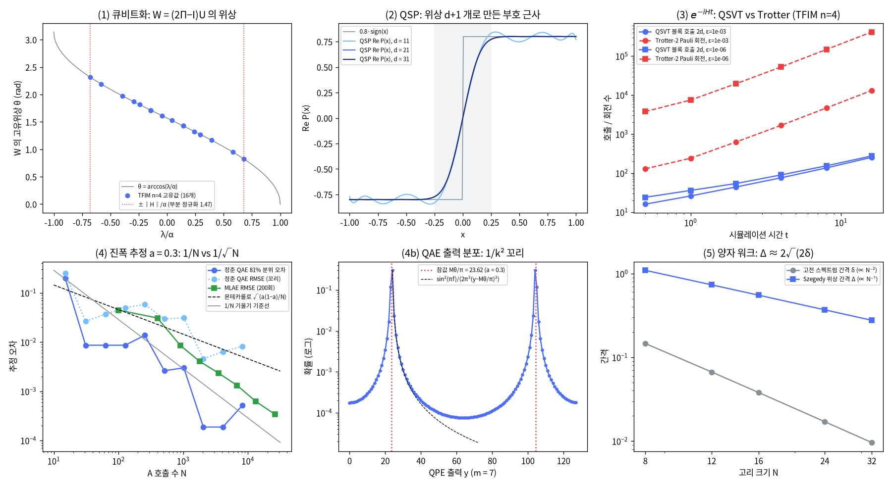

# 16장 원시 요소 사전

2026-10-30 · Gosh

양자컴퓨팅 입문·심화서 · 3부 알고리즘 발견 방법론 · 이 장을 마치면 블록 인코딩(LCU)·큐비트화·QSP/QSVT·진폭 추정·양자 워크를 "입력 → 호출 → 출력 → 비용"이 정해진 부품으로 다루고, 새 문제를 보면 어느 부품을 어떤 순서로 쌓을지와 그 호출 수를 적을 수 있다.

## 1. 요약

8\~15장의 알고리즘은 모두 몇 안 되는 부품을 조립한 것이다. 이 장은 그 부품 다섯 개 — **블록 인코딩(LCU), 큐비트화(qubitization), QSP/QSVT, 진폭 추정(AE), 양자 워크(Szegedy)** — 를 "무엇을 받아 무엇을 내놓고, 몇 번 호출하는가"로 정리한 사전이다. 15장이 "가속은 어디서 오는가"였다면, 16장은 "그 가속을 어떤 단위로 조립하는가"다. 17장(발견 절차)은 문제를 이 부품들로 매핑하는 체크리스트이고, 20장(HHL)이 첫 응용이다.

numpy로 확인한 것(TFIM n = 4, J = h = 1 — 12\~14장과 같은 모형): (1) **블록 인코딩**: Pauli 7개의 LCU로 보조 3큐비트 유니터리 U를 만들면 ⟨0|U|0⟩ = H/α가 오차 6×10⁻¹⁷로 성립. α = Σ|cᵢ| = 7은 ‖H‖ = 4.76보다 1.47배 크다 — 이 "부분 정규화"가 모든 비용에 곱해진다. (2) **큐비트화**: W = (2Π − I)U의 고유위상이 정확히 ±arccos(λ/α)(오차 4×10⁻¹⁶) — 반사 U를 회전 W로 바꾸면 QPE로 고유값을 읽을 수 있다. (3) **QSP/QSVT**: 위상 d + 1개만 바꿔 다항식을 고른다. 차수 11·21·31의 부호 근사, 그리고 같은 위상을 U에 쓴 QSVT 블록이 P(H/α)와 10⁻¹⁵까지 일치. 해밀토니안 시뮬레이션 e^{−iHt}(t = 0.5)를 cos·sin 차수 14·13으로 오차 3×10⁻⁹에 재현. ε = 10⁻⁶에서 QSVT는 차수 12\~138(cos·sin 블록 호출 24\~276번), 2차 Trotter는 Pauli 회전 3,797\~416,328번(t = 0.5\~16). (4) **진폭 추정**: 정준 QAE의 81% 분위 오차는 BHMT 상한(∝ 1/N) 아래에 머물지만(격자 때문에 계단식), 한 번 돌린 RMSE는 QPE 분포의 1/k² 꼬리 때문에 1/N로 줄지 않는다. QPE 없는 MLAE는 A 호출 26,200번에서 RMSE 3.4×10⁻⁴ — 같은 호출의 몬테카를로보다 8.3배 정확. (5) **Szegedy 워크**: 고리 N = 32의 고전 간격 δ = 0.0096에 대해 양자 위상 간격 Δ = 0.277 ≈ 2√(2δ) — 스펙트럼 간격의 제곱근.

이 장의 메시지: 양자 알고리즘의 "가속"은 대부분 **호출 횟수**의 이야기다. 부품의 비용은 "오라클(블록 인코딩, 상태 준비 A) 호출 몇 번"으로 적히고, 그 오라클 하나를 만드는 비용(α, 상태 준비 회로)이 실제 시간을 정한다. 부품 사전을 쓰는 법은 단순하다: 문제의 입력을 블록 인코딩이나 상태 준비로 바꿀 수 있는가, 그 α는 얼마인가, 원하는 함수는 낮은 차수 다항식으로 근사되는가.

## 2. 직관 먼저 — 비유와 Quirk

**블록 인코딩 = 큰 유니터리의 한 구석에 숨긴 행렬.** 양자 회로는 유니터리만 만든다. 그런데 우리가 다루고 싶은 H나 A는 유니터리가 아니다. 해법은 보조 큐비트를 더해 더 큰 유니터리 U를 만들고, 보조가 |0⟩으로 들어갔다 |0⟩으로 나오는 구석에 H/α를 넣는 것이다. α는 "축척" — 유니터리의 원소는 1을 넘을 수 없으므로 H를 α로 나눠 넣는다.

**QSP/QSVT = 오디오 이퀄라이저(FIR 필터).** 같은 신호(블록 인코딩 U)를 d번 통과시키면서 그 사이에 위상 회전 d + 1개를 끼우면, 고유값 λ마다 다른 배율 P(λ)가 곱해진다. FIR 필터가 탭 d개로 주파수 응답을 빚는 것과 같다: 위상은 탭, 다항식 P는 주파수 응답, 차수 d는 필터 길이. 부호 함수 근사(5절 그림 2)는 이상적 저역 통과 필터이고, 그 가장자리 물결은 Gibbs 현상이다. 깨지는 곳: FIR의 탭은 응답에 선형으로 들어가지만 QSP 위상은 비선형이고, |P| ≤ 1과 패리티(짝수·홀수) 제약이 있다 — 그래서 위상은 최적화로 찾는다(4절).

**진폭 추정 = 짧은 녹음 여러 번 대신 긴 녹음 한 번으로 주파수 재기.** 확률 a를 동전 던지기로 재면 N번에 오차 1/√N(평균의 잡음). 양자는 a를 회전각 θ(a = sin²θ)로 바꾼 뒤 그 회전을 N번 누적해 위상 Nθ를 잰다 — 긴 녹음의 주파수 분해능이 1/T인 것과 같은 1/N. 깨지는 곳: 긴 녹음은 잡음을 평균하지만, 양자 회전의 누적은 결맞음이 유지될 때만 가능하다(14장의 오류 예산이 누적 길이를 제한한다).

**양자 워크 = 확산 대신 직진.** 15장의 Hadamard 워크가 t걸음에 t만큼 퍼진 것처럼, Szegedy 워크는 고전 마르코프 사슬이 1/δ 걸음 걸려 섞일 것을 약 1/√δ 걸음으로 "감지"한다.

- [Quirk: LCU 블록 인코딩 (X + Z)/2](https://algassert.com/quirk#circuit={"cols":[["H"],["◦","X"],["•","Z"],["H"],["Chance2"]]}) — 위쪽이 보조, 아래쪽이 시스템(|0⟩). PREP = H, SELECT = (보조 0이면 X, 1이면 Z), PREP† = H. 보조 = 0인 두 칸의 확률이 각 1/4 — 시스템에 걸린 것은 (X + Z)/2|0⟩ = (|0⟩ + |1⟩)/2이고, 보조를 0으로 골라낼 확률 1/2가 α = 2의 대가다.
- [Quirk: QSP 축소판 — 같은 신호 회전 사이에 고정 위상](https://algassert.com/quirk#circuit={"cols":[["X^t"],["Z^½"],["X^t"],["Z^½"],["X^t"],["Chance"]]}) — X^t(신호) 3번 사이에 S를 끼웠다. t가 돌 때 출력 확률이 X^t 하나일 때와 다른 모양으로 움직인다. Z^½를 다른 각도로 바꾸면 모양이 또 바뀐다 — 위상이 응답 곡선을 고른다는 뜻이다.

## 3. 정의와 수식 — 부품 다섯 개와 교과서 비교

**사전 표.** 8\~12장의 부품 — 위상 되돌림(8장), 진폭 증폭(9장), QPE(10장), 곱 공식(12장) — 은 이 사전의 전제로 두고, 표에는 그 위에 쌓는 다섯 개만 적는다. 각 부품을 "무엇을 받아 무엇을 내놓고 몇 번 호출하는가"로 적었다. 호출 비용은 모두 입력 오라클(U 또는 A) 호출 수다.

| 부품 | 입력(오라클) | 출력 | 호출 비용 | 이 책에서 쓰는 곳 |
| --- | --- | --- | --- | --- |
| 블록 인코딩(LCU) | H = Σ cᵢ Uᵢ (유니터리 항 L개) | 왼쪽 위 블록이 H/α인 유니터리 U | PREP 2 + SELECT 1, 보조 ⌈log₂L⌉ | 12장 해밀토니안, 20장 행렬 |
| 큐비트화 | 에르미트 블록 인코딩 U | 고유위상 ±arccos(λ/α) 인 워크 W | W 하나 = U 1 + 반사 1 | QPE로 고유값(10·12장) |
| QSP/QSVT | 블록 인코딩 U, 다항식 P (차수 d) | P(H/α)의 블록 인코딩 | U d번 + 위상 회전 d + 1 | e^{−iHt}, 역행렬(20장), 필터 |
| 진폭 추정(AE) | 상태 준비 A, 표식 χ | 좋은 결과의 확률 a의 추정 | 오차 ε에 O(1/ε) (고전 O(1/ε²)) | 9장 진폭 증폭의 확장, 12장 QPE(Q), 몬테카를로 |
| Szegedy 워크 | 마르코프 사슬 P의 전이 상태 준비 | 고유위상 ±2arccos λ(D) 인 워크 | 위상 간격 Δ ≥ 2√(2δ), 검색 O(1/√(εδ)) 걸음 | 검색·표본 추출(15장 워크) |

**블록 인코딩.** 보조 m큐비트를 갖는 유니터리 U가 행렬 A의 (α, m, ε)-블록 인코딩이라는 말은

```latex
\left\| A - \alpha\,(\langle 0^m| \otimes I)\, U\, (|0^m\rangle \otimes I) \right\| \le \varepsilon
```

이다. 부분 정규화 α ≥ ‖A‖가 작을수록 좋다: 이 블록을 쓰는 모든 알고리즘의 호출 수가 α에 비례한다.

**LCU(유니터리의 선형 결합, Childs–Wiebe 2012).** H = Σᵢ cᵢ Uᵢ이면(Pauli 합이 대표적), cᵢ의 부호를 Uᵢ에 넣고

```latex
\mathrm{PREP}|0\rangle = \sum_i \sqrt{|c_i|/\alpha}\,|i\rangle,\quad \mathrm{SELECT} = \sum_i |i\rangle\langle i| \otimes \mathrm{sgn}(c_i)\,U_i,\quad U = (\mathrm{PREP}^\dagger \otimes I)\,\mathrm{SELECT}\,(\mathrm{PREP} \otimes I),\quad \alpha = \sum_i |c_i|
```

이면 ⟨0|U|0⟩ = H/α다. 상태 |ψ⟩에 U를 걸고 보조를 0으로 얻을 확률은 ‖Hψ‖²/α² — 바닥상태면 (E₀/α)². 이 장의 TFIM은 ZZ 3 + X 4 = L = 7항, α = 7, 보조 3큐비트.

**큐비트화(Low–Chuang 2019).** SELECT가 에르미트면(Pauli는 그렇다) U도 에르미트·유니터리, 즉 반사(U² = I)다. 고유값이 ±1뿐인 반사에는 위상 정보가 없다. 보조 레지스터에 대한 두 번째 반사 2Π − I(Π = |0ᵐ⟩⟨0ᵐ| ⊗ I)를 곱하면 두 반사의 곱이 회전이 된다(9장 Grover 반복과 같은 기하).

```latex
W = (2\Pi - I)\,U,\qquad W\ \text{의 고유값} = e^{\pm i \arccos(\lambda_k/\alpha)}\quad (\lambda_k:\ H\ \text{의 고유값})
```

각 λₖ마다 2차원 불변 부분공간 span{|0⟩|λₖ⟩, |⊥ₖ⟩}이 있고 그 안에서 U는 반사 R(λ/α) = \[\[x, √(1−x²)\], \[√(1−x²), −x\]\], 2Π − I는 Z다. W에 QPE를 하면 θ = arccos(λ/α)를 얻고 λ = α cos θ로 역산한다 — e^{−iHt}를 만들지 않고도 고유값 추정이 된다. SELECT가 에르미트가 아니면 보조 1개를 더해 에르미트 블록 인코딩으로 바꾼다.

**QSP(양자 신호 처리, Low–Yoder–Chuang 2016, Low–Chuang 2017).** 반사 규약에서 위상 Φ = (φ₀, …, φ\_d)에 대해

```latex
P_\Phi(x) = \langle 0 |\, e^{i\phi_0 Z} \prod_{k=1}^{d} \big[ R(x)\, e^{i\phi_k Z} \big] \,| 0 \rangle,\qquad R(x) = \begin{pmatrix} x & \sqrt{1-x^2} \\ \sqrt{1-x^2} & -x \end{pmatrix}
```

P는 차수 ≤ d, 패리티 d mod 2인 다항식이다. 역도 성립한다: 패리티가 맞고 \[−1, 1\]에서 |f| ≤ 1인 실수 다항식 f는 어떤 Φ에 대해 Re P\_Φ = f로 만들 수 있다(Gilyén–Su–Low–Wiebe 2019). 예: φ₀ = 0, φ₁ = … = φ\_d = π/2이면 P = iᵈ T\_d(x)(체비쇼프) — 연습문제 2.

**QSVT.** 같은 Φ를 블록 인코딩에 쓰면 각 불변 부분공간에서 위 2×2 계산이 그대로 일어난다.

```latex
U_\Phi = e^{i\phi_0(2\Pi - I)} \prod_{k=1}^{d} \big[ U\, e^{i\phi_k(2\Pi - I)} \big],\qquad \Pi\, U_\Phi\, \Pi = P_\Phi(H/\alpha)
```

실수 부분 Re P는 Φ와 −Φ를 보조 1개로 섞어(위상 회전만 제어, U 호출은 공유) 얻는다. 그래서 "함수 f(H)를 만드는 비용" = "f를 \[−1, 1\]에서 근사하는 다항식의 차수"다. 해밀토니안 시뮬레이션은 Jacobi–Anger 전개

```latex
\cos(\tau x) = J_0(\tau) + 2\sum_{k\ge1} (-1)^k J_{2k}(\tau)\, T_{2k}(x),\qquad \sin(\tau x) = 2\sum_{k\ge0} (-1)^k J_{2k+1}(\tau)\, T_{2k+1}(x),\qquad \tau = \alpha t
```

를 차수 d에서 자른다. d = eτ/2 + ln(1/ε) 정도면 충분하다(τ가 크면 실제 필요 차수는 τ에 가깝다: 5절에서 τ = 112, ε = 10⁻³일 때 127). 호출 수 O(αt + log(1/ε)/log log(1/ε))로 최적이다(Low–Chuang 2017). 2차 Trotter의 O(t^{3/2}/ε^{1/2})(12장)와 달리 ε에 로그다.

**진폭 추정(Brassard–Høyer–Mosca–Tapp 2002).** A|0⟩ = sinθ|good⟩ + cosθ|bad⟩, a = sin²θ. Grover 반복 Q = −A S₀ A† S\_f(BHMT 원논문 표기 S\_χ)는 이 평면에서 2θ 회전이므로 고유값이 e^{±2iθ}. m비트 QPE(Q 호출 M − 1 = 2ᵐ − 1번)로 y를 얻고 ã = sin²(πy/M)로 역산하면, 확률 ≥ 8/π² ≈ 0.81로

```latex
|\tilde a - a| \le \frac{2\pi \sqrt{a(1-a)}}{M} + \frac{\pi^2}{M^2}
```

고전 몬테카를로의 √(a(1−a)/N)과 비교하면 1/√N → 1/N(제곱 가속). 12장에서 QPE(Q)로 처음 보인 것을 여기서 일반화한다. QPE 없는 변형 MLAE(Suzuki et al. 2020)는 k번 반복한 Q^k A|0⟩를 여러 k에서 측정해 로그 우도 Σₖ \[hₖ log sin²((2k+1)θ) + (Nₖ − hₖ) log cos²((2k+1)θ)\]를 최대화한다. IQAE(Grinko et al. 2021)도 같은 목적이다 — 제어 Q와 역 QFT가 필요 없어 얕은 회로에 맞다.

**Szegedy 양자 워크(2004).** 가역 마르코프 사슬 P에 대해 |ψₓ⟩ = |x⟩ ⊗ Σ\_y √P\_xy |y⟩, Π\_A = Σₓ |ψₓ⟩⟨ψₓ|, S = SWAP으로 W = S(2Π\_A − I)S(2Π\_A − I). 판별 행렬 D\_xy = √(P\_xy P\_yx)의 고유값 λₖ에 대해 W의 고유위상은 ±2 arccos λₖ — 큐비트화의 특수한 경우다. 고전 스펙트럼 간격 δ = 1 − max\_{k≥2}|λₖ|(게으른 사슬처럼 λ ≥ 0이면 1 − λ₂)에 대해 위상 간격 Δ = 2 arccos(1 − δ) ≥ 2√(2δ)이므로, 표식된 원소(비율 ε)를 찾는 검색이 고전 O(1/(εδ)) 대신 O(1/√(εδ)) 걸음으로 된다(Magniez–Nayak–Roland–Santha 2011).

**교과서 비교.** N&C(2000)는 QPE(5.2절), Grover와 양자 계수 세기(6.1·6.3절 — 진폭 추정의 조상)까지다. KLM(2007)은 8장에서 진폭 증폭·진폭 추정·양자 계수 세기를 한 줄기로 다루고 표기도 같다(9·12·16장 모두 Q = −A S₀ A† S\_f; BHMT의 S\_χ와 같은 표식 반사). 블록 인코딩·큐비트화·QSVT는 두 책 이후(2012\~2019)의 결과라 교과서에 없고, 표준 개관은 Martyn–Rossi–Tan–Chuang(2021) "Grand unification"과 Lin Lin의 강의록(arXiv:2201.08309)이다. 이 장의 반사 규약은 Gilyén et al.의 것이고, Wₓ = e^{i arccos(x) X} 규약(Low–Chuang, pyqsp)과는 위상이 다르다 — 논문·도구 사이에서 위상을 옮길 때 가장 흔한 함정.

## 4. 회로 구성 — numpy 구현과 Qiskit

**numpy 구현(실행 완료).** `ch16_primitives.py`(실행 약 2분, 대부분 QSP 위상 맞춤과 Trotter 단계 탐색). 모든 부품을 행렬로 직접 만들고 정의대로 동작하는지 잰다. 레지스터 순서는 보조가 앞(상위 비트), 시스템이 뒤. 아래는 `ch16_primitives.py`에서 핵심만 간추린 발췌다(그대로 실행되지 않는다). 실행 가능한 전체 코드는 스크립트 파일에 있다.

```python
def lcu_block_encoding(terms, n):            # terms = [(c_i, 'ZZII'), ...]
    PREP = householder_first_column(sqrt(|c|/α))   # 첫 열이 Σ√(|cᵢ|/α)|i⟩ 인 실직교 행렬
    SEL  = block_diag(sgn(c_i) * P_i ...)            # 쓰지 않는 색인은 I
    return kron(PREP.T, I) @ SEL @ kron(PREP, I)     # ⟨0|U|0⟩ = H/α

W = diag(2Π − 1) @ U                            # 큐비트화: 고유위상 ±arccos(λ/α)

def qsp_poly(phis, x):                         # 반사 규약, x 배열을 한 번에
    v0, v1 = e^{iφ₀}, 0                           # 행 벡터 ⟨0| 를 오른쪽으로 밀며 R(x), e^{iφZ} 를 곱한다
    for φ in phis[1:]: (v0, v1) = (v0·x + v1·s, v0·s − v1·x); v0 *= e^{iφ}; v1 *= e^{−iφ}
    return v0

def qsvt(U, phis, Pd):                         # Pd = 2Π − 1 의 대각
    M = diag(e^{iφ₀ Pd})
    for φ in phis[1:]: M = M @ U @ diag(e^{iφ Pd})
    return M                                   # Π M Π = P(H/α)

Q = −A S₀ A† S_f                                 # 진폭 추정의 Grover 반복, 고유값 e^{±2iθ}
W_sz = S (2Π_A − I) S (2Π_A − I)                  # Szegedy 워크, Π_A = Σ|ψₓ⟩⟨ψₓ|
```

세 가지 주의. (1) PREP는 "첫 열이 Σ√(|cᵢ|/α)|i⟩인 아무 유니터리"면 된다 — 행렬 검산에는 Householder 반사를, 실제 회로에는 상태 준비(Möttönen 분해, 회전 O(L))나 오류 정정 시대의 별칭 표본 추출(alias sampling, Babbush et al. 2018)을 쓴다. (2) QSP 위상은 비선형 최적화로 찾는다. Dong–Meng–Whaley–Lin(2021)의 대칭 위상 제약과 초기값 (π/4, 0, …, 0, π/4)(원래 Wₓ 규약용)을 이 장의 반사 규약에 그대로 써서 Levenberg–Marquardt로 풀었다. 점 수 = 미지수 수로 푸는 것이 표준이지만, 시작점 하나의 LM은 국소 최소(잔차 10⁻⁴\~10⁻²)에 멈출 수 있고 어느 차수에서 멈추는지가 계산하는 컴퓨터의 반올림 끝자리에 따라 갈린다. 그래서 점을 두 배로 늘려 다시 풀고, 그래도 안 되면 시작점을 흔들어(시드 고정) 전 구간 최대 오차가 10⁻¹² 아래로 내려갈 때까지 다시 푼다(맞춤 잔차는 10⁻¹⁵ 수준). 차수 수백\~수천은 전용 도구(QSPPACK, pyqsp)의 분야다. (3) 정준 QAE 한 번의 오차 분포는 꼬리가 1/k²이라 RMSE가 줄지 않는다(5절) — 여러 번 돌려 중앙값을 쓰거나 MLAE·IQAE를 쓴다.

**게이트 비용 기록.** 이 장의 인스턴스가 쓴 보조 큐비트와 오라클 호출 수. 다중 제어 게이트의 CNOT 분해는 4장 계산을 따른다.

| 부품 | 이 장의 인스턴스 | 보조 큐비트 | 오라클 호출 | 비고 |
| --- | --- | --- | --- | --- |
| LCU 블록 인코딩 | TFIM n = 4, L = 7 | 3 | PREP 2 + SELECT 1 | SELECT = 제어 3개짜리 다중 제어 Pauli 7개. unary iteration이면 Toffoli ≈ L개(Babbush et al. 2018) |
| 큐비트화 + QPE | E₀, 10비트 | 3 + 10 | W 1,023번 | 반사 2Π − I = 보조 3개에 대한 다중 제어 Z. 오차 5.4×10⁻³ |
| QSVT 부호 근사 | d = 21 | 3 + 1(위상) + 1(Re) | U 21번 | 위상 회전 22개, 각각 다중 제어 NOT 2 + Rz |
| QSVT e^{−iHt} | t = 0.5, ε = 10⁻⁸ | 3 + 2(+1 cos·sin 결합) | U 14 + 13번 | 부분 정규화 회복에 OAA |
| 정준 QAE | 3큐비트 A, m = 5 | 5 | 제어 Q 31번(A 63번) | 역 QFT 1 |
| MLAE | k ≤ 64, 각 100샷 | 0 | A 호출 총 26,200 | 제어·QFT 없음, 회로 깊이 ≤ 129 A |
| Szegedy 워크 | 고리 N = 32 | 5 + 5(두 레지스터) | W 1번 = 반사 2 = 전이 상태 준비 4번 | 위상 간격 0.277 |

**Qiskit 스니펫(작성됨, 미실행).** Qiskit에는 QSVT 전용 클래스가 없다. 블록 인코딩은 부품(StatePreparation, 제어 PauliGate)으로 직접 조립하고, 진폭 추정은 커뮤니티 패키지 qiskit-algorithms를 쓴다.

```python
# qiskit==2.5.x, qiskit-algorithms==0.4.x — 작성됨, 미실행
import numpy as np
from qiskit import QuantumCircuit, QuantumRegister
from qiskit.circuit.library import StatePreparation, PauliGate, GlobalPhaseGate
from qiskit.quantum_info import SparsePauliOp, Operator

H = SparsePauliOp.from_sparse_list([("ZZ", [i, i + 1], -1.0) for i in range(3)] +
                                   [("X", [i], -1.0) for i in range(4)], num_qubits=4)
c = H.coeffs.real; alpha = np.abs(c).sum(); L = len(c); m = int(np.ceil(np.log2(L)))
amp = np.zeros(2 ** m); amp[:L] = np.sqrt(np.abs(c) / alpha)

anc, sys = QuantumRegister(m, "a"), QuantumRegister(4, "s")
qc = QuantumCircuit(anc, sys)
prep = StatePreparation(amp)
qc.append(prep, anc)
for i, (p, ci) in enumerate(zip(H.paulis, c)):                   # SELECT: |i⟩ 일 때만 P_i
    qc.append(PauliGate(p.to_label()).control(m, ctrl_state=i), list(anc) + list(sys))
    if ci < 0:                                                    # 부호는 제어 전역 위상 π
        qc.append(GlobalPhaseGate(np.pi).control(m, ctrl_state=i), list(anc))
qc.append(prep.inverse(), anc)

U = Operator(qc).data                       # Qiskit 은 리틀 엔디안: 보조(하위 비트)=0 인 행·열만 고른다
print(np.allclose(U[::2 ** m, ::2 ** m], H.to_matrix() / alpha))   # True 예상

# 진폭 추정 (QPE 없는 MLAE)
from qiskit_algorithms import EstimationProblem, MaximumLikelihoodAmplitudeEstimation
from qiskit.primitives import StatevectorSampler
A = QuantumCircuit(1); A.ry(2 * np.arcsin(np.sqrt(0.3)), 0)     # a = 0.3
problem = EstimationProblem(state_preparation=A, objective_qubits=[0])
mlae = MaximumLikelihoodAmplitudeEstimation(evaluation_schedule=6, sampler=StatevectorSampler(seed=7))
print(mlae.estimate(problem).estimation)    # ≈ 0.3
```

핵심 세 줄: `PauliGate(...).control(m, ctrl_state=i)` — SELECT의 한 항. `ctrl_state` 정수는 제어 목록의 첫 큐비트를 최하위 비트로 읽는다(StatePreparation의 진폭 색인과 같은 리틀 엔디안이라 서로 맞는다). `U[::2**m, ::2**m]` — 보조가 하위 비트이므로 2ᵐ 간격의 행·열이 ⟨0|U|0⟩ 블록(이 책의 빅 엔디안 numpy에서는 `U[:ds, :ds]`). `evaluation_schedule=6` — k = 0, 1, 2, 4, …, 32의 MLAE 스케줄.

## 5. 시뮬레이션 결과

모든 수치는 `ch16_primitives.py`를 `seed=7`로 실행한 출력이다. 모형은 TFIM n = 4(J = h = 1, 열린 사슬): E₀ = −4.758770, ‖H‖ = 4.7588.

**(1) 블록 인코딩.** L = 7항, 보조 3큐비트, α = 7. U의 유니터리 오차 1.2×10⁻¹⁵, 에르미트 오차 0, ‖⟨0|U|0⟩ − H/α‖ = 5.6×10⁻¹⁷. 부분 정규화 α/‖H‖ = 1.471. 바닥상태에 U를 걸고 보조 = 0을 얻을 확률 = (E₀/α)² = 0.4622 — 블록 인코딩을 "한 번 적용하고 골라내기"로 쓰면 절반을 버린다.

**(2) 큐비트화.** W = (2Π − I)U의 고유값 128개 가운데 예측 위상 ±arccos(λₖ/α) 32개가 모두 있다(최대 차 4.4×10⁻¹⁶). U 자체의 고유값은 ±1뿐이다. 바닥상태 λ₀/α = −0.6798 → θ = 2.3183. W로 QPE를 하고 λ = α cos θ로 역산한 에너지:

| QPE 비트 | W 호출 | θ̂ | Ê₀ | 오차 | 1차 상한 α·π/2ᵐ·sin θ |
| --- | --- | --- | --- | --- | --- |
| 6 | 63 | 2.35619 | −4.94975 | 1.9×10⁻¹ | 2.5×10⁻¹ |
| 8 | 255 | 2.30711 | −4.70091 | 5.8×10⁻² | 6.3×10⁻² |
| 10 | 1,023 | 2.31938 | −4.76421 | 5.4×10⁻³ | 1.6×10⁻² |
| 12 | 4,095 | 2.31784 | −4.75633 | 2.4×10⁻³ | 3.9×10⁻³ |

오차는 α에 비례한다 — α를 줄이는 것(항을 묶거나 더 좋은 분해)이 QPE 비트를 늘리는 것만큼 효과가 있다. 그림 (1).

**(3) QSP와 QSVT.** 0.8·erf(6x)의 체비쇼프 전개를 홀수 차수 d에서 자른 다항식을 목표로 위상을 맞추었다.

| 차수 d | 위상 수 | 맞춤 잔차 | 절댓값 x ≥ 0.25에서 Re P − 0.8·sign(x)의 최대 오차 |
| --- | --- | --- | --- |
| 11 | 12 | 10⁻¹⁵ 수준 | 0.052 |
| 21 | 22 | 10⁻¹⁵ 수준 | 0.029 |
| 31 | 32 | 10⁻¹⁵ 수준 | 0.027 |

d = 21과 31의 차이가 작은 것은 목표 0.8·erf(6x) 자체가 |x| = 0.25에서 0.8·sign과 0.8·(1 − erf 1.5) = 0.027 다르기 때문 — 더 가파른 문턱(큰 κ)을 원하면 차수가 O(κ)로 늘어야 한다. 같은 d = 21 위상을 블록 인코딩 U에 쓴 QSVT는 ‖ΠU\_ΦΠ − P(H/α)‖ = 1.0×10⁻¹⁵, 실수 부분 (U\_Φ + U\_−Φ)/2는 Re P(H/α)와 8.9×10⁻¹⁶ — 2×2 신호 계산이 128차원에서 그대로 성립한다. 그림 (2).

**해밀토니안 시뮬레이션(QSVT).** t = 0.5, τ = αt = 3.5, ε = 10⁻⁸ → 차수 cos 14, sin 13. 위상 맞춤 잔차 10⁻¹⁵\~10⁻¹⁴ 수준(목표를 1/2로 줄여 맞춤을 안정화했다 — 이 상태로 LCU 결합하면 부분 정규화가 1/4이 되므로, 회로에서는 |P| ≤ 1을 지키는 전체 크기 cos·sin 다항식을 써서 1/2로 만들고 OAA 한 번으로 회복한다). 2·(블록\_cos − i·블록\_sin)과 e^{−iHt}의 최대 차 2.6×10⁻⁹.

**QSVT vs 2차 Trotter(TFIM n = 4).** QSVT는 Jacobi–Anger 꼬리가 ε 밑이 되는 차수 d(cos·sin 합쳐 블록 호출 ≈ 2d), Trotter는 연산자 노름 오차 ≤ ε인 최소 단계 r(단계당 Pauli 회전 7개, 인접 ZZ 반단계 병합).

| ε | t | αt | QSVT 차수 d | 블록 호출 ≈ 2d | Trotter-2 단계 r | Pauli 회전 수 |
| --- | --- | --- | --- | --- | --- | --- |
| 10⁻³ | 0.5 | 3.5 | 8 | 16 | 18 | 129 |
| 10⁻³ | 2 | 14 | 22 | 44 | 89 | 626 |
| 10⁻³ | 16 | 112 | 127 | 254 | 1,881 | 13,170 |
| 10⁻⁶ | 0.5 | 3.5 | 12 | 24 | 542 | 3,797 |
| 10⁻⁶ | 2 | 14 | 27 | 54 | 2,790 | 19,533 |
| 10⁻⁶ | 16 | 112 | 138 | 276 | 59,475 | 416,328 |

두 열은 단위가 다르다: 블록 호출 하나 = PREP 2 + SELECT(다중 제어 Pauli 7개), Trotter 회전 하나 = Pauli 지수 하나. 대략 블록 호출 1 ≈ 회전 10\~20개 분량으로 보면 ε = 10⁻³의 짧은 t에서는 Trotter가 앞서고, ε = 10⁻⁶에서는 QSVT가 약 10배(t = 0.5)에서 백 배 안팎(t = 16)까지 적다(OAA 3배를 넣으면 각각 3\~5배, 25\~50배) — ε에 로그 vs 다항의 차이. 단 표의 2d는 cos·sin 블록만 센 것이고, 이 장의 조립(cos·sin을 LCU로 합쳐 부분 정규화 1/2 → OAA 한 번)은 실제로 ≈ 3·2d 호출이다. 큐비트화 W에 직접 QSP를 거는 Low–Chuang 방식은 OAA 없이 ≈ d\~2d다. 그림 (3). 실제 하드웨어 관점(오류 정정 없음)에서는 깊은 다중 제어 때문에 Trotter가 더 현실적이다(7절).

**(4) 진폭 추정.** 게이트 수준 검산: 3큐비트 무작위 A(a = 0.0819, θ = 0.2903), m = 5. 계수 큐비트 q_j가 제어 Q^{2^{m−1−j}}를 걸고(N&C 5.2절 그림) 교과서 역 QFT(SWAP 포함)를 게이트별로 적용한 분포와 해석식의 최대 차 7.8×10⁻¹⁶. 역 QFT의 SWAP을 빼먹으면 최대 차 0.50 — 단순한 비트 반전이 아니라 분포 자체가 망가져 최빈 출력이 y = 12·20(각 0.24)으로 흩어진다(SWAP 없이 쓰려면 제어 거듭제곱 순서를 뒤집어 q_j가 Q^{2^j}를 제어해야 한다). 최빈 y = 3과 거울상 y = 29(같은 â = 0.0843)의 확률 합 0.994. 오차 스케일링(a = 0.3):

| m | A 호출 N | QAE 81% 분위 오차 | BHMT 상한 | 상한 안 확률 | QAE RMSE | 몬테카를로 81% 오차 |
| --- | --- | --- | --- | --- | --- | --- |
| 4 | 31 | 8.7×10⁻³ | 2.2×10⁻¹ | 0.997 | 2.7×10⁻² | 1.1×10⁻¹ |
| 6 | 127 | 8.7×10⁻³ | 4.7×10⁻² | 0.935 | 5.0×10⁻² | 5.3×10⁻² |
| 8 | 511 | 2.6×10⁻³ | 1.1×10⁻² | 0.910 | 3.0×10⁻² | 2.7×10⁻² |
| 10 | 2,047 | 1.9×10⁻⁴ | 2.8×10⁻³ | 0.990 | 4.6×10⁻³ | 1.3×10⁻² |
| 12 | 8,191 | 5.1×10⁻⁴ | 7.0×10⁻⁴ | 0.891 | 8.2×10⁻³ | 6.6×10⁻³ |

BHMT 상한 안에 들 확률은 m = 3\~12 모두 0.81 이상(최소 0.813, m = 9)이다. 하지만 한 번 돌린 RMSE는 2.5×10⁻¹(m = 3)에서 8.2×10⁻³(m = 12)으로 1/N이 아니라 들쭉날쭉 줄고, m = 12에서는 같은 호출의 몬테카를로 RMSE(5.1×10⁻³)보다도 크다 — QPE 분포의 1/k² 꼬리 탓이다(그림 4b, 연습문제 3). 81% 분위 오차가 계단처럼 멈추는 것은 추정값이 sin²(πy/M) 격자 위에만 있기 때문이다.

MLAE(k = 0, 1, 2, 4, …, 각 100샷, 200회 반복 RMSE):

| k 최댓값 | A 호출 N | MLAE RMSE | 몬테카를로 RMSE | 비 |
| --- | --- | --- | --- | --- |
| 0 | 100 | 4.5×10⁻² | 4.6×10⁻² | 1.0 |
| 2 | 900 | 8.6×10⁻³ | 1.5×10⁻² | 1.8 |
| 8 | 3,500 | 2.4×10⁻³ | 7.7×10⁻³ | 3.3 |
| 32 | 13,300 | 6.2×10⁻⁴ | 4.0×10⁻³ | 6.4 |
| 64 | 26,200 | 3.4×10⁻⁴ | 2.8×10⁻³ | 8.3 |

N이 두 배가 될 때 MLAE RMSE는 약 절반(1/N), 몬테카를로는 1/√2 — 비가 √N처럼 커진다. 표에서 뺀 k ≤ 1 행(N = 400)은 우도가 여러 봉우리라 몬테카를로보다 나쁘다(비 0.7). 그림 (4).

**(5) Szegedy 워크.** 게으른 고리(제자리 1/2, 양옆 1/4씩) 위의 랜덤 워크. W의 고유위상은 예측 ±2arccos λₖ과 최대 3×10⁻⁸ 안에서 일치(N = 16에서 λ = 1이 반올림으로 1 − 10⁻¹⁶이 되어 arccos의 √ 민감도로 생긴 값이고, 나머지는 10⁻¹⁴ 이하).

| N | 고전 간격 δ | 1/δ | 양자 위상 간격 Δ | 1/Δ | 2√(2δ) | Δ/√δ |
| --- | --- | --- | --- | --- | --- | --- |
| 8 | 0.14645 | 6.8 | 1.09606 | 0.9 | 1.08239 | 2.864 |
| 16 | 0.03806 | 26.3 | 0.55356 | 1.8 | 0.55180 | 2.837 |
| 32 | 0.00961 | 104.1 | 0.27746 | 3.6 | 0.27723 | 2.831 |

N을 두 배로 하면 δ는 1/4, Δ는 1/2 — Δ/√δ → 2√2 = 2.828. 그림 (5).

그림(`ch16_results.png`): (1) 큐비트화 위상 θ = arccos(λ/α)와 TFIM 고유값, (2) QSP 부호 근사 d = 11·21·31, (3) e^{−iHt} 비용 QSVT vs Trotter, (4) 진폭 추정 오차 vs 호출 수, (4b) QAE 출력 분포(a = 0.3, m = 7, 로그)와 꼬리 sin²(πf)/(2π²(y−Mθ/π)²), (5) Szegedy 위상 간격 vs 고전 간격.



## 6. 다른 SDK 대응 — PennyLane

이 장에서 PennyLane을 고른 이유는, 다섯 부품 중 셋(블록 인코딩·큐비트화·QSVT)을 연산자로 갖고 있어서 4절에서 Qiskit 부품으로 직접 조립한 것과 나란히 놓고 볼 수 있기 때문이다. SDK마다 부품이 들어 있는 정도가 크게 다르다. Qiskit에 들어 있는 것은 진폭 추정뿐이고(커뮤니티 패키지), PennyLane에서는 거꾸로 진폭 추정을 조립해야 한다.

|  | Qiskit | PennyLane |
| --- | --- | --- |
| 블록 인코딩 | `StatePreparation` + 제어 `PauliGate`로 직접 | `qp.PrepSelPrep`, `qp.BlockEncode`(행렬), `qp.FABLE` |
| 큐비트화 | 직접 | `qp.Qubitization` |
| QSP/QSVT와 위상 계산 | 없음(위상은 pyqsp·QSPPACK) | `qp.qsvt`, `qp.QSVT`, `qp.poly_to_angles` |
| 진폭 추정 | qiskit-algorithms `AmplitudeEstimation`, `MaximumLikelihoodAmplitudeEstimation`, `IterativeAmplitudeEstimation` | `qp.AmplitudeAmplification` + `qp.QuantumPhaseEstimation` |
| 양자 워크(Szegedy) | 직접 | 직접 |
| 자원 추정 | 트랜스파일 후 `count_ops` | `qp.estimator`(17장) |

**PennyLane 스니펫(작성됨, 미실행).** 큐비트화 워크 연산자의 고유위상이 ±arccos(λ/α)인지 확인하고, 같은 H에 QSVT 다항식을 건다.

```python
# pennylane==0.45.x — 작성됨, 미실행
import numpy as np
import pennylane as qp

coeffs = [-1.0] * 7 + [0.5]                                    # ±대칭을 깨는 항 하나 — 반사 부호 규약을 구분하는 검사가 되게
ops = [qp.Z(i) @ qp.Z(i + 1) for i in range(3)] + [qp.X(i) for i in range(4)] + [qp.Z(0) @ qp.Z(2)]
H = qp.dot(coeffs, ops)
control = [4, 5, 6]                                            # 보조 3개

W = qp.matrix(qp.Qubitization(H, control=control), wire_order=control + list(range(4)))
ev = np.linalg.eigvals(W); th = np.abs(np.angle(ev))
th = np.unique(th[(th > 1e-6) & (th < np.pi - 1e-6)].round(6))   # 쓰지 않는 부분공간의 ±1(위상 0, π) 제외
lam = np.linalg.eigvalsh(qp.matrix(H, wire_order=range(4)))
print(np.allclose(th, np.unique(np.arccos(lam / 7.5).round(6))))  # True 예상 (α = 7.5)

poly = np.array([0, 0.6, 0, -0.2])                               # 0.6x − 0.2x³ (홀수, |P| ≤ 1), 낮은 차수부터
dev = qp.device("default.qubit")
@qp.qnode(dev)
def qsvt_state():
    qp.qsvt(H, poly, encoding_wires=control, block_encoding="prepselprep")   # 위상은 내부에서 계산
    return qp.state()
angles = qp.poly_to_angles(poly, "QSVT")                          # 위상만 따로 얻기
```

규약 주의 두 가지. (1) QSP 위상은 신호 연산자(반사 R(x) 또는 회전 Wₓ)와 측정 기저(⟨0|·|0⟩ 또는 ⟨+|·|+⟩)에 따라 다르다 — R(x) = −i e^{iπ/4 Z} Wₓ e^{iπ/4 Z}이므로 반사 규약의 Φ를 Wₓ 규약으로 옮기려면 양 끝 위상에 π/4, 안쪽 위상에 π/2를 더하고 전역 위상 (−i)ᵈ를 붙인다(스크립트에서 무작위 위상 8개로 확인, 최대 차 4.7×10⁻¹⁶). 도구 사이에서 위상을 그대로 옮기면 엉뚱한 다항식이 나온다. (2) PennyLane `qp.Qubitization`의 반사(`qp.Reflection` 기본값)는 −I + 2|0⟩⟨0| = 2Π − I로 이 장과 같아 고유위상도 ±arccos(λ/α)다. 단 보조 = 0 밖 부분공간의 ±1 고유값(위상 0, π)은 걸러야 한다(위 스니펫).

## 7. 한계와 반례

**블록 인코딩은 공짜가 아니다 — "입력 모형"의 비용.** 이 장의 모든 비용은 "오라클 호출 몇 번"이다. 오라클 하나를 만드는 데 L개 항의 SELECT와 √(|cᵢ|/α) 상태 준비가 들고, 임의 행렬 A를 블록 인코딩하려면 보통 QRAM 같은 데이터 접근 가정이 필요하다. Aaronson의 "Read the fine print"(2015)가 지적한 조건 — 입력 적재, α(또는 조건수 κ), 출력을 무엇으로 읽는가 — 이 모두 여기 해당한다. 15장의 Tang dequantization은 바로 이 입력 모형을 고전에도 주면 가속이 사라지는 경우다(18장).

**부분 정규화는 곱에 따라 쌓인다.** α = 7로 ‖H‖ = 4.76을 인코딩하면 모든 호출 수가 1.47배 늘고, "한 번 적용하고 골라내기"는 바닥상태에서도 성공 확률 0.46이다. 블록 인코딩 두 개를 곱하면 α는 α₁α₂, k번 곱하면 성공 확률이 지수적으로 줄어든다 — 그래서 QSVT는 고른 다항식 하나로 한 번에 하고, 남은 부분 정규화는 진폭 증폭(OAA)으로 회복한다.

**오류 정정 없는 실기에서는 거의 못 돌린다.** 14장의 오류 예산으로 보면 CZ는 100\~230개 정도가 한계다(예산 0.3\~0.5). 이 장의 SELECT 하나는 제어 3개짜리 다중 제어 Pauli 7개이고, 그 하나가 Toffoli 사다리로 CZ 수십 개다. QSVT d = 21이면 추산으로 CZ 수천 개 — 예산을 한 자릿수 넘는다. 블록 인코딩·QSVT·정준 QAE는 오류 정정 시대의 도구이고, 지금 실기에서는 Trotter와 얕은 MLAE가 현실적이다.

**제곱 가속은 상수에 잡아먹힌다.** 진폭 추정과 Szegedy 워크의 이득은 제곱 가속이다. Babbush et al.(2021)은 논리 Toffoli 하나에 약 170 µs가 드는 표면 코드 가정에서, 제곱 가속의 손익분기 실행 시간이 단일 코어 상대 2.4시간(하한 모형)\~320일(SA 모형), 고전 병렬도 10³ 상대 100일\~880년임을 보였다(Table I, 9장 7절과 같은 표). 3차는 12초\~40일, 4차는 1.4초\~4.9시간이다(같은 표의 전체 범위). 몬테카를로 1/√N → 1/N은 "양자가 이긴다"의 근거가 아니라 "비용을 재야 한다"의 시작이다(17장).

**정준 QAE는 꼬리가 두껍다.** 5절에서 보았듯 한 번 돌린 RMSE는 호출 수를 256배로 늘려도(m = 4 → 12) 2.7×10⁻² → 8.2×10⁻³로 3배만 줄었다(1/N이면 256배, 1/√N이면 16배). "확률 81%로 오차 ≤ 상한"과 "평균 제곱 오차가 작다"는 다른 주장이다. 실무에서는 독립 실행 여러 번의 중앙값(실패 확률이 반복 수에 지수적으로 줄어든다), MLAE, IQAE를 쓴다.

**반례 — 작은 문제에서는 Trotter가 이긴다.** ε = 10⁻³, t = 0.5에서 QSVT는 블록 호출 16번, Trotter는 Pauli 회전 129번 — 블록 호출 하나가 다중 제어 Pauli 7개와 상태 준비 두 번이므로 대략 Trotter가 1.2\~2.5배 앞선다(OAA까지 넣으면 4\~7배). Childs et al.(2018)는 스핀 사슬 시뮬레이션의 실제 게이트 수에서 고차 곱 공식이 점근적으로 더 좋은 방법들과 대등하거나 앞선다는 것을 보였다. 점근 복잡도는 "어느 쪽이 더 빨리 나빠지는가"를 말할 뿐이다.

**양자 워크의 제곱 가속은 "찾기"에서다.** Szegedy 워크가 √δ로 줄이는 것은 표식된 원소를 찾는 도달 시간이다. 정상 분포에서 표본을 뽑는 일(혼합)은 Σ√πₓ|x⟩ 상태 준비가 따로 필요해 일반적으로 제곱 가속이 보장되지 않는다. 15장 분류표의 "양자 워크" 칸이 지수 가속(접착 나무(glued trees), Childs et al. 2003)과 제곱 가속(Szegedy)을 둘 다 담는 이유다.

## 8. 연습문제와 해답

**문제 1 (자작 — 2절 Quirk 회로).** 1큐비트 H = X + Z를 LCU로 블록 인코딩하라. α, ⟨0|U|0⟩, 시스템 |0⟩에서 보조 = 0을 얻을 확률, 큐비트화 W의 고유위상, 부분 정규화 α/‖H‖를 구하라.

*해답.* 계수 (1, 1) → α = 2, PREP = H(보조 1개), SELECT = (보조 0이면 X, 1이면 Z). ⟨0|U|0⟩ = (X + Z)/2. (X + Z)|0⟩ = |0⟩ + |1⟩이므로 확률 = ‖(X + Z)|0⟩‖²/α² = 2/4 = 1/2 — Quirk의 두 칸 1/4 + 1/4. H의 고유값 ±√2 → W의 위상 ±arccos(±1/√2) = ±π/4, ±3π/4. α/‖H‖ = 2/√2 = √2. 교훈: 항이 서로 반교환하면(X, Z) ‖H‖ = √(Σc²)인데 α = Σ|c|라, 항이 많을수록 α/‖H‖가 커질 수 있다.

**문제 2 (Gilyén et al. 2019 예제 변형).** 반사 규약에서 φ₀ = 0, φ₁ = … = φ\_d = π/2이면 P(x) = i^d T\_d(x)임을 보여라.

*해답.* e^{iπ/2 Z} = iZ. x = cos θ로 두면 R(x)Z = \[\[x, −√(1−x²)\], \[√(1−x²), x\]\]는 각 θ의 회전 Rot(θ)다. 따라서 Π\_{k=1}^{d} R(x)(iZ) = i^d Rot(θ)^d = i^d Rot(dθ), (0,0) 원소 = i^d cos(dθ) = i^d T\_d(x). 스크립트와 같은 방식으로 d = 3, 4, 5, x = 0.3, −0.7에서 수치로 확인했다(d = 3, x = 0.3: P = 0.792i, T₃ = −0.792). 의미: 위상을 고정하면 블록 인코딩 d번으로 T\_d(H/α)를 만든다 — 체비쇼프 다항식이 QSVT의 "기저"이고, 위상을 바꾸는 것은 그 결합 계수를 고르는 일이다.

**문제 3 (자작 — 5절 (4)의 관찰).** 정준 QAE 한 번의 오차 분포에서 참값 근처 칸으로부터 k칸 떨어진 출력의 확률은 대략 sin²(πf)/(π²k²)이다(f = Mθ/π의 소수 부분; 거울상 두 봉우리를 합친 값이고 봉우리 하나는 그 절반 — 그림 4b). 이것으로 한 번 실행한 RMSE가 1/M이 아니라 1/√M로 줄어듦을 보이고, 처방을 말하라.

*해답.* k칸 떨어진 출력의 추정 오차는 선형 근사로 Δa ≈ sin 2θ·πk/M이다. 꼬리 확률 ∝ 1/k²과 곱하면 각 칸이 k²를 상쇄해 칸 수(≈ M)만큼 쌓이므로 MSE ∝ 1/M이다. 선형 근사 없이도 닫힌 식이 나온다. A = πy/M으로 두면 sin²A − sin²θ = sin(A+θ)·sin(A−θ)이고, 봉우리 하나의 분포는 sin²(Mθ)/(2M² sin²(A−θ))이므로 분모가 정확히 상쇄된다. 거울상 봉우리도 같은 꼴이고 Σ\_y sin²(A±θ) = M/2이므로 MSE = sin²(Mθ)/(2M) = sin²(πf)/(2M) — θ는 f를 통해서만 들어오고 sin 2θ 인자는 없다. RMSE = |sin πf|/√(2M) ∝ 1/√M ∝ 1/√N, 몬테카를로와 같은 차수다. 5절의 a = 0.3에 넣으면 m = 4에서 2.65×10⁻², m = 12에서 8.22×10⁻³으로 표의 값과 일치한다. a를 (0, 1)에 고르게 평균하면 sin²(πf)의 평균이 1/2이라 RMSE·√M = 1/2이다(스크립트 0.50\~0.52, m = 4\~12). 5절의 a = 0.3 하나에서 m = 4 → 12에 RMSE가 16배가 아니라 3배만 준 것은 sin²(πf)가 0.022 → 0.554로 출렁였기 때문이다. 처방: (a) 독립 실행 R번의 중앙값 — 각 실행이 81% 확률로 상한 안이므로 중앙값이 상한 밖일 확률은 e^{−cR}로 준다(BHMT 2002), (b) QPE 없이 우도를 쓰는 MLAE(5절, N이 2배일 때 RMSE 약 1/2), (c) IQAE(신뢰 구간을 직접 좁힘).

## 9. 학습 노트

- **블록 인코딩과 부분 정규화 α** — 비유니터리 H를 큰 유니터리의 한 구석(보조 = 0 블록)에 H/α로 넣는 방법. α가 모든 후속 호출 수에 곱해진다: 이 장의 TFIM은 α/‖H‖ = 1.47. 비유: 큰 지도를 축척 1/α로 한 장에 넣는 것 — 축척이 작을수록(α가 클수록) 같은 정밀도를 얻으려면 더 많이 확대(호출)해야 한다. 깨지는 곳: 지도 축척은 자유롭게 고르지만 α는 분해 방식(LCU 항의 수와 크기)이 정한다. 더 깊이: Lin Lin 강의록(arXiv:2201.08309)의 블록 인코딩 장, Childs–Wiebe 2012.
- **큐비트화(qubitization)** — 반사 두 개(U와 2Π − I)의 곱이 고유값 λ마다 각 arccos(λ/α)의 회전이 되는 것. QPE와 붙이면 e^{−iHt} 없이 고유값을 읽는다. 9장 Grover 반복(반사 두 개 = 2θ 회전)과 같은 기하. 더 깊이: Low–Chuang, "Hamiltonian simulation by qubitization", Quantum 3, 163 (2019).
- **QSP/QSVT = 다항식으로 행렬 함수 만들기** — 위상 d + 1개로 차수 d 다항식 P를 골라 P(H/α)를 만든다. 비용 = 원하는 함수 f를 \[−1, 1\]에서 근사하는 다항식의 차수. 비유: FIR 필터의 탭으로 주파수 응답을 빚는 것(위상 = 탭, 차수 = 필터 길이). 깨지는 곳: 위상은 비선형이고 |P| ≤ 1·패리티 제약이 있어 최적화로 찾는다. 더 깊이: Martyn–Rossi–Tan–Chuang, PRX Quantum 2, 040203 (2021); Dong–Meng–Whaley–Lin, PRA 103, 042419 (2021).
- **진폭 추정의 두 가지 오차** — "81% 확률로 오차 ≤ 2π√(a(1−a))/M"(상한이 1/N)과 "한 번 실행의 RMSE"(1/√N, QPE 꼬리)는 다른 진술이다. 중앙값·MLAE·IQAE가 그 차이를 메운다. 이 장의 분기점: 정준 QAE의 RMSE가 줄지 않는 것을 보고 81% 분위 오차와 BHMT 상한으로 지표를 바꿨다. 더 깊이: Suzuki et al. 2020 (MLAE), Grinko et al. 2021 (IQAE).
- **위상 간격 vs 스펙트럼 간격** — 고전 마르코프 사슬은 δ = 1 − max\_{k≥2}|λₖ|(게으른 사슬이면 1 − λ₂)에 반비례하는 걸음으로 섞이고, Szegedy 워크의 위상 간격은 2 arccos(1 − δ) ≥ 2√(2δ)라 QPE가 1/√δ 걸음으로 그 간격을 분해한다. 이것이 "양자 워크의 제곱 가속"의 정확한 출처다. 더 깊이: Szegedy 2004 (FOCS); Magniez–Nayak–Roland–Santha, SIAM J. Comput. 40, 142 (2011).

## 10. 출처와 환경

- Nielsen & Chuang, 5.2절(QPE), 6.1·6.3절(Grover, 양자 계수 세기). Kaye–Laflamme–Mosca 8장(진폭 증폭·진폭 추정·양자 계수 세기).
- Childs & Wiebe, "Hamiltonian simulation using linear combinations of unitary operations", *Quantum Inf. Comput.* 12, 901 (2012). Berry, Childs, Cleve, Kothari, Somma, "Simulating Hamiltonian dynamics with a truncated Taylor series", *Phys. Rev. Lett.* 114, 090502 (2015).
- Low & Chuang, "Optimal Hamiltonian simulation by quantum signal processing", *Phys. Rev. Lett.* 118, 010501 (2017); "Hamiltonian simulation by qubitization", *Quantum* 3, 163 (2019).
- Low, Yoder, Chuang, "Methodology of resonant equiangular composite quantum gates", *Phys. Rev. X* 6, 041067 (2016).
- Gilyén, Su, Low, Wiebe, "Quantum singular value transformation and beyond", *STOC* 2019. Martyn, Rossi, Tan, Chuang, "Grand unification of quantum algorithms", *PRX Quantum* 2, 040203 (2021). Dong, Meng, Whaley, Lin, "Efficient phase-factor evaluation in quantum signal processing", *Phys. Rev. A* 103, 042419 (2021).
- Brassard, Høyer, Mosca, Tapp, "Quantum amplitude amplification and estimation", *Contemp. Math.* 305, 53 (2002). Suzuki et al., "Amplitude estimation without phase estimation", *Quantum Inf. Process.* 19, 75 (2020). Grinko, Gacon, Zoufal, Woerner, "Iterative quantum amplitude estimation", *npj Quantum Inf.* 7, 52 (2021).
- Szegedy, "Quantum speed-up of Markov chain based algorithms", *FOCS* 2004. Magniez, Nayak, Roland, Santha, "Search via quantum walk", *SIAM J. Comput.* 40, 142 (2011). Childs et al., "Exponential algorithmic speedup by a quantum walk", *STOC* 2003.
- Babbush et al., "Encoding electronic spectra in quantum circuits with linear T complexity", *Phys. Rev. X* 8, 041015 (2018). Babbush et al., "Focus beyond quadratic speedups for error-corrected quantum advantage", *PRX Quantum* 2, 010103 (2021). Childs, Maslov, Nam, Ross, Su, "Toward the first quantum simulation with quantum speedup", *PNAS* 115, 9456 (2018).
- Aaronson, "Read the fine print", *Nature Physics* 11, 291 (2015). Lin Lin, "Lecture notes on quantum algorithms for scientific computation", arXiv:2201.08309.
- SDK 문서: Qiskit `StatePreparation`, `PauliGate`, `GlobalPhaseGate`; qiskit-algorithms `MaximumLikelihoodAmplitudeEstimation`; PennyLane `PrepSelPrep`, `Qubitization`, `qsvt`, `poly_to_angles`.
- 환경: Python 3.13.17, numpy 2.5.3, scipy 1.18.1(`least_squares`, `jv`, `expm`), matplotlib 3.11.2; `ch16_primitives.py` 실행 약 2분, seed = 7. SDK 코드는 PyPI 차단으로 작성만 되고 미실행.
