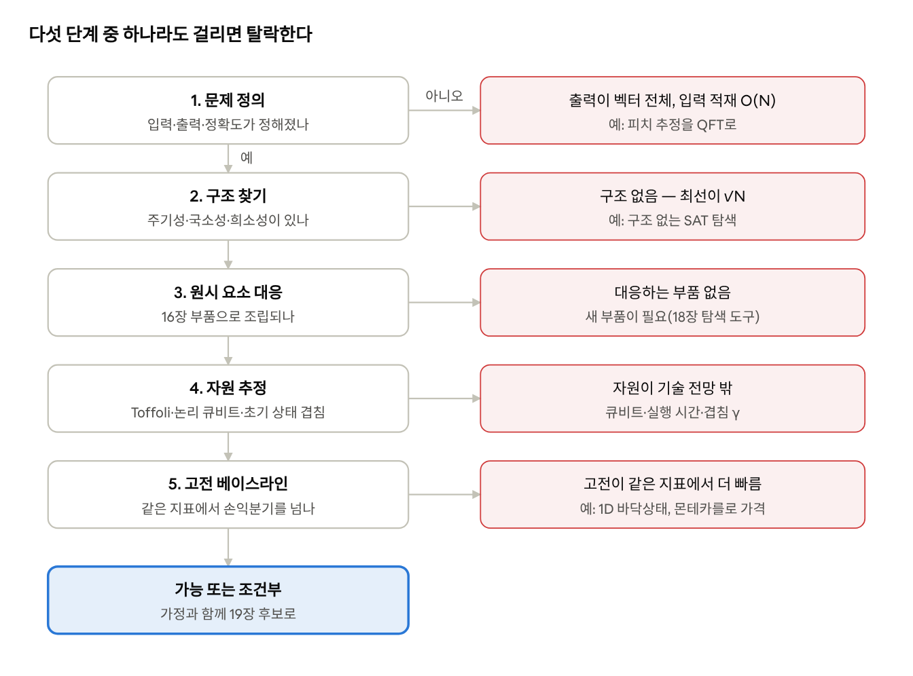
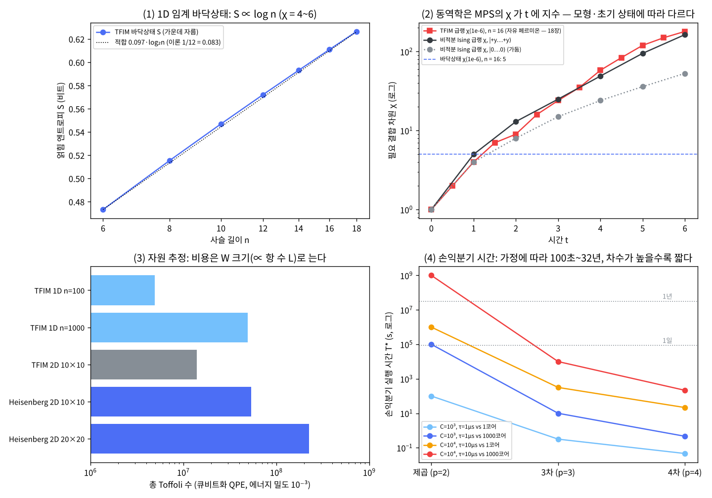

# 17장 발견 절차

2026-10-30 · Gosh

양자컴퓨팅 입문·심화서 · 3부 알고리즘 발견 방법론 · 이 장을 마치면 새 문제를 "문제 → 구조 → 원시 요소 → 자원 추정 → 고전 베이스라인"의 다섯 단계로 따져, 양자 알고리즘을 만들 가치가 있는지 숫자로 판정할 수 있다.

## 1. 요약

15장은 가속이 어디서 오는지, 16장은 그 가속을 어떤 부품으로 조립하는지를 다뤘다. 이 장은 둘을 묶어 **체크리스트**로 만든다. 다섯 단계는 이렇다: (1) 문제를 "입력·출력·정확도"로 못 박는다, (2) 구조(주기성·대칭·국소성·희소성·저계수)를 찾는다, (3) 구조를 16장의 부품에 대응시킨다, (4) 그 조립의 자원(오라클 호출·Toffoli·논리 큐비트)을 센다, (5) 같은 지표로 최선의 고전 방법과 비교한다. 대부분의 후보는 5단계에서 떨어진다 — 이 장의 사례가 그것을 숫자로 보인다.

numpy로 확인한 것: (1) **고전 베이스라인 — 바닥상태**: 1D 임계 TFIM 바닥상태의 반쪽 사슬 엔트로피는 n = 6 → 18에서 0.47 → 0.63비트로 log n에 비례(기울기 0.097, 이론 1/12 = 0.083)하고, 버린 가중치 10⁻⁶에 필요한 결합 차원 χ는 4\~6 — 1D 바닥상태는 텐서망이 이긴다. (2) **고전 베이스라인 — 동역학**: 같은 모형을 |0…0⟩에서 급랭하면(n = 16) S가 0.91비트/단위시간으로 선형 증가하고 MPS의 χ는 t = 1에서 4, t = 6에서 180으로 지수적으로 는다. 다만 1D TFIM은 자유 페르미온 모형이라 이 급랭은 다른 고전 방법으로 쉽게 풀린다(18장). 세로장을 더한 비적분 Ising을 |+y…+y⟩에서 급랭하면 S가 0.87비트/단위시간, χ가 t = 6에서 164로 같은 식으로 늘어난다 — 실시간 동역학이 고전에 어려워지는 것은 이런 경우다. (3) **자원 추정**: 16장의 큐비트화 + QPE로 에너지 밀도 10⁻³의 바닥상태 에너지를 구하는 비용을 근사 계산기로 셌다. W 호출은 8,192\~32,768로 거의 일정하고 총 Toffoli는 4.9×10⁶(TFIM 1D n = 100)\~2.2×10⁸(Heisenberg 2D 20×20)으로 항 수 L에 비례한다. 계산기의 정밀도 공식은 n = 4·6·8에서 반올림 모형으로 확인했다. (4) **손익분기**: 제곱 가속(p = 2)의 손익분기 실행 시간은 가정에 따라 100초\~32년의 범위다(오라클 Toffoli 10³\~10⁴, 논리 Toffoli 1\~10 µs, 고전 1\~1000코어). 3·4차 가속이면 최악 가정에서도 2.8시간·3.6분으로 줄어든다.

이 장의 메시지: 양자 알고리즘의 발견은 "가속이 있는가"가 아니라 "**같은 문제, 같은 정확도, 같은 벽시계에서 이기는가**"를 묻는 일이다. 체크리스트는 그 질문을 순서대로 강제한다. 18장은 각 단계의 자동화 도구와 반례(dequantization)를, 19장은 이 절차로 후보 10개를 다시 평가한다.

## 2. 직관 먼저 — 비유와 Quirk

**비유: 새 음성 인식 모델을 서비스에 넣을지 심사하는 일.** 논문이 "WER 20% 개선"이라고 해도 바로 바꾸지 않는다. 먼저 과제를 정확히 정한다(어떤 도메인, 어떤 지연 한도). 다음에 그 개선이 무엇에서 나오는지 본다(더 많은 데이터인지, 구조적 귀납 편향인지). 그 구조를 구현할 기성 부품이 있는지 확인하고, GPU 시간과 지연을 센 뒤, **같은 테스트셋·같은 지연 한도**에서 지금 쓰는 모델과 비교한다. 양자 알고리즘의 발견 절차도 똑같다. 차이는 셋이다. 첫째, 양자 쪽 "GPU 시간"은 아직 없는 오류 정정 기계의 시간이라 추정 모형의 가정이 결론을 좌우한다. 둘째, 고전 베이스라인이 움직인다 — 양자 알고리즘이 나오면 그 구조를 쓰는 고전 알고리즘이 따라 나오곤 한다(15장 Tang). 셋째, 양자 이득은 대부분 호출 수의 차수(√N, log)이고 상수는 크게 불리하다.

깨지는 곳: 모델 심사는 실측 벤치마크로 끝나지만, 이 절차의 4·5단계는 대부분 **추정**이다. 그래서 각 숫자에 가정(논리 게이트 시간, 고전 코어 수)을 붙여 적고, 가정을 바꾸면 결론이 어떻게 움직이는지(민감도)를 함께 본다 — 5절 그림 (4)가 그 예다.

**구조가 있으면 간섭이 일한다.** 2단계의 "구조"가 무슨 뜻인지는 회로 하나로 볼 수 있다.

- [Quirk: 주기 2인 상태에 QFT](https://algassert.com/quirk#circuit={"cols":[[1,"H","H"],["QFT3"],["Chance3"]]}) — Quirk는 맨 위 줄이 최하위 비트다. 위에서 둘째·셋째 줄에 H를 걸면 x ∈ {0, 2, 4, 6}, 즉 주기 2인 균등 중첩이 된다. QFT 뒤 출력은 0과 4(= 8/주기)에만 나온다. 주기라는 구조가 간섭으로 "답이 있는 자리"에만 진폭을 모은 것이다. 구조가 없는 함수(무작위 표식)에서는 이런 집중이 생기지 않고, 할 수 있는 최선은 Grover의 √N이다(9·15장).

## 3. 체크리스트와 수식 — 다섯 단계, 자원 공식, 손익분기

**다섯 단계.** 각 단계는 다음 단계로 넘길 산출물과 "여기서 멈추라"는 탈락 신호를 갖는다. 앞 단계에서 떨어지면 뒤 단계는 하지 않는다.

| 단계 | 묻는 것 | 산출물 | 탈락 신호 |
| --- | --- | --- | --- |
| 1. 문제 정의 | 입력은 어떻게 주어지나(공식·데이터·오라클), 출력은 무엇인가(비트열·기댓값·샘플), 정확도는 얼마인가 | "N, ε, 입력 모형" 세 줄 | 출력이 큰 벡터 전체(읽으면 지수 비용), 입력이 거대한 비정형 데이터 |
| 2. 구조 찾기 | 주기성·숨은 부분군, 국소 해밀토니안, 희소·잘 조건화된 선형성, 저계수, 구조 없음 | 구조 이름 하나 | 구조 없음(→ 최선이 √N) |
| 3. 원시 요소 대응 | 그 구조를 쓰는 16장 부품의 조합 | 조립도(어떤 부품을 몇 번) | 대응하는 부품이 없음 |
| 4. 자원 추정 | 오라클 호출 수, 오라클 하나의 Toffoli, 논리 큐비트, 초기 상태 겹침 | Toffoli 수·큐비트·실행 시간(가정 명시) | 논리 큐비트·실행 시간이 기술 전망 밖 |
| 5. 고전 베이스라인 | 같은 입력·출력·정확도에서 최선의 고전 방법과 그 비용, dequantization 가능성 | 손익분기 N\*·T\* | 고전이 다항이고 빠름, 손익분기가 수년 이상 |



왼쪽 기둥을 끝까지 통과한 후보만 19장으로 간다. 이 장의 여덟 후보 가운데 탈락한 넷 중 셋(1D·2D TFIM 바닥상태, 파생상품 가격)은 마지막 단계(고전 베이스라인)에서, 구조 없는 SAT 탐색은 2단계(구조 없음)에서 걸렸다. 제곱 가속이라는 사실만으로는 2단계에서 떨어지지 않는다. 확률·기댓값 구조(진폭 추정)는 2단계를 통과하고 5단계의 손익분기로 판정한다. "구조 없음"은 양자 쪽에 쓸 구조가 없는데 고전 쪽은 실제 입력의 구조를 쓸 수 있는 경우이므로 2단계에서 멈춘다.

**2단계 — 구조와 부품의 대응.** 15장의 분류를 "구조 → 부품 → 기대 가속"으로 다시 쓴 것이다.

| 구조 | 부품(16장) | 기대 가속 | 대표 예 |
| --- | --- | --- | --- |
| 주기성·숨은 부분군 | QFT/QPE + 가역 산술 | 지수(고전 최선 대비) | 인수분해·이산 로그(11장) |
| 국소 해밀토니안의 동역학 | 곱 공식 또는 블록 인코딩 + QSVT | 지수(고전 시뮬레이션 대비) | 스핀·분자 동역학(12장) |
| 국소 해밀토니안의 바닥상태 | 블록 인코딩 + 큐비트화 + QPE, 초기 상태 준비 | 초기 상태 겹침에 달림 | 분자·격자 바닥상태 에너지 |
| 희소·잘 조건화된 선형계 | 블록 인코딩 + QSVT(1/x) + 진폭 증폭 | 입출력 가정에 달림 | HHL(20장) |
| 확률·기댓값 | 상태 준비 A + 진폭 추정 | 제곱 | 몬테카를로 적분 |
| 구조 없는 탐색(2단계 탈락 신호 — 참고) | Grover / 진폭 증폭 | 제곱 | SAT, 무차별 대입 |
| 마르코프 사슬 탐색 | Szegedy 워크 | 제곱 | 표식 원소 찾기 |
| 증명된 구조가 없는 경우(변분·커널) | 얕은 파라미터 회로 + 고전 최적화, 특성 맵의 내적(6·13장) | 증명된 가속 없음 | VQE·QAOA·양자 커널 — 4·5단계 대신 18장의 휴리스틱 트랙으로 판정 |

**4단계 — 자원 공식(이 장의 계산기).** 16장의 큐비트화 + QPE로 바닥상태 에너지를 정밀도 ε로 구하는 비용을 이렇게 근사한다. LCU 항 L개, α = Σ|cᵢ|, 색인 보조 m = ⌈log₂L⌉.

```latex
N_W = 2^{b},\quad b = \left\lceil \log_2 \frac{\pi\alpha}{\varepsilon} \right\rceil,\qquad C_W \approx \underbrace{(L-1)}_{\mathrm{SELECT}} + \underbrace{2L}_{\mathrm{PREP}\times 2} + \underbrace{(m-1)}_{\text{반사}},\qquad \text{Toffoli} \approx N_W\, C_W
```

첫 식은 QPE 위상 반올림 오차 ≤ π/2ᵇ에 에너지 감도 α|sin θ| ≤ α를 곱한 것이다(16장 5절의 상한과 같은 식). 단 이것은 위상이 가장 가까운 격자점으로 반올림된다는 모형의 상한이다. 표준 QPE는 가장 가까운 두 격자점 중 하나를 확률 ≥ 8/π² ≈ 0.81로 주므로(오차 ≤ 2π/2ᵇ), 보장하려면 1비트를 더하고 반복·중앙값으로 성공 확률을 올린다. 최적 창을 쓰는 문헌 추정은 N\_W ≈ √2·πα/(2ε)(Babbush et al. 2018, 식 24; QPE 몫의 오차만 ε\_QPE로 두면 πα/(2ε\_QPE))이라 이 식과 상수 2배 안팎 차이다. SELECT는 unary iteration으로 Toffoli L − 1개, PREP는 일반 계수에 QROM·별칭 표본 추출을 쓰면 대략 L개다(Babbush et al. 2018). 논리 큐비트 ≈ n + 2m + μ + 1(μ = 별칭 표본 추출의 keep 비트 10, 위상 비트는 반복 QPE로 1개; unary iteration 보조 m − 1과 균등 비교 레지스터 μ는 빼서 하한 쪽 근사). 상수 2배 안팎의 근사이고, 표면 코드의 물리 큐비트·마법 상태 공장은 포함하지 않는다. 그리고 **초기 상태의 바닥상태 겹침 γ = |⟨ψ₀|φ⟩|²**(10·12장과 같은 정의)가 따로 곱해진다 — QPE가 바닥상태를 뽑을 확률이 γ이므로 반복 횟수는 1/γ(진폭 증폭으로 1/√γ)다. 큰 계에서 γ가 지수적으로 작아질 수 있다는 것이 Lee et al.(2023)이 "양자 화학의 지수 가속"을 의심한 핵심 근거다.

**5단계 — 손익분기(Babbush et al. 2021의 논리).** 고전은 평가 N번에 한 번당 t\_c, 양자는 오라클 N^{1/p}번에 한 번당 C개의 Toffoli × τ(논리 Toffoli 시간)라 하면

```latex
N\, t_c = N^{1/p}\, C\,\tau \;\Rightarrow\; N^{*} = \left(\frac{C\tau}{t_c}\right)^{p/(p-1)},\qquad T^{*} = N^{*} t_c
```

이고, 실행 시간이 T\*보다 길어야 양자가 이긴다. 제곱 가속(p = 2)이면 T\* = (Cτ)²/t\_c로 오라클 비용의 제곱에 비례한다 — 오라클 하나가 무거우면 손익분기는 급격히 멀어진다. 고차 가속(p = 3, 4)이 필요한 이유다(Babbush et al. 2021; Hoefler–Häner–Troyer 2023도 같은 결론).

**교과서 비교.** N&C는 복잡도 클래스(4.5.5절)와 검색의 최적성(6.6절)으로 "무엇이 불가능한가"까지만 말하고, 실제 문제를 고르는 절차는 다루지 않는다. KLM도 마찬가지다. 이 장의 절차는 자원 추정 문헌 — Gidney–Ekerå(2019 arXiv, 2021 Quantum; RSA-2048에 물리 큐비트 2천만 개·8시간)와 Gidney(2025, 100만 개 미만·1주 미만), Chakrabarti et al.(2021, 파생상품 가격 결정에 논리 큐비트 약 8천 개·T 깊이 5,400만, 약 1초 안에 실행해야 이점; arXiv v2판 수치는 7.5k·4,600만·논리 클럭 10 MHz) — 과 Babbush et al.(2021), Hoefler–Häner–Troyer(2023)의 "현실적 이점" 논의를 체크리스트로 정리한 것이다.

## 4. 도구 구성 — numpy 계산기와 PennyLane 자원 추정기

이 장의 "회로"는 회로가 아니라 **판정 도구** 세 개다: 고전 베이스라인 검사(얽힘 → MPS 비용), 자원 계산기, 손익분기 계산기.

**numpy 구현(실행 완료).** `ch17_discovery.py`(실행 약 16초).

```python
def chi_needed(p, infid=1e-6):                 # 슈미트 가중치 → 버린 가중치 ≤ infid 인 최소 χ (가운데 자름)
    c = cumsum(sort(p)[::-1]); return searchsorted(c, 1 - infid) + 1

# (A) 고전 베이스라인: 바닥상태(eigsh) vs |0…0⟩ 급랭(expm_multiply) 의 S 와 χ
states = expm_multiply(-1j * H, psi0, start=0, stop=6, num=13, endpoint=True)

def qpe_qubitization_cost(L, alpha, n_sys, eps, mu=10):    # (B) 자원 계산기
    m = ceil(log2(L)); b = ceil(log2(pi * alpha / eps))
    tof_W = (L - 1) + 2 * L + (m - 1)                          # SELECT + PREP×2 + 반사
    return dict(calls=2**b, tof=2**b * tof_W, qubits=n_sys + 2*m + mu + 1)

Nstar = (C * tau / tc) ** (p / (p - 1)); Tstar = Nstar * tc   # (C) 손익분기 (이분법으로 검산)
```

세 가지 주의. (1) χ는 **가운데 자름 하나**의 필요치다. 모든 결합을 자르면 오차가 쌓이므로 실제 MPS는 조금 더 큰 χ가 필요하다(15장 5절: 가운데 자름 충실도 0.64 vs 전체 결합 ≈ 0.50). 그래도 "χ가 n·t에 어떻게 달라지는가"라는 결론은 같다. (2) 자원 계산기는 상수 2배 안팎의 모형이다. 정밀도 공식(b)만 n = 4·6·8의 정확한 E₀로 검산했고, Toffoli/W는 문헌의 부품 비용을 더한 것이다 — 실무에서는 아래 PennyLane·Qualtran 추정기로 교차 확인한다. (3) 손익분기 계산기의 입력(C, τ, t\_c)은 모두 가정이다. 그래서 한 점이 아니라 네 가지 시나리오 × 세 가지 p를 모두 보고 결론이 가정에 얼마나 민감한지를 본다.

**자원 기록 표(19장에서 후보마다 채운다).** 체크리스트의 산출물을 한 줄로 모은 양식이다.

| 항목 | 적는 것 | 이 장의 예(Heisenberg 2D 10×10 바닥상태) |
| --- | --- | --- |
| 문제 | 입력 모형, 출력, 정확도 | 항 540개의 Pauli 합, E₀, 사이트당 10⁻³(ε = 0.1) |
| 구조 | 구조 이름 | 국소 해밀토니안 바닥상태 |
| 조립 | 부품과 호출 수 | LCU + 큐비트화 + QPE, W 32,768번 |
| 자원 | Toffoli, 논리 큐비트, 실행 시간(가정) | 5.3×10⁷, ≈ 131, ≈ 9분(논리 Toffoli 10 µs) + 초기 상태 반복 1/γ |
| 고전 베이스라인 | 최선 방법, 비용, dequantization 여부 | 비좌절 격자는 QMC(부호 문제 없음), 좌절 격자는 PEPS·DMRG 한계 |
| 판정 | 가능 / 조건부 / 탈락 + 이유 | 조건부: 좌절·페르미온일 때만 |

**PennyLane 자원 추정기(작성됨, 미실행).** `pennylane.estimator`(별칭 `qre`)는 회로를 실행하지 않고 논리 자원만 센다. 항의 "종류와 개수"만으로 해밀토니안을 표현해 큰 계도 즉시 센다.

```python
# pennylane==0.45 — 작성됨, 미실행
import numpy as np
import pennylane.estimator as qre

n = 100; L = 2 * n - 1
H = qre.PauliHamiltonian(num_qubits=n, pauli_terms={"ZZ": n - 1, "X": n})   # 항의 종류와 개수만
prep = qre.UniformStatePrep(num_states=L)          # J = h 이면 LCU 계수가 같아 균일 상태 준비로 충분
walk = qre.Qubitization(prep, qre.SelectPauli(H))
alpha, eps = 2 * n - 1, 1e-3 * n
b = int(np.ceil(np.log2(np.pi * alpha / eps)))      # 13 — 이 장 계산기와 같은 정밀도
res = qre.estimate(qre.QPE(walk, num_estimation_wires=b))
print(res)                                          # 총 큐비트·게이트, gate_counts["Toffoli"] 등
print(qre.estimate(qre.TrotterPauli(H, num_steps=1000, order=2)))   # 비교: 2차 Trotter 1000단계
```

핵심 세 줄: `PauliHamiltonian(num_qubits, pauli_terms={"ZZ": …, "X": …})` — 항의 위치가 아니라 개수만 넣는다(비용은 개수로 정해지므로). `UniformStatePrep` — 이 장 계산기는 일반 계수용 PREP(≈ L Toffoli)를 가정했으므로 PREP 몫은 PennyLane 쪽이 더 적게 나오는 것이 정상이지만, 제어 W·QFT 몫이 더해지므로 총량은 항목별로 맞춰 비교한다. `QPE(..., num_estimation_wires=b)` — 교과서 QPE라 위상 큐비트가 b개다(이 장 계산기는 반복 QPE로 1개).

## 5. 사례 적용 결과

모든 수치는 `ch17_discovery.py`의 출력이다(난수를 쓰지 않아 결정론적). 세 도구의 결과를 먼저 보고, 끝에 후보 여덟 개에 체크리스트를 적용한 표를 둔다.

**(A) 고전 베이스라인 — 바닥상태.** 1D TFIM(J = h = 1, 임계점, 열린 사슬)의 바닥상태, 가운데 자름.

| n | E₀ | S (비트) | χ (버린 가중치 ≤ 10⁻⁶) |
| --- | --- | --- | --- |
| 6 | −7.296230 | 0.4732 | 4 |
| 10 | −12.381490 | 0.5469 | 4 |
| 14 | −17.471004 | 0.5930 | 5 |
| 18 | −22.562009 | 0.6264 | 6 |

S vs log₂n의 기울기 0.097(이론 c/6 = 1/12 = 0.083, 작은 n의 경계 보정 포함). n을 3배로 늘려도 χ는 4 → 6 — 1D 바닥상태는 DMRG·MPS가 수천 사이트도 쉽게 푼다. 체크리스트 5단계에서 탈락. 그림 (1).

**(A) 고전 베이스라인 — 급랭 동역학.** 같은 모형 n = 16을 |0…0⟩에서 e^{−iHt}로 흘려보냈다.

| t | 0 | 1 | 2 | 3 | 4 | 5 | 6 |
| --- | --- | --- | --- | --- | --- | --- | --- |
| S (비트) | 0.000 | 0.601 | 1.498 | 2.414 | 3.358 | 4.247 | 3.784 |
| χ (10⁻⁶) | 1 | 4 | 9 | 24 | 58 | 120 | 180 |

t = 1\~3에서 S는 0.91비트/단위시간으로 선형 증가하고 χ ≳ 2^S는 지수적으로 늘어난다. t = 5 이후 S가 꺾이는 것은 n = 16의 유한 크기(준입자가 양 끝에서 반사되는) 효과다. 같은 n의 바닥상태 χ = 5와 비교하면 MPS에게 정적 문제는 쉽고 동적 문제는 어렵다. 그림 (2).

**주의 — 위 표가 잰 것은 "MPS라는 한 가지 고전 방법의 비용"이다.** 1D TFIM은 Jordan–Wigner 변환으로 자유 페르미온이 되므로 이런 급랭은 2n×2n 행렬 계산으로 풀린다(18장 5절: 같은 모형을 |+…+⟩에서 급랭해 n = 1000, t = 40까지 약 10초. |0…0⟩ 시작은 가우스 상태 둘의 중첩이어서 같은 방법으로 다룰 수 있다 — 18장은 근거만 보이고 구현하지는 않았다). 얽힘 검사 하나만으로 "고전에 어렵다"고 판정하면 안 된다. 그래서 자유 페르미온이 아닌 모형에서 같은 표를 다시 쟀다. 세로장 −h\_z Σ Zᵢ를 더한 비적분 Ising(J = 1, h = 0.9045, h\_z = 0.8090; Kim–Huse 2013의 매개변수), n = 16이다.

| t | 0 | 1 | 2 | 3 | 4 | 5 | 6 |
| --- | --- | --- | --- | --- | --- | --- | --- |
| S (비트), +y 정렬 상태에서 시작 | 0.000 | 0.721 | 1.622 | 2.542 | 3.317 | 4.040 | 4.709 |
| χ (10⁻⁶), +y 정렬 상태에서 시작 | 1 | 5 | 13 | 25 | 49 | 95 | 164 |
| S (비트), 모두 0인 상태에서 시작 | 0.000 | 0.205 | 0.161 | 0.161 | 0.220 | 0.137 | 0.234 |
| χ (10⁻⁶), 모두 0인 상태에서 시작 | 1 | 4 | 8 | 15 | 24 | 36 | 53 |

모든 스핀이 +y를 향한 곱상태에서 시작하면 S가 0.87비트/단위시간으로 선형 증가하고 χ는 t = 6에서 164에 이른다. 자유 페르미온이라는 지름길도 없다. 후보 표 다섯째 줄(스핀 격자 급랭 동역학, 23a장)이 살아남는 근거는 이 표다. 같은 모형을 |0…0⟩에서 시작하면 S가 0.23비트를 넘지 않고 χ도 53에 그친다. 세로장이 들뜬 준입자 쌍을 묶어 두는 가둠(confinement) 현상이다(Kormos et al. 2017). 고전 베이스라인의 어려움은 모형만이 아니라 (모형, 초기 상태, 시간)의 조합으로 정해진다.

**(B) 자원 계산기.** 먼저 정밀도 공식을 검산했다: TFIM n = 4·6·8, ε = 0.01에서 b = 12·12·13비트로 위상을 반올림하면 |ΔE| = 2.44×10⁻³·2.98×10⁻³·3.13×10⁻³, 모두 ≤ ε. 그다음 모형 다섯 개에 대해 에너지 밀도 10⁻³(ε = 10⁻³n)의 비용:

| 모형 | 항 L | α | b | W 호출 | Toffoli/W | 총 Toffoli | 논리 큐비트 | 실행(Toffoli 10 µs) |
| --- | --- | --- | --- | --- | --- | --- | --- | --- |
| TFIM 1D n = 100 | 199 | 199 | 13 | 8,192 | 603 | 4.9×10⁶ | 127 | 49초 |
| TFIM 1D n = 1000 | 1,999 | 1,999 | 13 | 8,192 | 6,006 | 4.9×10⁷ | 1,033 | 8.2분 |
| TFIM 2D 10×10 | 280 | 280 | 14 | 16,384 | 847 | 1.4×10⁷ | 129 | 2.3분 |
| Heisenberg 2D 10×10 | 540 | 540 | 15 | 32,768 | 1,628 | 5.3×10⁷ | 131 | 8.9분 |
| Heisenberg 2D 20×20 | 2,280 | 2,280 | 15 | 32,768 | 6,850 | 2.2×10⁸ | 435 | 37분 |

에너지 밀도 정밀도가 고정이면 α/ε가 n에 거의 무관해 W 호출 수는 거의 일정하고, 비용은 W 하나의 크기(∝ L)로 늘어난다. 이 수치들은 논리 자원이다 — 표면 코드 물리 큐비트(논리 큐비트당 수백\~수천), 마법 상태 공장, 초기 상태 반복 1/γ를 넣으면 실제 부담은 훨씬 크다. 그림 (3).

**(C) 손익분기.** 실행 시간 T\*(초)와, 이분법으로 재계산한 N\*가 공식과 일치함을 확인했다.

| 오라클 C, 논리 Toffoli τ | 고전 t\_c | p = 2 | p = 3 | p = 4 |
| --- | --- | --- | --- | --- |
| 10³, 1 µs | 10 ns (1코어) | 100 s | 0.32 s | 0.046 s |
| 10³, 1 µs | 10 ps (1000코어) | 1.0×10⁵ s (1.2일) | 10 s | 0.46 s |
| 10⁴, 10 µs | 10 ns (1코어) | 1.0×10⁶ s (12일) | 316 s | 22 s |
| 10⁴, 10 µs | 10 ps (1000코어) | 1.0×10⁹ s (32년) | 1.0×10⁴ s (2.8시간) | 215 s |

제곱 가속의 T\*는 가장 낙관적인 가정에서 100초, 가장 비관적인 가정에서 32년으로 10⁷배 차이가 난다. 오라클 비용 Cτ가 100배 늘고 고전이 1000배 빨라지면 T\*는 (100)² × 1000 = 10⁷배 — 제곱이 입력 가정을 그대로 증폭한다. p = 3·4이면 같은 최악 가정에서도 2.8시간·3.6분이다. 이 표의 τ = 1\~10 µs는 낙관적인 가정이다. Babbush et al.(2021)이 쓴 논리 Toffoli 170 µs를 넣으면 같은 네 시나리오의 p = 2는 33일\~9,200년이 된다 — 9장 7절이 인용한 Babbush의 표(고전 병렬도 10³에서 100일\~880년, 10⁶에서 280년\~88만 년)와 겹치는 범위다. 그림 (4).

**체크리스트 적용 — 후보 여덟 개.** 위 도구와 문헌 수치를 단계별로 넣었다.

| 후보 | 2. 구조 | 3. 부품 | 4. 자원 | 5. 고전 베이스라인 | 판정 |
| --- | --- | --- | --- | --- | --- |
| RSA-2048 인수분해 | 주기성 | QFT/QPE + 가역 산술(11장) | 물리 큐비트 100만 미만, 1주 미만(Gidney 2025) | 일반 수체 체(GNFS), 준지수 | 가능 — 지수 가속, 오류 정정 필요 |
| TFIM 1D 바닥상태 | 국소 H | 큐비트화 + QPE | 4.9×10⁶ Toffoli(n = 100) | DMRG, χ = 4\~6(A) | 탈락 |
| TFIM 2D 바닥상태 | 국소 H | 큐비트화 + QPE | 1.4×10⁷ Toffoli(10×10) | stoquastic(비대각 원소 ≤ 0) → 양자 몬테카를로 | 탈락 |
| 좌절 Heisenberg 2D·Fermi–Hubbard 바닥상태 | 국소 H | 큐비트화 + QPE + 초기 상태 | 5.3×10⁷ Toffoli(10×10, 최근접 이웃만; J₂ 항을 넣으면 L ≈ 1,026) + 1/γ | 부호 문제(좌절 스핀, 반채움 밖 Hubbard), PEPS·DMRG 한계 | 조건부 — γ가 크게 유지될 때 |
| 스핀 격자 급랭 동역학 | 국소 H의 e^{−iHt} | Trotter 또는 QSVT(12·16장) | 2차 Trotter, 16장 비용표 | 비적분 모형에서 χ가 t에 지수(A). 자유 페르미온 모형은 제외(18장) | 가능 — 23a장(비적분·2D 모형, 얽힘이 자라는 초기 상태) |
| 파생상품 가격(몬테카를로) | 기댓값 | 진폭 추정(16장) | 논리 8k, T 깊이 5,400만, 약 1초 안 실행 필요(Chakrabarti 2021) | 고전 MC·준몬테카를로, GPU | 탈락 — 제곱 가속, T\* 큼(C) |
| 구조 없는 SAT 탐색 | 구조 없음 | —(참고: Grover) | —(참고: √N 호출) | —(참고: 최신 SAT 솔버는 실제 입력의 구조를 씀) | 탈락(2단계) — 구조 없음, 최선이 √N. 2단계에서 멈추므로 뒤 칸은 참고용 |
| 희소 선형계 | 희소·잘 조건화 | 블록 인코딩 + QSVT(1/x) | QSVT 차수 κ·log(κ/ε), 진폭 증폭 포함 총 κ²·log(κ/ε)(최적 알고리즘은 κ·log(1/ε)) | 켤레 기울기법, dequantization | 조건부 — 출력이 기댓값일 때만(20장) |

여덟 개 중 "가능"은 둘, "조건부"는 둘, 탈락은 넷이다. 탈락 넷 중 셋은 구조·부품·자원을 통과하고 5단계(고전 베이스라인)에서 떨어졌고, 구조 없는 SAT 탐색만 2단계에서 떨어졌다.

그림(`ch17_results.png`): (1) 1D 바닥상태 S vs n(log), (2) 급랭 동역학 χ vs t(로그; TFIM과 비적분 Ising의 두 초기 상태)와 바닥상태 χ, (3) 모형별 총 Toffoli, (4) 손익분기 T\* vs 가속 차수 p.



## 6. 다른 SDK 대응 — Qualtran

이 장에서 Qualtran을 고른 이유는, Qualtran이 Cirq 위에서 블록(bloq)을 재귀적으로 분해해 Toffoli·And 수를 세는 자원 추정 도구여서, 항의 개수만 받아 세는 4절의 PennyLane 추정기와 "같은 SELECT를 다른 방식으로 센" 결과를 대조할 수 있기 때문이다. 두 도구 모두 "회로를 실행하지 않고 논리 게이트·큐비트를 센다"는 같은 일을 하고, 물리 큐비트까지 내려가는가에서 갈린다.

|  | PennyLane | Qualtran (Cirq 기반) |
| --- | --- | --- |
| 논리 자원 | `qre.estimate(...)` | `get_cost_value(bloq, QECGatesCost())` |
| 큰 계를 기호적으로 | `PauliHamiltonian`(항 개수만) | 블록 재귀 분해 |
| 물리 큐비트·시간 | —(논리까지) | `qualtran.surface_code` |

```python
# qualtran (Cirq 기반) — 작성됨, 미실행. n = 100 TFIM 의 SELECT(SelectPauliLCU, 항 L = 199) 를 만들어 Toffoli·And 수를 센다 (이 장 계산기의 SELECT 항 L − 1 과 비교)
import cirq
from qualtran.bloqs.multiplexers.select_pauli_lcu import SelectPauliLCU
from qualtran.resource_counting import get_cost_value, QECGatesCost

n = 100
terms = ["I" * i + "ZZ" + "I" * (n - i - 2) for i in range(n - 1)] + ["I" * i + "X" + "I" * (n - i - 1) for i in range(n)]
sel = SelectPauliLCU(selection_bitsize=8, target_bitsize=n,
                     select_unitaries=[cirq.DensePauliString(s) for s in terms])
print(get_cost_value(sel, QECGatesCost()))   # GateCounts(and_bloq ≈ L − 2 = 197, toffoli ≈ 0, …) — unary iteration의 And가 이 장 계산기의 SELECT 항 L − 1에 해당
```

도구 사이의 차이는 "무엇을 세는가"에서 나온다. 같은 SELECT도 Toffoli를 세는 도구(Qualtran은 And를 따로 셈), T로 환산하는 도구(Toffoli·And = T 4개는 측정 기반 구성, 보조 없는 표준 분해는 T 7개; PennyLane 기본 게이트 집합은 Toffoli·T 둘 다 포함), 회전을 Clifford+T로 분해하는 정밀도(ResourceConfig)가 다르면 수십 배까지 달라진다. 문헌의 수치를 비교할 때는 게이트 집합과 정밀도 가정을 먼저 맞춘다 — 14장 탈분극 규약 문제와 같은 종류다.

## 7. 한계와 반례

**체크리스트는 걸러낼 뿐 발명하지 않는다.** 2단계의 "구조"는 이미 알려진 구조 목록에서 고른다. 새로운 구조와 부품은 이 목록 밖에서 나온다 — 예를 들어 Jordan et al.(2024)의 복호화 양자 간섭(DQI)은 최적화 문제를 오류 정정 부호의 복호화로 바꾸는 새 대응을 제안했다. 체크리스트는 "알려진 부품으로 이길 수 있는가"를 빠르게 판정하는 것이지, 새 알고리즘을 만들어 주지 않는다.

**추정은 가정만큼만 맞다.** 5절 (B)의 Toffoli 수는 상수 2배 안팎의 논리 비용이고, 물리 큐비트·마법 상태 공장·라우팅은 없다. (C)의 손익분기는 가정에 따라 10⁷배 움직였다. 그래서 체크리스트의 판정은 "확정"이 아니라 "어느 가정에서 바뀌는가"와 함께 적는다. 문헌 수치(RSA-2048의 물리 큐비트: 2019년 Gidney–Ekerå 2천만 → 2025년 Gidney 100만 미만)도 6년 사이에 20배 이상 바뀌었다.

**고전 베이스라인은 움직이는 표적이다.** 15장의 Tang dequantization처럼 양자 알고리즘이 나오면 그 입력 모형을 고전에도 주었을 때의 고전 알고리즘이 따라 나온다. 또 "같은 지표"가 까다롭다: Grover는 최악의 경우를 보장하고, SAT 솔버는 실제 입력의 구조를 써서 평균적으로 빠르다 — 최악 경우 대 평균 경우를 비교하면 양자가 이긴 것처럼 보인다. 2D TFIM처럼 stoquastic(비대각 원소가 모두 ≤ 0인) 해밀토니안은 양자 몬테카를로가 부호 문제 없이 푼다(15장). TFIM은 ZZ 항이 대각이라 좌절 격자에서도 stoquastic이다 — 다만 그때는 QMC 평형화가 느려질 수 있다.

**바닥상태는 초기 상태가 병목이다.** QPE는 "초기 상태와 바닥상태의 겹침 γ"만큼만 바닥상태를 골라낸다. 큰 계에서 γ가 지수적으로 작아지면(직교 파국) 비용이 지수로 돌아간다. Lee et al.(2023)은 양자 화학에서 좋은 초기 상태를 만드는 문제가 바로 고전 방법이 잘하는 문제와 겹친다고 보고, 지수 가속의 일반적 근거를 찾지 못했다. 체크리스트 4단계의 "초기 상태 겹침"은 빼면 안 되는 칸이다.

**반례 — 휴리스틱은 자원을 미리 셀 수 없다.** QAOA·VQE(13장) 같은 변분 알고리즘은 "호출 몇 번에 오차 ε"를 보장하지 않는다. 4단계 자원 추정이 성립하지 않으므로 이 체크리스트의 4·5단계를 그대로 쓸 수 없다. 18장이 이 경우를 위한 휴리스틱 트랙(훈련 가능성 → 측정 예산 → 고전 대리 계산 검사 → 같은 예산의 고전 휴리스틱과 실측 비교)을 따로 두고, 19장이 이 트랙으로 평가한 뒤 21·22·23장이 실행한다.

**출력을 읽는 비용.** 1단계에서 출력이 "벡터 전체"면 탈락이다. HHL의 해 |x⟩는 N개의 진폭을 갖지만 추정에는 최소 Ω(N)번의 샷이 필요하다 — 기댓값 하나(⟨x|M|x⟩)가 출력일 때만 지수 이득이 남는다(Aaronson 2015, 20장).

## 8. 연습문제와 해답

**문제 1 (자작 — 작업계획서 후보 1번).** "음성 피치·주기 추정을 QFT/QPE로"에 체크리스트를 적용하라. 입력은 16 kHz 샘플링 파형의 프레임 N = 512개 샘플이다.

*해답.* 1단계: 입력은 실수 N개(고전 데이터), 출력은 피치 하나, 정확도는 수 Hz. 2단계: 주기성 — 구조는 있다. 3단계: 진폭 인코딩 Σxᵢ|i⟩ + QFT + 측정. 4단계: QFT 자체는 log₂N = 9큐비트에 O(log²N) 게이트로 싸지만, 상태 준비가 일반 벡터 하나에 O(N) 회전이고, 측정 한 번은 주파수 하나를 확률적으로 내놓아 스펙트럼 봉우리를 확인하려면 여러 번 반복해야 한다. 5단계: FFT는 N log N ≈ 4,600번의 연산으로 스펙트럼 전체를 정확히 내놓고, 상태 준비만으로도 이미 O(N)이다. 판정: 탈락 — 입력 적재가 양자 이득을 지운다. 작업계획서가 이 후보를 22장의 반례 박스로 돌린 이유다. 교훈: "주기성이 있다"는 충분조건이 아니다 — Shor에서는 주기 함수가 공식(aˣ mod N)으로 주어져 적재 비용이 없다.

**문제 2 (Babbush et al. 2021의 손익분기 계산 변형 — 5절 (C)의 연장).** 몬테카를로 파생상품 가격 결정에서 오라클 하나(가격 경로 생성 + 페이오프 계산)가 Toffoli 10⁵개, 논리 Toffoli 10 µs, 고전은 1000코어로 표본당 10 ps라 하자. 제곱 가속의 손익분기 N\*와 T\*는?

*해답.* Cτ = 10⁵ × 10⁻⁵ = 1 s, Cτ/t\_c = 10¹¹. p = 2이면 N\* = (10¹¹)² = 10²², T\* = N\* t\_c = 10¹¹ s ≈ 3,200년. 양자가 이기려면 3,200년보다 긴 계산이어야 한다 — 사실상 불가능. Chakrabarti et al.(2021) arXiv v2판이 "논리 클럭 10 MHz"(τ = 0.1 µs)를 요구한 것이 이 구조다(출판본은 T 깊이 5,400만을 약 1초에, 즉 T 층당 약 19 ns): τ를 100배 줄이면 T\*는 10⁴배 줄어 약 4개월이 된다. 제곱 가속에서는 하드웨어 속도의 개선이 제곱으로 들어간다.

**문제 3 (자작 — 5절 (B)의 변형).** TFIM 1D n = 100을 에너지 밀도가 아니라 절대 정밀도 ε = 0.01로 구하면 W 호출과 총 Toffoli는 얼마인가? 화학의 "화학적 정확도 1.6 mHa"는 어느 쪽에 가까운가?

*해답.* πα/ε = π × 199/0.01 = 62,518 → b = 16, W 호출 2¹⁶ = 65,536. Toffoli/W는 그대로 603이므로 총 3.95×10⁷ — 에너지 밀도 10⁻³(ε = 0.1, b = 13)보다 8배. 절대 정밀도를 고정하면 W 호출이 α ∝ n에 비례해 총 비용이 n²로 늘어난다. 화학적 정확도는 분자 크기와 무관한 절대 정밀도이므로 이쪽이다 — 큰 분자일수록 α/ε가 커지는 것이 양자 화학 자원 추정이 큰 이유 중 하나다(23장).

## 9. 학습 노트

- **발견 절차 다섯 단계** — 문제 정의 → 구조 → 원시 요소 → 자원 추정 → 고전 베이스라인. 앞 단계에서 떨어지면 뒤는 하지 않는다. 이 장의 후보 여덟 개 중 탈락 넷은 셋이 5단계, 하나(구조 없는 SAT)가 2단계에서 떨어졌다. 비유: 새 음성 인식 모델 도입 심사(같은 테스트셋·같은 지연에서 기존 모델과 비교). 깨지는 곳: 양자 쪽 수치는 아직 없는 기계의 추정이다. 더 깊이: Hoefler–Häner–Troyer, "Disentangling hype from practicality" (CACM 2023).
- **얽힘으로 고전 베이스라인 재기** — 가운데 자름의 엔트로피 S는 결합 차원의 하한 χ ≥ 2^S를 준다. 실제 필요치는 슈미트 스펙트럼의 꼬리로 정해진다(바닥상태 n = 16: 2^S ≈ 1.5, χ = 5; 급랭 t = 6: 2^S ≈ 14, χ = 180). 1D 바닥상태는 χ = 4\~6(n = 18까지)에 머문다. "정적 문제는 쉽고 동적 문제는 어렵다"는 이 장의 분기점이 여기서 나왔다. 더 깊이: Calabrese–Cardy(2004, 2005)의 얽힘 엔트로피 스케일링.
- **손익분기 N\* = (Cτ/t\_c)^{p/(p−1)}** — 양자가 호출 수에서 N^{1/p}로 이기더라도, 호출 하나의 비용(Cτ)이 고전 평가 하나(t\_c)보다 무거우면 N\*가 되기 전까지는 진다. 제곱 가속은 비용 비의 제곱에 비례해 가정에 극도로 민감하다(10⁷배). 비유: 비싼 장비는 많이 써야 본전을 뽑는다. 더 깊이: Babbush et al., PRX Quantum 2, 010103 (2021).
- **에너지 밀도 정밀도 vs 절대 정밀도** — ε를 사이트당으로 고정하면 α/ε가 n에 무관해 W 호출이 일정하고, 절댓값으로 고정하면 W 호출이 n에 비례한다(연습문제 3). 자원 추정을 비교할 때 가장 먼저 맞춰야 하는 가정이다.
- **논리 자원 vs 물리 자원** — 이 장의 Toffoli·논리 큐비트는 오류 정정된 "논리" 단위다. 물리 큐비트는 논리 큐비트당 수백\~수천(코드 거리에 따라)이고, Toffoli는 마법 상태 공장이 만든다. 더 깊이: 25장, Gidney 2025(RSA-2048 물리 큐비트 산정).

## 10. 출처와 환경

- Nielsen & Chuang, 4.5.5절(양자 계산 복잡도), 6.6절(검색의 최적성).
- Babbush, McClean, Newman, Gidney, Boixo, Neven, "Focus beyond quadratic speedups for error-corrected quantum advantage", *PRX Quantum* 2, 010103 (2021).
- Hoefler, Häner, Troyer, "Disentangling hype from practicality: on realistically achieving quantum advantage", *Communications of the ACM* 66(5), 82 (2023).
- Gidney & Ekerå, "How to factor 2048 bit RSA integers in 8 hours using 20 million noisy qubits", *Quantum* 5, 433 (2021). Gidney, "How to factor 2048 bit RSA integers with less than a million noisy qubits", arXiv:2505.15917 (2025).
- Chakrabarti, Krishnakumar, Mazzola, Stamatopoulos, Woerner, Zeng, "A threshold for quantum advantage in derivative pricing", *Quantum* 5, 463 (2021) (arXiv:2012.03819 v2와 출판본의 자원 수치가 다르다).
- Lee et al., "Evaluating the evidence for exponential quantum advantage in ground-state quantum chemistry", *Nature Communications* 14, 1952 (2023).
- Babbush et al., "Encoding electronic spectra in quantum circuits with linear T complexity", *Phys. Rev. X* 8, 041015 (2018).
- Calabrese & Cardy, "Entanglement entropy and quantum field theory", *J. Stat. Mech.* P06002 (2004); "Evolution of entanglement entropy in one-dimensional systems", *J. Stat. Mech.* P04010 (2005).
- Kim & Huse, "Ballistic spreading of entanglement in a diffusive nonintegrable system", *Phys. Rev. Lett.* 111, 127205 (2013) — 비적분 Ising 매개변수. Kormos, Collura, Takács, Calabrese, "Real-time confinement following a quantum quench to a non-integrable model", *Nature Physics* 13, 246 (2017).
- Jordan et al., "Optimization by Decoded Quantum Interferometry", arXiv:2408.08292 (2024). Aaronson, "Read the fine print", *Nature Physics* 11, 291 (2015).
- SDK 문서: PennyLane `pennylane.estimator`(`estimate`, `PauliHamiltonian`, `Qubitization`, `SelectPauli`, `UniformStatePrep`, `QPE`, `TrotterPauli`) — [qp.estimator](https://docs.pennylane.ai/en/stable/code/qp_estimator.html), [estimate](https://docs.pennylane.ai/en/stable/code/api/pennylane.estimator.estimate.estimate.html), [사용법 데모](https://pennylane.ai/qml/demos/re_how_to_use_pennylane_for_resource_estimation); Qualtran `SelectPauliLCU`, `QECGatesCost`.
- 환경: Python 3.13.17, numpy 2.5.3, scipy 1.18.1(`eigsh`, `expm_multiply`), matplotlib 3.11.2; `ch17_discovery.py` 실행 약 16초, 난수 없음(결정론적). SDK 코드는 PyPI 차단으로 작성만 되고 미실행.
