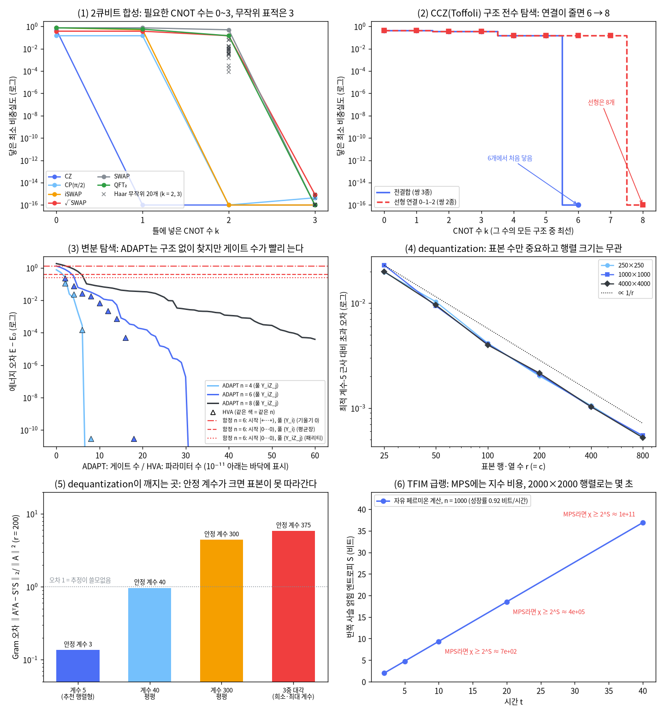

# 18장 탐색 도구와 반례

2026-11-10 · Gosh

양자컴퓨팅 입문·심화서 · 3부 알고리즘 발견 방법론 · 이 장을 마치면 회로를 자동으로 합성하고, 변분 탐색으로 회로를 키우고, 후보 알고리즘이 고전 경계(dequantization·자유 페르미온·stoquastic)에 걸리는지 검사할 수 있다.

## 1. 요약

17장의 체크리스트는 손으로 채우는 표였다. 이 장은 그 표의 칸을 채우는 **도구**와, 도구가 내놓은 답을 뒤집는 **반례**를 다룬다. 도구는 셋이다. (1) 자동 회로 합성은 3단계(원시 요소 대응)에서 "이 유니터리를 게이트 몇 개로 만들 수 있나"를 탐색으로 답한다. (2) 변분 탐색(ADAPT-VQE)은 증명된 구조가 없는 후보에서 회로를 한 게이트씩 키운다. (3) 고전 경계 검사는 5단계(고전 베이스라인)에서 "같은 입력을 고전에 주면 어떻게 되나"를 잰다. 17장이 판정을 미룬 변분·커널 후보를 위해 **휴리스틱 트랙**도 따로 정리한다.

numpy로 확인한 것은 다음과 같다.

1. **합성 — 2큐비트.** CNOT k개짜리 틀의 각도를 최적화해 표적 6개의 최소 CNOT 수를 구했다. CZ 1, CP(π/2)·iSWAP 2, √SWAP·SWAP·QFT₂ 3으로, Shende–Bullock–Markov 불변량의 판정과 모두 일치한다. Haar 무작위 표적 20개는 CNOT 2개로 하나도 못 만들고(비충실도 중앙값 6.4×10⁻³) 3개로는 전부 만든다.
2. **합성 — 3큐비트.** CCZ(표적 큐비트 앞뒤에 H를 붙이면 Toffoli)의 CNOT 배치를 전수 탐색했다. 전결합에서는 5개 이하 구조 43묶음이 모두 실패(최소 비충실도 0.146)하고 6개에서 처음 닿는다. 선형 연결 0–1–2에서는 7개 이하가 모두 실패하고 8개가 필요하다.
3. **변분 탐색.** TFIM 바닥상태를 ADAPT-VQE로 찾으면 n = 4에서 게이트 7개(CNOT 14), n = 6에서 31개(CNOT 62)로 오차 10⁻⁸ 아래에 닿는다. 구조를 아는 틀 HVA는 n = 6에서 파라미터 18개(CNOT 90)가 든다. n = 8의 ADAPT는 게이트 60개에서도 3.9×10⁻⁵에 머문다.
4. **탐색의 함정.** 풀과 시작 상태를 잘못 고르면 ADAPT는 기울기가 모두 0인 곳에서 멈춘다. 멈춘 오차 세 가지(0.759, 0.355, 0.347; n = 4)는 각각 시작 상태의 에너지 오차, 평균장(mean field) 최적값의 오차, 패리티 간극의 절반으로 정확히 설명된다.
5. **dequantization.** 계수 5인 행렬의 특이 부분공간을 ℓ² 표본만으로 구했다. 초과 오차는 표본 수 r에만 달리고(r = 25 → 800에서 0.02 → 0.0005, ∝ 1/r) 행렬 크기 250·1000·4000과는 무관하다. 1000×1000 행렬에서는 안정 계수가 40만 돼도 10% 오차에 필요한 표본 행이 약 16,000개로 행렬의 행 수를 넘어, 같은 방법이 전체를 읽는 것보다 비싸다.
6. **자유 페르미온.** 17장이 "MPS로는 지수 비용"이라 잰 TFIM 급랭을(여기서는 |+…+⟩에서 시작) 2000×2000 행렬로 n = 1000, t = 40까지 10초에 풀었다. 그 시각의 얽힘은 36.9비트로, MPS라면 결합 차원이 10¹¹을 넘어야 한다.

이 장의 메시지: **도구가 "된다"고 답한 이유가 곧 고전으로도 되는 이유일 수 있다.** 이 장의 변분 탐색이 표적으로 삼은 TFIM은 자유 페르미온 모형이라 2n×2n 행렬로 풀린다. 구조를 아는 틀 HVA는 바로 그 구조(Majorana 2차식) 덕분에 불모 고원이 없고, 같은 구조 때문에 고전으로 시뮬레이션된다. 탐색이 성공했다는 사실만으로는 양자 이득의 증거가 되지 않는다. 그래서 탐색 도구와 반례 검사는 한 쌍으로 쓴다. 19장은 이 장의 도구와 17장의 체크리스트로 후보 10개를 다시 평가한다.

## 2. 직관 먼저 — 비유와 Quirk

**자동 합성 = 신경망 구조 탐색(NAS).** 음성 모델의 구조를 자동으로 찾을 때는 두 겹의 탐색을 한다. 바깥에서는 층을 어떻게 쌓을지(이산 선택)를 고르고, 안에서는 그 구조의 가중치(연속 값)를 학습한다. 회로 합성도 같다. 바깥은 "CNOT을 어느 큐비트 쌍에 몇 번 둘 것인가", 안쪽은 "그 사이 1큐비트 회전 각도"다. 깨지는 곳: NAS는 검증 데이터로 대략 채점하지만, 합성은 정답 유니터리가 있어서 오차 10⁻¹⁰까지 맞았는지 정확히 확인된다. 대신 구조 수가 CNOT 수에 지수(3ᵏ)로 늘어 큐비트 서너 개가 한계다.

**변분 탐색(ADAPT) = 전진 선택법(forward selection).** 회귀에서 변수를 하나씩 넣을 때, 지금 잔차와 가장 상관이 큰 변수를 골라 넣고 전체를 다시 맞춘다. ADAPT도 연산자 풀(operator pool)에서 에너지 기울기가 가장 큰 게이트를 골라 붙이고 모든 각도를 다시 최적화한다. 깨지는 곳: 회귀의 변수는 순서를 바꿔도 되지만 게이트는 교환하지 않아 붙이는 순서가 결과를 바꾼다. 그리고 기울기가 모두 0이어도 답이 아닐 수 있다(5절의 함정).

**dequantization 검사 = "베이스라인에도 같은 색인을 줬는가".** 근사 최근접 탐색 논문이 색인을 미리 지어 놓은 자기 방법과, 색인 없이 전수 비교하는 베이스라인을 견주면 불공정하다. 양자 머신러닝의 지수 가속 주장 다수가 이 꼴이었다. 양자 쪽은 데이터를 QRAM에 실어 "진폭이 데이터에 비례하는 상태"를 한 번에 준비한다고 가정한다. 같은 전처리를 고전에 주면 "성분의 제곱에 비례해 표본을 뽑는" 자료구조가 된다. Tang(2019)은 이 접근만으로 양자 추천 알고리즘과 같은 일을 하는 고전 알고리즘을 만들었다. 깨지는 곳: 색인이 통하지 않는 입력이 있다. 계수가 높은 희소 행렬은 표본이 구조를 못 잡는다(5절). 조건수까지 좋으면 가속이 남는다.

**CNOT 세 개가 SWAP 하나다.** 합성기가 찾아내는 가장 단순한 답을 손으로 확인한다.

- [Quirk: CNOT 세 개 = SWAP](https://algassert.com/quirk#circuit={"cols":[["X"],["•","X"],["X","•"],["•","X"],["Chance2"]]}) — 맨 위 줄에만 X를 걸어 1로 만들었다. 방향을 번갈아 놓은 CNOT 세 개를 지나면 1이 아래 줄로 옮겨 간다. 가운데 CNOT을 지우면 앞뒤의 같은 CNOT이 서로 지워져 1이 위 줄에 그대로 남는다. 5절은 "CNOT 두 개로는 어떤 1큐비트 게이트를 끼워도 SWAP이 안 된다"를 탐색으로 보인다(비충실도 바닥 0.5).
- [Quirk: 같은 회로에 중첩 입력](https://algassert.com/quirk#circuit={"cols":[["H"],["Z^¼"],["•","X"],["X","•"],["•","X"],["Bloch","Bloch"]]}) — 위 줄을 H와 T로 임의 상태에 가깝게 만든 뒤 같은 CNOT 세 개를 지나게 한다. Bloch 화살표가 통째로 아래 줄로 옮겨 간다. 계산 기저 상태뿐 아니라 중첩 상태도 옮긴다. 네 기저 상태에서 모두 맞고 선형이므로 유니터리로서 SWAP이다.

## 3. 정의와 수식 — 탐색 두 가지와 검사 두 가지

**(가) 회로 합성은 이산 구조 위의 연속 최적화다.** 표적 유니터리 U(n큐비트, d = 2ⁿ)와 회로 틀 V\_s(θ)가 있다. 구조 s는 CNOT을 놓을 큐비트 쌍의 순서열이고, θ는 그 사이 1큐비트 회전(U3 = Rz·Ry·Rz)의 각도다. 목적함수는 전역 위상을 무시한 공정 비충실도(process infidelity)다.

```latex
f(s,\theta) = 1 - \frac{\left|\operatorname{Tr}\left(U^\dagger V_s(\theta)\right)\right|^2}{d^2},
\qquad
\min_{s}\ \min_{\theta}\ f(s,\theta) \le 10^{-10} \ \text{인 가장 짧은 } s
```

안쪽 최적화(각도 맞추기)는 매끄럽지만 볼록하지 않아 시작점을 여러 개 쓴다. 바깥 탐색은 CNOT 수 k를 늘려 가며 구조를 열거한다. Davis et al.(2019)의 합성기(출판판과 BQSKit에서는 QSearch라 부른다)는 이 열거를 A\* 탐색으로 줄인 것이다.

**파라미터 세기 하한.** SU(2ⁿ)의 차원은 4ⁿ − 1이다. 틀은 처음에 3n개의 각도를 갖고, CNOT 하나가 늘 때마다 새로 생기는 독립 각도는 많아야 4개다(제어 쪽 Rz와 표적 쪽 Rx는 CNOT을 그대로 통과해 앞의 회전에 합쳐진다). 그래서 거의 모든 n큐비트 유니터리는 다음 개수 이상의 CNOT이 필요하다(Shende–Markov–Bullock 2004).

```latex
3n + 4k \ \ge\ 4^n - 1
\quad\Longrightarrow\quad
k \ \ge\ \left\lceil \frac{4^n - 3n - 1}{4} \right\rceil
\qquad (n=2:\ 3,\quad n=3:\ 14,\quad n=4:\ 61)
```

이 하한은 "일반적인" 유니터리에 대한 것이다. 구조가 있는 표적은 훨씬 적게 든다. Toffoli는 6개면 되고, 6개보다 적게는 안 된다는 것도 증명돼 있다(Shende–Markov 2009).

**2큐비트는 닫힌 판정식이 있다.** U를 행렬식 1로 맞춘 뒤 γ(U) = U·(Y⊗Y)·Uᵀ·(Y⊗Y)를 만든다(Shende–Bullock–Markov 2004).

| γ(U)의 조건 | 필요한 CNOT 수 | 예 |
| --- | --- | --- |
| γ = ±I | 0 | 1큐비트 게이트의 텐서곱 |
| tr γ = 0 이고 γ² = −I | 1 | CNOT, CZ |
| tr γ 가 실수 | 2 | CP(π/2), iSWAP |
| 그 밖 | 3 | SWAP, √SWAP, 무작위 유니터리 |

**(나) ADAPT-VQE는 기울기로 게이트를 고른다.** 연산자 풀은 파울리 문자열 P의 집합이고, 회로는 |ψ⟩ = ∏\_k exp(−iθ\_k P\_k/2)|ψ₀⟩다. 지금 상태에 게이트 exp(−iθP/2)를 하나 더 붙였을 때 θ = 0에서의 에너지 기울기는 교환자 하나의 기댓값이다.

```latex
g_P \;=\; \left.\frac{\partial E}{\partial \theta}\right|_{\theta=0}
\;=\; \frac{i}{2}\,\langle \psi |\,[P,\,H]\,| \psi \rangle ,
\qquad
P^\star = \arg\max_{P \in \text{pool}} |g_P|
```

매 단계는 (1) 풀 전체의 g\_P 측정, (2) |g\_P|가 가장 큰 P를 붙임, (3) 모든 각도 재최적화다. max|g\_P|가 문턱값 아래면 멈춘다(Grimsley et al. 2019). 주의할 점은 두 가지다. 첫째, 모든 g\_P = 0은 "풀 안에서 한 게이트로는 더 못 내려간다"는 뜻일 뿐 바닥상태라는 뜻이 아니다. 둘째, 대칭이 두 가지 방식으로 탐색을 막는다. (i) H가 대칭 Q와 교환하고 지금 상태가 Q의 한 구역 안에 있으면, Q와 반교환하는(구역을 바꾸는) P의 기울기는 언제나 0이다. P|ψ⟩는 다른 구역에 있고 H는 구역을 섞지 않기 때문이다. 그런 연산자는 풀에 있어도 끝내 뽑히지 않는다. Shkolnikov et al.(2023)이 대칭 장벽(symmetry roadblock)이라 부른 것이 이것이고, 처방은 풀을 대칭을 지키는 연산자로 짜는 것이다. (ii) 반대로 풀의 모든 P가 Q와 교환하면 회로는 Q의 구역별 가중치를 바꿀 수 없다. 시작 상태가 답과 다른 구역에 걸쳐 있으면 거기서 막힌다(이 책에서는 구역 가중치 보존이라 부른다). 5절의 함정 표에서 첫째 줄이 (i), 셋째 줄이 (ii)다.

**(다) 표본·질의 접근이 QRAM의 고전 짝이다.** 행렬 A(m×n)에 대한 표본·질의 접근(sample-and-query access)은 네 가지를 O(log mn) 시간에 해 준다: 행 i를 ‖A\_i‖²/‖A‖\_F² 확률로 뽑기, 행 안에서 열 j를 A\_ij²/‖A\_i‖² 확률로 뽑기, 성분 읽기, 노름 읽기. 이진 트리 하나로 구현되고 전처리는 성분 수에 선형이다. 양자 쪽이 QRAM에 데이터를 싣는 비용과 같은 급이다. 핵심 도구는 Frieze–Kannan–Vempala(2004)의 표본화다. 행 r개를 노름²에 비례해 뽑아 1/√(r·p\_i)로 키운 행렬 S(r×n)를 만들면,

```latex
\mathbb{E}\left[S^{\mathsf T} S\right] = A^{\mathsf T} A ,
\qquad
\mathbb{E}\,\left\| A^{\mathsf T}A - S^{\mathsf T}S \right\|_F^2 \ \le\ \frac{\|A\|_F^4}{r}
```

오차가 행렬 크기가 아니라 표본 수 r에만 달려 있다. S의 열을 같은 식으로 한 번 더 뽑은 r×c 행렬 W의 SVD만 계산하면 A의 위쪽 특이벡터를 "표본 행들의 선형결합"으로 얻는다. 이 오차를 스펙트럼 노름 ‖A‖²에 견주면 (‖A‖\_F²/‖A‖²)/√r 이다. 분자의 비가 **안정 계수(stable rank)** 다. 안정 계수가 작으면(저계수) 표본 몇백 개로 충분하고, 크면 표본이 행렬 전체보다 많이 필요하다.

차수 d인 다항식 p(A)b를 정밀도 ε로 구하는 비용은, QRAM을 가정한 QSVT가 Õ(d·‖A‖\_F/(‖A‖ε))이고 2023년 기준 가장 좋은 고전 표본 알고리즘이 Õ(d¹¹·‖A‖\_F⁴/(‖A‖⁴ε²))이다(Bakshi–Tang 2023). 둘 다 행렬 크기에는 다항로그다. 즉 이 입력 모형에서 남는 가속은 지수가 아니라 다항이다.

**(라) 자유 페르미온은 2n×2n 행렬로 풀린다.** Jordan–Wigner 변환으로 큐비트 n개를 Majorana 연산자 2n개로 옮긴다(c\_a² = I, 서로 반교환). X를 점유수 축으로 잡으면,

```latex
c_{2j} = \Big(\prod_{k<j} X_k\Big) Z_j , \qquad
c_{2j+1} = \Big(\prod_{k<j} X_k\Big) Y_j , \qquad
X_j = i\,c_{2j}\,c_{2j+1} , \qquad
Z_j Z_{j+1} = i\,c_{2j+1}\,c_{2j+2}
```

TFIM의 두 종류 항이 모두 Majorana의 2차식이므로 H = (i/4) Σ A\_ab c\_a c\_b (A는 실 반대칭 2n×2n)로 쓸 수 있다. Heisenberg 그림에서 c는 선형으로 움직이고, 상태는 공분산 행렬(covariance matrix) Γ\_ab = (i/2)⟨\[c\_a, c\_b\]⟩ 하나로 완전히 정해진다(가우스 상태(Gaussian state), Wick 정리).

```latex
\frac{dc}{dt} = A\,c , \qquad
\Gamma(t) = e^{At}\,\Gamma(0)\,e^{-At} , \qquad
S_{\text{block}} = \sum_{\nu_k > 0} H_2\!\left(\frac{1+\nu_k}{2}\right)
```

±iν\_k는 블록에 해당하는 Γ의 부분행렬의 고유값이고 H₂는 이진 엔트로피다. 비용은 O(n³)으로, 얽힘이 아무리 커도 상관없다. 세로장 Z\_j(차수 2j + 1, 홀수)나 다음 이웃 결합 Z\_jZ\_{j+2}(차수 4)는 2차식이 아니어서 이 길이 막힌다. 이것이 15장 3절의 "자유 페르미온(matchgate)" 경계다(Valiant 2002, Terhal–DiVincenzo 2002).

**교과서 비교.** N&C 4.5절과 KLM 4장은 "임의의 유니터리를 CNOT과 1큐비트 게이트로 분해할 수 있다"를 구성적으로 증명하고, 그 분해가 일반적으로 지수적으로 길다는 것을 세는 논법으로 보인다(N&C 4.5.4). 두 책 모두 "가장 짧은 회로를 찾는 법"은 다루지 않는다. 이 장의 세 주제(수치 합성 2004\~2020, ADAPT 2019, dequantization 2019)는 두 교과서가 나온 뒤의 결과라 원논문이 1차 출처다.

## 4. 도구 구성 — 체크리스트의 각 칸에 붙이는 도구

**단계별 도구.** 17장 체크리스트의 2\~5단계에 이 책이 만든 도구와 기성 도구를 대응시킨다. 기성 도구는 이름만 적었고 이 장에서 실행한 것은 "이 책의 도구" 열뿐이다.

| 단계(17장) | 묻는 것 | 이 책의 도구(numpy) | 기성 도구 |
| --- | --- | --- | --- |
| 2. 구조 | 대칭이 있는가, 자유 페르미온인가, 저계수인가 | Majorana 차수 세기·안정 계수(이 장), DLA·궤도 차원(13장) | PennyLane `qp.lie_closure` |
| 3. 원시 요소 대응 | 이 유니터리를 게이트 몇 개로 만드는가 | 구조 탐색 합성(이 장) | Qiskit `UnitarySynthesis` 패스, BQSKit `QSearchSynthesisPass`, PennyLane `qp.ops.two_qubit_decomposition` |
| 4. 자원 추정 | 호출 수, Toffoli, 논리 큐비트 | 큐비트화 QPE 계산기(17장) | `pennylane.estimator`, Qualtran(17장) |
| 5. 고전 베이스라인 | 어느 고전 경계에 걸리는가 | 아래 "고전 경계 검사" 표 | Aer `stabilizer`·`matrix_product_state`(15장), CUDA-Q `tensornet-mps`(6절) |

**고전 경계 검사 한 벌.** 15장 3절·7절의 경계마다 검사를 하나씩 붙였다. 후보는 자기 문제 종류에 해당하는 줄을 모두 빠져나가야 하고, 하나라도 걸리면 5단계 탈락이다. 단 stoquastic 줄에 걸린 경우는 곧바로 탈락이 아니라 "양자 몬테카를로와 먼저 비교"로 읽는다. 해당 범위는 줄마다 다르다. stoquastic 줄은 바닥상태·열평형 문제에만 쓴다. 실시간 동역학 e^{−iHt}는 H가 stoquastic이어도 몬테카를로 가중치가 복소 위상이 되어 부호 문제가 다시 생기므로(동역학적 부호 문제, dynamical sign problem) 이 줄로 탈락시키지 않는다(17장의 비적분 Ising은 비대각 원소가 모두 0 이하인 stoquastic 모형이지만 그 급랭 동역학은 "가능" 판정이다). 부호 문제가 없다는 것도 다항 시간 수렴까지 보장하지는 않는다. 자유 페르미온 줄은 초기 상태가 가우스 상태(또는 그 몇 개의 중첩)일 때, 입력 모형 줄은 QRAM 입력을 쓰는 선형대수 후보에만 해당한다.

| 경계 | 검사 | 걸렸다는 신호 | 도구가 있는 곳 |
| --- | --- | --- | --- |
| Clifford·낮은 마법 | T 게이트 수, 안정자 범위 | T 수가 수십 개 이하 | 15장 5절 |
| 낮은 얽힘 | 반쪽 사슬 엔트로피 S, 결합 차원 χ | S가 log n 또는 상수 | 17장 5절 (A) |
| 자유 페르미온 | Majorana 차수, Wick 검사 | 모든 항의 차수가 2 이하 | 이 장 5절 (D) |
| 부호 문제 없음(stoquastic) — 바닥상태·열평형만 | 비대각 원소의 부호(기저 회전 포함) | 비대각 원소가 모두 0 이하 | 이 장 5절 (D) |
| 입력 모형(dequantization) | QRAM 가정 여부, 안정 계수 | QRAM 입력이고 안정 계수가 작음 | 이 장 5절 (C) |
| 잡음 | 게이트 수 × 오류율 | 1을 크게 넘음(출력이 균등 분포로 수렴) | 14장 오류 예산 |

어느 검사도 "고전에 어렵다"를 증명하지는 않는다. 검사는 알려진 쉬운 경우를 걸러 낼 뿐이다.

**휴리스틱 트랙.** 변분·커널 후보는 "호출 몇 번에 오차 ε"의 보장이 없어 17장의 4·5단계를 그대로 못 쓴다. 1\~2단계(문제 정의, 구조)는 같다. 3단계(원시 요소 대응)도 증명된 부품이 없으므로 훈련 가능성 검사로 바꾸고, 그 뒤를 합해 네 단계로 한다. 19장이 변분·커널 후보(21·22·23장)에 이 트랙을 적용한다.

| 단계 | 묻는 것 | 도구 | 탈락 신호 |
| --- | --- | --- | --- |
| 3′ 훈련 가능성 | 틀이 답에 닿는가, 기울기(커널이면 커널 값의 차이)가 살아 있는가 | 궤도·DLA 차원과 기울기 분산(6·13장), 풀의 대칭 검사(이 장), 커널이면 커널 값의 분산(19·22장) | 불모 고원(기울기 분산이 n에 지수로 감소), 커널 집중(아래 설명), 풀이 보존하는 대칭에서 시작 상태의 구역이 답의 구역과 다름 |
| 4′ 측정 예산 | 목표 정밀도까지 샷 수 × 반복 수 | 샷 잡음 계수(13장), 풀 기울기 측정 횟수(이 장) | 예산이 17장의 손익분기를 넘음 |
| 5′ 고전 대리 계산 | 훈련을 가능하게 한 구조가 고전 계산도 가능하게 하는가 | 위 "고전 경계 검사" 표, 커널이면 고전 커널(RBF)과의 비교(19·22장) | 같은 손실함수를 고전으로(또는 양자 장치에서 초기 데이터만 한 번 모은 뒤 고전으로) 계산할 수 있음(Cerezo et al. 2023) |
| 6′ 같은 예산 비교 | 같은 예산의 고전 휴리스틱과 같은 지표로 견주면 이기는가 | 담금질 등 베이스라인(21장) | 같은 예산에서 고전이 같거나 나음 |

6장이 예고한 "변분 회로를 쓰려면 불모 고원을 먼저 검사한다"가 3′ 단계다.

6′의 "같은 예산"은 양쪽의 비용을 같은 단위로 세고 같은 상한 안에서 견준다는 뜻이다. 조합 최적화에서는 단위가 목적함수를 한 번 계산하는 일이다(회로 실행 1샷 = 담금질 1걸음 = 무작위 비트열 1개). 변분 알고리즘이 훈련에 쓴 샷도 같은 단위로 세어 TTS₉₉에 한 번 더한다(0장). 커널에서는 같은 특성과 같은 훈련 데이터를 준 고전 커널이 상대이고, 바닥상태에서는 같은 크기의 고전 정확 계산이 상대다. 어느 경우든 장치에서 잰 값끼리의 비교라는 뜻은 아니다. 이 책에서 QPU 값에만 쓰는 "실측"(0장)과 무관하다. 21장이 조합 최적화의 경우를 numpy 계산으로 수행한다.

커널 집중(kernel concentration)은 조건에 따라(표현력이 지나치게 큰 특성 맵, 전역 측정, 큰 얽힘, 잡음) 큐비트 수가 늘수록 서로 다른 두 입력의 커널 값이 한 상수로 지수적으로 몰리는 현상이다. 그러면 그 차이를 읽는 데 필요한 샷 수가 지수로 는다(Thanasilp et al. 2024). 불모 고원의 커널 판이어서 3′ 단계에서 보고, 샷 수는 4′에서 센다. 검사는 n을 키우며 입력 쌍에 대한 커널 값의 분산을 재는 것이고, 19장과 22장에서 한다.

**numpy 구현(실행 완료).** 전체 코드는 `ch18_search_tools.py`(실행 약 6분)에 있다. 아래는 합성의 핵심만 담은 완결 코드다. 그대로 실행되며(1\~2초) SWAP에 CNOT 3개가 필요함을 보인다.

```python
# numpy 2.x, scipy 1.1x — 그대로 실행된다 (1~2초)
import numpy as np
from scipy.optimize import minimize

I2 = np.eye(2); X = np.array([[0, 1], [1, 0]]); CX = np.array([[1, 0, 0, 0], [0, 1, 0, 0], [0, 0, 0, 1], [0, 0, 1, 0]])

def u3(a, b, c):                                   # Rz(a)·Ry(b)·Rz(c), 전역 위상 무시
    rz = lambda t: np.diag([np.exp(-0.5j * t), np.exp(0.5j * t)])
    ry = lambda t: np.array([[np.cos(t / 2), -np.sin(t / 2)], [np.sin(t / 2), np.cos(t / 2)]])
    return rz(a) @ ry(b) @ rz(c)

def template(th, k):                               # U3⊗U3, 그 뒤 (CNOT, U3⊗U3)를 k번
    th = th.reshape(k + 1, 6); V = np.kron(u3(*th[0, :3]), u3(*th[0, 3:]))
    for layer in th[1:]:
        V = np.kron(u3(*layer[:3]), u3(*layer[3:])) @ CX @ V
    return V

def infidelity(th, k, U):                          # 1 − |Tr(U†V)|²/16
    return 1 - abs(np.trace(U.conj().T @ template(th, k))) ** 2 / 16

def synthesize(U, k, starts=6, seed=18):
    rng = np.random.default_rng(seed)
    return min(minimize(infidelity, rng.uniform(0, 2 * np.pi, 6 * (k + 1)), args=(k, U), method="BFGS").fun
               for _ in range(starts))

SWAP = np.eye(4)[[0, 2, 1, 3]]
for k in range(4):
    print(k, f"{synthesize(SWAP, k):.4f}")         # 0.7500, 0.7500, 0.5000, 0.0000
```

스크립트는 여기에 네 가지를 더한다. (1) 합성은 앞·뒤 부분곱으로 해석적 기울기를 계산하고(중심차분과 최대 차 10⁻¹¹ 수준), 3큐비트 구조를 큐비트 순열·뒤집기 대칭으로 묶어 전수 탐색한다. (2) ADAPT는 파울리 회전을 희소 행렬로 적용하고 수반(adjoint) 방법으로 기울기를 구한다. (3) dequantization은 표본·질의 접근 클래스가 읽은 성분 수를 센다. (4) 자유 페르미온은 A의 고유분해 한 번으로 임의 시각의 Γ(t)를 만든다.

**PennyLane 코드(작성됨, 미실행).** 이 장의 주 도구는 작업계획서가 정한 PennyLane이다. 합성과 ADAPT 모두 함수 하나로 제공한다.

```python
# pennylane==0.45.x — 작성됨, 미실행
import numpy as np
import pennylane as qp

# (1) 2큐비트 합성: 필요한 CNOT 수를 판정해 최소 개수로 분해한다
SWAP = np.eye(4)[[0, 2, 1, 3]]
ops = qp.ops.two_qubit_decomposition(SWAP, wires=[0, 1])
print(sum(op.name == "CNOT" for op in ops))            # 기대값 3

# (2) ADAPT-VQE: TFIM n = 4, 풀 {Y_i Z_j}, 시작 |++++>
n = 4
H = qp.Hamiltonian([-1.0] * (2 * n - 1),
                   [qp.Z(i) @ qp.Z(i + 1) for i in range(n - 1)] + [qp.X(i) for i in range(n)])
pool = [qp.PauliRot(0.0, "YZ", wires=[i, j]) for i in range(n) for j in range(n) if i != j]
dev = qp.device("default.qubit", wires=n)

@qp.qnode(dev)
def circuit():
    for w in range(n):
        qp.Hadamard(wires=w)
    return qp.expval(H)

opt = qp.AdaptiveOptimizer(param_steps=30, stepsize=0.2)
for step in range(12):
    circuit, energy, gmax = opt.step_and_cost(circuit, pool, drain_pool=False)
    print(step, energy, gmax)                          # energy는 게이트를 붙이기 전의 값
    if gmax < 1e-3:
        break
```

두 가지가 5절의 numpy 판과 다르다. `AdaptiveOptimizer`는 새로 붙인 게이트의 각도만 경사 하강 `param_steps`번으로 맞추고 앞의 각도는 고정한다. numpy 판은 매 단계 모든 각도를 다시 최적화하므로 게이트 수가 더 적게 나온다. 또 `drain_pool=True`는 한 번 고른 게이트를 풀에서 빼는데, ADAPT는 같은 연산자를 다시 고를 수 있어야 하므로 `False`로 둔다. 그 비교는 이름과 와이어만으로 이뤄져서, 같은 와이어에 파울리 문자열이 다른 `PauliRot`(예: YZ와 YX)을 함께 둔 풀에서는 하나를 고르면 둘 다 빠진다.

## 5. 실행 결과

모든 수치는 `ch18_search_tools.py`의 출력이다(seed = 18, 보강 확인 F는 seed = 1818). 네 묶음으로 본다: (A) 합성, (B) 변분 탐색, (C) dequantization, (D) 자유 페르미온과 stoquastic 검사. 스크립트의 (E)는 연습문제 검산, (F)는 본문 주장의 보강 확인이다.

**(A) 합성 — 2큐비트 표적의 최소 CNOT 수.** CNOT k개 틀로 닿는 최소 비충실도다(시작점 6개 중 최선). 0.0000은 소수 넷째 자리까지 0이라는 뜻이다(실제 값은 10⁻¹⁵ 수준, 그림 (1)).

| 표적 | k = 0 | k = 1 | k = 2 | k = 3 | 수치로 찾은 최소 k | γ 판정식 |
| --- | --- | --- | --- | --- | --- | --- |
| CZ | 0.5000 | 0.0000 | 0.0000 | 0.0000 | 1 | 1 |
| CP(π/2) | 0.1464 | 0.1464 | 0.0000 | 0.0000 | 2 | 2 |
| iSWAP | 0.7500 | 0.5000 | 0.0000 | 0.0000 | 2 | 2 |
| √SWAP | 0.3750 | 0.3750 | 0.1464 | 0.0000 | 3 | 3 |
| SWAP | 0.7500 | 0.7500 | 0.5000 | 0.0000 | 3 | 3 |
| QFT₂ | 0.7500 | 0.5732 | 0.1464 | 0.0000 | 3 | 3 |

탐색이 찾은 최소 k가 여섯 표적 모두에서 판정식과 같다. Haar 무작위 유니터리 20개는 CNOT 2개로 하나도 닿지 못했다(비충실도 최소 8.4×10⁻⁵, 중앙값 6.4×10⁻³, 최대 6.4×10⁻²). 3개로는 20개 모두 닿는다(최대 10⁻¹⁵ 수준). k = 2의 바닥값은 |Im tr γ(U)|와 순위 상관 0.93으로 함께 움직인다. "tr γ가 실수"라는 조건에서 멀수록 CNOT 2개로는 더 못 맞춘다. 그림 (1).

**(A) 합성 — CCZ의 구조 전수 탐색.** CCZ는 표적 큐비트에 H를 양쪽에 붙이면 Toffoli다. CNOT 수 k마다 가능한 모든 배치를 대칭으로 묶어 각각 시작점 4개로 최적화했다.

| k | 전결합: 구조 묶음 수 | 전결합: 최소 비충실도 | 선형 0–1–2: 구조 묶음 수 | 선형: 최소 비충실도 |
| --- | --- | --- | --- | --- |
| 0\~1 | 1 | 0.4375 | 1 | 0.4375 |
| 2 | 2 | 0.3750 | 2 | 0.3750 |
| 3 | 4 | 0.3750 | 3 | 0.3750 |
| 4 | 10 | 0.1464 | 6 | 0.1464 |
| 5 | 25 | 0.1464 | 10 | 0.1464 |
| 6 | 70 | 0 (시작점 4개로 4묶음이 닿음) | 20 | 0.1464 |
| 7 | — | — | 36 | 0.1464 |
| 8 | — | — | 72 | 0 (시작점 4개로 4묶음이 닿음) |

전결합에서는 6개가 최소다. 닿은 구조 중 하나는 쌍의 순서가 01·01·02·12·02·12로, N&C 그림 4.9와 동치인 표준 분해(4장)의 CNOT 배치를 뒤집은 것이다. 5개 이하에서는 어떤 구조도 비충실도 0.146 = (2 − √2)/4 아래로 내려가지 못했다. Shende–Markov(2009)의 증명(6개가 필요)과 일치한다. 선형 연결에서는 8개가 필요하다. Davis et al.(2019)도 전결합 6개, 선형 8개를 보고했다(선형 8개가 최소라는 증명은 없다). 연결이 하나 빠지면 CNOT 2개가 더 든다는 것은, 14장의 라우팅(SWAP 하나 = CNOT 3개를 끼워 넣기)보다 합성이 연결 제약을 직접 고려할 때 더 싸다는 뜻이다. 그림 (2).

주의: "닿지 못했다"는 수치 탐색의 결과이지 증명이 아니다. 닿을 수 있는 구조에서도 시작점 하나가 성공하는 비율은 구조에 따라 10\~68%로 크게 달라서(스크립트 F5: 구조마다 40번 시도), 시작점 4개로는 닿는 구조를 놓칠 수 있다. 그래서 "4묶음"이라는 개수는 이 실행의 결과일 뿐이다. 시작점을 12개로 늘린 재실행(스크립트 F1)에서도 닿은 묶음은 4개였지만 같은 넷이 아니다. 처음 실행이 놓친 01·02·12·01·12·02를 찾았고, 처음 실행이 찾은 01·02·01·12·12·02는 놓쳤다. 두 실행이 모두 놓친 01·02·12·12·01·02도 시도를 늘리면 닿는다(40번 중 4번). 닿는 묶음은 적어도 6개다. "5개 이하로는 안 된다"의 보강 근거는 둘이다. CNOT 수마다 구조 전체의 최솟값이 0.4375, 0.375, 0.1464라는 닫힌 꼴의 상수로 나오고(CNOT 5개에서 구조 하나하나가 멈춘 값은 0.375, 0.2714, 0.1464의 세 가지다), 알려진 정리와 일치한다. 선형 연결의 7개는 근거가 탐색뿐이어서 시작점을 12개로 늘려 다시 돌렸고, 36묶음 가운데 닿은 것이 없었다(가장 낮은 비충실도 0.1464).

**(B) 변분 탐색 — ADAPT가 키운 회로.** TFIM(J = h = 1) 바닥상태, 시작 상태 |+…+⟩, 풀은 파울리 문자열 Y\_iZ\_j 전부(n(n−1)개)다. 게이트 하나 exp(−iθY\_iZ\_j/2)는 CNOT 2개다.

| n | 풀 크기 | 오차 10⁻³까지 게이트(CNOT) | 오차 10⁻⁸까지 게이트(CNOT) | 풀 기울기 측정 횟수 | 에너지·기울기 평가 횟수(이 실행) |
| --- | --- | --- | --- | --- | --- |
| 4 | 12 | 6 (12) | 7 (14) | 96 | 172 |
| 6 | 30 | 15 (30) | 31 (62) | 960 | 1,936 |
| 8 | 56 | 43 (86) | 60개에서 3.9×10⁻⁵, 미도달 | 3,416 | 5,207 |

n = 4에서 고른 순서는 Y₀Z₁, Y₂Z₁, Y₃Z₂, Y₀Z₂, Y₃Z₁, Y₀Z₃, Y₁Z₃다. 처음 세 개는 이웃 쌍이고 그 뒤로 먼 쌍이 들어온다. 대칭 때문에 기울기가 같은 후보가 자주 생기는데, 그 차는 앞 단계 최적화의 잔차(10⁻¹³\~10⁻¹⁰)라 그대로 최댓값을 고르면 계산하는 컴퓨터마다 다른 후보가 뽑힌다. 그래서 최댓값과 10⁻⁷ 안의 후보는 동점으로 보고 풀 순서의 첫째를 고른다. 이 규칙으로 맥·리눅스(arm64, x86\_64) 세 환경의 순서와 게이트 수가 같았다. 에너지·기울기 평가 횟수는 최적화기(BFGS)의 경로가 반올림 끝자리에 따라 달라져 세 환경에서 몇 % 다르다(n = 6: 1,936\~2,077). 비교 기준은 13장의 HVA(층마다 ZZ 전체와 X 전체, 파라미터 2p개, CNOT 2p(n−1)개)다.

| n | HVA 층 수 p | 파라미터 | CNOT | 최선 오차(시작점 21개 중) | 그 최선값의 2배 이내로 간 시작점 비율 |
| --- | --- | --- | --- | --- | --- |
| 4 | 3 | 6 | 18 | 1.6×10⁻⁴ | 0.24 |
| 4 | 4 | 8 | 24 | 2×10⁻¹⁴ | 0.71 |
| 6 | 6 | 12 | 60 | 2.3×10⁻³ | 0.19 |
| 6 | 8 | 16 | 80 | 5.0×10⁻⁵ | 0.05 |
| 6 | 9 | 18 | 90 | 1×10⁻¹³ | 0.19 |

읽는 법은 세 가지다. 첫째, ADAPT는 문제 구조를 모르고도 CNOT 수에서 HVA보다 짧은 회로를 찾았다(n = 6: 62 대 90). 단 먼 쌍을 자유롭게 쓴 결과라 선형 연결에서는 라우팅 비용이 붙는다. 둘째, 파라미터 수는 HVA가 적다(18 대 31). 구조를 알면 같은 각도를 여러 게이트가 나눠 쓸 수 있기 때문이다. 셋째, 고정된 틀을 무작위로 시작하면 국소 최소가 많다. 표의 "최선 오차"는 시작점 21개(무작위 20개와, 앞 층의 최적값에 0을 이어 붙인 1개. 뒤의 것은 정류점(stationary point)이라 움직이지 않는다) 가운데 최선일 뿐 그 층 수의 최적값이 아니다. 어느 국소 최소에 빠지는지도 계산하는 컴퓨터에 따라 달라서, n = 6의 p = 8은 세 환경에서 5.0×10⁻⁵·2.0×10⁻⁴·5.0×10⁻⁵, p = 9의 비율은 0.19\~0.24가 나왔다(p = 6까지와 문턱은 같다). 시작점을 250개로 늘리면(스크립트 F5) n = 6의 p = 6은 2.3×10⁻³에서 3.2×10⁻⁴로(7배), p = 8은 5.0×10⁻⁵에서 7.5×10⁻⁶으로(7배) 더 내려간다. p = 8의 이 값은 계산기마다 크게 달라서 세 환경에서 7.5×10⁻⁶·1.3×10⁻⁷·4.8×10⁻⁶이었다. 늘 10⁻⁵ 아래로 내려가지만 얼마나 내려가는지는 운이다. 믿을 수 있는 것은 문턱이다. 오차가 10⁻⁸ 아래로 가는 것은 n = 4에서 p = 4, n = 6에서 p = 9부터이고, 파라미터 수 2p가 n²/2에 닿는 층 수와 같다. 탐색 비용도 다르다. HVA는 n = 6의 p = 1\~9에 시작점 20\~21개씩, 에너지·기울기 평가가 약 6만 번(이 실행 59,577번) 들었다. ADAPT는 한 번의 실행에 평가 약 2천 번(1,936번)과 풀 기울기 측정 960번이 들었다. 새 각도를 0에서 시작해 에너지가 단조로 내려가기 때문이다. 그림 (3).

하지만 게이트 수가 n에 따라 빠르게 는다(오차 10⁻³까지 6 → 15 → 43). n = 8은 60개로도 10⁻⁶에 못 미친다. 탐색은 구조를 몰라도 돌지만, 모르는 만큼 비용을 낸다.

**(B) 탐색의 함정 세 가지.** 풀과 시작 상태를 바꾸어 ADAPT를 돌리면, 모든 기울기가 2×10⁻⁸ 이하인데(멈춤 문턱값은 10⁻⁶) 오차는 큰 상태에서 멈춘다.

| 시작 상태 | 풀 | 멈춘 오차 (n = 4) | 멈춘 오차 (n = 6) | 이 값의 정체 |
| --- | --- | --- | --- | --- |
| 모두 + | Y\_i | 0.759 (게이트 0개) | 1.296 (게이트 0개) | 시작 상태의 에너지 오차 그대로. Y\_i가 ∏X와 반교환해 처음부터 기울기가 전부 0(대칭 장벽) |
| 모두 0 | Y\_i | 0.355 | 0.394 | 최선의 곱상태(평균장). 1큐비트 회전은 얽힘을 못 만든다 |
| 모두 0 | Y\_iZ\_j | 0.347 | 0.241 | (E₁ − E₀)/2. 풀이 패리티를 보존한다(구역 가중치 보존) |
| 모두 + | Y\_iZ\_j | 10⁻¹⁴ 이하 | 10⁻¹⁴ 이하 | 바닥상태 도달 |
| 모두 0 | Y\_i, Y\_iZ\_j, Y\_iX\_j | 10⁻¹⁴ 이하 | 10⁻¹⁴ 이하 | 바닥상태 도달 |

세 함정 모두 숫자가 정확히 설명된다. 첫째 줄이 Shkolnikov et al.의 대칭 장벽이다. |+…+⟩는 패리티 ∏X = +1 구역에 있고 Y\_i는 ∏X와 반교환하므로 기울기가 처음부터 전부 0이다. 셋째 줄은 그 반대 경우다. Y\_iZ\_j는 모두 패리티 연산자 ∏X와 교환한다. |0…0⟩은 패리티 짝 구역과 홀 구역에 절반씩 걸쳐 있고 회로는 그 비율을 바꿀 수 없다. 그래서 닿을 수 있는 최저 에너지가 두 구역 바닥의 평균 (E₀ + E₁)/2이고, 오차는 간극의 절반이다(n = 4: 간극 0.6946 = 4·sin(π/18)). 패리티를 깨는 Y\_iX\_j를 풀에 넣거나 시작 상태를 짝 구역의 |+…+⟩로 바꾸면 풀린다. 교훈: "기울기가 0이라 멈췄다"는 수렴의 증거가 아니다. 풀이 보존하는 대칭과 시작 상태의 구역을 먼저 확인한다(휴리스틱 트랙 3′).

**(C) dequantization — 표본 수만 중요하다.** 계수 5인 "선호 행렬"에 잡음을 더한 m×n 행렬(안정 계수 3.2)에서 행·열을 r개씩 표본해 위쪽 5차원 특이 부분공간을 구했다. 표의 값은 최적 계수-5 근사 대비 초과 오차(‖A‖\_F² 단위, 5회 평균)다.

| 크기 | r = 25 | r = 50 | r = 100 | r = 200 | r = 400 | r = 800 |
| --- | --- | --- | --- | --- | --- | --- |
| 250×250 | 0.0197 | 0.0103 | 0.0042 | 0.0020 | 0.0011 | 0.0005 |
| 1000×1000 | 0.0230 | 0.0094 | 0.0041 | 0.0021 | 0.0010 | 0.0005 |
| 4000×4000 | 0.0199 | 0.0096 | 0.0040 | 0.0022 | 0.0010 | 0.0005 |

세 크기의 곡선이 겹친다. 성분 수가 256배 늘어도 같은 r에서 같은 오차다(로그-로그 기울기 −1.07, 즉 ∝ 1/r). 읽은 성분은 r²개라서 r = 800일 때 4000×4000에서는 전체의 4%지만 250×250에서는 전체의 10배다. 표본 방법은 행렬이 클 때만 이득이다. 그림 (4).

추천 질의의 계수도 표본만으로 구했다. 4000×4000, r = 400에서 부분공간 단계가 성분 160,000개(전체의 1%)를, 질의 하나가 160,400개를 읽어 사용자 i의 계수-5 근사 행 x̂ = Σ\_t λ\_t v̂\_t의 계수 λ\_t 다섯 개를 얻는다. x̂의 성분 하나는 여기에 400개를 더 읽으면 나온다. 품질은 검증용으로 x̂ 전체를 만들어 쟀다(성분 1.6×10⁶개를 더 읽으므로 위 개수에는 넣지 않았다). 사용자 20명의 상대 오차는 평균 0.17(내적을 정확히 계산하면 0.14), 상위 10개 추천의 일치율은 평균 0.81이다. 양자 추천 알고리즘과 Tang의 알고리즘은 x̂ 전체가 아니라 x̂에서 뽑은 표본 하나를 내놓는다. 그 마지막 단계(기각 표본 추출, rejection sampling)는 여기서 구현하지 않았다.

**(C) 어디서 깨지는가 — 안정 계수.** 1000×1000 행렬 네 종류에서 표본 행 수 r을 바꿔 가며 Gram 오차 ‖AᵀA − SᵀS‖₂/‖A‖²를 재었다.

| 행렬 | 안정 계수 | r = 200 | r = 1,000 | r = 4,000 | r = 16,000 | 행 수 1,000과 비교 |
| --- | --- | --- | --- | --- | --- | --- |
| 계수 5(추천 행렬형) | 3.0 | 0.136 | 0.049 | 0.031 | 0.016 | 10%에 200\~1,000행 — 행렬보다 적다, 표본이 이득 |
| 계수 40, 평평한 스펙트럼 | 40 | 0.966 | 0.417 | 0.195 | 0.096 | 10%에 약 16,000행 — 행렬보다 많다 |
| 계수 300, 평평한 스펙트럼 | 300 | 4.41 | 1.57 | 0.83 | 0.34 | 16,000행으로도 34% |
| 3중 대각(희소, 최대 계수) | 375 | 5.84 | 1.87 | 0.81 | 0.39 | 16,000행으로도 39% |

r = 200 열은 5회 평균(그림 (5)), 나머지는 3회 평균이다(스크립트 F2). 표본 행이 1,000개를 넘으면 행렬을 통째로 읽은 것보다 많이 읽은 셈이다. 이 기준으로 이득인 것은 계수 5인 행렬뿐이다. 안정 계수 40에서는 10%에 닿는 데 약 16,000행, 즉 행렬의 16배가 든다. 3절의 상한 (안정 계수)/√r로 어림한 필요 표본 수 (안정 계수/0.1)²는 차례로 9×10², 1.6×10⁵, 9×10⁶, 1.4×10⁷으로 실험값보다 크지만 순서는 같다. 3중 대각 행렬은 행마다 성분이 3개뿐인 희소 행렬이다. 다만 조건수가 N²에 비례해(N = 1000에서 4×10⁵) 양자 선형계 알고리즘에도 유리한 예는 아니다. 여기서는 "표본이 통하지 않는 희소·최대 계수 입력"의 예로만 쓴다. 양자 쪽은 이런 희소 행렬을 QRAM 없이 희소 접근 오라클로 블록 인코딩한다(16장). dequantization이 지우는 것은 "QRAM 입력 + 저계수" 조합이고, "희소 접근 + 높은 계수 + 좋은 조건수"(HHL의 원래 설정, 20장)는 남는다. 그림 (5).

**(D) 자유 페르미온 검사 — Majorana 차수.** 모형의 파울리 항을 Jordan–Wigner로 옮겨 최대 차수를 센다(n = 6, 끈 축 X·Y·Z 중 최선).

| 모형 | 최대 Majorana 차수(최선의 축) | 판정 |
| --- | --- | --- |
| TFIM 1D | 2 | 자유 페르미온 |
| XY 사슬 | 2 | 자유 페르미온 |
| TFIM 1D + 다음 이웃 ZZ | 4 | 상호작용 |
| Heisenberg 사슬 | 4 | 상호작용 |
| 2D TFIM 2×3(뱀 순서) | 10 | 상호작용 |
| TFIM 1D + 세로장 | 11 | 상호작용 |

12\~17장이 예제로 쓴 1D TFIM은 자유 페르미온이다. 검산으로 n = 12에서 |+…+⟩를 임계 TFIM으로 급랭해 상태벡터(4096차원)와 24×24 행렬 계산을 비교했다. t = 0.5\~4에서 반쪽 엔트로피의 최대 차가 10⁻¹³비트 수준, ⟨X\_j⟩의 최대 차가 4.2×10⁻¹⁴다.

17장의 급랭은 |0…0⟩에서 시작했는데 여기서는 |+…+⟩로 바꿨다. 끈을 X로 잡은 Jordan–Wigner에서 |0…0⟩은 패리티 ∏X의 짝·홀 구역에 절반씩 걸친 상태 (|GHZ₊⟩ + |GHZ₋⟩)/√2, |GHZ±⟩ = (|0…0⟩ ± |1…1⟩)/√2 이고, ⟨c₀⟩ = ⟨Z₀⟩ = 1 ≠ 0이라 가우스 상태 하나가 아니기 때문이다. 그래도 고전으로 쉽다. |GHZ±⟩ 각각은 가우스 상태이고(아래 Wick 검사) H가 패리티를 보존하므로, 가우스 계산 두 번과 두 구역 사이의 교차항(가우스 상태 사이의 행렬 원소)으로 풀린다. 교차항 계산은 이 장에서 구현하지 않았다. |+…+⟩는 처음부터 가우스 상태 하나라서 식이 가장 간단하다.

**(D) 같은 급랭을 n = 1000에서.** 2000×2000 행렬만으로 계산했다(약 10초).

| t | 2 | 5 | 10 | 20 | 40 |
| --- | --- | --- | --- | --- | --- |
| 반쪽 엔트로피 S (비트) | 2.00 | 4.75 | 9.34 | 18.53 | 36.90 |
| MPS 결합 차원 하한 2^S | 4 | 27 | 6.5×10² | 3.8×10⁵ | 1.3×10¹¹ |

S는 0.92비트/단위시간으로 선형 증가한다(17장이 |0…0⟩에서 시작해 n = 16에서 잰 0.91과 거의 같다). MPS에게 t = 40은 결합 차원 10¹¹이 필요한 불가능한 계산이고, 자유 페르미온 방법에게는 행렬 고유분해 한 번이다. **얽힘이 크다는 것은 MPS가 못 푼다는 뜻일 뿐, 고전이 못 푼다는 뜻이 아니다.** 17장 5절이 비적분 모형으로 표를 다시 잰 이유다. 그림 (6).

**(D) Wick 검사.** 해밀토니안을 몰라도 상태만으로 검사할 수 있다. 2점 상관 Γ로 만든 가우스 엔트로피와 실제 엔트로피를 비교한다(n = 12, t = 2).

| 모형 | 실제 S | 가우스 S | 차이 |
| --- | --- | --- | --- |
| TFIM, +…+ 상태에서 시작 | 2.0014 | 2.0014 | 7×10⁻¹³ |
| TFIM + 세로장 0.5, +…+ 상태에서 시작 | 1.6841 | 3.8453 | 2.2 |
| TFIM + 세로장 1.0, +…+ 상태에서 시작 | 1.3415 | 4.1897 | 2.8 |
| TFIM, 0…0 상태에서 시작(17장의 급랭) | 1.4980 | 2.4979 | 1.0 |
| TFIM, GHZ₊에서 시작 | 2.4977 | 2.4977 | 6×10⁻¹³ |
| TFIM, GHZ₋에서 시작 | 2.4979 | 2.4979 | 6×10⁻¹³ |

자유 모형을 가우스 상태에서 시작하면 두 값이 13자리까지 같고, 세로장을 켜면 2비트 넘게 벌어진다. 차이가 0이 아니면 그 상태는 가우스 상태 하나가 아니고, 3절의 Γ(t) 계산을 그대로 쓸 수 없다. 그렇다고 곧 어렵다는 뜻은 아니다. 넷째 줄의 |0…0⟩ 급랭은 차이가 1비트지만, 그 두 패리티 성분(다섯째·여섯째 줄)은 각각 가우스 상태여서 여전히 다항 시간에 풀린다.

**(D) stoquastic 검사.** 계산 기저에서 비대각 원소의 최댓값을 본다(n = 6). 비대각 원소가 모두 0 이하인 해밀토니안을 stoquastic이라 부른다(Bravyi et al. 2008). 기저에 따라 달라지므로 홀수 자리에 Z를 곱하는 부분격자 회전도 함께 본다.

| 모형 | 비대각 최댓값(원래 기저) | 비대각 최댓값(회전 뒤) | 판정 |
| --- | --- | --- | --- |
| TFIM 1D | 0 | +1 | stoquastic |
| 2D TFIM 2×3 | 0 | +1 | stoquastic |
| 반강자성 Heisenberg 사슬 | +2 | 0 | stoquastic(회전 뒤) |
| J1–J2 Heisenberg(J2 = 0.5, 좌절(frustration)) | +2 | +1 | 두 기저 모두 부호 문제 |

17장이 2D TFIM 바닥상태를 "양자 몬테카를로로 풀린다"고 탈락시킨 근거가 둘째 줄이다(1D TFIM은 17장에서 DMRG로 이미 탈락했다). 좌절이 있는 J1–J2 모형은 두 기저 모두에서 양의 비대각 원소가 남는다. 다른 기저에서 부호 문제가 사라질 가능성까지 배제한 것은 아니다.

그림(`ch18_results.png`): (1) 2큐비트 표적의 비충실도 대 CNOT 수, (2) CCZ 구조 전수 탐색, (3) ADAPT·HVA·함정의 오차 대 게이트 수, (4) 표본 수 대 초과 오차, (5) 안정 계수별 Gram 오차, (6) n = 1000 급랭의 얽힘 성장. 그림 (3)에서 n = 6의 HVA 삼각형 가운데 파라미터 12\~16개의 점은 시작점 21개 중 최선이라, 시작점을 늘리면 한 자릿수쯤 더 내려간다(스크립트 F5).



## 6. 다른 SDK 대응 — CUDA-Q

이 장에서 CUDA-Q를 고른 이유는, 같은 커널을 타깃 이름만 바꿔 상태벡터와 MPS(`tensornet-mps`)로 돌릴 수 있어서 "낮은 얽힘" 검사를 회로 그대로 할 수 있기 때문이다. 결합 차원 상한을 늘려도 관측량이 변하지 않으면 그 회로는 MPS로 충분하다. 다른 SDK의 대응 기능은 4절 표에 이름만 적었다.

```python
# cudaq==0.16.x — 작성됨, 미실행 (tensornet-mps 타깃은 NVIDIA GPU 필요)
import os
os.environ["CUDAQ_MPS_MAX_BOND"] = "16"      # 결합 차원 상한 χ (기본 64). 타깃 설정 전에 둔다
import cudaq
from cudaq import spin

cudaq.set_target("tensornet-mps")             # GPU가 없으면 "qpp-cpu"(상태벡터)로 바꾸고 n을 24 이하로

@cudaq.kernel
def quench(n: int, steps: int, dt: float):
    q = cudaq.qvector(n)                      # |0...0> 에서 시작 (17장의 급랭)
    for s in range(steps):                    # 1차 Trotter: H = -sum ZZ - sum X
        for i in range(n - 1):                # exp(+i dt Z_i Z_{i+1})
            x.ctrl(q[i], q[i + 1])
            rz(-2.0 * dt, q[i + 1])
            x.ctrl(q[i], q[i + 1])
        for i in range(n):                    # exp(+i dt X_i)
            rx(-2.0 * dt, q[i])

n, dt = 40, 0.05
for t in (1.0, 2.0, 3.0):
    val = cudaq.observe(quench, spin.z(n // 2), n, int(t / dt), dt).expectation()
    print(t, val)
```

쓰는 법: `CUDAQ_MPS_MAX_BOND`를 8, 16, 32, 64로 바꿔 가며 같은 출력을 비교한다. 17장 표대로라면 t = 3에서 χ ≈ 24가 필요하므로 χ = 16의 값은 t = 3에서 흔들리고 χ = 32부터 멈춰야 한다(미실행이라 예상이다). MPS 타깃은 특이값 절단 `CUDAQ_MPS_ABS_CUTOFF`·`CUDAQ_MPS_RELATIVE_CUTOFF`(기본값 10⁻⁵)도 함께 쓴다. 이 검사가 놓치는 것이 5절 (D)다. 이 회로는 자유 페르미온 회로라 χ가 아무리 커져도 고전으로 쉽다(|0…0⟩ 시작은 가우스 상태 둘의 중첩이어서 관측량 기댓값은 같은 방법으로 계산할 수 있다; 5절 (D)).

| 기능 | PennyLane(이 장의 주 도구) | CUDA-Q |
| --- | --- | --- |
| 2큐비트 최소 CNOT 분해 | `qp.ops.two_qubit_decomposition` | 해당 함수 없음(커널을 직접 작성) |
| 적응형 변분 탐색 | `qp.AdaptiveOptimizer` | `cudaq.observe`로 풀 기울기를 재는 루프를 직접 작성 |
| 고전 경계 검사 | `default.clifford`, `default.tensor` 장치(15장) | 타깃 `tensornet-mps`, `tensornet`, `stim`(15장) |

## 7. 한계와 반례

**불모 고원이 없는 이유가 고전으로 쉬운 이유일 수 있다.** 이 장의 변분 탐색은 TFIM 바닥상태를 표적으로 삼았다. 그런데 5절 (D)는 같은 모형이 자유 페르미온이라 2n×2n 행렬로 풀린다고 말한다. HVA에서는 둘이 같은 사실이다. HVA의 게이트(ZZ 회전과 X 회전)는 모두 Majorana 2차식의 지수라서 회로 전체가 자유 페르미온 회로다. 동역학 리 대수(DLA)가 다항 크기(n = 3, 4, 5에서 9, 16, 25차원, 스크립트 F3)여서 불모 고원이 없고(13장), 같은 이유로 고전 시뮬레이션이 된다. 단 불모 고원이 없다는 것과 잘 훈련된다는 것은 다르다. 5절의 HVA는 층이 모자랄 때 무작위 시작점 대부분이 국소 최소에 빠졌다. ADAPT는 사정이 다르다. 풀 Y\_iZ\_j의 먼 쌍은 Majorana 4차 이상(거리 2에서 4차, 거리 3에서 6차)이라 자유 페르미온 회로가 아니고, 풀의 리 대수도 HVA보다 훨씬 크다(n = 3, 4에서 12, 56차원. HVA는 9, 16차원). ADAPT의 성공은 "회로가 고전으로 쉽다"로는 설명되지 않는다. 쉬운 것은 표적 문제(TFIM 바닥상태) 쪽이다. Cerezo et al.(2023)은 앞의 경우가 일반적 경향이라고 본다. 불모 고원이 없다고 증명된 회로족은 대개 그 증명에 쓴 구조로 손실함수를 고전에서 계산할 수 있다는 것이다(경우에 따라 양자 장치에서 초기 데이터를 한 번 모아야 한다). 어느 쪽이든 변분 탐색이 성공했다는 사실은 양자 이득의 증거가 아니다. 휴리스틱 트랙의 5′ 단계가 그래서 있다.

**탐색 공간은 지수로 커진다.** 구조 수는 쌍의 종류를 밑으로 CNOT 수에 지수다(3큐비트 전결합 3ᵏ). 일반적인 n큐비트 유니터리는 CNOT이 4ⁿ/4개 필요하므로 전수 탐색은 3\~4큐비트가 한계다. 실용 합성기는 큰 회로를 3큐비트 안팎의 블록으로 쪼개 블록마다 다시 합성한다. 전역 최적은 보장하지 못한다. 안쪽 최적화도 비볼록이다. 변분 회로의 훈련은 최악의 경우 NP-난해다(Bittel–Kliesch 2021, 13장).

**"찾았다"는 검증되고 "못 찾았다"는 검증되지 않는다.** 합성기가 내놓은 회로는 행렬을 곱해 보면 맞는지 바로 안다. 반대로 k개로 못 찾았다는 것은 시작점이 나빴을 수도 있다. 하한은 증명에서 온다. 이 장의 CCZ 6개는 Shende–Markov의 정리가 있어서 단정할 수 있고, 선형 연결의 8개는 이 장의 전수 탐색과 QSearch의 보고가 일치한다는 수치적 근거까지다.

**dequantization은 가속을 없앤 것이 아니라 지수를 다항으로 줄였다.** 고전 표본 알고리즘의 비용은 차수 d의 11제곱, ‖A‖\_F/‖A‖의 4제곱이다(Bakshi–Tang 2023). 양자는 각각 1제곱이다. 남은 다항 격차가 크므로 17장의 손익분기 계산으로 넘기면 된다. 다만 실제 비교 상대는 표본 알고리즘이 아니라 평범한 SVD나 켤레 기울기법이다. Arrazola et al.(2020)은 표본 알고리즘을 구현해 보고, 계수와 조건수가 아주 작고 차원이 아주 큰 경우에만 잘 작동한다고 보고했다. 반대쪽 경계도 있다. 희소 접근으로 주어진 잘 조건화된 행렬의 역행렬 문제는 BQP-완전이라(Harrow–Hassidim–Lloyd 2009) 일반적인 dequantization은 기대하기 어렵다.

**검사는 충분조건만 본다.** Jordan–Wigner에서 차수가 2를 넘어도 다른 변환으로 자유 페르미온이 될 수 있다(Chapman–Flammia 2020이 그래프 불변량으로 판정법을 준다). stoquastic 여부는 기저에 달려 있고, 부호 문제를 없애는 기저를 찾는 일은 일반적으로 어렵다(Marvian–Lidar–Hen 2019). 4절의 표를 모두 통과했다는 것은 "알려진 지름길 여섯 개에 안 걸렸다"는 뜻이지 어렵다는 증명이 아니다. 15장이 말한 대로 이 경계는 양쪽이 밀고 당기는 전선이다.

**알려진 알고리즘도 탐색의 대상이다.** 발견은 새 문제에만 있지 않다. Regev(2023)는 30년 된 Shor 알고리즘에서 회로 한 번의 게이트 수를 Õ(n^1.5)로 줄였고(대신 회로를 √n + 4번 돌린다; 11장), Gidney(2025)는 같은 RSA-2048 인수분해의 물리 큐비트를 2,000만 개에서 100만 개 미만으로 줄였다(11·17장). 둘 다 새 가속 원천이 아니라 알려진 구조를 더 싸게 조립한 것이다. 합성과 자원 추정 도구가 가장 확실하게 기여하는 곳이 여기다.

**도구가 하지 않는 일.** 이 장의 도구는 "주어진 유니터리나 해밀토니안에 대한 더 짧은 회로"를 찾는다. "어떤 문제에 양자 가속이 있는가"는 찾지 않는다. 그것은 15장의 구조 분석과 17장의 체크리스트가 하는 일이고, 도구는 그 표의 칸을 빨리 채워 줄 뿐이다.

## 8. 연습문제와 해답

**문제 1 (N&C 4.5.4절의 세는 논법 변형).** (a) 3절의 틀에서 CNOT 하나가 늘 때 새로 생기는 독립 각도가 6개가 아니라 많아야 4개인 이유를 설명하라. (b) n = 3, 4의 하한을 계산하라. (c) γ(SWAP)를 손으로 계산해 SWAP에 CNOT 3개가 필요함을 보여라. (d) CCZ가 6개로 되는 것이 n = 3의 하한과 모순이 아닌 이유는?

*해답.* (a) CNOT 뒤의 U3 두 개는 각도 6개다. 그런데 제어 큐비트의 Rz와 표적 큐비트의 Rx는 CNOT과 교환한다. 각 U3에서 그런 회전 하나씩을 CNOT 앞으로 넘기면 앞 층의 U3에 합쳐진다. 남는 것은 큐비트당 2개, 합해 4개다. (b) ⌈(64 − 9 − 1)/4⌉ = 14, ⌈(256 − 12 − 1)/4⌉ = 61. (c) det SWAP = −1이므로 SU(4)의 대표는 e^{−iπ/4}·SWAP이다. SWAP은 대칭 행렬이고 Y⊗Y와 교환하므로 γ = e^{−iπ/2}·SWAP·(Y⊗Y)·SWAP·(Y⊗Y) = −i·I다. tr γ = −4i로 실수가 아니고 γ = ±I도 아니므로 3개가 필요하다(스크립트 E1이 같은 값을 낸다). (d) 하한은 측도 0인 집합을 뺀 "거의 모든" 유니터리에 대한 것이다. CCZ는 대각 행렬이라는 특별한 구조를 가진 원소여서 그 집합에 들어간다. 알고리즘에 쓰는 유니터리는 대부분 이런 예외다.

**문제 2 (자작 — 구역 가중치 보존).** 5절에서 시작 상태 |0…0⟩, 풀 Y\_iZ\_j의 ADAPT가 오차 0.347(n = 4)에서 멈췄다. 이 값이 (E₁ − E₀)/2임을 보여라. E₁은 패리티 ∏X = −1 구역의 최저 에너지다.

*해답.* Q = ∏X라 하자. Y\_i는 X\_i와 반교환하고 Z\_j도 X\_j와 반교환하므로 Y\_iZ\_j는 Q와 교환한다. H도 Q와 교환한다. 따라서 회로는 Q = +1 구역과 Q = −1 구역을 섞지 못하고, 각 구역의 가중치는 시작 상태의 값에서 변하지 않는다. Q|0…0⟩ = |1…1⟩이므로 ⟨0…0|Q|0…0⟩ = 0이고, 두 구역의 가중치는 (1 ± 0)/2 = 1/2씩이다. 에너지는 (1/2)·(짝 구역 기댓값) + (1/2)·(홀 구역 기댓값)이고 각각 E₀, E₁ 이상이므로 E ≥ (E₀ + E₁)/2, 즉 오차 ≥ (E₁ − E₀)/2다. 스크립트 E2: n = 4에서 0.3473, n = 6에서 0.2411로, ADAPT가 멈춘 값과 같다. 탐색은 허용된 범위의 바닥까지 정확히 내려갔고, 막은 것은 풀의 대칭이다.

**문제 3 (자작 — 작업계획서 후보 2번).** 화자 임베딩 행렬(발화 10,000개 × 192차원)의 주성분을 "양자 PCA로 지수 가속"한다는 주장이 있다고 하자. 안정 계수를 3으로 가정하고 (a) 표본 방법으로 Gram 오차 5%를 얻는 데 필요한 r과 읽을 성분 수를 추정하라(스크립트 E3가 5절의 계수 5 행렬, r = 200에서 맞춘 식: 오차 ≈ c·안정 계수/√r, c = 0.65). (b) 이 주장을 17장 체크리스트의 몇 단계에서 판정해야 하는가?

*해답.* (a) r ≈ (0.65 × 3/0.05)² ≈ 1,500이다. 열이 192개뿐이므로 열을 다시 뽑을 필요 없이 표본 행을 통째로 읽으면 되고, 읽는 성분은 1,500 × 192 ≈ 2.9×10⁵개로 전체 1.92×10⁶개의 15%다. 표본 방법의 이득은 7배쯤이다. (b) 1단계(문제 정의)다. 7배의 이득은 의미가 없다. 이 크기의 행렬은 전체 SVD가 0.1초 남짓이면 끝난다(스크립트 E3, 이 컨테이너 기준). 지수 가속은 크기가 무한히 커질 때의 이야기인데, 입력을 QRAM에 싣는 데만 성분 수만큼의 시간이 들고 그 시간이 이미 고전 풀이 시간과 같은 급이다. 더 큰 행렬이라면 5단계의 dequantization 검사에 걸린다. QRAM 입력에 저계수이기 때문이다. 그래서 22장은 이 후보에서 가속을 묻지 않고, 양자 커널이 고전 커널과 다른 군집을 만드는지와 그 커널이 고전으로 계산되는지를 묻는다.

## 9. 학습 노트

- **구조 탐색 + 각도 최적화(수치 합성)** — 표적 유니터리를 "CNOT 배치(이산)"와 "회전 각도(연속)"의 두 겹 탐색으로 만드는 방법. 3단계의 "이 부품을 게이트 몇 개로"에 답한다. 비유: 신경망 구조 탐색. 깨지는 곳: 정답이 있어 검증은 정확하지만 구조 수가 3ᵏ으로 늘어 3\~4큐비트가 한계다. 더 깊이: Davis et al. 2019(QSearch), BQSKit 문서.
- **파라미터 세기 하한** — 자유도 수를 세어 "적어도 이만큼의 CNOT"을 얻는 논법. 2큐비트 3개, 3큐비트 14개. 비유: 미지수 15개를 맞추려면 다이얼이 15개는 있어야 한다. 깨지는 곳: "거의 모든" 유니터리에만 성립하고, 알고리즘에 쓰는 구조적 유니터리(CCZ 6개)는 훨씬 적게 든다. 더 깊이: Shende–Markov–Bullock 2004, N&C 4.5.4절.
- **ADAPT-VQE와 대칭 장벽** — 풀에서 기울기가 가장 큰 게이트를 하나씩 붙여 회로를 키우는 변분 탐색. 구조가 증명되지 않은 후보에서 틀을 사람이 고르지 않게 해 준다. 비유: 회귀의 전진 선택법. 깨지는 곳: 기울기가 모두 0이어도 답이 아닐 수 있다. 대칭을 깨는 연산자는 기울기가 0이라 뽑히지 않고(대칭 장벽), 대칭을 지키는 풀은 시작 상태의 구역 가중치를 바꾸지 못해 오차가 (E₁ − E₀)/2에서 멈춘다. 더 깊이: Grimsley et al. 2019, Shkolnikov et al. 2023.
- **표본·질의 접근과 안정 계수** — 성분²에 비례해 표본을 뽑는 고전 자료구조가 QRAM의 짝이다. 이것만으로 저계수 행렬의 특이 부분공간을 행렬 크기와 무관한 비용으로 얻는다. 비유: 베이스라인에도 같은 색인을 준다. 깨지는 곳: 안정 계수 ‖A‖\_F²/‖A‖²가 크면(희소·높은 계수) 표본이 행렬 전체보다 많이 든다. 더 깊이: Tang 2019, Chia et al. 2020, Bakshi–Tang 2023.
- **자유 페르미온과 가우스 상태** — Jordan–Wigner로 옮겼을 때 해밀토니안이 Majorana 2차식이면 상태가 2n×2n 공분산 행렬 하나로 정해진다. 얽힘이 커도 O(n³)이다. 비유: 가우스 분포는 평균과 공분산만 알면 끝이다. 깨지는 곳: 세로장(홀수 차)·다음 이웃 결합·2차원(4차 이상)처럼 2차가 아닌 항이 하나라도 있으면 고차 상관이 독립적으로 움직여 쓸 수 없다. 초기 상태가 가우스 상태가 아닐 때도 Γ 하나로는 모자란다(5절의 |0…0⟩ 급랭). 더 깊이: Terhal–DiVincenzo 2002, Lieb–Schultz–Mattis 1961.
- **도구와 반례는 한 쌍** — 탐색이 잘 되는 이유(구조)가 고전으로 쉬운 이유일 수 있다. TFIM의 HVA에 불모 고원이 없는 것과 그 회로가 2n×2n 행렬로 시뮬레이션되는 것은 같은 사실(Majorana 2차식, 다항 크기의 리 대수)의 두 얼굴이다. 비유: 시험이 쉬워서 점수가 잘 나온 것을 실력으로 착각하지 않기. 깨지는 곳: 이 관계는 경향이지 정리가 아니다. 불모 고원이 없어도 국소 최소 때문에 훈련이 안 될 수 있고(5절의 HVA), 이 장의 ADAPT처럼 회로는 자유 페르미온이 아닌데 표적 문제가 쉬워서 성공하는 경우도 있다. 구조가 있으면서 고전에 어려운 예(인수분해)가 책 전체의 출발점이다. 더 깊이: Cerezo et al. 2023.

## 10. 출처와 환경

- Nielsen & Chuang, 4.5절(범용 게이트; 4.5.4 일반적 유니터리 근사의 어려움). Kaye–Laflamme–Mosca 4장. 등급 A.
- Shende, Markov, Bullock, "Minimal universal two-qubit controlled-NOT-based circuits", *Phys. Rev. A* 69, 062321 (2004), [arXiv:quant-ph/0308033](https://arxiv.org/abs/quant-ph/0308033) — CNOT 3개 정리와 파라미터 세기 하한. 등급 A.
- Shende, Bullock, Markov, "Recognizing small-circuit structure in two-qubit operators", *Phys. Rev. A* 70, 012310 (2004), [arXiv:quant-ph/0308045](https://arxiv.org/abs/quant-ph/0308045) — γ(U) 판정식. 등급 A.
- Shende & Markov, "On the CNOT-cost of TOFFOLI gates", *Quantum Inf. Comput.* 9, 461 (2009), [arXiv:0803.2316](https://arxiv.org/abs/0803.2316) — Toffoli는 CNOT 6개가 필요. 등급 A.
- Davis, Smith, Tudor, Sen, Siddiqi, Iancu, "Heuristics for quantum compiling with a continuous gate set", [arXiv:1912.02727](https://arxiv.org/abs/1912.02727) (2019) — A\* 구조 탐색, Toffoli 전결합 6·선형 8. 출판판: "Towards Optimal Topology Aware Quantum Circuit Synthesis", IEEE QCE 2020(여기서 QSearch라는 이름을 쓴다). 등급 A.
- Grimsley, Economou, Barnes, Mayhall, "An adaptive variational algorithm for exact molecular simulations on a quantum computer", *Nature Communications* 10, 3007 (2019), [arXiv:1812.11173](https://arxiv.org/abs/1812.11173) — ADAPT-VQE. 등급 A.
- Tang, Shkolnikov, Barron, Grimsley, Mayhall, Barnes, Economou, "qubit-ADAPT-VQE", *PRX Quantum* 2, 020310 (2021), [arXiv:1911.10205](https://arxiv.org/abs/1911.10205) — 파울리 문자열 풀, 최소 완비 풀 2n−2. 등급 A.
- Shkolnikov, Mayhall, Economou, Barnes, "Avoiding symmetry roadblocks and minimizing the measurement overhead of adaptive variational quantum eigensolvers", *Quantum* 7, 1040 (2023), [arXiv:2109.05340](https://arxiv.org/abs/2109.05340) — 대칭 장벽. 등급 A.
- Cerezo et al., "Does provable absence of barren plateaus imply classical simulability?", *Nature Communications* 16, 7907 (2025), doi:10.1038/s41467-025-63099-6, [arXiv:2312.09121](https://arxiv.org/abs/2312.09121) (2023). 등급 A.
- Thanasilp, Wang, Cerezo, Holmes, "Exponential concentration in quantum kernel methods", *Nature Communications* 15, 5200 (2024), doi:10.1038/s41467-024-49287-w, [arXiv:2208.11060](https://arxiv.org/abs/2208.11060) — 커널 집중. 등급 A.
- Frieze, Kannan, Vempala, "Fast Monte-Carlo algorithms for finding low-rank approximations", *J. ACM* 51, 1025 (2004) — 노름² 표본화. 등급 A.
- Tang, "A quantum-inspired classical algorithm for recommendation systems", *STOC* 2019, [arXiv:1807.04271](https://arxiv.org/abs/1807.04271). Kerenidis & Prakash, "Quantum recommendation systems", *ITCS* 2017. 등급 A.
- Chia, Gilyén, Li, Lin, Tang, Wang, "Sampling-based sublinear low-rank matrix arithmetic framework for dequantizing quantum machine learning", *STOC* 2020, [arXiv:1910.06151](https://arxiv.org/abs/1910.06151). 등급 A.
- Bakshi & Tang, "An improved classical singular value transformation for quantum machine learning", [arXiv:2303.01492](https://arxiv.org/abs/2303.01492) (2023) — 고전 d¹¹‖A‖\_F⁴/(‖A‖⁴ε²) 대 양자 d‖A‖\_F/(‖A‖ε). 등급 A.
- Arrazola, Delgado, Bardhan, Lloyd, "Quantum-inspired algorithms in practice", *Quantum* 4, 307 (2020). Harrow, Hassidim, Lloyd, "Quantum algorithm for linear systems of equations", *Phys. Rev. Lett.* 103, 150502 (2009). 등급 A.
- Valiant, "Quantum circuits that can be simulated classically in polynomial time", *SIAM J. Comput.* 31, 1229 (2002). 등급 A.
- Lieb, Schultz, Mattis, "Two soluble models of an antiferromagnetic chain", *Annals of Physics* 16, 407 (1961). Pfeuty, "The one-dimensional Ising model with a transverse field", *Annals of Physics* 57, 79 (1970). Terhal & DiVincenzo, "Classical simulation of noninteracting-fermion quantum circuits", *Phys. Rev. A* 65, 032325 (2002). 등급 A.
- Chapman & Flammia, "Characterization of solvable spin models via graph invariants", *Quantum* 4, 278 (2020). Marvian, Lidar, Hen, "On the computational complexity of curing non-stoquastic Hamiltonians", *Nature Communications* 10, 1571 (2019). Bravyi, DiVincenzo, Oliveira, Terhal, "The complexity of stoquastic local Hamiltonian problems", *Quantum Inf. Comput.* 8, 361 (2008). 등급 A.
- Regev, "An efficient quantum factoring algorithm", arXiv:2308.06572 (2023). Gidney, arXiv:2505.15917 (2025). Bittel & Kliesch, "Training variational quantum algorithms is NP-hard", *Phys. Rev. Lett.* 127, 120502 (2021). 등급 A.
- SDK 문서: PennyLane [AdaptiveOptimizer](https://docs.pennylane.ai/en/stable/code/api/pennylane.AdaptiveOptimizer.html), [two\_qubit\_decomposition](https://docs.pennylane.ai/en/stable/code/api/pennylane.ops.two_qubit_decomposition.html), [lie\_closure](https://docs.pennylane.ai/en/stable/code/api/pennylane.lie_closure.html)(0.45.1 확인); CUDA-Q [Tensor Network Simulators](https://nvidia.github.io/cuda-quantum/latest/using/backends/sims/tnsims.html)(`tensornet-mps`, `CUDAQ_MPS_MAX_BOND` 기본 64); BQSKit [QSearchSynthesisPass](https://bqskit.readthedocs.io/en/latest/source/autogen/bqskit.passes.QSearchSynthesisPass.html). 등급 A.
- 환경: Python 3.13.17, numpy 2.5.3, scipy 1.18.1(`minimize`, `svds`, `expm_multiply`), matplotlib 3.11.2; `ch18_search_tools.py` 실행 약 6분, seed = 18(보강 확인 F는 seed = 1818). 시간 측정값(초)은 이 컨테이너 기준이다. PennyLane·CUDA-Q 코드는 PyPI 차단으로 "작성됨, 미실행"이다.
