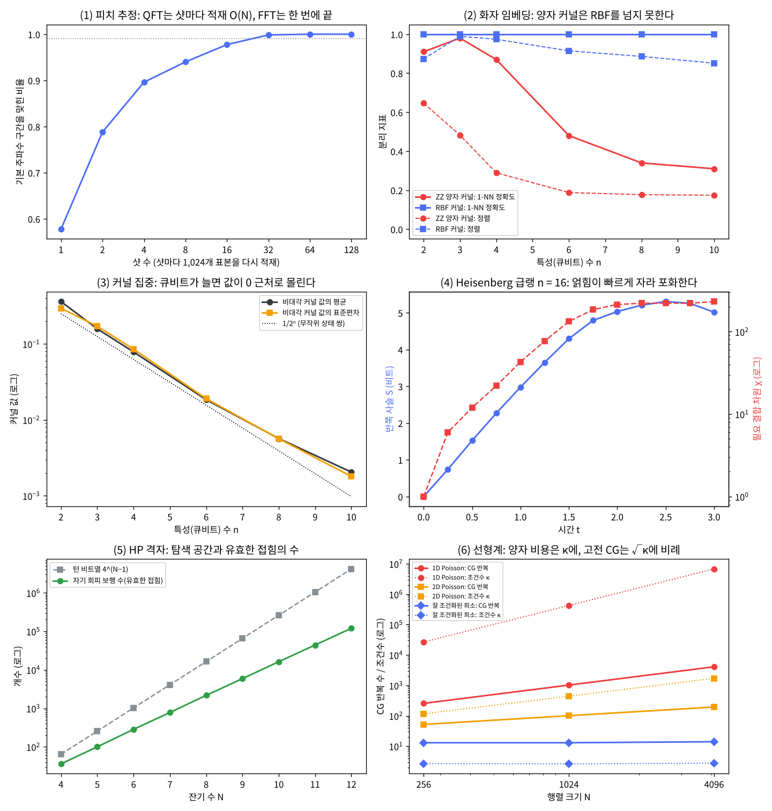

# 19장 후보 문제 선정

2026-11-10 · Gosh

양자컴퓨팅 입문·심화서 · 4부 실용 알고리즘 탐색·구현 · 이 장을 마치면 17장의 체크리스트와 18장의 휴리스틱 트랙으로 후보 문제를 평가하고, 고른 사례마다 판정 기준을 미리 적을 수 있다.

## 1. 요약

작업계획서의 후보 10개를 17·18장의 절차로 다시 평가했다. 결론은 둘이다. 첫째, **고른 5개는 계획서의 초기 선정과 같지만 그 역할이 다르다.** 양자 이득을 기대할 수 있는 후보는 둘(Heisenberg 동역학, 희소 선형계)뿐이고, 나머지 셋은 방법을 끝까지 구현해 보는 사례이거나 안 되는 이유를 측정으로 보여 주는 반례 사례다. 둘째, **사례마다 가설·지표·고전 베이스라인·통과 기준을 돌리기 전에 적어 둔다**(5절의 사전 등록 표). 20\~23a장은 그 표에 결과를 채운다.

후보마다 판정을 가르는 숫자를 하나씩 numpy로 쟀다. 아래 1\~5는 후보 번호와 같고, 6은 후보 8번이다.

1. **음성 피치 추정을 QFT로 — 탈락.** 1,024표본 프레임에서 기본 주파수를 99% 맞히려면(±1구간) 24\~32샷이 필요하고, 샷마다 표본을 다시 적재해야 해서 CNOT이 2.5만\~3.3만 개 든다. 고전 FFT는 한 번에 약 10 µs다.
2. **화자 임베딩 양자 커널 — 이득 주장 탈락, 반례 사례로 유지.** 큐비트를 2개에서 10개로 늘리면 커널의 비대각 원소 평균이 0.36에서 0.002로 줄고(커널 집중), 화자를 가르는 1-NN 정확도가 0.91에서 0.31로 떨어진다(n = 3의 0.98이 가장 높고, 화자 정보가 없는 넷째 주성분부터 넣으면 떨어진다). 같은 특성의 RBF 커널은 계속 1.00이다. 대역폭을 줄이면 정확도가 돌아오지만 그 구간에서 RBF 커널과의 상관이 0.08에서 0.74까지 오른다.
3. **분자 바닥상태 VQE — 방법 사례.** H₂와 LiH(STO-3G)의 FCI 차원은 4와 225라서 고전 정확 대각화가 순식간이다. 이득을 물을 크기가 아니다.
4. **Heisenberg 사슬 동역학 — 이득 후보.** 자유 페르미온이 아니고(Majorana 4차), Néel 상태에서 얽힘이 2.9비트/단위시간으로 자란다. 다만 이 사슬은 Bethe 가설풀이로 풀리는 적분 가능 모형이어서, 23a장은 적분 가능성을 깬 사슬을 함께 돌린다. 또 MPS가 버거워지는 크기(n ≈ 30\~42, t ≈ 3.2\~4.6)의 회로는 CNOT이 약 2,900\~5,700개여서 오류율 0.3%의 잡음 QPU에서 무오류 확률이 10⁻⁴\~10⁻⁸ 수준이다.
5. **단백질 접힘 HP 격자 — 방법 사례.** 잔기 12개의 유효한 접힘 120,292개를 0.3초 안에 전수 열거해 정답(에너지 −5)을 얻는다. 양자 쪽은 22큐비트가 든다.
6. **희소 선형계(후보 8번) — 조건부 이득 후보.** 조건수 κ가 Poisson 행렬에서는 크기 N의 2제곱(1차원)·1제곱(2차원)으로 커지고, 대각이 지배적인 희소 행렬에서는 2.7로 일정하다. 양자 비용은 κ에 비례하므로 뒤의 경우에만 길이 있다.

나머지 넷(후보 6·7·9·10번: 약물 활성 분류, Schwinger 모형, Max-Cut, 옵션 가격)은 앞의 여섯과 같은 이유로 탈락하거나 중복이다.

## 2. 직관 먼저 — 돌리기 전에 판정 기준을 적는다

**비유: 실험 전 등록(pre-registration).** 음성 인식 모델을 바꿀 때 테스트셋과 지표와 통과 기준을 실험 전에 정해 두지 않으면, 결과를 본 뒤에 유리한 지표를 고르게 된다. WER이 안 좋으면 CER을, 전체가 안 좋으면 특정 도메인만 보여 주는 식이다. 임상시험이 가설과 평가 변수를 미리 등록하는 것도 같은 이유다. 4부의 사례도 그렇게 한다. 각 사례가 "무엇을, 어떤 고전 방법과, 어떤 예산에서, 어떤 숫자로 견줄지"를 이 장에서 먼저 적고, 20\~23a장은 그 표에 결과를 채운다. 깨지는 곳: 임상시험은 제3의 등록소가 기준을 보관하지만 여기서는 저자가 스스로 지켜야 한다. 그래서 등록 표를 작업계획서에도 옮겨 두고, 기준을 바꿀 때는 결정 기록에 사유를 남긴다.

**평가는 두 갈래로 나뉜다.** 후보마다 먼저 "증명된 구조가 있는가"를 묻는다.

- 있으면(주기성, 국소 해밀토니안, 희소 선형계, 기댓값) 17장의 5단계를 따른다: 문제 → 구조 → 원시 요소 → 자원 추정 → 고전 베이스라인.
- 없으면(변분, 커널) 18장의 휴리스틱 트랙을 따른다: 훈련 가능성 → 측정 예산 → 고전 대리 계산 → 같은 예산의 실측 비교.

**사례의 역할은 셋이다.** 4부에 싣는 사례가 모두 "양자가 이긴다"를 보여 줄 필요는 없다. 오히려 그러면 책이 광고가 된다.

| 역할 | 뜻 | 이 장에서 요구하는 것 |
| --- | --- | --- |
| 이득 후보 | 고전 경계 검사를 빠져나가고, 자원 추정에서 남은 간격을 숫자로 적을 수 있는 문제 | 17장 1\~3단계와 5단계 통과, 4단계의 남은 조건을 명시 |
| 방법 사례 | 원시 요소를 입력부터 출력까지 끝까지 구현해 보는 문제. 이득은 주장하지 않는다 | 작은 크기에서 정답과 비교 가능, 큰 크기로 가는 길의 병목을 명시 |
| 반례 사례 | 그럴듯해 보이지만 안 되는 이유를 측정으로 보여 주는 문제 | 탈락 단계와 결정적 숫자 하나 |

이 장은 후보 10개 각각에 대해 판정을 가르는 **결정적 숫자**를 하나씩 재고, 역할을 붙인다.

## 3. 정의와 수식 — 판정, 결정적 숫자, 사전 등록 양식

**판정과 역할은 따로 적는다.** 판정은 17장의 셋(가능·조건부·탈락)을 그대로 쓰고, "양자 이득을 기대할 수 있는가"에 대한 답이다. 역할(이득 후보·방법 사례·반례 사례)은 "이 책에서 무엇을 보여 주려고 싣는가"에 대한 답이다. 탈락한 후보도 반례 사례로 실을 수 있고, 방법 사례는 작은 크기에서 고전이 빠르다는 사실 때문에 버리지 않는다. 방법 사례의 판정 칸에는 셋 중 하나 대신 "이 크기에서는 이득 없음"이라고 적고, 큰 크기에서의 판정은 7절에서 따로 밝힌다.

**결정적 숫자.** 후보 하나의 판정을 바꿀 수 있는 가장 싼 측정을 이 장에서는 결정적 숫자라 부른다. 조건은 셋이다. (i) 노트북에서 몇 초 안에 나온다. (ii) 값이 어느 쪽으로 나와도 판정이 정해진다. (iii) 17장 체크리스트나 18장 휴리스틱 트랙의 탈락 신호 하나와 짝이 맞는다. 후보 유형별로 쓰는 숫자는 아래와 같다.

| 후보 유형 | 결정적 숫자 | 짝이 되는 단계 |
| --- | --- | --- |
| 고전 데이터가 입력인 경우 | 샷 수 × 상태 준비 게이트 수 | 17장 1단계(입력 모형) |
| 커널 | 커널 값의 평균과 퍼짐, 같은 특성의 고전 커널과의 성능 차 | 18장 3′(커널 집중)·4′(측정 예산)·6′(실측 비교), 5′(고전 대리 계산)는 보조 |
| 바닥상태 | 힐베르트 공간 차원(정확 대각화 가능 여부) | 17장 5단계(변분 후보는 18장 6′) |
| 동역학 | Majorana 차수, 얽힘 엔트로피의 증가 속도 | 17장 5단계, 18장 고전 경계 검사 |
| 조합 최적화 | 전수 열거 시간, 같은 예산의 고전 휴리스틱 성공률 | 18장 6′(실측 비교) |
| 선형계 | 조건수 κ가 크기 N에 따라 자라는 지수 | 17장 2단계(잘 조건화) |

**수식 다섯 개.** 5절의 숫자는 모두 아래 식에서 나온다.

(1) *적재 비용.* 실수 N = 2ⁿ개를 진폭에 싣는 일반 상태 준비는 균등 제어 Ry 회전을 큐비트마다 하나씩 쌓아 만든다. 제어가 k개인 균등 제어 회전은 CNOT 2ᵏ개로 분해되므로(Möttönen et al. 2005) 합은 2 + 4 + … + 2ⁿ⁻¹ = 2ⁿ − 2개다. 측정은 상태를 부수므로 s번 재려면 s번 다시 싣는다.

```latex
C_{\text{양자}} \approx s\,(2^n - 2)\ \text{CNOT}
\qquad\text{대}\qquad
C_{\text{FFT}} \approx N\log_2 N\ \text{연산}
```

(2) *커널 측정 예산.* 양자 커널 값 K = |⟨Φ(x)|Φ(y)⟩|²은 확률이고, s샷 추정값의 분산은 K(1 − K)/s다. 두 커널 값의 차이 Δ를 표준오차의 2배 이상으로 구분하려면

```latex
\Delta \ \ge\ 2\sqrt{\frac{2K(1-K)}{s}}
\quad\Longrightarrow\quad
s \ \ge\ \frac{8K(1-K)}{\Delta^2}
```

이다. 커널 값이 K ≈ σ\_K ≈ 2⁻ⁿ로 모이면(커널 집중, Thanasilp et al. 2024) 구분할 차이 Δ도 2⁻ⁿ 크기이므로 s ≈ 8/K ≈ 8·2ⁿ로 자란다.

(3) *해까지의 시간(time-to-solution, TTS).* 한 번 실행의 비용이 R, 그 실행이 최적해를 낼 확률이 P일 때, 99% 확률로 최적해를 한 번 이상 보는 데 드는 비용이다.

```latex
\mathrm{TTS}_{99} = R\cdot\frac{\ln(1-0.99)}{\ln(1-P)}
```

R은 양쪽이 같은 단위여야 한다. 변분 알고리즘은 훈련에 쓴 회로 실행(평가 수 × 평가당 샷 수)도 같은 단위로 세어 TTS에 한 번 더한다. 훈련은 표본을 뽑을 때마다 다시 하지 않으므로 R에 곱해지지 않는다(연습문제 3).

(4) *선형계의 비용.* 크기 N, 비영 원소 nnz, 조건수 κ, 정밀도 ε에서

```latex
C_{\text{CG}} \approx \mathrm{nnz}\cdot\sqrt{\kappa}\,\log(1/\varepsilon),
\qquad
Q_{\text{양자}} \approx \kappa\,\log(1/\varepsilon)\ \text{(블록 인코딩 호출 수)}
```

앞의 것은 양의 정부호 행렬에 대한 켤레 기울기법(CG)의 상한이고, 뒤의 것은 최적 양자 알고리즘(Costa et al. 2022)의 호출 수다. 양자 쪽이 κ에 선형이고 고전 쪽이 √κ이므로, κ가 N의 거듭제곱으로 자라면 지수 이득은 없다. HHL이 처음부터 κ = polylog N을 조건으로 건 이유다.

(5) *잡음 속 생존 확률.* 2큐비트 게이트 G개, 게이트당 오류율 r이면 오류 없이 끝날 확률은 대략

```latex
P_{\text{무오류}} \approx (1-r)^{G} \approx e^{-rG}
```

이다(14장의 오류 예산). rG가 1을 크게 넘으면 오류 완화의 표본 비용이 지수로 든다(25장).

**사전 등록 양식.** 선정한 사례마다 여섯 칸을 채운다.

| 칸 | 적는 것 |
| --- | --- |
| 가설 | 참·거짓이 갈리는 문장 하나 |
| 지표 | 숫자 하나와 그 단위 |
| 고전 베이스라인 | 같은 입력·같은 지표로 돌릴 고전 방법 |
| 크기와 예산 | 문제 크기, 샷 수, 반복 수 |
| 통과 기준 | 지표의 문턱값. 결과를 본 뒤에는 바꾸지 않는다 |
| 예상 | 지금 믿는 결과. 틀리면 그 자체가 배울 거리다 |

**교과서와의 비교.** Nielsen & Chuang과 Kaye–Laflamme–Mosca에는 문제 선정을 다루는 장이 없다. N&C에서 가장 가까운 대목은 4.7절(양자계 시뮬레이션)의 도입부로, 시뮬레이션이 양자컴퓨터의 자연스러운 응용인 이유를 설명한다. 두 책 모두 알고리즘이 주어진 뒤의 분석을 다루고, 입력 적재·출력 읽기·고전 베이스라인을 함께 따지는 일은 Aaronson의 "Read the fine print"(2015)가 선형계와 기계학습에 대해 널리 알려진 형태로 정리했다. 이 장의 양식은 그 글의 네 가지 단서(입력 준비, 희소성, 조건수, 출력)를 후보 전체로 넓힌 것이다.

## 4. 도구 구성 — 후보마다 붙이는 검사

이 장에는 양자 회로가 없다. 회로를 짜기 전에 하는 계산만 있다. 후보 10개에 붙인 검사와 `ch19_candidates.py`의 해당 절은 다음과 같다.

| # | 후보 | 평가 갈래 | 결정적 숫자를 내는 검사 | 스크립트 절 |
| --- | --- | --- | --- | --- |
| 1 | 음성 피치 추정을 QFT로 | 17장 체크리스트 | 스펙트럼 분포에서 표본을 뽑아 최빈 구간이 기본 주파수일 확률, 샷 수 × (2ⁿ − 2) | (1) |
| 2 | 화자 임베딩 양자 커널 | 휴리스틱 트랙 | ZZ 특성 맵 커널의 비대각 평균·표준편차, RBF 커널과의 1-NN·정렬 비교, 대역폭 조절 | (2) |
| 3 | 분자 바닥상태 VQE | 휴리스틱 트랙 | 큐비트 수와 FCI 차원 | (3) |
| 4 | Heisenberg 사슬 동역학 | 17장 체크리스트 | Majorana 차수, Néel 급랭의 엔트로피와 χ, Trotter 오차, (1 − r)^G | (4) |
| 5 | 단백질 접힘 HP 격자 | 휴리스틱 트랙 | 자기 회피 보행 전수 열거(정답, 개수, 시간) | (5) |
| 6 | 약물 활성 분류(QML) | 휴리스틱 트랙 | 2번의 커널 결과를 다시 쓴다 | — |
| 7 | Schwinger 모형 동역학 | 17장 체크리스트 | Majorana 차수, 12사이트 급랭의 엔트로피 | (7), (R6) |
| 8 | 희소 선형계 | 17장 체크리스트 | 세 행렬 족의 κ와 CG 반복 수, 크기에 대한 지수 | (8) |
| 9 | Max-Cut QAOA | 휴리스틱 트랙 | 13장의 근사비를 다시 쓴다 | — |
| 10 | 옵션 가격(진폭 추정) | 17장 체크리스트 | 17장의 손익분기를 다시 쓴다 | — |

검사에 쓴 정의 몇 가지를 적어 둔다.

- **1-NN 정확도**: 발화마다 커널 값이 가장 큰 다른 발화를 찾아 그 화자가 같은 비율이다. 군집이 갈라지는 정도를 재는 간단한 지표로 썼다.
- **커널–목표 정렬**(kernel–target alignment): 중심화한 커널 행렬 K와 이상적인 행렬 Y(같은 화자면 1, 아니면 0)의 정규화된 내적 ⟨K, Y⟩/(‖K‖·‖Y‖)이다. 1이면 커널이 화자 구분과 완전히 일치한다.
- **ZZ 특성 맵**: 6장의 Qiskit `ZZFeatureMap`(2회 반복)과 같은 정의를 numpy로 구현했다. 임베딩 192차원을 주성분 n개로 줄이고 각 성분을 \[0, π\]로 맞춰 큐비트 n개의 회전 각도로 쓴다.
- **Majorana 차수**: 18장 5절 (D)의 검사다. 해밀토니안의 각 항을 Jordan–Wigner 변환으로 Majorana 연산자의 곱으로 썼을 때의 최대 차수이고, 2차이면 자유 페르미온이다.
- **χ**: 가운데를 자른 Schmidt 계수에서 버린 가중치가 10⁻⁶ 이하가 되는 최소 개수다(17장과 같은 정의).

**실행 가능한 예: HP 격자의 전수 열거.** 5번 후보의 결정적 숫자를 내는 코드다. 사슬을 2차원 정사각 격자 위에 겹치지 않게 놓는 방법(자기 회피 보행)을 모두 돌면서, 사슬에서는 떨어져 있지만 격자에서 이웃한 H–H 쌍마다 에너지 −1을 준다.

```python
# Python 3.12+, 표준 라이브러리만 — 그대로 실행된다 (약 1초)
def enumerate_hp(seq):
    """2D 정사각 격자의 자기 회피 보행을 모두 돌며 HP 에너지(사슬에서 잇닿지 않은 이웃 H–H 쌍마다 −1)를 센다."""
    L, pos, occ = len(seq), [(0, 0)], {(0, 0): 0}
    stat = {"count": 0, "best": 0, "nbest": 0}

    def energy():
        e = 0
        for i, (x, y) in enumerate(pos):
            if seq[i] == "H":
                for q in ((x + 1, y), (x, y + 1)):          # 오른쪽·위쪽 이웃만 보면 쌍을 한 번씩 센다
                    j = occ.get(q)
                    if j is not None and seq[j] == "H" and abs(i - j) > 1:
                        e -= 1
        return e

    def grow(k):
        if k == L:
            stat["count"] += 1
            e = energy()
            if e < stat["best"]:
                stat["best"], stat["nbest"] = e, 1
            elif e == stat["best"]:
                stat["nbest"] += 1
            return
        x, y = pos[-1]
        for q in ((x + 1, y), (x, y + 1), (x - 1, y), (x, y - 1)):
            if q not in occ:
                pos.append(q); occ[q] = k
                grow(k + 1)
                pos.pop(); del occ[q]

    grow(1)
    return stat["count"], stat["best"], stat["nbest"]

print(enumerate_hp("HPHPPHHPHPPH"))     # (120292, -5, 16): 접힘 120,292개, 최저 에너지 −5, 최저 접힘 16개
```

세 가지 주의. (1) 개수 120,292는 회전·반사로 겹치는 접힘을 따로 센 값이다(OEIS A001411의 11걸음 항). 대칭을 빼면 약 1/8이다. (2) 양자 쪽 인코딩은 걸음마다 방향 2비트를 쓰는 턴 인코딩을 가정했다. 잔기 N개에 2(N − 1)비트이고, 비트열 4^(N−1)개 가운데 겹치지 않는 접힘은 일부라서 나머지는 벌점 항으로 막아야 한다(21장). (3) 전수 열거의 시간은 걸음마다 약 2.7배로 는다. 이 코드의 속도로는 잔기 30개쯤에서 몇 달이 걸린다(스크립트의 외삽으로 3\~4달, 실행마다 달라진다). 그 크기에서는 전수 열거 대신 가지치기와 담금질이 고전 쪽 베이스라인이 된다.

## 5. 실행 결과

**numpy 구현(실행 완료).** `ch19_candidates.py`(실행 약 20초, seed = 19). 후보 번호 순서로 적는다. 스크립트의 (R) 절은 본문 주장을 받치는 보강 확인이고 (E) 절은 연습문제 검산이다.

**(1) 음성 피치 추정을 QFT로.** 16 kHz로 표본화한 1,024표본(64 ms) 프레임에 기본 주파수 180 Hz와 그 2\~10배음(진폭 1/k), 신호 대 잡음비 10 dB의 잡음을 넣었다. 이 프레임을 10큐비트의 진폭에 싣고 QFT를 한 뒤 재면 주파수 구간 k가 스펙트럼의 파워에 비례하는 확률로 나온다. 기본 주파수 구간(±1)에 실린 확률은 0.564이고 나머지는 배음과 잡음이다. 그래서 한 번 재서는 모르고, 여러 번 재서 가장 많이 나온 구간을 골라야 한다.

| 샷 수 | 1 | 2 | 4 | 8 | 16 | 32 | 64 |
| --- | --- | --- | --- | --- | --- | --- | --- |
| 최빈 구간이 기본 주파수인 비율 | 0.578 | 0.788 | 0.896 | 0.940 | 0.978 | 0.999 | 1.000 |

1샷의 0.578은 2,000회 추정값이고 정확한 값은 위의 0.564다. 2의 거듭제곱만 보면 99%를 넘는 첫 값이 32샷이고, 촘촘히 재면 24샷에서 0.991로 넘는다(스크립트 R1). 여기서 "맞힌다"는 ±1구간, 곧 ±15.6 Hz 안이라는 뜻이다. FFT는 봉우리 보간으로 구간 폭보다 훨씬 잘게 읽는다. 샷마다 1,024개 표본을 다시 실어야 하므로 CNOT은 32샷이면 32 × 1,022 = 32,704개, 24샷이면 24,528개다(QFT의 제어 위상 45개는 여기에 비하면 무시할 만하다). 고전 FFT는 약 10,240번의 연산으로 스펙트럼 전체를 내고, 이 컨테이너에서 10 µs 안팎이 걸렸다(실행마다 9\~14 µs). 양자 쪽은 게이트 수만으로 2\~3배 많고, 14장의 t\_CZ = 68 ns로 32샷 회로를 차례로 돌리면 2.2 ms로 FFT의 150배 이상이며(판독·초기화 시간은 뺀 값이다), 얻는 것은 봉우리 하나의 위치뿐이다. 프레임을 키워도 사정은 같다. N = 4,096(12큐비트)으로 4배 늘려도 2의 거듭제곱으로 잰 필요 샷 수는 그대로 32이고(스크립트 R1b: 16샷 0.987, 32샷 0.998), CNOT 131,008개 대 FFT 49,152번으로 비가 3.2배에서 2.7배로 줄 뿐이다. 양자 쪽 비용은 샷 수 × N, 고전 쪽은 N·log₂N이라 연산 수가 같아지는 곳은 log₂N ≈ 32, 곧 16 kHz에서 약 75시간 길이의 프레임이다. 피치는 수십 ms마다 바뀌므로 그런 프레임은 쓸모가 없다. 로그 인자 하나를 놓고 다투는 비교에서는 상수가 결론을 정한다. 그림 (1).

**(2) 화자 임베딩 양자 커널.** 화자 4명 × 발화 25개의 합성 임베딩(192차원, 코사인 유사도 평균이 같은 화자 0.421, 다른 화자 0.029)을 주성분 n개로 줄여 ZZ 특성 맵(2회 반복)에 넣었다. 같은 n개 특성으로 RBF 커널(폭은 중앙값 규칙)도 만들었다.

| n | 설명 분산 | 양자 커널 비대각 평균 | 표준편차 | 1-NN | 정렬 | RBF 1-NN | RBF 정렬 | 샷 수(3절 식 (2), Δ = σ) |
| --- | --- | --- | --- | --- | --- | --- | --- | --- |
| 2 | 0.260 | 0.3614 | 0.2948 | 0.91 | +0.646 | 1.00 | +0.873 | 21 |
| 3 | 0.369 | 0.1579 | 0.1708 | 0.98 | +0.482 | 1.00 | +0.989 | 36 |
| 4 | 0.387 | 0.0784 | 0.0853 | 0.87 | +0.289 | 1.00 | +0.974 | 79 |
| 6 | 0.421 | 0.0184 | 0.0190 | 0.48 | +0.188 | 1.00 | +0.915 | 400 |
| 8 | 0.454 | 0.0057 | 0.0056 | 0.34 | +0.177 | 1.00 | +0.886 | 1,419 |
| 10 | 0.484 | 0.0020 | 0.0018 | 0.31 | +0.174 | 1.00 | +0.851 | 5,058 |

세 가지가 보인다. 첫째, 큐비트를 늘릴수록 서로 다른 발화의 커널 값이 0으로 모인다. n = 10의 평균 0.0020은 무작위 상태 한 쌍의 평균 충실도 1/2¹⁰ = 0.0010의 2배다. 특성 맵이 서로 다른 입력을 거의 무작위인 상태 쌍으로 보낸다는 뜻이다. 둘째, 같은 화자와 다른 화자의 구분이 흐려진다. 정렬이 +0.646에서 +0.174로 줄고, 1-NN 정확도 0.31은 화자 4명에서 찍어 맞히는 수준(약 0.24)에 가깝다. 다만 1-NN의 붕괴에는 이 데이터의 사정이 섞여 있다. 화자가 4명이면 화자 중심의 차이는 3차원에 다 들어가므로 넷째 주성분부터는 화자 정보가 없는 잡음이다(주성분별 화자 간 분산 비율이 1\~3번째는 0.96\~0.98, 4\~10번째는 0.002 이하; 스크립트 R2). 그 잡음 성분도 \[0, π\] 전체로 늘려 회전 각도로 썼다. 1-NN이 n = 3에서 0.98로 가장 높고 n ≥ 4에서 떨어지는 이유다. 화자를 8명, 11명으로 늘린 대조 실험에서는 n = 10의 커널 값이 똑같이 작아도(평균 0.0020, 0.0022) 1-NN이 0.37(찍기 0.12), 0.70(찍기 0.09)으로 찍기보다 높다. 같은 특성을 받은 RBF 커널은 세 경우 모두 1.00이므로 "잡음 특성에 약하다"는 것은 양자 커널 쪽의 약점이 맞다. 그러나 찍기 수준까지 무너지는 것은 화자가 4명뿐인 이 데이터의 사정이다. 특성 10개가 모두 화자 정보를 담는 11명 대조에서도 1-NN은 n = 10에서 0.70으로 RBF의 1.00에 못 미치지만, 찍기(0.09)와는 거리가 멀다. 어느 데이터에서나 n과 함께 나빠지는 것은 커널 값의 크기와 정렬이다. 셋째, 커널 값을 재는 비용이 같은 속도로 는다. n = 10에서 커널 값 하나에 약 5,000샷이 필요하다. 같은 특성의 RBF 커널은 모든 n에서 1-NN 1.00이고, 192차원 코사인 유사도도 1.00(정렬 +0.907)이다. 그림 (2), (3).

대역폭을 줄이면 집중은 풀린다(Shaydulin & Wild 2022). n = 8에서 특성의 범위를 \[0, c·π\]로 줄였다.

| c | 비대각 평균 | 표준편차 | 1-NN | 정렬 | 가장 닮은 RBF 커널과의 상관 |
| --- | --- | --- | --- | --- | --- |
| 1.00 | 0.0057 | 0.0056 | 0.34 | +0.177 | 0.080 |
| 0.50 | 0.0058 | 0.0059 | 0.56 | +0.180 | 0.147 |
| 0.25 | 0.0121 | 0.0125 | 0.74 | +0.202 | 0.442 |
| 0.10 | 0.0533 | 0.0594 | 0.96 | +0.353 | 0.742 |
| 0.05 | 0.2714 | 0.1341 | 1.00 | +0.596 | 0.739 |
| 0.02 | 0.6034 | 0.2109 | 1.00 | +0.656 | 0.616 |

c = 0.05에서 1-NN이 1.00으로 돌아온다. 정렬(+0.596)은 여전히 같은 특성의 RBF(+0.886)보다 낮다. 성능이 돌아오는 구간에서 양자 커널은 고전 커널 쪽으로 다가간다. 다만 상관 0.74는 양자 커널 값의 분산 가운데 절반쯤(0.74² ≈ 0.55)을 RBF 하나가 설명한다는 뜻이고, 22장의 사전 등록이 "닮았다"의 문턱으로 둔 0.9에는 못 미친다. c를 0.02까지 더 줄이면 상관은 0.62로 도로 내려간다. 이 데이터에서 시험한 설정 가운데 양자 커널이 RBF보다 나은 것은 없었다(c ≤ 0.05의 1-NN만 1.00으로 같다). 18장 휴리스틱 트랙으로 말하면 3′(커널 집중)와 4′(측정 예산: 샷 수가 2ⁿ에 비례해 는다), 6′(실측 비교: 같은 특성의 고전 커널이 같거나 낫다)에 걸렸고, 5′(고전 대리 계산)는 방향만 보였다.

**(3) 분자 바닥상태 VQE.** 공간 궤도 M개, 전자 N개(스핀 위·아래 절반씩)인 분자는 큐비트 2M개가 필요하고, 고전 정확 대각화(FCI)가 다루는 차원은 C(M, N/2)²이다.

| 분자 / 기저 | 공간 궤도 | 전자 | 큐비트 | FCI 차원 |
| --- | --- | --- | --- | --- |
| H₂ / STO-3G | 2 | 2 | 4 | 4 |
| LiH / STO-3G | 6 | 4 | 12 | 225 |
| H₂O / STO-3G | 7 | 10 | 14 | 441 |
| N₂ / cc-pVDZ | 28 | 14 | 56 | 1.4×10¹² |
| FeMoco 활성 공간(54전자, 54궤도) | 54 | 54 | 108 | 3.8×10³⁰ |

23장이 다루는 H₂와 LiH는 차원 4와 225다. 고전으로 순식간에 풀리므로 이 크기에서 양자 이득을 물을 수는 없다. 이 사례의 가치는 방법에 있다. 해밀토니안을 파울리 항으로 옮기고, 틀을 고르고, 샷 잡음 속에서 화학적 정확도(1.6 mHa)에 닿는 과정 전체를 정답과 비교하며 익힐 수 있다. 이득을 물을 수 있는 크기는 표의 맨 아래 줄 쪽이다. N₂/cc-pVDZ의 1.4×10¹²은 2024년에 보고된 FCI 계산(C₃H₈/STO-3G, 1.3×10¹² 행렬식, Gao et al. 2024)과 같은 크기다. 2025년에는 10¹⁵ 행렬식 규모의 수치적으로 정확한 CI 계산까지 보고됐다(Shayit et al. 2025). 1s 궤도를 얼리면 4.3×10⁹으로 줄어 FCI 기준값이 오래전부터 있는 분자이기도 하다. 그보다 큰 쪽은 VQE가 아니라 QPE의 영역이고 초기 상태 겹침이 조건이다(17장).

**(4) Heisenberg 사슬의 실시간 동역학.** H = Σ(XX + YY + ZZ)는 Jordan–Wigner 변환에서 ZZ 항이 Majorana 4차식이 된다. 끈의 축을 X, Y, Z 어느 쪽으로 잡아도 최대 차수가 4다. 18장의 자유 페르미온 검사를 통과하지 못한다는 뜻이고, 2n×2n 행렬 풀이가 없다. 다만 이 사슬은 자유 페르미온은 아니어도 Bethe 가설풀이(Bethe ansatz)로 풀리는 적분 가능 모형이다. 17장의 "가능" 판정은 비적분 모형을 조건으로 달았다. 적분 가능성은 얽힘 증가를 막지 못하지만(아래 표) 고전 쪽에 다른 길을 준다. Néel 급랭의 정상 상태는 정확히 풀렸고(Wouters et al. 2014), 얽힘 엔트로피의 증가도 준입자 그림으로 예측된다(Alba & Calabrese 2017). 유한 시간의 일반 상관 함수에는 여전히 수치 계산이 필요하다. 그래서 23a장은 이 사슬을 기준 사례로 쓰되, 다음 이웃 결합 J₂를 더해 적분 가능성을 깬 사슬을 함께 돌린다. J₂ = 0.5인 사슬의 같은 급랭에서도 S는 단위시간당 3.01비트로 자란다(스크립트 R4). n = 16 사슬을 Néel 상태 |0101…⟩에서 급랭하면 반쪽 사슬 엔트로피 S와 필요한 결합 차원 χ가 이렇게 자란다.

| t | 0.5 | 1.0 | 1.5 | 2.0 | 2.5 | 3.0 |
| --- | --- | --- | --- | --- | --- | --- |
| S(비트) | 1.52 | 2.98 | 4.30 | 5.03 | 5.31 | 5.02 |
| χ | 12 | 43 | 133 | 214 | 222 | 232 |

S는 t = 0.25\~1.25에서 단위시간당 2.91비트로 자라고, t ≥ 2에서 약 5.17비트(반쪽 8큐비트의 65%)로 포화한다. 포화는 사슬이 짧아서 생긴다. 긴 사슬에서는 선형 증가가 계속되고 χ는 시간에 지수로 자란다. 다만 χ = 2^S는 하한일 뿐이다. 위 표에서 버린 가중치 10⁻⁶ 기준의 χ는 2^S의 4\~7배다(t = 2에서 2^5.03 ≈ 33인데 χ = 214). MPS가 버거워지는 기준을 χ ≈ 10⁴으로 잡으면 경계를 두 가지로 어림할 수 있다. 하한 χ = 2^S를 쓰면 S ≈ 13.3비트가 필요하고, 같은 포화 비율(65%)에서 n ≳ 42, t ≈ 4.6이다. 표의 χ를 그대로 외삽하면(t = 0.25\~1.5에서 log₂χ ≈ 1.76 + 3.58t) t ≈ 3.2, S ≈ 9.4비트, n ≳ 30에서 이미 χ ≈ 10⁴에 닿는다(스크립트 R4). 아래에서는 고전 쪽에 유리한 앞의 값(n ≈ 42, t ≈ 4.6)을 경계로 쓴다. 두 값 모두 n = 16 하나에서 얻은 거친 외삽이고, 23a장이 여러 크기로 다시 잰다.

양자 쪽의 비용은 작은 크기에서 먼저 쟀다. n = 10, t = 2에서 2차 Trotter의 단계 수를 바꾸며 상태 비충실도와 CNOT 수를 셌다(2큐비트 오류율은 14장의 0.3%).

| Trotter 단계 | 상태 비충실도 | CNOT 수 | 무오류 확률 |
| --- | --- | --- | --- |
| 5 | 7.7×10⁻¹ | 150 | 0.637 |
| 10 | 7.0×10⁻² | 285 | 0.425 |
| 20 | 4.3×10⁻³ | 555 | 0.189 |
| 40 | 2.7×10⁻⁴ | 1,095 | 0.037 |

단계를 2배로 늘리면 비충실도가 약 16배 줄지만(오차 노름이 dt²에 비례하므로 비충실도는 dt⁴. 5 → 10단계는 아직 점근 영역이 아니어서 11배) 무오류 확률도 함께 준다. 알고리즘 오차와 장치 오류가 반대 방향으로 움직이므로 최적 단계 수가 있다. 경계 크기(n = 42, dt = 0.1, 46단계)의 회로는 CNOT이 5,721개이고 무오류 확률은 (1 − 0.003)^5721 = 3.4×10⁻⁸이다. dt = 0.1은 n = 10에서 고른 값이라 이 크기의 상태 충실도까지 보장하지는 않는다. CNOT 수는 하한에 가깝다. 표의 χ로 외삽한 경계(n = 30, t = 3.2, 33단계)로 계산하면 CNOT 2,916개, 무오류 확률 1.6×10⁻⁴이다. 어느 쪽이든 결론은 같다. 판정은 "가능"이되 조건이 둘 붙는다. 하나는 위의 적분 가능성이고(17장의 "가능"은 비적분 모형이 조건이다), 다른 하나는 잡음이다. 고전이 버거워지는 크기와 지금의 잡음 장치가 닿는 크기 사이에 간격이 있다. 경계 회로는 rG ≈ 17이라 3절 식 (5)의 기준에 걸리고, 오류 완화만으로는 표본 비용이 지수로 든다. 이 간격을 메우는 것은 오류율을 한 자릿수 낮추는 일(r = 3×10⁻⁴이면 rG ≈ 1.7, 무오류 확률 0.18)이나 오류 정정이다(25장). 그림 (4).

**(5) 단백질 접힘 HP 격자.** 서열 HPHPPHHPHPPH의 앞 N개 잔기를 전수 열거했다.

| 잔기 수 N | 유효한 접힘 수 | 최저 에너지 | 최저 접힘 수 | 턴 인코딩 비트 | 비트열 수 4^(N−1) |
| --- | --- | --- | --- | --- | --- |
| 6 | 284 | −2 | 8 | 10 | 1.0×10³ |
| 8 | 2,172 | −2 | 24 | 14 | 1.6×10⁴ |
| 10 | 16,268 | −2 | 376 | 18 | 2.6×10⁵ |
| 12 | 120,292 | −5 | 16 | 22 | 4.2×10⁶ |

접힘 수는 OEIS A001411과 모든 N에서 일치하고, 걸음마다 약 2.72배로 는다(알려진 연결 상수는 2.638). N = 12의 정답은 0.3초 안에 나온다. 턴 인코딩의 22비트 비트열 가운데 겹치지 않는 접힘은 2.9%뿐이다. QAOA는 나머지 97%를 벌점으로 밀어내면서 16개의 최저 접힘을 찾아야 한다. 양자 이득을 물을 크기가 아니므로 역할은 방법 사례다. 조합 최적화를 QUBO로 옮기고, 벌점 항을 설계하고, 같은 예산의 담금질과 TTS로 비교하는 절차를 정답이 있는 크기에서 익힌다. 그림 (5).

**(7) 격자 Schwinger 모형.** 게이지장을 Gauss 법칙으로 소거한 6사이트 모형은 도약 항 10개(결합 5개 × XX, YY), Z 항 6개, 장거리 ZZ 항 10개로 이루어진다. Majorana 최대 차수는 끈 축 X·Y에서 11, Z에서 4다. 가장 유리한 축에서도 4차이므로 자유 페르미온은 아니다. 그러나 3절의 표대로 동역학 후보의 결정적 숫자는 둘이고, 둘째(얽힘 증가 속도)에서 이 후보는 4번과 갈린다. Schwinger 모형은 가둠(confinement)이 있는 이론이고, 가둠은 급랭 뒤 얽힘의 증가를 늦출 수 있다(17장의 Kormos et al. 2017). 실제로 배경 전기장을 켠 급랭은 MPS로 t ≈ 25까지 결합 차원 200 미만에서 계산됐다(Buyens et al. 2014). 12사이트 모형 H = Σ(XX + YY) + m Σ(−1)ⁿZₙ + J Σ Lₙ²(m은 질량, J는 전기장 에너지의 계수, Lₙ은 Gauss 법칙으로 정해지는 n번째 결합의 전기장)을 맨 진공 |1010…⟩에서 급랭해 보았다(스크립트 R6). 전기장 항을 끈 J = 0, m = 0은 자유 페르미온이라 견줄 대상이 아니고(4.58비트까지 자라지만 18장의 자유 페르미온 검사에 걸린다), 상호작용이 있는 J = 0.5, m = 0에서는 반쪽 엔트로피가 t ≤ 3에서 4.70비트까지 자란다. 반면 J = 2, m = 1에서는 0.91비트, J = 4, m = 1에서는 0.66비트를 넘지 않는다. 뒤의 영역은 18장 고전 경계 검사의 "낮은 얽힘" 줄에 걸린다. 판정은 "가능(얽힘이 빠르게 자라는 매개변수 영역에 한함)"으로 적는다. 4번과 다른 점은 ZZ가 이웃이 아닌 쌍에도 걸려(ZZ 10쌍 가운데 6쌍) 회로가 깊어진다는 것이다. 따로 장을 두지 않고, 얽힘 증가를 재는 일까지 묶어 23a장의 연습문제로 돌린다.

**(8) 희소 선형계.** 세 행렬 족에서 조건수 κ와 CG 반복 수(상대 잔차 10⁻⁸)를 쟀다.

| 행렬 족 | N | κ | CG 반복 수 |
| --- | --- | --- | --- |
| 1D Poisson | 256 / 1,024 / 4,096 | 2.7×10⁴ / 4.3×10⁵ / 6.8×10⁶ | 256 / 1,024 / 4,096 |
| 2D Poisson | 256 / 1,024 / 4,096 | 117 / 441 / 1,712 | 52 / 101 / 194 |
| 대각이 지배적인 희소 행렬(I + 0.2·S, 행당 비영 원소 평균 5개·최대 16개) | 256 / 1,024 / 4,096 | 2.69 / 2.62 / 2.79 | 13 / 13 / 14 |

| 행렬 족 | κ의 크기 의존 | CG 반복 수 | 고전 비용(nnz × 반복) | 양자 게이트 수(호출 수 κ·log(1/ε) × 호출당 polylog N) |
| --- | --- | --- | --- | --- |
| 1D Poisson | N^2.00 | N^1.00 | N^2.00 | N^2.00 · polylog N |
| 2D Poisson | N^0.97 | N^0.47 | N^1.47 | N^0.97 · polylog N |
| 대각이 지배적인 희소 행렬 | N^0.01 | N^0.03 | N^1.03 | N^0.01 · polylog N |

미분방정식을 격자로 옮긴 Poisson 행렬에서는 κ가 N의 거듭제곱으로 자라서 양자 호출 수도 N의 거듭제곱이 된다. 지수 이득은 없다. 게다가 CG는 가장 단순한 베이스라인이다. 1D Poisson은 삼중대각 직접 풀이로, 2D Poisson은 멀티그리드로 O(N)에 풀린다. κ가 크기와 무관한 행렬 족에서만 양자 호출 수가 polylog N으로 남는다. 그때에도 조건이 둘 더 붙는다. 우변 b를 싸게 준비할 수 있어야 하고, 출력이 해 벡터 전체가 아니라 기댓값 하나여야 한다(17장). 판정은 17장과 같은 "조건부"이고, 20장은 조건이 맞는 족과 맞지 않는 족을 나란히 돌린다. 그림 (6).

**(6)(9)(10) 계산 없이 판정한 후보.** 약물 활성 분류(6번)는 2번과 같은 커널 방법이고 입력이 수천 비트의 분자 지문이라 적재 문제까지 겹친다. Max-Cut QAOA(9번)는 13장에서 p = 1의 근사비 0.6924가 Goemans–Williamson의 0.878에 못 미쳤고, 같은 부품(QAOA)을 5번이 벌점 항이 있는 더 풍부한 문제로 다룬다. 옵션 가격(10번)은 제곱 가속이라 17장 5절 (C)의 손익분기에 걸린다(Babbush et al.의 논리 Toffoli 170 µs에서 33일\~9,200년).

**판정표.**

| # | 후보 | 걸린 단계 | 결정적 숫자 | 판정 | 역할과 행선지 |
| --- | --- | --- | --- | --- | --- |
| 1 | 음성 피치 추정 QFT | 17장 1단계(입력 적재) | 24\~32샷 × 1,022 CNOT 대 FFT 약 10 µs | 탈락 | 22장의 반례 박스 |
| 2 | 화자 임베딩 양자 커널 | 18장 3′·4′·6′(5′는 부분적) | n = 10에서 커널 값 하나에 5,058샷(2ⁿ에 비례), 1-NN 0.31(RBF 1.00) | 탈락(이득 주장) | 반례 사례 → 22장 |
| 3 | 분자 바닥상태 VQE | 18장 6′(17장 5단계에 해당: 고전 정확 대각화) | FCI 차원 4, 225 | 이 크기에서는 이득 없음 | 방법 사례 → 23장 |
| 4 | Heisenberg 사슬 동역학 | 통과(적분 가능 모형이라는 단서) | Majorana 4차, S 증가 2.91비트/시간, 경계 회로의 무오류 확률 10⁻⁴\~10⁻⁸ | 가능(비적분 변형을 함께 다루고, 오류율 10배 개선 또는 오류 정정 필요) | 이득 후보 → 23a장 |
| 5 | 단백질 접힘 HP 격자 | 18장 6′ | N = 12 전수 열거 0.3초 | 이 크기에서는 이득 없음 | 방법 사례 → 21장 |
| 6 | 약물 활성 분류(QML) | 17장 1단계, 18장 3′·4′·6′ | 2번과 같음 | 탈락 | 싣지 않음 |
| 7 | Schwinger 모형 동역학 | 매개변수에 따라 18장의 낮은 얽힘 검사에 걸림 | Majorana 4차, 급랭 엔트로피 4.70비트(J = 0.5, m = 0) 대 0.91비트(J = 2, m = 1) | 가능(얽힘이 빨리 자라는 영역에 한함) | 4번과 중복 → 23a장 연습문제 |
| 8 | 희소 선형계 | 17장 2단계가 조건 | κ ∝ N^2.00, N^0.97, N^0.01 | 조건부 | 이득 후보(조건부) → 20장 |
| 9 | Max-Cut QAOA | 18장 6′(보장값 비교) | 근사비 0.6924 대 0.878 | 탈락 | 5번에 흡수 |
| 10 | 옵션 가격(진폭 추정) | 17장 5단계 | 손익분기 33일\~9,200년 | 탈락 | 16장의 진폭 추정 예제로 갈음 |

고른 5개는 작업계획서의 초기 선정과 같다. 달라진 것은 이름표다. 계획서는 다섯을 모두 "사례"로만 불렀는데, 이 장의 숫자로 보면 이득을 기대할 수 있는 것은 4번과 8번(조건부)뿐이다. 3번과 5번은 방법 사례이고, 2번은 반례 사례다. 4부는 양자 이득을 다섯 번 보여 주는 부가 아니다. 같은 절차를 다섯 번 끝까지 밟아 보는 부다.

**사전 등록 표.** 20\~23a장이 돌리기 전에 못 박아 두는 내용이다. 각 장은 5절에서 이 표의 통과 기준에 대한 결과를 보고한다.

| 장 · 사례(역할) | 가설 | 지표와 고전 베이스라인 | 크기와 예산 | 통과 기준 | 예상 |
| --- | --- | --- | --- | --- | --- |
| 20장 · 희소 선형계(조건부 이득 후보) | 잘 조건화된 희소 행렬에서 QSVT 역행렬 다항식의 차수 d(진폭 증폭을 뺀 블록 인코딩 호출 수)는 블록 인코딩의 유효 조건수 κ에 거의 선형이다. 진폭 증폭을 넣은 총 호출 수 d/√p\_s는 최악의 b에서 κ²이고(17장), 무작위 b에서는 κ¹과 κ² 사이다 | 해의 오차 10⁻³까지의 QSVT 다항식 차수 d, 성공 확률 p\_s = ‖A⁻¹b‖²/(2κ)²(‖A‖ = 1로 맞춘 뒤, b는 무작위 단위 벡터 10개의 평균), 총 호출 수 d/√p\_s. 베이스라인은 CG의 nnz × 반복 수 | N = 16\~256(4\~8큐비트와 보조 큐비트), κ는 I + γS 족의 γ를 바꿔 2, 4, 8, 16, 32로 맞춘다. 상태 벡터 시뮬레이션 | N = 256에서 차수의 κ 지수가 1 ± 0.2이고, 총 호출 수 d/√p\_s의 κ 지수가 1.3 이상 2.3 이하. 차수가 N과 무관한지는 검산 항목으로만 보고한다(다항식이 κ와 ε만으로 정해지므로 가설이 아니다) | 통과. 다만 이 크기의 벽시계 시간은 CG가 압도한다 |
| 21장 · HP 격자(방법 사례) | 같은 실행 예산에서 QAOA(p ≤ 3)가 담금질과 무작위 추출보다 짧은 TTS로 최저 에너지 접힘을 찾는다 | TTS₉₉, 단위는 목적함수 평가 1회(회로 실행 1샷 = 담금질 1걸음 = 무작위 비트열 1개). 베이스라인은 담금질과 균등 무작위 비트열 추출, 정답은 전수 열거. 보조 지표: 훈련 비용을 뺀 한 샷 성공 확률이 무작위 추출의 몇 배인가 | 잔기 8·10·12개(14\~22큐비트), 예산 10⁷ 평가 | 잔기 12개에서 QAOA의 TTS(훈련 샷 포함)가 담금질과 무작위 추출 둘 다보다 짧다. 8·10개는 참고로만 보고한다. 예산 안에 최적해를 한 번도 못 보면 TTS = ∞로 적는다 | 불통과(담금질에 진다). 잔기 8·10개에서는 무작위 추출의 TTS₉₉가 3,141과 3,208이라 훈련에 수천 샷을 쓰는 순간 진다. 12개(무작위 1.2×10⁶)에서는 무작위보다 짧을 수 있다 |
| 22장 · 화자 임베딩 커널(반례 사례) | ZZ 특성 맵 양자 커널의 스펙트럴 군집화가 같은 특성의 RBF 커널보다 화자를 잘 가른다 | 정답 화자 레이블에 대한 정규화 상호 정보량(NMI). 베이스라인은 RBF 커널과 192차원 코사인 유사도 | 화자 8명 × 발화 25개(4명은 참고용), n은 2, 4, 6, 8, 10, 대역폭 c는 1, 0.5, 0.25, 0.1, 0.05, 무잡음 커널과 1,000샷 커널, 데이터 시드 10개. 임베딩 잡음은 n = 8에서 RBF 커널의 NMI가 0.8\~0.9가 되도록 먼저 맞추고 모든 n에 같은 값을 쓴다(이 장의 데이터는 RBF의 NMI가 1.000이라 넘을 여지가 없다) | (n, c) 설정 하나 이상에서 시드 평균 NMI가 RBF보다 0.02 이상 높고, 그 차이가 시드 간 표준오차의 2배를 넘으며, 그 설정에서 가장 닮은 RBF 커널과의 상관이 0.9 미만. 설정은 시드 절반으로 고르고 나머지 절반으로 판정한다 | 불통과 |
| 23장 · 분자 VQE(방법 사례) | 화학에서 온 틀(UCCSD, ADAPT)의 VQE가 H₂·LiH의 FCI 에너지를 화학적 정확도로 재현한다 | 결합 길이 곡선 전체에서 FCI와의 에너지 차(mHa). 베이스라인은 Hartree–Fock과 FCI | 4큐비트와 12큐비트, 무잡음 상태 벡터. 결합 길이는 H₂ 0.4\~2.5 Å, LiH 1.0\~3.5 Å(0.1 Å 간격). ADAPT의 연산자 수는 UCCSD의 파라미터 수를 넘지 않게 한다. 샷 잡음을 넣은 실행은 필요한 총 샷 수를 보고 | 무잡음에서 모든 결합 길이의 오차가 1.6 mHa 이하 | 평형 거리 근처는 통과. 늘인 LiH에서 UCCSD가 1.6 mHa 안에 드는지는 돌려 봐야 안다 |
| 23a장 · Heisenberg 동역학(이득 후보) | (a) 2차 Trotter의 오차 노름은 dt²에 비례한다 (b) Néel 급랭에서 MPS의 필요 결합 차원은 포화 전까지 시간에 지수로 자라고, 적분 가능성을 깬 J₁–J₂ 사슬에서도 그렇다 (c) MPS가 버거워지는 크기의 회로는 오류율 0.3%에서 rG가 1을 크게 넘는다 | (a) 상태 비충실도의 dt 지수 (b) 포화 전 구간(S가 반쪽 사슬 큐비트 수의 1/3에 닿기 전, 시간 간격 0.05)에서 log χ 대 t 직선 맞춤과 log χ 대 log t 직선 맞춤의 잔차 비교 (c) χ = 10⁴에 닿는 (n, t)의 외삽값과 그 크기 회로의 rG(r = 0.003). 외삽은 이 장 5절 (4)와 같은 절차로 한다(S의 기울기는 t = 0.25\~1.25, log₂χ 맞춤은 t = 0.25\~1.5, 포화 비율은 t ≥ 2의 평균). 베이스라인은 정확한 상태 벡터와 χ를 제한한 MPS | n = 16, 20(판정용), n = 12(참고용. 구간이 t ≤ 0.65, χ ≤ 20에서 끝나 두 맞춤이 갈리지 않는다), t ≤ 3. Heisenberg 사슬과 J₂ = 0.5 사슬 | (a) 지수 4 ± 0.4 (b) 두 사슬 모두 n = 20에서 지수 맞춤의 잔차 제곱합이 거듭제곱 맞춤의 절반 이하이고, n = 16과 20의 기울기가 둘의 평균에서 ±10% 안 (c) n = 16과 20에서 따로 구한 외삽값이 서로, 그리고 이 장의 값(n ≈ 30\~42, t ≈ 3.2\~4.6)과 n·t 모두 2배 안에서 일치하고, 그 크기에서 rG가 5보다 크다 | (a)(b)(c) 통과. 결론은 "오류율 0.3%로는 닿지 못함" |

그림(`ch19_results.png`): (1) 샷 수에 따른 피치 추정 성공률, (2) 큐비트 수에 따른 양자 커널과 RBF 커널의 1-NN 정확도·정렬, (3) 커널 값의 평균과 표준편차(커널 집중), (4) Heisenberg 급랭의 S와 χ, (5) HP 격자의 접힘 수와 비트열 수, (6) 선형계 세 족의 κ와 CG 반복 수.



## 6. 다른 SDK 대응 — 사례별 도구 배정

이 장은 회로를 만들지 않으므로 SDK 코드가 없다. 대신 선정한 다섯 사례에 어떤 도구를 쓸지 정해 둔다. 배정은 작업계획서의 장 목록을 따랐고, 이유를 한 줄씩 붙였다. 대응 도구는 장마다 하나다.

| 장 | 사례 | 주 도구 | 대응 도구 | 고르는 이유 |
| --- | --- | --- | --- | --- |
| 20 | 희소 선형계 | Qiskit | PennyLane | 블록 인코딩 회로를 직접 조립해 호출 수를 세기 좋고, PennyLane의 QSVT 도구(16장)로 위상각을 검산한다 |
| 21 | HP 격자 QAOA | PennyLane | CUDA-Q | 비용 해밀토니안과 벌점 항의 기울기 계산이 편하고, 18큐비트 이상은 CUDA-Q의 GPU 상태 벡터로 넘긴다 |
| 22 | 화자 임베딩 커널 | PennyLane | — | 특성 맵과 커널 행렬 계산을 한 줄로 쓴다. 고전 군집화는 scikit-learn |
| 23 | 분자 VQE | Qiskit | PennyLane | 분자 해밀토니안과 틀(UCCSD, ADAPT)을 두 SDK가 모두 제공해 같은 분자로 교차 검증한다 |
| 23a | Heisenberg 동역학 | Qiskit | QuTiP | Trotter 회로는 Qiskit, 정확한 시간 진화의 기준값은 QuTiP. MPS 베이스라인은 numpy로 직접 짠다 |

이 장의 계산은 모두 numpy와 scipy로 했다. PyPI가 막힌 환경이라 4부에서도 SDK 코드는 "작성됨, 미실행"으로 표시하고, 숫자는 numpy 구현에서 낸다.

## 7. 한계와 반례

**합성 데이터와 작은 크기에서 잰 숫자다.** 화자 임베딩은 화자 중심에 등방 잡음을 더해 만든 합성 데이터이고, 고전 커널이 1-NN 1.00을 낼 만큼 쉽다. 실제 임베딩에는 채널 차이와 화자 간 겹침이 있어 고전 커널도 틀린다. "양자 커널이 RBF보다 나은 설정이 없었다"는 결론은 이 데이터에 한한 것이고, 22장이 더 어려운 설정에서 다시 잰다.

**특성 맵 하나만 시험했다.** 시험한 것은 ZZ 특성 맵 2회 반복뿐이다. 집중을 줄이는 방법은 대역폭 조절(Shaydulin & Wild 2022) 말고도 있다. 투영 양자 커널(Huang et al. 2021)은 상태 전체의 충실도 대신 큐비트별 축소 밀도 행렬을 비교한다. 같은 논문은 양자 커널이 고전 커널보다 나을 수 있는 데이터의 조건을 "기하 차이"라는 양으로 제시했고, 그 조건에 맞춰 만든 레이블에서 이득을 보였다. 22장의 통과 기준에 "RBF와의 상관 0.9 미만"을 넣은 것은 이 조건을 거칠게 흉내 낸 것이다.

**반례 — 증명된 커널 가속은 있다.** Liu, Arunachalam, Temme(2021)는 이산 로그에 바탕을 둔 분류 문제에서 양자 커널의 지수 가속을 증명했다. 고전 학습기는 이산 로그가 어렵다는 가정 아래 찍기보다 나을 수 없다. 이 결과는 "커널은 전부 탈락"이라는 일반화를 막는다. 다만 가속의 원천은 데이터에 심은 암호학적 구조이고, 화자 임베딩에 그런 구조가 있다는 근거는 없다. 17장의 2단계(구조 찾기)를 커널 후보에도 물어야 한다는 뜻이다.

**선정 기준은 이득 가능성만이 아니다.** 다섯 사례는 도메인(음성·화학·물리·바이오·수학)과 가속 원천을 고루 덮도록 골랐다. 이득 가능성만으로 고르면 4번, 7번, 8번과 17장의 좌절 스핀계·Fermi–Hubbard 바닥상태가 남는다. 자기 문제에 이 절차를 쓸 때는 고루 덮는다는 기준을 버려야 한다.

**"고전에 어려운 크기"는 움직인다.** χ ≈ 10⁴이라는 기준은 편의상 정한 값이다. MPS의 비용은 χ³에 비례하고, GPU와 클러스터에서는 수만까지 다룬다. 실제 사례도 있다. Kim et al.(2023)은 127큐비트 장치에서 걷어차인 Ising 모형의 동역학을 재고 정확한 고전 계산이 닿지 않는 영역이라고 보고했는데, 몇 주에서 몇 달 사이에 텐서망과 파울리 전파 방법으로 같은 관측량을 고전으로 계산한 결과가 나왔다(Tindall et al. 2024, Begušić et al. 2024). 23a장의 경계 추정은 이런 이유로 통과 기준에 "2배 안"이라는 넓은 폭을 뒀다.

**HP 모형이 NP-hard라는 사실은 양자 이득의 근거가 아니다.** HP 접힘의 최적화는 2차원(Crescenzi et al. 1998)과 3차원(Berger & Leighton 1998) 격자 모두에서 NP-hard다. 그러나 이는 최악의 경우에 대한 말이고, 양자컴퓨터가 NP-hard 문제를 다항 시간에 푼다는 근거는 없다(15장). Robert et al.(2021)은 사면체 격자 모형으로 아미노산 10개의 접힘을 22큐비트 시뮬레이션에서, 7개의 접힘을 실기 9큐비트에서 찾았다. 방법의 시연이고 고전 대비 이득의 주장은 아니다. 21장도 같은 위치에 선다.

**"이 크기에서 고전이 빠르다"와 "스케일링에서 진다"는 다르다.** 3번과 5번이 이득 없음인 이유는 앞의 것이다. 크기를 키웠을 때의 판정은 3번은 조건부(QPE와 초기 상태 겹침)이고 5번은 근거 없음이다. 1번과 2번은 뒤의 것이다. 1번은 적재 비용이 N에 비례하고 2번은 커널 집중이 n에 지수적이어서, 크기를 키울수록 나빠진다. 판정표의 1번·2번·6번 "탈락"은 뒤의 경우다. 9번과 10번의 "탈락"은 이유가 다르다. 9번은 증명된 가속이 없고 고전 보장(0.878)에 못 미치며, 10번은 제곱 가속이 있지만 호출 하나의 비용 때문에 손익분기가 33일\~9,200년으로 밀린다.

**사전 등록의 문턱값은 임의적이다.** 0.02, 0.9, "2배 안" 같은 숫자에 이론적 근거는 없다. 결과를 보기 전에 선을 그어 둔다는 데 뜻이 있다. 다만 20장과 23a장의 기준은 엄밀한 뜻의 사전 등록이 아니다. 독립 검토가 n = 12, 16, 20의 상태 벡터와 작은 행렬로 예비 계산을 해 본 뒤, 판정이 시간 간격이나 맞춤 구간에 따라 뒤집히지 않도록 구간과 문턱을 고쳤기 때문이다. 그 예비 계산의 수치는 이 장에 싣지 않았고 20·23a장이 다시 잰다. 문턱을 바꿔야 하면 바꾼 사실과 이유를 해당 장과 작업계획서의 검토 기록에 남긴다.

## 8. 연습문제와 해답

문제 1은 N&C 연습 4.46의 변형이고 나머지 둘은 자작이다. 문제 선정 자체를 다루는 연습문제는 두 교과서에 없다. 숫자는 스크립트의 (E) 절이 검산한다.

**문제 1 (N&C 연습 4.46 변형 — 고전 기술의 크기).** (a) n큐비트 밀도 행렬을 적는 데 독립인 실수가 4ⁿ − 1개 필요함을 보여라(N&C 연습 4.46). 순수 상태라면 몇 개인가? (b) 5절 (3)의 분자는 큐비트 2M개를 쓰지만 FCI가 다루는 차원은 C(M, N/2)²다. H₂O/STO-3G와 N₂/cc-pVDZ에서 2^(2M)과 FCI 차원의 비를 구하라. (c) 이 비는 "큐비트 수만으로는 고전 난이도를 말할 수 없다"는 것과 어떻게 이어지는가?

*해답.* (a) 밀도 행렬은 2ⁿ×2ⁿ 에르미트 행렬이다. 대각 원소 2ⁿ개는 실수이고 대각 위쪽의 원소 2ⁿ(2ⁿ − 1)/2개는 복소수이므로 실수로 2ⁿ + 2ⁿ(2ⁿ − 1) = 4ⁿ개다. 대각합이 1이라는 조건 하나를 빼면 4ⁿ − 1개다. 순수 상태는 복소 진폭 2ⁿ개에서 정규화와 전역 위상을 빼 2·2ⁿ − 2개다. (b) H₂O는 2¹⁴ = 16,384 대 441로 37배, N₂는 2⁵⁶ ≈ 7.2×10¹⁶ 대 1.4×10¹²로 약 5만 배다(스크립트 E1). (c) 해밀토니안이 전자 수와 스핀을 보존하므로 상태는 힐베르트 공간 전체가 아니라 한 구역 안에서만 움직인다. 고전 계산의 크기는 큐비트 수가 아니라 그 구역의 차원이 정한다. 18장의 대칭 구역 논의와 같은 이야기다. 3절의 표가 바닥상태 후보의 결정적 숫자를 큐비트 수가 아니라 힐베르트 공간 차원으로 잡은 이유이고, 큐비트 56개짜리 N₂가 고전 FCI의 손이 닿는 범위에 있는 이유다.

**문제 2 (자작 — 커널 행렬 하나의 값).** 5절 (2)의 n = 10 줄(비대각 평균 0.0020, 표준편차 0.0018)을 쓴다. (a) 두 커널 값의 차이 Δ = σ\_K를 표준오차의 2배로 구분하는 데 필요한 샷 수는? (b) 발화 100개의 커널 행렬 전체에는 회로를 몇 번 돌려야 하는가? (c) 평균과 표준편차가 계속 2⁻ⁿ에 비례해 준다면 n = 20에서는? (d) 이 비용을 피하려고 대역폭을 줄였다면 무엇을 추가로 확인해야 하는가?

*해답.* (a) s ≥ 8K(1 − K)/Δ² ≈ 5,058샷(스크립트 E2. 표의 반올림한 값으로 계산하면 약 4,900이 나온다). (b) 쌍은 100 × 99/2 = 4,950개이므로 약 2.5×10⁷번이다. (c) K̄ ≈ 2.0×10⁻⁶이고 s ≈ 8/K̄ ≈ 4.0×10⁶샷이 쌍마다 든다. 커널 행렬 하나에 2×10¹⁰번이다. (d) 18장 휴리스틱 트랙의 5′와 6′다. 대역폭을 줄여 집중이 풀린 커널이 고전 커널과 얼마나 닮았는지(5절 표의 마지막 열)와, 같은 특성의 고전 커널보다 성능이 나은지를 확인한다. 5절에서는 상관이 0.74까지 올랐고 성능은 RBF를 넘지 못했다.

**문제 3 (자작 — 예산의 단위).** 어떤 보고서가 이렇게 적었다. "QAOA는 2,000번의 평가로 훈련한 뒤 한 샷에 확률 0.02로 최적해를 낸다. 담금질은 한 번 실행에 5,000번 평가하고 확률 0.30으로 최적해를 낸다." QAOA의 평가 한 번은 기댓값 추정을 위해 회로를 1,000샷 돌린다. (a) 양쪽의 TTS₉₉를 보고서의 단위(평가 수)로 계산하라. (b) 단위를 "목적함수를 한 번 계산하는 일"(회로 1샷 = 담금질 1걸음)로 맞춰 다시 계산하라. (c) 사전 등록 표의 어느 칸이 이 오류를 막는가?

*해답.* (a) QAOA는 훈련 뒤 ln(0.01)/ln(0.98) ≈ 228샷이 필요하다. 보고서 방식으로는 2,000 + 228 = 2,228이다. 담금질은 ln(0.01)/ln(0.70) ≈ 12.9, 올림해 13번 실행이고 13 × 5,000 = 65,000이다. 이 단위로는 QAOA가 29배 싸 보인다. (b) QAOA의 평가 한 번은 회로 1,000샷이므로 2,000 × 1,000 + 228 = 2,000,228이다. 담금질의 65,000보다 31배 비싸다(스크립트 E3). 결론이 뒤집혔다. (c) "지표" 칸이다. 지표를 숫자 하나와 그 단위로 적게 한 이유가 여기에 있다. 21장의 사전 등록은 단위를 "회로 실행 1샷 = 담금질 1걸음"으로 못 박았다. 엄밀히는 양자 쪽 1샷의 벽시계 시간이 고전 1걸음보다 길어서 이 단위도 양자 쪽에 유리하다.

## 9. 학습 노트

- **역할 구분(이득 후보·방법 사례·반례 사례)** — 사례를 싣는 이유를 판정과 따로 적는 이름표다. 4부의 다섯 사례 중 이득 후보는 둘뿐이고, 이름표가 없으면 다섯 모두가 "양자가 이긴 예"로 읽힌다. 비유: 논문의 "주 결과", "방법 검증", "실패 분석" 절이다. 깨지는 곳: 논문의 절은 결과를 본 뒤에 나누지만 이 이름표는 돌리기 전에 붙였으므로 결과에 따라 바뀔 수 있다.
- **결정적 숫자** — 후보 하나의 판정을 가르는 가장 싼 측정이다. 후보 10개에 드는 계산이 합쳐 10초였다. 회로를 짜기 전에 이 숫자부터 잰다. 비유: 큰 모델을 학습시키기 전에 작은 부분집합으로 과적합이 되는지부터 보는 점검이다. 깨지는 곳: 작은 크기의 숫자가 큰 크기로 그대로 외삽된다는 보장이 없다(7절).
- **적재 병목** — 고전 데이터 N개를 진폭에 싣는 데 게이트가 N개쯤 들고, 측정할 때마다 다시 실어야 한다는 제약이다. 후보 1번이 여기서 탈락했다. 비유: 디코더가 아무리 빨라도 특징 추출이 실시간보다 느리면 전체가 느린 파이프라인이다. 깨지는 곳: 입력이 공식으로 주어지면(Shor의 aˣ mod N) 적재 비용이 없다.
- **커널 집중과 대역폭** — 특성 맵이 서로 다른 입력을 거의 직교하는 상태로 보내면 커널 값이 모두 2⁻ⁿ 근처로 모여 구분에 지수적으로 많은 샷이 든다. 대역폭(회전 각도의 범위)을 줄이면 풀리지만 그 구간에서 커널이 고전 커널 쪽으로 다가간다. 후보 2번의 판정 근거다. 비유: RBF 커널의 폭을 너무 좁게 잡아 모든 표본이 서로 무관해 보이는 상태다. 깨지는 곳: RBF는 폭을 넓히면 그만이지만, 양자 커널에서 같은 일(회전 각도의 범위를 줄이는 것)을 하면 고전 커널과 다른 부분도 함께 줄어든다.
- **TTS와 예산의 단위** — 99% 확률로 정답을 한 번 보는 데 드는 총비용이다. 단위를 한쪽은 "평가", 다른 쪽은 "샷"으로 세면 결론이 뒤집힌다(연습문제 3: 29배 유리에서 31배 불리로). 비유: 모델 비교에서 한쪽은 추론 시간만, 다른 쪽은 학습 시간까지 넣어 재는 실수다. 깨지는 곳: 단위를 맞춰도 양자 1샷과 고전 1걸음의 벽시계 시간은 다르다.
- 더 깊이 볼 것: Aaronson, "Read the fine print"(2015); Thanasilp et al., "Exponential concentration in quantum kernel methods"(2024); Huang et al., "Power of data in quantum machine learning"(2021); 키워드 pre-registration, time-to-solution, projected quantum kernel.

## 10. 출처와 환경

- Nielsen & Chuang, 4.7절(양자계 시뮬레이션). Kaye–Laflamme–Mosca에는 문제 선정에 대응하는 절이 없다. 등급 A.
- Aaronson, "Read the fine print", *Nature Physics* 11, 291 (2015) — 양자 선형계·기계학습의 네 가지 단서. 등급 A.
- Harrow, Hassidim, Lloyd, "Quantum algorithm for linear systems of equations", *Phys. Rev. Lett.* 103, 150502 (2009). Costa, An, Sanders, Su, Babbush, Berry, "Optimal scaling quantum linear-systems solver via discrete adiabatic theorem", *PRX Quantum* 3, 040303 (2022), [arXiv:2111.08152](https://arxiv.org/abs/2111.08152) — 호출 수 κ·log(1/ε). 등급 A.
- Möttönen, Vartiainen, Bergholm, Salomaa, "Transformation of quantum states using uniformly controlled rotations", *Quantum Inf. Comput.* 5, 467 (2005), [arXiv:quant-ph/0407010](https://arxiv.org/abs/quant-ph/0407010) — 균등 제어 회전에 의한 상태 준비. 등급 A.
- Havlíček et al., "Supervised learning with quantum-enhanced feature spaces", *Nature* 567, 209 (2019) — ZZ 특성 맵과 양자 커널. 등급 A.
- Thanasilp, Wang, Cerezo, Holmes, "Exponential concentration in quantum kernel methods", *Nature Communications* 15, 5200 (2024), [arXiv:2208.11060](https://arxiv.org/abs/2208.11060) — 커널 집중. 등급 A.
- Shaydulin & Wild, "Importance of kernel bandwidth in quantum machine learning", *Phys. Rev. A* 106, 042407 (2022), [arXiv:2111.05451](https://arxiv.org/abs/2111.05451) — 대역폭 조절. 등급 A.
- Huang et al., "Power of data in quantum machine learning", *Nature Communications* 12, 2631 (2021), [arXiv:2011.01938](https://arxiv.org/abs/2011.01938) — 기하 차이, 투영 양자 커널. 등급 A.
- Liu, Arunachalam, Temme, "A rigorous and robust quantum speed-up in supervised machine learning", *Nature Physics* 17, 1013 (2021), [arXiv:2010.02174](https://arxiv.org/abs/2010.02174) — 이산 로그 기반 커널 가속. 등급 A.
- Lau & Dill, "A lattice statistical mechanics model of the conformational and sequence spaces of proteins", *Macromolecules* 22, 3986 (1989) — HP 모형. Crescenzi, Goldman, Papadimitriou, Piccolboni, Yannakakis, "On the complexity of protein folding", *J. Comput. Biol.* 5, 423 (1998). Berger & Leighton, "Protein folding in the hydrophobic-hydrophilic (HP) model is NP-complete", *J. Comput. Biol.* 5, 27 (1998). 등급 A.
- Robert, Barkoutsos, Woerner, Tavernelli, "Resource-efficient quantum algorithm for protein folding", *npj Quantum Information* 7, 38 (2021), [arXiv:1908.02163](https://arxiv.org/abs/1908.02163). 등급 A.
- OEIS [A001411](https://oeis.org/A001411) — 정사각 격자의 n걸음 자기 회피 보행 수. 등급 A.
- Reiher, Wiebe, Svore, Wecker, Troyer, "Elucidating reaction mechanisms on quantum computers", *PNAS* 114, 7555 (2017) — FeMoco 활성 공간(54전자, 54궤도). 등급 A.
- Martinez et al., "Real-time dynamics of lattice gauge theories with a few-qubit quantum computer", *Nature* 534, 516 (2016) — 게이지장을 소거한 Schwinger 모형. Buyens, Haegeman, Van Acoleyen, Verschelde, Verstraete, "Matrix product states for gauge field theories", *Phys. Rev. Lett.* 113, 091601 (2014), [arXiv:1312.6654](https://arxiv.org/abs/1312.6654) — Schwinger 모형의 MPS 계산. 등급 A.
- Wouters, De Nardis, Brockmann, Fioretto, Rigol, Caux, "Quenching the anisotropic Heisenberg chain: exact solution and generalized Gibbs ensemble predictions", *Phys. Rev. Lett.* 113, 117202 (2014), [arXiv:1405.0172](https://arxiv.org/abs/1405.0172). Alba & Calabrese, "Entanglement and thermodynamics after a quantum quench in integrable systems", *PNAS* 114, 7947 (2017), [arXiv:1608.00614](https://arxiv.org/abs/1608.00614) — 적분 가능 사슬의 급랭. 등급 A.
- Gao, Imamura, Kasagi, Yoshida, "Distributed implementation of full configuration interaction for one trillion determinants", *J. Chem. Theory Comput.* 20, 1185 (2024) — 1.3×10¹² 행렬식의 FCI 계산. 수치는 [arXiv:2402.13111](https://arxiv.org/abs/2402.13111)의 서술로 확인했다. 등급 B. Shayit, Liao, Upadhyay, Hu, Zhang, DePrince, Yang, Li, "Numerically exact configuration interaction at quadrillion-determinant scale", *Nature Communications* 16, 11016 (2025), [arXiv:2505.20375](https://arxiv.org/abs/2505.20375) — 10¹⁵ 행렬식 규모. 초록만 확인했다. 등급 B.
- Kim et al., "Evidence for the utility of quantum computing before fault tolerance", *Nature* 618, 500 (2023). Tindall, Fishman, Stoudenmire, Sels, "Efficient tensor network simulation of IBM's Eagle kicked Ising experiment", *PRX Quantum* 5, 010308 (2024). Begušić, Gray, Chan, "Fast and converged classical simulations of evidence for the utility of quantum computing before fault tolerance", *Science Advances* 10, eadk4321 (2024). 등급 A.
- 이 책의 앞 장: 13장(QAOA 근사비 0.6924, Goemans–Williamson 0.878), 14장(2큐비트 오류율 0.3%), 17장(체크리스트, 손익분기), 18장(휴리스틱 트랙, 자유 페르미온 검사).
- 환경: Python 3.13.17, numpy 2.5.3, scipy 1.18.1(`expm_multiply`, `cg`), matplotlib 3.11.2; `ch19_candidates.py` 실행 약 20초, seed = 19(검토 보강 R은 seed = 1920, 연습문제 검산 E는 seed = 1919). 시간 측정값은 이 컨테이너 기준이다. 화자 임베딩은 합성 데이터다.
