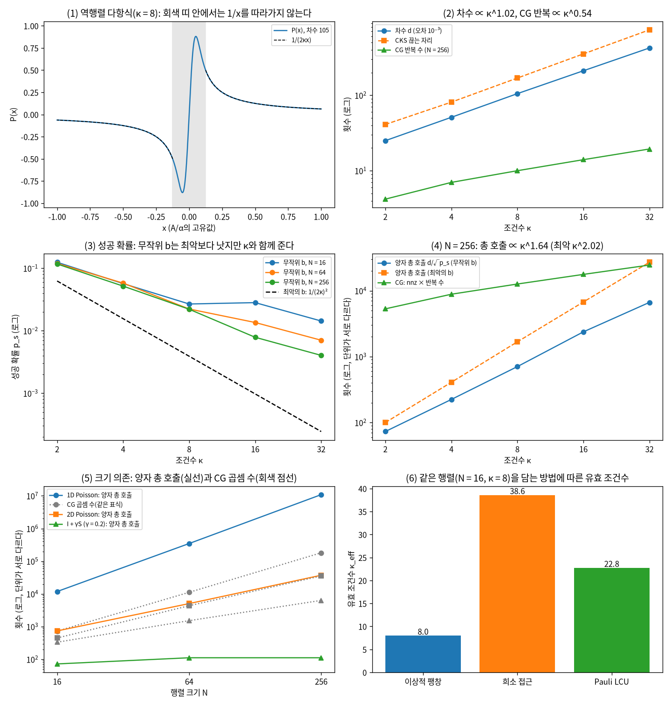

# 20장 사례 1: 선형계와 블록 인코딩

2026-11-11 · Gosh

양자컴퓨팅 입문·심화서 · 4부 실용 알고리즘 탐색·구현 · 이 장을 마치면 A x = b를 QSVT로 푸는 회로를 다항식 → 위상 → 블록 인코딩 → 성공 확률의 순서로 끝까지 조립하고, 그 비용을 19장에서 미리 적어 둔 기준에 대어 판정할 수 있다.

## 1. 요약

19장의 사전 등록 표(20장 행)의 설정대로 실행했다. 잘 조건화된 희소 행렬 족 I + γS에서 조건수 κ를 2, 4, 8, 16, 32로, 크기 N을 16, 64, 256으로 바꿔 가며 QSVT 역행렬을 돌리고 해의 오차 10⁻³까지 드는 비용을 쟀다. **두 통과 기준은 모두 통과했다.** N = 256에서 다항식 차수의 κ 지수는 1.02(기준 1 ± 0.2)이고, 진폭 증폭까지 넣은 총 호출 수 d/√p\_s의 κ 지수는 1.64(기준 1.3 이상 2.3 이하)다.

통과가 뜻하는 것은 "이 방법의 비용이 이론대로 자란다"까지다. 같은 실행에서 잰 나머지 숫자들은 이 사례가 여전히 **조건부** 이득 후보라는 것을 보여 준다.

1. **차수는 κ에 비례한다.** 오차 10⁻³에서 d = 25, 51, 105, 211, 423(κ = 2\~32)이고 d/κ는 12.5에서 13.2로 모인다. 차수는 N과 무관하다(κ = 8이면 N = 16, 64, 256 모두 105).
2. **위상은 Newton 법 4\~5회로 구해진다.** 차수 423의 위상 424개까지 계수 잔차 5.4×10⁻¹⁴ 이하. 블록 인코딩 위의 QSVT는 목표 다항식과 10⁻¹³ 안에서(반올림 수준) 같고, 해의 오차는 모든 설정에서 7.5×10⁻⁴ 이하다.
3. **성공 확률이 비용의 나머지 절반이다.** 최악의 b에서 p\_s = 1/(2κ)²이고 총 호출의 지수는 2.02다. 무작위 b는 N = 256에서 성공 확률이 최악보다 1.9\~16.5배 크지만, 판정 뒤의 사후 확인에서 N을 4,096까지 늘려 기댓값으로 다시 재면 지수가 1.38(N = 16)에서 1.71로 올라간다.
4. **블록 인코딩의 α가 조건수에 곱해진다.** 본 실험은 α = 1인 이상적인 블록 인코딩으로 호출 수만 셌다. 같은 행렬을 희소 접근 방식으로 담으면 유효 조건수 κ\_eff = ακ가 8\~10배가 되고 차수도 그만큼 는다.
5. **게이트로 끝까지 풀어 보면 지금의 장치로는 닿지 않는다.** 4큐비트 행렬(κ = 4)을 LCU로 담은 10큐비트 회로는 게이트 35,208개, 2큐비트 게이트 14,178개다. 상태 벡터로 돌린 결과는 다항식과 4.5×10⁻¹⁴ 안에서 같지만, 14장의 공개 중앙값(CZ 오류율 3.0×10⁻³)이면 rG = 42.5, 부록 A 실행 당일의 보정값(가운데 2.0×10⁻³)이면 28.4다. 같은 문제를 CG는 곱셈 560번에 푼다.
6. **조건이 맞지 않는 족에서는 길이 없다.** 1차원 Poisson 행렬은 κ ∝ N^1.96이어서 양자 총 호출이 N^2.46으로 자란다. CG의 곱셈 수 N^1.99보다 가파르다. 2차원에서는 두 지수가 비슷하고(1.41 대 1.58), 고전 쪽에는 O(N)의 멀티그리드가 있다.

결론: 19장의 판정 "조건부 이득 후보"를 유지한다. 조건은 넷이다 — κ가 N과 함께 자라지 않을 것, 블록 인코딩의 α가 작을 것, b를 싸게 준비할 수 있을 것, 출력이 기댓값 몇 개일 것(7절). 19장이 적어 둔 예상("통과. 다만 이 크기의 벽시계 시간은 CG가 압도한다")도 그대로 맞았다.

## 2. 직관 먼저 — 나눗셈을 다항식으로 바꾼다

양자 회로는 유니터리다. 벡터에 A⁻¹을 곱하는 일은 유니터리가 아니므로 그대로는 할 수 없다. 16장의 QSVT가 주는 것은 "블록 인코딩된 행렬 A에 다항식 P를 적용한 P(A)"다. 그래서 선형계를 푸는 일은 **1/x를 흉내 내는 다항식을 고르는 일**로 바뀐다. A의 고유값이 λ이면 P(A)는 그 고유벡터 성분에 P(λ)를 곱하므로, 고유값이 있는 구간에서 P(λ) ∝ 1/λ이면 P(A)b ∝ A⁻¹b다.

**비유 — 채널 등화기.** 음성 신호가 채널 H(f)를 지나며 왜곡됐을 때 FIR 필터로 1/H(f)를 근사해 되돌리는 것이 등화다. 채널 응답이 0에 가까운 주파수(깊은 골)가 있으면 그 근처에서 1/H(f)가 급하게 솟아 필터 탭이 길어진다. 가장 큰 이득과 가장 작은 이득의 비가 조건수 κ이고, 필터 길이가 다항식의 차수 d다. 골이 깊을수록(κ가 클수록) 탭이 많이 든다는 것이 이 장의 첫 번째 결과(d ∝ κ)다. 비유가 깨지는 곳: 등화기는 신호 전체에 그대로 작용하지만 QSVT의 결과는 보조 큐비트를 0으로 측정했을 때만 남는다. 그 확률 p\_s가 κ와 함께 줄어들고, 이것이 비용의 나머지 절반이다. 또 등화기의 출력은 읽을 수 있는 신호지만 QSVT의 출력은 양자 상태여서 성분을 다 읽으려면 N에 비례하는 반복이 든다.

**손으로 푸는 예.** A = diag(1, 1/2)이면 κ = 2다. 이상적인 함수 f(x) = 1/(2κx) = 1/(4x)를 쓰면 f(A) = diag(1/4, 1/2)다. 앞의 1/(2κ)는 다항식의 크기를 1 아래로 누르려고 붙인 것이다(3절).

| b | f(A)b | 성공 확률 p\_s = ‖f(A)b‖² | 정규화한 해 | (π/2)/√p\_s |
| --- | --- | --- | --- | --- |
| (1, 1)/√2 | (0.1768, 0.3536) | 0.15625 | (0.4472, 0.8944) | 3.97 |
| (1, 0) — 가장 큰 고유값 쪽 | (0.25, 0) | 0.0625 = 1/(2κ)² | (1, 0) | 6.28 |
| (0, 1) — 가장 작은 고유값 쪽 | (0, 0.5) | 0.25 | (0, 1) | 3.14 |

해의 방향은 맞게 나온다((1, 2)/√5). 눈여겨볼 것은 p\_s가 b에 따라 4배 차이 난다는 점이다. b가 큰 고유값 쪽에 몰려 있으면 A⁻¹b가 짧아서 성공 확률이 낮고, 작은 고유값 쪽에 몰려 있으면 높다. 최악은 1/(2κ)², 최선은 1/4이다. 5절의 본 실험은 이 범위 안에서 무작위 b가 어디에 떨어지는지를 잰다.

**손잡이는 셋이다.** (1) 차수 d — κ와 정밀도 ε이 정한다. (2) 성공 확률 p\_s — κ와 b가 정한다. (3) 블록 인코딩의 α — 행렬을 회로에 담는 방식이 정하고, 다항식이 보는 조건수를 κ에서 ακ로 키운다. 총 비용은 대략 (블록 인코딩 한 번의 게이트 수) × d × (π/2)/√p\_s 다.

## 3. 정의와 수식 — 문제, 다항식, 위상, 성공 확률

**양자 선형계 문제(QLSP).** N × N 에르미트 행렬 A(‖A‖ ≤ 1, 고유값의 절댓값이 \[1/κ, 1\] 안)와 상태 |b⟩를 준비하는 회로가 주어졌을 때, 정규화한 해

```latex
|x\rangle = \frac{A^{-1}|b\rangle}{\|A^{-1}|b\rangle\|}
```

와 거리 ε 안에 있는 상태를 만드는 문제다. 고전 선형계와 다른 점이 둘 있다. 출력이 벡터가 아니라 상태이고(성분을 읽는 것은 별도 비용), 입력 A와 b가 "회로로 접근할 수 있다"는 가정 아래 주어진다. A가 에르미트가 아니면 \[\[0, A\], \[A†, 0\]\]으로 크기를 두 배로 늘려 에르미트로 만든다.

**블록 인코딩과 유효 조건수.** 16장의 정의대로 유니터리 U의 왼쪽 위 블록이 A/α이면 U는 A의 블록 인코딩이다. QSVT의 다항식은 A가 아니라 A/α에 적용되므로, 다항식이 1/x를 따라가야 하는 구간은 \[1/κ, 1\]이 아니라 \[λ\_min/α, ‖A‖/α\]다. 이 구간의 아래 끝의 역수가 유효 조건수다.

```latex
\kappa_{\mathrm{eff}} = \frac{\alpha}{\lambda_{\min}}\qquad(\|A\| = 1\ \text{이면}\ \kappa_{\mathrm{eff}} = \alpha\,\kappa)
```

**역행렬 다항식(Childs–Kothari–Somma 2017).** 1/x는 0에서 발산하므로 \[−1, 1\] 전체에서 다항식으로 근사할 수 없다. 대신 0 근처를 매끄럽게 눌러 놓은 함수를 쓴다.

```latex
g_\beta(x) = \frac{1-(1-x^2)^\beta}{x},\qquad
g_\beta(x) = 4\sum_{j=0}^{\beta-1}(-1)^j\left[2^{-2\beta}\sum_{i=j+1}^{\beta}\binom{2\beta}{\beta+i}\right]T_{2j+1}(x)
```

지수 β는 양의 정수다(CKS의 기호는 b인데, 이 장에서는 우변 벡터 b와 겹치지 않게 β로 쓴다. 스크립트 출력의 b 열이 이것이다). 구간 |x| ≥ 1/κ에서 (1 − x²)^β ≤ e^{−β/κ²}이므로 β = ⌈κ² ln(2/ε)⌉이면 x·g\_β(x)가 1에서 ε/2 이상 벗어나지 않는다(연습문제 2). 대괄호 안은 공정한 동전을 2β번 던져 앞면이 β + j번을 넘을 확률이어서 j가 √β를 넘으면 지수적으로 작아진다. 그래서 합을 j ≈ √(β·ln(1/ε)) 근처에서 끊을 수 있고, 차수는 d ≈ 2j ∝ κ·ln(1/ε)가 된다. 이 장이 쓰는 다항식은 끊은 것을 2κ로 나눈

```latex
P(x) = \frac{1}{2\kappa}\,\tilde g_\beta(x)\ \approx\ \frac{1}{2\kappa x}\quad(|x|\in[1/\kappa,1]),\qquad \text{상대 오차}\ \sup_{x\in[1/\kappa,1]}|2\kappa\,x\,P(x)-1|\le\varepsilon
```

이다. 2κ로 나누는 이유는 QSVT가 \[−1, 1\] 전체에서 |P| ≤ 1인 다항식만 구현하기 때문이다. g\_β는 |x| < 1/κ인 틈에서 κ보다 크게 솟는다(그림 1). CKS는 1/x에 대한 절대 오차 ε을 기준으로 지수 κ² log(κ/ε)와 끊는 자리 j₀ = √(β log(4β/ε))를 준다(보조정리 17\~19). 이 장은 정규화한 해의 오차를 보므로 상대 오차 기준이고, 끊는 자리는 격자에서 상대 오차가 ε 이하인 가장 낮은 차수로 정했다.

**QSP 위상과 QSVT.** 16장은 반사 규약으로 QSVT를 적었다. 위상을 구할 때는 회전 규약(W\_x)이 편하다. W(x) = \[\[x, i√(1−x²)\], \[i√(1−x²), x\]\]로 두고

```latex
U_\Phi(x) = e^{i\phi_0 Z}\prod_{j=1}^{d} W(x)\,e^{i\phi_j Z},\qquad \mathrm{Im}\,\langle 0|U_\Phi(x)|0\rangle = P(x)
```

가 되는 대칭 위상(φ\_j = φ\_{d−j})을 찾는다. 실수 계수에 패리티가 정해지고 \[−1, 1\]에서 |P| < 1인 다항식에는 이런 위상이 있다(Wang–Dong–Lin 2022, 정리 1. 대칭 위상을 처음 제안한 것은 Dong et al. 2021). 이 장의 다항식은 max|P| ≤ 0.898로 이 조건을 만족한다. 미지수는 위상의 오른쪽 절반 (d + 1)/2개이고, 풀 식은 "위상 → Im 부분의 체비쇼프 계수" 사상 F에 대한 F(Φ) = c다. Φ = 0에서 F의 야코비안은 2I이므로(Dong–Lin–Ni–Wang 2024, 보조정리 16) Φ ≈ c/2에서 출발해 Newton 법으로 푼다. 같은 논문의 고정점 반복은 ‖c‖₁ ≤ 0.861에서 수렴이 증명돼 있는데 이 장의 다항식은 ‖c‖₁ = 1.56이어서 그 범위 밖이다. 그래서 Newton 법을 쓰고 수렴은 수치로 확인한다(5절 (2)).

블록 인코딩 U가 에르미트이면(이 장의 두 가지 블록 인코딩이 모두 그렇다. LCU 쪽은 작업 큐비트가 00인 부분공간에서) U는 반사이고, 사영 Π(보조 = 0)에 대한 Z\_Π = 2Π − I를 써서 W = i·e^{−iπ/4·Z\_Π} U e^{−iπ/4·Z\_Π}로 바꿀 수 있다. 대입하면 회로에 그대로 쓰는 꼴이 된다.

```latex
U_\Phi = i^{d}\; e^{i(\phi_0-\pi/4)Z_\Pi}\; U\; e^{i(\phi_1-\pi/2)Z_\Pi}\; U \cdots U\; e^{i(\phi_d-\pi/4)Z_\Pi}
```

U를 d번, 사영 위상 회전을 d + 1번 쓴다. 16장 6절의 규약 변환(양 끝 π/4, 안쪽 π/2)과 같은 식이다.

**Im 부분 꺼내기.** U\_Φ의 Π 블록은 P가 허수부에 들어 있는 복소 다항식이다. 위상의 부호를 모두 뒤집은 U\_{−Φ}의 블록은 그 켤레이므로

```latex
\frac{U_\Phi - U_{-\Phi}}{2i}\ \text{의}\ \Pi\ \text{블록} = P(A/\alpha)
```

다. 부호 보조 큐비트 하나를 |+⟩로 두고 그 값에 따라 위상의 부호를 바꾼 뒤 H를 걸어 1을 얻으면 이 차가 구현된다. 추가 손실은 없다(진폭이 정확히 P(A/α)b다).

**성공 확률과 총 호출 수.** P(A/α) ≈ (α/(2κ\_eff))·A⁻¹ = (λ\_min/2)·A⁻¹이므로

```latex
p_s = \|P(A/\alpha)\,b\|^2 \approx \frac{\lambda_{\min}^2}{4}\,\|A^{-1}b\|^2
\ \overset{\|A\|=1}{=}\ \frac{\|A^{-1}b\|^2}{(2\kappa)^2},\qquad \frac{1}{4\kappa^2}\le p_s\le\frac14
```

α는 p\_s에 들어가지 않는다. α가 커지면 다항식이 더 좁은 구간까지 1/x를 따라가야 해서 차수가 늘 뿐이다(연습문제 4). 진폭 증폭(9장)을 쓰면 반복 m = ⌊π/(4θ)⌋회(sin θ = √p\_s)에 QSVT 회로와 그 역을 합쳐 2m + 1번 쓰므로

```latex
\text{총 호출 수} = (2m+1)\,d\ \approx\ \frac{\pi}{2}\cdot\frac{d}{\sqrt{p_s}}
```

다. 사전 등록 지표는 상수 π/2를 뺀 d/√p\_s다. 최악의 b(p\_s = 1/(4κ²))에서 d ∝ κ와 합쳐 κ²이 된다.

**알고리즘 비교.** 호출 수는 블록 인코딩(또는 희소 접근 오라클) 기준이고, Õ는 로그 인자를 생략한 표기다.

| 방법 | κ 의존 | ε 의존 | 비고 |
| --- | --- | --- | --- |
| HHL (2009) | κ² | 1/ε | QPE로 고유값을 읽고 회전. 해밀토니안 시뮬레이션 필요 |
| Ambainis (2012) | κ·log³κ | 1/ε³ | 가변 시간 진폭 증폭(VTAA)으로 κ² → κ |
| CKS (2017), 체비쇼프 | κ²(VTAA 쓰면 κ) | polylog(1/ε) | 이 장의 다항식의 출처. QPE를 없애 ε 의존을 지수적으로 개선 |
| QSVT (Gilyén et al. 2019) | 차수 κ·log(κ/ε), 진폭 증폭 포함 κ² | log(1/ε) | 이 장의 구현 |
| 이산 단열(Costa et al. 2022) | κ | log(1/ε) | 최적. 하한 Ω(κ)와 일치 |
| 고전 CG(양의 정부호) | √κ 반복 × nnz | log(1/ε) | 반복마다 희소 행렬–벡터 곱 한 번 |

κ에 대해 양자 쪽이 κ^{1−δ}로 내려갈 수는 없다(그러면 BQP = PSPACE; HHL 2009). 고전 CG는 양의 정부호 행렬에서 √κ인데, 양자 쪽은 양의 정부호로 한정해도 일반적으로 κ에 선형이다(Orsucci–Dunjko 2021). 그러니 **κ만 보면 양자 쪽이 불리하다.** 양자 쪽의 이득은 N 의존(log N 대 nnz ≈ sN)에서만 나온다.

**교과서 비교.** N&C와 KLM에는 선형계 알고리즘이 없다(HHL이 2009년에 나왔다). 재료는 두 책에 있다. N&C 5.2절(QPE)과 6.1절(Grover 반복 횟수), KLM 8장(진폭 증폭)이다. HHL은 QPE로 고유값을 레지스터에 적고 1/λ에 비례하는 회전을 거는 구성이어서 5장의 연장으로 읽을 수 있다. 이 장은 QPE를 쓰지 않는 QSVT 구성을 따른다. 고유값을 읽지 않고 다항식으로 직접 변환하므로 정밀도 의존이 1/ε에서 log(1/ε)로 준다.

## 4. 회로 구성 — numpy 구현과 Qiskit

**파이프라인.** `ch20_linear_systems.py`(numpy 구현, 실행 완료)는 다음 순서로 간다.

1. `inv_cheb`, `min_degree` — g\_β의 체비쇼프 계수를 이항 분포의 꼬리 확률(`scipy.stats.binom.sf`)로 구하고, 격자 4,201점에서 상대 오차가 ε 이하인 가장 낮은 홀수 차수에서 끊는다.
2. `solve_qsp` — 체비쇼프 마디에서 Im⟨0|U\_Φ|0⟩를 계산해 계수로 바꾸는 사상 F를 만들고, 야코비안을 차분으로 구해 Newton 법을 돌린다. 16장은 최소제곱 맞춤으로 위상을 구했는데, 이 장은 차수가 수백이어서 F의 구조(0에서의 야코비안이 2I)를 쓰는 Newton 법으로 바꿨다.
3. `family`, `dilation` — 행렬 A = (I + γS)/‖I + γS‖를 만들고(S는 크기마다 하나로 고정, γ만 이분법으로 맞춘다) 블록 인코딩한다.
4. `qsvt_apply`, `qsvt_solve` — 3절의 U\_Φ 식대로 U와 사영 위상을 번갈아 벡터에 적용하고 (U\_Φ − U\_{−Φ})/(2i)를 꺼낸다.
5. `cg_error_iters` — 켤레 기울기법을 직접 돌려 해의 상대 오차가 10⁻³ 이하가 되는 첫 반복 수를 센다(잔차가 아니라 해의 오차로 멈춘다 — 양자 쪽과 같은 기준).

**블록 인코딩 두 가지.** 본 실험(5절 (3)·(4))은 유니터리 팽창을 쓴다.

```latex
U = \begin{pmatrix} A & \sqrt{I-A^2} \\ \sqrt{I-A^2} & -A \end{pmatrix}
```

보조 큐비트 하나, α = 1, 에르미트이면서 유니터리다. 이것은 회로가 아니라 행렬이다. 만들려면 √(I − A²)를 고전 컴퓨터로 계산해야 하고(대각화나 그에 맞먹는 계산) 그 비용이 선형계를 직접 푸는 것 이상이므로 실제 장치에서는 쓸 수 없다. "블록 인코딩을 몇 번 부르는가"만 세는 실험에 쓴다. 호출 한 번이 게이트 몇 개인지는 아래의 두 번째 구성으로 본다.

두 번째는 게이트 리스트로 끝까지 짠 LCU 블록 인코딩이다(5절 (6)). 행렬은 A = I + γ(Σ Z\_i Z\_{i+1} + Σ X\_i), n = 4, κ = 4로 16장의 TFIM 항에 항등 항을 더한 것이다. 항 8개(I 1 + ZZ 3 + X 4), 계수 (1, γ, …, γ), α = 1 + 7γ.

| 큐비트(빅 엔디안) | 역할 |
| --- | --- |
| 0 | 부호 보조 c — Im 부분 꺼내기 |
| 1, 2, 3 | 색인 a₀a₁a₂ — LCU의 항 번호. Π는 색인 = 000 |
| 4, 5 | 작업 w₁w₂ — "색인 = i"를 w₂에 모으는 Toffoli 2개의 중간값 |
| 6, 7, 8, 9 | 시스템 q₀…q₃ — 처음에 b를 싣는다 |

- **PREP**: 진폭 √(c\_i/α)를 Ry 나무로 싣는다(Ry 3 + 제어 Ry 3 + 이중 제어 Ry 1).
- **SELECT**: 항등이 아닌 항마다 색인이 i일 때만 w₂ = 1이 되게 하고(Toffoli 2개), w₂로 제어한 Pauli를 건 뒤(ZZ는 CZ 2개, X는 CX 1개) 되돌린다. 가장 단순한 구성이고, unary iteration(Babbush et al. 2018)을 쓰면 Toffoli 수가 줄어든다.
- **사영 위상**: 색인 = 000을 w₂에 모으면 Z\_Π = −Z\_{w₂}다. e^{i(σφ − η)Z\_Π}(σ = ±1은 부호 보조의 값, η는 π/4 또는 π/2)는 e^{−iφ·Z\_c Z\_{w₂}}와 e^{+iη·Z\_{w₂}}의 곱이므로 ZZ 회전 하나와 Rz 하나다.
- **전체**: H(c) → 사영 위상(φ\_d) → \[U → 사영 위상(φ\_k)\]를 k = d − 1, …, 0으로 → H(c). 부호 보조 1, 색인 000을 얻으면 시스템에 P(A/α)b가 남는다. 작업 큐비트는 매번 00으로 돌아온다.

**게이트 비용 기록(이 책의 규칙).** 세는 법은 10장과 같다: 기저는 CX + 임의의 1큐비트 게이트(전결합), CZ는 2큐비트 게이트 1개, Toffoli = 6 CX + T 7개, 제어 회전 = 2 CX + 회전 2개, e^{−iθZZ} = 2 CX + Rz 1개; 깊이는 ASAP 층 수다. 일반 각도의 회전은 수 R로 적고 T ≈ 3·log₂(1/ε\_합성)·R로 어림한다(회전 하나의 합성 오차 ε\_합성 = 10⁻⁶이면 회전당 약 60). 다만 이 회로는 회전이 1,892개여서 회전당 10⁻⁶이면 합성 오차의 합이 해의 오차 목표 10⁻³을 넘을 수 있다(0장 3절). 회전당 오차를 한 자리 더 줄이면 T는 회전당 약 10개씩 는다. 아래는 스크립트 6번이 게이트 리스트를 짜서 `tools/gate_cost.py`로 센 값이고, 리스트를 10큐비트 상태 벡터에 적용한 결과가 다항식과 같은지 확인한 뒤에 적었다.

| 대상 | 큐비트 | 2큐비트 게이트 | 깊이 | T | 회전 R | 비고 |
| --- | --- | --- | --- | --- | --- | --- |
| U 한 번(PREP·SELECT·PREP†) | 9 | 206 | 327 | 196 | 30 | Toffoli 28개(항 7개 × 4) |
| 사영 위상 한 번 | 6 | 26 | 44 | 28 | 1 | Toffoli 4개 + ZZ 회전 1 |
| QSVT 한 번(d = 61, 진폭 증폭 없음) | 10 | 14,178 | 22,675 | 13,692 | 1,892 | 61 × 206 + 62 × 26 = 14,178. 전개한 게이트 35,208개. T ≈ 13,692 + 113,132 |
| 진폭 증폭 포함 | 10 | 99,246 | — | — | — | 반복 3회, QSVT 회로 2m + 1 = 7번(어림 (π/2)/√p\_s = 7.3배). b 준비와 반사의 비용은 뺀 값 |

**Qiskit 스니펫(작성됨, 미실행).** Qiskit에는 QSVT 클래스가 없으므로(16장) 3절의 식을 그대로 회로로 옮긴다. 블록 인코딩은 팽창 행렬을 `UnitaryGate`로 넣고, 위상과 행렬은 스크립트가 남긴 `ch20_case.json`(N = 16, κ = 2, 차수 25)에서 읽는다. 같은 게이트 열을 Qiskit의 RZZ·RZ 정의대로 numpy에서 돌린 결과는 i^(1−d)·P(A)b와 10⁻¹⁴ 안에서(반올림 수준) 같다(스크립트의 `snippet_check`). Qiskit 자체는 아직 돌리지 않았다.

```python
# qiskit==2.5.x — 작성됨, 미실행
import json
import numpy as np
from qiskit import QuantumCircuit
from qiskit.circuit.library import UnitaryGate
from qiskit.quantum_info import Statevector

case = json.load(open("ch20_case.json"))                     # ch20_linear_systems.py 가 만든 사례
A, b, phis = np.array(case["A"]), np.array(case["b"]), np.array(case["phis_wx"])
n, d = 4, len(phis) - 1                                      # 시스템 4큐비트, 차수 25
w, V = np.linalg.eigh(A); B = (V * np.sqrt(np.clip(1 - w * w, 0, None))) @ V.T
U = UnitaryGate(np.block([[A, B], [B, -A]]), label="U_A")    # 팽창: [[A, √(I−A²)], [√(I−A²), −A]]

sys_q, anc, sgn = list(range(n)), n, n + 1                   # Qiskit 은 번호가 큰 큐비트가 상위 비트
shift = np.full(d + 1, np.pi / 2); shift[[0, -1]] = np.pi / 4

def proj_phase(qc, phi, sh):                                 # e^{i(s·phi − sh) Z_anc}, s = +1(sgn = 0), −1(sgn = 1)
    qc.rzz(-2 * phi, sgn, anc)                               # RZZ(θ) = exp(−iθ/2·Z⊗Z) → e^{+i·phi·Z_sgn·Z_anc}
    qc.rz(2 * sh, anc)                                       # RZ(θ) = exp(−iθ/2·Z)   → e^{−i·sh·Z_anc}

qc = QuantumCircuit(n + 2)
qc.h(sgn)
proj_phase(qc, phis[d], shift[d])
for k in range(d - 1, -1, -1):
    qc.append(U, sys_q + [anc])                              # 목록의 마지막(anc)이 행렬의 상위 비트
    proj_phase(qc, phis[k], shift[k])
qc.h(sgn)

psi0 = np.zeros(2 ** (n + 2), complex); psi0[: 2 ** n] = b   # sgn = 0, anc = 0, 시스템 = b
out = Statevector(psi0).evolve(qc).data
blk = out[2 ** (n + 1): 2 ** (n + 1) + 2 ** n]               # sgn = 1, anc = 0 인 블록
x = (blk / 1j ** (1 - d)).real; x /= np.linalg.norm(x)
print(round(float(np.linalg.norm(blk) ** 2), 4))             # 성공 확률 0.1249 예상
print(np.linalg.norm(x - np.array(case["x_normalized"])))    # 해의 오차 약 6.0e-04 예상
```

핵심 세 줄: `qc.append(U, sys_q + [anc])` — `UnitaryGate`의 행렬은 건넨 큐비트 목록의 첫 번째를 최하위 비트로 읽으므로 보조를 마지막에 둬야 A가 "보조 = 0" 블록에 온다. `qc.rzz(-2 * phi, sgn, anc)` — 부호 보조가 1이면 위상의 부호가 뒤집혀 U\_Φ와 U\_{−Φ}가 한 회로에 겹쳐진다. `out[2 ** (n + 1): …]` — Qiskit의 리틀 엔디안에서 sgn(큐비트 n + 1) = 1, anc(큐비트 n) = 0인 구간이다. 이 책의 빅 엔디안으로 옮기면 시스템 색인의 상위 비트가 Qiskit의 큐비트 n − 1이다.

## 5. 실행 결과

모든 수치는 `ch20_linear_systems.py`의 출력(`ch20_stdout.txt`)이다. 끝의 회귀 검사가 판정에 쓰는 값과 표의 값 대부분을 고정한다(실행 시간처럼 기계에 따라 달라지는 값은 뺀다).

**(1) 역행렬 다항식.** 오차 10⁻³에서 κ마다 필요한 차수다. "꼬리 합 상한"은 버린 계수의 절댓값 합으로 상대 오차 ε을 보장하는 차수다. "CKS 끊는 자리"는 논문의 j₀ = √(β log(4β/ε))에 이 장의 β를 넣은 2j₀ + 1이고, 참고로만 적는다(이 장의 상대 오차 기준에 대한 상한은 아니다).

| κ | β | 차수 d | 꼬리 합 상한 | CKS 끊는 자리 | 상대 오차 | max\|P\| | ‖c‖₁ | d/κ |
| --- | --- | --- | --- | --- | --- | --- | --- | --- |
| 2 | 31 | 25 | 29 | 41 | 7.30×10⁻⁴ | 0.898 | 1.56 | 12.50 |
| 4 | 122 | 51 | 59 | 81 | 9.78×10⁻⁴ | 0.884 | 1.56 | 12.75 |
| 8 | 487 | 105 | 123 | 169 | 9.57×10⁻⁴ | 0.881 | 1.56 | 13.12 |
| 16 | 1,946 | 211 | 257 | 353 | 9.83×10⁻⁴ | 0.880 | 1.56 | 13.19 |
| 32 | 7,784 | 423 | 533 | 735 | 9.90×10⁻⁴ | 0.880 | 1.56 | 13.22 |

로그-로그 맞춤의 기울기는 1.021이다. g\_β 자체의 차수는 2β − 1(κ = 32에서 15,567)인데 끊으면 423으로 충분하다. 정밀도 의존은 κ = 8에서 ε = 10⁻², 10⁻³, 10⁻⁴, 10⁻⁶에 d = 67, 105, 139, 211이다. 자릿수를 하나 늘릴 때 차수가 곱이 아니라 덧셈으로 는다. 다만 ε을 줄이면 틈 안에서 다항식이 더 높이 솟아 max|P|가 0.740, 0.881, 1.005, 1.216으로 커진다. ε = 10⁻⁴에서 이미 1을 막 넘는다. 1을 넘으면 그대로는 QSVT에 쓸 수 없어 전체를 더 줄여야 하고 그만큼 성공 확률이 준다(Gilyén et al. 2019의 따름정리 69는 크기가 1 이하로 묶인 근사 다항식을 따로 만든다). 이 장의 ε = 10⁻³에서는 1/(2κ)로 충분하다.

**(2) QSP 위상.**

| κ | 차수 d | 위상 수 | Newton 갱신 횟수 | 계수 잔차 | 조밀 격자(4,001점)에서 Im 부분과 P의 최대 차 |
| --- | --- | --- | --- | --- | --- |
| 2 | 25 | 26 | 5 | 2.8×10⁻¹⁶ | 3.9×10⁻¹⁵ |
| 4 | 51 | 52 | 4 | 5.4×10⁻¹⁴ | 3.4×10⁻¹³ |
| 8 | 105 | 106 | 4 | 1.8×10⁻¹⁴ | 2.4×10⁻¹³ |
| 16 | 211 | 212 | 4 | 8.1×10⁻¹⁵ | 2.1×10⁻¹³ |
| 32 | 423 | 424 | 4 | 4.0×10⁻¹⁵ | 2.3×10⁻¹³ |

위상 0에서의 야코비안은 2I와 1.3×10⁻¹²까지 같다(κ = 2, 13 × 13). 위상은 작다. κ = 8에서 가장 큰 것이 0.062 rad(가운데 두 개)이고 양 끝은 4.93×10⁻⁵ rad다. 3절의 식에서 π/4와 π/2를 빼기 전의 값이므로 회로에 들어가는 각이 작다는 뜻은 아니다. Newton 법은 d = 423을 약 5초에 푼다(야코비안을 차분으로 구하는 단순 구현의 시간이다). 한 가지 더 적어 둔다. 계수를 Σ c\_{2j+1} z^j로 놓고 단위원 위에서 크기를 재면 최댓값이 ‖c‖₁과 같은 1.56이다(계수의 부호가 번갈기 때문이다). \[−1, 1\]에서는 |P| ≤ 0.9인데 단위원에서는 1을 넘는다. 이 차이가 6절에서 PennyLane의 위상 해법을 그대로 쓰지 못하는 이유다.

**(3) 본 실험 — I + γS 족.** S는 19장과 같은 방식으로 뽑은 무작위 대칭 희소 행렬(A의 행당 비영 원소는 대각을 넣어 평균 약 5개)이고 크기마다 하나로 고정했다. b는 설정마다 무작위 단위 벡터 10개다. "QSVT − 다항식"은 회로를 따라 적용한 결과와 고유분해로 계산한 P(A)b의 최대 차이고 모든 행에서 10⁻¹³ 미만이다(반올림 수준 — 끝자리는 계산하는 컴퓨터마다 다르다). p\_s의 표본 평균은 공식 ‖A⁻¹b‖²/(2κ)²의 평균과 0.2% 안에서 같다(최대 0.18%; 차이는 다항식의 오차 10⁻³에서 온다).

| N | κ | 차수 d | nnz | 해의 오차(최대) | p\_s(무작위 b 평균) | p\_s(최악의 b) | 총 호출 d/√p\_s | 총 호출(최악) | CG 반복 | CG nnz × 반복 |
| --- | --- | --- | --- | --- | --- | --- | --- | --- | --- | --- |
| 16 | 2 | 25 | 74 | 6.39×10⁻⁴ | 0.1248 | 0.0626 | 71 | 100 | 4.1 | 303 |
| 16 | 4 | 51 | 74 | 6.32×10⁻⁴ | 0.0569 | 0.0156 | 214 | 408 | 6.0 | 444 |
| 16 | 8 | 105 | 74 | 5.36×10⁻⁴ | 0.0268 | 0.00391 | 641 | 1,679 | 8.0 | 592 |
| 16 | 16 | 211 | 74 | 7.47×10⁻⁴ | 0.0282 | 0.000975 | 1,257 | 6,757 | 8.8 | 651 |
| 16 | 32 | 423 | 74 | 6.82×10⁻⁴ | 0.0143 | 0.000244 | 3,535 | 27,090 | 9.8 | 725 |
| 64 | 2 | 25 | 298 | 5.34×10⁻⁴ | 0.1196 | 0.0626 | 72 | 100 | 4.4 | 1,311 |
| 64 | 4 | 51 | 298 | 6.71×10⁻⁴ | 0.0579 | 0.0156 | 212 | 408 | 6.9 | 2,056 |
| 64 | 8 | 105 | 298 | 6.09×10⁻⁴ | 0.0223 | 0.00391 | 703 | 1,679 | 9.0 | 2,682 |
| 64 | 16 | 211 | 298 | 7.19×10⁻⁴ | 0.0136 | 0.000975 | 1,812 | 6,757 | 11.1 | 3,308 |
| 64 | 32 | 423 | 298 | 7.36×10⁻⁴ | 0.0070 | 0.000244 | 5,038 | 27,090 | 12.7 | 3,785 |
| 256 | 2 | 25 | 1,266 | 5.07×10⁻⁴ | 0.1171 | 0.0626 | 73 | 100 | 4.2 | 5,317 |
| 256 | 4 | 51 | 1,266 | 6.10×10⁻⁴ | 0.0518 | 0.0156 | 224 | 408 | 7.0 | 8,862 |
| 256 | 8 | 105 | 1,266 | 5.06×10⁻⁴ | 0.0221 | 0.00391 | 706 | 1,679 | 10.0 | 12,660 |
| 256 | 16 | 211 | 1,266 | 5.77×10⁻⁴ | 0.0079 | 0.000975 | 2,380 | 6,757 | 14.0 | 17,724 |
| 256 | 32 | 423 | 1,266 | 6.56×10⁻⁴ | 0.0040 | 0.000244 | 6,659 | 27,090 | 19.4 | 24,560 |

표의 두 "총 호출" 열과 "CG nnz × 반복" 열은 단위가 다르다. 앞의 둘은 블록 인코딩 호출 수이고 뒤는 실수 곱셈 수다. 블록 인코딩 호출 하나는 (6)에서 보듯 2큐비트 게이트 수백 개이므로 두 열을 그대로 견주면 안 된다. N = 16에서 p\_s가 κ = 8 → 16에서 0.0268 → 0.0282로 오른 것은 b를 설정마다 새로 뽑은 표본 10개의 흔들림이다.

**(4) 사전 등록 기준에 대한 결과.**

| 기준(19장 5절) | 결과 | 판정 |
| --- | --- | --- |
| N = 256에서 차수의 κ 지수가 1 ± 0.2 | 1.02 | 통과 |
| N = 256에서 총 호출 수 d/√p\_s의 κ 지수가 1.3 이상 2.3 이하 | 1.64 | 통과 |
| (검산) 차수가 N과 무관 | κ = 8의 차수가 N = 16, 64, 256에서 105, 105, 105 | 확인 |

크기별 지수는 다음과 같다.

| N | 차수 | 총 호출(무작위 b) | 총 호출(최악의 b) | CG 반복 |
| --- | --- | --- | --- | --- |
| 16 | 1.02 | 1.38 | 2.02 | 0.31 |
| 64 | 1.02 | 1.53 | 2.02 | 0.37 |
| 256 | 1.02 | 1.64 | 2.02 | 0.54 |

가설의 세 부분이 모두 확인됐다. 차수는 κ에 선형이고, 최악의 b에서 총 호출은 κ²이며, 무작위 b는 그 사이다. 무작위 b의 성공 확률은 N = 256에서 최악보다 1.9배(κ = 2)\~16.5배(κ = 32) 크다. N = 256에서 CG 반복 수의 지수 0.54는 이론값 1/2과 맞는다(N = 16과 64의 0.31, 0.37이 낮은 것은 CG가 서로 다른 고유값의 수만큼만 걸으면 끝나기 때문이다).

**사전 등록에 대해 밝혀 둘 것.** 19장 7절이 적은 대로 이 행의 문턱(1.3\~2.3)은 독립 검토가 작은 행렬로 예비 계산을 해 본 뒤에 정한 것이어서 엄밀한 뜻의 사전 등록은 아니다. 또 등록에 없던 세부를 이 장이 정했다. 차수는 격자에서 다항식의 상대 오차가 ε 이하인 가장 낮은 차수로 잡았고(실제 해의 오차는 5.1\~7.5×10⁻⁴), 총 호출은 d/√(p\_s의 평균)으로 계산했고, 맞춤에는 κ 다섯 점을 모두 썼다. 이 세부를 바꿔도 판정은 그대로다. 차수의 지수는 꼬리 합 상한이나 CKS 끊는 자리로 재도 1.05이고, 총 호출의 지수는 b마다 d/√p\_s를 구해 평균하면 1.65, 공식의 p\_s로는 1.64, κ = 2\~16만 쓰면 1.67, κ = 4\~32만 쓰면 1.64다.

**사후 확인(사전 등록 밖).** 무작위 b의 지수가 N과 함께 커지는 것이 눈에 띄어서, 판정이 끝난 뒤에 원인을 따로 쟀다. 무작위 단위 벡터에서 E\[b\_i²\] = 1/N이므로 E\[p\_s\] = (1/N)·Σ 1/(2κλ\_i)²를 표본 없이 계산할 수 있고, 가장 작은 고유값 하나만으로도 E\[p\_s\] ≥ 1/(4N)이다. N이 작으면 이 바닥 때문에 p\_s가 덜 줄어 지수가 낮게 나온다.

| N | 총 호출의 κ 지수(기댓값으로) | κ = 32의 E\[p\_s\] | 바닥 1/(4N) | 바닥이 차지하는 몫 |
| --- | --- | --- | --- | --- |
| 16 | 1.38 | 0.01713 | 0.01562 | 91% |
| 64 | 1.58 | 0.00581 | 0.00391 | 67% |
| 256 | 1.64 | 0.00403 | 0.00098 | 24% |
| 1,024 (새로 뽑은 S) | 1.69 | 0.00291 | 0.00024 | 8% |
| 4,096 (새로 뽑은 S) | 1.71 | 0.00263 | 0.00006 | 2% |

N = 256의 판정값 1.64는 표본으로 잰 값과 기댓값이 같다. 크기를 키우면 지수는 1.7 근처로 느리게 올라가고 기준 범위 안에 머문다. N → ∞의 값은 S의 고유값이 아래쪽 끝에 얼마나 몰려 있는지가 정하므로 행렬 족마다 다르다. "무작위 b에서는 κ²보다 낫다"는 말은 맞지만 그 정도는 N = 16의 1.38이 보여 주는 것보다 작다.

**(5) 유효 조건수.** 본 실험의 α = 1은 이상적인 경우다. 희소 접근 오라클로 만드는 블록 인코딩은 α = s·max|a\_ij|다(s는 행당 비영 원소 수의 최댓값; Gilyén et al. 2019 보조정리 48). 같은 행렬(N = 256)에 대입하면 다음과 같다. \* 표시는 κ\_eff가 커서 d ≈ 13.2·κ\_eff로 어림한 값이다.

| κ | s | max\|a\_ij\| | α | κ\_eff = ακ | 차수 d(κ) → d(κ\_eff) | 배율 |
| --- | --- | --- | --- | --- | --- | --- |
| 2 | 11 | 0.8646 | 9.51 | 19.0 | 25 → 251 | 10.0배 |
| 4 | 11 | 0.7969 | 8.77 | 35.1 | 51 → 463 | 9.1배 |
| 8 | 11 | 0.7630 | 8.39 | 67.1 | 105 → 889 | 8.5배 |
| 16 | 11 | 0.7461 | 8.21 | 131.3 | 211 → 1,736\* | 8.2배 |
| 32 | 11 | 0.7376 | 8.11 | 259.6 | 423 → 3,432\* | 8.1배 |

행당 비영 원소는 평균 5개쯤인데 α를 정하는 것은 가장 빽빽한 행(11개)이다. N = 16, κ = 8의 같은 행렬을 세 가지로 담으면 이상적 팽창은 κ\_eff = 8.0, 희소 접근은 α = 4.82로 κ\_eff = 38.6, Pauli LCU는 항 88개에 α = 2.84로 κ\_eff = 22.8이다(그림 6). 성공 확률은 α와 무관하므로(3절) 손해는 차수에만 곱해진다.

**(6) 게이트 리스트로 푼 작은 사례.** n = 4, A = I + γ(Σ Z\_i Z\_{i+1} + Σ X\_i). S의 고유값 범위가 \[−4.7588, 4.7588\]이어서 γ = 0.1261이면 A의 고유값이 \[0.4, 1.6\], κ = 4다. LCU의 α = 1 + 7γ = 1.8826이고 κ\_eff = α/λ\_min = 4.706(κ의 1.18배)이다. 항등 항이 큰 행렬은 α 손해가 작다.

- 검산: PREP이 만든 진폭은 √(c/α)와 4.4×10⁻¹⁶ 안에서 같고, U의 (색인 000, 작업 00) 블록은 A/α와 2.0×10⁻¹⁵ 안에서 같다. 작업 큐비트가 00이 아닌 블록으로 새는 성분은 최대 3.8×10⁻¹⁶이다. 작업 = 00인 부분공간에서 U는 에르미트이고(차 1.5×10⁻¹⁵) U² = I다(8.7×10⁻¹⁵). 3절의 W 변환이 쓰는 성질이다.
- κ\_eff = 4.706의 다항식은 β = 169, 차수 d = 61, 위상 62개(Newton 4회, 잔차 4.3×10⁻¹⁴)다.
- 회로 전체(게이트 35,208개)를 10큐비트 상태 벡터에 적용하면(0.3초) (c = 1, 색인 000, 작업 00) 블록이 i^(1−d)·P(A/α)b와 4.5×10⁻¹⁴ 안에서 같다. i^(−d)는 회로에서 뺀 전역 위상이고, 남은 i는 Im 부분을 꺼낼 때의 1/(2i)에서 온다.
- 성공 확률 p\_s = 0.04679(공식 ‖A⁻¹b‖²λ\_min²/4 = 0.04683), 해의 오차 4.58×10⁻⁴.
- 게이트 비용은 4절의 표와 같다. 2큐비트 게이트 G = 14,178에 14장의 공개 중앙값 r = 3.0×10⁻³을 쓰면 rG = 42.5, 오류 없이 끝날 확률 e^{−rG} = 3.4×10⁻¹⁹이다. 부록 A의 ibm\_fez 실행에 쓰인 연결의 CZ 오류율 범위(1.58\~2.46×10⁻³)의 가운데 r = 2.0×10⁻³을 써도 rG = 28.4, 4.8×10⁻¹³이다. 14장이 잡은 예산(rG ≈ 0.3\~0.5)의 57\~142배다.
- 진폭 증폭까지 넣으면 반복 3회에 QSVT 회로를 7번 쓰므로(어림 (π/2)/√p\_s = 7.3배) 2큐비트 게이트가 99,246개다(b 준비와 반사는 뺀 값). 오류가 없다고 치고 CZ(68 ns)를 차례로 세기만 해도 6.7 ms다. 같은 문제를 CG는 반복 7회 × nnz 80 = 곱셈 560번에 푼다.

**(7) 조건이 맞지 않는 족.** 19장이 κ의 N 의존으로 갈랐던 세 족에 이 장의 비용 공식을 넣었다. \* 표시는 d ≈ 13.2·κ로 어림한 값이다. 성공 확률은 무작위 단위 벡터에 대한 기댓값 E\[p\_s\] = (1/N)·Σ 1/(2κλ\_i)²로 계산했다. Poisson 행렬에서는 p\_s가 가장 낮은 모드의 성분 하나에 좌우되어 b 10개의 표본 평균이 20\~40% 흔들리기 때문이다(1차원 N = 16의 표본 평균은 0.0073, 기댓값은 0.0170). CG 반복 수는 b 10개의 평균이고, nnz는 실제로 0이 아닌 원소 수다.

| 행렬 족 | N | κ | 차수 d | E\[p\_s\] | 양자 총 호출 d/√E\[p\_s\] | CG 반복 | nnz | CG nnz × 반복 |
| --- | --- | --- | --- | --- | --- | --- | --- | --- |
| 1D Poisson | 16 | 116.5 | 1,539\* | 0.01696 | 11,817 | 15.8 | 46 | 727 |
| 1D Poisson | 64 | 1,711.7 | 22,626\* | 0.00423 | 347,941 | 58.9 | 190 | 11,191 |
| 1D Poisson | 256 | 26,768.0 | 353,839\* | 0.00106 | 10,883,645 | 236.6 | 766 | 181,236 |
| 2D Poisson | 16 | 9.5 | 125 | 0.02869 | 738 | 7.0 | 64 | 448 |
| 2D Poisson | 64 | 32.2 | 425 | 0.00706 | 5,059 | 15.1 | 288 | 4,349 |
| 2D Poisson | 256 | 116.5 | 1,539\* | 0.00171 | 37,256 | 29.2 | 1,216 | 35,507 |
| I + γS (γ = 0.2) | 16 | 2.0 | 25 | 0.12001 | 72 | 4.5 | 74 | 333 |
| I + γS (γ = 0.2) | 64 | 2.6 | 33 | 0.08782 | 111 | 5.1 | 298 | 1,520 |
| I + γS (γ = 0.2) | 256 | 2.6 | 33 | 0.08793 | 111 | 5.0 | 1,266 | 6,330 |

| 행렬 족 | κ의 N 지수 | 양자 총 호출의 N 지수 | CG 곱셈 수의 N 지수 |
| --- | --- | --- | --- |
| 1D Poisson | 1.96 | 2.46 | 1.99 |
| 2D Poisson | 0.91 | 1.41 | 1.58 |
| I + γS (γ = 0.2) | 0.09 | 0.16 | 1.06 |

1차원 Poisson에서는 양자 쪽의 호출 수(N^2.46)가 CG의 곱셈 수(N^1.99)보다 가파르게 자란다. 호출 하나의 비용을 넣기도 전에 진다. 2차원에서는 두 지수가 비슷하다(양자 1.41, CG 1.58; 세 점으로 맞춘 값이라 둘째 자리는 믿기 어렵다). 지수가 비슷하면 호출 하나가 2큐비트 게이트 수백 개인 양자 쪽이 지고, 고전 쪽에는 O(N)의 멀티그리드도 있다(7절). γ를 고정한 I + γS에서만 양자 쪽의 N 지수(0.16)가 CG(1.06)보다 뚜렷이 낮다. 17장 2단계("구조가 있는가")가 선형계에서 뜻하는 것이 이것이다: κ가 N과 함께 자라지 않는 족이어야 한다.

**(8) 읽어 내기.** 양자 쪽의 출력은 상태 |x⟩다. 기댓값 ⟨x|M|x⟩ 하나를 표준오차 δ로 읽으려면 분산/δ²번 반복해야 한다. N = 256, κ = 8, M = 첫 큐비트의 Z에서 ⟨M⟩ = −0.0361, 분산 0.999이다.

| 목표 오차 δ | 샷 수 | 샷당 블록 인코딩 호출(진폭 증폭 포함) | 총 호출 |
| --- | --- | --- | --- |
| 0.1 | 100 | 1,110 | 110,815 |
| 0.01 | 9,987 | 1,110 | 11,081,540 |

CG는 곱셈 12,660번에 해 벡터 전체(성분 256개)를 준다. 양자 쪽에서 기댓값 하나를 둘째 자리까지 읽는 호출 수가 그보다 약 900배 많다. 진폭 추정(16장)을 쓰면 1/δ²이 1/δ로 줄지만 회로가 그만큼 깊어진다.

그림(`ch20_results.png`): (1) κ = 8의 역행렬 다항식과 1/(2κx), (2) κ에 따른 차수·CKS 끊는 자리·CG 반복 수, (3) 성공 확률(무작위 b와 최악의 b), (4) N = 256의 총 호출과 CG 곱셈 수, (5) 세 족의 크기 의존, (6) 담는 방법에 따른 유효 조건수.



## 6. 다른 SDK 대응 — PennyLane

이 장에서 PennyLane을 고른 이유는, 4절에서 Qiskit으로 손수 조립한 세 단계(블록 인코딩, 위상 계산, QSVT 열)를 PennyLane은 연산자로 갖고 있어서 같은 사례 파일로 두 구현을 맞대어 볼 수 있기 때문이다.

|  | Qiskit | PennyLane |
| --- | --- | --- |
| 행렬의 블록 인코딩 | `UnitaryGate`에 팽창 행렬을 직접 | `qp.BlockEncode`(팽창), `qp.FABLE`(회전 게이트로 분해) |
| QSP 위상 | 없음(이 장의 `solve_qsp`, 또는 pyqsp·QSPPACK) | `qp.poly_to_angles(poly, "QSVT")` |
| QSVT 열 | `rzz`·`rz`와 `append`로 직접 | `qp.QSVT(블록 인코딩, 사영 위상 목록)`, 한 줄로는 `qp.qsvt` |
| 다항식 입력 | 체비쇼프 계수(이 장) | 단항식 계수(낮은 차수부터) |
| 선형계 전용 클래스 | 없음. 예전 `qiskit.algorithms.linear_solvers`의 HHL은 지금의 Qiskit 본체에 없다(`qiskit.algorithms`가 1.0에서 빠졌다) | 없음(`qp.qsvt`로 조립) |

**PennyLane 스니펫(작성됨, 미실행).** 같은 사례(N = 16, κ = 2, 차수 25)에 PennyLane이 구한 위상으로 QSVT를 걸고, 왼쪽 위 블록의 실수부가 P(A)인지 본다.

```python
# pennylane==0.45.x — 작성됨, 미실행
import json
import numpy as np
import pennylane as qp
from numpy.polynomial import chebyshev as C

case = json.load(open("ch20_case.json"))
A, b = np.array(case["A"]), np.array(case["b"])
cheb = np.zeros(case["degree"] + 1); cheb[1::2] = case["cheb_odd"]       # T_1, T_3, …, T_25 의 계수
poly = C.cheb2poly(cheb); poly[::2] = 0.0                                 # 단항식 계수(낮은 차수부터), 최대 크기 약 4.9e5
scale = 0.6                                                               # 단위원 위 최댓값 1.56 → 0.6배 하면 0.94 (아래 주의 1)

wires = list(range(5))                                                    # 0 = 보조, 1~4 = 시스템
w, V = np.linalg.eigh(A); B = (V * np.sqrt(np.clip(1 - w * w, 0, None))) @ V.T
UA = qp.QubitUnitary(np.block([[A, B], [B, -A]]), wires=wires)            # 4절과 같은 팽창
angles = qp.poly_to_angles(scale * poly, "QSVT", angle_solver="root-finding")   # 위상 26개
projectors = [qp.PCPhase(a, dim=16, wires=wires) for a in angles]         # 앞 16차원(보조 = 0)에 e^{ia}, 나머지에 e^{−ia}

M = qp.matrix(qp.QSVT(UA, projectors), wire_order=wires)
PA = M[:16, :16].real / scale                                             # 왼쪽 위 블록의 실수부, 줄인 만큼 되돌린다
print(np.allclose(PA, (V * C.chebval(w, cheb)) @ V.T, atol=1e-6))         # True 예상
x = PA @ b
print(round(float(x @ x), 4))                                             # 성공 확률 0.1249 예상
print(np.linalg.norm(x / np.linalg.norm(x) - np.array(case["x_normalized"])))   # 약 6.0e-04 예상
```

주의 세 가지. (1) **위상 해법과 다항식의 크기.** `root-finding` 해법은 계수를 Σ c\_{2j+1} z^j로 놓았을 때 단위원 전체에서 크기가 1 이하일 것을 요구한다. \[−1, 1\]에서 |P| ≤ 1인 것보다 강한 조건이다. 이 장의 다항식은 그 최댓값이 1.5639(= ‖c‖₁)여서 그대로 넣으면 해법이 실패한다. 그래서 다항식을 0.6배로 줄여 넣고(0.938) 결과를 0.6으로 나눈다. 실제 회로라면 줄인 만큼 성공 확률이 0.36배가 된다. 이 처방은 독립 검토가 PennyLane 0.45.1의 해법을 numpy로 옮겨 확인한 것이고(문서의 예제를 16자리까지 재현, 이 사례에서 블록과 P(A)의 차 3×10⁻¹¹), PennyLane 자체로는 아직 돌리지 않았다. 대안은 `angle_solver="iterative"`다. PennyLane은 단항식 계수를 받으므로 변환도 필요한데, 차수 25에서는 계수의 크기가 최대 4.94×10⁵이고 \[1/κ, 1\]에서 체비쇼프 꼴과의 차가 6.5×10⁻¹¹이다. 차수가 높아지면 이 변환에서 자릿수가 깎이므로 스니펫은 κ = 2 사례만 쓴다. (2) **정규화.** 한 줄짜리 `qp.qsvt(A, poly, encoding_wires=wires, block_encoding="embedding")`은 안에서 `qp.BlockEncode`를 쓰는데, 이 연산자는 ‖A·A†‖\_∞와 ‖A†·A‖\_∞(행 합 노름) 중 큰 값이 1을 넘으면 A를 그 값으로 나눈다(0.45.1 소스). 이 사례의 행렬은 ‖A‖₂ = 1이지만 ‖A·Aᵀ‖\_∞ = 1.4897이라 A가 1.4897로 나뉘고, 다항식이 엉뚱한 구간에 걸린다. 스니펫이 팽창을 직접 만들어 `qp.QubitUnitary`로 넣은 이유다. (3) **실수부와 허수부.** PennyLane의 `"QSVT"` 위상은 P가 블록의 실수부에 오게 하는 규약이고, 이 장의 `solve_qsp`는 허수부에 오게 한다. 두 도구의 위상을 그대로 바꿔 쓰면 안 된다(16장 6절). 상태로 꺼내려면 PennyLane 쪽도 보조 큐비트 하나를 더 써서 U\_Φ와 U\_Φ†를 더해야 한다.

## 7. 한계와 반례

**팽창은 회로가 아니다.** 본 실험이 쓴 U = \[\[A, √(I−A²)\], \[√(I−A²), −A\]\]를 만들려면 √(I−A²)를 고전 컴퓨터로 계산해야 한다. 대각화나 그에 맞먹는 계산이 들고, 그것이 되면 선형계는 이미 풀린 것이다. 본 실험이 잰 것은 "블록 인코딩이 주어졌을 때의 호출 수"이고, 사전 등록 지표도 그렇게 정의돼 있다. 호출 하나의 비용과 α는 (5)·(6)에서 따로 봤다.

**α가 조건수를 키운다.** 희소 접근 블록 인코딩은 κ\_eff를 8\~10배로 만들었다. 성공 확률은 그대로여도 차수가 그만큼 는다. α를 줄이는 것(전처리, 더 나은 LCU 분해)이 다항식을 다듬는 것보다 효과가 크다. 전처리로 κ 자체를 줄이는 양자 알고리즘도 있다(Clader et al. 2013).

**b의 준비와 출력 읽기 — Aaronson의 단서.** 이 장의 호출 수에는 |b⟩를 준비하는 비용이 없다. 임의의 b를 싣는 데는 게이트가 N개쯤 들고(19장의 적재 병목), 진폭 증폭은 그 준비 회로를 2m + 1번 부른다. 출력 쪽은 (8)에서 봤다. 해 벡터 전체가 필요하면 N에 비례하는 샷이 들어 이득이 사라진다(17장 1단계). "Read the fine print"(Aaronson 2015)의 네 단서는 b의 준비, A의 접근 모형, κ, 출력이다. 뒤의 셋이 이 장의 5절 (5)·(7)·(8)에 대응하고, b의 준비는 이 장이 세지 않았다.

**양의 정부호 행렬에서 고전은 √κ다.** 이 장의 족은 양의 정부호여서 CG의 반복 수가 κ^0.54로 자랐다. 양자 쪽은 차수가 κ^1.02다. Orsucci–Dunjko(2021)는 양의 정부호로 한정해도 양자 쪽의 κ 의존이 일반적으로 선형임을 보였고, √κ가 가능한 특수한 부류를 따로 제시했다. κ가 커지는 쪽으로는 양자 쪽이 불리하다.

**κ가 상수인 족에서는 고전 쪽에도 지름길이 있다.** 양자 쪽이 유리하려면 κ가 작아야 하는데, 바로 그 조건에서 고전 국소 알고리즘이 생긴다. 대각 지배(SDD) 희소 행렬은 해의 성분 하나를 N의 polylog 시간에 어림할 수 있다(Andoni–Krauthgamer–Pogrow 2019, 무작위 걷기). 본 실험의 행렬 중 κ = 2는 256개 행이 모두 대각 지배다(κ = 4에서는 238행, κ = 32에서는 167행). 같은 논문은 일반 양의 준정부호 희소 행렬에서는 κ ≤ 3이어도 성분 하나를 ‖x‖\_∞의 1/5 오차로 어림하는 데 b를 n^{Ω(1/d²)}번(d는 행당 비영 원소 수) 조회해야 한다는 하한도 보였다. 오차의 기준(성분별 대 2-노름)과 출력의 종류가 달라 양자 쪽과 그대로 견줄 수는 없지만, "잘 조건화된 희소 행렬"이라는 조건만으로 고전이 어렵다고 말할 수 없다는 것은 분명하다. 저랭크 행렬에서는 표본 접근을 주면 고전도 polylog N에 푼다(18장의 dequantization).

**Poisson 방정식은 반례다.** 선형계의 대표 예로 자주 나오지만 κ가 N^1.96(1차원), N^0.91(2차원)으로 자란다. 1차원에서는 양자 호출 수가 CG의 곱셈 수보다 가파르게 늘고, 2차원에서는 지수가 비슷하다(5절 (7)). 어느 쪽이든 고전에는 Poisson 행렬을 O(N)에 푸는 멀티그리드가 있다(Briggs et al. 2000). 유한 요소법 전반에 대해서도, 차원이 고정된 문제에서는 양자 가속이 많아야 다항적이라는 분석이 있다(Montanaro–Pallister 2016).

**ε을 줄이면 다항식이 1을 넘는다.** κ = 8에서 ε = 10⁻⁴이면 max|P| = 1.005로 1을 막 넘고, 10⁻⁶이면 1.216이다. 1/(2κ) 대신 더 작은 상수를 쓰거나 틈에서 솟지 않게 다항식을 다시 만들어야 하고, 어느 쪽이든 성공 확률이나 차수에서 값을 치른다. "차수는 log(1/ε)"라는 말에는 이 상수가 숨어 있다.

**진폭 증폭에는 p\_s를 알아야 한다.** m = ⌊π/(4θ)⌋를 정하려면 p\_s가 필요한데 p\_s는 ‖A⁻¹b‖, 곧 답의 크기에 달려 있다. 모르면 횟수를 늘려 가며 시도하거나(9장) 고정점 진폭 증폭을 쓴다(Yoder–Low–Chuang 2014). 가변 시간 진폭 증폭이나 이산 단열 방법은 κ² → κ로 줄이지만 이 장은 구현하지 않았다.

**오류 정정 없이는 4큐비트 문제도 못 푼다.** (6)의 회로는 2큐비트 게이트 14,178개다. 부록 A에서 실제로 돌린 회로들은 CZ가 3\~39개였고 정답 확률이 0.81\~0.92였다. 이 장의 회로는 가장 깊었던 Grover(CZ 39개)의 360배가 넘는다. 16장 7절의 결론("블록 인코딩·QSVT는 오류 정정 시대의 도구")이 가장 작은 선형계에서도 그대로 성립한다.

**이 장이 하지 않은 것.** 샷 잡음을 넣은 실행, 희소 접근 오라클의 게이트 수준 구성, 에르미트가 아닌 A, 가변 시간 진폭 증폭. 유효 조건수 표의 \* 값과 Poisson 표의 \* 값은 직접 구한 차수가 아니라 d ≈ 13.2·κ의 외삽이다.

## 8. 연습문제와 해답

문제 2는 Childs–Kothari–Somma(2017) 보조정리 17의 변형, 문제 3은 N&C 6.1절(Grover 반복 횟수)의 변형이고 나머지 둘은 자작이다. 숫자는 스크립트의 (E) 절이 검산한다.

**문제 1 (자작 — 2절의 손으로 푸는 예).** A = diag(1, 1/2), f(x) = 1/(2κx)에서 (a) b = (1, 1)/√2, (1, 0), (0, 1)의 성공 확률을 구하라. (b) 일반적으로 1/(4κ²) ≤ p\_s ≤ 1/4임을 보이고 등호가 성립하는 b를 말하라.

*해답.* (a) f(A) = diag(1/4, 1/2). 차례로 p\_s = (1/16 + 1/4)/2 = 5/32 = 0.15625, 1/16 = 0.0625, 1/4 = 0.25. (b) ‖A‖ = 1이고 고유값이 \[1/κ, 1\]에 있으면 A⁻¹의 고유값은 \[1, κ\]에 있으므로 단위 벡터 b에 대해 1 ≤ ‖A⁻¹b‖ ≤ κ다. p\_s = ‖A⁻¹b‖²/(2κ)²에 넣으면 된다. 아래 등호는 b가 고유값 1의 고유벡터일 때, 위 등호는 고유값 1/κ의 고유벡터일 때다. 진폭 증폭의 배율 (π/2)/√p\_s는 차례로 3.97, 6.28, 3.14다.

**문제 2 (CKS 2017 보조정리 17 변형).** 지수 β ≥ κ² ln(2/ε)이면 |x| ∈ \[1/κ, 1\]에서 |x·g\_β(x) − 1| ≤ ε/2임을 보여라. κ = 8과 32, ε = 10⁻³에서 β를 구하라.

*해답.* x·g\_β(x) − 1 = −(1 − x²)^β. 1 − t ≤ e^{−t}이므로 (1 − x²)^β ≤ e^{−βx²} ≤ e^{−β/κ²} ≤ e^{−ln(2/ε)} = ε/2. κ = 8: κ² ln(2/ε) = 486.46 → β = 487, (1 − 1/κ²)^β = 4.669×10⁻⁴ ≤ e^{−β/κ²} = 4.958×10⁻⁴ ≤ 5.0×10⁻⁴. κ = 32: 7,783.32 → β = 7,784, 4.978×10⁻⁴ ≤ 4.997×10⁻⁴ ≤ 5.0×10⁻⁴. CKS의 지수 κ² log(κ/ε)에 log κ가 더 있는 것은 1/x에 대한 절대 오차(최대 κ인 함수의 오차 ε)를 요구하기 때문이다.

**문제 3 (N&C 6.1절 변형 — 진폭 증폭의 정확한 횟수).** N = 256, κ = 32에서 무작위 b의 p\_s = 0.00403, 최악의 b의 p\_s = 0.00024다. 각각 반복 수 m, 증폭 뒤의 성공 확률, 블록 인코딩 호출 수를 구하고 어림 (π/2)·d/√p\_s와 비교하라(d = 423).

*해답.* sin θ = √p\_s, m = ⌊π/(4θ)⌋, 증폭 뒤 확률 sin²((2m + 1)θ), 호출 수 (2m + 1)·d. 무작위 b: θ = 0.06356 rad, m = 12, 확률 0.9997, 호출 10,575(어림 10,461). 최악의 b: θ = 0.01562 rad, m = 50, 확률 1.0000, 호출 42,723(어림 42,553). 5절 (6)의 n = 4 사례(p\_s = 0.04679, d = 61)는 m = 3, 확률 0.9980, 호출 427(어림 443)이다. 어림은 4% 안에서 맞는다. 다만 m을 정하려면 p\_s를 알아야 한다(7절).

**문제 4 (자작 — α는 무엇을 바꾸는가).** 5절 (6)의 행렬을 α = 1.8826(LCU)과 α′ = ‖A‖ = 1.6(이상적인 경우)으로 담았을 때 κ\_eff, 차수, 성공 확률을 비교하라.

*해답.* κ\_eff = α/λ\_min이므로 4.706과 4.000. 차수는 61과 51. 성공 확률은 ‖P(A/α)b‖² = 0.04679와 0.04681로 사실상 같다(공식 ‖A⁻¹b‖²λ\_min²/4 = 0.04683; 남은 차이는 다항식의 오차다). α가 커지면 A/α의 스펙트럼이 0 쪽으로 밀려 다항식이 더 좁은 구간까지 1/x를 따라가야 하므로 차수가 늘지만, P(A/α) ≈ (λ\_min/2)A⁻¹에는 α가 남지 않는다. 블록 인코딩의 손해는 깊이에만 나타난다.

## 9. 학습 노트

- **역행렬 다항식** — 1/x를 고유값이 있는 구간 \[1/κ, 1\]에서만 따라가고 0 근처는 눌러 놓은 홀수 다항식. QSVT가 구현할 수 있는 것이 |P| ≤ 1인 다항식뿐이어서 나눗셈을 이것으로 바꾼다. 차수는 κ에 비례한다(이 장에서 d ≈ 13.2κ). 비유: 채널의 깊은 골을 되돌리는 FIR 등화기 — 골이 깊을수록 탭이 길다. 깨지는 곳: 등화기는 출력을 그대로 쓰지만 여기서는 1/(2κ)로 줄인 값이 진폭이어서 성공 확률이 κ²에 반비례한다.
- **유효 조건수 κ\_eff = α/λ\_min** — 다항식이 실제로 보는 조건수. 행렬을 회로에 담는 방식이 α를 정하고 그만큼 차수가 는다(희소 접근에서 8\~10배). 이 장의 분기점: 호출 수 실험은 α = 1인 팽창으로 하고, α와 게이트 수는 따로 쟀다 — 둘을 섞으면 "차수가 κ에 선형인가"라는 가설을 깨끗하게 볼 수 없다. 비유: 녹음 레벨을 낮게 잡으면 같은 신호 대 잡음비를 얻는 데 더 긴 평균이 필요한 것과 같다. 깨지는 곳: 녹음 레벨은 다시 올리면 되지만 α는 분해 방식이 정한다.
- **성공 확률 p\_s ≈ ‖A⁻¹b‖²/(2κ)²** — QSVT 뒤에 보조 큐비트가 0으로 나올 확률. b가 어느 고유벡터 쪽에 실려 있는지에 따라 1/(4κ²)에서 1/4까지 달라진다. 총 비용은 d/√p\_s이므로 최악에서 κ², 무작위 b에서 κ^1.6\~1.7이다. 작은 N에서는 바닥 1/(4N) 때문에 지수가 낮게 보인다 — 작은 크기의 지수를 그대로 외삽하면 안 된다는 19장 학습 노트의 실례다.
- **대칭 QSP 위상과 Newton 법** — 다항식 계수에서 위상을 구하는 비선형 방정식 F(Φ) = c. 위상 0에서 야코비안이 2I여서 c/2가 좋은 출발점이고 Newton 법이 4\~5회에 끝난다. 이 장의 분기점: 16장의 최소제곱 맞춤 대신 Newton 법을 썼다(차수가 수백이라 F의 구조를 쓰는 쪽이 낫다 — 4절). 비유: 원하는 주파수 응답에서 필터 계수를 역산하는 일 — 응답이 작을 때는 계수와 거의 선형이다. 깨지는 곳: ‖c‖₁이 크면 선형 근사가 나빠져 수렴 보장이 없다(증명은 0.861까지, 이 장은 1.56에서 수치로 확인). 같은 1.56 때문에 PennyLane의 뿌리 찾기 해법은 다항식을 줄여서 넣어야 한다(6절).
- **사전 등록 통과와 "이득"은 다른 말이다** — 통과한 것은 "비용이 이론대로 자란다"는 가설이다. 이득이 되려면 κ가 N과 무관하고, α가 작고, b를 싸게 준비하고, 출력이 기댓값 몇 개여야 한다. 이 넷 가운데 이 장이 수치로 확인한 것은 첫째뿐이다.
- 더 깊이 볼 것: Lin Lin 강의록(arXiv:2201.08309)의 선형계 장; Gilyén et al.(2019) 정리 41(역행렬); Costa et al.(2022)의 이산 단열 방법; QSPPACK; 키워드 variable-time amplitude amplification, block-encoding of sparse matrices, quantum linear system lower bound.

## 10. 출처와 환경

- Nielsen & Chuang, 5.2절(QPE), 6.1절(Grover 반복과 횟수). Kaye–Laflamme–Mosca 8장(진폭 증폭). 두 책에 선형계 알고리즘은 없다. 등급 A.
- Harrow, Hassidim, Lloyd, "Quantum algorithm for linear systems of equations", *Phys. Rev. Lett.* 103, 150502 (2009) — HHL, κ에 대한 하한. Ambainis, "Variable time amplitude amplification and quantum algorithms for linear algebra problems", *STACS* 2012. 등급 A.
- Childs, Kothari, Somma, "Quantum algorithm for systems of linear equations with exponentially improved dependence on precision", *SIAM J. Comput.* 46, 1920 (2017), [arXiv:1511.02306](https://arxiv.org/abs/1511.02306) — 보조정리 17\~19(이 장의 g\_β, 체비쇼프 전개, 끊는 자리), 정리 4·5. 본문을 확인했다. 등급 A.
- Gilyén, Su, Low, Wiebe, "Quantum singular value transformation and beyond", *STOC* 2019, [arXiv:1806.01838](https://arxiv.org/abs/1806.01838) — QSVT, 1/x의 다항식 근사(보조정리 40, 따름정리 69), 역행렬(정리 41), 희소 접근 블록 인코딩(보조정리 48). 번호는 arXiv 판에서 확인했다. 등급 A.
- Costa, An, Sanders, Su, Babbush, Berry, "Optimal scaling quantum linear-systems solver via discrete adiabatic theorem", *PRX Quantum* 3, 040303 (2022), [arXiv:2111.08152](https://arxiv.org/abs/2111.08152). 등급 A.
- Orsucci & Dunjko, "On solving classes of positive-definite quantum linear systems with quadratically improved runtime in the condition number", *Quantum* 5, 573 (2021), [arXiv:2101.11868](https://arxiv.org/abs/2101.11868) — 양의 정부호에서도 κ에 선형. 초록을 확인했다. 등급 B.
- Dong, Meng, Whaley, Lin, "Efficient phase-factor evaluation in quantum signal processing", *Phys. Rev. A* 103, 042419 (2021) — 대칭 위상의 제안. Wang, Dong, Lin, "On the energy landscape of symmetric quantum signal processing", *Quantum* 6, 850 (2022), [arXiv:2110.04993](https://arxiv.org/abs/2110.04993) — 대칭 위상의 존재(정리 1). 독립 검토가 서론과 정리 1을 확인했다. 등급 A. Dong, Lin, Ni, Wang, "Infinite quantum signal processing", *Quantum* 8, 1558 (2024), [arXiv:2209.10162](https://arxiv.org/abs/2209.10162) — 축약 위상, DF(0) = 2I(보조정리 16), 고정점 반복의 수렴 범위 0.861(정리 5). 본문을 확인했다. 등급 A. 같은 저자, "Robust iterative method for symmetric quantum signal processing in all parameter regimes", [arXiv:2307.12468](https://arxiv.org/abs/2307.12468) (2023) — Newton 법. 초록을 확인했다. 등급 B.
- Aaronson, "Read the fine print", *Nature Physics* 11, 291 (2015). 등급 A.
- Andoni, Krauthgamer, Pogrow, "On solving linear systems in sublinear time", *ITCS* 2019, [arXiv:1809.02995](https://arxiv.org/abs/1809.02995) — SDD 행렬의 성분 하나를 polylog 시간에(정리 1.1·5.1), 양의 준정부호에 대한 하한(정리 1.2). arXiv 판의 서론과 정리를 확인했다. 등급 A.
- Montanaro & Pallister, "Quantum algorithms and the finite element method", *Phys. Rev. A* 93, 032324 (2016). Clader, Jacobs, Sprouse, "Preconditioned quantum linear system algorithm", *Phys. Rev. Lett.* 110, 250504 (2013). 이번에 다시 열어 보지 않았다. 등급 B.
- Hestenes & Stiefel, "Methods of conjugate gradients for solving linear systems", *J. Res. Natl. Bur. Stand.* 49, 409 (1952). Briggs, Henson, McCormick, *A Multigrid Tutorial*, 2판 (SIAM, 2000). 등급 A.
- Babbush et al., "Encoding electronic spectra in quantum circuits with linear T complexity", *Phys. Rev. X* 8, 041015 (2018) — unary iteration. Ross & Selinger, *Quantum Inf. Comput.* 16, 901 (2016) — 회전 하나의 T 수. 등급 A.
- PennyLane 0.45.1 문서: [`qp.qsvt`](https://docs.pennylane.ai/en/stable/code/api/pennylane.qsvt.html), [`qp.poly_to_angles`](https://docs.pennylane.ai/en/stable/code/api/pennylane.poly_to_angles.html), [`qp.BlockEncode`](https://docs.pennylane.ai/en/stable/code/api/pennylane.BlockEncode.html)와 그 [소스](https://docs.pennylane.ai/en/stable/_modules/pennylane/ops/qubit/matrix_ops.html)(정규화에 쓰는 노름) — 2026-11-11에 읽었다. 등급 A. 뿌리 찾기 해법이 차수 25의 다항식에서 실패한 사례와 `"iterative"` 권고: [PennyLane 포럼](https://discuss.pennylane.ai/t/error-when-using-qml-qsvt/8612). 등급 C(포럼 글).
- Yoder, Low, Chuang, "Fixed-point quantum search with an optimal number of queries", *Phys. Rev. Lett.* 113, 210501 (2014) — 고정점 진폭 증폭. 이번에 다시 열어 보지 않았다. 등급 B.
- 이 책의 앞 장: 9장(진폭 증폭), 14장(오류 예산, CZ 68 ns), 16장(블록 인코딩·QSVT·규약 변환), 17장(체크리스트), 18장(dequantization), 19장(사전 등록 표), 부록 A(ibm\_fez의 CZ 오류율).
- 환경: Python 3.13.17, numpy 2.5.3, scipy 1.18.1(`binom.sf`), matplotlib 3.11.2; `ch20_linear_systems.py` 실행 약 25초, seed = 20(스니펫용 사례는 seed = 2020, 사후 확인의 N = 1,024·4,096은 seed = 2021로 따로 뽑아 본 실험의 난수 열을 건드리지 않는다). `tools/gate_cost.py`를 불러 쓴다. 스크립트는 그림과 함께 스니펫용 사례 `ch20_case.json`을 만든다. 시간 측정값은 이 컨테이너 기준이다. SDK 스니펫 둘은 작성만 했고 실행하지 않았다(이 환경에 SDK가 없다). 같은 게이트 열과 PennyLane의 위상 해법을 numpy로 옮긴 확인은 스크립트의 `snippet_check`와 독립 검토(`reviews/2026-11-11/R12_findings.md`)에 있다.
