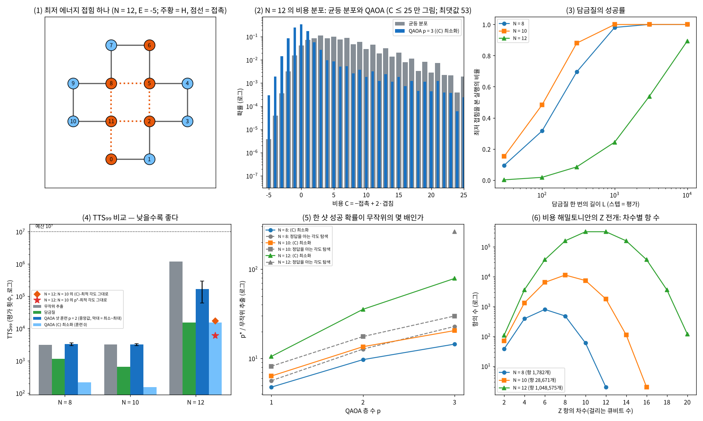

# 21장 사례 2: 단백질 접힘 HP 격자

2026-11-12 · Gosh

양자컴퓨팅 입문·심화서 · 4부 실용 알고리즘 탐색·구현 · 이 장을 마치면 조합 최적화 문제를 비트열의 비용 함수로 옮기고, 벌점 항을 정하고, QAOA를 같은 예산의 고전 휴리스틱과 TTS로 견주어 19장에서 미리 적어 둔 기준에 대어 판정할 수 있다 — 그리고 그 기준이 무엇을 정해 두지 않았는지 알아볼 수 있다.

## 1. 요약

19장의 사전 등록 표(21장 행)의 설정대로 실행했다. 서열 HPHPPHHPHPPH의 앞 8·10·12개 잔기를 2차원 정사각 격자에 접는 문제(14·18·22큐비트)에서, QAOA(p ≤ 3)와 담금질과 균등 무작위 추출이 최저 에너지 접힘을 처음 보기까지 드는 목적함수 평가 횟수 TTS₉₉를 쟀다.

**판정은 훈련 방식에 달려 있었다.** 등록한 기준은 "잔기 12개에서 QAOA의 TTS₉₉(훈련 샷 포함)가 담금질과 무작위 추출 둘 다보다 짧다"이고, 각도를 어떻게 정하는지는 적어 두지 않았다. 담금질은 15,601(성공률의 표준오차로 14,795\~16,495), 무작위 추출은 1,207,215다.

| 방식 | 잔기 12개의 TTS₉₉ | 담금질 대비 | 기준의 글자대로면 |
| --- | --- | --- | --- |
| 1. 잔기 12개에서 샷으로 훈련(SPSA, p = 2, 2,560샷). 설정은 독립 검토 전에 정한 것이고, 출발점의 부호와 시드 수는 검토 뒤에 고쳤다(4절) | 중앙값 169,302 (시드 20개, 62,647\~299,062) | 10.9배 길다(4.0\~19.2배) | **불통과** |
| 2. 잔기 10개에서 ⟨C⟩를 최소화한 p = 3의 각도를 그대로 쓴다(12개에서 훈련 0샷). 사후 분석 | 17,114 | 1.10배 | 불통과(근소한 차) |
| 3. 잔기 10개에서 정답을 써서 p\*를 키운 p = 3의 각도를 그대로 쓴다(12개에서 훈련 0샷). 사후 분석 | 5,963 | 0.38배 | 통과 |

사전 등록의 판정은 방식 1로 적는다: **불통과**. 방식 1은 무작위 추출보다 7.1배 짧지만 스무 시드 모두 담금질보다 길다(같은 훈련을 p = 3으로 한 다섯 시드도 그렇다. 중앙값 93,403, 담금질의 6.0배). 19장이 적어 둔 예상(불통과, 담금질에 진다. 12개에서는 무작위보다 짧을 수 있다)은 이 방식에서 맞았다. 방식 2와 3은 독립 검토(R13) 뒤에 더한 것이라 사전 등록의 판정으로 쓰지 않는다. 다만 방식 3이 일정을 맞춘 담금질(9,894)보다도 짧다는 것은 예상하지 못한 결과이고, 그대로 적는다.

방식 3을 "통과"라고 적지 않는 이유는 넷이다.

1. **사후에 고른 방식이다.** 결과를 본 뒤에 더했다. 14장에서 정한 규칙(예측은 고치지 않고 사후 계산은 옆에 놓는다)과 같은 이유다.
2. **각도를 미리 구하는 비용이 빠져 있다.** 잔기 8·10개의 비용 표 278,528칸을 만들고 그 위에서 상태 벡터 계산을 되풀이했다. 표의 칸 수만으로도 잔기 12개의 담금질 TTS₉₉의 18배이고, 그 칸 수를 방식 3의 5,963에 더하면 284,491로 방식 1의 중앙값보다도 길다. 같은 각도가 다른 서열에도 통해야 나눠 낼 수 있는 비용인데, 이 장은 서열 하나만 봤고 작은 문제는 큰 문제의 앞부분이다.
3. **단위가 양자 쪽에 유리하다.** 회로 1샷과 담금질 1스텝을 같은 값으로 쳤다. 이 비용 함수를 가장 단순하게 Pauli-Z 항으로 풀면 잔기 12개에서 항이 1,048,575개이고 QAOA 한 층이 2큐비트 게이트 20,971,522개다. 담금질의 한 스텝은 표 한 칸을 읽는 일이다.
4. **고전 쪽 베이스라인이 가장 강한 것이 아니다.** 벌점 비용 위의 담금질 하나뿐이다(7절).

그 밖에 숫자가 말해 주는 것.

- **2,560샷의 훈련은 중앙값으로 좋은 각도의 절반에도 못 미친다.** 잔기 12개에서 한 샷 성공 확률은 출발점에서 무작위의 3.4배이고 훈련 뒤에 7.2배(시드 20개의 중앙값, 4.1\~20.1배)다. 같은 p = 2 회로에서 정확한 ⟨C⟩를 줄여 찾은 값은 35.5배, p = 3이면 78.8배다. 좋은 각도에서 출발해 샷으로 더 훈련하면 중앙값이 내려갔다(잔기 10개: 19.3배 → 16.2배).
- **작은 크기에서는 무작위 추출이 이미 싸다.** 잔기 8·10개의 무작위 추출은 3,141·3,208번이다. 훈련에 2,560샷을 쓰면 QAOA는 3,305·3,187로 무작위 추출과 거의 같아지고, 담금질(1,163·652)에 진다.
- **훈련 비용을 0으로 치면 QAOA는 일정을 고정한 담금질과 같거나 앞선다.** ⟨C⟩를 최소화한 p = 3은 잔기 8·10개에서 215·154로 담금질보다 5.4배·4.2배 짧고, 12개에서는 15,321로 담금질(15,601)과 표본 오차 안에서 같다. 일정을 맞춘 담금질(9,894)보다는 1.55배 길다.
- **⟨C⟩를 줄이는 것과 정답을 겨냥하는 것은 다르다.** 잔기 12개의 p = 3에서 ⟨C⟩로 고른 각도의 p\*는 p\*로 고른 각도의 30%다.

결론: 19장의 판정 "방법 사례"를 유지한다. 이득의 증거는 아니다(위 넷). 이 장이 남기는 것은 절차와, 사전 등록에 훈련 방식을 적어 두지 않으면 판정이 갈린다는 교훈이다. 이 장의 첫 판은 QAOA 출발점의 부호를 잘못 잡아 "훈련 비용을 0으로 쳐도 담금질에 진다"고 적었고, 독립 검토가 바로잡았다. 둘째 판은 방식 1을 시드 다섯 개로 적었는데(중앙값 90,328) 스무 개로 늘리니 169,302가 됐다(7절). 불통과라는 방향은 세 판이 같다.

## 2. 직관 먼저 — 접힘을 비트열로, 탐색을 간섭으로

**HP 모형.** 단백질을 구슬 사슬로 본다. 구슬은 두 종류다. H(소수성, 물을 싫어한다)와 P(극성). 사슬을 격자 위에 겹치지 않게 놓았을 때, 사슬에서는 떨어져 있는데 격자에서 이웃한 H–H 쌍 하나마다 에너지가 1 내려간다. 물을 싫어하는 구슬끼리 안쪽에 뭉친 모양이 에너지가 낮다. 가장 낮은 모양을 찾는 것이 문제다.

**비유 — 줄자 접기.** 12마디짜리 접이식 줄자를 책상 위에서 직각으로만 꺾어 접는다고 하자. 마디마다 "오른쪽·위·왼쪽·아래" 가운데 하나를 고르면 모양이 정해진다. 빨간 마디(H)끼리 최대한 맞닿게 접는 것이 목표이고, 줄자가 제 몸을 지나갈 수는 없다. 비유가 깨지는 곳: 줄자는 손으로 조금씩 고쳐 가며 접지만(이것이 담금질이다), QAOA는 모든 접는 법의 중첩에서 출발해 비용에 따른 위상과 간섭으로 좋은 모양의 확률을 키운다. 그리고 실제 단백질은 격자 위에 있지 않다. HP 모형은 접힘의 조합적 어려움만 남긴 장난감이다.

**턴 인코딩.** 걸음마다 방향을 2비트로 적는다(00 오른쪽, 01 위, 10 왼쪽, 11 아래). 잔기 N개면 걸음이 N − 1개이므로 2(N − 1)큐비트다. 비트열 4^(N−1)개가 모두 "접는 법"이지만 대부분은 제 몸을 지나간다. 잔기 12개에서 겹치지 않는 접힘은 2.87%뿐이다.

**손으로 세는 예.** 서열 HPPH(N = 4, 6큐비트). 비트열은 64개다. 겹치지 않는 접힘은 36개이고(자기 회피 보행 3걸음), 두 H가 맞닿는 접힘은 ㄷ자 모양 8개다. 균등하게 뽑으면 한 번에 8/64 = 12.5%로 정답을 보고, 99% 확률로 한 번 이상 보려면 34.5번 뽑으면 된다. 이 숫자가 TTS₉₉다.

**세 가지 탐색.** (1) 무작위 추출 — 비트열을 균등하게 뽑는다. (2) 담금질 — 걸음 하나의 방향을 바꿔 보고, 비용이 내려가면 받아들이고 올라가면 온도에 따른 확률로 받아들인다. 온도를 천천히 내린다. 이 "바꿔 보기" 한 번을 스텝이라 부른다(사슬의 걸음과 구별한다). (3) QAOA — 모든 비트열의 균등 중첩에 "비용만큼 위상을 주는 층"과 "큐비트마다 조금 섞는 층"을 번갈아 p번 걸고 측정한다. 각도 2p개는 따로 정해야 한다.

## 3. 정의와 수식 — 비용, 벌점, QAOA, TTS

**비용 함수.** 비트열 z가 정하는 잔기 i의 위치를 r\_i(z)라 하자. 두 가지를 센다.

```latex
\mathrm{con}(z) = \#\{(i,j):\ j-i\ge 3,\ s_i=s_j=\mathrm{H},\ |r_i-r_j|_1 = 1\},\qquad
\mathrm{ov}(z) = \#\{(i,j):\ i<j,\ r_i = r_j\}
```

con은 사슬에서 잇닿지 않은 H–H 격자 이웃 쌍의 수, ov는 같은 자리에 놓인 잔기 쌍의 수다. 정사각 격자에서는 사슬 거리가 짝수인 쌍만 겹칠 수 있고 홀수인 쌍만 이웃이 될 수 있다. 그래서 잇닿지 않은 이웃의 가장 짧은 사슬 거리가 3이다(거리 2인 쌍은 이웃이 될 수 없다). 비용은

```latex
C(z) = -\,\mathrm{con}(z) + \lambda\,\mathrm{ov}(z)
```

이다. 유효한 접힘(ov = 0)에서 C는 HP 에너지와 같다.

**벌점 λ의 하한.** 겹친 비트열이 더 많은 접촉을 만들 수 있으므로 λ가 작으면 최솟값이 유효한 접힘이 아니게 된다. 최저 에너지를 E\_min이라 하면 겹친 모든 z에서 −con(z) + λ·ov(z) > E\_min이어야 하므로

```latex
\lambda > \max_{z:\ \mathrm{ov}(z)>0}\ \frac{\mathrm{con}(z) + E_{\min}}{\mathrm{ov}(z)}
```

이다. 이 값은 전수 열거로 계산한다(5절 (2)). 큰 문제에서는 정답을 모르므로 이 하한을 계산할 수 없고 넉넉한 값을 써야 한다. 넉넉한 λ가 무엇을 치르는지는 5절 (7)에서 본다.

**QAOA.** 비용을 대각 연산자 C로 보고

```latex
|\gamma,\beta\rangle = \prod_{l=1}^{p} e^{-i\beta_l \sum_q X_q}\; e^{-i\gamma_l C/\sigma}\ |+\rangle^{\otimes n},\qquad
p^{*} = \sum_{z\in \mathrm{opt}} |\langle z|\gamma,\beta\rangle|^2
```

층은 l = 1부터 걸리고, 한 층 안에서는 비용 위상이 먼저다. σ는 균등 분포에서 잰 C의 표준편차다. 비용을 σ로 나눠 두면 한 크기에서 찾은 각도를 다른 크기로 옮겨 볼 수 있다(이 서열에서는 통했다. 5절 (5)).

**각도의 부호.** 비용을 줄이려면 γ와 β의 부호가 반대여야 한다. \|+⟩ⁿ은 −ΣX의 바닥상태이고, H(s) = −(1 − s)ΣX + sC를 천천히 따라가는 한 단계가 e^{−isC·dt}·e^{+i(1−s)ΣX·dt}이기 때문이다. 이 장의 규약에서는 γ > 0, β < 0이다. 13장의 MaxCut은 비용을 키우는 문제라 둘 다 양수였다. 부호를 틀리면 최적화가 나쁜 국소 최솟값에 갇힌다(7절).

**무엇을 최소화하는가.** 정답을 모르는 채로 할 수 있는 훈련은 기댓값 ⟨C⟩를 줄이는 것이다. p\*(최저 접힘을 볼 확률)를 직접 키우려면 그 문제의 정답을 알아야 한다. 두 목표가 같은 일이 아니라는 점이 5절에서 숫자로 나온다.

**비용 연산자의 게이트 수.** 대각 연산자는 Z의 곱으로 전개된다.

```latex
C = \sum_{S\subseteq\{1..n\}} w_S \prod_{q\in S} Z_q,\qquad w_S = \frac{1}{2^n}\sum_z C(z)\,(-1)^{\sum_{q\in S} z_q}
```

계수 w는 비용 표의 Walsh–Hadamard 변환이다. 차수 k인 항(큐비트 k개에 Z)의 e^{−iγwZ…Z}는 CX 2(k − 1)개와 Rz 1개로 만든다(12장). MaxCut은 모든 항이 차수 2지만, 접힘의 비용은 "멀리 떨어진 두 잔기가 같은 자리에 있는가"가 그 사이의 모든 걸음에 달려 있어서 차수가 높은 항이 많다.

**TTS₉₉.** 0장의 정의다. 한 번의 시도가 평가 R회이고 성공 확률이 P이면 99% 확률로 한 번 이상 성공하는 데 드는 평가 수는

```latex
\mathrm{TTS}_{99} = R\cdot\frac{\ln 0.01}{\ln(1-P)}
```

이다(P ≥ 0.99면 시도 한 번, R로 친다). 세 방법 모두 "성공"은 최저 접힘을 한 번이라도 보는 것이다. 무작위 추출은 R = 1, P = (최저 접힘 수)/4^(N−1). 담금질은 R = 한 번 실행의 스텝 수 L이고, P는 L 스텝 안에 최저 접힘을 한 번이라도 지난 실행의 비율이다. QAOA는 R = 1, P = p\*에 훈련에 쓴 샷 수를 한 번 더한다.

```latex
\mathrm{TTS}_{99}^{\mathrm{QAOA}} = T_{\mathrm{train}} + \frac{\ln 0.01}{\ln(1-p^{*})}
```

**교과서 비교.** N&C와 KLM에는 QAOA도 담금질과의 비교도 없다(QAOA는 2014년). 가장 가까운 것은 N&C 6장의 탐색이다. Grover는 구조가 없는 탐색에서 탐색 공간 크기의 제곱근만큼의 오라클 호출을 보장하지만 오류 정정이 필요한 깊이다(9장, 연습문제 5). QAOA는 얕은 회로로 구조를 쓰려는 휴리스틱이고 보장이 없다. 그래서 이 장의 판정은 정리가 아니라 계산 결과의 비교다.

## 4. 회로 구성 — numpy 구현과 PennyLane

**파이프라인.** `ch21_hp_folding.py`(numpy 구현, 실행 완료)는 다음 순서로 간다.

1. `tables` — 모든 비트열의 위치를 한꺼번에 계산해 ov와 con을 센다. 19장의 전수 열거(`enumerate_hp`)와 접힘 수·최저 에너지·최저 접힘 수가 같은지 확인한다.
2. `cost` — 벌점 λ를 넣어 비용 표 C(z)를 만든다. 최솟값의 집합이 최저 에너지 접힘의 집합과 정확히 같은지 확인한다.
3. `fwht` — 비용 표의 Walsh–Hadamard 변환으로 Z 항의 계수를 구하고, 차수별 항 수와 게이트 수를 센다. 변환을 되돌려 비용 표가 나오는지 확인한다.
4. `anneal` — 담금질 4,000회를 벡터로 한꺼번에 돌린다. 한 스텝은 걸음 하나의 방향을 다른 셋 중 하나로 바꾸는 제안이고, 표 한 칸을 읽는 평가 1회다.
5. `qaoa_probs` — 상태 벡터(잔기 12개면 진폭 4,194,304개)에 위상 층과 섞는 층을 건다. 섞는 층은 큐비트 네 개씩 묶은 16 × 16 행렬을 곱한다(두 개씩 곱하는 계산과 확률이 같은지 스크립트가 잔기 8개, p = 3에서 확인한다. 차 3.3×10⁻¹⁹).
6. 각도를 정하는 네 가지 방법(아래 표).

**각도를 정하는 네 가지 방법.**

| 이름 | 각도를 정하는 법 | 잔기 12개에서 드는 것 | 실제로 쓸 수 있는가 |
| --- | --- | --- | --- |
| (가) ⟨C⟩ 최소화 | 정확한 ⟨C⟩를 Nelder–Mead로 줄인다. 잔기 8개는 출발점 여럿, 10·12개는 작은 크기의 각도에서 출발 | 정확한 기댓값 평가(세지 않는다) | 아니다. 기댓값을 정확히 알 수 없다. "훈련이 잘됐을 때 어디까지 가는가"의 참고값 |
| (나) 정답을 아는 각도 탐색 | 그 크기의 정답을 써서 p\*를 직접 키운다 | 정답(세지 않는다) | 아니다. 지역 탐색이라 증명된 상한도 아니다 |
| (전이) | 작은 크기(8·10개)에서 (가)나 (나)로 정한 각도를 12개에 그대로 쓴다 | 없다(훈련 0샷, 탐색 0회) | 그렇다. 다만 작은 크기의 계산이 미리 필요하다 |
| (다) 샷으로 하는 훈련 | SPSA 20회, 반복마다 회로 2개 × 64샷, p = 2 | 2,560샷(모두 센다) | 그렇다. 설정(p, 샷, 반복, 이득)은 독립 검토 전에 정한 것이고 출발점의 부호는 검토 뒤에 고쳤다(아래) |

이 장에서 "⟨C⟩-최적 각도"와 "p\*-최적 각도"는 (가)와 (나)에서 찾은 각도를 뜻한다. 잔기 10·12개의 값은 지역 탐색이 찾은 값이고 전역 최적이라는 보장은 없다.

SPSA는 각도 전체를 무작위 방향으로 한 번 흔들어 회로 두 번의 차로 기울기를 어림하는 방법이다(Spall 1992). 각도가 몇 개든 반복마다 회로 2개면 된다. 이득은 a\_k = 0.15/(k + 3)^0.602, c\_k = 0.15/(k + 1)^0.101이고 출발점은 선형 경사(γ는 0에서 0.6으로, β는 −0.6에서 0으로)다. p, 샷 수, 반복 수, 이득은 이 장을 쓰면서 정했고 결과를 보고 바꾸지 않았다(19장의 등록에는 없는 값이라 저장소의 기록으로 확인할 수는 없다). 검토 뒤에 바뀐 것은 넷이다. 출발점의 부호(첫 판은 β도 양수였다. 7절), 시드 수와 적는 통계량(첫 판은 시드 하나였고 잔기 12개의 값은 196,189였다. 둘째 판은 시드 5개의 중앙값 90,328, 지금은 20개의 중앙값과 범위다), 담금질의 실행 수와 시드(2,000회 → 4,000회. 첫 판의 값은 16,045였다), 잔기 12개의 p = 3 훈련(검토 R15 뒤에 더했다). 첫 판의 숫자는 검토 R13의 기록에서 옮겼다. 그러니 방식 1은 "검토 전에 정한 설정을, 검토 뒤에 고친 출발점에서 다시 돌린 것"이다. 불통과라는 방향은 첫 판(담금질의 12배)과 지금(4.0\~19.2배)이 같다. 다른 설정은 작은 크기에서만 돌려 민감도로 적었다(5절 (5)).

**게이트 비용 기록(이 책의 규칙).** QAOA 한 층의 비용이다. 세는 법은 10장과 같다(기저 CX + 1큐비트 게이트, 전결합). 차수 k인 Z 항 하나는 CX 2(k − 1)개와 Rz 1개, 섞는 층은 Rx n개다. 아래는 비용 표를 그대로 Z 항으로 푼 **가장 단순한 구성**의 값이다. 항의 순서를 잘 잡으면 이웃한 항의 CX 사다리가 일부 지워져 CX가 줄고(얼마나 주는지는 세지 않았다), 보조 큐비트로 위치를 계산해 비용을 위상에 싣는 산술 회로나 차수를 2로 낮추는 구성(Perdomo-Ortiz et al. 2012; Babbush et al. 2014)도 있다. 어느 것도 이 장은 세지 않았다. 깊이도 세지 않았다(큰 크기는 게이트 목록을 만들지 않고 공식으로 셌다).

| 잔기 N | 큐비트 | 0이 아닌 Z 항 | 최대 차수 | 차수 2 이하 | 한 층의 2큐비트 게이트 | 한 층의 회전(Rz + Rx) |
| --- | --- | --- | --- | --- | --- | --- |
| 8 | 14 | 1,782 | 12 | 38 | 18,388 | 1,796 |
| 10 | 18 | 28,671 | 16 | 70 | 409,602 | 28,689 |
| 12 | 22 | 1,048,575 | 20 | 110 | 20,971,522 | 1,048,597 |

공식이 맞는지는 작은 사례(아래 스니펫용 사례, 10큐비트)에서 게이트 목록을 실제로 만들어 확인했다. `tools/gate_cost.py`로 센 값은 2큐비트 2,050, 깊이 2,277, 회전 265(T ≈ 15,846, 12장의 어림)이고, 그 게이트 목록을 적용한 확률은 비용 표를 위상으로 건 계산과 3.4×10⁻¹⁷ 안에서 같다. 14장 7절의 한계(CZ ≈ 100개, 오류 예산 0.3)와 견주면 잔기 8개의 한 층(18,388개)이 이미 184배다. 이 장의 QAOA는 상태 벡터 위의 계산이고 장치에서 돌릴 수 있는 회로가 아니다.

**PennyLane 스니펫(작성됨, 미실행).** 19장의 도구 표대로 이 장의 주 도구는 PennyLane이다. 스크립트가 남긴 `ch21_case.json`(서열 HPHPPH, 10큐비트, p = 1의 최적 각도)을 읽어 같은 확률이 나오는지 본다. 비용 층은 비용 표를 그대로 대각 유니터리로 넣는다. 19장이 든 이유(기울기 계산이 편하다)는 훈련을 PennyLane으로 옮길 때의 것이고, 이 스니펫은 정해진 각도에서 확률만 대조하므로 기울기를 쓰지 않는다.

```python
# pennylane==0.45.x — 작성됨, 미실행
import json
import numpy as np
import pennylane as qp

case = json.load(open("ch21_case.json"))                    # ch21_hp_folding.py 가 만든 사례
C = np.array(case["cost"]); n = case["n_qubits"]; sigma = case["sigma"]
dev = qp.device("default.qubit", wires=n)

@qp.qnode(dev)
def qaoa(gamma, beta):
    for w in range(n):
        qp.Hadamard(wires=w)
    qp.DiagonalQubitUnitary(np.exp(-1j * gamma * C / sigma), wires=range(n))   # e^{−iγC/σ}: 비용 표를 위상으로
    for w in range(n):
        qp.RX(2 * beta, wires=w)                                              # RX(θ) = e^{−iθX/2} → e^{−iβX}
    return qp.probs(wires=range(n))

pr = qaoa(case["gamma"], case["beta"])
print(float(pr @ C))                               # ⟨C⟩ 0.2904 예상 (균등 분포에서는 C 의 평균)
print(float(pr[case["optimal"]].sum()))            # p* 0.0313 예상 (무작위 0.0078)
```

핵심 세 줄: `qp.DiagonalQubitUnitary(...)` — 시뮬레이터에서는 비용 표 전체를 위상으로 한 번에 건다. 장치에서는 이 한 줄이 위 표의 게이트 수로 풀린다. `qp.RX(2 * beta, ...)` — PennyLane의 RX는 각의 절반이 지수에 들어가므로 2β를 준다. `qp.probs(wires=range(n))` — PennyLane은 wire 0이 상위 비트라 이 책의 빅 엔디안과 같고, 비용 표의 색인을 그대로 쓸 수 있다.

## 5. 실행 결과

모든 수치는 `ch21_hp_folding.py`의 출력(`ch21_stdout.txt`)이다. 끝의 회귀 검사가 판정에 쓰는 값과 표의 값 대부분을 고정한다.

**(1) 비용 표와 전수 열거.**

| 잔기 N | 큐비트 | 비트열 4^(N−1) | 유효한 접힘 | 비율 | 최저 에너지 | 최저 접힘 수 | 전수 열거와 일치 |
| --- | --- | --- | --- | --- | --- | --- | --- |
| 8 | 14 | 16,384 | 2,172 | 13.26% | −2 | 24 | 예 |
| 10 | 18 | 262,144 | 16,268 | 6.21% | −2 | 376 | 예 |
| 12 | 22 | 4,194,304 | 120,292 | 2.87% | −5 | 16 | 예 |

19장 5절 (5)의 표와 같다. 잔기 8·10개는 최저 에너지가 −2이고 최저 접힘이 많다(24개, 376개). 12개에서 처음으로 접촉 5개짜리 촘촘한 모양이 나오고 그런 접힘은 16개뿐이다. 문제의 어려움이 크기에 고르게 늘지 않는다.

**(2) 벌점 λ.** 겹친 비트열이 만들 수 있는 접촉 수의 최대는 잔기 8·10·12개에서 2·3·7개다(유효한 접힘의 최대는 2·2·5개). 3절의 하한은 λ > 0(양수면 된다), λ > 1, λ > 1이다.

| λ | N = 10: 최솟값과 그 가운데 유효한 접힘 | N = 12: 최솟값과 그 가운데 유효한 접힘 |
| --- | --- | --- |
| 0.5 | −2.5, 0/208 | −6.0, 0/8 |
| 1.0 | −2.0, 376/584 | −5.0, 16/56 |
| 2.0 | −2.0, 376/376 | −5.0, 16/16 |

λ = 0.5면 겹친 비트열이 더 낮고, λ = 1이면 유효한 접힘과 겹친 비트열이 같은 값으로 섞인다. 본 실험은 λ = 2로 했다. 세 크기 모두에서 최솟값의 집합이 최저 에너지 접힘의 집합과 정확히 같다. 이때 균등 분포에서 비용의 평균과 표준편차는 잔기 8개에서 3.562와 3.073, 10개에서 5.252와 4.220, 12개에서 6.348과 4.990이다.

**(3) 비용 연산자의 Z 전개.** 4절의 표다. 잔기 8개의 차수별 항 수는 차수 2가 38개, 4가 393개, 6이 804개, 8이 485개, 10이 60개, 12가 2개다. 홀수 차수는 없다. 대칭이 둘 있기 때문이다. 모든 비트를 뒤집으면(오른쪽 ↔ 아래, 위 ↔ 왼쪽) 접힘이 대각선에 대해 뒤집히고, 걸음마다 상위 비트만 뒤집으면(오른쪽 ↔ 왼쪽, 위 ↔ 아래) 180° 돌 뿐이라 비용이 같다. 두 대칭을 합치면 상위 비트에 걸린 Z와 하위 비트에 걸린 Z가 각각 짝수 개인 항만 남고, 그런 항은 4^(N−2) − 1개다. 그 가운데 살아 있는 것이 잔기 8개에서 43.5%, 10개에서 43.7%, 12개에서는 전부(1,048,575개)다. 차수 2 이하인 항은 110개뿐이다. 이 장은 QUBO(차수 2 이하의 식)를 만들지 않았다. 차수를 낮추지 않으면 항이 100만 개이고, 낮추려면 보조 큐비트가 드는데 그 수는 세지 않았다.

**(4) 베이스라인.** 무작위 추출은 해석식이다. 담금질은 온도를 2.0에서 0.2로 기하 감소시키며 4,000회 실행했고, 실행 길이 L마다 최저 접힘을 한 번이라도 지난 실행의 비율 p\_L에서 TTS₉₉를 구했다. 출발 비트열의 평가 1회는 세지 않았다.

| 잔기 N | 무작위: 한 개의 성공 확률 | 무작위 TTS₉₉ | 담금질 p\_L (L = 30, 100, 300, 1000, 3000, 10000) | 담금질 TTS₉₉(가장 짧은 L; 성공률의 표준오차 범위) |
| --- | --- | --- | --- | --- |
| 8 | 1.465×10⁻³ | 3,141 | 0.095, 0.316, 0.695, 0.981, 1.000, 1.000 | 1,163 (L = 300; 1,140\~1,187) |
| 10 | 1.434×10⁻³ | 3,208 | 0.152, 0.483, 0.880, 1.000, 1.000, 1.000 | 652 (L = 300; 639\~665) |
| 12 | 3.815×10⁻⁶ | 1,207,215 | 0.002, 0.018, 0.085, 0.244, 0.538, 0.893 | 15,601 (L = 300; 14,795\~16,495) |

담금질이 무작위 추출을 줄이는 배율은 2.7배, 4.9배, 77.4배다. 잔기 12개에서 QAOA가 넘어야 하는 것은 무작위 추출이 아니라 이쪽이다. 두 가지를 밝혀 둔다. 실행 길이 L은 결과를 보고 가장 좋은 것을 골랐다. 담금질에 유리한 선택이고 그 조정 비용은 세지 않았다(QAOA의 훈련 샷은 센다). 온도 일정은 이 장을 쓰면서 정했고 결과를 보고 바꾸지 않았다(기록으로 확인할 수는 없다). 일정을 이 문제에 맞추면 담금질은 더 짧아진다(1.0 → 0.2에서 12,989, 1.0 → 0.1에서 12,908, 0.5 고정에서 9,894. 3.0 → 0.3에서는 20,281).

**(5) QAOA.**

(가) 정확한 ⟨C⟩를 최소화한 값(훈련 비용 0으로 침). 균등 분포에서 유효한 접힘의 확률은 잔기 8·10·12개에서 0.1326, 0.0621, 0.0287이다. 마지막 열은 p\*의 배율을 "유효한 접힘을 고르는 배율 × 유효한 접힘 안에서 최저를 고르는 배율"로 나눈 것이다.

| 잔기 N | p | ⟨C⟩ (균등 분포의 평균) | 유효한 접힘의 확률 | 한 샷 성공 확률 p\* | 무작위의 몇 배 | TTS₉₉(훈련 0) | 분해 |
| --- | --- | --- | --- | --- | --- | --- | --- |
| 8 | 1 | +1.2965 (+3.562) | 0.4781 | 7.005×10⁻³ | 4.78 | 655 | 3.6 × 1.3 |
| 8 | 2 | +0.4740 | 0.6874 | 1.422×10⁻² | 9.71 | 322 | 5.2 × 1.9 |
| 8 | 3 | +0.1031 | 0.8016 | 2.121×10⁻² | 14.48 | 215 | 6.0 × 2.4 |
| 10 | 1 | +2.1218 (+5.252) | 0.3148 | 9.129×10⁻³ | 6.36 | 502 | 5.1 × 1.3 |
| 10 | 2 | +0.9369 | 0.5317 | 1.944×10⁻² | 13.56 | 235 | 8.6 × 1.6 |
| 10 | 3 | +0.3578 | 0.6631 | 2.945×10⁻² | 20.53 | 154 | 10.7 × 1.9 |
| 12 | 1 | +2.6604 (+6.348) | 0.1827 | 4.025×10⁻⁵ | 10.55 | 114,410 | 6.4 × 1.7 |
| 12 | 2 | +1.1746 | 0.3598 | 1.355×10⁻⁴ | 35.53 | 33,978 | 12.5 × 2.8 |
| 12 | 3 | +0.3863 | 0.4975 | 3.005×10⁻⁴ | 78.78 | 15,321 | 17.3 × 4.5 |

잔기 8개의 값은 출발점 일곱\~여덟(선형 경사, p ≥ 2면 한 층 적은 해를 늘린 것, 선형 경사를 흔든 여섯) 가운데 가장 좋은 것이다. p = 1은 각도의 한 주기 전체를 격자(241 × 61)로 훑어 확인했다(격자 최솟값 1.2992, Nelder–Mead 1.2965). 잔기 10·12개는 작은 크기의 각도에서 출발한 지역 탐색이다. 12개는 평가가 느려 탐색 횟수를 60·160·400회로 정해 두고 절반씩 두 번 돌렸다(둘째는 첫째가 찾은 점에서 새로 출발한다). 둘째 탐색에서 ⟨C⟩가 더 내려간 폭은 p = 1에서 3.3×10⁻⁷, p = 2에서 0, p = 3에서 8.3×10⁻⁸이다. 수렴 기준까지 간 것은 p = 3뿐이고, p = 1·2의 둘째 탐색은 횟수 상한에서 끊겼다. 세 값은 검토 R13이 별도 코드로 찾은 값(2.6604, 1.1746, 0.3863)과 넷째 자리까지 같다. 거의 다 내려왔다는 뜻이고 전역 최솟값의 증명은 아니다. 이전 판은 p = 3을 80회에서 끊어 +0.3873(76.7배, 15,734)으로 적었고, 검토 R15가 덜 내려간 값임을 찾았다. p = 3의 각도 (γ₁ γ₂ γ₃ \| β₁ β₂ β₃)는 잔기 8개에서 (+0.449 +0.893 +1.616 \| −0.190 −0.153 −0.109), 12개에서 (+0.531 +1.032 +1.976 \| −0.158 −0.137 −0.116)으로 크기가 달라도 비슷하다.

읽을 것 둘. 첫째, ⟨C⟩로 훈련한 QAOA가 주로 하는 일은 벌점을 피하는 것이다. 잔기 12개의 p = 3에서 유효한 접힘의 확률은 균등 분포의 17.3배가 되고, 유효한 접힘 안에서 최저 접힘을 고르는 배율은 4.5배다. 둘째, 층을 늘릴수록 좋아지고(잔기 12개에서 10.6배 → 35.5배 → 78.8배), 훈련 비용을 0으로 친 TTS₉₉는 p = 3에서 잔기 8·10개가 담금질보다 5.4배·4.2배 짧다(215 대 1,163, 154 대 652). 12개는 15,321 대 15,601이고, 차(279)가 담금질 값의 표준오차 범위의 반폭(850)의 0.33배라 어느 쪽이 짧은지는 정해지지 않는다.

(나) 정답을 아는 각도 탐색. p\*를 직접 키우면 p = 3에서 잔기 8·10·12개가 무작위의 22.9배·29.9배·262.8배이고 TTS₉₉(훈련 0)는 135·105·4,592다. ⟨C⟩로 고른 각도의 p\*는 이 값의 63%·69%·30%다. p = 1에서도 틈이 있다(잔기 8개에서 4.78배 대 5.65배, 10개에서 6.36배 대 8.19배). 잔기 12개의 분해는 11.5 × 22.8로, (가)와 반대로 유효한 접힘 안에서 최저를 고르는 쪽이 크다. 정답을 겨냥한 각도는 벌점을 피하는 데 덜 쓰이고 최저 접힘을 고르는 데 더 쓰인다. 잔기 12개의 값은 400회로 정해 둔 지역 탐색의 값이다(둘째 탐색에서 더 오른 폭은 표시 자릿수 아래이고, 검토 R13이 따로 찾은 262.8배와 같다). p\*로 고른 p = 3의 각도는 잔기 8개에서 (+1.003 +1.577 +2.014 \| −0.235 −0.191 −0.162), 10개에서 (+1.059 +2.000 +2.982 \| −0.233 −0.175 −0.137), 12개에서 (+1.514 +2.841 +2.921 \| −0.234 −0.205 −0.186)이다. ⟨C⟩로 고른 각도보다 세 층 모두 γ가 크고 β의 크기도 크다.

(전이) 작은 크기에서 정한 각도를 잔기 12개에 그대로 쓴 값. 12개에서의 훈련 샷과 탐색은 0이다.

| 각도를 정한 곳과 방식 | p | ⟨C⟩ | 유효한 접힘의 확률 | p\* | 무작위의 몇 배 | TTS₉₉(훈련 0) |
| --- | --- | --- | --- | --- | --- | --- |
| 잔기 8개, ⟨C⟩ 최소화 | 2 | +1.2911 | 0.3198 | 1.120×10⁻⁴ | 29.3 | 41,130 |
| 잔기 8개, ⟨C⟩ 최소화 | 3 | +0.5666 | 0.4296 | 2.367×10⁻⁴ | 62.1 | 19,453 |
| 잔기 10개, ⟨C⟩ 최소화 | 2 | +1.1944 | 0.3487 | 1.274×10⁻⁴ | 33.4 | 36,154 |
| 잔기 10개, ⟨C⟩ 최소화 | 3 | +0.4178 | 0.4703 | 2.690×10⁻⁴ | 70.5 | 17,114 |
| 잔기 8개, p\* 최대화 | 2 | +2.4244 | 0.3510 | 2.440×10⁻⁴ | 64.0 | 18,869 |
| 잔기 8개, p\* 최대화 | 3 | +1.8261 | 0.4289 | 6.173×10⁻⁴ | 161.8 | 7,458 |
| 잔기 10개, p\* 최대화 | 2 | +1.9741 | 0.4329 | 2.631×10⁻⁴ | 69.0 | 17,502 |
| 잔기 10개, p\* 최대화 | 3 | +1.4992 | 0.5409 | 7.720×10⁻⁴ | 202.4 | 5,963 |

⟨C⟩로 정한 각도는 이 서열에서는 옮겨도 거의 그대로 통한다(잔기 10개의 각도로 70.5배, 12개에서 더 내린 값 78.8배). p\*로 정한 각도는 ⟨C⟩가 더 높은데도(+1.50 대 +0.42) p\*가 2.87배다. "p\* 최대화"는 작은 문제의 정답을 쓴다. 작은 문제는 전수 열거가 되므로 정당한 절차이고, 잔기 12개의 정답은 쓰지 않는다. 이 각도를 미리 구하는 데는 잔기 8·10개의 비용 표 16,384 + 262,144 = 278,528칸과 그 위의 상태 벡터 계산이 든다. 표의 칸 수만으로 잔기 12개의 담금질 TTS₉₉의 18배다. 여덟 가지 가운데 담금질(15,601)보다 짧은 것은 p\*로 정한 p = 3의 둘(7,458, 5,963)뿐이고, 방식 2와 3은 이 표에서 고른 것이다.

(다) 샷으로 하는 훈련(SPSA 20회, 회로 2개 × 64샷, p = 2, 출발점은 선형 경사). 결과가 시드마다 크게 달라 여러 시드의 중앙값과 범위를 적는다.

| 잔기 N | 시드 수 | 훈련 샷 | 출발점의 p\* | 훈련 뒤 p\*: 중앙값 (최소\~최대) | TTS₉₉ = 훈련 샷 + 추출: 중앙값 (최소\~최대) | 훈련 샷도 기회로 센 TTS₉₉(중앙값) | 훈련 중 최저 접힘을 본 샷(중앙값) |
| --- | --- | --- | --- | --- | --- | --- | --- |
| 8 | 20 | 2,560 | 2.62배 | 4.21배 (2.89\~7.48) | 3,305 (2,978\~3,644) | 1,356 | 11.5 |
| 10 | 20 | 2,560 | 2.58배 | 5.10배 (3.85\~7.75) | 3,187 (2,972\~3,392) | 1,260 | 12.5 |
| 12 | 20 | 2,560 | 3.42배 | 7.24배 (4.07\~20.09) | 169,302 (62,647\~299,062) | 167,930 | 0.0 |

"훈련 샷도 기회로 센 TTS₉₉"는 훈련 회로에서 나온 표본까지 쳐서 최저 접힘을 한 번도 못 볼 확률이 1%가 되는 누적 샷 수다. 사전 등록 지표보다 QAOA에 유리한 셈법이다. 작은 크기에서는 훈련 도중에 정답을 이미 본다(중앙값 11.5번·12.5번). 잔기 12개에서는 훈련 2,560샷 동안 보지 못했고(중앙값 0번) 두 셈법이 거의 같다.

잔기 12개의 중앙값은 시드 수에 민감하다. 이전 판은 처음 다섯 시드만 돌려 13.75배, 90,328로 적었다. 스무 개로 늘리니 7.24배, 169,302가 됐고, 스무 개 가운데 90,328보다 짧은 것은 셋뿐이다. 처음 다섯이 유리한 쪽이었다(검토 R15의 지적. R13·R15가 같은 설정으로 따로 돌린 시드 10개도 p\*가 무작위의 4.4\~10.8배였다). 어느 시드도 담금질보다 짧지 않다. 같은 훈련을 p = 3으로 하면(시드 5개, 출발점 4.61배) 훈련 뒤 13.29배(11.04\~19.78), TTS₉₉ 93,403(63,591\~111,906)이다. 다섯 시드 모두 담금질보다 길다(가장 좋은 시드 63,591도 담금질의 4.1배다). 다섯 시드의 최대(111,906)가 p = 2 스무 시드의 중앙값(169,302)보다 짧고, p = 2의 스무 시드 가운데 111,906보다 짧은 것은 여섯뿐이니 p = 3 쪽이 나아 보인다. 다만 시드가 다섯 개뿐이라 얼마나 나은지는 말할 수 없다. 훈련 뒤의 p\*(p = 2의 중앙값)는 같은 회로에서 정확한 ⟨C⟩를 줄여 찾은 값의 20%다(잔기 8개 43%, 10개 38%).

훈련 설정을 바꾼 결과(작은 크기에서만. 잔기 8개는 시드 10개, 10개는 시드 5개의 중앙값)는 이렇다. 잔기 10개에서 (p, 샷, 반복)을 (1, 64, 20), (2, 16, 20), (2, 256, 20), (2, 64, 60), (3, 64, 20)으로 바꾸면 TTS₉₉가 3,333, 1,292, 10,776, 8,074, 2,920이다. 가장 짧은 것은 훈련을 가장 적게 한 설정(640샷, 1,292)이고 그것도 담금질(652)의 2.0배다. 훈련을 길게 하면 p\*는 조금 오르지만(8.1배) 쓴 샷이 그보다 크다. 좋은 각도에서 출발해 샷으로 더 훈련하는 것도 해 봤다. 잔기 10개에서 잔기 8개의 ⟨C⟩-최적 각도(p = 3, 19.3배)에서 출발하면 훈련 뒤 중앙값이 16.2배(12.9\~19.6배)다. 이 샷 수의 훈련은 좋은 각도의 중앙값을 올리지 못했다(다섯 시드 가운데 가장 좋은 것이 19.6배로 출발점과 비슷하다). 샷 잡음이 기울기보다 큰 것으로 보인다.

**(6) 사전 등록 기준에 대한 결과.**

| 잔기 N | 무작위 추출 | 담금질 | QAOA (다) 샷 훈련 p = 2(중앙값) | (가) ⟨C⟩ 최소화, 훈련 0 | (나) 정답을 아는 각도 탐색, 훈련 0 |
| --- | --- | --- | --- | --- | --- |
| 8 | 3,141 | 1,163 | 3,305 | 215 (p = 3) | 135 (p = 3) |
| 10 | 3,208 | 652 | 3,187 | 154 (p = 3) | 105 (p = 3) |
| 12 | 1,207,215 | 15,601 | 169,302 | 15,321 (p = 3) | 4,592 (p = 3) |

기준은 "잔기 12개에서 QAOA의 TTS₉₉(훈련 샷 포함)가 담금질과 무작위 추출 둘 다보다 짧다"이다.

| 방식 | 잔기 12개의 TTS₉₉ | 무작위의 몇 배의 p\* | 담금질(15,601) 대비 | 글자대로면 |
| --- | --- | --- | --- | --- |
| 1. 샷 훈련(SPSA, p = 2, 2,560샷). 설정은 검토 전에 정한 것, 출발점의 부호는 검토 뒤에 고쳤다 | 중앙값 169,302 (62,647\~299,062, 시드 20개) | 7.2 | 10.9배 (4.0\~19.2배). 담금질보다 짧은 시드 0개 | **불통과** |
| 1′. 같은 훈련을 p = 3으로(시드 5개). 검토 뒤에 더한 것 | 중앙값 93,403 (63,591\~111,906) | 13.3 | 6.0배 (4.1\~7.2배). 담금질보다 짧은 시드 0개 | 불통과 |
| 2. 잔기 10개의 ⟨C⟩-최적 각도(p = 3)를 그대로. 사후 분석 | 17,114 | 70.5 | 1.10배. 일정을 맞춘 담금질(9,894)의 1.73배 | 불통과 |
| 3. 잔기 10개의 p\*-최적 각도(p = 3)를 그대로. 사후 분석 | 5,963 | 202.4 | 0.38배. 일정을 맞춘 담금질(9,894)의 0.60배 | 통과 |

담금질을 이기는 데 필요한 p\*는 훈련 0샷이면 무작위의 77.4배, 훈련 2,560샷을 쓴 뒤면 92.6배다. 샷 훈련이 닿은 값은 p = 2에서 중앙값 7.2배(스무 시드의 최대 20.1배), p = 3에서 13.3배(다섯 시드의 최대 19.8배)이고, p = 3에서 정확한 ⟨C⟩를 줄여 찾은 값이 78.8배다. 2,560샷을 쓰는 샷 훈련은 p ≤ 3에서 (가)가 찾은 ⟨C⟩의 최적점에 닿아도 92.6배에 못 미친다. 방식 1은 무작위 추출보다 7.1배 짧다. 세 방법 모두(무작위 추출, 담금질, QAOA 방식 1) TTS₉₉가 예산 10⁷ 평가 안이다(QAOA의 값은 p\*에서 계산한 것이고, 방식 1의 훈련 중에 최저 접힘을 본 샷은 중앙값이 0이다). 잔기 8·10개는 참고다. 샷 훈련을 넣으면 QAOA(3,305·3,187)는 무작위 추출(3,141·3,208)과 거의 같고 담금질(1,163·652)에 진다.

**판정.** 사전 등록의 판정은 방식 1로 적는다: **불통과**. 방식 2·3은 검토 뒤에 더한 사후 분석이라 판정에 쓰지 않고 나란히 적는다. 방식 3이 기준의 글자를 채운다는 것은 사실이다. 그것을 "통과"로 적지 않는 이유는 1절의 넷이다(사후 선택, 각도를 미리 구하는 비용 278,528칸, 단위, 약한 베이스라인). 보조 지표(훈련 비용을 뺀 한 샷 성공 확률이 무작위의 몇 배인가)는 (가)의 표와 같고, p = 3에서 14.5배, 20.5배, 78.8배로 크기와 함께 커진다. 담금질이 무작위 추출을 줄이는 배율(2.7배, 4.9배, 77.4배)과 잔기 12개에서 거의 같다.

**사전 등록에 대해 밝혀 둘 것.** 등록에 없던 세부를 이 장이 정했다. 벌점 λ = 2, 담금질의 온도 일정과 제안 방식(걸음 하나의 방향 바꾸기), 실행 길이 L을 결과에서 고르는 것, 훈련 방법(SPSA, p = 2, 64샷 × 20회, 이득, 출발점), 시드 수와 중앙값으로 적는 것, 비용을 σ로 나누는 정규화, (가)·(나)의 탐색 예산이다. 출발점의 부호, 시드 수와 적는 통계량, 담금질의 실행 수와 시드는 검토 뒤에 바뀌었고 잔기 12개의 p = 3 훈련은 검토 뒤에 더했다(4절). 잔기 12개의 탐색 예산도 검토 R15 뒤에 늘렸다(5절 (5)). 이 가운데 훈련 방법이 판정을 가른다. 등록할 때 "각도는 그 크기에서 샷으로 훈련한다"거나 "작은 크기에서 미리 구한 각도를 써도 된다. 그 계산 비용은 이렇게 센다"를 적어 두었어야 했다. 다음 사례(22·23장)의 등록 행에 이런 구멍이 없는지 다시 본다.

**(7) 벌점 λ에 따른 민감도(잔기 10개, p = 2, 정확한 ⟨C⟩ 최소화. 담금질은 같은 λ의 비용으로 1,000회 실행).**

| λ | 비용의 σ | QAOA: 유효한 접힘의 확률 | p\* | 무작위의 몇 배 | 분해: 유효 × 유효 안의 최저 | 담금질 TTS₉₉ | 비고 |
| --- | --- | --- | --- | --- | --- | --- | --- |
| 0.5 | 0.950 | 0.1138 | 2.564×10⁻² | 17.88 | 1.8 × 9.7 | 1,079 | 최솟값이 겹친 비트열 |
| 1.0 | 1.926 | 0.3783 | 2.623×10⁻² | 18.28 | 6.1 × 3.0 | 762 | 최솟값에 겹친 비트열이 섞임 |
| 2.0 | 4.220 | 0.5317 | 1.944×10⁻² | 13.56 | 8.6 × 1.6 | 654 | 본 실험 |
| 5.0 | 11.313 | 0.5947 | 1.402×10⁻² | 9.77 | 9.6 × 1.0 | 649 |  |
| 20.0 | 46.970 | 0.6145 | 1.147×10⁻² | 8.00 | 9.9 × 0.8 | 657 |  |

λ를 키우면 QAOA는 유효한 접힘을 더 잘 고르지만(0.53 → 0.61) 유효한 접힘 안에서 최저를 고르는 배율이 1.6에서 0.8로 떨어져 p\*가 내려간다(13.6배 → 8.0배). 벌점이 크면 ⟨C⟩의 차이가 거의 다 겹침에서 나와, ⟨C⟩를 줄이는 훈련이 "겹쳤는가"만 구별하게 되기 때문으로 보인다. 담금질은 λ ≥ 2에서 거의 변하지 않는다(649\~657. (4)의 652와는 실행 수와 시드가 달라 표본 오차 안에서 같다). 큰 문제에서는 λ의 하한을 모르므로 넉넉하게 잡아야 하고, 그 값은 QAOA 쪽이 치른다.

그림(`ch21_results.png`): (1) 잔기 12개의 최저 에너지 접힘 하나, (2) 잔기 12개의 비용 분포(균등 분포와 QAOA p = 3, C ≤ 25만 그렸다), (3) 담금질의 실행 길이별 성공률, (4) TTS₉₉ 비교(샷 훈련은 중앙값과 최소\~최대, 잔기 12개에는 전이한 각도의 값을 점으로 얹었다), (5) 한 샷 성공 확률이 무작위의 몇 배인가, (6) Z 항의 차수 분포.



## 6. 다른 SDK 대응 — CUDA-Q

이 장에서 CUDA-Q를 고른 이유는, 잔기 10개(18큐비트)를 넘으면 상태 벡터가 CPU에서 느려지는데 CUDA-Q는 같은 커널을 GPU 상태 벡터 타깃으로 그대로 돌릴 수 있기 때문이다(19장의 도구 표). 다만 아래 스니펫은 10큐비트 사례 전용이다. 잔기 10·12개는 Z 항이 28,671개·1,048,575개라 항마다 게이트를 거는 이 커널로는 옮길 수 없고, 비용을 산술 회로로 계산하는 커널을 따로 짜야 한다.

|  | PennyLane | CUDA-Q |
| --- | --- | --- |
| 비용 층 | `qp.DiagonalQubitUnitary`(비용 표를 그대로) | Z 항마다 CX 사다리와 `rz`(게이트로 풀어서) |
| 섞는 층 | `qp.RX(2β)` | `rx(2β)` |
| 결과 | `qp.probs`(정확한 확률) | `cudaq.sample`(샷) |
| 큰 크기 | `lightning.qubit`·`lightning.gpu` 장치(22 wire의 대각 유니터리를 받는지는 확인하지 못했다) | `cudaq.set_target("nvidia")` |
| 비트 순서 | wire 0이 상위 비트(이 책과 같다) | 표본 문자열의 왼쪽이 큐비트 0(이 책과 같다) |

**CUDA-Q 스니펫(작성됨, 미실행).** 같은 사례 파일의 Z 항 255개(항등 항은 뺀다)를 게이트로 풀어 넣는다. 한 층이 CX 2,050개, rz 255개, rx 10개다. PennyLane 스니펫이 "표를 위상으로"였다면 이쪽은 4절의 게이트 수가 실제로 어떻게 생기는지를 보여 준다.

```python
# cudaq==0.16.x — 작성됨, 미실행 (GPU 가 없으면 기본 타깃 qpp-cpu 로 돈다)
import json
import numpy as np
import cudaq

case = json.load(open("ch21_case.json")); n = case["n_qubits"]; sigma = case["sigma"]
qubits, starts, weights = [], [0], []
for mask, w in case["pauli_z_terms"]:
    if mask == 0:
        continue                                              # 항등 항은 전역 위상
    qs = [q for q in range(n) if (mask >> (n - 1 - q)) & 1]   # 빅 엔디안: 큐비트 0 이 최상위 비트
    qubits += qs; starts.append(len(qubits)); weights.append(w / sigma)

@cudaq.kernel
def qaoa(n: int, gamma: float, beta: float, qubits: list[int], starts: list[int], weights: list[float]):
    q = cudaq.qvector(n)
    h(q)
    for t in range(len(weights)):                             # e^{−iγ w Z…Z} = CX 사다리 · Rz(2γw) · CX 사다리
        a = starts[t]
        b = starts[t + 1]
        for k in range(a, b - 1):
            x.ctrl(q[qubits[k]], q[qubits[k + 1]])
        rz(2.0 * gamma * weights[t], q[qubits[b - 1]])
        for j in range(b - a - 1):
            m = b - 2 - j
            x.ctrl(q[qubits[m]], q[qubits[m + 1]])
    for i in range(n):
        rx(2.0 * beta, q[i])

counts = cudaq.sample(qaoa, n, case["gamma"], case["beta"], qubits, starts, weights, shots_count=20000)
C = np.array(case["cost"]); opt = set(case["optimal"]); tot = sum(c for _, c in counts.items())
print(sum(C[int(bits, 2)] * c for bits, c in counts.items()) / tot)          # ⟨C⟩ 0.29 근처 예상
print(sum(c for bits, c in counts.items() if int(bits, 2) in opt) / tot)     # p* 0.031 근처 예상 (20,000샷이면 ±0.001)
```

주의 두 가지. (1) 커널 안에서 쓸 수 있는 Python 문법은 제한돼 있다. 리스트 인자와 색인, `range` 반복, 정수 연산은 0.16의 커널 명세에 있지만, 실행 시에 정해지는 범위(`range(a, b - 1)`)와 계산한 색인으로 인자 리스트를 읽는 조합을 돌려 보지는 않았다. 안 되면 항마다 길이 n의 문자열(`"ZIZI…"`)을 만들어 `list[cudaq.pauli_word]` 인자로 넘기고 `exp_pauli(-gamma * weights[t], q, words[t])`로 건다(`exp_pauli(θ, …)`는 e^{+iθP}라 부호가 반대다). (2) 각의 부호. `rz(θ)`는 e^{−iθZ/2}이므로 2γw를 준다. 부호가 반대면 ⟨C⟩가 기대값과 크게 달라지므로 첫 출력으로 바로 드러난다. 이 스니펫의 게이트 순서는 numpy로 옮겨 같은 확률이 나오는 것을 확인했다(4절의 게이트 목록 검산).

## 7. 한계와 반례

**이 장의 첫 판은 틀렸다.** 첫 판은 QAOA의 출발점을 γ와 β가 모두 양수인 선형 경사로 잡았다. 13장의 MaxCut(비용을 키우는 문제)에서 쓴 부호를 그대로 가져온 것이다. 비용을 줄이는 문제에서는 그 출발점이 비용을 키우는 쪽이라, 최적화가 나쁜 국소 최솟값에 갇혔다. 그 결과로 "p = 1은 ⟨C⟩를 줄이는데도 p\*가 무작위보다 낮다", "훈련 비용을 0으로 쳐도 잔기 12개에서는 담금질이 짧다(24,724 대 16,045)", "어떤 방식도 담금질을 넘지 못한다"고 적었고 셋 다 틀렸다. 독립 검토 R13이 별도 코드로 다시 계산해 찾았다. 지금 스크립트는 출발점에서 ⟨C⟩가 균등 분포의 평균보다 낮은지 검사하고, 잔기 8개의 p = 1은 격자 전체와 대조한다. 교훈: 변분 최적화의 숫자는 "찾은 값"이지 "최솟값"이 아니고, 출발점 하나의 지역 탐색을 "이상적인 경우"라고 부르면 안 된다. 첫 판의 숫자는 검토 R13의 기록에 남아 있다.

**둘째 판에도 덜 끝난 숫자가 둘 있었다.** 잔기 12개의 p = 3 탐색을 80회에서 끊은 값(76.7배, 15,734)과 시드 다섯 개의 중앙값(90,328)이다. 검토 R15가 찾았다. 지금 값은 78.8배(15,321)와 시드 스무 개의 169,302다. 앞의 것은 "훈련 0이면 담금질보다 근소하게 길다"를 "근소하게 짧다"로 바꿨고(둘 다 표본 오차 안이다), 뒤의 것은 방식 1과 담금질의 차를 5.8배에서 10.9배로 벌렸다. 판정은 그대로다. 확률적 최적화의 값을 시드 몇 개의 중앙값으로 적을 때는 범위를 함께 적고, 결론이 범위의 끝에서도 유지되는지 본다.

**이 결과는 서열 하나, 크기 셋의 것이다.** 통과 기준을 잔기 12개 한 점에 걸었고 서열도 하나다. 작은 문제는 큰 문제의 앞부분이라 각도의 전이가 실제보다 잘돼 보일 수 있다. 다른 서열에서 같은 각도가 통하는지는 보지 않았다. 더 현실적인 격자 모형을 본 Boulebnane et al.(2023)은 정확한 결과에는 깊은 회로가 필요하고 QAOA의 성능은 작은 덧비용의 무작위 추출로 따라잡을 수 있다고 보고하며, 가까운 장래에 QAOA로 접힘 문제를 다루기는 어렵다고 결론지었다. 이 장의 p = 3 배율(수십\~수백 배)은 작은 HP 사례 하나의 것이다.

**단위가 양자 쪽에 유리하다.** 회로 1샷 = 담금질 1스텝으로 쳤다. 가장 단순한 구성으로 잔기 12개의 QAOA 한 층은 2큐비트 게이트 20,971,522개이고 p = 3이면 62,914,566개다. 담금질 한 스텝은 표 한 칸이다. 산술 회로로 비용을 계산하면 게이트 수는 다항 크기로 줄지만 그래도 스텝 하나와는 비교가 되지 않는다. 19장 연습문제 3이 경고한 "예산의 단위"가 그대로 나타난 사례이고, 방식 3의 숫자를 이득으로 읽을 수 없는 가장 큰 이유다.

**잡음이 없다.** 이 장의 QAOA는 정확한 상태 벡터다. 14장의 오류 모형(r = 3×10⁻³)으로 예측하면 잔기 8개의 한 층(2큐비트 게이트 18,388개)에서 이미 rG ≈ 55이고 오류 없이 끝날 확률의 어림 e^{−rG}가 10⁻²⁴이다. 출력은 신호를 잃을 것이고, 그러면 QAOA의 TTS는 무작위 추출의 TTS에 훈련 비용을 더한 값에 가까워진다. 이것은 예측이고 이 장이 계산한 값은 아니다.

**⟨C⟩를 줄이는 훈련은 정답을 겨냥하지 않는다.** 잔기 12개의 p = 3에서 ⟨C⟩-최적 각도의 p\*는 p\*-최적 각도의 30%다. 낮은 쪽 꼬리만 평균하는 CVaR 목적함수(Barkoutsos et al. 2020)가 이 틈을 줄이려는 방법이다. 이 장은 돌리지 않았다.

**벌점은 문제를 어렵게 만든다.** 비트열의 97.13%가 무효인 인코딩에서는 ⟨C⟩로 훈련한 QAOA의 일 대부분이 벌점을 피하는 데 쓰인다. 제약의 일부를 섞는 층이 지키게 하는 방법(Hadfield et al. 2019의 quantum alternating operator ansatz; 접힘에는 Fingerhuth et al. 2018)이 있지만, 자기 회피 조건을 지키는 섞는 연산자를 만드는 것 자체가 어렵다. 담금질도 같은 벌점 비용 위에서 돌렸으므로 그 점에서는 공정하다. 유효한 접힘만 도는 고전 방법(pivot 이동)은 더 빠를 것이다. 이 장은 돌리지 않았다.

**고전 쪽 베이스라인이 가장 강한 것이 아니다.** 담금질의 일정을 맞추면 15,601이 9,894가 된다. HP 모형에는 이보다 훨씬 강한 전용 방법이 있다. 사슬을 키워 가며 가지를 치고 늘리는 몬테카를로(PERM; Hsu et al. 2003)와 복제 교환 몬테카를로(Thachuk et al. 2007)는 잔기 100개 안팎의 2차원 문제에서 알려진 최저 에너지에 닿는다. 이 장의 크기는 전수 열거가 되는 크기다.

**NP-hard는 근거가 아니다.** 19장 7절에 적은 대로다. HP 접힘이 NP-hard라는 것은 최악의 경우에 대한 말이고, QAOA가 그런 문제를 다항 시간에 푼다는 근거는 없다.

**이 장이 하지 않은 것.** p > 3, CVaR 등 다른 목적함수, 유효한 접힘만 도는 섞는 층, QUBO로의 환원, 3차원·사면체 격자(Robert et al. 2021), 다른 서열로의 각도 전이, 잡음을 넣은 실행, 장치 실행.

## 8. 연습문제와 해답

문제 5는 N&C 6장(Grover 반복 수)의 변형, 문제 2는 Rønnow et al.(2014)의 TTS 정의의 변형, 문제 4는 12장의 Z 항 지수의 변형이고 나머지 둘은 자작이다. QAOA와 TTS를 다루는 연습문제는 두 교과서에 없다. 숫자는 스크립트의 (E) 절이 검산한다.

**문제 1 (자작 — 2절의 손으로 세는 예).** 서열 HPPH를 턴 인코딩하면 비트열이 몇 개인가. 그 가운데 유효한 접힘, 접촉이 1개인 접힘은 몇 개인가. 균등 무작위 추출의 TTS₉₉는?

*해답.* 걸음 3개 × 2비트 = 6큐비트, 비트열 64개. 유효한 접힘은 3걸음짜리 자기 회피 보행의 수 36개(4 × 3 × 3)이고 나머지 28개는 되돌아가는 걸음이 있어 겹친다. 두 H(0번과 3번)가 맞닿으려면 ㄷ자로 접어야 하고 그런 접힘은 8개다(첫 걸음의 방향 넷 × 꺾는 쪽 둘). P = 8/64이므로 TTS₉₉ = ln(0.01)/ln(1 − 0.125) = 34.5.

**문제 2 (Rønnow et al. 2014 변형 — TTS의 단위).** 다음 세 경우의 TTS₉₉를 구하라. (a) 한 번의 시도가 평가 100회, 성공 확률 0.5. (b) 평가 1,000회, 성공 확률 0.9. (c) 평가 1회, 성공 확률 0.02. 성공 확률이 가장 높은 것이 가장 좋은가?

*해답.* 시도 수는 ln(0.01)/ln(1 − P)로 6.64, 2.00, 227.95이고 TTS₉₉는 664.39, 2,000.00, 227.95다. 성공 확률이 가장 낮은 (c)가 가장 짧다. 한 번의 비용이 싸기 때문이다. 담금질의 실행 길이 L을 고를 때도 같은 일이 생긴다. 잔기 12개에서 L = 10,000은 성공률이 0.893이지만 TTS₉₉는 20,562이고, 성공률 0.085인 L = 300이 15,601로 더 짧다.

**문제 3 (자작 — 훈련 비용의 손익분기).** 훈련 뒤의 p\*가 p = 3의 (가)에서 찾은 값(무작위의 14.5배, 20.5배, 78.8배)과 같다면, 무작위 추출과 담금질을 각각 이기려면 훈련에 쓸 수 있는 샷은 최대 몇 개인가.

*해답.* 손익분기 훈련 샷 = (상대의 TTS₉₉) − (훈련 뒤 추출의 TTS₉₉). 차는 반올림 전 값으로 계산한다. 무작위 추출에 대해서는 잔기 8개 2,927, 10개 3,054, 12개 1,191,894다. 담금질에 대해서는 8개 949, 10개 498, 12개 279다. 다만 12개의 279는 담금질 값의 표준오차 범위(14,795\~16,495, 반폭 850)보다 작아서 부호도 믿을 수 없다. 즉 잔기 12개에서는 이 각도를 훈련 없이 얻어도 담금질과 비기는 정도이고, 담금질 값의 범위 두 끝에서 빼면 −526\~1,173이니 훈련에 쓸 수 있는 샷은 없거나 많아야 천 개 남짓이다. 방식 1이 쓴 2,560샷은 그보다 많다. 큰 크기에서 무작위 추출을 이기는 것은 쉽다. 상대는 무작위 추출이 아니라 담금질이다.

**문제 4 (12장 변형 — 항의 차수와 게이트 수).** 잔기 8개(14큐비트)의 비용 연산자는 Z 항이 1,782개이고 최대 차수가 12다(그 차수의 항 2개). 차수 2 이하는 38개다. (a) 차수 12인 항 하나의 e^{−iγwZ…Z}에 CX가 몇 개 드는가. (b) 이 문제를 QUBO(차수 2 이하)로 그대로 쓸 수 있는가.

*해답.* (a) CX 2(k − 1) = 22개와 Rz 1개. (b) 없다. 1,782개 가운데 1,744개가 차수 3 이상이다. 차수를 낮추려면 곱 z\_a z\_b를 새 변수로 두고 벌점을 더하는 방식으로 보조 큐비트를 늘려야 한다. Perdomo-Ortiz et al.(2012)은 아미노산 6개의 문제를 나눠 풀었고, 가장 큰 실험은 논리 변수 19개의 2차식을 장치의 연결에 맞춰 물리 큐비트 81개에 심은 것이다(3차·5차 항을 2차로 낮추는 데는 보조 변수 1개·5개를 썼다). "QUBO로 옮긴다"는 말에는 이 비용이 들어 있다.

**문제 5 (N&C 6장 변형 — 같은 탐색을 Grover로).** 잔기 12개의 탐색 공간은 4,194,304개이고 표적(최저 접힘)은 16개다. 표적 수를 안다고 할 때 Grover의 반복 수와 성공 확률은? 담금질의 TTS₉₉와 견주어라.

*해답.* θ = asin√(16/4,194,304) = 0.001953, 반복 수 ⌊π/4θ⌋ = 402, 성공 확률 sin²((2·402 + 1)θ) = 0.999998. 오라클 호출 402회로, 담금질(15,601)의 39분의 1, 무작위 추출(1,207,215)의 3,003분의 1이다. 다만 오라클 한 번은 비용 함수를 중첩 위에서 가역으로 계산하는 회로이고, 402번을 이어 붙인 깊이는 오류 정정이 있어야 버틴다(9장). 표적 수를 모르면 반복 수를 정하는 절차가 더 든다. 호출 수로는 Grover가 가장 적고, 그것이 지금 쓸 수 있다는 뜻은 아니다.

## 9. 학습 노트

- **턴 인코딩과 벌점** — 접힘을 걸음마다 방향 2비트로 적고, 겹침을 비용에 λ·ov로 더해 막는 방식. 비트열의 97%가 무효라서 ⟨C⟩를 줄이는 최적화의 대부분이 벌점을 피하는 일이 된다. 이 장의 분기점: λ의 하한을 전수 열거로 계산해 λ = 2로 정했다 — 큰 문제에서는 이 계산을 할 수 없어 넉넉한 λ를 써야 하고, 그러면 QAOA의 성공 확률이 내려간다(5절 (7)). 비유: 시험에서 감점을 너무 크게 주면 학생이 감점만 피하고 가산점 문제는 풀지 않는다. 깨지는 곳: 담금질은 같은 감점에서도 거의 영향을 받지 않았다.
- **TTS₉₉** — 정답을 99% 확률로 한 번 이상 보는 데 드는 총비용 R·ln(0.01)/ln(1 − P). 성공 확률만 보면 안 되고 한 번의 비용과 훈련 비용을 함께 넣어야 한다. 비유: 복권의 당첨 확률이 아니라 "1등을 한 번 볼 때까지 쓰는 돈". 깨지는 곳: 단위(1샷 = 1스텝)를 어떻게 잡느냐가 결론을 바꾼다.
- **QAOA 각도의 부호** — e^{−iγC}·e^{−iβΣX} 규약에서 비용을 줄이려면 γ와 β의 부호가 반대다(\|+⟩ⁿ이 −ΣX의 바닥상태라서). MaxCut처럼 비용을 키울 때는 같은 부호다. 이 장의 첫 판이 이것을 틀려 결론 셋이 뒤집혔다. 점검법: 출발점의 ⟨C⟩가 균등 분포의 평균보다 낮은지 본다.
- **⟨C⟩와 p\*의 틈** — 변분 훈련은 평균 비용을 줄이지만 원하는 것은 최저값을 볼 확률이다. 잔기 12개의 p = 3에서 ⟨C⟩-최적 각도의 p\*는 p\*-최적 각도의 30%였다. 더 깊이: CVaR 목적함수.
- **각도의 전이(parameter transfer)** — 비용을 표준편차로 나눠 두면 작은 문제에서 찾은 QAOA 각도가 이 서열에서는 큰 문제에서도 거의 그대로 통했다(잔기 10개의 각도로 12개에서 70.5배, 12개에서 더 내려서 78.8배). 큰 문제에서 샷으로 훈련하는 것보다 훨씬 나았다. 치르는 것은 작은 문제를 고전 계산으로 미리 푸는 비용이고, 이 장의 판정을 가른 것이 바로 그 비용을 어떻게 세느냐였다.
- **사전 등록의 구멍** — 기준에 "훈련 샷 포함"이라고만 적고 훈련 방식을 정하지 않았더니, 방식에 따라 불통과와 통과가 갈렸다. 등록할 때는 지표와 함께 "무엇을 비용으로 세는가"와 "어떤 절차까지 허용하는가"를 적는다. 사후에 더한 분석은 판정에 쓰지 않고 옆에 놓는다(14장의 예측·실측 병기와 같은 규칙).
- **시드 몇 개의 중앙값** — 확률적 최적화(SPSA)의 결과는 시드마다 크게 다르다. 이 장의 둘째 판은 다섯 시드의 중앙값 90,328을 적었고 스무 시드에서는 169,302였다. 점검법: 범위를 함께 적고, 결론(여기서는 불통과)이 범위의 가장 좋은 끝(62,647)에서도 유지되는지 본다. 음성 인식 실험에서 학습 시드 하나의 WER로 모델을 견주지 않는 것과 같은 이유다.
- **Walsh–Hadamard 변환** — 비용 표를 Z 항의 계수로 바꾸는 변환. FFT의 ±1 판이다(음성 처리의 하다마드 변환과 같다). 대각 연산자를 게이트로 풀 때 항의 수와 차수를 알려 준다.
- 더 깊이 볼 것: Farhi et al.(2014) QAOA 원논문; Hadfield et al.(2019) 제약을 지키는 섞는 층; Boulebnane et al.(2023)의 접힘 QAOA 평가; 키워드 CVaR-QAOA, parameter concentration·transfer, PERM(pruned-enriched Rosenbluth method), time-to-solution.

## 10. 출처와 환경

- Nielsen & Chuang 6장(탐색). 두 교과서에 QAOA는 없다. 등급 A.
- Lau & Dill, "A lattice statistical mechanics model of the conformational and sequence spaces of proteins", *Macromolecules* 22, 3986 (1989) — HP 모형. Crescenzi et al., *J. Comput. Biol.* 5, 423 (1998); Berger & Leighton, *J. Comput. Biol.* 5, 27 (1998) — NP-hard. 19장과 같은 출처. 등급 A.
- Farhi, Goldstone, Gutmann, "A quantum approximate optimization algorithm", arXiv:1411.4028 (2014). 등급 A.
- Perdomo-Ortiz, Dickson, Drew-Brook, Rose, Aspuru-Guzik, "Finding low-energy conformations of lattice protein models by quantum annealing", *Scientific Reports* 2, 571 (2012), [PMC3417777](https://pmc.ncbi.nlm.nih.gov/articles/PMC3417777) — 턴 인코딩, 보조 변수로 차수 낮추기, 바닥상태 13/10,000회. Miyazawa–Jernigan 모형이고, 81은 논리 변수 19개를 심은 물리 큐비트 수다. 본문을 확인했다(검토 R13이 다시 확인). 등급 A.
- Babbush, Perdomo-Ortiz, O'Gorman, Macready, Aspuru-Guzik, "Construction of energy functions for lattice heteropolymer models: efficient encodings for constraint satisfaction programming and quantum annealing", *Adv. Chem. Phys.* 155, 201 (2014). 서지만 확인했다. 등급 B.
- Fingerhuth, Babej, Ing, "A quantum alternating operator ansatz with hard and soft constraints for lattice protein folding", [arXiv:1810.13411](https://arxiv.org/abs/1810.13411) (2018). 초록을 확인했다(제약을 엄격한 것과 느슨한 것으로 나누고 섞는 층이 엄격한 쪽을 지킨다). 등급 B.
- Robert, Barkoutsos, Woerner, Tavernelli, "Resource-efficient quantum algorithm for protein folding", *npj Quantum Information* 7, 38 (2021), [arXiv:1908.02163](https://arxiv.org/abs/1908.02163). 등급 A.
- Boulebnane, Lucas, Meyder, Adaszewski, Montanaro, "Peptide conformational sampling using the Quantum Approximate Optimization Algorithm", *npj Quantum Information* 9, 70 (2023), [arXiv:2204.01821](https://arxiv.org/abs/2204.01821) — 깊은 회로가 필요하다는 것, "무작위 추출로 따라잡을 수 있다", 가까운 장래의 전망. 초록을 확인했다. 등급 B.
- Hadfield, Wang, O'Gorman, Rieffel, Venturelli, Biswas, "From the quantum approximate optimization algorithm to a quantum alternating operator ansatz", *Algorithms* 12, 34 (2019). Barkoutsos, Nannicini, Robert, Tavernelli, Woerner, "Improving variational quantum optimization using CVaR", *Quantum* 4, 256 (2020). 서지만 확인했다. 등급 B.
- Hsu, Mehlhorn, Nadler, Grassberger, "Growth algorithms for lattice heteropolymers at low temperatures", *J. Chem. Phys.* 118, 444 (2003), [arXiv:cond-mat/0208042](https://arxiv.org/abs/cond-mat/0208042) — PERM. Thachuk, Shmygelska, Hoos, "A replica exchange Monte Carlo algorithm for protein folding in the HP model", *BMC Bioinformatics* 8, 342 (2007), [PMC2071922](https://pmc.ncbi.nlm.nih.gov/articles/PMC2071922). 제목과 서지만 확인했다(검토 R13의 검색). 등급 B.
- Kirkpatrick, Gelatt, Vecchi, "Optimization by simulated annealing", *Science* 220, 671 (1983). Spall, "Multivariate stochastic approximation using a simultaneous perturbation gradient approximation", *IEEE Trans. Autom. Control* 37, 332 (1992). Rønnow et al., "Defining and detecting quantum speedup", *Science* 345, 420 (2014) — TTS. 서지만 확인했다. 등급 B.
- CUDA-Q 0.16 커널 명세와 연산자 예제(`exp_pauli`, `cudaq.pauli_word`), PennyLane `DiagonalQubitUnitary` 문서 — 검토 R13이 2026-11-12에 확인. https://nvidia.github.io/cuda-quantum/0.16.0/specification/cudaq/kernels.html , https://docs.pennylane.ai/en/stable/code/api/pennylane.DiagonalQubitUnitary.html
- 독립 검토 보고서: `reviews/2026-11-12/R13_findings.md`(표·λ·Z 전개·무작위·담금질은 별도 코드로 재현. QAOA 출발점의 부호 오류와 그에 딸린 결론 셋, 판정이 훈련 방식에 달려 있다는 것을 지적). `R15_findings.md`(고쳐 쓴 판의 검증: 스크립트가 찍는 수치와 본문은 전부 일치. 잔기 12개 p = 3의 탐색이 덜 끝난 것, 방식 1의 시드 다섯이 유리한 쪽이었던 것, "검토 전에 정한 방식"이라는 말이 검토 뒤에 바뀐 것을 가린다는 것을 지적). `R16_findings.md`(R15 반영분의 검증: 틀린 수치 없음. 방식 1의 시드 스물과 p = 3의 다섯을 별도 코드로 재현. p = 3과 p = 2를 견주는 문장, 탐색이 횟수 상한에서 끊긴 것의 표기, 회귀 검사 결과가 출력에 남지 않던 것을 지적).
- 이 책의 앞 장: 0장(TTS₉₉의 정의), 12장(Z 항의 지수), 13장(QAOA), 14장(오류 예산, 예측과 사후 계산의 구분), 18장(휴리스틱 트랙 6′ 같은 예산 비교), 19장(전수 열거, 사전 등록 표, 예산의 단위).
- 환경: Python 3.13.17, numpy 2.5.3, scipy 1.18.1(`minimize`의 Nelder–Mead), matplotlib 3.11.2; `ch21_hp_folding.py` 실행 약 20분(22큐비트 상태 벡터 평가 2,000회가 대부분). 난수: 여러 출발점은 `default_rng(21)`, 담금질은 `default_rng([N, L])`, SPSA는 `default_rng([21, N, p, 샷, 반복, 시드 번호])`. 스크립트는 그림과 함께 스니펫용 사례 `ch21_case.json`을 만든다. SDK 스니펫 둘은 작성만 했고 실행하지 않았다(이 환경에 SDK가 없다).
